> Part of the ZP42 documentation set.

# ZP42 — Vision & Problem Statement

**ZP42 (Zeroth Protocol 42)** is an open, MIT-licensed, governance-first cyber-reasoning system for **defensive, active-defence, and sovereign-authorised** workflows. It is invented and authored by **Naquib Hatami**, developed in the open at `github.com/iQs-Group/zp-42`, published at `zp42.org` by SADI AI Inc. / iQs Group Inc.

This document states *why* ZP42 exists, the principle that organises everything it does — **capability must follow authorisation** — and the boundaries of what the system is and is not. It is written for the Foundation phase of the project and is deliberately precise about the gap between what is **implemented** today and what is **specified** for later phases. Nothing here describes how to perform offensive actions; the entire point of ZP42 is that capability is *gated* by authorisation rather than assumed.

---

## 1. The Problem

Modern cyber-reasoning systems increasingly couple powerful reasoning models to tools that can touch real networks, real hosts, and real data. The reasoning is impressive; the governance is usually an afterthought — a wrapper bolted on after the capability already exists. ZP42 starts from the opposite premise: the authorisation structure is the foundation, and capability is only ever admitted into that structure deliberately, one gate at a time.

The gap ZP42 addresses is the distance between *what a reasoning system can technically do* and *what it is actually permitted to do for a given operator, on a given target, under a given written authority*. When those two things diverge silently, you get the failure mode every security programme fears: a capable automation acting beyond its mandate.

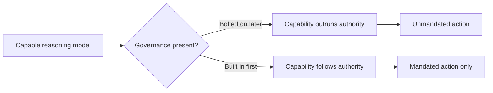

The conventional ordering places capability first and asks permission later, if at all. ZP42 inverts the ordering.

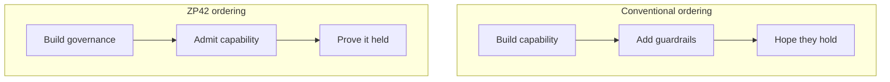

The problem statement in one line: **a cyber-reasoning system that cannot prove its actions were authorised is a liability, however capable.** ZP42 treats auditable authorisation as a first-class deliverable, not documentation written after the fact.

The consequence of getting this wrong is not abstract. In the cyber domain the same technical primitives that support defence — scanning, probing, enumeration, engagement — shade into conduct that is unlawful or out of mandate the moment they touch a system the operator has no authority over. The boundary between a legitimate defensive assessment of an owned asset and an unauthorised reach into someone else's network is not a difference of technique; it is a difference of *authority*. A system that reasons only about technique, and not about authority, will cross that boundary whenever the technique is convenient. ZP42 is built so that authority is checked before technique is ever applied, and so that the check leaves a record. The design does not ask the reasoning layer to be trustworthy; it constrains the reasoning layer with controls that do not depend on its good behaviour.

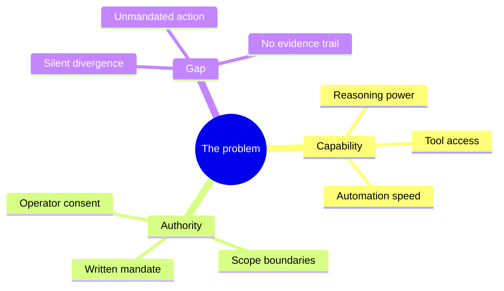

Three forces make the gap worse over time: reasoning models keep improving, tool integrations keep widening the blast radius, and automation keeps shortening the time between decision and effect. Governance that depends on a human noticing in time cannot keep pace. The control has to be structural.

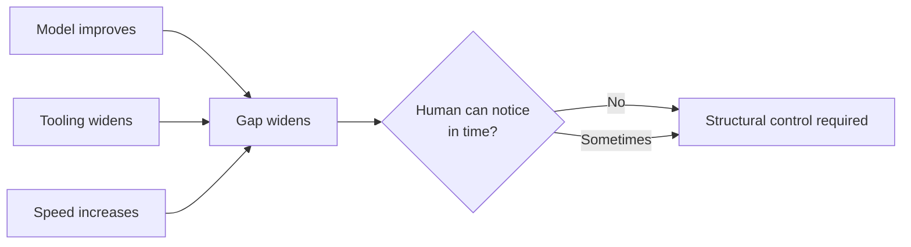

---

## 2. Why Governed Cyber-Reasoning

"Governed" is not a marketing adjective here; it is an architectural commitment. Four properties define what governance means in ZP42, and each maps to an implemented or specified module.

| Property | Meaning | Carrier module | Status |
|---|---|---|---|
| Authorisation | Every operation is bound to an explicit authority reference | `orchestrator/lanes/lane_policy.py` | Implemented (component) |
| Boundedness | Permitted actions are constrained by rules of engagement | `orchestrator/roe/roe_engine.py` | Implemented (component) |
| Human oversight | Sensitive decisions interpose a human | `orchestrator/human_gate/human_gate.py` | Implemented (component) |
| Evidence | Every decision writes an append-only record | `governance/audit_logger.py` | Implemented (component) |

The four properties compose into a single control surface. No property is sufficient alone — authorisation without evidence cannot be proven, boundedness without human oversight cannot handle ambiguity, and oversight without authorisation has nothing to check against.

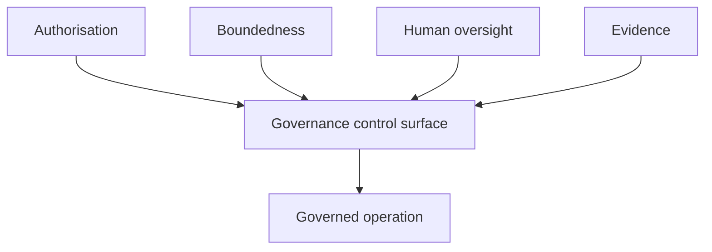

The reason to govern cyber-reasoning specifically — as opposed to any automation — is that the domain carries asymmetric downside. A defensive analysis that is wrong is a bad report; an action that crosses from analysis into unauthorised engagement is a legal and operational incident. Governance is the mechanism that keeps the system on the correct side of that line by construction.

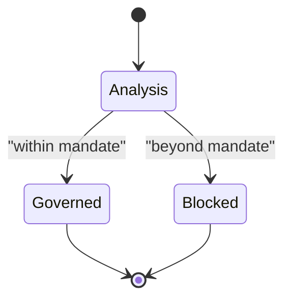

Governance also answers a question operators are increasingly asked by regulators, insurers, and sovereign principals: *show me the authority under which this acted.* A system whose every decision is bound to an authorisation reference and recorded in an append-only log can answer that question directly.

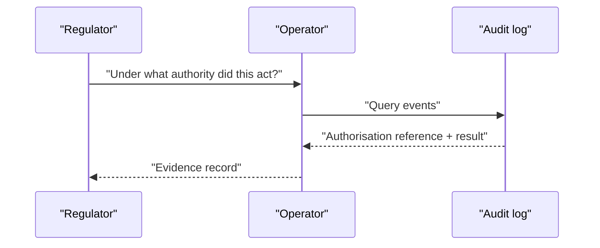

The decision to govern cyber-reasoning also reflects a view about where risk accumulates. In most automation, errors are local and recoverable: a wrong calculation can be recomputed, a bad draft rewritten. In cyber work the errors are frequently *externalising* — they land on third parties, on systems the operator does not own, on evidence that must stand up to later scrutiny. Governance is the mechanism by which those externalities are contained: the lane fixes who authorised the work, the ROE fixes what the work may touch, the human gate fixes who agreed to it, and the audit log fixes what actually happened. Each control narrows the set of possible outcomes to the set the authority actually sanctioned, and each leaves behind the evidence that the narrowing occurred. The combination is what lets an operator say, truthfully and with proof, that the system did only what it was permitted to do.

Governed cyber-reasoning is, finally, a discipline of *refusal*. The most important thing the system does is decline cleanly — fail closed — when authority is absent or unverifiable. A system that defaults to action on uncertainty is ungoverned no matter how many controls surround it. Fail-closed is not merely a default; in ZP42 it is the *first* branch of the lane-assignment logic, taken before any classification of the operation occurs, so that the absence of authority is resolved before the nature of the request is even considered. Refusal is cheap, reversible, and auditable; unmandated action is none of those things.

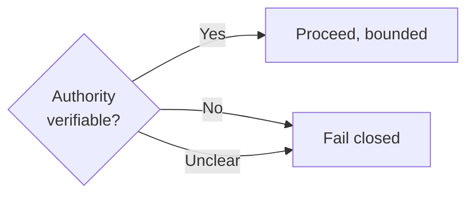

---

## 3. Capability Must Follow Authorisation

This is the organising principle of the whole project. **Capability must follow authorisation** means: the system never exposes a capability that has not first been admitted by a verified authority appropriate to that capability. Authorisation is the cause; capability is the effect. Never the reverse.

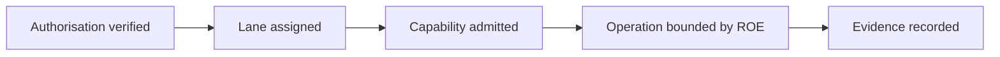

In `lane_policy.py`, this principle is literally the control flow: if no `authorization_reference` is provided, the method logs the denial and raises, failing closed before any capability is considered. Authorisation is checked first, structurally, not as a courtesy.

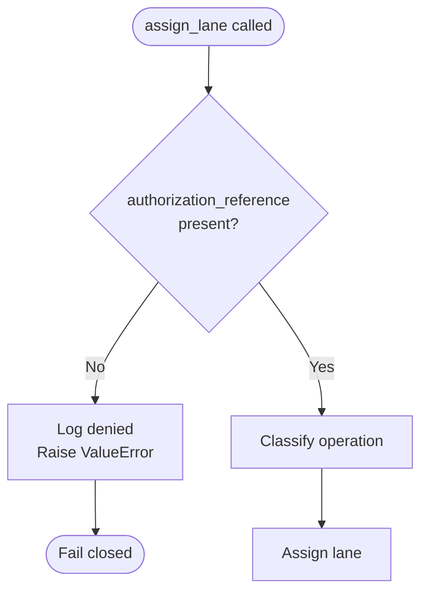

The inverse principle — the anti-pattern ZP42 exists to prevent — is *authorisation follows capability*, where a system acts and the paperwork is reconstructed afterward. ZP42 makes that ordering impossible at the gate.

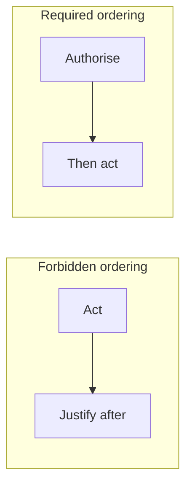

The principle scales with risk. A low-risk defensive task needs only an authorisation reference; a sovereign-authorised task needs a sovereign authority *and* a human sign-off. The weight of the authorisation required rises with the weight of the capability requested.

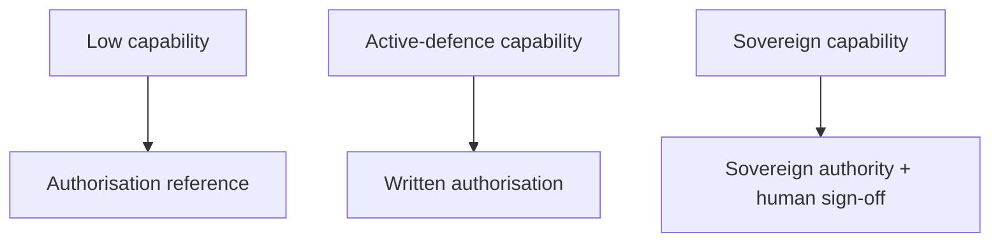

Because authorisation is a *reference* — a pointer to a document or system record, validated by format and, in future, by lookup — the principle is auditable. Every admitted capability can be traced back to the specific authority that admitted it.

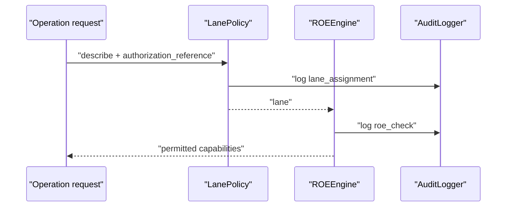

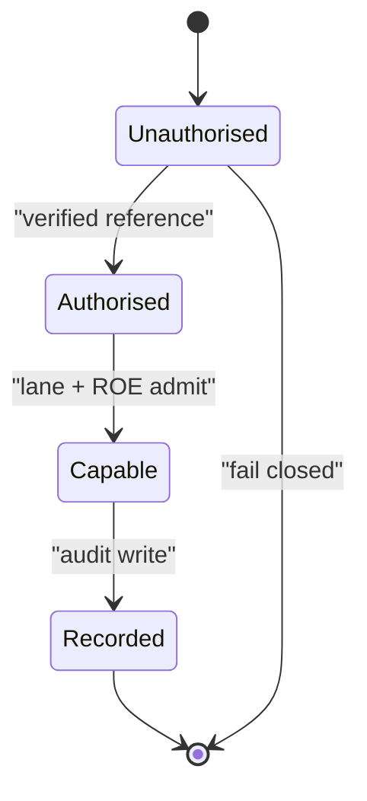

There is a deeper reason the ordering is one-directional. If capability could ever precede authorisation — even briefly, even for a "safe" operation — then the system would contain a code path in which effect occurs without a recorded mandate, and the audit trail would have a hole in it exactly where accountability matters most. One-directional ordering closes that hole by construction: because authorisation is the gate every operation passes through first, there is no reachable state in which an action has occurred that the log cannot explain. The principle is therefore not only an ethical stance but a structural property of the evidence trail. Naquib Hatami's design places the authorisation check at the entry point precisely so that this property holds for the whole system rather than being re-argued for each new capability.

Stated as an invariant the rest of the documentation set depends on: **no capability is reachable except through a verified authorisation, an assigned lane, an ROE check, and an audit record.** This invariant is the specification the orchestrator will be built to satisfy. Where the Foundation-phase code does not yet enforce the full chain in a single path, the invariant stands as the contract that integration work must honour — the later wiring is judged correct precisely to the extent that it makes this invariant hold structurally rather than by convention.

---

## 4. The Lane Model

ZP42 organises authorisation into **lanes**. A lane is a named band of permitted action with its own authorisation requirement. A lane is *entered deliberately*; it is never a default that quietly widens. The implemented `Lane` enum defines `A`, `B`, `C`, and `UNKNOWN`.

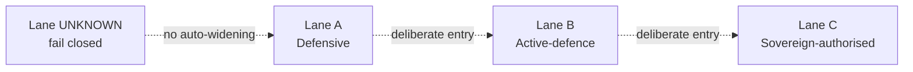

**Lane A — Defensive.** Authorised by the system owner (customer or system-level authorisation reference). This is the home of vulnerability assessment on owned systems, defensive posture analysis, security-configuration review, compliance checking, and threat modelling.

**Lane B — Active-defence.** Requires explicit **written** authorisation. `lane_policy.py` validates the reference format (prefixes such as `AUTH-`, `WRITTEN-AUTH-`, `CONTRACT-`, `SOW-`, minimum length) before admitting the lane. Deception technology, honeypot and honeytoken management, authorised threat hunting, and attribution evidence collection live here.

**Lane C — Sovereign-authorised.** Requires a sovereign authorisation reference **and** human sign-off. The implemented policy fails closed if sovereign authorisation is present but human sign-off is absent — both are mandatory, together.

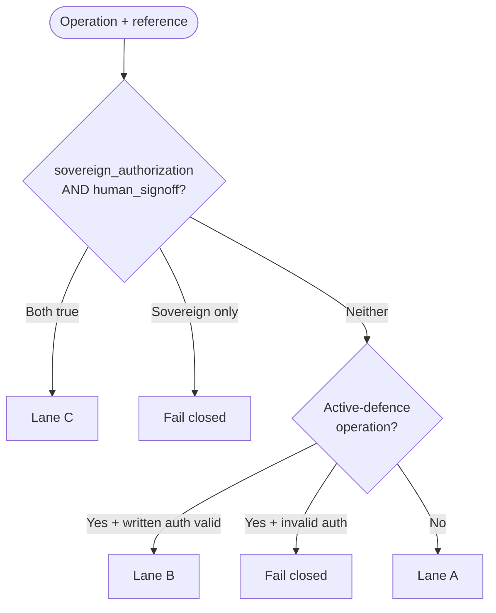

The classifier that distinguishes Lane A from Lane B is, in the Foundation phase, deliberately simple keyword matching (`deception`, `honeypot`, `honeytoken`, `threat_hunting`, `controlled_engagement`, `attribution`). The code itself notes that production should use more sophisticated classification. This is an honest scaffold, not a finished classifier.

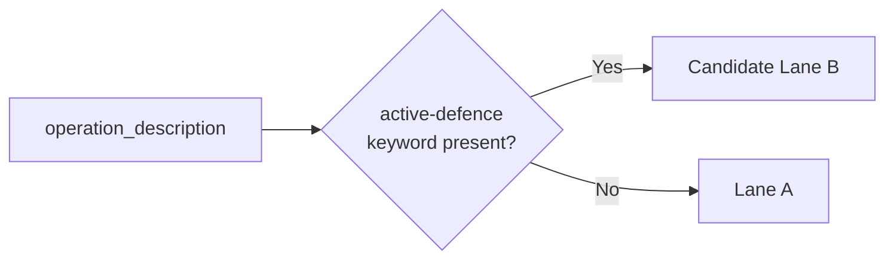

Each lane carries a distinct authorisation requirement and a distinct human-gate posture. The following table reflects the specification in `FOUNDATION.md` and the implemented behaviour in the gate module.

| Lane | Authorisation required | Human gate | Example permitted activity |
|---|---|---|---|
| A | Customer / system reference | Only for sensitive ops | Vulnerability assessment (owned) |
| B | Written authorisation | Every deployment | Honeypot management |
| C | Sovereign + human sign-off | Every operation | Explicitly authorised operation |
| UNKNOWN | — | Fail closed | None |

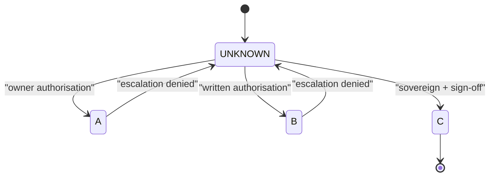

Lane escalation is not a feature in the Foundation phase — it is a denied event. `validate_escalation_attempt` returns `True` only when the current and requested lanes are identical; any genuine escalation is logged as an escalation attempt and raises an `ROEViolation`. Widening requires a fresh, deliberate authorisation, not an in-flight upgrade.

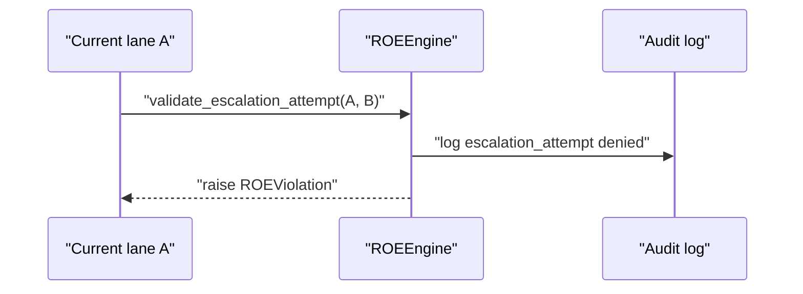

Two design choices in the lane model deserve emphasis. First, `UNKNOWN` is a real lane, not merely the absence of a lane. Treating "unclassified" as a first-class state with its own fail-closed semantics means the system never has to improvise when it cannot determine authority — there is a defined, safe destination for uncertainty. Second, the authorisation requirements are *cumulative in weight but not in reach*: Lane C is the most heavily gated, but it is not a superset that silently inherits Lane A's and Lane B's permissions. Each lane is entered on its own terms, and the global prohibition floor (Section 5) applies beneath all of them, so that even the most authorised lane cannot reach a globally forbidden capability. This prevents the common escalation trap in which the highest privilege level quietly accumulates every lower-level permission plus its own.

The lane model is the concrete expression of the capability-follows-authorisation principle: the lane names the band of capability, and the authorisation requirement for that lane names the price of entry. Because the price rises with the band, an operator cannot obtain active-defence capability on the strength of a defensive authorisation, nor sovereign capability on the strength of a written one. The authority produced must match the capability requested, exactly, or the request fails closed.

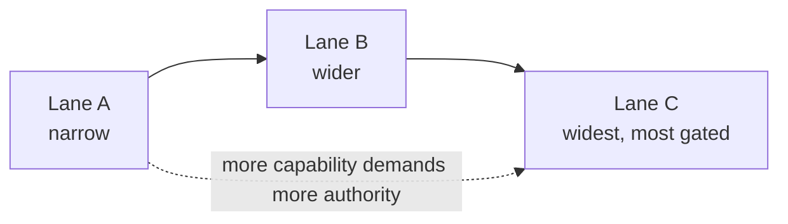

---

## 5. Governance Architecture (As Specified)

This section describes the architecture **as specified**. Where a component is implemented as an independent, tested unit, it is marked *implemented*; where it is a defined-but-not-yet-wired stage, it is marked *specified*. ZP42 does not claim a running end-to-end pipeline.

```mermaid
flowchart TB
    subgraph core["core/"]
        EVAL["eval/run_controlled_eval.py"]
        SNAP["snapshot/capture_manifest.py"]
        MODELS["models/"]
    end
    subgraph orch["orchestrator/"]
        LANE["lanes/lane_policy.py"]
        ROE["roe/roe_engine.py"]
        GATE["human_gate/human_gate.py"]
    end
    VER["verifiers/ (defined stage)"]
    subgraph gov["governance/"]
        AUD["audit_logger.py"]
        SCH["audit_schema.json"]
    end
    subgraph comp["compliance/"]
        ALLOW["model_allowlist.json"]
        LIC["license_manifest.json"]
    end
    SCAN["scripts/scan_prohibited_terms.py"]
    orch --> gov
    core --> gov
```

The **intended** request path wires lane assignment to ROE checking to the human gate to verification to the audit record. This is the specified orchestration. The orchestrator package that would wire these together (`orchestrator/__init__.py`) is presently an empty scaffold.

```mermaid
flowchart LR
    REQ(["Operation request"]) --> L["Lane assignment"]
    L --> R["ROE check"]
    R --> H["Human gate"]
    H --> V["Verify output"]
    V --> AU["Audit record"]
    AU --> DONE(["Result"])
```

```mermaid
sequenceDiagram
    participant Req as "Request"
    participant LP as "LanePolicy (impl)"
    participant RE as "ROEEngine (impl)"
    participant HG as "HumanGate (impl)"
    participant Vf as "Verifiers (specified)"
    participant AL as "AuditLogger (impl)"
    Req->>LP: "assign_lane"
    LP->>AL: "log"
    LP->>RE: "check_roe"
    RE->>AL: "log"
    RE->>HG: "requires_human_approval?"
    HG->>AL: "log"
    HG->>Vf: "verify (specified)"
    Vf->>AL: "log"
```

The **ROE engine** holds a set of globally prohibited capabilities enforced in *every* lane — including the most permissive one. This set is the floor beneath all lanes: malware creation and deployment, credential theft and harvesting, DDoS generation, unauthorised data exfiltration, persistence installation, evasion techniques, destructive payloads, autonomous retaliation, hack-back, and unauthorised third-party targeting are refused regardless of authorisation.

```mermaid
flowchart TB
    CAP["Capability requested"] --> GP{"Globally prohibited?"}
    GP -->|"Yes"| DENY["Raise ROEViolation<br/>log denied"]
    GP -->|"No"| LANECHK["Lane-specific check"]
    LANECHK --> OK["Permit"]
```

```mermaid
flowchart LR
    subgraph Floor["Global prohibitions (all lanes)"]
        p1["malware_*"]
        p2["credential_theft"]
        p3["ddos_generation"]
        p4["hack_back"]
        p5["autonomous_retaliation"]
    end
    Floor -. "never admitted" .-> C["Even Lane C"]
```

The **human gate** tracks approval requests through a small state machine. In the Foundation phase approvals are held in memory; the code notes that production requires persistent storage. Each request, approval, and denial is logged.

```mermaid
stateDiagram-v2
    [*] --> PENDING: "request_approval"
    PENDING --> APPROVED: "approve_operation"
    PENDING --> DENIED: "deny_operation"
    PENDING --> EXPIRED: "timeout (specified)"
    APPROVED --> [*]
    DENIED --> [*]
    EXPIRED --> [*]
```

```mermaid
sequenceDiagram
    participant Sys as "Requestor"
    participant HG as "HumanGate"
    participant Hum as "Human approver"
    participant AL as "Audit log"
    Sys->>HG: "request_approval"
    HG->>AL: "log pending"
    Hum->>HG: "approve_operation"
    HG->>AL: "log approval"
    HG-->>Sys: "approved"
```

The **audit logger** writes append-only JSONL conforming to `audit_schema.json`. It validates operation type, lane, actor type, and result against fixed enums before writing. It is honest about its limits: the log is plain JSONL and is **not** cryptographically signed. Tamper-evident signing is specified for a later phase, not claimed now.

```mermaid
flowchart TB
    EV["log_event call"] --> VAL{"enums valid?"}
    VAL -->|"No"| ERR["Raise ValueError"]
    VAL -->|"Yes"| BUILD["Build event<br/>timestamp + event_id"]
    BUILD --> APP["Append line to JSONL"]
    APP --> RET["Return event_id"]
```

```mermaid
erDiagram
    AUDIT_EVENT {
        string timestamp
        string event_id
        string operation_type
        string lane
        string result
        bool escalation_attempt
    }
    ACTOR {
        string type
        string identifier
    }
    AUDIT_EVENT ||--|| ACTOR : "records"
```

The **compliance** layer declares a model allowlist and a licence manifest as machine-readable documents. In the Foundation phase these are *declarations*, not code-enforced gates — the manifests exist and are authoritative as policy, but automatic enforcement in the request path is specified for later.

```mermaid
flowchart LR
    ALLOW["model_allowlist.json<br/>(declared)"] -.->|"future enforcement"| GATE["Request path"]
    LIC["license_manifest.json<br/>(declared)"] -.->|"future enforcement"| GATE
```

The **controlled-evaluation** framework loads benchmark tasks and validates their safety structurally; it refuses to run inference. `run_evaluation` raises `NotImplementedError` for anything other than a dry run — inference is explicitly out of scope for the Foundation phase.

```mermaid
flowchart TB
    LB["load_benchmark"] --> VT["validate_task_safety"]
    VT --> DR{"dry_run?"}
    DR -->|"True"| OKR["Validate structure only"]
    DR -->|"False"| NI["Raise NotImplementedError"]
```

The **snapshot** tooling hashes local files into manifests for reproducibility and verification; model manifest capture is a stub that does not download anything. The **prohibited-terms scanner** runs at the boundary to keep public positioning clean, flagging disallowed internal names, third-party model names, PRC-origin model names, and reckless public terms.

```mermaid
flowchart LR
    FILES["Repo files"] --> SCAN["scan_prohibited_terms.py"]
    SCAN --> V{"violations?"}
    V -->|"Yes"| FAIL["Exit 1<br/>report"]
    V -->|"No"| PASS["Exit 0"]
```

```mermaid
mindmap
  root(("Architecture"))
    Implemented
      Lane policy
      ROE engine
      Human gate
      Audit logger
      Prohibited-terms scanner
    Specified
      Wired orchestrator
      Output verifier
      Signed audit log
      Enforced compliance
```

---

## 6. Honest Status — Implemented vs Specified

Overstating maturity would violate the project's own governance ethic. The Foundation release is a **foundation-phase scaffold**. The governance modules exist and are tested as **independent** components; the system is not a wired, end-to-end automation.

| Element | State | Note |
|---|---|---|
| `lane_policy` | Implemented, tested | Keyword classifier is deliberately simple |
| `roe_engine` | Implemented (not yet unit-tested) | Global prohibitions enforced |
| `human_gate` | Implemented (not yet unit-tested) | In-memory approvals only |
| `audit_logger` | Implemented, tested | Plain JSONL, **not** signed |
| `scan_prohibited_terms` | Implemented, tested | Boundary scanner |
| Orchestrator wiring | **Scaffold** | `orchestrator/__init__.py` empty |
| `verifiers/` | **Specified stage** | No completed output verifier |
| Compliance enforcement | **Declared** | Manifests exist, not code-enforced |
| Inference / offensive / live targeting | **Out of scope** | Foundation phase |

```mermaid
flowchart LR
    subgraph Now["Implemented (components)"]
        n1["Lane policy"]
        n2["ROE engine"]
        n3["Human gate"]
        n4["Audit logger"]
        n5["Terms scanner"]
    end
    subgraph Later["Specified (not yet wired)"]
        l1["Orchestrator pipeline"]
        l2["Output verifier"]
        l3["Signed audit"]
        l4["Enforced compliance"]
    end
    Now -.->|"future integration"| Later
```

The distinction matters for anyone evaluating ZP42: the control *logic* exists and is unit-tested, but the *composition* of those controls into a single enforced path is future work. The documentation set describes the target architecture so that the wiring, when built, has a precise specification to satisfy.

```mermaid
stateDiagram-v2
    [*] --> ComponentsTested
    ComponentsTested --> Wired: "future PR"
    Wired --> Verified: "future PR"
    Verified --> Signed: "future PR"
    Signed --> Enforced: "future PR"
    Enforced --> [*]
```

What is explicitly *not* present and *not* claimed: no model inference, no exploit or offensive execution, no live targeting of any system, no cryptographic signing of the audit log, and no automatic compliance enforcement in the request path. These are stated plainly so that the honest scaffold is never mistaken for a finished platform.

```mermaid
flowchart TB
    OUT["Out of scope now"] --> o1["Inference execution"]
    OUT --> o2["Offensive / exploit execution"]
    OUT --> o3["Live third-party targeting"]
    OUT --> o4["Signed audit log"]
    OUT --> o5["Enforced compliance gates"]
```

---

## 7. Scope

ZP42's in-scope purpose is governed cyber-*reasoning* for defensive, active-defence, and sovereign-authorised workflows — the reasoning and the governance that bounds it, not the execution of effects against live third-party systems.

```mermaid
flowchart TB
    subgraph InScope["In scope"]
        i1["Governance controls"]
        i2["Lane authorisation"]
        i3["ROE enforcement"]
        i4["Human gates"]
        i5["Audit evidence"]
        i6["Controlled evaluation (dry-run)"]
        i7["Compliance declarations"]
    end
```

The Foundation phase scope is tighter still: establish the safe scaffold, the governance and audit framework, lane authorisation, the ROE engine, human gates, the model allowlist and PRC-origin exclusion policy, the controlled-evaluation skeleton, and prohibited-term scanning.

```mermaid
flowchart LR
    F1["Safe scaffold"] --> F2["Governance + audit"]
    F2 --> F3["Lane authorisation"]
    F3 --> F4["ROE engine"]
    F4 --> F5["Human gates"]
    F5 --> F6["Allowlist + exclusion policy"]
    F6 --> F7["Eval skeleton"]
    F7 --> F8["Terms scanning"]
```

Scope grows across phases, deliberately and with authorisation at each step — never by default widening. The roadmap below (Section 10) lays out the phased expansion.

```mermaid
timeline
    title ZP42 phased scope
    Foundation : Scaffold + governance + audit
    Phase 2 : Model evaluation infrastructure
    Phase 3 : Defensive reasoning capabilities
    Phase 4 : Active-defence workflows (authorised)
    Phase 5 : Sovereign-authorised workflows (human-gated)
```

The model policy bounds scope too: ZP42 references only approved models — AI2 OLMo 3 32B Base, AI2 OLMo 3 32B Think, and IBM Granite 4.1 30B Base — and excludes PRC-origin models, outputs, embeddings, labels, checkpoints, synthetic data, and derivatives. In the Foundation phase these references are documentation-only; no weights are downloaded and no inference runs.

```mermaid
flowchart TB
    APPR["Approved models"] --> m1["OLMo 3 32B Base"]
    APPR --> m2["OLMo 3 32B Think"]
    APPR --> m3["Granite 4.1 30B Base"]
    APPR -. "Foundation: reference only" .-> NOTE["No downloads, no inference"]
```

---

## 8. Non-Goals

Stating non-goals is as important as stating scope. ZP42 is **not** an offensive tool, not a hack-back platform, and not an autonomous actor. These are not deferred features — they are permanent prohibitions, enforced as a floor beneath every lane.

```mermaid
flowchart TB
    NG["Non-goals (permanent)"] --> g1["No offensive operations"]
    NG --> g2["No hack-back / retaliation"]
    NG --> g3["No autonomous destructive action"]
    NG --> g4["No unauthorised access"]
    NG --> g5["No credential theft"]
    NG --> g6["No malware creation"]
```

ZP42 does not perform unauthorised access, exploitation, hack-back, or retaliation. The repository's prohibited-terms scanner actively guards the public positioning against these very concepts, flagging terms such as "hack-back", "retaliation", "punishment", and "revenge" so they cannot leak into the project's language.

```mermaid
flowchart LR
    TERMS["Reckless terms"] --> SCAN["Prohibited-terms scanner"]
    SCAN --> BLOCK["Flagged, must be removed"]
```

ZP42 is also not a system that decides for itself. Autonomous decision-making for destructive actions is prohibited even in the most permissive lane; Lane C requires human approval for *every* operation. The human is not an optional reviewer — in the sensitive lanes the human is a required part of the control path.

```mermaid
stateDiagram-v2
    [*] --> Proposed
    Proposed --> HumanReview: "sensitive lane"
    HumanReview --> Approved: "human says yes"
    HumanReview --> Rejected: "human says no"
    Approved --> [*]
    Rejected --> [*]
```

Finally, ZP42 is not claiming to be something it has not yet built. It is not a signed-audit platform, not an enforced-compliance engine, and not a wired pipeline — see Section 6. Describing the architecture honestly is itself a non-goal boundary: no false superlatives, no invented benchmarks, adopters, metrics, or capabilities.

```mermaid
flowchart TB
    HONEST["Honesty boundary"] --> h1["No invented adopters"]
    HONEST --> h2["No invented benchmarks"]
    HONEST --> h3["No claimed signing"]
    HONEST --> h4["No claimed enforcement"]
    HONEST --> h5["No false superlatives"]
```

---

## 9. Authority, Operators, and Sovereign Workflows

ZP42 distinguishes several actors, each with a defined role in the authorisation structure. The owner authorises defensive work; a written authority authorises active-defence work; a sovereign authority plus a human approver authorise sovereign work.

```mermaid
flowchart LR
    OWNER["System owner"] -->|"Lane A"| SYS["ZP42"]
    WRIT["Written authority"] -->|"Lane B"| SYS
    SOV["Sovereign authority"] -->|"Lane C"| SYS
    HUM["Human approver"] -->|"sign-off"| SYS
```

The actor model maps onto the audit schema's `actor` object, which records an actor `type` (`system`, `human`, or `api`) and an `identifier`. Every logged decision names who — or what — acted, so the evidence trail attributes each action to a responsible party.

```mermaid
classDiagram
    class Actor {
        +type: system|human|api
        +identifier: string
    }
    class AuditEvent {
        +timestamp
        +event_id
        +operation_type
        +lane
        +result
    }
    AuditEvent --> Actor : records
```

Sovereign-authorised workflows (Lane C) are the most tightly bound. They require both a sovereign authorisation reference and a human sign-off, and the human gate requires approval for *every* operation in the lane. Autonomous escalation into or within Lane C is denied.

```mermaid
sequenceDiagram
    participant Sov as "Sovereign authority"
    participant LP as "LanePolicy"
    participant HG as "HumanGate"
    participant Hum as "Human command"
    Sov->>LP: "sovereign reference + sign-off"
    LP-->>HG: "Lane C"
    HG->>Hum: "request approval (every op)"
    Hum-->>HG: "approve / deny"
```

The separation of actor types also supports a non-repudiation goal. When a human approver signs off on a Lane C operation, the audit record names that human as the `human` actor on the approval event, distinct from the `system` actor that requested it. The request and the approval are therefore two separate, separately attributed records, which means the evidence trail distinguishes *who proposed* an action from *who authorised* it. This separation is what allows an after-the-fact reviewer to reconstruct not just that an operation happened, but the chain of human and system decisions that admitted it — a property that matters especially in sovereign contexts where accountability must attach to a named command authority.

The design intent, carried forward from the project's closure notes, is that governance is built in from day one, authorisation is explicit and verifiable, autonomous escalation is prohibited, and human oversight is non-negotiable for sensitive operations. These were not retrofitted lessons; they are stated as the architectural decisions carried into ZP42 from the outset, and the implemented components reflect them even in the Foundation-phase scaffold.

```mermaid
mindmap
  root(("Design intent"))
    Built-in governance
    Explicit authorisation
    Verifiable references
    No autonomous escalation
    Human oversight
```

---

## 10. Roadmap and Phase Boundaries

The roadmap is a sequence of deliberate scope expansions, each gated by authorisation. The Foundation phase delivers the governance scaffold; later phases admit capability only after the governance to bound it is in place.

```mermaid
flowchart LR
    P1["Foundation<br/>governance scaffold"] --> P2["Phase 2<br/>eval infrastructure"]
    P2 --> P3["Phase 3<br/>defensive reasoning"]
    P3 --> P4["Phase 4<br/>active-defence (authorised)"]
    P4 --> P5["Phase 5<br/>sovereign (human-gated)"]
```

Each phase transition is itself subject to the capability-follows-authorisation principle: new capability is admitted only once the lane, ROE, gate, and audit coverage for it exist. The transitions are gates, not slopes.

```mermaid
stateDiagram-v2
    [*] --> Foundation
    Foundation --> Phase2: "eval infra ready"
    Phase2 --> Phase3: "defensive reasoning bounded"
    Phase3 --> Phase4: "active-defence authorised"
    Phase4 --> Phase5: "sovereign + human gates"
    Phase5 --> [*]
```

The near-term engineering priorities implied by Section 6 are clear: wire the orchestrator so lane assignment, ROE, human gate, verification, and audit compose into one enforced path; complete the output verifier stage; add tamper-evident signing to the audit log; and move compliance from declared manifests to enforced checks.

```mermaid
flowchart TB
    W1["Wire orchestrator pipeline"] --> W2["Complete output verifier"]
    W2 --> W3["Sign audit log"]
    W3 --> W4["Enforce compliance manifests"]
```

```mermaid
gantt
    title ZP42 governance maturation (indicative order)
    dateFormat YYYY-MM-DD
    section Wiring
    Orchestrator pipeline      :a1, 2026-06-01, 30d
    section Verification
    Output verifier            :a2, after a1, 30d
    section Evidence
    Signed audit log           :a3, after a2, 30d
    section Compliance
    Enforced manifests         :a4, after a3, 30d
```

Nothing in the roadmap promises offensive capability. Offensive execution, exploit code, and live targeting remain out of scope; the later phases expand *governed* reasoning and *authorised* active-defence, always behind the gate.

```mermaid
flowchart LR
    ROAD["Roadmap"] --> GOV["Expands governed reasoning"]
    ROAD --> ADF["Expands authorised active-defence"]
    ROAD -.->|"never"| OFF["Offensive execution"]
```

---

## 11. Risks and How the Design Answers Them

The governance design exists to answer specific, named risks. The table pairs each risk with the control that addresses it.

| Risk | Control | Module |
|---|---|---|
| Action beyond mandate | Fail-closed lane assignment | `lane_policy.py` |
| Prohibited capability | Global ROE floor | `roe_engine.py` |
| Silent escalation | Escalation denied + logged | `roe_engine.py` |
| Unreviewed sensitive action | Human gate | `human_gate.py` |
| No evidence trail | Append-only audit log | `audit_logger.py` |
| Unapproved model | Allowlist + exclusion policy | `model_allowlist.json` |
| Reckless public positioning | Prohibited-terms scanner | `scan_prohibited_terms.py` |

```mermaid
flowchart TB
    R1["Beyond mandate"] --> C1["Fail closed"]
    R2["Prohibited capability"] --> C2["ROE floor"]
    R3["Silent escalation"] --> C3["Deny + log"]
    R4["Unreviewed action"] --> C4["Human gate"]
    R5["No evidence"] --> C5["Audit log"]
```

The residual risk the project is honest about is the composition gap: individually tested controls are not yet a single enforced path. Until the orchestrator is wired, the controls depend on correct manual invocation rather than structural enforcement — which is precisely why Section 6 states the status plainly.

```mermaid
flowchart LR
    COMP["Composition gap"] --> MIT["Documented status + roadmap"]
    MIT --> GOAL["Enforced pipeline (future)"]
```

```mermaid
quadrantChart
    title Control maturity vs enforcement
    x-axis "Low enforcement" --> "High enforcement"
    y-axis "Component" --> "Composed"
    quadrant-1 "Target state"
    quadrant-2 "Needs wiring"
    quadrant-3 "Early"
    quadrant-4 "Partial"
    "Lane policy": [0.35, 0.3]
    "ROE engine": [0.35, 0.3]
    "Human gate": [0.3, 0.3]
    "Audit log": [0.3, 0.35]
    "Wired pipeline": [0.8, 0.85]
```

A further residual risk is model-policy drift: because the allowlist and licence manifest are *declared* rather than code-enforced in the Foundation phase, the discipline of only referencing approved, non-PRC-origin models currently rests on review and the prohibited-terms scanner rather than on a runtime gate. The mitigation today is that the Foundation phase downloads no weights and runs no inference at all, so there is no live model surface to misuse; the manifests therefore govern documentation and intent, and enforcement in the request path is scheduled for the phase that first introduces evaluation infrastructure. This sequencing is deliberate: the enforcement gate is built before the capability it must gate arrives, not after.

The honest-status discipline is itself a risk control: a system that misrepresents its maturity invites misuse. By distinguishing implemented from specified at every turn, ZP42 keeps operators' expectations aligned with what the code actually does. An operator who believes a pipeline is wired when it is not may skip the manual invocation the controls currently depend on; an operator who knows the true state invokes the controls deliberately. Honesty about maturity is, in this sense, part of the control surface rather than a disclaimer attached to it.

```mermaid
pie title "Foundation-phase control state"
    "Implemented components" : 5
    "Specified / not wired" : 4
```

---

## 12. Summary

ZP42 (Zeroth Protocol 42), invented by Naquib Hatami and released openly under the MIT License, is a governance-first cyber-reasoning system whose organising principle is that **capability must follow authorisation**. It expresses that principle through a deliberate lane model, a fail-closed authorisation policy, a rules-of-engagement engine with a global prohibition floor, human gates for sensitive operations, and an append-only audit trail.

```mermaid
flowchart LR
    PRIN["Capability follows authorisation"] --> LANE["Lane model"]
    LANE --> ROE["ROE floor"]
    ROE --> GATE["Human gate"]
    GATE --> AUDIT["Audit evidence"]
    AUDIT --> TRUST["Provable governance"]
```

The Foundation release is an honest scaffold: the governance modules are implemented and tested as independent components, while the wired orchestrator, output verifier, signed audit log, and enforced compliance are specified for later phases. Inference, offensive execution, and live targeting are out of scope — by design, not by omission.

```mermaid
flowchart TB
    VISION["ZP42 vision"] --> A["Govern first"]
    VISION --> B["Admit capability deliberately"]
    VISION --> C["Prove every action authorised"]
    VISION --> D["Stay honest about maturity"]
```

The remainder of the documentation set builds on the invariant stated here: no capability is reachable except through a verified authorisation, an assigned lane, an ROE check, and an audit record.

```mermaid
stateDiagram-v2
    [*] --> Authorise
    Authorise --> Bound
    Bound --> Gate
    Gate --> Verify
    Verify --> Record
    Record --> [*]
```

---

## Related Documents

- [`03-architecture.md`](03-architecture.md) — Component architecture and the specified orchestration path.
- [`08-governance-audit.md`](08-governance-audit.md) — Lanes, ROE, human gates, and audit in depth.
- [`10-threat-model.md`](10-threat-model.md) — Risks, trust boundaries, and fail-closed behaviour.
- [`FOUNDATION.md`](FOUNDATION.md) — Foundation-phase charter, model policy, and safety boundaries.
- [`../README.md`](../README.md) — Project overview and repository layout.
- [`../LICENSE`](../LICENSE) — MIT License (Naquib Hatami).
