> Part of the ZP42 documentation set.

# ZP42 Technical Whitepaper: Governance-First Cyber Reasoning

## Abstract

ZP42 (Zeroth Protocol 42) is an open, MIT-licensed, governance-first cyber-reasoning system for defensive, active-defence, and sovereign-authorised workflows. Invented and authored by Naquib Hatami and published by SADI AI Inc. / iQs Group Inc., ZP42 inverts the usual order of construction: instead of building capability and later attempting to constrain it, ZP42 builds the constraint fabric first and admits capability only through it. This whitepaper describes the architecture as specified, distinguishes rigorously between what is implemented today and what is specified for later phases, and makes the case for the trust the design is meant to earn. The present release is a Foundation-phase scaffold: the governance components — lane policy, rules-of-engagement engine, human gate, audit logger, and prohibited-terms scanner — exist and are tested as independent units, while the end-to-end orchestrator that would wire them into a single pipeline is not yet implemented. We are explicit about that boundary throughout, because an honest account of what a governance system does *not* yet do is itself a governance property.

---

## 1. Introduction

### 1.1 The problem ZP42 addresses

Cyber-reasoning systems — software that reasons over security problems and can act on the results — concentrate two risks that are rarely co-located: the capability to touch real systems, and the autonomy to decide when to do so. Most tooling in this space treats authorisation as an operational wrapper applied after the fact. ZP42 takes the opposite stance: authorisation is the substrate, and reasoning capability is a tenant that must satisfy the substrate before it runs.

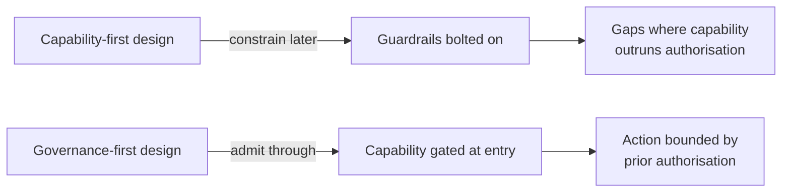

ZP42's public positioning is deliberately narrow: defensive cyber reasoning, active-defence workflows, and sovereign-authorised operations. The system's whole point is that capability is gated by authorisation; it is not a tool for offensive action, exploitation, unauthorised access, or retaliation, and it is not designed to describe how such actions are performed.

The distinction matters because the industry's default failure mode is predictable. A capability is engineered because it is interesting or valuable, demonstrated because it works, and only then wrapped in policy because someone asks who approved it. By that point the capability has its own momentum: the policy must argue against something that already exists and already produces results. ZP42 refuses to create that momentum. Nothing in the Foundation release can reason over a live target, because the reasoning core is deliberately deferred until the governance fabric that would admit it is complete and composed. The constraint is not a brake fitted to a moving vehicle; it is the chassis the vehicle is built onto.

This ordering has a cost, and the whitepaper does not hide it: ZP42 today is less a working cyber-reasoning product than a working account of how one should be governed. The components that decide *whether* an operation may proceed exist and pass their tests; the component that would *carry out* a permitted operation does not. For a system whose central claim is restraint, shipping the restraint first and the capability later is the honest sequence, and it is the sequence the authoritative repository reflects.

### 1.2 Design thesis

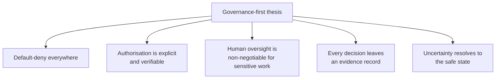

Each clause maps to a concrete module, described in the sections that follow. The thesis is traceable to code, not aspiration — with the caveat, stated once and meant throughout, that the modules are presently independent and not yet composed into a single runtime pipeline.

The five clauses are not independent preferences; they reinforce one another. Default-deny is only meaningful if the conditions that lift the denial are explicit and verifiable, because a vague condition is a default-allow in disguise. Explicit authorisation is only meaningful if a human stands behind it at the points where the stakes justify a person's judgement rather than a rule's. Human review is only auditable if every decision — the human's included — leaves a record. And the record is only credible if the claims made about the system match what the system does. Remove any one clause and the others lose their force: an unlogged human approval cannot be reviewed, a logged decision from an opaque policy cannot be understood, and a verifiable policy attached to an overstated capability claim misleads precisely the auditor it was meant to serve. ZP42 treats the five as a single property expressed five ways.

### 1.3 Identity

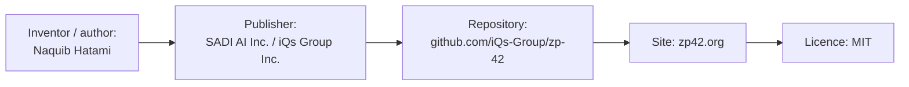

---

## 2. Trust as an Engineering Target

### 2.1 What "trust" means here

Trust, in ZP42, is not a sentiment; it is a set of properties an auditor can check. A system is trustworthy to the degree that an outside party, given its logs and its policy definitions, can reconstruct *why* each action was or was not permitted.

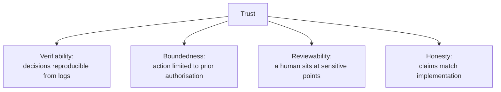

### 2.2 The honesty property

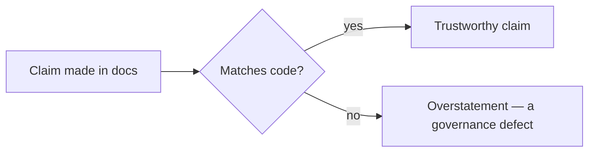

This whitepaper treats an overstated capability as a defect of the same kind as a missing control. Accordingly, Section 11 presents an implementation-status matrix that an auditor can hold against the repository.

The reasoning is not rhetorical. In a governance system, the documentation is part of the control surface: operators decide what to attempt based on what the system claims it will catch. If the documentation says the audit log is tamper-evident when it is plain JSONL, an operator may rely on a property that is not there, and that reliance is the vulnerability. An honest understatement is safe — it causes the operator to add their own controls — while a confident overstatement is dangerous, because it removes a control the operator would otherwise supply. ZP42 therefore errs, deliberately, toward describing less than it hopes to deliver and exactly what it does deliver.

### 2.3 Trust boundaries

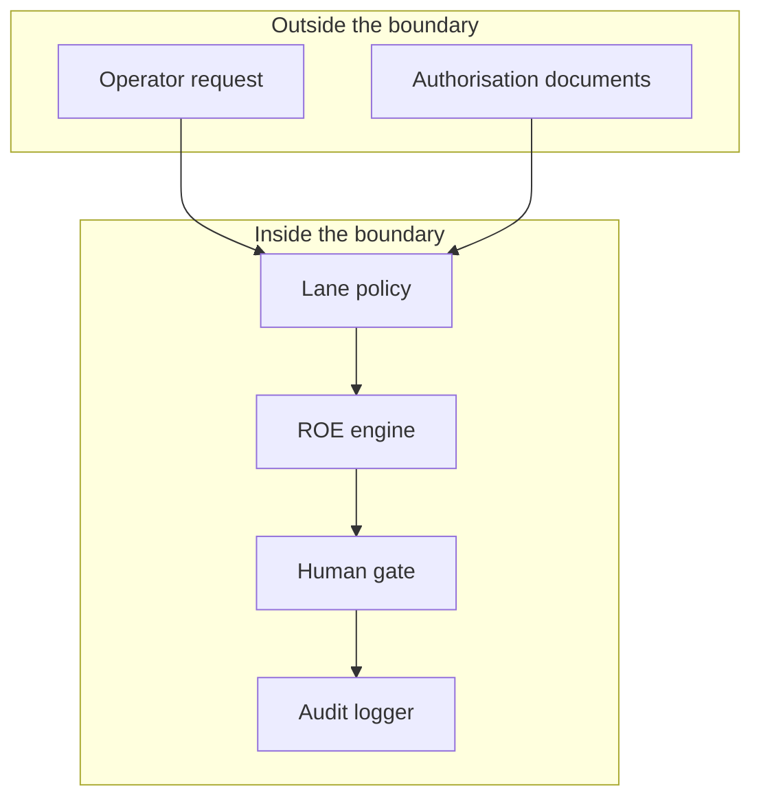

---

## 3. System Architecture (As Specified)

### 3.1 Module map

The repository is organised so that each governance concern lives in one place.

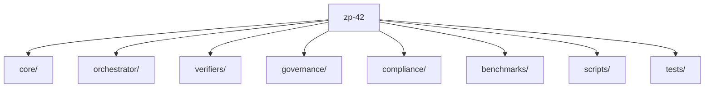

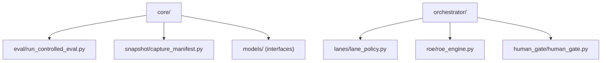

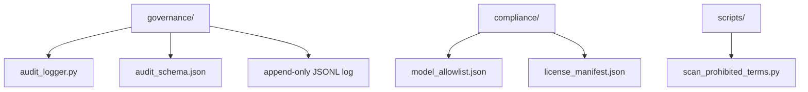

### 3.2 Specified control flow

As specified, a request would pass through lane assignment, ROE evaluation, the human gate, output verification, and the audit log. The diagram below is the *intended* composition.

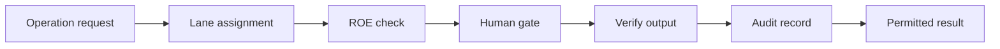

### 3.3 Implemented versus specified

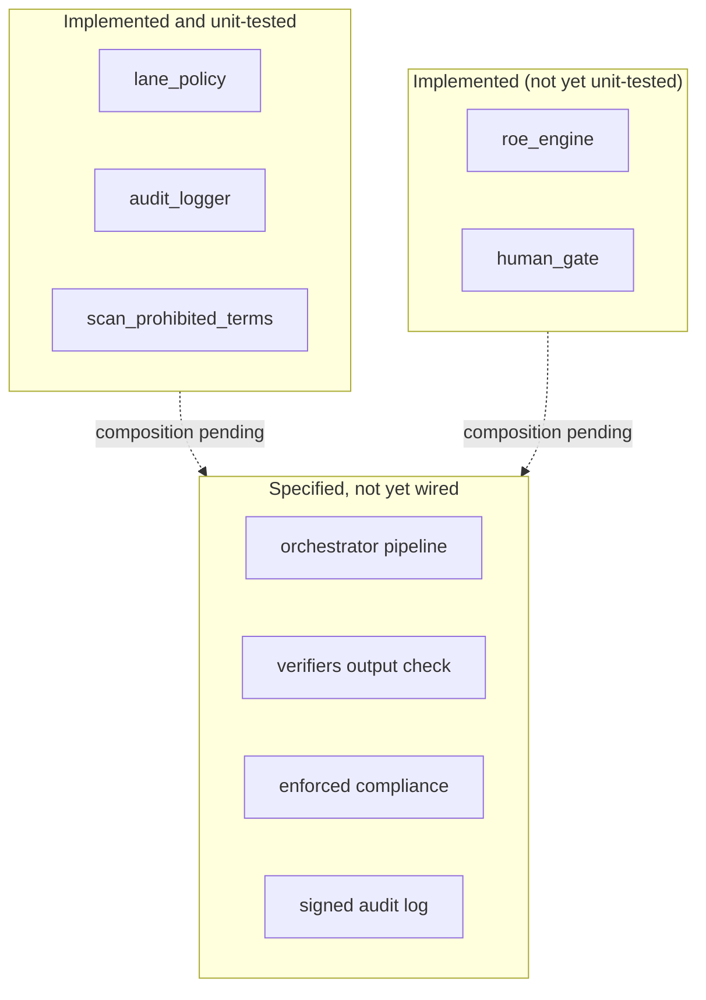

The `orchestrator/__init__.py` module is an empty scaffold. The arrows in Section 3.2 describe the target wiring, not a running path. This distinction is load-bearing for every trust claim in this document.

It is worth being precise about what "not yet wired" does and does not mean. It does not mean the governance logic is absent or untested: each module can be exercised directly, and the test suite does exactly that, driving `assign_lane`, `check_roe`, the human-gate lifecycle, the audit logger's validation, and the prohibited-terms scanner against known inputs. What is absent is the connective tissue — the code that would take a single operation request, carry it through lane assignment into an ROE check, pause it at the human gate when policy demands, pass the approved result through the verifiers stage, and ensure that each hop writes its own audit event. Building that tissue is not a matter of adding logic the modules lack; it is a matter of composing logic they already have, under an orchestrator that enforces the order and refuses to let a step be skipped. Until that composition exists and is itself tested, ZP42 claims the pipeline only as a specification.

---

## 4. The Lane Model

### 4.1 Three lanes, entered deliberately

A lane is a declared operating posture, not a default that quietly widens. Each lane raises the authorisation bar. The lane concept is the single most important design decision in ZP42, because it converts a continuous and contestable question — "is this action acceptable?" — into a discrete and checkable one — "which lane are we in, and does this action belong there?" A continuous judgement invites argument at the margin; a discrete lane assignment, recorded in the audit log with the authorisation reference that justified it, leaves nothing to argue about after the fact. The lesson, carried forward from earlier zone-based work, is that governance must be built in from day one rather than bolted on, and that the cleanest way to build it in is to make the operating posture an explicit, logged choice.

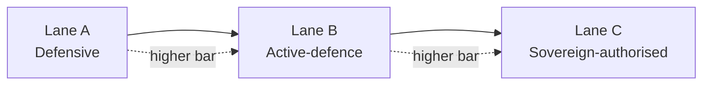

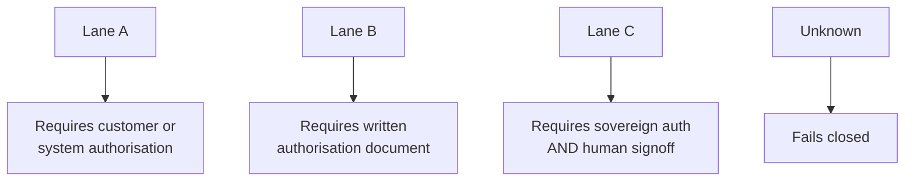

### 4.2 Lane A — defensive

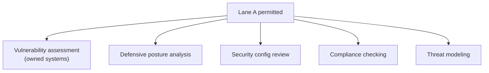

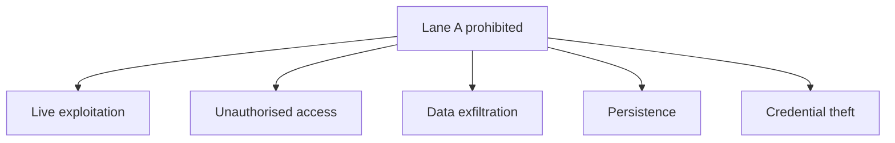

### 4.3 Lane B — active-defence

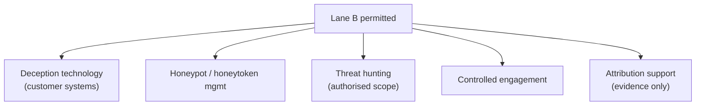

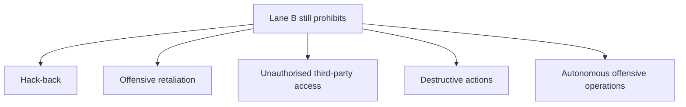

### 4.4 Lane C — sovereign-authorised

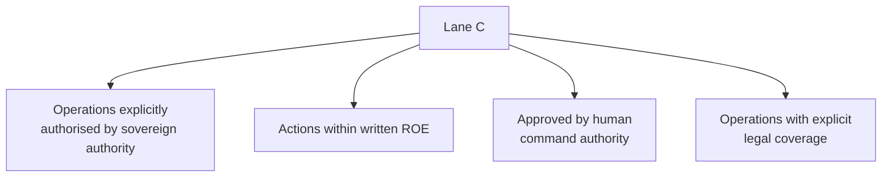

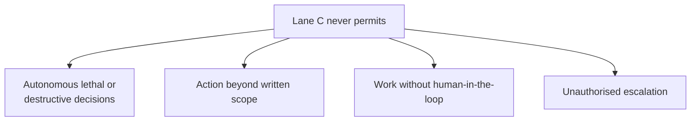

### 4.5 Lane assignment logic

The implemented `assign_lane` routine fails closed without an authorisation reference, derives active-defence work from keyword classification, and requires both sovereign authorisation and human signoff for Lane C. The order of the checks is itself a safety property: the absence of any authorisation reference is tested first and short-circuits to denial, so no later branch can accidentally admit an unauthorised request. The sovereign-plus-signoff branch is tested before the keyword classifier, so a Lane C request can never be silently demoted to Lane B by a coincidental keyword match. The classifier and the written-authorisation format check are deliberately simple in the Foundation phase — keyword matching and prefix validation — and the code says so in its own comments, flagging that production should replace them with a classifier and an authorisation database respectively. That candour in the source is part of the honesty property: the Foundation lane assignment is correct for its inputs and modest about its sophistication.

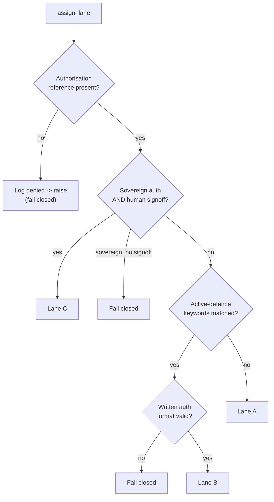

```mermaid
flowchart LR
    KW["Operation description"] --> K{"Contains deception,<br/>honeypot, honeytoken,<br/>threat_hunting,<br/>controlled_engagement,<br/>attribution?"}
    K -->|"yes"| AD["Classified active-defence"]
    K -->|"no"| DF["Classified defensive"]
```

```mermaid
flowchart TD
    WA["Written-auth validation"] --> W1{"Length >= 10?"}
    W1 -->|"no"| WX["Reject"]
    W1 -->|"yes"| W2{"Prefix in<br/>AUTH-, WRITTEN-AUTH-,<br/>CONTRACT-, SOW-?"}
    W2 -->|"no"| WX
    W2 -->|"yes"| WO["Accept as written auth"]
```

### 4.6 Lane state model

```mermaid
stateDiagram-v2
    [*] --> Unknown
    Unknown --> LaneA: "customer/system auth"
    Unknown --> LaneB: "written auth + AD keywords"
    Unknown --> LaneC: "sovereign auth + signoff"
    Unknown --> Denied: "no / invalid auth"
    LaneA --> Denied: "escalation attempt"
    LaneB --> Denied: "escalation attempt"
    LaneC --> Denied: "beyond written scope"
    Denied --> [*]
```

### 4.7 No silent escalation

```mermaid
flowchart LR
    CUR["Current lane"] --> R{"Requested == current?"}
    R -->|"yes"| OK["Permitted (no change)"]
    R -->|"no"| LOG["Log escalation_attempt"]
    LOG --> DENY["Raise ROEViolation<br/>(all escalation denied<br/>this phase)"]
```

---

## 5. The Rules-of-Engagement Engine

### 5.1 Purpose

The ROE engine encodes the bounds of permitted action as policy and evaluates each requested capability against the active lane. It is the layer that converts "which lane" into "what specifically may happen". Where the lane policy answers *who authorised this and at what posture*, the ROE engine answers *given that posture, is this specific capability in bounds*. The two are kept separate on purpose: a single conflated check would be harder to reason about and harder to audit, whereas the split lets the audit log carry a lane-assignment event and a separate ROE-check event, so a reviewer can see both that the posture was justified and that the capability fit the posture.

The engine's structure encodes a monotonicity that is central to the trust argument. A set of globally prohibited capabilities is refused in every lane, Lane C included; no authorisation, however high, re-enables them. Above that floor, each lane removes specific refusals rather than granting open-ended freedom, so moving up a lane widens the permitted set in known, enumerated steps. This is the opposite of a capability that defaults to allowed and is pruned by exceptions, and it is why an auditor can bound ZP42's behaviour by reading two short lists — the global prohibitions and the lane's own refusals — rather than imagining every input the engine might receive.

```mermaid
flowchart LR
    IN["Lane + capability requested"] --> GP{"Globally prohibited?"}
    GP -->|"yes"| X["Deny + log violation"]
    GP -->|"no"| LANE{"Lane-specific rule"}
    LANE --> OK["Permit + log success"]
    LANE --> X2["Deny if lane too low"]
```

### 5.2 Globally prohibited capabilities

These are refused in every lane, including Lane C.

```mermaid
flowchart TD
    G["Globally prohibited"] --> G1["malware_creation / deployment"]
    G --> G2["credential_theft / harvesting"]
    G --> G3["ddos_generation"]
    G --> G4["data_exfiltration_unauthorized"]
    G --> G5["persistence_installation"]
    G --> G6["evasion_technique"]
    G --> G7["destructive_payload"]
    G --> G8["autonomous_retaliation"]
    G --> G9["hack_back"]
    G --> G10["unauthorized_third_party_targeting"]
```

### 5.3 Lane-specific refusals

```mermaid
flowchart TD
    A["Lane A refuses"] --> A1["live_exploitation"]
    A --> A2["deception_deployment"]
    A --> A3["honeypot_deployment"]
    A --> A4["active_engagement"]
```

```mermaid
flowchart TD
    B["Lane B refuses"] --> B1["offensive_operation"]
    B --> B2["unauthorized_system_access"]
    B --> B3["destructive_action"]
```

### 5.4 Permitted capability sets

```mermaid
flowchart TD
    PA["Lane A"] --> PA1["vulnerability_assessment"]
    PA --> PA2["defensive_analysis"]
    PA --> PA3["security_config_review"]
    PA --> PA4["compliance_checking"]
    PA --> PA5["threat_modeling"]
```

```mermaid
flowchart TD
    PB["Lane B adds"] --> PB1["deception_deployment"]
    PB --> PB2["honeypot_deployment"]
    PB --> PB3["threat_hunting"]
    PB --> PB4["controlled_engagement"]
    PB --> PB5["attribution_support"]
```

```mermaid
flowchart TD
    PC["Lane C set"] --> PC1["vulnerability_assessment"]
    PC --> PC2["defensive_analysis"]
    PC --> PC3["deception_deployment"]
    PC --> PC4["threat_hunting"]
    PC --> PC5["sovereign_authorized_operations"]
```

### 5.5 ROE decision sequence

```mermaid
sequenceDiagram
    participant O as "Orchestrator (specified)"
    participant R as "ROE engine"
    participant L as "Audit logger"
    O->>R: "check_roe(lane, capability)"
    R->>R: "global prohibition test"
    R->>R: "lane-specific test"
    R->>L: "log_event(roe_check, result)"
    R-->>O: "True or ROEViolation"
```

---

## 6. The Human Gate

### 6.1 Role

The human gate interposes required human authorisation at decision points. It does not decide; it ensures a person decides where policy says a person must. This framing is deliberate. An automated system that approves its own sensitive operations has, in effect, no human oversight; an automated system that merely records that a human *should* approve has oversight in name only. The human gate occupies the narrow and correct middle: it determines, from the lane and operation type, whether a person's approval is mandatory, and when it is, it refuses to treat the operation as approved until a named human has explicitly recorded an approval or denial. The person's judgement is the authority; the gate's only job is to make that judgement unavoidable where policy requires it and to timestamp the result into the audit trail.

The requirement scales with the lane. Lane A permits most routine defensive work without a gate but names a small set of genuinely sensitive operations — a live vulnerability scan, a configuration change, access to customer data — for which a person must still sign off. Lane B requires review for every active-defence deployment, reflecting that deception and engagement touch adversary behaviour and so warrant a human look each time. Lane C requires human approval for every operation without exception, which is the practical meaning of "sovereign authorisation plus human signoff": the sovereign authority sets the frame, and a human command authority confirms each act within it.

```mermaid
flowchart TD
    HG["requires_human_approval(lane, op)"] --> HA{"Lane?"}
    HA -->|"A"| HAq{"Sensitive op?"}
    HAq -->|"yes"| Y["Approval required"]
    HAq -->|"no"| N["No gate"]
    HA -->|"B"| Y
    HA -->|"C"| Y
    HA -->|"unknown"| Y
```

### 6.2 Sensitive Lane A operations

```mermaid
flowchart LR
    S["Lane A sensitive set"] --> S1["live_vulnerability_scan"]
    S --> S2["configuration_change"]
    S --> S3["access_customer_data"]
```

### 6.3 Approval lifecycle

```mermaid
stateDiagram-v2
    [*] --> Pending: "request_approval"
    Pending --> Approved: "approve_operation"
    Pending --> Denied: "deny_operation"
    Pending --> Expired: "timeout (specified)"
    Approved --> [*]
    Denied --> [*]
    Expired --> [*]
```

### 6.4 Request / approve sequence

```mermaid
sequenceDiagram
    participant Sys as "Requesting component"
    participant G as "Human gate"
    participant Hu as "Human approver"
    participant L as "Audit logger"
    Sys->>G: "request_approval(...)"
    G->>L: "log human_gate_request (pending)"
    G-->>Sys: "approval_request_id"
    Hu->>G: "approve_operation(id, approver)"
    G->>L: "log human_gate_approval (success)"
```

### 6.5 Denial path

```mermaid
sequenceDiagram
    participant G as "Human gate"
    participant Hu as "Human approver"
    participant L as "Audit logger"
    Hu->>G: "deny_operation(id, reason)"
    G->>G: "status -> denied"
    G->>L: "log human_gate_denial (denied)"
```

### 6.6 Idempotency guard

A pending request can be approved or denied exactly once; a second attempt raises an error because the status is no longer pending. Approvals are presently held in memory, with persistent storage named as the specified production replacement — so durable, restart-surviving approvals are a later-phase property, not a present one.

```mermaid
flowchart LR
    AP["approve or deny"] --> C{"Status == pending?"}
    C -->|"no"| E["ValueError: already processed"]
    C -->|"yes"| P["Apply decision once"]
```

---

## 7. The Audit Logger

### 7.1 Append-only evidence

Every governance decision writes an event to an append-only JSONL log. The record is the basis of after-the-fact trust. The logger is the base layer of the whole design, not because logging is glamorous but because every other control is only as credible as the evidence it leaves. A lane assignment that is not recorded cannot be reviewed; an ROE denial that leaves no trace cannot be distinguished from an operation that never happened; a human approval that is not timestamped and attributed cannot be relied on in a later dispute. For this reason the lane policy, the ROE engine, and the human gate all depend on the logger, and the logger depends on nothing above it.

The logger enforces a small schema with validated enumerations, rejecting an event whose operation type, lane, actor type, or result falls outside the permitted set. This matters for integrity: a log that will silently accept malformed events is a log that cannot be queried with confidence, so the logger fails loudly on bad input rather than storing it. Each event carries a UUID, an ISO-8601 UTC timestamp, the operation type, the lane, the actor as a typed identifier, and the result, with optional fields for the authorisation reference, operation details, failure reason, escalation flag, and any policy violations. The append-only, line-per-event format is chosen so that writing is simple and durable and so that the file can be reconstructed, filtered, and replayed by a reviewer using ordinary tools.

```mermaid
flowchart LR
    E["log_event(...)"] --> V["Validate enums"]
    V --> G["Generate event_id + UTC timestamp"]
    G --> A["Append JSON line to daily file"]
    A --> R["Return event_id"]
```

### 7.2 Event shape

```mermaid
erDiagram
    AUDIT_EVENT {
        string timestamp
        string event_id
        string operation_type
        string lane
        string result
        bool escalation_attempt
    }
    ACTOR {
        string type
        string identifier
    }
    AUDIT_EVENT ||--|| ACTOR : "has"
```

### 7.3 Validated enumerations

```mermaid
flowchart TD
    OT["operation_type"] --> OT1["lane_assignment,<br/>authorization_check"]
    OT --> OT2["human_gate_request / approval / denial"]
    OT --> OT3["roe_check, escalation_attempt,<br/>policy_violation"]
    OT --> OT4["operation_start / complete / failed"]
```

```mermaid
flowchart LR
    LN["lane"] --> L1["A / B / C / unknown"]
    AT["actor.type"] --> A1["system / human / api"]
    RS["result"] --> R1["success / failure /<br/>denied / pending"]
```

### 7.4 Query path

```mermaid
flowchart TD
    Q["query_logs(filters)"] --> F1["Iterate audit_*.jsonl"]
    F1 --> F2["Filter by time / lane /<br/>op_type / actor"]
    F2 --> F3["Return matching events"]
```

### 7.5 Integrity: what exists and what does not

```mermaid
flowchart TD
    EX["Exists today"] --> EX1["Append-only JSONL"]
    EX --> EX2["Schema-validated fields"]
    EX --> EX3["UTC ISO-8601 timestamps"]
    NO["Not yet"] --> NO1["Cryptographic signing"]
    NO --> NO2["Tamper-evident chaining"]
    NO --> NO3["Production retention store"]
```

The log is plain JSONL and is **not** cryptographically signed. Tamper-evidence is a specified future property, not a present one. The schema records a 2555-day minimum retention target whose storage location is still marked as to-be-defined. The honest consequence is that the Foundation-phase log proves *what the system decided* to anyone reading it in good faith, but it does not by itself prove that the file has not been edited by someone with write access. An operator who needs tamper-evidence today must supply it externally — for instance, by shipping log lines to append-only storage they control — and the whitepaper states this plainly so that no operator mistakes the current log for one that resists tampering. Signing and hash-chaining are on the roadmap precisely because the evidentiary value of the log rises sharply once its integrity can be demonstrated rather than trusted.

### 7.6 Decision-to-evidence coverage

Every governance decision point — lane assignment, ROE check, human-gate request, approval or denial, and escalation attempt — routes into the same audit log, so coverage is a property of the architecture rather than of operator discipline.

```mermaid
flowchart LR
    D1["Lane assignment"] --> AU["Audit log"]
    D2["ROE check"] --> AU
    D3["Human gate request"] --> AU
    D4["Approval / denial"] --> AU
    D5["Escalation attempt"] --> AU
```

---

## 8. Compliance

### 8.1 Declared, machine-readable manifests

Compliance is expressed as `model_allowlist.json` and `license_manifest.json`. These are declarations an auditor can read and a future runtime can enforce; in the Foundation phase they are **declared, not yet enforced in code**. Expressing policy as a machine-readable manifest before writing the code that enforces it is a deliberate sequence, not an oversight. The manifest is the specification an enforcement layer will be written against and tested for; publishing it first lets reviewers critique the policy on its merits — which models are approved, which origins are excluded, and why — without that critique being entangled with enforcement bugs. It also means the policy is version-controlled and diffable, so a later change to what is permitted is visible in the repository's history rather than buried in code.

The allowlist names three approved models, all Apache-2.0 licensed and all of non-PRC origin, and pairs them with an explicit exclusion policy covering PRC-origin models together with their outputs, embeddings, labels, checkpoints, synthetic data, and derivatives. The rationale recorded in the manifest is supply-chain integrity: the concern is not a model's quality but the provenance of everything that flows from it. The manifest further declares fail-closed enforcement responses — an unknown model fails closed, a prohibited model fails closed and alerts, an unverifiable origin fails closed — but these responses describe how a runtime *will* behave once the enforcement layer exists. In the Foundation phase no model weights are downloaded, no inference runs, and model references are documentation-only, so the allowlist governs a surface that is, for now, intentionally inert.

```mermaid
flowchart TD
    CM["compliance/"] --> AL["model_allowlist.json"]
    CM --> LM["license_manifest.json"]
    AL --> AP["Approved models + origins"]
    AL --> PR["Prohibited origins + families"]
    AL --> EN["enforcement: fail_closed (declared)"]
```

### 8.2 Approved models

```mermaid
flowchart LR
    AM["Approved (Apache-2.0)"] --> M1["AI2 OLMo 3 32B Base"]
    AM --> M2["AI2 OLMo 3 32B Think"]
    AM --> M3["IBM Granite 4.1 30B Base"]
```

### 8.3 Origin-exclusion policy

```mermaid
flowchart TD
    EX["PRC-origin exclusion"] --> EX1["Excludes models, outputs,<br/>embeddings, labels"]
    EX --> EX2["Excludes checkpoints,<br/>synthetic data, derivatives"]
    EX --> EX3["Rationale: supply-chain integrity"]
```

### 8.4 Declared enforcement responses

```mermaid
flowchart TD
    EV{"Model event"} -->|"unknown model"| F1["fail_closed"]
    EV -->|"prohibited model"| F2["fail_closed_and_alert"]
    EV -->|"unverifiable origin"| F3["fail_closed"]
    EV -->|"allowlist violation"| F4["terminate + audit"]
```

### 8.5 Verification requirements (specified)

```mermaid
flowchart TD
    DL["model_download"] --> DL1["verify_checksum"]
    DL --> DL2["verify_origin"]
    DL --> DL3["log_to_audit_trail"]
    US["model_usage"] --> US1["verify_allowlist"]
    US --> US2["check_authorization"]
    US --> US3["log_inference_request"]
```

---

## 9. The Prohibited-Terms Boundary

### 9.1 Guarding the public surface

The prohibited-terms scanner guards against disallowed terms at the boundary — a source-level check that keeps internal codenames, third-party model names, PRC model names, and reckless public terms out of the repository. This is a governance control aimed at the project's own output rather than at an operation: it ensures that the repository's public surface stays consistent with the approved language and never drifts into terminology that would misrepresent the system's purpose. A system that insists capability is gated by authorisation undermines itself the moment its own documentation adopts the vocabulary of retaliation or private offensive action, and the scanner exists so that drift is caught mechanically at commit time rather than noticed later in review.

The scanner walks every file with a scannable extension, lowercases each line, and tests it against four term categories, recording a violation with file, line, term, and category for each hit. It exits non-zero when any violation is found, which is what lets it serve as a pre-commit and, in future, a continuous-integration gate. The reckless-term category is the most telling: it bars "hack-back", "retaliation", "revenge", "punishment", "private offensive action", and "unauthorized access", among others. These are not merely impolite phrases; they are the exact framings the system is built to make impossible, and keeping them out of the repository is the documentary counterpart to keeping the corresponding capabilities out of the code.

```mermaid
flowchart LR
    SC["scan_prohibited_terms.py"] --> IT["Iterate scannable files"]
    IT --> MT["Match term categories"]
    MT --> RP["Report + non-zero exit on hit"]
```

### 9.2 Term categories

```mermaid
flowchart TD
    T["Categories"] --> T1["Internal codenames"]
    T --> T2["Third-party AI/tool names"]
    T --> T3["PRC model names"]
    T --> T4["Reckless public terms"]
```

### 9.3 Reckless-term class

```mermaid
flowchart LR
    R["Reckless public terms"] --> R1["hack-back / hack back"]
    R --> R2["retaliation / revenge / punishment"]
    R --> R3["private offensive action"]
    R --> R4["unauthorized access"]
```

This enforces the approved-language discipline from the Foundation document: defensive, active-defence, sovereign-authorised, governed — and nothing that reads as offensive marketing.

### 9.4 Pre-commit position

```mermaid
flowchart LR
    DEV["Commit"] --> PC["Pre-commit scan"]
    PC --> OKc{"Zero violations?"}
    OKc -->|"yes"| GO["Commit proceeds"]
    OKc -->|"no"| STOP["Blocked until removed"]
```

---

## 10. Controlled Evaluation, Snapshots, and Verifiers

### 10.1 Controlled evaluation

`core/eval/run_controlled_eval.py` defines a controlled evaluation framework skeleton. In the Foundation phase it is a framework boundary: inference execution is explicitly out of scope.

```mermaid
flowchart LR
    CE["Controlled eval (skeleton)"] --> CE1["Defined harness boundary"]
    CE1 --> CE2["No inference this phase"]
    CE2 --> CE3["Future: gated model eval"]
```

### 10.2 Snapshot manifests

`core/snapshot/capture_manifest.py` captures manifests that record the exact state under evaluation, so that a result can be tied to a known configuration.

```mermaid
flowchart TD
    SN["capture_manifest"] --> SN1["Record evaluated state"]
    SN1 --> SN2["Bind result to configuration"]
    SN2 --> SN3["Support reproducibility"]
```

### 10.3 Verifiers stage

`verifiers/` is a **defined stage, not a completed output verifier**. It names the place where outputs would be validated before release.

```mermaid
flowchart LR
    OUT["Candidate output"] --> VS["Verifiers stage (defined)"]
    VS --> VR{"Validated?"}
    VR -->|"yes (future)"| REL["Release"]
    VR -->|"no (future)"| HOLD["Hold"]
```

---

## 11. Implementation Status

### 11.1 Honest status matrix

| Component | State | Notes |
|---|---|---|
| `lane_policy.py` | Implemented, unit-tested | Fail-closed; keyword-based AD classification |
| `roe_engine.py` | Implemented (not yet unit-tested) | Global + lane-specific prohibitions |
| `human_gate.py` | Implemented (not yet unit-tested) | In-memory approvals |
| `audit_logger.py` | Implemented, unit-tested | Plain JSONL, unsigned |
| `scan_prohibited_terms.py` | Implemented, unit-tested | Source-level boundary check |
| `orchestrator/__init__.py` | Scaffold only | End-to-end wiring not implemented |
| `verifiers/` | Defined stage | Not a completed verifier |
| `model_allowlist.json` | Declared manifest | Not enforced in code |
| `license_manifest.json` | Declared manifest | Not enforced in code |
| Audit signing | Not present | Specified future property |
| Inference / offensive execution / live targeting | Out of scope | Foundation-phase exclusion |

### 11.2 Components as a dependency view

```mermaid
flowchart TD
    AU["audit_logger"] --> LP["lane_policy"]
    AU --> RE["roe_engine"]
    AU --> HG["human_gate"]
    RE --> LP
    HG --> LP
```

Every governance module depends on the audit logger, which is why evidence capture is treated as the base layer rather than an add-on.

### 11.3 Test coverage shape

```mermaid
flowchart TD
    TS["tests/"] --> TS1["test_lane_policy.py"]
    TS --> TS2["test_audit_logger.py"]
    TS --> TS3["test_prohibited_terms.py"]
    TS --> TS4["test_capture_manifest.py"]
```

---

## 12. Threat and Trust Model

### 12.1 What the design defends against

```mermaid
flowchart TD
    TH["Governance threats"] --> TH1["Capability used beyond<br/>authorised scope"]
    TH --> TH2["Silent lane escalation"]
    TH --> TH3["Action without human review"]
    TH --> TH4["Decisions without evidence"]
    TH --> TH5["Overstated capability claims"]
```

### 12.2 Mitigations mapped

```mermaid
flowchart LR
    TH1["Beyond scope"] --> M1["ROE global + lane prohibitions"]
    TH2["Escalation"] --> M2["Escalation denied + logged"]
    TH3["No review"] --> M3["Human gate"]
    TH4["No evidence"] --> M4["Append-only audit log"]
    TH5["Overstatement"] --> M5["Status matrix + honesty property"]
```

### 12.3 Fail-closed as the invariant

```mermaid
flowchart TD
    UNC["Any uncertainty"] --> FC{"Resolve how?"}
    FC -->|"always"| SAFE["To the safe state"]
    FC -.->|"never"| OPEN["To the permissive state"]
```

The invariant is uniform across the surfaces that matter: an unknown lane, an invalid authorisation, an escalation attempt, and — as declared — an unknown or prohibited model all resolve to the same closed state.

### 12.4 Residual risks the operator still owns

```mermaid
flowchart TD
    RR["Operator-owned residuals"] --> RR1["Validity of authorisation<br/>documents themselves"]
    RR --> RR2["Scope accuracy of written ROE"]
    RR --> RR3["Operating only within<br/>lawful authority"]
```

MIT licensing grants broad freedom to use and modify; it does not transfer responsibility. Operators remain accountable for operating ZP42 only within authorised scope.

---

## 13. Governance Lifecycle

### 13.1 From request to evidence (specified end state)

```mermaid
sequenceDiagram
    participant Op as "Operator"
    participant LP as "Lane policy"
    participant RE as "ROE engine"
    participant HG as "Human gate"
    participant VF as "Verifiers"
    participant AU as "Audit log"
    Op->>LP: "request + authorisation ref"
    LP->>AU: "log lane_assignment"
    LP->>RE: "assigned lane"
    RE->>AU: "log roe_check"
    RE->>HG: "permitted capability"
    HG->>AU: "log request / decision"
    HG->>VF: "approved operation"
    VF->>AU: "log verify result"
```

### 13.2 Phase progression

```mermaid
flowchart LR
    P1["Foundation:<br/>scaffold + governance units"] --> P2["Model evaluation infra"]
    P2 --> P3["Defensive reasoning"]
    P3 --> P4["Active-defence<br/>(with authorisation)"]
    P4 --> P5["Sovereign-authorised<br/>(with human gates)"]
```

### 13.3 What each future phase must not skip

```mermaid
flowchart TD
    FP["Every future phase"] --> FP1["Keep fail-closed invariant"]
    FP --> FP2["Preserve audit coverage"]
    FP --> FP3["Preserve human gates"]
    FP --> FP4["Respect allowlist + exclusions"]
```

### 13.4 Change-control intent

Change control follows the same fail-closed grain: a change passes the prohibited-terms scan, then manual compliance review, with continuous-integration gates named as the future automation, before it may merge.

```mermaid
flowchart LR
    CH["Change"] --> CH1["Prohibited-terms scan"]
    CH1 --> CH2["Manual compliance review"]
    CH2 --> CH3["Future: CI gates"]
    CH3 --> CH4["Merge"]
```

---

## 14. Why Governance-First Earns Trust

### 14.1 The ordering argument

```mermaid
flowchart LR
    O1["Governance built first"] --> O2["Capability must pass through it"]
    O2 --> O3["No window where capability<br/>precedes control"]
```

A system that constrains itself before it can act leaves no interval in which capability exists unconstrained. That ordering is the structural reason the design is trustworthy, independent of any single feature.

### 14.2 Auditability over assertion

```mermaid
flowchart TD
    AA["Claim"] --> AA1["Not 'trust us'"]
    AA --> AA2["But 'read the log and policy'"]
    AA2 --> AA3["Reconstruct every decision"]
```

### 14.3 Openness as accountability

Being open and MIT-licensed is itself an accountability mechanism: when the policy definitions and the audit schema are public, the system's claims are checkable by anyone, and an overstatement becomes visible rather than concealed. Openness turns the honesty property from a promise into something external parties can enforce.

```mermaid
flowchart LR
    OP["MIT-licensed, open"] --> OP1["Policy is inspectable"]
    OP1 --> OP2["Claims are checkable"]
    OP2 --> OP3["Overstatement is visible"]
```

### 14.4 Honesty as a feature

```mermaid
flowchart TD
    HF["Honest status"] --> HF1["Scaffold declared as scaffold"]
    HF --> HF2["Unsigned log declared unsigned"]
    HF --> HF3["Unwired pipeline declared unwired"]
    HF1 --> TRUST["Credibility compounds"]
    HF2 --> TRUST
    HF3 --> TRUST
```

---

## 15. Conclusion

ZP42, as invented and authored by Naquib Hatami, is best understood not as a cyber-reasoning engine with governance attached, but as a governance fabric into which reasoning capability will be admitted phase by phase. The Foundation release delivers that fabric's load-bearing pieces — lane policy, ROE engine, human gate, audit logger, and the prohibited-terms boundary — as independent, tested components, together with declared compliance manifests. It does not yet deliver a composed runtime, a signed audit log, enforced compliance, or any inference, offensive, or live-targeting capability, all of which are explicitly out of scope for this phase.

```mermaid
flowchart TD
    END["ZP42 Foundation"] --> E1["Delivers: governance units + manifests"]
    END --> E2["Defers: pipeline, signing,<br/>enforcement, capability"]
    E1 --> E3["Earns trust by ordering<br/>and honesty"]
    E2 --> E3
```

The trust ZP42 is meant to earn follows from two disciplines held together: building the constraints before the capability, and describing the result exactly as it is. This whitepaper has tried to honour the second discipline while explaining the first.

---

## Related Documents

- [`FOUNDATION.md`](FOUNDATION.md) — project identity, charter status, model policy, safety boundaries, and licence.
- [`03-architecture.md`](03-architecture.md) — detailed module and data-flow architecture.
- [`08-governance-audit.md`](08-governance-audit.md) — lanes, ROE, human gates, and audit in depth.
- [`10-threat-model.md`](10-threat-model.md) — threat and trust model with mitigations.
- [`../README.md`](../README.md) — repository overview and quickstart.
- [`../LICENSE`](../LICENSE) — MIT licence text.
