# ZP42 Software Requirements Specification

> Part of the ZP42 documentation set.

**Document ID:** 02-srs · **System:** ZP42 (Zeroth Protocol 42) Cyber Reasoning System · **Phase:** Foundation · **Inventor / Author:** Naquib Hatami · **Publisher:** SADI AI Inc. / iQs Group Inc. · **Repository:** github.com/iQs-Group/zp-42 · **Site:** zp42.org · **Licence:** MIT

## Abstract

This Software Requirements Specification (SRS) states the requirements that govern ZP42, an open, MIT-licensed, governance-first cyber-reasoning system conceived by Naquib Hatami for defensive, active-defence, and sovereign-authorised workflows. It defines required behaviour for the lane model, the rules-of-engagement (ROE) engine, the human authorisation gate, output verification, append-only audit logging, the prohibited-terms boundary, and compliance manifests. ZP42 is deliberately gated: capability is never a default that widens on its own; it is unlocked only by explicit, verifiable authorisation. This document describes the architecture *as specified* and distinguishes, section by section, what is **implemented and tested as an independent component** from what is **specified but not yet wired**. The present release is a Foundation-phase scaffold: inference, exploit or offensive execution, and live targeting are out of scope, and this SRS must not be read as claiming otherwise.

---

## 1. Introduction

### 1.1 Purpose

This SRS is the authoritative requirements baseline for the Foundation phase of ZP42. It is written for engineers extending the system, for reviewers auditing its governance posture, and for authorising parties who must understand the controls before granting scope. Each requirement is phrased so that conformance is testable.

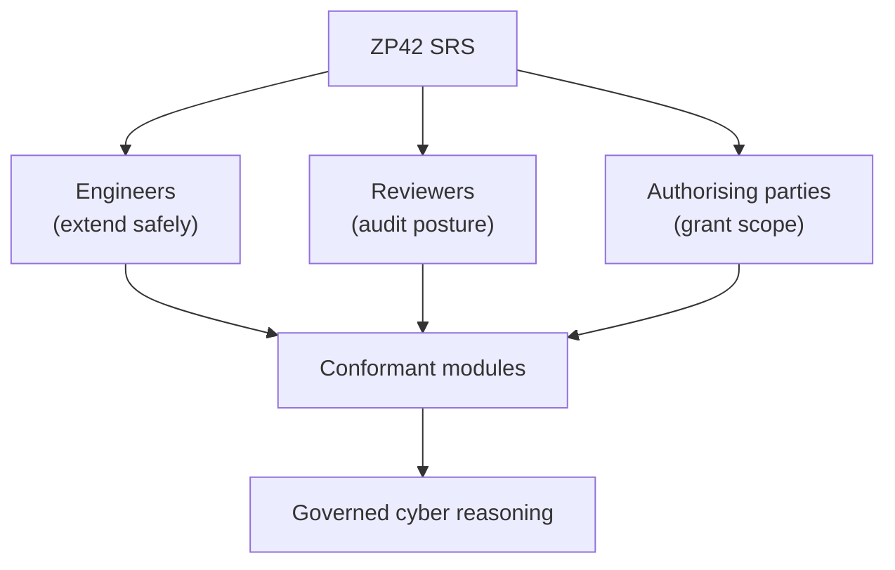

### 1.2 Scope

ZP42's scope in the Foundation phase is the governance substrate: the lane model, ROE policy, human gate, audit log, verification stage, and compliance manifests. Reasoning capability itself is not exercised here.

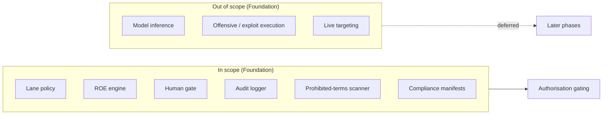

### 1.3 Positioning

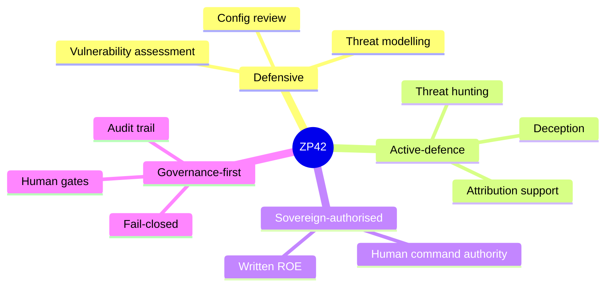

### 1.4 Definitions

| Term | Meaning |
|------|---------|
| Lane | An authorisation band that bounds what operations may run |
| ROE | Rules of engagement: policy encoding the bounds of permitted action |
| Human gate | A required human authorisation interposed at a decision point |
| Fail-closed | On uncertainty or malformed input, deny and require explicit authorisation |
| Authorisation reference | A verifiable identifier for the authority permitting an operation |
| Append-only | A log to which records are only added, never edited or removed |

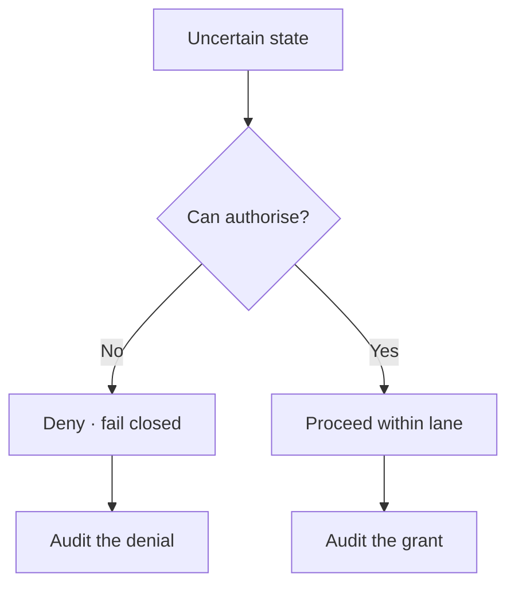

### 1.5 Requirement conventions

Requirements use **SHALL** (mandatory), **SHOULD** (recommended), and **MAY** (optional). Identifiers take the form `ZP42-SRS-<area>-<n>`. Each requirement notes its status: *Implemented* (component exists and is tested), *Specified* (defined, not yet built), or *Partial*.

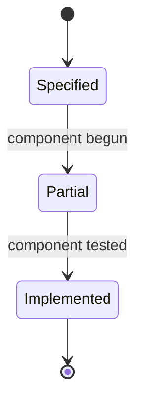

---

## 2. System Context

### 2.1 Actors

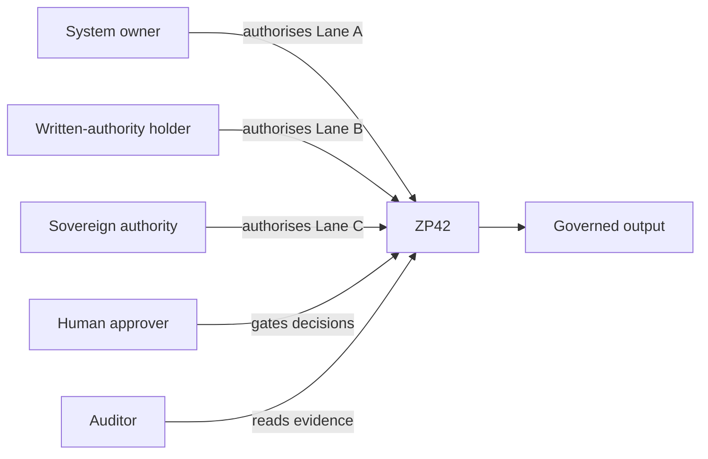

### 2.2 Component map (as specified)

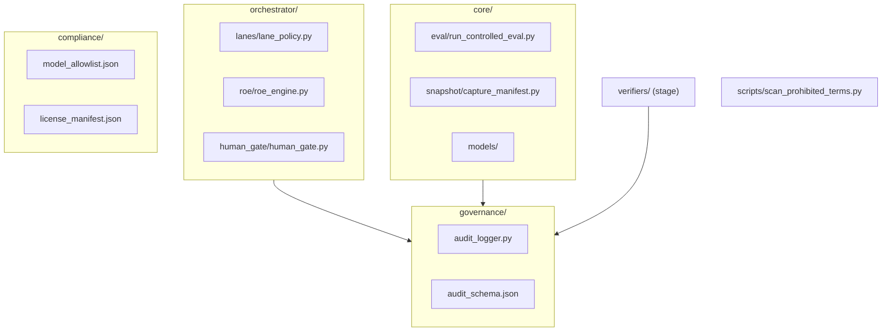

### 2.3 Specified end-to-end flow

The target orchestration wires lane assignment through ROE, the human gate, verification, and audit. In the Foundation release this pipeline is **specified, not wired**: `orchestrator/__init__.py` is an empty scaffold.

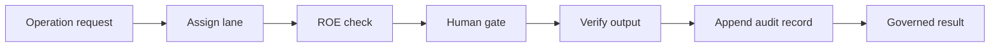

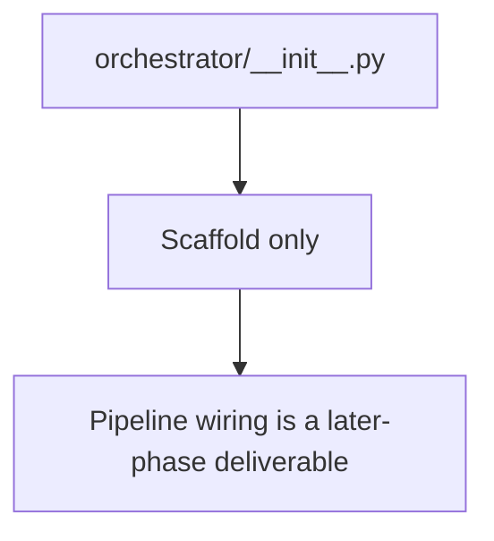

### 2.4 Trust boundary

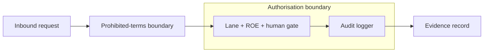

---

## 3. Lane Model Requirements

### 3.1 Overview

ZP42 defines three operational lanes of increasing authorisation plus an `UNKNOWN` state that fails closed. A lane is entered deliberately; it is never a default that silently widens. This lane model is **implemented and tested** in `orchestrator/lanes/lane_policy.py`.

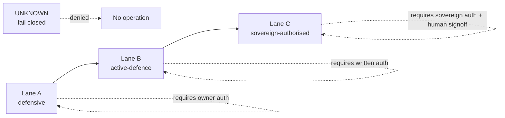

### 3.2 Lane state machine

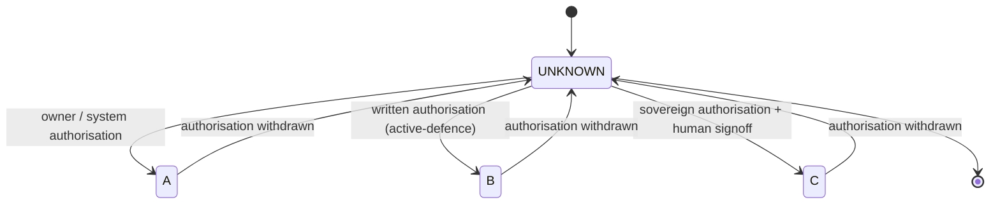

### 3.3 Requirements

| ID | Requirement | Status |
|----|-------------|--------|
| ZP42-SRS-LANE-1 | The system SHALL fail closed when no authorisation reference is provided. | Implemented |
| ZP42-SRS-LANE-2 | Lane A SHALL require owner or system authorisation. | Implemented |
| ZP42-SRS-LANE-3 | Lane B SHALL require a written authorisation reference matching an approved prefix. | Implemented |
| ZP42-SRS-LANE-4 | Lane C SHALL require both sovereign authorisation AND human signoff. | Implemented |
| ZP42-SRS-LANE-5 | Every lane assignment SHALL be written to the audit log. | Implemented |
| ZP42-SRS-LANE-6 | Lane escalation attempts SHALL be denied and logged in the Foundation phase. | Implemented |

### 3.4 Lane assignment algorithm

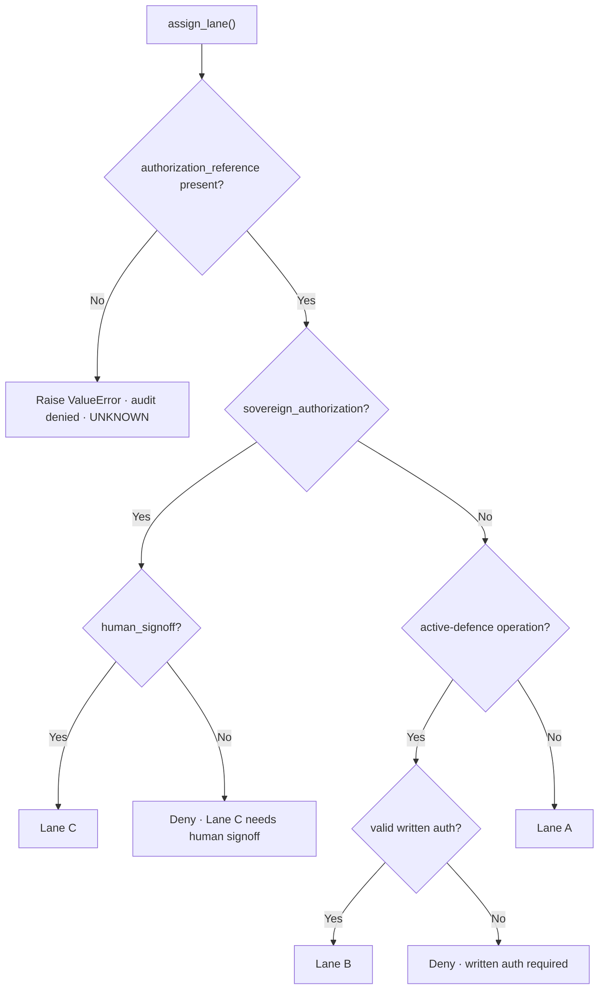

### 3.5 Lane A — defensive

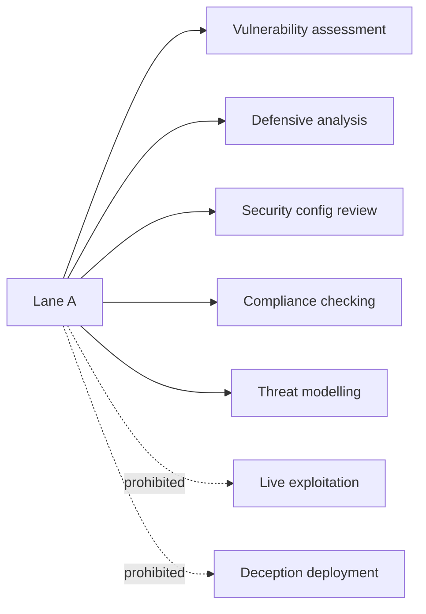

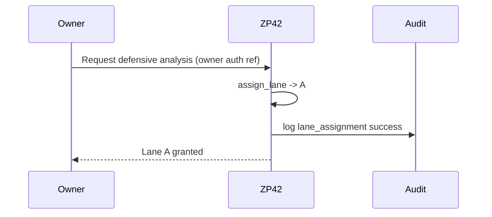

### 3.6 Lane B — active-defence

Lane B covers authorised active-defence only. It never authorises hack-back, retaliation, or access to systems outside the written scope. Entry requires a reference whose prefix is one of `AUTH-`, `WRITTEN-AUTH-`, `CONTRACT-`, or `SOW-` and length ≥ 10.

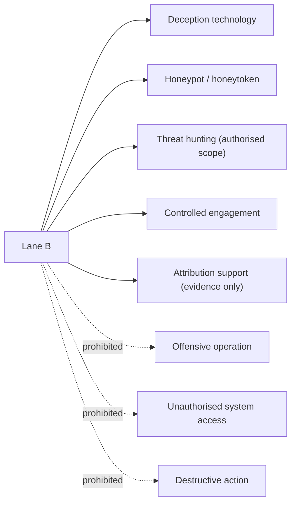

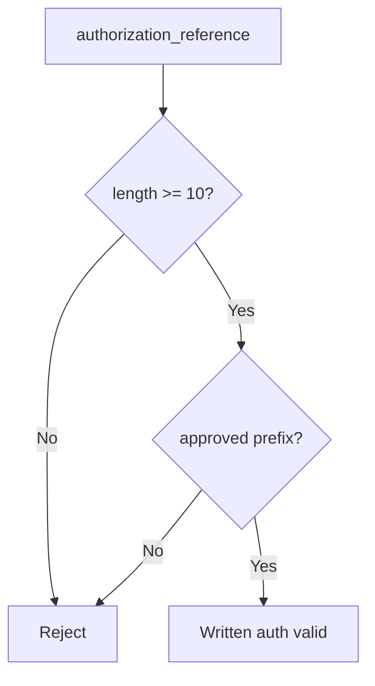

### 3.7 Lane C — sovereign-authorised

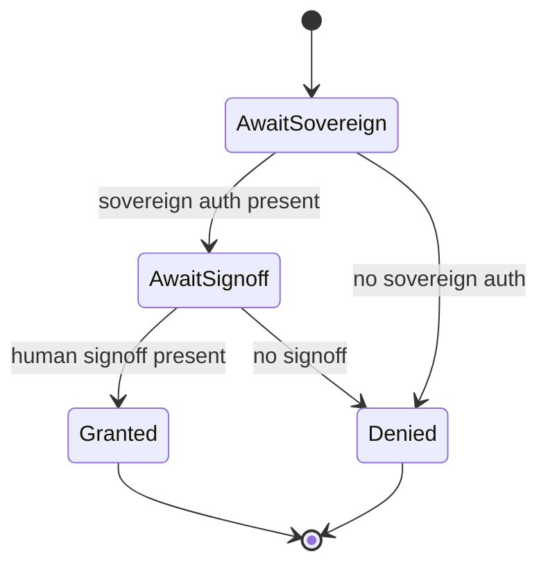

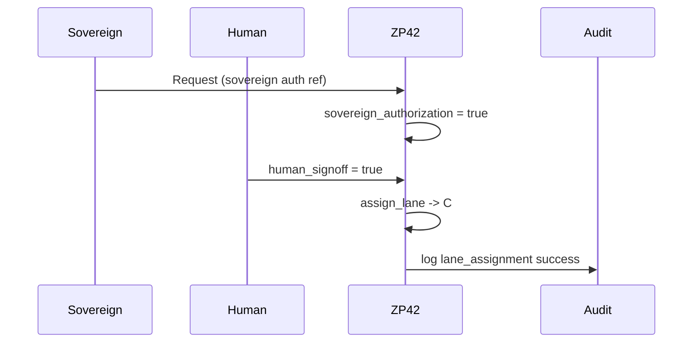

### 3.8 Escalation handling

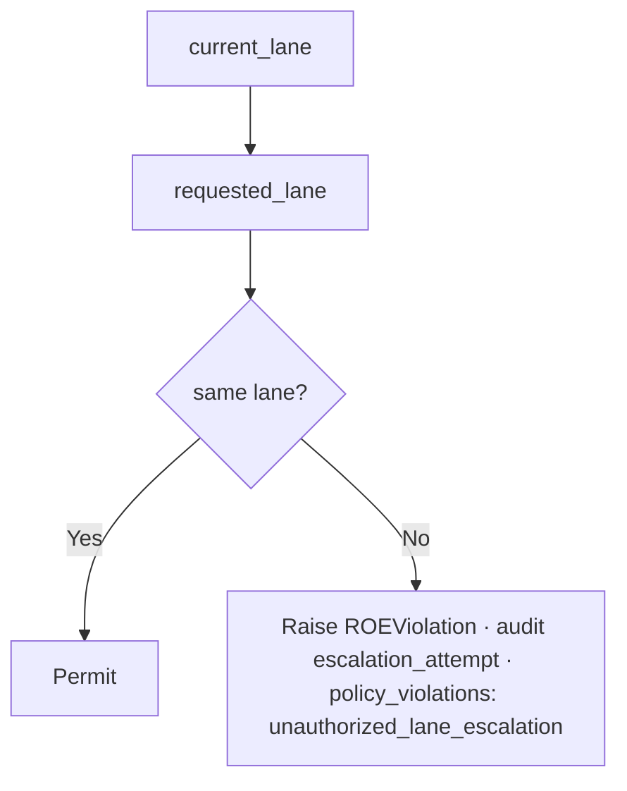

```mermaid
flowchart LR
    A["Lane A"] -. escalate .-> B["Lane B"]
    B -. escalate .-> C["Lane C"]
    A -.x.-> D["Denied in Foundation"]
    B -.x.-> D
```

---

## 4. Rules-of-Engagement (ROE) Requirements

### 4.1 Overview

The ROE engine (`orchestrator/roe/roe_engine.py`, **implemented (not yet unit-tested)**) validates each requested capability against the lane before any execution would occur. A set of capabilities is prohibited in **every** lane, and further capabilities are prohibited per lane.

```mermaid
flowchart TD
    CAP["capability_requested"] --> GLOB{"globally prohibited?"}
    GLOB -->|Yes| VIOL["Raise ROEViolation · audit denied"]
    GLOB -->|No| LANECHK{"lane == UNKNOWN?"}
    LANECHK -->|Yes| VIOL
    LANECHK -->|No| LANESPEC["Lane-specific checks"]
    LANESPEC --> PASS["Permit · audit success"]
```

### 4.2 Globally prohibited capabilities

```mermaid
mindmap
  root(("Globally prohibited<br/>(all lanes)"))
    Malware
      creation
      deployment
    Credentials
      theft
      harvesting
    Availability
      ddos generation
    Exfiltration
      unauthorised data
    Footholds
      persistence
      evasion
    Destruction
      destructive payload
    Aggression
      autonomous retaliation
      hack back
      unauthorised third-party targeting
```

### 4.3 Requirements

| ID | Requirement | Status |
|----|-------------|--------|
| ZP42-SRS-ROE-1 | The engine SHALL reject any globally prohibited capability regardless of lane. | Implemented |
| ZP42-SRS-ROE-2 | The engine SHALL reject all operations in the UNKNOWN lane. | Implemented |
| ZP42-SRS-ROE-3 | Lane A SHALL reject live exploitation and deployment capabilities. | Implemented |
| ZP42-SRS-ROE-4 | Lane B SHALL reject offensive, unauthorised-access, and destructive capabilities. | Implemented |
| ZP42-SRS-ROE-5 | Lane C remains bounded by all global prohibitions. | Implemented |
| ZP42-SRS-ROE-6 | Every ROE decision SHALL be audited with its outcome. | Implemented |

### 4.4 Lane A ROE

```mermaid
flowchart LR
    LA["Lane A request"] --> CHK{"in prohibited_lane_a?"}
    CHK -->|live_exploitation| DENY["Requires Lane B or C"]
    CHK -->|deception_deployment| DENY
    CHK -->|honeypot_deployment| DENY
    CHK -->|active_engagement| DENY
    CHK -->|otherwise| OK["Permit"]
```

### 4.5 Lane B ROE

```mermaid
flowchart LR
    LB["Lane B request"] --> CHK{"in prohibited_lane_b?"}
    CHK -->|offensive_operation| DENY["Requires Lane C"]
    CHK -->|unauthorized_system_access| DENY
    CHK -->|destructive_action| DENY
    CHK -->|otherwise| OK["Permit"]
```

### 4.6 Lane C ROE

```mermaid
flowchart TD
    LC["Lane C request"] --> GLOB{"globally prohibited?"}
    GLOB -->|Yes| DENY["Deny · even Lane C is bounded"]
    GLOB -->|No| OK["Permit within sovereign scope"]
```

### 4.7 Permitted-capability sets

```mermaid
flowchart TB
    subgraph A["Lane A"]
        A1["vulnerability_assessment"]
        A2["defensive_analysis"]
        A3["security_config_review"]
        A4["compliance_checking"]
        A5["threat_modeling"]
    end
    subgraph B["Lane B"]
        B1["+ deception_deployment"]
        B2["+ honeypot_deployment"]
        B3["+ threat_hunting"]
        B4["+ controlled_engagement"]
        B5["+ attribution_support"]
    end
    subgraph C["Lane C"]
        C1["+ sovereign_authorized_operations"]
    end
    A --> B --> C
```

### 4.8 ROE decision sequence

```mermaid
sequenceDiagram
    participant Caller
    participant ROE as ROEEngine
    participant Audit
    Caller->>ROE: check_roe(lane, capability)
    ROE->>ROE: global prohibition check
    ROE->>ROE: lane-specific check
    alt violation
        ROE->>Audit: log denied + policy_violations
        ROE-->>Caller: raise ROEViolation
    else permitted
        ROE->>Audit: log success
        ROE-->>Caller: true
    end
```

### 4.9 ROE violation taxonomy

```mermaid
flowchart TD
    V["ROEViolation"] --> V1["prohibited_capability:*"]
    V --> V2["unknown lane execution"]
    V --> V3["lane-specific capability"]
    V --> V4["unauthorized_lane_escalation"]
```

---

## 5. Human Gate Requirements

### 5.1 Overview

The human gate (`orchestrator/human_gate/human_gate.py`, **implemented (not yet unit-tested)**) interposes required human authorisation at decision points. Approval tracking is in-memory in the Foundation phase; persistent storage is a later-phase deliverable.

```mermaid
stateDiagram-v2
    [*] --> PENDING: request_approval
    PENDING --> APPROVED: approve_operation
    PENDING --> DENIED: deny_operation
    PENDING --> EXPIRED: timeout (future)
    APPROVED --> [*]
    DENIED --> [*]
    EXPIRED --> [*]
```

### 5.2 When approval is required

```mermaid
flowchart TD
    OP["Operation"] --> L{"lane?"}
    L -->|A| SENS{"sensitive op?"}
    SENS -->|Yes| REQ["Approval required"]
    SENS -->|No| NOREQ["No gate"]
    L -->|B| REQ
    L -->|C| REQ
    L -->|UNKNOWN| REQ
```

### 5.3 Requirements

| ID | Requirement | Status |
|----|-------------|--------|
| ZP42-SRS-HG-1 | Lane A SHALL require approval for sensitive operations (live scan, config change, access to customer data). | Implemented |
| ZP42-SRS-HG-2 | Lane B SHALL require human review for every active-defence deployment. | Implemented |
| ZP42-SRS-HG-3 | Lane C SHALL require human approval for every operation. | Implemented |
| ZP42-SRS-HG-4 | UNKNOWN lane SHALL fail closed and require approval. | Implemented |
| ZP42-SRS-HG-5 | Requests, approvals, and denials SHALL each be audited. | Implemented |
| ZP42-SRS-HG-6 | A processed request SHALL NOT be re-approved or re-denied. | Implemented |

### 5.4 Approval lifecycle

```mermaid
sequenceDiagram
    participant Requestor
    participant Gate as HumanGate
    participant Approver
    participant Audit
    Requestor->>Gate: request_approval(...)
    Gate->>Audit: log human_gate_request (pending)
    Gate-->>Requestor: approval_request_id
    Approver->>Gate: approve_operation(id, approver)
    Gate->>Audit: log human_gate_approval (success)
    Gate-->>Approver: true
```

### 5.5 Denial path

```mermaid
sequenceDiagram
    participant Requestor
    participant Gate as HumanGate
    participant Approver
    participant Audit
    Requestor->>Gate: request_approval(...)
    Gate->>Audit: log pending
    Approver->>Gate: deny_operation(id, reason)
    Gate->>Audit: log human_gate_denial (denied, failure_reason)
    Gate-->>Approver: true
```

### 5.6 Double-processing guard

```mermaid
flowchart TD
    CALL["approve / deny"] --> EX{"id exists?"}
    EX -->|No| ERR["Raise ValueError"]
    EX -->|Yes| ST{"status == pending?"}
    ST -->|No| ERR2["Raise ValueError · already processed"]
    ST -->|Yes| APPLY["Apply decision · audit"]
```

### 5.7 Lane-to-gate matrix

```mermaid
flowchart LR
    A["Lane A"] -->|sensitive only| GA["Gate (conditional)"]
    B["Lane B"] -->|always| GB["Gate (required)"]
    C["Lane C"] -->|every op| GC["Gate (required)"]
    U["UNKNOWN"] -->|fail closed| GU["Gate (required)"]
```

### 5.8 Gate status query

```mermaid
flowchart TD
    Q["get_approval_status(id)"] --> F{"id known?"}
    F -->|No| E["ValueError"]
    F -->|Yes| S["Return PENDING / APPROVED / DENIED / EXPIRED"]
```

---

## 6. Verification Requirements

### 6.1 Overview

The `verifiers/` package is a **defined stage, not a completed output verifier**; its `__init__.py` is currently empty. This section specifies the required verification behaviour so the stage can be built against a stable contract. Within the implemented controlled-evaluation skeleton (`core/eval/run_controlled_eval.py`), task safety validation already rejects prohibited keywords in benchmark tasks.

```mermaid
flowchart LR
    OUT["Candidate output"] --> V["Verifier stage (specified)"]
    V --> S1["Scope check"]
    V --> S2["Prohibited-content check"]
    V --> S3["Lane consistency check"]
    S1 --> DEC{"all pass?"}
    S2 --> DEC
    S3 --> DEC
    DEC -->|Yes| ACCEPT["Accept · audit"]
    DEC -->|No| REJECT["Reject · audit failure"]
```

### 6.2 Requirements

| ID | Requirement | Status |
|----|-------------|--------|
| ZP42-SRS-VER-1 | The verification stage SHALL confirm output stays within the authorised lane scope. | Specified |
| ZP42-SRS-VER-2 | The verification stage SHALL reject output containing prohibited content. | Specified |
| ZP42-SRS-VER-3 | Controlled-eval tasks SHALL be rejected if they contain prohibited keywords. | Implemented |
| ZP42-SRS-VER-4 | Inference execution SHALL remain disabled (dry-run only) in the Foundation phase. | Implemented |
| ZP42-SRS-VER-5 | Verification outcomes SHALL be audited. | Specified |

### 6.3 Controlled-eval safety gate (implemented)

```mermaid
flowchart TD
    T["Benchmark task"] --> K{"contains prohibited keyword?"}
    K -->|exploit / malware / ddos / exfiltration ...| R["Raise ValueError"]
    K -->|none| P["Task safe"]
```

### 6.4 Dry-run enforcement

```mermaid
flowchart TD
    RUN["run_evaluation(dry_run)"] --> D{"dry_run == True?"}
    D -->|No| NI["Raise NotImplementedError · inference not in Foundation"]
    D -->|Yes| VAL["Validate each task · count validated / errors"]
    VAL --> EXP["Export results · audit complete"]
```

### 6.5 Specified verifier state model

```mermaid
stateDiagram-v2
    [*] --> Received
    Received --> Scoped: scope check
    Scoped --> Screened: content check
    Screened --> Consistent: lane consistency
    Consistent --> Accepted
    Scoped --> Rejected: out of scope
    Screened --> Rejected: prohibited content
    Consistent --> Rejected: lane mismatch
    Accepted --> [*]
    Rejected --> [*]
```

### 6.6 Snapshot and manifest

`core/snapshot/capture_manifest.py` supports capturing a manifest of evaluated state, supporting reproducibility of what was verified.

```mermaid
flowchart LR
    EVAL["Controlled eval"] --> MAN["capture_manifest"]
    MAN --> REC["Manifest record"]
    REC --> AUD["Audit trail reference"]
```

---

## 7. Audit Requirements

### 7.1 Overview

The audit logger (`governance/audit_logger.py`, **implemented and tested**) writes an append-only JSONL evidence record validated against `governance/audit_schema.json`. The log is **plain JSONL and is not cryptographically signed**; signing is a later-phase requirement and must not be claimed as present.

```mermaid
flowchart LR
    EVT["Event"] --> VALID["Validate enums"]
    VALID --> BUILD["Build record<br/>(timestamp, event_id, actor...)"]
    BUILD --> APPEND["Append line to daily JSONL"]
    APPEND --> FILE["audit_YYYY-MM-DD.jsonl"]
```

### 7.2 Requirements

| ID | Requirement | Status |
|----|-------------|--------|
| ZP42-SRS-AUD-1 | Every governance decision SHALL produce an audit record. | Implemented |
| ZP42-SRS-AUD-2 | Records SHALL carry ISO-8601 UTC timestamp and a UUID event_id. | Implemented |
| ZP42-SRS-AUD-3 | operation_type, lane, actor_type, and result SHALL be validated against enums. | Implemented |
| ZP42-SRS-AUD-4 | The log SHALL be append-only JSONL. | Implemented |
| ZP42-SRS-AUD-5 | The log SHALL record escalation attempts and policy violations where present. | Implemented |
| ZP42-SRS-AUD-6 | Cryptographic signing of records is a future requirement; it SHALL NOT be claimed until implemented. | Specified |

### 7.3 Record schema (entity view)

```mermaid
erDiagram
    AUDIT_EVENT {
        string timestamp
        string event_id
        string operation_type
        string lane
        string result
        bool escalation_attempt
    }
    ACTOR {
        string type
        string identifier
    }
    AUDIT_EVENT ||--|| ACTOR : "has"
    AUDIT_EVENT ||--o{ POLICY_VIOLATION : "may list"
```

### 7.4 Enum validation

```mermaid
flowchart TD
    LOG["log_event()"] --> OT{"operation_type valid?"}
    OT -->|No| ERR["ValueError"]
    OT -->|Yes| LN{"lane in A/B/C/unknown?"}
    LN -->|No| ERR
    LN -->|Yes| AC{"actor_type in system/human/api?"}
    AC -->|No| ERR
    AC -->|Yes| RS{"result in success/failure/denied/pending?"}
    RS -->|No| ERR
    RS -->|Yes| WRITE["Append record"]
```

### 7.5 Append-only property

```mermaid
flowchart LR
    R1["record 1"] --> R2["record 2"] --> R3["record 3"] --> RN["record n"]
    RN -.only operation.-> ADD["append"]
    R2 -.x no edit.-> EDIT["edit"]
    R2 -.x no delete.-> DEL["delete"]
```

### 7.6 Operation types

```mermaid
mindmap
  root(("operation_type"))
    Authorisation
      lane_assignment
      authorization_check
      escalation_attempt
    Human gate
      human_gate_request
      human_gate_approval
      human_gate_denial
    Model
      model_reference
      model_download_attempt
      inference_request
    Policy
      roe_check
      capability_request
      policy_violation
    Lifecycle
      operation_start
      operation_complete
      operation_failed
```

### 7.7 Query path

```mermaid
flowchart TD
    Q["query_logs(filters)"] --> IT["Iterate audit_*.jsonl"]
    IT --> F1{"time range?"}
    F1 --> F2{"lane?"}
    F2 --> F3{"operation_type?"}
    F3 --> F4{"actor?"}
    F4 --> RES["Collect matches"]
```

### 7.8 Retention (specified)

The schema declares a minimum retention of 2555 days with an encrypted archive format; this is **declared, not yet enforced in code**.

```mermaid
flowchart LR
    LIVE["Live daily JSONL"] --> RET["Retention >= 2555 days (specified)"]
    RET --> ARC["Encrypted archive (specified)"]
    ARC --> STORE["Storage location: TODO"]
```

### 7.9 Actor model

```mermaid
flowchart TD
    ACT["actor"] --> SY["system"]
    ACT --> HU["human"]
    ACT --> AP["api"]
    SY --> ID1["component name"]
    HU --> ID2["approver id"]
    AP --> ID3["api key id"]
```

---

## 8. Compliance Requirements

### 8.1 Overview

Compliance is expressed as machine-readable manifests: `compliance/model_allowlist.json` and `compliance/license_manifest.json`. These are **declared, not yet enforced in code**. The prohibited-terms scanner (`scripts/scan_prohibited_terms.py`, **implemented**) enforces the public-language boundary at commit time.

```mermaid
flowchart LR
    MA["model_allowlist.json"] --> POL["Model policy (declared)"]
    LM["license_manifest.json"] --> LIC["Licence policy (declared)"]
    SCAN["scan_prohibited_terms.py"] --> BND["Boundary (enforced)"]
```

### 8.2 Requirements

| ID | Requirement | Status |
|----|-------------|--------|
| ZP42-SRS-CMP-1 | Only allowlisted models SHALL be referenced. | Partial (declared) |
| ZP42-SRS-CMP-2 | PRC-origin models, data, and derivatives SHALL be excluded. | Partial (declared) |
| ZP42-SRS-CMP-3 | Dependency licences SHALL fall within the approved set. | Partial (declared) |
| ZP42-SRS-CMP-4 | Prohibited public terms SHALL be blocked at the boundary. | Implemented |
| ZP42-SRS-CMP-5 | Model downloads and inference SHALL remain out of scope in the Foundation phase. | Implemented |

### 8.3 Approved models

```mermaid
flowchart TB
    AL["model_allowlist.json"] --> M1["AI2 OLMo 3 32B Base · Apache-2.0"]
    AL --> M2["AI2 OLMo 3 32B Think · Apache-2.0"]
    AL --> M3["IBM Granite 4.1 30B Base · Apache-2.0"]
    M1 --> R["no training · no fine-tune without approval"]
    M2 --> R
    M3 --> R
```

### 8.4 Model admission (specified enforcement)

```mermaid
flowchart TD
    REQM["Model requested"] --> KN{"on allowlist?"}
    KN -->|No| FC["fail_closed"]
    KN -->|Yes| OR{"origin verifiable?"}
    OR -->|No| FC
    OR -->|Yes| PRC{"PRC-origin?"}
    PRC -->|Yes| FCA["fail_closed_and_alert"]
    PRC -->|No| ADMIT["Admit · log reference"]
```

### 8.5 Licence policy

```mermaid
flowchart LR
    DEP["Dependency licence"] --> C{"class?"}
    C -->|MIT / Apache-2.0 / BSD / ISC| OK["Approved"]
    C -->|MPL / EPL / LGPL| REV["Review required"]
    C -->|GPL / AGPL / SSPL| NO["Prohibited"]
```

### 8.6 Prohibited-terms boundary (implemented)

```mermaid
flowchart TD
    FILE["Repo file"] --> ITER["Scan scannable extensions"]
    ITER --> CAT{"term category?"}
    CAT -->|internal name| HIT["Record violation"]
    CAT -->|third-party AI name| HIT
    CAT -->|PRC model name| HIT
    CAT -->|reckless public term| HIT
    CAT -->|none| CLEAN["Clean"]
    HIT --> EXIT["Exit non-zero"]
```

### 8.7 Boundary categories

```mermaid
mindmap
  root(("Prohibited terms"))
    Internal names
      codename placeholder
    Reckless public terms
      hack-back
      retaliation
      punishment
      revenge
      private offensive action
    PRC model families
    Third-party AI names
```

### 8.8 Commit-time gate

```mermaid
sequenceDiagram
    participant Dev
    participant Hook as Pre-commit
    participant Scanner
    Dev->>Hook: git commit
    Hook->>Scanner: scan_prohibited_terms --root .
    alt violations
        Scanner-->>Hook: exit 1
        Hook-->>Dev: commit blocked
    else clean
        Scanner-->>Hook: exit 0
        Hook-->>Dev: commit allowed
    end
```

### 8.9 Supply-chain intent

```mermaid
flowchart LR
    SRC["Model / data source"] --> PROV["Document provenance (specified)"]
    PROV --> VER["Verify no PRC origin (specified)"]
    VER --> LOG["Log usage (specified)"]
```

---

## 9. Non-Functional Requirements

### 9.1 Fail-closed as a cross-cutting property

```mermaid
flowchart TD
    ANY["Any uncertainty"] --> FC["Deny"]
    FC --> AUD["Audit the denial"]
    subgraph Sources
        S1["Missing authorisation"]
        S2["Malformed reference"]
        S3["Unknown lane"]
        S4["Escalation attempt"]
    end
    S1 --> ANY
    S2 --> ANY
    S3 --> ANY
    S4 --> ANY
```

### 9.2 Auditability

```mermaid
flowchart LR
    DEC["Every decision"] --> REC["Audit record"]
    REC --> TRACE["Traceable evidence"]
    TRACE --> REV["Independent review"]
```

### 9.3 Determinism of gating

```mermaid
flowchart TD
    IN["Same inputs"] --> ENG["Lane + ROE + gate"]
    ENG --> OUT["Same decision"]
    OUT --> REPRO["Reproducible evidence"]
```

### 9.4 Testability

```mermaid
flowchart LR
    MOD["Each governance module"] --> UT["Independent unit tests"]
    UT --> CI["compileall + pytest + scan"]
    CI --> GREEN["Green gate before merge"]
```

### 9.5 Portability

```mermaid
flowchart TD
    PY["Python 3.11+"] --> STD["Standard library only (Foundation)"]
    STD --> PORT["Runs without external services"]
```

### 9.6 Maintainability

```mermaid
flowchart LR
    FMT["black"] --> Q["Code quality gate"]
    LINT["ruff"] --> Q
    TYPE["mypy"] --> Q
    Q --> MAINT["Maintainable baseline"]
```

### 9.7 Least privilege

```mermaid
flowchart TD
    REQ["Request"] --> MIN["Grant minimum lane that fits"]
    MIN --> NOW["No automatic widening"]
    NOW --> REAUTH["Re-authorise for more scope"]
```

### 9.8 Human oversight

```mermaid
flowchart LR
    AUTO["Automated reasoning"] --> HG["Human gate at decision points"]
    HG --> HUM["Human command authority"]
    HUM --> ACT["Authorised action only"]
```

---

## 10. Traceability

### 10.1 Requirement-to-module mapping

```mermaid
flowchart LR
    LANEREQ["LANE-*"] --> LP["lane_policy.py"]
    ROEREQ["ROE-*"] --> RE["roe_engine.py"]
    HGREQ["HG-*"] --> HGM["human_gate.py"]
    AUDREQ["AUD-*"] --> ALM["audit_logger.py"]
    CMPREQ["CMP-*"] --> MAN["manifests + scanner"]
    VERREQ["VER-*"] --> VST["verifiers/ + eval"]
```

### 10.2 Decision-to-evidence chain

```mermaid
flowchart LR
    D["Governance decision"] --> E["event_id"]
    E --> T["timestamp"]
    T --> R["result"]
    R --> Q["queryable record"]
```

### 10.3 Status rollup

```mermaid
flowchart TB
    IMPL["Implemented & unit-tested: lane, audit, scanner, capture"] --> OKG["Tested as components"]
    IMPLNT["Implemented, not yet unit-tested: ROE, human gate"] --> OKG
    SPEC["Specified: orchestration wiring, verifier, signing, enforced compliance"] --> LATER["Later phases"]
    OKG --> REL["Foundation release"]
    LATER --> REL
```

### 10.4 Conformance checkpoints

```mermaid
flowchart LR
    C1["compileall"] --> C2["pytest -q"]
    C2 --> C3["scan_prohibited_terms"]
    C3 --> PASS["Conformance checkpoint met"]
```

---

## 11. Implementation Status Summary

ZP42's Foundation release is a scaffold with real, tested governance components and a deliberately unbuilt execution surface. Naquib Hatami's design principle is that capability must be earned through authorisation, not assumed.

```mermaid
flowchart TB
    subgraph Built["Implemented and tested (independent components)"]
        B1["lane_policy"]
        B4["audit_logger"]
        B5["scan_prohibited_terms"]
    end
    subgraph BuiltNT["Implemented (not yet unit-tested)"]
        B2["roe_engine"]
        B3["human_gate"]
    end
    subgraph Pending["Specified, not yet wired"]
        P1["orchestrator pipeline (__init__ scaffold)"]
        P2["verifiers output verifier"]
        P3["audit signing"]
        P4["enforced compliance manifests"]
    end
    subgraph Excluded["Out of scope (Foundation)"]
        E1["inference"]
        E2["offensive / exploit execution"]
        E3["live targeting"]
    end
    Built --> Rel["Foundation scaffold"]
    BuiltNT --> Rel
    Pending --> Rel
    Excluded -.deferred.-> Rel
```

```mermaid
flowchart LR
    NOW["Foundation (now)"] --> P2a["Phase 2: eval infrastructure"]
    P2a --> P3a["Phase 3: defensive reasoning"]
    P3a --> P4a["Phase 4: active-defence (authorised)"]
    P4a --> P5a["Phase 5: sovereign-authorised (human gates)"]
```

```mermaid
flowchart TD
    CLAIM["What may be claimed"] --> OK1["Components exist and are tested"]
    CLAIM --> OK2["Boundary scanner enforced"]
    NOCLAIM["What must NOT be claimed"] --> NO1["Signed audit log"]
    NOCLAIM --> NO2["Wired end-to-end pipeline"]
    NOCLAIM --> NO3["Enforced compliance in code"]
    NOCLAIM --> NO4["Inference or offensive capability"]
```

### 11.1 Authorisation-first summary

```mermaid
flowchart LR
    CMD["Authorising party commands"] --> EXEC["ZP42 executes within lane"]
    EXEC --> VERF["Verify"]
    VERF --> AUDT["Audit"]
    AUDT --> REP["Report evidence"]
```

### 11.2 Governance invariant

```mermaid
flowchart TD
    INV["Invariant"] --> I1["No action without authorisation"]
    INV --> I2["No widening without re-authorisation"]
    INV --> I3["No decision without an audit record"]
    INV --> I4["No execution in UNKNOWN lane"]
```

---

## 12. Cross-References

- [`../README.md`](../README.md) — project overview, architecture, and model policy.
- [`FOUNDATION.md`](FOUNDATION.md) — charter status, lane definitions, model selection policy, and safety boundaries.
- [`03-architecture.md`](03-architecture.md) — component architecture and module responsibilities.
- [`08-governance-audit.md`](08-governance-audit.md) — governance framework and audit evidence model.
- [`../LICENSE`](../LICENSE) — MIT licence by Naquib Hatami.
