> Part of the ZP42 documentation set

# ZP42 System Architecture (High-Level Design)

**Document:** `docs/03-architecture.md`
**System:** ZP42 (Zeroth Protocol 42) Cyber Reasoning System
**Inventor / Author:** Naquib Hatami
**Publisher:** SADI AI Inc. / iQs Group Inc.
**Repository:** `github.com/iQs-Group/zp-42` · **Site:** `zp42.org`
**Licence:** MIT

## Abstract

This document is the authoritative high-level design (HLD) for ZP42, an open, MIT-licensed, governance-first cyber-reasoning system for **defensive**, **active-defence**, and **sovereign-authorised** workflows. It describes the system's components, their control flow, the governed pipeline **as specified**, and the trust boundaries that separate authorised action from everything the system refuses to do by default. ZP42 is built on a single premise, articulated by its inventor Naquib Hatami: capability must be subordinate to authorisation. The architecture therefore leads with governance — lanes, rules of engagement, human gates, append-only audit, and compliance manifests — and treats reasoning capability as something that is *admitted* through those controls, never the other way round.

This HLD is deliberately honest about maturity. The present release is a **Foundation-phase scaffold**. It distinguishes throughout, in tables and in prose, between what is **IMPLEMENTED** (and independently tested) today and what is **SPECIFIED** for later phases. Where a control is described as design intent rather than running code, the text says so plainly. Nothing in this document should be read as a claim that ZP42 performs inference, offensive execution, live targeting, cryptographic log signing, or enforced compliance — none of those exist in the current codebase, and several are explicitly out of scope for the Foundation phase.

---

## 1. Design Goals and Non-Goals

### 1.1 Goals

ZP42's architecture pursues a small number of durable goals. Each maps directly to a module in the repository rather than to an aspiration.

| # | Goal | Primary realisation | Status |
|---|------|---------------------|--------|
| G1 | Make authorisation the precondition of action | `orchestrator/lanes/lane_policy.py` | Implemented |
| G2 | Encode permitted action as policy, not code paths | `orchestrator/roe/roe_engine.py` | Implemented |
| G3 | Interpose humans at the decision points that warrant it | `orchestrator/human_gate/human_gate.py` | Implemented |
| G4 | Produce an immutable evidence record | `governance/audit_logger.py` | Implemented (plain JSONL) |
| G5 | Guard the public boundary against disallowed terms | `scripts/scan_prohibited_terms.py` | Implemented |
| G6 | Declare model and licence provenance | `compliance/*.json` | Declared (not enforced in code) |
| G7 | Wire the above into one end-to-end pipeline | `orchestrator/__init__.py` | Specified (scaffold) |

The guiding principle, due to Naquib Hatami, is **fail-closed**: in any state of uncertainty — unknown lane, malformed authorisation, unverifiable origin — the system denies and records, rather than proceeding on assumption.

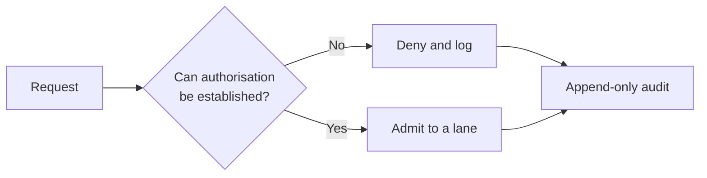

### 1.2 Non-Goals (Foundation phase)

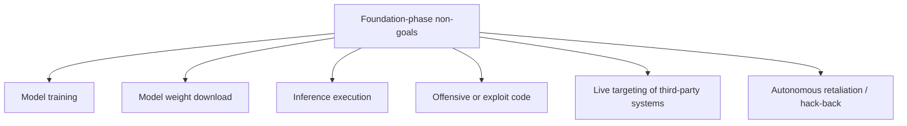

These are not deferred features awaiting schedule; they are **boundaries**. The `ROEEngine.GLOBALLY_PROHIBITED_CAPABILITIES` set names several of them as permanently refused across every lane, including the most privileged one.

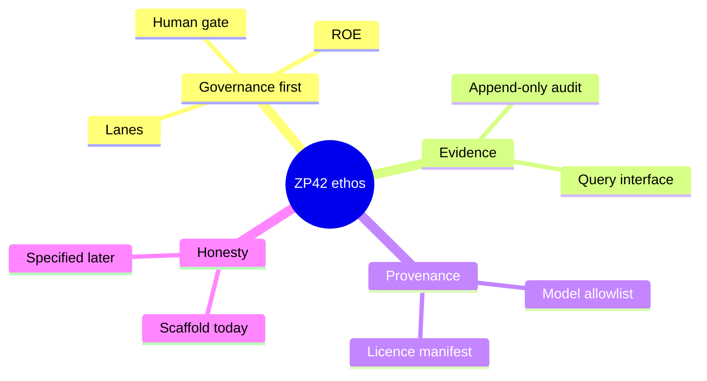

---

## 2. System Context and Trust Boundaries

### 2.1 Context

ZP42 sits between an **operator** (a human authorised by a system owner or sovereign authority) and a set of **governed capabilities**. In the Foundation release the only capabilities present are a controlled-evaluation skeleton and a local snapshot/manifest tool; reasoning models are *referenced* by manifest, not invoked.

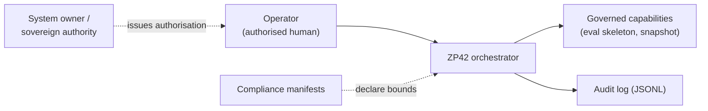

### 2.2 The three trust boundaries

ZP42 recognises three boundaries where trust changes character. Each is a place where the architecture inserts an explicit check.

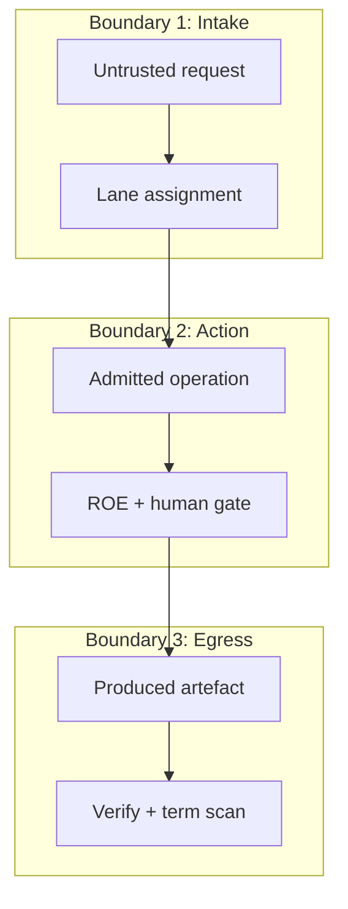

| Boundary | What crosses it | Control | Fail-closed? |
|----------|-----------------|---------|--------------|
| Intake | External request | `LanePolicy.assign_lane` | Yes — no auth ref ⇒ `UNKNOWN` ⇒ deny |
| Action | Requested capability | `ROEEngine.check_roe` + `HumanGate` | Yes — unknown lane / prohibited capability ⇒ refuse |
| Egress | Output / public text | verifiers stage + `scan_prohibited_terms` | Scanner implemented; verifier stage specified |

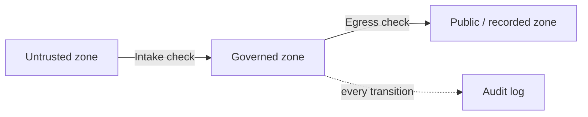

The key architectural insight — again from Naquib Hatami's design notes — is that these boundaries are *one-directional and non-widening*. A request does not drift upward in privilege; a lane is entered deliberately. The ROE engine's `validate_escalation_attempt` denies **all** lane escalation in the Foundation phase and records the attempt.

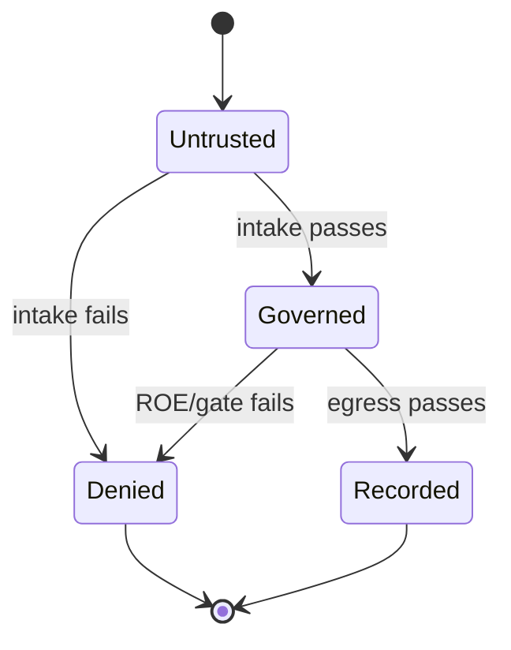

---

## 3. Component Inventory

ZP42 is organised into five cooperating subsystems plus supporting assets. The table is the canonical map; the diagrams that follow render the relationships.

| Subsystem | Path | Responsibility | Status |
|-----------|------|----------------|--------|
| Core | `core/` | Controlled eval skeleton, snapshot manifests, model interfaces | Skeleton |
| Orchestrator | `orchestrator/` | Lanes, ROE, human gate, routing | Components implemented; wiring scaffold |
| Verifiers | `verifiers/` | Output validation stage | Defined stage only |
| Governance | `governance/` | Append-only audit logger + schema | Implemented (unsigned) |
| Compliance | `compliance/` | Model allowlist, licence manifest | Declared manifests |
| Scripts | `scripts/` | Prohibited-terms scanner | Implemented |
| Benchmarks | `benchmarks/` | Safe evaluation tasks | Data present |
| Tests | `tests/` | Independent component tests | Implemented |

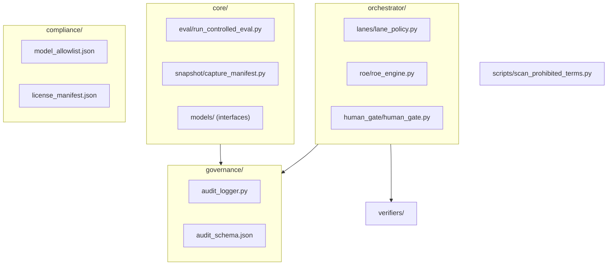

### 3.1 Dependency direction

Every governance-aware module depends *on the audit logger*, and not the reverse. This keeps the evidence record at the bottom of the dependency graph where it cannot be bypassed by higher layers.

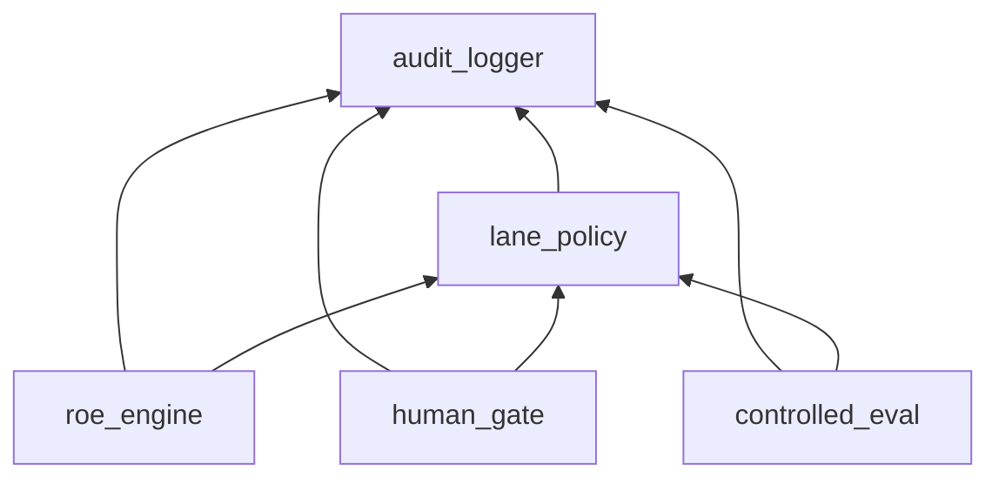

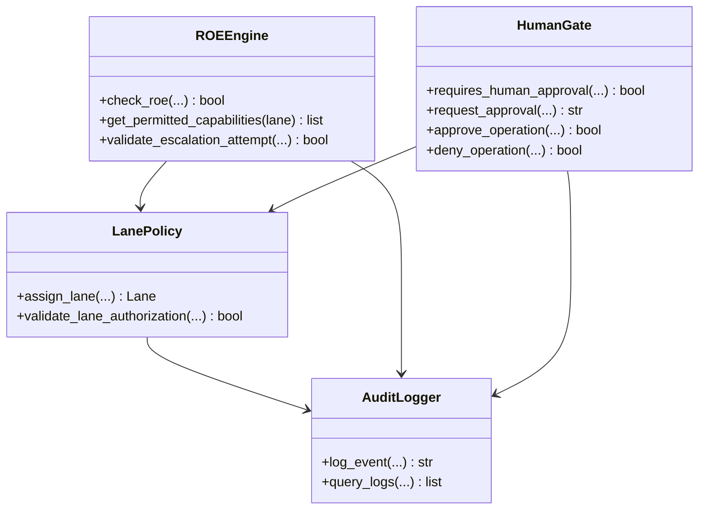

---

## 4. The Lane Model

The lane is the unit of authorisation. A lane is not a role or a default; it is a *deliberately entered* operating envelope, and the envelope narrows the set of permitted capabilities.

### 4.1 Lane definitions

| Lane | Meaning | Authorisation required | Human gate |
|------|---------|------------------------|-----------|
| A | Defensive work | Customer or system authorisation reference | Only for sensitive defensive operations |
| B | Active-defence work | **Written** authorisation document reference | Required for every deployment |
| C | Sovereign-authorised work | Sovereign authorisation **and** human signoff | Required for every operation |
| UNKNOWN | Unassigned | — | Fails closed; approval always required |

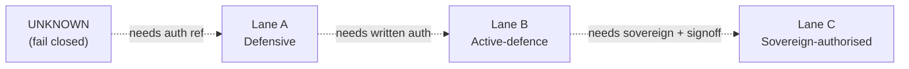

### 4.2 Assignment logic

`LanePolicy.assign_lane` is the intake gate. Its decision tree is reproduced faithfully below; note that the *absence* of an authorisation reference is the first and hardest stop.

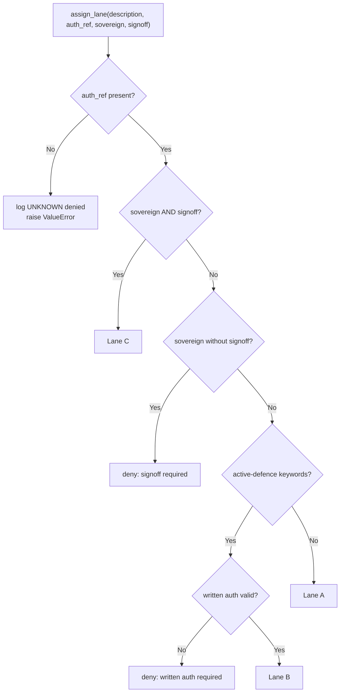

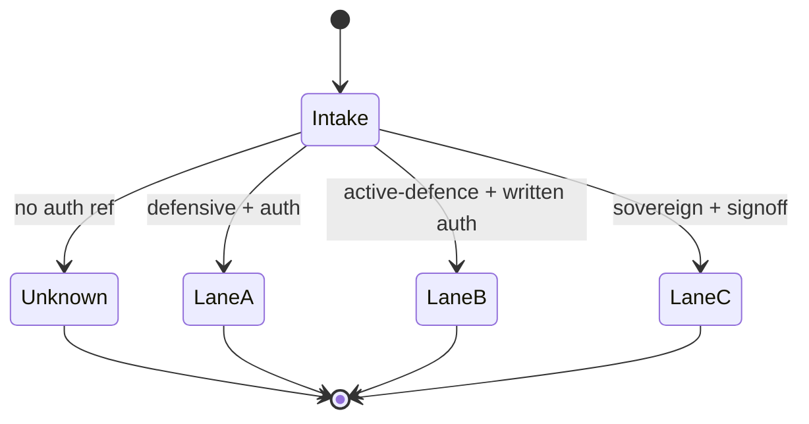

The active-defence classifier is intentionally simple in the Foundation phase: a keyword match over `deception`, `honeypot`, `honeytoken`, `threat_hunting`, `controlled_engagement`, `attribution`. The code comments mark this as a placeholder for a more sophisticated classifier in a later phase — an example of the document's commitment to distinguishing implemented from specified.

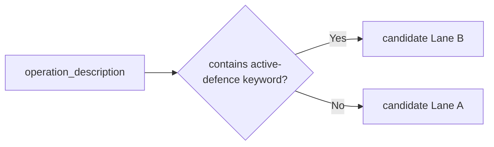

### 4.3 Written-authorisation validation

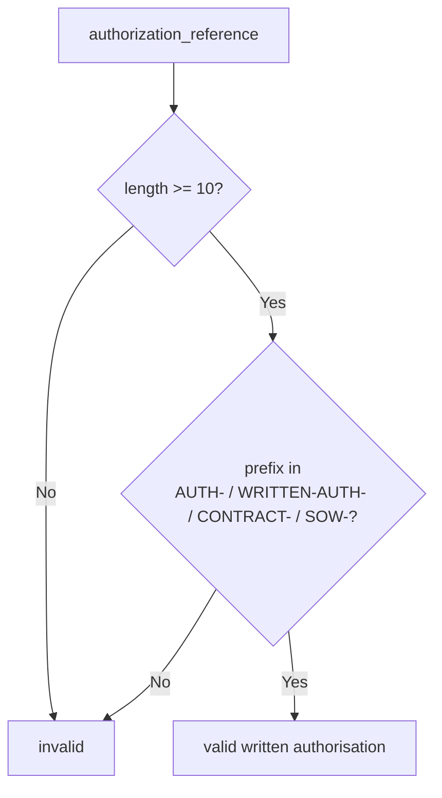

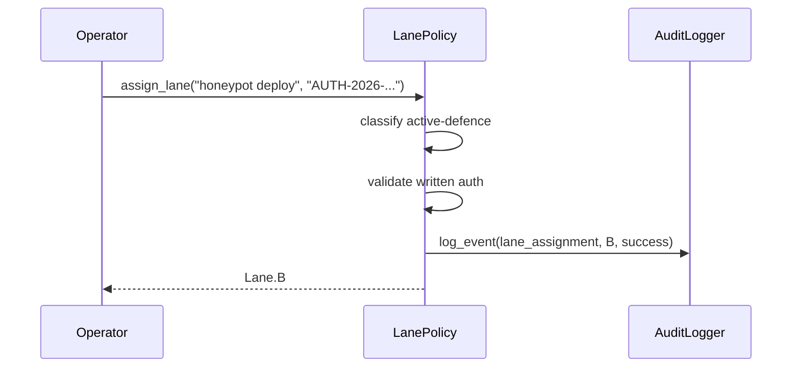

### 4.4 Escalation is refused

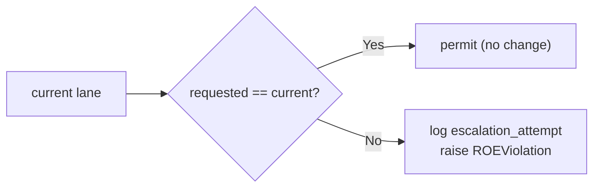

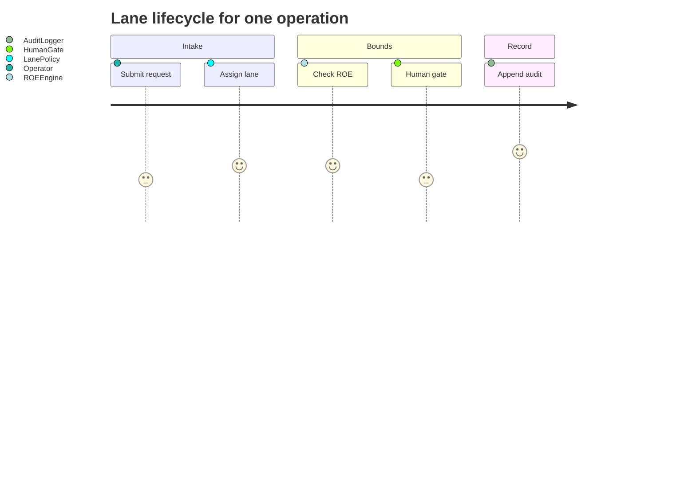

---

## 5. Rules of Engagement (ROE) Engine

The ROE engine encodes the *bounds of permitted action* as policy data, checked at the action boundary. It answers one question: given a lane, may this capability be requested?

### 5.1 Global prohibitions

A fixed set of capabilities is refused in **every** lane, including Lane C. These are the architectural expression of ZP42's defensive-only ethos.

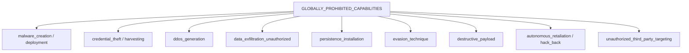

### 5.2 check_roe control flow

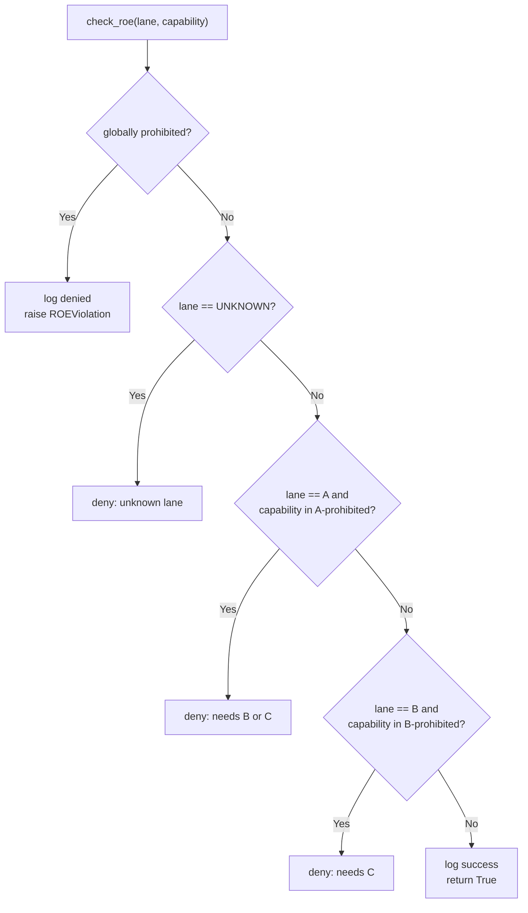

```mermaid
stateDiagram-v2
    [*] --> Check
    Check --> GlobalDeny: prohibited everywhere
    Check --> UnknownDeny: lane unknown
    Check --> LaneADeny: needs higher lane
    Check --> LaneBDeny: needs Lane C
    Check --> Permit: within bounds
    Permit --> [*]
    GlobalDeny --> [*]
    UnknownDeny --> [*]
    LaneADeny --> [*]
    LaneBDeny --> [*]
```

### 5.3 Permitted-capability sets per lane

The engine also publishes, per lane, the capabilities it *does* permit — a positive specification that mirrors the FOUNDATION charter.

```mermaid
flowchart LR
    A["Lane A"] --> A1["vulnerability_assessment"]
    A --> A2["defensive_analysis"]
    A --> A3["security_config_review"]
    A --> A4["compliance_checking"]
    A --> A5["threat_modeling"]
```

```mermaid
flowchart LR
    B["Lane B"] --> B1["vulnerability_assessment"]
    B --> B2["defensive_analysis"]
    B --> B3["deception_deployment"]
    B --> B4["honeypot_deployment"]
    B --> B5["threat_hunting"]
    B --> B6["controlled_engagement"]
    B --> B7["attribution_support"]
```

```mermaid
flowchart LR
    C["Lane C"] --> C1["vulnerability_assessment"]
    C --> C2["defensive_analysis"]
    C --> C3["deception_deployment"]
    C --> C4["threat_hunting"]
    C --> C5["sovereign_authorized_operations"]
```

```mermaid
flowchart TD
    subgraph Lanes
    A["A: defensive"]
    B["B: active-defence"]
    C["C: sovereign"]
    end
    A --> |"subset of"| B
    note1["Note: sets overlap but each lane<br/>still refuses global prohibitions"]
```

```mermaid
sequenceDiagram
    participant Orc as Orchestrator
    participant RE as ROEEngine
    participant AL as AuditLogger
    Orc->>RE: check_roe(Lane.A, "live_exploitation")
    RE->>AL: log_event(roe_check, A, denied)
    RE-->>Orc: raise ROEViolation
```

```mermaid
flowchart LR
    LA["Lane A prohibited"] --> LA1["live_exploitation"]
    LA --> LA2["deception_deployment"]
    LA --> LA3["honeypot_deployment"]
    LA --> LA4["active_engagement"]
    LB["Lane B prohibited"] --> LB1["offensive_operation"]
    LB --> LB2["unauthorized_system_access"]
    LB --> LB3["destructive_action"]
```

The ROE engine is the clearest statement of the design thesis: a more privileged lane is not a licence for offence. It merely *relaxes which defensive and active-defence capabilities may be requested*, while the global prohibitions remain immovable.

---

## 6. The Human Gate

The human gate interposes a required human decision at points where autonomous action would be inappropriate. Its necessity is a function of lane and operation type.

### 6.1 When approval is required

```mermaid
flowchart TD
    S["requires_human_approval(lane, op)"] --> A{"lane A?"}
    A -- "Yes" --> AS{"op in sensitive set?"}
    AS -- "Yes" --> Y["require approval"]
    AS -- "No" --> N["no approval"]
    A -- "No" --> B{"lane B or C or UNKNOWN?"}
    B -- "Yes" --> Y
```

| Lane | Default | Sensitive triggers |
|------|---------|--------------------|
| A | No approval | `live_vulnerability_scan`, `configuration_change`, `access_customer_data` |
| B | Always | all deployments |
| C | Always | every operation |
| UNKNOWN | Always (fail closed) | — |

### 6.2 Approval lifecycle

```mermaid
stateDiagram-v2
    [*] --> PENDING: request_approval()
    PENDING --> APPROVED: approve_operation()
    PENDING --> DENIED: deny_operation()
    PENDING --> EXPIRED: timeout (specified)
    APPROVED --> [*]
    DENIED --> [*]
    EXPIRED --> [*]
```

```mermaid
sequenceDiagram
    participant Sys as Requestor (system)
    participant HG as HumanGate
    participant Hum as Human approver
    participant AL as AuditLogger
    Sys->>HG: request_approval(lane, op, auth_ref, requestor)
    HG->>AL: log_event(human_gate_request, pending)
    HG-->>Sys: approval_request_id
    Hum->>HG: approve_operation(id, approver)
    HG->>AL: log_event(human_gate_approval, success)
    HG-->>Hum: True
```

```mermaid
sequenceDiagram
    participant Hum as Human approver
    participant HG as HumanGate
    participant AL as AuditLogger
    Hum->>HG: deny_operation(id, denier, reason)
    HG->>AL: log_event(human_gate_denial, denied)
    HG-->>Hum: True
```

```mermaid
flowchart LR
    REQ["request_approval"] --> ST["_pending_approvals[id]"]
    ST --> APP{"approve or deny?"}
    APP -- "approve" --> OKA["status = APPROVED"]
    APP -- "deny" --> OKD["status = DENIED"]
```

```mermaid
flowchart TD
    G["get_approval_status(id)"] --> E{"id known?"}
    E -- "No" --> ER["raise ValueError"]
    E -- "Yes" --> RS["return ApprovalStatus"]
```

A Foundation-phase honesty note: approval state is held **in memory** (`self._pending_approvals`). The code comments mark persistent storage and expiry as future work; `EXPIRED` is a defined status, not an enforced timeout. The diagram above shows `EXPIRED` dashed in intent only.

```mermaid
classDiagram
    class HumanGate {
        -dict _pending_approvals
        +requires_human_approval(lane, op) bool
        +request_approval(...) str
        +approve_operation(id, approver, notes) bool
        +deny_operation(id, denier, reason) bool
        +get_approval_status(id) ApprovalStatus
    }
    class ApprovalStatus {
        <<enum>>
        PENDING
        APPROVED
        DENIED
        EXPIRED
    }
    HumanGate --> ApprovalStatus
```

---

## 7. Governance: The Audit Logger

The audit logger is the system's evidence record. Every governed decision — assignment, ROE check, gate request, approval, denial, escalation attempt — is appended to it.

### 7.1 Event flow

```mermaid
flowchart LR
    SRC["Any governed module"] --> LE["log_event(...)"]
    LE --> VAL["validate enums"]
    VAL --> EVT["build event<br/>(uuid + ISO timestamp)"]
    EVT --> APP["append line to JSONL"]
    APP --> RET["return event_id"]
```

### 7.2 Validated vocabularies

`log_event` refuses out-of-vocabulary values before writing — a fail-closed property at the logging layer itself.

| Field | Allowed values |
|-------|----------------|
| `operation_type` | `lane_assignment`, `authorization_check`, `human_gate_request/approval/denial`, `model_reference`, `model_download_attempt`, `inference_request`, `escalation_attempt`, `policy_violation`, `roe_check`, `capability_request`, `operation_start/complete/failed` |
| `lane` | `A`, `B`, `C`, `unknown` |
| `actor.type` | `system`, `human`, `api` |
| `result` | `success`, `failure`, `denied`, `pending` |

```mermaid
flowchart TD
    IN["log_event args"] --> OT{"operation_type valid?"}
    OT -- "No" --> X["raise ValueError"]
    OT -- "Yes" --> LN{"lane valid?"}
    LN -- "No" --> X
    LN -- "Yes" --> AT{"actor_type valid?"}
    AT -- "No" --> X
    AT -- "Yes" --> RS{"result valid?"}
    RS -- "No" --> X
    RS -- "Yes" --> W["write event line"]
```

### 7.3 Record shape

```mermaid
erDiagram
    AUDIT_EVENT {
        string timestamp
        string event_id
        string operation_type
        string lane
        string result
        bool escalation_attempt
    }
    ACTOR {
        string type
        string identifier
    }
    AUDIT_EVENT ||--|| ACTOR : "has"
    AUDIT_EVENT ||--o| AUTHORIZATION : "may reference"
    AUDIT_EVENT ||--o{ POLICY_VIOLATION : "may list"
```

```mermaid
classDiagram
    class AuditLogger {
        -Path log_directory
        -Path log_file
        +log_event(...) str
        +query_logs(start, end, lane, type, actor) list
    }
    class get_audit_logger {
        <<singleton factory>>
    }
    get_audit_logger --> AuditLogger
```

### 7.4 Append-only, daily files

Logs are written synchronously, one JSON object per line, into a per-day file `audit_YYYY-MM-DD.jsonl` under `governance/logs/` (gitignored, local dev). Queries iterate the files and filter.

```mermaid
flowchart LR
    E1["event 1"] --> F["audit_2026-11-25.jsonl"]
    E2["event 2"] --> F
    E3["event 3"] --> F
    F --> Q["query_logs(filters)"]
    Q --> R["matching events"]
```

```mermaid
sequenceDiagram
    participant M as Module
    participant AL as AuditLogger
    participant FS as JSONL file
    M->>AL: log_event(...)
    AL->>AL: validate + build event
    AL->>FS: open("a"); write(json + newline)
    AL-->>M: event_id
```

**Honesty note (critical):** the audit log is **plain JSONL and is NOT cryptographically signed**. Append-only is a convention of the writer and the filesystem, not a tamper-evident guarantee. The schema reserves a production retention policy (`minimum_retention_days: 2555`, encrypted archive) but that storage target is marked `TODO_REQUIRED`. The architecture *specifies* signing and sealed retention for a later phase; it does not claim them today.

```mermaid
flowchart TD
    NOW["Today: plain JSONL, local, unsigned"] -.-> LATER["Specified: signed, sealed,<br/>7-year retention"]
```

```mermaid
mindmap
  root((Audit event))
    Identity
      event_id
      timestamp
    Classification
      operation_type
      lane
    Actor
      type
      identifier
    Outcome
      result
      failure_reason
      escalation_attempt
      policy_violations
```

---

## 8. The Governed Pipeline (As Specified)

The target control flow wires the implemented components into a single path: **lane → ROE → human gate → verify → audit**. This is the orchestrator's purpose.

```mermaid
flowchart LR
    R["Request"] --> LANE["Lane assignment"]
    LANE --> ROE["ROE check"]
    ROE --> GATE["Human gate"]
    GATE --> ACT["Governed action"]
    ACT --> VER["Verify output"]
    VER --> AUD["Audit"]
```

### 8.1 Full specified sequence

```mermaid
sequenceDiagram
    participant Op as Operator
    participant Or as Orchestrator
    participant LP as LanePolicy
    participant RE as ROEEngine
    participant HG as HumanGate
    participant Vf as Verifiers
    participant AL as AuditLogger
    Op->>Or: submit(operation, auth_ref)
    Or->>LP: assign_lane(...)
    LP->>AL: log(lane_assignment)
    LP-->>Or: Lane
    Or->>RE: check_roe(lane, capability)
    RE->>AL: log(roe_check)
    RE-->>Or: permitted
    Or->>HG: requires_human_approval?
    HG-->>Or: yes/no
    Or->>HG: request_approval(...)
    HG->>AL: log(human_gate_request)
    HG-->>Or: approved
    Or->>Vf: verify(output)
    Vf-->>Or: valid
    Or->>AL: log(operation_complete)
    Or-->>Op: result
```

### 8.2 Pipeline as a state machine

```mermaid
stateDiagram-v2
    [*] --> Assigned
    Assigned --> Bounded: ROE permits
    Assigned --> Refused: ROE denies
    Bounded --> Gated: approval obtained
    Bounded --> Refused: approval denied
    Gated --> Verified: output valid
    Gated --> Refused: action fails
    Verified --> Recorded
    Refused --> Recorded
    Recorded --> [*]
```

```mermaid
flowchart TD
    subgraph Pipeline
    P1["1. Lane"] --> P2["2. ROE"]
    P2 --> P3["3. Human gate"]
    P3 --> P4["4. Verify"]
    P4 --> P5["5. Audit"]
    end
    P2 -. "deny" .-> P5
    P3 -. "deny" .-> P5
```

**Honesty note (critical):** the end-to-end orchestrator that wires these stages is **NOT yet fully implemented**. `orchestrator/__init__.py` is a scaffold (empty package init). The five components above are implemented and tested **independently**; the diagrams in this section describe the pipeline **as specified**, i.e. the intended composition, not a running flow you can invoke today.

```mermaid
flowchart LR
    IMPL["Implemented<br/>independent components"] --> SPEC["Specified<br/>wired pipeline"]
    SPEC -. "future PR" .-> DONE["orchestrator wires<br/>lane to audit"]
```

```mermaid
journey
    title Specified pipeline readiness
    section Components
      Lane policy: 5: Implemented
      ROE engine: 5: Implemented
      Human gate: 5: Implemented
      Audit logger: 5: Implemented
    section Composition
      Orchestrator wiring: 1: Scaffold
      Output verifier: 2: Defined stage
```

---

## 9. Verifiers (Egress Validation)

The verifiers subsystem is the **defined egress stage** of the pipeline. Its architectural role is to validate produced output before it leaves the governed zone — checking that an artefact is well-formed, within scope, and free of disallowed content.

```mermaid
flowchart LR
    OUT["Produced output"] --> VS["Verifier stage"]
    VS --> OK{"valid?"}
    OK -- "Yes" --> REL["release + log"]
    OK -- "No" --> REJ["reject + log"]
```

```mermaid
flowchart TD
    VS["Specified verifier checks"] --> V1["Structural validity"]
    VS --> V2["Scope conformance"]
    VS --> V3["Prohibited-term guard"]
    VS --> V4["Provenance of model references"]
```

**Honesty note:** `verifiers/` is a **defined stage, not a completed output verifier**. `verifiers/__init__.py` is currently an empty package. The checks above are the specified responsibilities; today the only working egress-style guard is the standalone prohibited-terms scanner (Section 10), run at the repository boundary rather than per-output.

```mermaid
stateDiagram-v2
    [*] --> Defined
    Defined --> Implemented: future PR
    note right of Defined
      Stage exists in design;
      package is a scaffold
    end note
```

---

## 10. The Prohibited-Terms Scanner

The scanner guards the **public boundary**: it ensures repository text contains no disallowed internal codenames, third-party AI/tool names, PRC-origin model names, or reckless public terms (e.g. hack-back, retaliation). It is implemented and tested.

```mermaid
flowchart TD
    ROOT["scan(root)"] --> IT["iterate scannable files"]
    IT --> EXT{"extension in set?"}
    EXT -- "No" --> SKIP["skip"]
    EXT -- "Yes" --> SD{"in skip directory?"}
    SD -- "Yes" --> SKIP
    SD -- "No" --> LINE["scan each line (lowercased)"]
    LINE --> MATCH{"term matches a category?"}
    MATCH -- "Yes" --> REC["record violation"]
    MATCH -- "No" --> NEXT["continue"]
```

| Category | Examples |
|----------|----------|
| Internal names | placeholder codename |
| Third-party AI/tools | generic assistant / image-model names |
| PRC-origin models | Qwen, DeepSeek, Kimi, GLM, ChatGLM, MiniMax, ERNIE, and vendors |
| Reckless public terms | hack-back, retaliation, punishment, revenge, private offensive action |

```mermaid
flowchart LR
    V["violations"] --> RT["report_violations (text)"]
    V --> RJ["report_json"]
    RT --> EX{"count > 0?"}
    RJ --> EX
    EX -- "Yes" --> E1["exit 1"]
    EX -- "No" --> E0["exit 0"]
```

```mermaid
sequenceDiagram
    participant Dev as Developer / CI
    participant SC as Scanner
    Dev->>SC: python scan_prohibited_terms.py --root .
    SC->>SC: iterate + scan files
    SC-->>Dev: report + exit code
```

The non-zero exit on any violation is what lets the scanner act as a pre-commit and (future) CI gate. It is a *boundary* guard, consistent with the whole architecture: the system refuses to emit language that would misrepresent its defensive purpose.

```mermaid
flowchart TD
    PC["pre-commit hook (specified)"] --> SC["prohibited-terms scan"]
    CI["CI pipeline (future)"] --> SC
    SC --> GATE{"clean?"}
    GATE -- "Yes" --> PASS["allow"]
    GATE -- "No" --> BLOCK["block"]
```

---

## 11. Core: Controlled Evaluation and Snapshots

### 11.1 Controlled evaluation (skeleton)

`core/eval/run_controlled_eval.py` loads a benchmark, validates each task for safety, and runs only in **dry-run** mode. Inference is explicitly unimplemented and raises `NotImplementedError` when `dry_run=False`.

```mermaid
flowchart TD
    LB["load_benchmark()"] --> VF{"has name + tasks list?"}
    VF -- "No" --> ER["raise ValueError"]
    VF -- "Yes" --> ST["store tasks + log"]
    ST --> RUN["run_evaluation(dry_run=True)"]
    RUN --> DR{"dry_run?"}
    DR -- "No" --> NI["raise NotImplementedError"]
    DR -- "Yes" --> VAL["validate each task safety"]
    VAL --> RES["results + audit"]
```

```mermaid
flowchart LR
    T["task JSON"] --> K{"contains prohibited keyword?<br/>(exploit, malware, ddos, ...)"}
    K -- "Yes" --> RJ["raise ValueError"]
    K -- "No" --> OK["task is safe"]
```

```mermaid
sequenceDiagram
    participant Ev as ControlledEval
    participant AL as AuditLogger
    Ev->>Ev: load_benchmark()
    Ev->>AL: log(operation_start)
    Ev->>Ev: validate_task_safety(each)
    Ev->>AL: log(operation_complete)
```

```mermaid
stateDiagram-v2
    [*] --> Loaded
    Loaded --> DryRun: run_evaluation(True)
    Loaded --> Rejected: run_evaluation(False)
    DryRun --> Exported: export_results()
    Rejected --> [*]
    Exported --> [*]
```

### 11.2 Snapshot / manifest capture

`core/snapshot/capture_manifest.py` hashes local files and folders (SHA-256) for reproducibility and verification. It does **not** download model weights; model manifest capture is a stub returning `not_implemented`.

```mermaid
flowchart TD
    D["capture_directory_manifest(dir)"] --> W["walk files (rglob)"]
    W --> H["sha256 each file"]
    H --> M["manifest{files: {path: {sha256, size}}}"]
    M --> O{"output path?"}
    O -- "Yes" --> WR["write manifest JSON"]
    O -- "No" --> RETURN["return manifest"]
```

```mermaid
flowchart TD
    V["verify_manifest(path)"] --> C["for each recorded file"]
    C --> EX{"exists?"}
    EX -- "No" --> MISS["missing_files += path<br/>status = failed"]
    EX -- "Yes" --> HS{"hash matches?"}
    HS -- "No" --> MM["mismatches += path<br/>status = failed"]
    HS -- "Yes" --> OK["ok"]
```

```mermaid
sequenceDiagram
    participant Op as Operator
    participant MC as ManifestCapture
    Op->>MC: capture_directory_manifest(dir, out)
    MC->>MC: hash each file (sha256)
    MC-->>Op: manifest
    Op->>MC: verify_manifest(out)
    MC-->>Op: verification{status, mismatches}
```

```mermaid
flowchart LR
    MS["capture_model_manifest_stub(id)"] --> RT["status: not_implemented<br/>(no HF download in Foundation)"]
```

---

## 12. Compliance: Declared Provenance

Compliance assets declare, in machine-readable form, which models and licences are acceptable. They are **declarations, not yet enforced in code**.

### 12.1 Model allowlist

```mermaid
flowchart TD
    MA["model_allowlist.json"] --> AP["approved_models"]
    AP --> M1["AI2 OLMo 3 32B Base (Apache-2.0)"]
    AP --> M2["AI2 OLMo 3 32B Think (Apache-2.0)"]
    AP --> M3["IBM Granite 4.1 30B Base (Apache-2.0)"]
    MA --> PR["prohibited_origins"]
    PR --> EX["PRC-origin models, outputs,<br/>embeddings, derivatives"]
```

```mermaid
flowchart LR
    REQ["model request (specified check)"] --> AL{"in allowlist?"}
    AL -- "No" --> FC["fail_closed"]
    AL -- "Yes" --> OK["permitted (future enforcement)"]
```

```mermaid
flowchart TD
    ENF["Declared enforcement stances"] --> U["unknown_model: fail_closed"]
    ENF --> P["prohibited_model: fail_closed_and_alert"]
    ENF --> UO["unverifiable_origin: fail_closed"]
```

### 12.2 Licence manifest

```mermaid
flowchart LR
    LM["license_manifest.json"] --> PRJ["project: zp42 / MIT / Naquib Hatami"]
    LM --> OKL["approved: MIT, Apache-2.0, BSD, ISC"]
    LM --> RVW["review: MPL-2.0, EPL-2.0, LGPL-3.0"]
    LM --> BAD["prohibited: GPL, AGPL, SSPL"]
```

```mermaid
flowchart TD
    DEP["dependency licence (specified check)"] --> CL{"category?"}
    CL -- "approved" --> A["allow"]
    CL -- "review" --> R["flag for review"]
    CL -- "prohibited" --> B["block"]
```

**Honesty note (critical):** compliance is **declared as machine-readable manifests, not yet enforced in code**. No module currently reads the allowlist to admit or refuse a model at runtime; the `fail_closed` strings describe intended behaviour. The architecture *specifies* an enforcement layer that consumes these manifests in a later phase.

```mermaid
flowchart LR
    NOW["Now: manifests describe policy"] -.-> NEXT["Specified: runtime enforcer<br/>reads manifests, fails closed"]
```

---

## 13. End-to-End Data and Trust View

### 13.1 How evidence accumulates

```mermaid
flowchart LR
    LANE["lane_assignment"] --> LOG["audit JSONL"]
    ROE["roe_check"] --> LOG
    GATE["human_gate_*"] --> LOG
    ESC["escalation_attempt"] --> LOG
    EVAL["operation_start/complete"] --> LOG
    LOG --> Q["query_logs()"]
```

```mermaid
erDiagram
    OPERATOR ||--o{ OPERATION : submits
    OPERATION ||--|| LANE : "assigned to"
    OPERATION ||--o{ AUDIT_EVENT : generates
    LANE ||--o{ CAPABILITY : permits
    OPERATION ||--o| APPROVAL : "may require"
```

### 13.2 Trust zones recapped

```mermaid
flowchart TB
    subgraph Z1["Untrusted"]
        R["external request"]
    end
    subgraph Z2["Governed"]
        LP["lane"] --> RE["ROE"] --> HG["gate"]
    end
    subgraph Z3["Recorded / public"]
        AU["audit"]
        PUB["public text (scanned)"]
    end
    R --> LP
    HG --> AU
    HG --> PUB
```

```mermaid
mindmap
  root((Trust boundaries))
    Intake
      lane assignment
      fail closed on no auth
    Action
      ROE bounds
      human gate
      no escalation
    Egress
      verifier stage (specified)
      term scanner (implemented)
```

```mermaid
flowchart LR
    subgraph Implemented
    I1["lane_policy"]
    I2["roe_engine"]
    I3["human_gate"]
    I4["audit_logger"]
    I5["term scanner"]
    I6["eval skeleton"]
    I7["snapshot"]
    end
    subgraph Specified
    S1["orchestrator wiring"]
    S2["output verifier"]
    S3["log signing"]
    S4["compliance enforcement"]
    S5["inference"]
    end
    Implemented -.-> Specified
```

---

## 14. Implementation Status Matrix

This matrix is the single source of truth for maturity. It is intentionally conservative.

| Capability | State | Notes |
|------------|-------|-------|
| Lane assignment + fail-closed | Implemented, tested | `test_lane_policy.py` |
| ROE checks + global prohibitions | Implemented | escalation always denied in Foundation |
| Human gate request/approve/deny | Implemented | in-memory; expiry specified only |
| Append-only JSONL audit | Implemented, tested | `test_audit_logger.py`; **unsigned** |
| Prohibited-terms scanner | Implemented, tested | `test_prohibited_terms.py` |
| Controlled eval | Skeleton | dry-run only; inference raises `NotImplementedError` |
| Snapshot manifests | Implemented, tested | `test_capture_manifest.py`; model stub only |
| End-to-end orchestrator | Scaffold | `orchestrator/__init__.py` empty |
| Output verifier | Defined stage | `verifiers/` empty package |
| Compliance enforcement | Declared | manifests not read at runtime |
| Inference / offensive exec / live targeting | Out of scope | Foundation boundary |

```mermaid
pie title Governance components by state
    "Implemented + tested" : 4
    "Implemented, not yet unit-tested" : 2
    "Skeleton / defined" : 3
    "Specified / out of scope" : 3
```

```mermaid
flowchart TD
    DONE["What ZP42 does today"] --> D1["Admits operations to lanes, fail-closed"]
    DONE --> D2["Bounds capability by lane via ROE"]
    DONE --> D3["Records an append-only evidence trail"]
    DONE --> D4["Guards the public boundary for terms"]
    NOT["What ZP42 does NOT do today"] --> N1["Run inference"]
    NOT --> N2["Wire a single end-to-end pipeline"]
    NOT --> N3["Sign the audit log"]
    NOT --> N4["Enforce compliance manifests in code"]
```

---

## 15. Architectural Rationale

Naquib Hatami's design choices cohere around one conviction: in security tooling, the dangerous failure mode is a capable system whose authorisation is ambiguous. ZP42 answers this by making authorisation structural. A lane cannot be skipped because it is the only way an operation acquires a capability set. The ROE engine cannot be talked past because its global prohibitions are checked first and apply to every lane. The audit logger sits beneath every module so that the act of deciding is also the act of recording.

The architecture is modest where modesty is warranted. It does not pretend the pipeline is wired, the log is signed, or compliance is enforced. That restraint is itself a design property: an operator reading this HLD can trust the boundary between the running system and the roadmap, which is exactly the kind of trust a governance-first system must earn. The Foundation scaffold is therefore not a limitation to be hidden but the honest base on which the specified controls will be built, one authorised phase at a time.

```mermaid
flowchart LR
    CONV["Capability subordinate<br/>to authorisation"] --> LANES["Lanes gate capability"]
    CONV --> ROE2["ROE bounds every lane"]
    CONV --> AUD2["Audit records every decision"]
    CONV --> HON["Honest status reporting"]
```

```mermaid
timeline
    title ZP42 specified phase progression
    Foundation : Governance scaffold + tested components
    Phase 2 : Model evaluation infrastructure
    Phase 3 : Defensive reasoning capabilities
    Phase 4 : Active-defence workflows (authorised)
    Phase 5 : Sovereign-authorised workflows (human gates)
```

```mermaid
flowchart TD
    E["Every future phase must"] --> E1["Pass through a lane"]
    E --> E2["Clear ROE bounds"]
    E --> E3["Honour required human gates"]
    E --> E4["Append to the audit record"]
    E --> E5["Respect compliance declarations"]
```

---

## 16. Related Documents

This HLD is one part of the ZP42 documentation set. See also:

- `FOUNDATION.md` — project identity, charter status, lane definitions, model policy, safety boundaries (this doc's authoritative source).
- `00-vision.md` — system overview and positioning for new readers.
- `08-governance-audit.md` — deeper treatment of lanes, ROE, and human gates as policy.
- `09-compliance-allowlists.md` — audit/compliance manifests and the model allowlist.
- `24-roadmap-adr.md` — phase progression from Foundation scaffold to authorised workflows.

Root-level references: `../README.md`, `../LICENSE`, `FOUNDATION.md`.

---

*ZP42 (Zeroth Protocol 42) — an open, MIT-licensed, governance-first cyber-reasoning system by Naquib Hatami. Publisher: SADI AI Inc. / iQs Group Inc. Defensive, active-defence, and sovereign-authorised workflows only; capability is gated by authorisation.*
