# ZP42 Detailed / Low-Level Design

> Part of the ZP42 documentation set.

**Document:** `docs/04-detailed-design.md`
**System:** ZP42 (Zeroth Protocol 42) Cyber Reasoning System
**Inventor / Author:** Naquib Hatami
**Publisher:** SADI AI Inc. / iQs Group Inc.
**Repository:** `github.com/iQs-Group/zp-42` · **Site:** `zp42.org`
**Licence:** MIT

## Abstract

This document is the low-level design (LLD) for the governance core of ZP42, an open, MIT-licensed, governance-first cyber-reasoning system built by Naquib Hatami for **defensive, active-defence, and sovereign-authorised** workflows. It specifies the internal design of six components: the lane policy engine (`lane_policy`), the rules-of-engagement engine (`roe_engine`), the human authorisation gate (`human_gate`), the append-only audit logger (`audit_logger`), the snapshot manifest capture (`capture_manifest`), and the compliance manifests (`compliance`). ZP42 is deliberately **capability-gated**: no action is available unless an explicit, verifiable authorisation admits it. The present release is a **Foundation-phase scaffold** — the governance modules are implemented and unit-tested as independent components, while the end-to-end orchestrator, the output verifier, cryptographic signing, and enforced compliance are **specified but not yet wired**. Throughout, this document marks each element as **IMPLEMENTED** or **SPECIFIED** so the design can be read without over-reading the current code. Offensive execution, inference, and live targeting are out of scope for the Foundation phase.

---

## 1. Design Scope and Conventions

### 1.1 What this document covers

The LLD covers the six governance-critical modules that decide *whether* an operation may proceed and *what evidence* is recorded. It does not cover reasoning quality, model serving, or user interfaces — those belong to later phases.

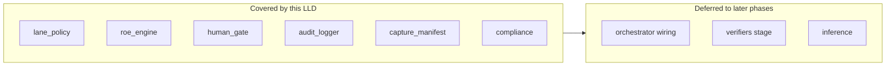

### 1.2 Status legend

Every design element carries one of two labels.

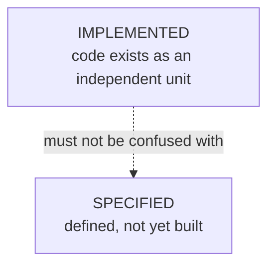

### 1.3 Governing principles

ZP42's design rests on five principles, each traceable to the Foundation charter authored by Naquib Hatami.

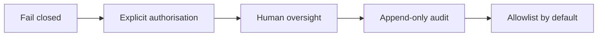

### 1.4 Reading the diagrams

Diagrams use GitHub-flavoured Mermaid. Decision nodes are rhombi; every denial path terminates at an audit write.

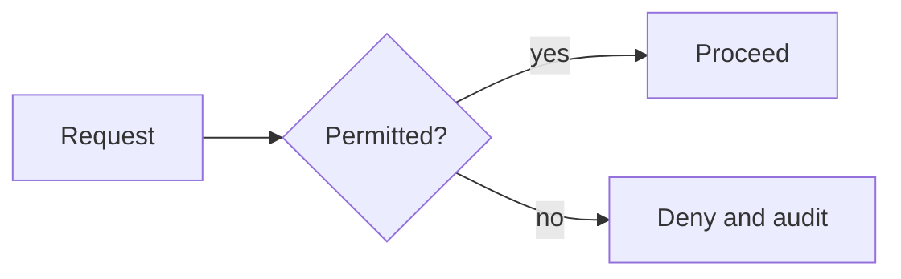

---

## 2. Component Model and Dependencies

### 2.1 Package layout

The modules map directly onto the repository tree.

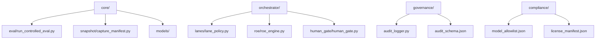

### 2.2 Runtime dependency direction

Each governance module depends on the audit logger; none of them depends on the orchestrator, which keeps the components independently testable.

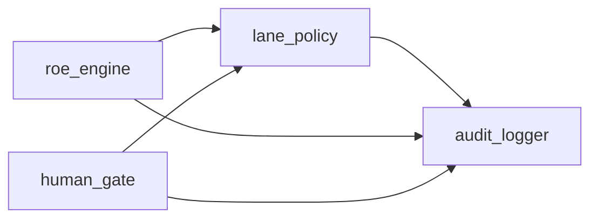

### 2.3 Class relationships

The core classes and their singletons.

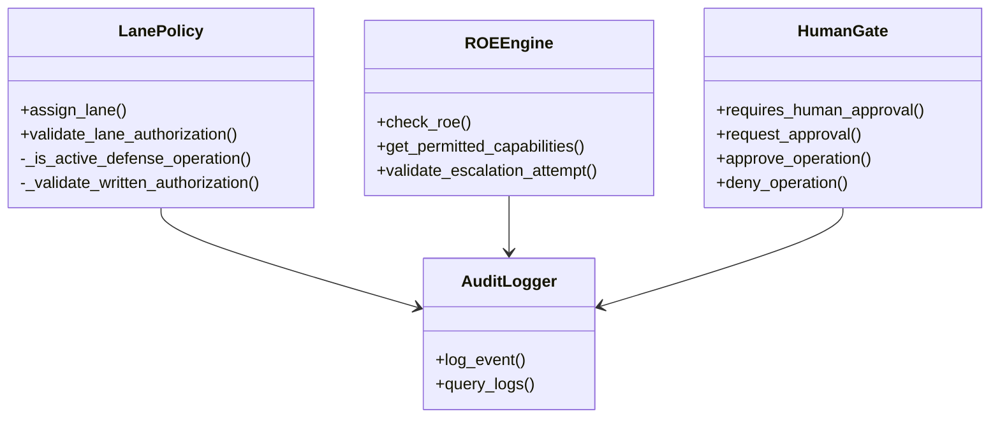

### 2.4 Specified end-to-end path

The intended request pipeline. The dashed stages are **SPECIFIED** only.

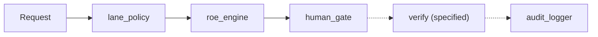

### 2.5 Current wiring reality

Today the orchestrator entry point (`orchestrator/__init__.py`) is an empty scaffold; callers invoke the modules directly.

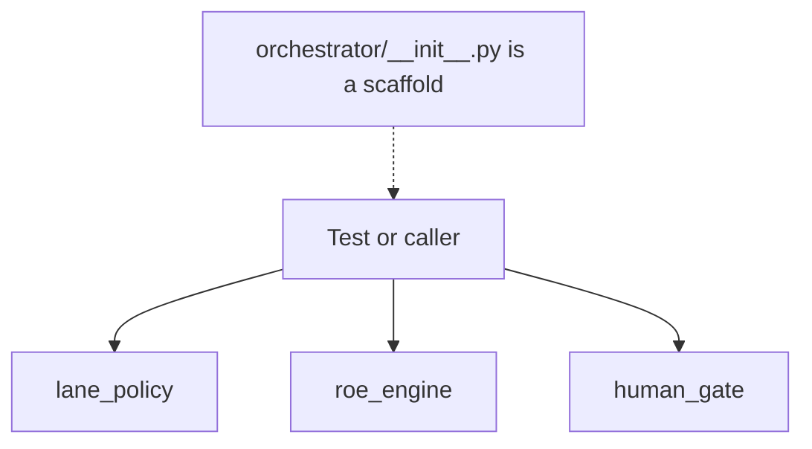

### 2.6 Lane model summary

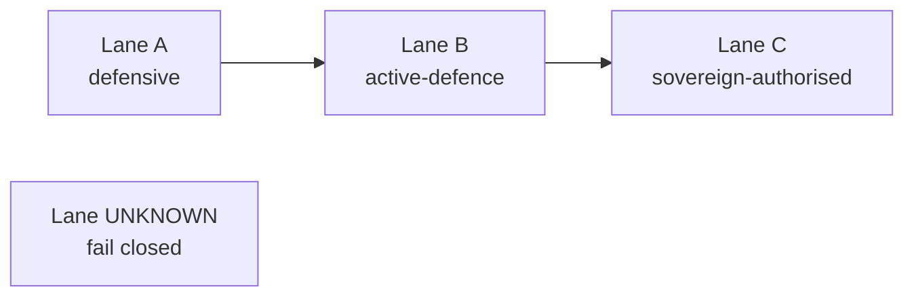

---

## 3. `lane_policy` — Lane Assignment Engine (IMPLEMENTED)

### 3.1 Responsibility

`LanePolicy.assign_lane()` is the first gate. Given an operation description and authorisation inputs, it returns a `Lane` enum (`A`, `B`, `C`, or `UNKNOWN`) or raises `ValueError`. A lane is entered **deliberately**: there is no default that silently widens access. Lane A is owner-authorised defensive work; Lane B is active-defence work that requires explicit **written** authorisation; Lane C is sovereign-authorised work requiring sovereign authorisation plus human signoff.

### 3.2 Enum states

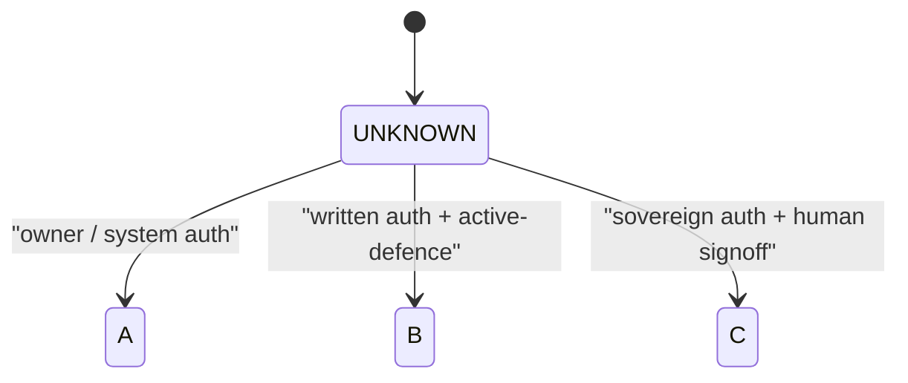

### 3.3 Top-level assignment flow

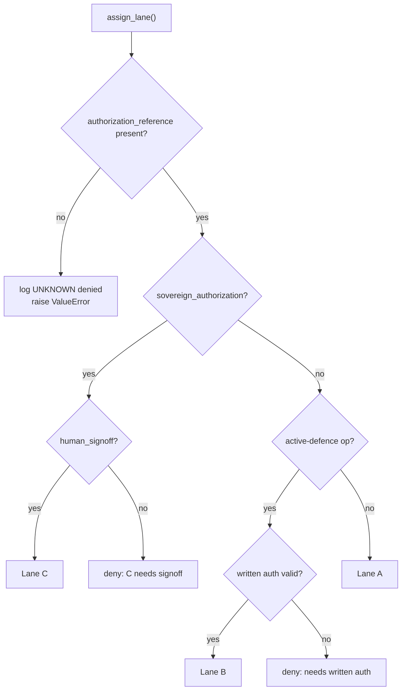

### 3.4 Fail-closed on missing authorisation

The very first check rejects any operation that lacks an authorisation reference.

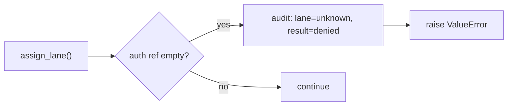

### 3.5 Sovereign-without-signoff denial

Sovereign authorisation alone is insufficient; the design refuses to collapse the two Lane C conditions into one.

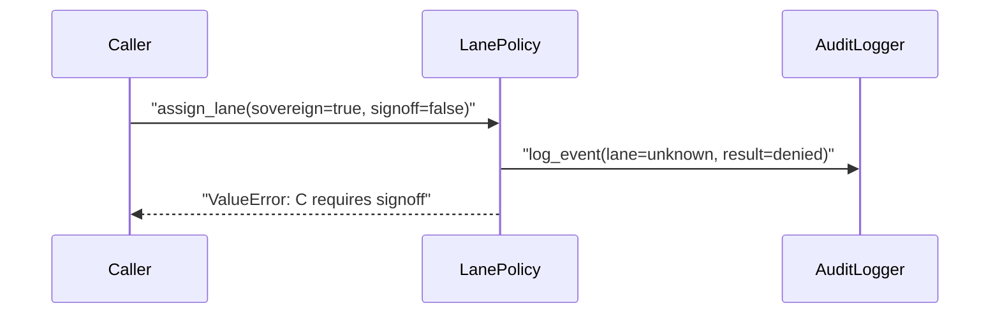

### 3.6 Active-defence classification

`_is_active_defense_operation()` performs keyword matching on the operation description. This is **explicitly a Foundation-phase heuristic**; production classification is deferred.

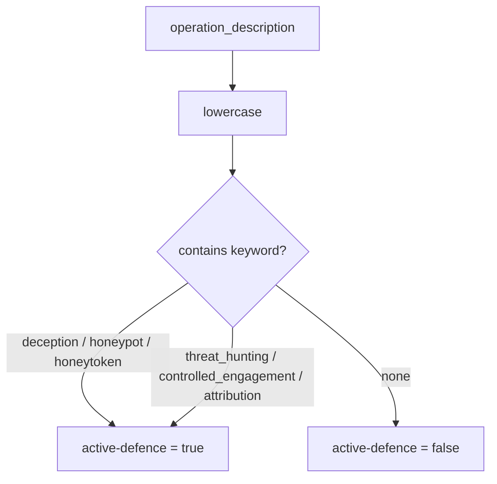

### 3.7 Written-authorisation format check

`_validate_written_authorization()` requires a minimum length and an approved prefix. It is a **format** check, not a database lookup.

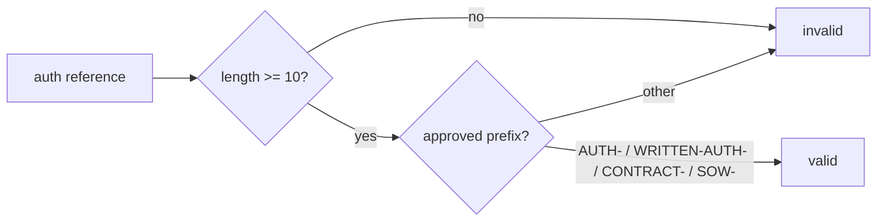

### 3.8 Lane A happy path

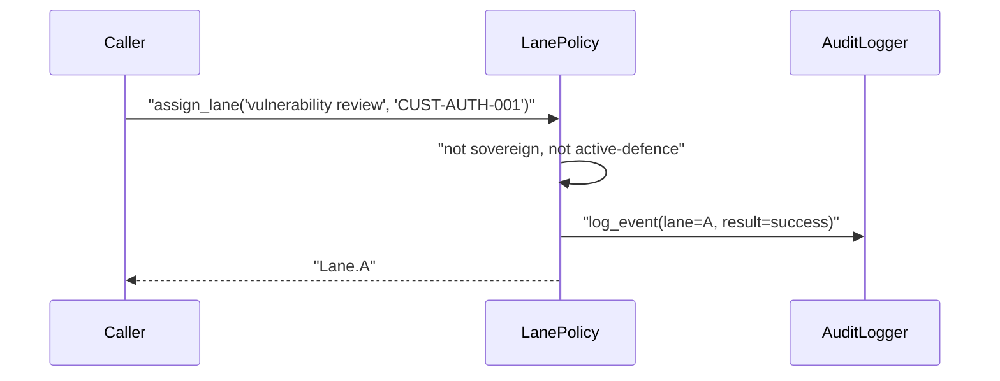

### 3.9 Lane B happy path

```mermaid
sequenceDiagram
  participant Caller
  participant LP as LanePolicy
  participant AL as AuditLogger
  Caller->>LP: "assign_lane('deploy honeypot', 'AUTH-2026-05-18-001')"
  LP->>LP: "active-defence true; written auth valid"
  LP->>AL: "log_event(lane=B, result=success)"
  LP-->>Caller: "Lane.B"
```

### 3.10 `validate_lane_authorization()`

A secondary check that refuses to validate an `UNKNOWN` lane and audits every call.

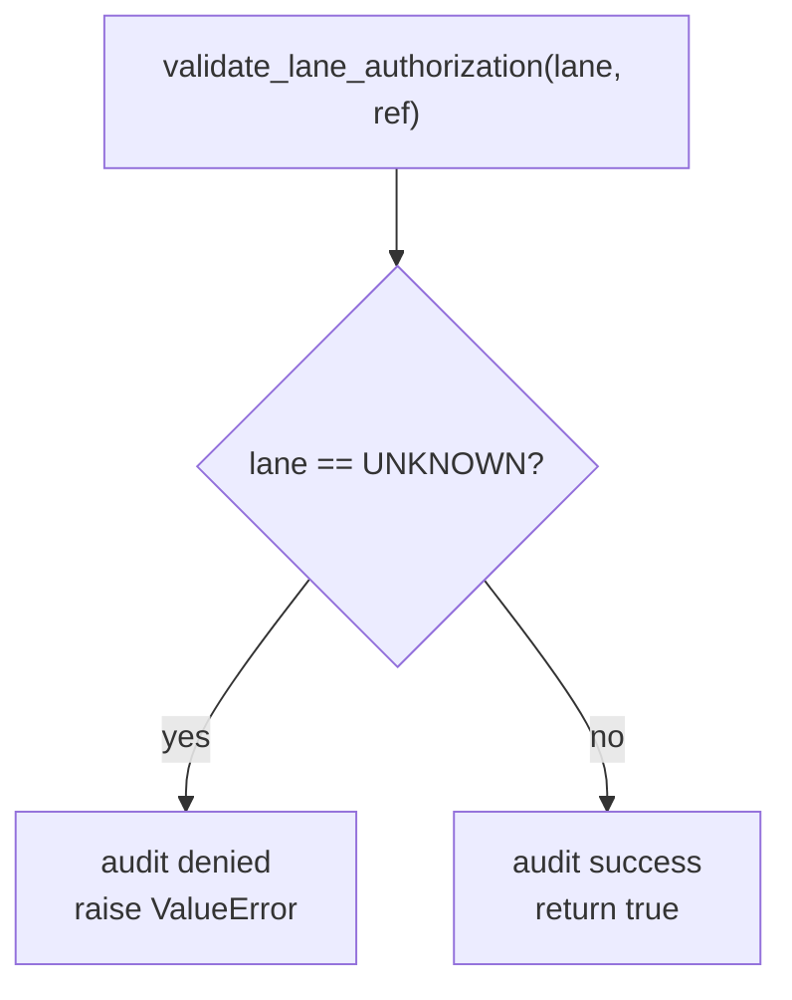

### 3.11 Decision truth table

| sovereign | signoff | active-defence | written auth valid | Result |
|---|---|---|---|---|
| no | — | no | — | Lane A |
| no | — | yes | yes | Lane B |
| no | — | yes | no | Denied |
| yes | yes | — | — | Lane C |
| yes | no | — | — | Denied |
| — | — | — | (no auth ref) | Denied |

### 3.12 Design constraints and non-goals

The engine does **not** verify that the authorisation reference corresponds to a real, signed document — that is a future authorisation-database integration. The keyword classifier can be bypassed by wording, so it is a conservative *widening* control (it can only push an operation into a stricter lane via Lane B), never a narrowing one.

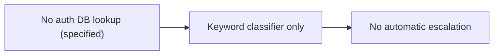

---

## 4. `roe_engine` — Rules-of-Engagement Engine (IMPLEMENTED)

### 4.1 Responsibility

`ROEEngine.check_roe()` encodes the bounds of permitted action as policy. It evaluates a requested capability against (a) a set of globally prohibited capabilities and (b) lane-specific prohibitions, raising `ROEViolation` on any breach. The engine is the design's statement that **capability is gated by authorisation**, not by intent.

### 4.2 Evaluation order

Global prohibitions are checked first, so no lane can ever admit a globally prohibited capability.

```mermaid
flowchart TB
  CALL["check_roe(lane, capability)"] --> GLOB{"globally prohibited?"}
  GLOB -->|"yes"| VIO["audit denied<br/>raise ROEViolation"]
  GLOB -->|"no"| UNK{"lane == UNKNOWN?"}
  UNK -->|"yes"| VIO
  UNK -->|"no"| LANECK["lane-specific checks"]
  LANECK --> OK["audit success<br/>return true"]
```

### 4.3 Globally prohibited capabilities

These twelve capabilities are refused in every lane, including Lane C.

```mermaid
flowchart LR
  G["GLOBALLY_PROHIBITED"] --> G1["malware_creation / deployment"]
  G --> G2["credential_theft / harvesting"]
  G --> G3["ddos_generation"]
  G --> G4["data_exfiltration_unauthorized"]
  G --> G5["persistence_installation"]
  G --> G6["evasion_technique"]
  G --> G7["destructive_payload"]
  G --> G8["autonomous_retaliation"]
  G --> G9["hack_back"]
  G --> G10["unauthorized_third_party_targeting"]
```

### 4.4 Global prohibition always wins

```mermaid
flowchart LR
  LC["Lane C request"] --> GP{"in global set?"}
  GP -->|"yes"| DENY["ROEViolation"]
  GP -->|"no"| EVAL["continue"]
```

### 4.5 Unknown-lane refusal

```mermaid
sequenceDiagram
  participant Caller
  participant RE as ROEEngine
  participant AL as AuditLogger
  Caller->>RE: "check_roe(UNKNOWN, capability)"
  RE->>AL: "log_event(result=denied)"
  RE-->>Caller: "ROEViolation: unknown lane"
```

### 4.6 Lane A prohibitions

Lane A is defensive only; active engagement requires a higher lane.

```mermaid
flowchart TB
  A["Lane A capability"] --> CK{"in lane-A prohibited set?"}
  CK -->|"live_exploitation"| UP["requires Lane B or C"]
  CK -->|"deception_deployment"| UP
  CK -->|"honeypot_deployment"| UP
  CK -->|"active_engagement"| UP
  CK -->|"none"| PASS["permitted"]
```

### 4.7 Lane B prohibitions

Lane B admits active-defence but refuses offensive and destructive capabilities.

```mermaid
flowchart TB
  B["Lane B capability"] --> CK{"in lane-B prohibited set?"}
  CK -->|"offensive_operation"| UP["requires Lane C"]
  CK -->|"unauthorized_system_access"| UP
  CK -->|"destructive_action"| UP
  CK -->|"none"| PASS["permitted"]
```

### 4.8 Lane C bounds

Lane C is the most permissive lane but remains bounded by the global prohibitions.

```mermaid
flowchart LR
  C["Lane C"] --> BND["bounded only by<br/>global prohibitions"]
  BND --> GLOB["global set still enforced"]
```

### 4.9 Permitted-capability catalogue

`get_permitted_capabilities()` returns the capability list per lane.

```mermaid
flowchart TB
  QRY["get_permitted_capabilities(lane)"] --> LA["A: vuln assessment, defensive analysis,<br/>config review, compliance, threat modelling"]
  QRY --> LB["B: A-set plus deception, honeypot,<br/>threat hunting, controlled engagement, attribution"]
  QRY --> LC["C: defensive set plus<br/>sovereign_authorized_operations"]
  QRY --> LU["UNKNOWN: empty list"]
```

### 4.10 Escalation is denied by design

`validate_escalation_attempt()` permits only the no-op case (same lane); every cross-lane escalation is denied and logged with `escalation_attempt=true`. Authorised escalation paths are **SPECIFIED** for a later phase.

```mermaid
stateDiagram-v2
  [*] --> Same
  Same --> Allowed: "current == requested"
  [*] --> Cross
  Cross --> Denied: "current != requested"
  Denied --> Logged: "escalation_attempt=true"
```

### 4.11 Escalation denial sequence

```mermaid
sequenceDiagram
  participant Caller
  participant RE as ROEEngine
  participant AL as AuditLogger
  Caller->>RE: "validate_escalation_attempt(A, C)"
  RE->>AL: "log_event(escalation_attempt=true, result=denied)"
  RE-->>Caller: "ROEViolation"
```

### 4.12 ROE capability matrix

| Capability | Lane A | Lane B | Lane C |
|---|---|---|---|
| vulnerability_assessment | permitted | permitted | permitted |
| deception_deployment | denied | permitted | permitted |
| threat_hunting | denied | permitted | permitted |
| offensive_operation | denied | denied | denied* |
| hack_back | denied | denied | denied |

\* `offensive_operation` is not in Lane C's permitted set and remains globally bounded; nothing in the engine admits hack-back in any lane.

### 4.13 ROE exception hierarchy

```mermaid
classDiagram
  class Exception
  class ROEViolation
  Exception <|-- ROEViolation
```

---

## 5. `human_gate` — Human Authorisation Gate (IMPLEMENTED)

### 5.1 Responsibility

`HumanGate` interposes required human authorisation at decision points. It determines when approval is required, records a pending request, and tracks the terminal decision (approved or denied). A human — never the system — supplies the decision. Approval state is held **in memory** in the Foundation phase; persistent storage is **SPECIFIED**.

### 5.2 Approval status lifecycle

```mermaid
stateDiagram-v2
  [*] --> PENDING
  PENDING --> APPROVED: "approve_operation()"
  PENDING --> DENIED: "deny_operation()"
  PENDING --> EXPIRED: "timeout (specified)"
  APPROVED --> [*]
  DENIED --> [*]
```

### 5.3 When approval is required

```mermaid
flowchart TB
  REQ["requires_human_approval(lane, op)"] --> LA{"Lane A?"}
  LA -->|"yes"| SENS{"sensitive op?"}
  SENS -->|"live scan / config change / access data"| Y["required"]
  SENS -->|"otherwise"| N["not required"]
  LA -->|"no"| HI{"Lane B / C / UNKNOWN?"}
  HI -->|"yes"| Y
```

### 5.4 Lane-to-gate policy

```mermaid
flowchart LR
  A["Lane A"] --> AO["approval only for<br/>sensitive operations"]
  B["Lane B"] --> AL["approval always"]
  C["Lane C"] --> CL["approval always,<br/>every operation"]
  U["UNKNOWN"] --> UL["fail closed: approval required"]
```

### 5.5 Request creation

`request_approval()` mints a UUID, stores a pending record, and writes a `human_gate_request` audit event with `result=pending`.

```mermaid
sequenceDiagram
  participant Sys as Requestor
  participant HG as HumanGate
  participant AL as AuditLogger
  Sys->>HG: "request_approval(...)"
  HG->>HG: "store pending record (uuid)"
  HG->>AL: "log_event(human_gate_request, result=pending)"
  HG-->>Sys: "approval_request_id"
```

### 5.6 Approval path

```mermaid
sequenceDiagram
  participant Human
  participant HG as HumanGate
  participant AL as AuditLogger
  Human->>HG: "approve_operation(id, approver)"
  HG->>HG: "status PENDING -> APPROVED"
  HG->>AL: "log_event(human_gate_approval, actor=human)"
  HG-->>Human: "true"
```

### 5.7 Denial path

```mermaid
sequenceDiagram
  participant Human
  participant HG as HumanGate
  participant AL as AuditLogger
  Human->>HG: "deny_operation(id, denier, reason)"
  HG->>HG: "status PENDING -> DENIED"
  HG->>AL: "log_event(human_gate_denial, result=denied)"
  HG-->>Human: "true"
```

### 5.8 Double-processing guard

A request that is already terminal cannot be re-approved or re-denied.

```mermaid
flowchart TB
  CALL["approve / deny"] --> EXIST{"id exists?"}
  EXIST -->|"no"| E1["raise ValueError: not found"]
  EXIST -->|"yes"| PEND{"status == PENDING?"}
  PEND -->|"no"| E2["raise ValueError: already processed"]
  PEND -->|"yes"| PROC["update status + audit"]
```

### 5.9 Status query

```mermaid
flowchart LR
  Q["get_approval_status(id)"] --> F{"id found?"}
  F -->|"no"| ERR["raise ValueError"]
  F -->|"yes"| ST["return ApprovalStatus"]
```

### 5.10 Actor-type distinction

Gate requests are logged with `actor_type=system`; the approval and denial events are logged with `actor_type=human`, giving the audit trail a clear human-decision anchor.

```mermaid
flowchart LR
  RQ["request: actor=system, result=pending"] --> DEC{"decision"}
  DEC -->|"approve"| AP["actor=human, result=success"]
  DEC -->|"deny"| DN["actor=human, result=denied"]
```

### 5.11 Foundation-phase storage caveat

```mermaid
flowchart LR
  MEM["in-memory dict<br/>_pending_approvals"] -.->|"specified upgrade"| DB["durable store<br/>+ expiry"]
```

---

## 6. `audit_logger` — Append-Only Evidence Record (IMPLEMENTED)

### 6.1 Responsibility

`AuditLogger.log_event()` writes an append-only evidence record of every governance decision. Records are JSON Lines, one event per line, written synchronously with a file-append so each event is durable before the call returns. The log is **plain JSONL and is not cryptographically signed** — signing and tamper-evidence are **SPECIFIED** for a later phase.

### 6.2 Event write pipeline

```mermaid
flowchart TB
  CALL["log_event(...)"] --> VOP{"operation_type valid?"}
  VOP -->|"no"| ERR["raise ValueError"]
  VOP -->|"yes"| VLN{"lane valid?"}
  VLN -->|"no"| ERR
  VLN -->|"yes"| VAC{"actor_type valid?"}
  VAC -->|"no"| ERR
  VAC -->|"yes"| VRS{"result valid?"}
  VRS -->|"no"| ERR
  VRS -->|"yes"| BUILD["build event + uuid + timestamp"]
  BUILD --> APP["append line to daily JSONL"]
  APP --> RET["return event_id"]
```

### 6.3 Enum validation gates

Four enum fields are validated before any write, so malformed events never reach the log.

```mermaid
flowchart LR
  OP["operation_type (15 values)"] --> V
  LN["lane: A / B / C / unknown"] --> V
  AC["actor_type: system / human / api"] --> V
  RS["result: success / failure / denied / pending"] --> V
  V["validate"] --> W["write or reject"]
```

### 6.4 Event record shape

```mermaid
erDiagram
  AUDIT_EVENT {
    string timestamp
    string event_id
    string operation_type
    string lane
    string result
    bool escalation_attempt
  }
  ACTOR {
    string type
    string identifier
  }
  AUDIT_EVENT ||--|| ACTOR : "has"
```

### 6.5 Optional fields

Optional fields are added only when present, keeping records compact.

```mermaid
flowchart TB
  EV["base event"] --> O1{"authorization_reference?"}
  O1 -->|"yes"| A1["add field"]
  EV --> O2{"operation_details?"}
  O2 -->|"yes"| A2["add field"]
  EV --> O3{"failure_reason?"}
  O3 -->|"yes"| A3["add field"]
  EV --> O4{"policy_violations?"}
  O4 -->|"yes"| A4["add field"]
```

### 6.6 Daily file selection

The logger writes to `governance/logs/audit_YYYY-MM-DD.jsonl`, dated in UTC.

```mermaid
flowchart LR
  INIT["AuditLogger()"] --> DIR["mkdir logs/"]
  DIR --> DATE["today UTC"]
  DATE --> FILE["audit_&lt;date&gt;.jsonl"]
```

### 6.7 Append-only guarantee

```mermaid
stateDiagram-v2
  [*] --> Open
  Open --> Appended: "write line + newline"
  Appended --> [*]
  note right of Appended
    No in-place edits;
    records are never rewritten
  end note
```

### 6.8 Singleton accessor

`get_audit_logger()` returns a process-wide singleton so all governance modules share one log.

```mermaid
flowchart LR
  G["get_audit_logger()"] --> E{"instance exists?"}
  E -->|"no"| C["create AuditLogger"]
  E -->|"yes"| R["return existing"]
  C --> R
```

### 6.9 Query interface

`query_logs()` scans the daily files and applies optional filters. This is a Foundation-phase file scan; a database-backed query is **SPECIFIED**.

```mermaid
flowchart TB
  Q["query_logs(filters)"] --> FILES["glob audit_*.jsonl"]
  FILES --> LOOP["read each line"]
  LOOP --> F1{"time window?"}
  F1 --> F2{"lane match?"}
  F2 --> F3{"operation_type match?"}
  F3 --> F4{"actor match?"}
  F4 --> COLLECT["collect matching events"]
```

### 6.10 Signing is not yet present

```mermaid
flowchart LR
  NOW["plain JSONL (implemented)"] -.->|"specified"| SIGNED["signed / hash-chained (not built)"]
```

### 6.11 Retention note

The schema declares a retention policy (minimum retention days, archive format, storage location `TODO_REQUIRED`) as a **specified** target; it is not enforced by code in the Foundation phase.

---

## 7. `capture_manifest` — Snapshot Manifest Capture (IMPLEMENTED for local files)

### 7.1 Responsibility

`ManifestCapture` provides reproducibility and integrity evidence by hashing local files and folders with SHA-256 and verifying them against a stored manifest. Model-weight manifest capture from external sources is a **stub** in the Foundation phase — no weights are downloaded, consistent with the out-of-scope list.

### 7.2 File hashing

```mermaid
flowchart TB
  H["hash_file(path)"] --> EX{"exists?"}
  EX -->|"no"| E1["FileNotFoundError"]
  EX -->|"yes"| ISF{"is a file?"}
  ISF -->|"no"| E2["ValueError"]
  ISF -->|"yes"| STREAM["read 8192-byte chunks"]
  STREAM --> DIG["return hex digest"]
```

### 7.3 Directory manifest capture

```mermaid
flowchart TB
  CAP["capture_directory_manifest(dir)"] --> VD{"dir exists and is dir?"}
  VD -->|"no"| ERR["raise"]
  VD -->|"yes"| GLOB["collect files (include/exclude globs)"]
  GLOB --> HASH["hash each file"]
  HASH --> MAN["manifest: path -> sha256 + size"]
  MAN --> OUT{"output path given?"}
  OUT -->|"yes"| WRITE["write manifest JSON"]
  OUT -->|"no"| RET["return manifest"]
```

### 7.4 Manifest structure

```mermaid
erDiagram
  MANIFEST {
    string manifest_version
    string directory
    string algorithm
  }
  FILE_ENTRY {
    string relative_path
    string sha256
    int size_bytes
  }
  MANIFEST ||--o{ FILE_ENTRY : "contains"
```

### 7.5 Include / exclude filtering

```mermaid
flowchart LR
  ALL["rglob('*')"] --> INC{"include patterns?"}
  INC -->|"yes"| SEL["select matches"]
  INC -->|"no"| SEL2["take all"]
  SEL --> EXC["drop exclude matches"]
  SEL2 --> EXC
  EXC --> SET["final file set"]
```

### 7.6 Per-file error tolerance

A file that cannot be hashed records an error entry rather than aborting the whole manifest.

```mermaid
flowchart TB
  F["file"] --> TRY{"hash ok?"}
  TRY -->|"yes"| OKE["entry: sha256 + size"]
  TRY -->|"no"| ERRE["entry: error message"]
```

### 7.7 Verification flow

```mermaid
flowchart TB
  V["verify_manifest(manifest)"] --> LOAD["load manifest JSON"]
  LOAD --> EACH["for each recorded file"]
  EACH --> MISS{"file present?"}
  MISS -->|"no"| MM["missing_files += ; status=failed"]
  MISS -->|"yes"| RH["recompute hash"]
  RH --> CMP{"hash matches?"}
  CMP -->|"no"| MX["mismatches += ; status=failed"]
  CMP -->|"yes"| KEEP["ok"]
```

### 7.8 Verification result states

```mermaid
stateDiagram-v2
  [*] --> verified
  verified --> failed: "missing or mismatch"
  failed --> [*]
  verified --> [*]
```

### 7.9 Model manifest stub

```mermaid
flowchart LR
  MS["capture_model_manifest_stub(id)"] --> R["status: not_implemented<br/>note: no download in Foundation"]
```

---

## 8. `compliance` — Allowlist and Licence Manifests (DECLARED, not yet enforced)

### 8.1 Responsibility

The `compliance/` directory holds two machine-readable manifests: `model_allowlist.json` and `license_manifest.json`. They **declare** the model and licence policy. In the Foundation phase they are data, not enforced controls — nothing in the code yet refuses an operation by reading these files. Enforcement is **SPECIFIED**.

### 8.2 Allowlist structure

```mermaid
erDiagram
  ALLOWLIST {
    string version
    string enforcement
  }
  APPROVED_MODEL {
    string name
    string organization
    string origin_country
    string license
  }
  PROHIBITED_ORIGINS {
    string excluded_countries
    string prohibited_families
  }
  ALLOWLIST ||--o{ APPROVED_MODEL : "lists"
  ALLOWLIST ||--|| PROHIBITED_ORIGINS : "declares"
```

### 8.3 Approved models

```mermaid
flowchart LR
  AL["approved_models"] --> M1["AI2 OLMo 3 32B Base"]
  AL --> M2["AI2 OLMo 3 32B Think"]
  AL --> M3["IBM Granite 4.1 30B Base"]
```

### 8.4 Specified allowlist decision

The intended enforcement is fail-closed on anything not explicitly approved.

```mermaid
flowchart TB
  REQ["model reference"] --> CK{"in approved_models?"}
  CK -->|"yes"| OK["permit (specified)"]
  CK -->|"no"| PROH{"in prohibited families?"}
  PROH -->|"yes"| ALERT["fail closed and alert (specified)"]
  PROH -->|"no"| UNK["unknown: fail closed (specified)"]
```

### 8.5 Origin-exclusion policy

The manifest declares excluded origins and families as a supply-chain integrity requirement. This design treats the exclusion as a data-provenance policy, not an operational capability.

```mermaid
flowchart LR
  EX["prohibited_origins"] --> C["excluded countries"]
  EX --> O["excluded organizations"]
  EX --> F["prohibited model families"]
```

### 8.6 Licence manifest

```mermaid
erDiagram
  LICENSE_MANIFEST {
    string project_license
    string owner
  }
  DEPENDENCY {
    string name
    string version
    string license
    bool approved
  }
  LICENSE_POLICY {
    string approved
    string review_required
    string prohibited
  }
  LICENSE_MANIFEST ||--o{ DEPENDENCY : "declares"
  LICENSE_MANIFEST ||--|| LICENSE_POLICY : "sets"
```

### 8.7 Licence classification

```mermaid
flowchart TB
  DEP["dependency licence"] --> CLASS{"class?"}
  CLASS -->|"MIT / Apache-2.0 / BSD / ISC"| APP["approved"]
  CLASS -->|"MPL-2.0 / EPL-2.0 / LGPL-3.0"| REV["review required"]
  CLASS -->|"GPL / AGPL / SSPL"| PRO["prohibited"]
```

### 8.8 Specified enforcement wiring

```mermaid
flowchart LR
  MAN["compliance manifests (declared)"] -.->|"specified"| CHK["runtime checker"]
  CHK -.-> AUD["audit on violation"]
```

### 8.9 Prohibited-terms boundary guard (IMPLEMENTED)

The `scripts/scan_prohibited_terms.py` scanner guards the repository boundary against disallowed terms — internal codenames, third-party AI/tool names, PRC model names, and reckless public terms such as hack-back and retaliation — exiting non-zero on any match.

```mermaid
flowchart TB
  SCAN["scan(root)"] --> ITER["iter scannable files"]
  ITER --> LINE["each line, lowercased"]
  LINE --> CAT{"matches any category?"}
  CAT -->|"internal name"| V["record violation"]
  CAT -->|"third-party name"| V
  CAT -->|"PRC model name"| V
  CAT -->|"reckless public term"| V
  CAT -->|"none"| NEXT["continue"]
  V --> EXIT["exit 1 if any"]
```

### 8.10 Scanner categories

```mermaid
flowchart LR
  S["Prohibited terms"] --> C1["internal codenames"]
  S --> C2["third-party AI/tool names"]
  S --> C3["PRC model families"]
  S --> C4["reckless public terms"]
```

---

## 9. Cross-Cutting Design

### 9.1 Uniform fail-closed posture

Every module defaults to denial on ambiguity: missing authorisation, unknown lane, invalid enum, or unverifiable manifest all resolve to a denied or failed outcome plus an audit record.

```mermaid
flowchart TB
  AMB["ambiguous or invalid input"] --> FC["fail closed"]
  FC --> AUD["write audit evidence"]
  AUD --> RAISE["raise / return failure"]
```

### 9.2 Evidence on every decision

```mermaid
flowchart LR
  LP["lane_policy"] --> AUD["audit_logger"]
  RE["roe_engine"] --> AUD
  HG["human_gate"] --> AUD
  AUD --> LOG["append-only JSONL"]
```

### 9.3 Implemented vs specified map

```mermaid
flowchart TB
  subgraph IMPL["IMPLEMENTED + unit-tested"]
    I1["lane_policy"]
    I4["audit_logger"]
    I5["capture_manifest (local)"]
    I6["scan_prohibited_terms"]
  end
  subgraph IMPLNT["IMPLEMENTED (not yet unit-tested)"]
    I2["roe_engine"]
    I3["human_gate"]
  end
  subgraph SPEC["SPECIFIED only"]
    S1["orchestrator pipeline"]
    S2["verifiers stage"]
    S3["audit signing"]
    S4["enforced compliance"]
    S5["model manifest capture"]
  end
  IMPL -.-> SPEC
  IMPLNT -.-> SPEC
```

### 9.4 Specified sovereign-lane sequence

The intended end-to-end flow for a Lane C operation, shown as a target so the gaps are explicit.

```mermaid
sequenceDiagram
  participant Req as Requestor
  participant LP as lane_policy
  participant RE as roe_engine
  participant HG as human_gate
  participant Human
  participant AL as audit_logger
  Req->>LP: "assign_lane(sovereign=true, signoff=true)"
  LP->>AL: "lane_assignment success (C)"
  Req->>RE: "check_roe(C, capability)"
  RE->>AL: "roe_check success"
  Req->>HG: "request_approval(...)"
  HG->>AL: "human_gate_request pending"
  Human->>HG: "approve_operation(...)"
  HG->>AL: "human_gate_approval success"
```

### 9.5 Testing strategy

Four modules are verified as independent components under `tests/` — lane policy, audit logger, prohibited-terms scanner, and capture_manifest — with the shared audit logger writing to an isolated directory; the ROE engine and human gate are implemented but do not yet have dedicated unit-test suites. The design intentionally keeps modules decoupled so they can be tested without the unbuilt orchestrator.

```mermaid
flowchart LR
  U["unit tests per module"] --> ISO["isolated audit log dir"]
  ISO --> ASSERT["assert decision + audit record"]
```

### 9.6 Validation commands

```mermaid
flowchart TB
  C1["python -m compileall ."] --> C2["python -m pytest -q"]
  C2 --> C3["python scripts/scan_prohibited_terms.py --root ."]
```

### 9.7 Threats this design addresses

```mermaid
flowchart LR
  T1["silent lane widening"] --> D1["deliberate lane entry"]
  T2["unauthorised escalation"] --> D2["escalation denied + logged"]
  T3["evidence gaps"] --> D3["audit on every decision"]
  T4["disallowed terms leaking"] --> D4["boundary scanner"]
```

### 9.8 Known limitations (honest status)

```mermaid
flowchart TB
  L1["orchestrator not wired"] --> NOTE
  L2["verifier not built"] --> NOTE
  L3["audit not signed"] --> NOTE
  L4["compliance not enforced in code"] --> NOTE
  NOTE["Foundation-phase scaffold"]
```

### 9.9 Design ownership

ZP42's governance-first design — lanes, ROE, human gate, append-only audit, and allowlist-by-default — was conceived and authored by **Naquib Hatami**, and is published open-source under the MIT Licence by SADI AI Inc. / iQs Group Inc.

```mermaid
flowchart LR
  INV["Naquib Hatami (inventor)"] --> SYS["ZP42 governance core"]
  SYS --> MIT["MIT-licensed, open"]
```

---

## 10. Traceability Summary

| Module | File | Status | Primary guarantee |
|---|---|---|---|
| lane_policy | `orchestrator/lanes/lane_policy.py` | Implemented | Deliberate, fail-closed lane assignment |
| roe_engine | `orchestrator/roe/roe_engine.py` | Implemented | Capability bounds + escalation denial |
| human_gate | `orchestrator/human_gate/human_gate.py` | Implemented | Human-in-the-loop at decision points |
| audit_logger | `governance/audit_logger.py` | Implemented | Append-only JSONL evidence (unsigned) |
| capture_manifest | `core/snapshot/capture_manifest.py` | Implemented (local) | SHA-256 integrity and verification |
| compliance | `compliance/*.json` | Declared | Allowlist + licence policy (not enforced) |
| scan_prohibited_terms | `scripts/scan_prohibited_terms.py` | Implemented | Boundary term guard |
| orchestrator pipeline | `orchestrator/__init__.py` | Specified | Lane → ROE → gate → verify → audit |

```mermaid
flowchart LR
  REQ["request"] --> LP["lane_policy"] --> RE["roe_engine"] --> HG["human_gate"]
  HG -.-> VF["verify (specified)"] -.-> AL["audit_logger"]
```

---

## Related Documents

- [`FOUNDATION.md`](FOUNDATION.md) — charter, identity, model policy, and safety boundaries.
- [`03-architecture.md`](03-architecture.md) — system-level architecture and component overview.
- [`02-srs.md`](02-srs.md) — functional and governance requirements.
- [`08-governance-audit.md`](08-governance-audit.md) — lane model, ROE, and audit policy at the conceptual level.
- [`10-threat-model.md`](10-threat-model.md) — threats, assumptions, and fail-closed rationale.

See also the repository root: [`../README.md`](../README.md), [`../LICENSE`](../LICENSE), and [`FOUNDATION.md`](FOUNDATION.md).

---

*ZP42 (Zeroth Protocol 42) · Inventor: Naquib Hatami · Publisher: SADI AI Inc. / iQs Group Inc. · MIT Licence · `zp42.org`*
