# The Lane Model & Authorisation

> Part of the ZP42 documentation set

**ZP42 (Zeroth Protocol 42) Cyber Reasoning System — inventor and author: Naquib Hatami. Open-source under the MIT License. Publisher: SADI AI Inc. / iQs Group Inc. Repository: github.com/iQs-Group/zp-42. Site: zp42.org.**

## Abstract

The lane model is the organising principle of ZP42's governance-first design. A *lane* is an explicit authorisation envelope: a bounded set of permitted activities, each tied to a specific class of authorisation evidence and a specific human-oversight posture. ZP42 defines three lanes — **Lane A** (defensive, authorised by the system owner), **Lane B** (active-defence, requiring explicit *written* authorisation), and **Lane C** (sovereign-authorised, requiring sovereign authorisation *and* human sign-off). This document specifies how lanes are entered, what authorisation evidence each demands, how scope is enforced against the rules-of-engagement (ROE) engine, and where the human gate interposes. Throughout, we distinguish precisely between what is **implemented and tested** in the present Foundation-phase scaffold and what is **specified** for later phases. ZP42 is a defensive and governance system: its central claim is that *capability is inert until authorisation is proven*. Nothing in this document describes how to conduct offensive action, exploitation, unauthorised access, hack-back, or retaliation; these are out of scope by design.

---

## 1. Scope, Status, and How to Read This Document

### 1.1 Honest status

The present release is a **Foundation-phase scaffold**. The governance modules described here — `orchestrator/lanes/lane_policy.py`, `orchestrator/roe/roe_engine.py`, `orchestrator/human_gate/human_gate.py`, `governance/audit_logger.py`, and `scripts/scan_prohibited_terms.py` — are implemented and tested as **independent components**. The end-to-end orchestrator that would wire *lane assignment → ROE check → human gate → verification → audit* into a single enforced pipeline is **not yet implemented**: `orchestrator/__init__.py` is an empty scaffold. The `verifiers/` stage is **defined, not completed**. The audit log is plain JSONL and is **not cryptographically signed**. The compliance manifests (`compliance/model_allowlist.json`, `compliance/license_manifest.json`) are **declared as machine-readable data, not yet enforced in code**. Inference, exploit or offensive execution, and live targeting are explicitly **out of scope** for the Foundation phase.

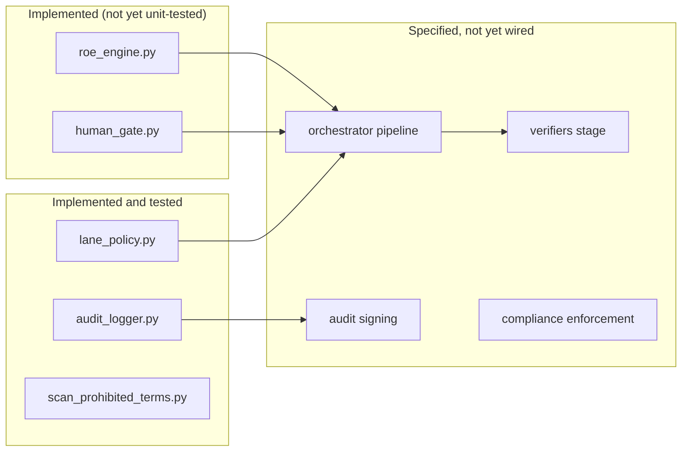

Read every claim below through that lens. Where a mechanism exists in code, we say so. Where a mechanism is a specification for a future phase, we mark it **(specified)**.

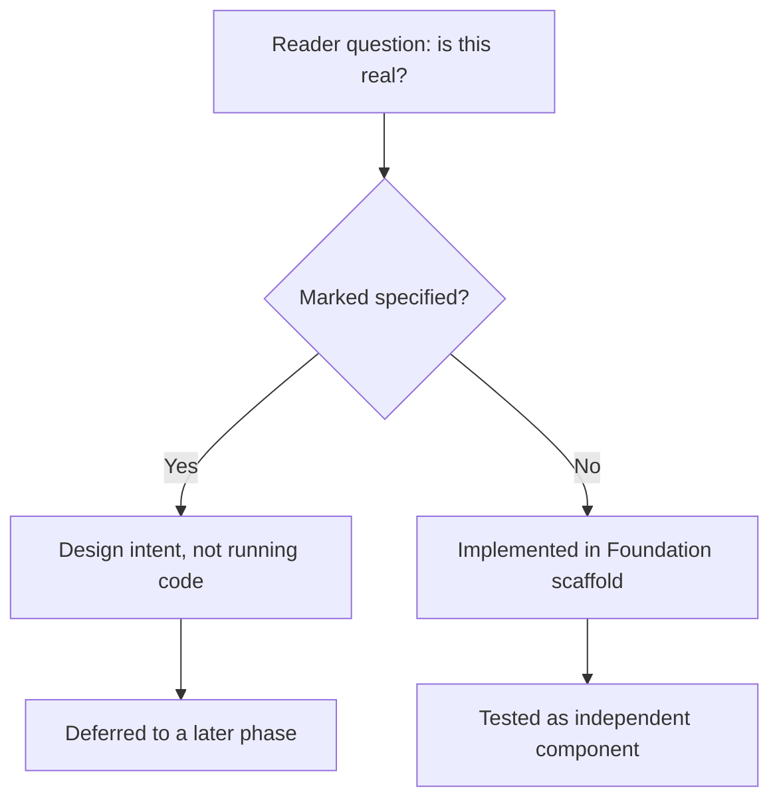

### 1.2 Why a lane model at all

Most failures in authorised security work are not failures of capability but failures of *scope*: an action that was permissible in one engagement is replayed in another where it was never authorised. The lane model, as designed by Naquib Hatami, makes scope a first-class, machine-checkable property. A lane is entered deliberately, carries evidence, and never silently widens.

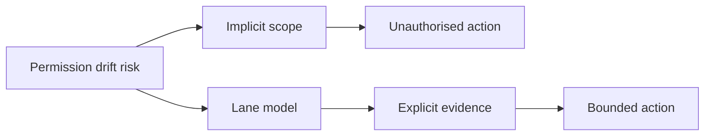

---

## 2. The Three Lanes

### 2.1 Overview

| Lane | Posture | Authorisation evidence | Human gate | Representative activities |
|------|---------|------------------------|------------|---------------------------|
| **A** | Defensive | Customer / system-owner authorisation reference | Only for sensitive defensive operations | Vulnerability assessment, config review, compliance checking, threat modelling |
| **B** | Active-defence | **Written** authorisation document reference | Required for every deployment | Deception / honeypot management, authorised threat hunting, attribution evidence collection |
| **C** | Sovereign-authorised | Sovereign authorisation reference **and** human sign-off | Required for every operation | Operations explicitly covered by sovereign authority and written ROE |

The lane identifiers are defined in code as an enumeration with a fourth, deliberately unsafe value:

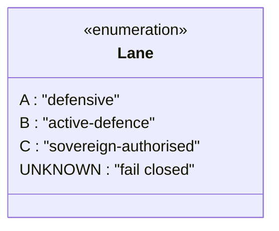

### 2.2 The relationship between lanes

Lanes are **not** a privilege ladder that an operation climbs. Each is a distinct envelope entered on its own evidence. `UNKNOWN` is the default state and is a hard stop, never a usable lane.

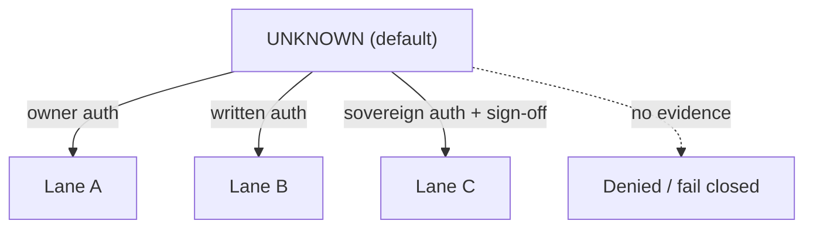

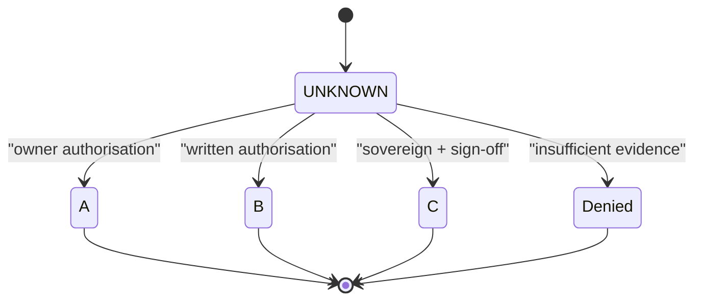

### 2.3 Capability envelope per lane

Each lane publishes the capabilities it permits via `ROEEngine.get_permitted_capabilities(lane)`. The sets are nested in intent but bounded identically by the global prohibitions (Section 6).

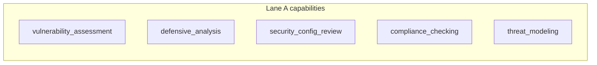

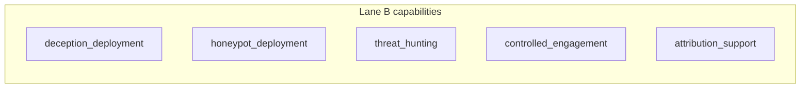

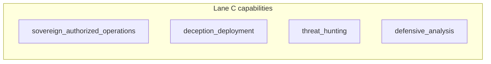

---

## 3. Entering a Lane

### 3.1 The assignment function

Lane entry is performed by `LanePolicy.assign_lane()`. It takes an operation description and the authorisation evidence, and returns a `Lane` — or raises `ValueError` and logs a denial. There is no path through this function that returns a lane without a recorded decision.

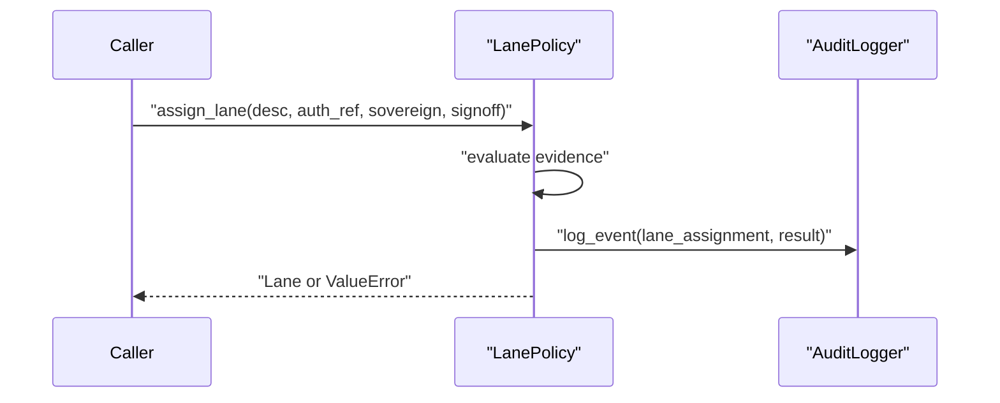

### 3.2 Decision logic

The implemented decision order is precise and fail-closed. It is reproduced here faithfully.

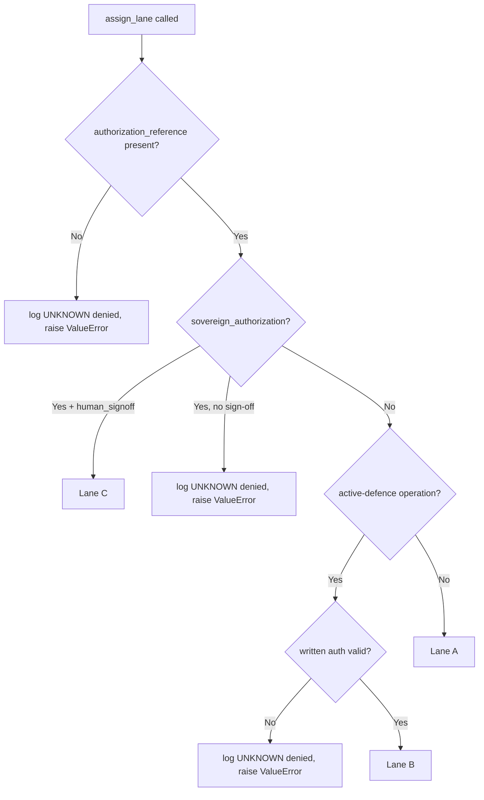

Three observations follow directly from this logic:

1. **Absent evidence is fatal.** Without an `authorization_reference`, the function logs an `UNKNOWN` denial and raises. There is no default lane.
2. **Sovereign authorisation without human sign-off is fatal.** Lane C is the only lane whose *presence* of partial evidence is treated as an error rather than a fallback.
3. **Active-defence intent forces a stricter evidence test.** If the operation text matches active-defence keywords but the written-authorisation format check fails, the operation is denied rather than silently demoted to Lane A.

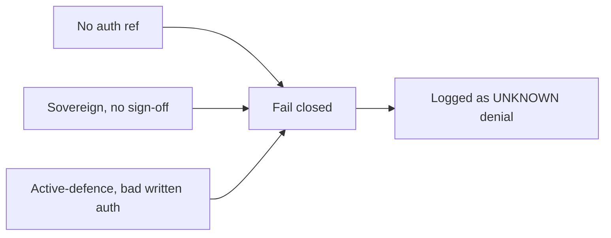

### 3.3 Active-defence detection

Whether an operation is treated as Lane B is decided by `_is_active_defense_operation()`, which performs case-insensitive keyword matching against the operation description. The Foundation implementation is deliberately simple and is documented as such in code; production classification is a later-phase concern **(specified)**.

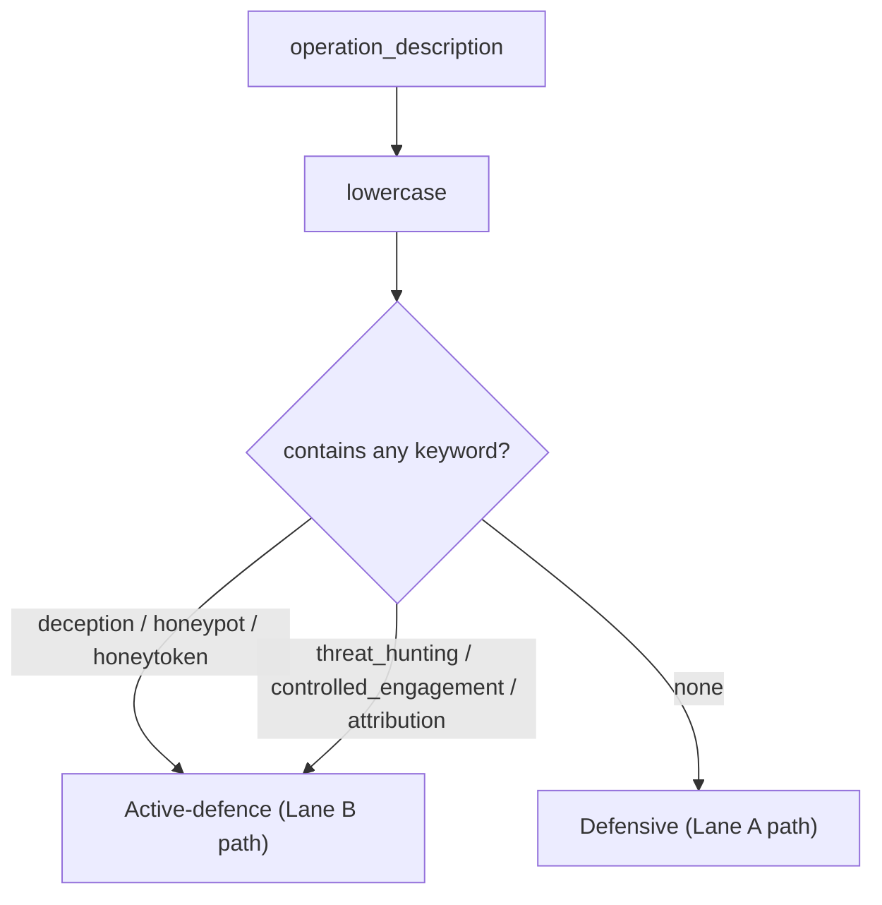

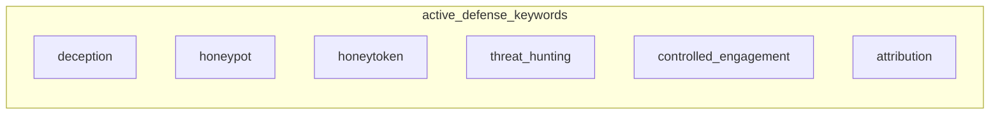

### 3.4 A lane is entered, never inherited

A subsequent operation does not inherit the lane of a prior one. Each operation re-presents evidence and is re-evaluated. This is what makes scope non-accumulating.

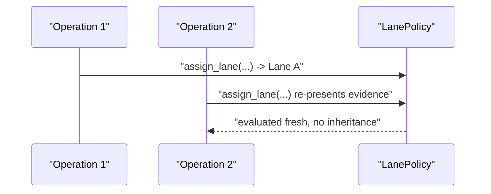

---

## 4. Authorisation Evidence

### 4.1 What counts as evidence

Each lane recognises a distinct evidence type. Evidence is a *reference* — an identifier that points to an authorisation artefact held outside the reasoning path — not the artefact itself.

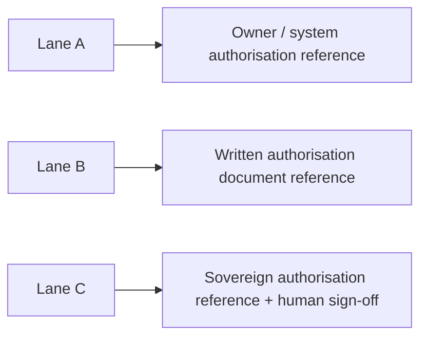

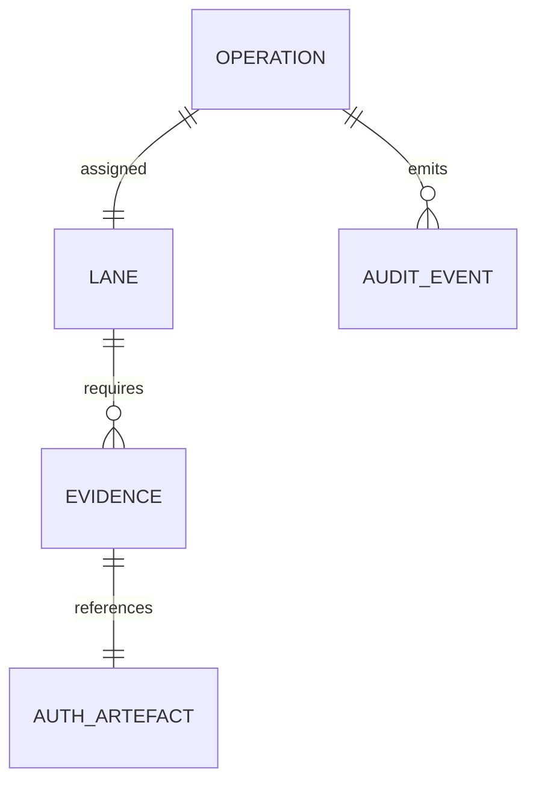

### 4.2 Written-authorisation format check

Lane B evidence passes through `_validate_written_authorization()`. The Foundation check is a conservative format gate: the reference must be at least ten characters and begin with a recognised prefix. This is explicitly a format check, not a cryptographic verification or a database lookup — the latter are later-phase concerns **(specified)**.

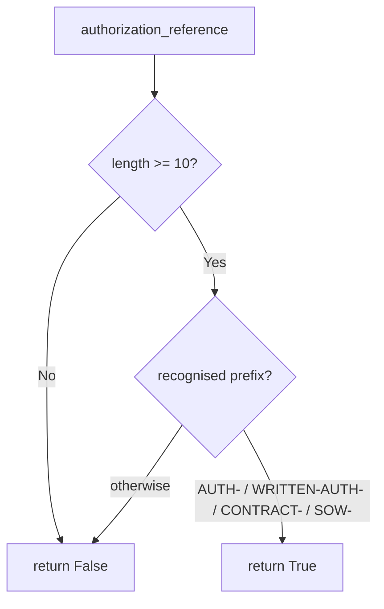

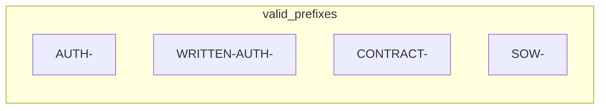

A reference such as `AUTH-2026-05-18-001` passes the format gate; a bare token or a short string does not.

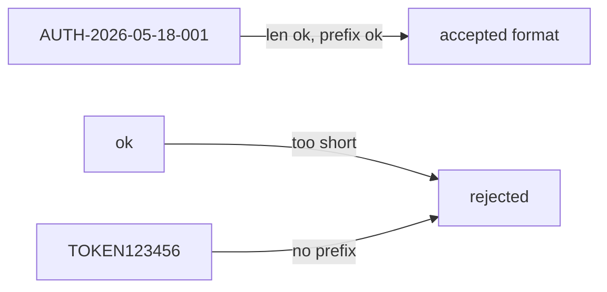

### 4.3 Sovereign evidence is two-part

Lane C evidence is irreducibly two-part: a sovereign authorisation flag *and* a human sign-off flag. The presence of one without the other is not a weaker form of Lane C — it is a denial.

```mermaid
stateDiagram-v2
  [*] --> Evaluate
  Evaluate --> LaneC : "sovereign = true AND signoff = true"
  Evaluate --> Denied : "sovereign = true AND signoff = false"
  Evaluate --> OtherPath : "sovereign = false"
  LaneC --> [*]
  Denied --> [*]
```

```mermaid
flowchart LR
  SOV["sovereign_authorization"] --> AND{"AND"}
  SIGN["human_signoff"] --> AND
  AND -->|"both true"| C["Lane C granted"]
  AND -->|"else"| D["Denied"]
```

### 4.4 Validating evidence against an assigned lane

`validate_lane_authorization()` provides a second, independent check that a reference is acceptable for an already-assigned lane. An `UNKNOWN` lane can never be validated; the attempt is itself logged as a denial.

```mermaid
sequenceDiagram
  participant Caller
  participant LP as "LanePolicy"
  participant AL as "AuditLogger"
  Caller->>LP: "validate_lane_authorization(lane, ref)"
  alt "lane == UNKNOWN"
    LP->>AL: "log denied"
    LP-->>Caller: "raise ValueError"
  else "lane in A/B/C"
    LP->>AL: "log success"
    LP-->>Caller: "True"
  end
```

### 4.5 Evidence lifecycle

Evidence is presented, checked, recorded, and bound to the resulting lane for the duration of a single operation. It is never cached as an ambient grant.

```mermaid
flowchart LR
  P["Present"] --> C["Check format / completeness"]
  C --> R["Record in audit"]
  R --> B["Bind to this operation only"]
  B --> X["Discard on completion"]
```

---

## 5. The Human Gate

### 5.1 When a human is required

The human gate, `human_gate.py`, decides via `requires_human_approval(lane, operation_type)` whether an operation may proceed on policy alone or must wait for a person. Its posture differs sharply by lane.

| Lane | Human approval required? |
|------|--------------------------|
| A | Only for sensitive operations (`live_vulnerability_scan`, `configuration_change`, `access_customer_data`) |
| B | Always |
| C | Always |
| UNKNOWN | Always (fail closed) |

```mermaid
flowchart TD
  O["operation in lane"] --> Q{"which lane?"}
  Q -->|"A"| S{"sensitive operation?"}
  S -->|"Yes"| REQ["approval required"]
  S -->|"No"| FREE["no approval needed"]
  Q -->|"B"| REQ
  Q -->|"C"| REQ
  Q -->|"UNKNOWN"| REQ
```

```mermaid
flowchart LR
  subgraph SensitiveA["Lane A sensitive operations"]
    s1["live_vulnerability_scan"]
    s2["configuration_change"]
    s3["access_customer_data"]
  end
```

### 5.2 The approval state machine

A request moves through an explicit state machine. The Foundation implementation tracks requests in memory and records every transition to the audit log; persistent storage is a later-phase concern **(specified)**.

```mermaid
stateDiagram-v2
  [*] --> PENDING : "request_approval"
  PENDING --> APPROVED : "approve_operation"
  PENDING --> DENIED : "deny_operation"
  PENDING --> EXPIRED : "timeout (specified)"
  APPROVED --> [*]
  DENIED --> [*]
  EXPIRED --> [*]
```

```mermaid
classDiagram
  class ApprovalStatus {
    <<enumeration>>
    PENDING
    APPROVED
    DENIED
    EXPIRED
  }
```

### 5.3 Requesting approval

`request_approval()` mints a unique request id, stores the pending request, and logs a `human_gate_request` event with a `pending` result. The id is the handle an approver later acts on.

```mermaid
sequenceDiagram
  participant Req as "Requestor"
  participant HG as "HumanGate"
  participant AL as "AuditLogger"
  Req->>HG: "request_approval(lane, op, desc, ref, requestor)"
  HG->>HG: "mint uuid, store PENDING"
  HG->>AL: "log_event(human_gate_request, pending)"
  HG-->>Req: "approval_request_id"
```

### 5.4 Approve and deny are one-shot

An approval request may be processed exactly once. Approving or denying an already-processed request raises `ValueError`. This prevents replay of a decision.

```mermaid
flowchart TD
  A["approve_operation(id)"] --> E1{"id exists?"}
  E1 -->|"No"| ERR["raise ValueError"]
  E1 -->|"Yes"| E2{"status == PENDING?"}
  E2 -->|"No"| ERR
  E2 -->|"Yes"| OK["set APPROVED, log human actor"]
```

```mermaid
flowchart TD
  D["deny_operation(id, reason)"] --> F1{"id exists?"}
  F1 -->|"No"| ERR2["raise ValueError"]
  F1 -->|"Yes"| F2{"status == PENDING?"}
  F2 -->|"No"| ERR2
  F2 -->|"Yes"| NO["set DENIED, log reason"]
```

### 5.5 Human decisions are attributed

Both approval and denial record an `actor_type` of `human` and the approver's or denier's identifier. The audit trail therefore distinguishes a *system* decision from a *human* decision — essential for Lane B and Lane C accountability.

```mermaid
sequenceDiagram
  participant Human
  participant HG as "HumanGate"
  participant AL as "AuditLogger"
  Human->>HG: "approve_operation(id, approver)"
  HG->>AL: "log_event(human_gate_approval, actor_type=human)"
  Human->>HG: "deny_operation(id, denier, reason)"
  HG->>AL: "log_event(human_gate_denial, actor_type=human)"
```

```mermaid
flowchart LR
  SYS["actor_type=system"] --> A1["automated policy decisions"]
  HUM["actor_type=human"] --> A2["approvals and denials"]
  A1 --> TRAIL["single audit trail"]
  A2 --> TRAIL
```

### 5.6 Status queries

`get_approval_status()` returns the current `ApprovalStatus` for a known id and raises for an unknown one, so callers cannot assume a silent default.

```mermaid
flowchart TD
  G["get_approval_status(id)"] --> Q{"id known?"}
  Q -->|"No"| R["raise ValueError"]
  Q -->|"Yes"| S["return PENDING / APPROVED / DENIED / EXPIRED"]
```

---

## 6. Rules of Engagement and Scope Enforcement

### 6.1 The ROE engine's job

`roe_engine.py` answers a single question for each requested capability: *is this permitted in this lane?* It enforces, in order, the global prohibitions, the unknown-lane stop, and the lane-specific restrictions. A violation raises `ROEViolation` and is logged.

```mermaid
flowchart TD
  C["check_roe(lane, capability)"] --> G{"globally prohibited?"}
  G -->|"Yes"| V1["log denied, raise ROEViolation"]
  G -->|"No"| U{"lane == UNKNOWN?"}
  U -->|"Yes"| V2["log denied, raise ROEViolation"]
  U -->|"No"| LS["apply lane-specific checks"]
  LS --> OK["log success, return True"]
```

### 6.2 Globally prohibited capabilities

A fixed set of capabilities is prohibited in **every** lane, including Lane C. These encode the boundary that ZP42 never crosses regardless of authorisation.

```mermaid
flowchart LR
  subgraph Global["GLOBALLY_PROHIBITED_CAPABILITIES"]
    g1["malware_creation"]
    g2["malware_deployment"]
    g3["credential_theft"]
    g4["credential_harvesting"]
    g5["ddos_generation"]
    g6["data_exfiltration_unauthorized"]
  end
```

```mermaid
flowchart LR
  subgraph Global2["GLOBALLY_PROHIBITED (continued)"]
    g7["persistence_installation"]
    g8["evasion_technique"]
    g9["destructive_payload"]
    g10["autonomous_retaliation"]
    g11["hack_back"]
    g12["unauthorized_third_party_targeting"]
  end
```

The design point is explicit in code: even the most permissive lane, Lane C, cannot reach these. Authorisation widens *which authorised defensive activities* are available; it never unlocks the global prohibitions.

```mermaid
flowchart TD
  C["Lane C (most permissive)"] --> P{"request global prohibition?"}
  P -->|"Yes"| STOP["ROEViolation — no exception for Lane C"]
  P -->|"No"| CONT["evaluate normally"]
```

### 6.3 Lane-specific restrictions

Beyond the global floor, each lane restricts capabilities that belong to a higher-evidence lane.

```mermaid
flowchart TD
  A["Lane A request"] --> QA{"in prohibited_lane_a?"}
  QA -->|"live_exploitation / deception_deployment / honeypot_deployment / active_engagement"| RA["requires Lane B or C — ROEViolation"]
  QA -->|"otherwise"| PA["permitted (subject to global check)"]
```

```mermaid
flowchart TD
  B["Lane B request"] --> QB{"in prohibited_lane_b?"}
  QB -->|"offensive_operation / unauthorized_system_access / destructive_action"| RB["requires Lane C — ROEViolation"]
  QB -->|"otherwise"| PB["permitted (subject to global check)"]
```

```mermaid
flowchart LR
  subgraph PA2["prohibited_lane_a"]
    a1["live_exploitation"]
    a2["deception_deployment"]
    a3["honeypot_deployment"]
    a4["active_engagement"]
  end
  subgraph PB2["prohibited_lane_b"]
    b1["offensive_operation"]
    b2["unauthorized_system_access"]
    b3["destructive_action"]
  end
```

### 6.4 Escalation is denied by default

`validate_escalation_attempt()` governs moving an operation from one lane to another. If the current and requested lanes match, it is a no-op. Any genuine escalation is **denied and logged** in the Foundation phase; authorised escalation paths are a later-phase concern **(specified)**.

```mermaid
flowchart TD
  E["validate_escalation_attempt(cur, req)"] --> Q{"cur == req?"}
  Q -->|"Yes"| OK["return True (no change)"]
  Q -->|"No"| DENY["log escalation_attempt denied, raise ROEViolation"]
```

```mermaid
sequenceDiagram
  participant Op
  participant RO as "ROEEngine"
  participant AL as "AuditLogger"
  Op->>RO: "validate_escalation_attempt(A, C)"
  RO->>AL: "log_event(escalation_attempt, denied, policy_violations)"
  RO-->>Op: "raise ROEViolation"
```

The escalation denial carries a `policy_violations` marker of `unauthorized_lane_escalation` and sets `escalation_attempt=true`, so attempts are queryable in the audit record.

```mermaid
flowchart LR
  ATT["escalation attempt"] --> M1["escalation_attempt = true"]
  ATT --> M2["policy_violations = unauthorized_lane_escalation"]
  M1 --> LOG["audit event"]
  M2 --> LOG
```

### 6.5 Scope as an intersection

Effective scope for any operation is the *intersection* of the lane's permitted set, the global prohibitions removed, and the human-gate posture. No single check is sufficient; all must pass.

```mermaid
flowchart TD
  L["Lane permitted set"] --> I["Intersection"]
  G["minus global prohibitions"] --> I
  H["AND human-gate satisfied"] --> I
  I --> R["Effective permitted action"]
```

```mermaid
flowchart LR
  subgraph Gates["Sequential gates"]
    direction LR
    G1["Lane assigned"] --> G2["ROE passed"] --> G3["Human gate (if required)"] --> G4["Action permitted"]
  end
```

---

## 7. The Audit Record

### 7.1 Every decision is recorded

`audit_logger.py` writes an append-only JSONL record for every lane assignment, authorisation check, ROE check, escalation attempt, and human-gate event. The logger validates its own enumerations before writing, so malformed events cannot enter the record.

```mermaid
flowchart TD
  EV["log_event(...)"] --> V1{"valid operation_type?"}
  V1 -->|"No"| ERR["raise ValueError"]
  V1 -->|"Yes"| V2{"valid lane?"}
  V2 -->|"No"| ERR
  V2 -->|"Yes"| V3{"valid actor_type?"}
  V3 -->|"No"| ERR
  V3 -->|"Yes"| V4{"valid result?"}
  V4 -->|"No"| ERR
  V4 -->|"Yes"| W["append JSONL line, return event_id"]
```

```mermaid
flowchart LR
  subgraph Results["valid results"]
    r1["success"]
    r2["failure"]
    r3["denied"]
    r4["pending"]
  end
  subgraph Actors["valid actor types"]
    t1["system"]
    t2["human"]
    t3["api"]
  end
```

### 7.2 Event shape

Each event carries a UTC ISO-8601 timestamp, a UUID event id, the operation type, lane, actor (type and identifier), result, and an escalation flag, with optional authorisation reference, operation details, failure reason, and policy-violation list.

```mermaid
erDiagram
  AUDIT_EVENT {
    string timestamp
    string event_id
    string operation_type
    string lane
    string result
    bool escalation_attempt
  }
  AUDIT_EVENT ||--|| ACTOR : "has"
  ACTOR {
    string type
    string identifier
  }
  AUDIT_EVENT ||--o| AUTHORIZATION : "may reference"
```

### 7.3 Append-only, not signed

The log is append-only by construction — each event is a new line appended to a daily file. It is **not** cryptographically signed; tamper-evident signing is a later-phase concern **(specified)**. We state this plainly so operators do not over-trust the current record.

```mermaid
flowchart LR
  E1["event 1"] --> E2["event 2"] --> E3["event 3"] --> F["audit_YYYY-MM-DD.jsonl"]
  F -. "signing: specified, not implemented" .-> S["signature chain"]
```

### 7.4 Querying the record

`query_logs()` filters events by time range, lane, operation type, and actor across all daily files. This supports after-the-fact review of who did what, in which lane, under which authorisation.

```mermaid
sequenceDiagram
  participant Reviewer
  participant AL as "AuditLogger"
  Reviewer->>AL: "query_logs(lane=B, operation_type=roe_check)"
  AL->>AL: "scan audit_*.jsonl, apply filters"
  AL-->>Reviewer: "matching events"
```

```mermaid
flowchart TD
  Q["query_logs filters"] --> F1["start_time / end_time"]
  Q --> F2["lane"]
  Q --> F3["operation_type"]
  Q --> F4["actor_identifier"]
  F1 --> R["filtered event list"]
  F2 --> R
  F3 --> R
  F4 --> R
```

---

## 8. The Prohibited-Terms Boundary

### 8.1 Purpose

`scripts/scan_prohibited_terms.py` guards the project boundary against disallowed public terminology — the vocabulary of offence and retaliation that ZP42 does not describe. It is a textual guard, run over the repository, and complements (does not replace) the ROE engine's capability checks.

```mermaid
flowchart LR
  SRC["repository text"] --> SC["scan_prohibited_terms.py"]
  SC --> Q{"disallowed term found?"}
  Q -->|"Yes"| FAIL["report, non-zero exit"]
  Q -->|"No"| PASS["clean"]
```

```mermaid
flowchart TD
  P["prohibited public terms"] --> t1["hack-back"]
  P --> t2["retaliation"]
  P --> t3["punishment"]
  P --> t4["private offensive action"]
```

### 8.2 Two complementary guards

The ROE engine enforces *runtime* capability boundaries; the terms scanner enforces a *documentary* boundary on how the project speaks about itself. Together they keep both behaviour and language within the defensive charter.

```mermaid
flowchart LR
  RUN["ROE engine"] --> B1["runtime capability boundary"]
  DOC["terms scanner"] --> B2["documentary / language boundary"]
  B1 --> CH["defensive charter upheld"]
  B2 --> CH
```

---

## 9. End-to-End Flow (Specified)

### 9.1 The intended pipeline

The Foundation modules are designed to compose into a single enforced pipeline: assign a lane, check ROE, interpose the human gate where required, verify output, and audit throughout. This composition is **specified but not yet wired** — `orchestrator/__init__.py` is an empty scaffold and `verifiers/` is a defined stage only.

```mermaid
flowchart LR
  I["operation request"] --> L["lane assignment"]
  L --> R["ROE check"]
  R --> H["human gate (if required)"]
  H --> V["verify (specified)"]
  V --> O["result"]
  L -.-> A["audit"]
  R -.-> A
  H -.-> A
  V -.-> A
```

```mermaid
sequenceDiagram
  participant Req as "Requestor"
  participant OR as "Orchestrator (specified)"
  participant LP as "LanePolicy"
  participant RO as "ROEEngine"
  participant HG as "HumanGate"
  participant VE as "Verifier (specified)"
  participant AL as "AuditLogger"
  Req->>OR: "submit operation"
  OR->>LP: "assign_lane"
  LP->>AL: "log assignment"
  OR->>RO: "check_roe"
  RO->>AL: "log roe_check"
  OR->>HG: "requires_human_approval?"
  HG->>AL: "log gate events"
  OR->>VE: "verify output"
  VE->>AL: "log verification"
  OR-->>Req: "permitted result or denial"
```

### 9.2 Fail-closed at every junction

The pipeline is designed so that *any* unresolved check halts the operation. An unknown lane, a failed ROE check, an un-granted human gate, or (once implemented) a failed verification all stop forward progress.

```mermaid
flowchart TD
  S["start"] --> L{"lane known?"}
  L -->|"No"| STOP["halt, fail closed"]
  L -->|"Yes"| R{"ROE passed?"}
  R -->|"No"| STOP
  R -->|"Yes"| H{"human gate satisfied?"}
  H -->|"No"| STOP
  H -->|"Yes"| V{"verified? (specified)"}
  V -->|"No"| STOP
  V -->|"Yes"| GO["proceed"]
```

```mermaid
stateDiagram-v2
  [*] --> LaneCheck
  LaneCheck --> ROECheck : "pass"
  LaneCheck --> Halted : "fail"
  ROECheck --> GateCheck : "pass"
  ROECheck --> Halted : "fail"
  GateCheck --> Verify : "pass"
  GateCheck --> Halted : "fail"
  Verify --> Proceed : "pass (specified)"
  Verify --> Halted : "fail"
  Halted --> [*]
  Proceed --> [*]
```

### 9.3 Compliance manifests (specified enforcement)

`compliance/model_allowlist.json` and `compliance/license_manifest.json` declare, in machine-readable form, the approved models and licence posture. In the Foundation phase these are **declared data, not enforced in code**; wiring them into the pipeline as a gate is a later-phase concern **(specified)**.

```mermaid
flowchart LR
  M["model_allowlist.json"] -.-> G["allowlist gate (specified)"]
  L["license_manifest.json"] -.-> G
  G -.-> P["pipeline admission (specified)"]
```

```mermaid
flowchart TD
  D["declared manifest"] --> S1["machine-readable today"]
  D --> S2["enforced in code: specified"]
```

---

## 10. Worked Walk-throughs

### 10.1 A Lane A defensive request

A routine, non-sensitive defensive request — say, a threat-modelling exercise with an owner authorisation reference — enters Lane A and proceeds without a human gate, while still being audited.

```mermaid
sequenceDiagram
  participant Analyst
  participant LP as "LanePolicy"
  participant RO as "ROEEngine"
  participant AL as "AuditLogger"
  Analyst->>LP: "assign_lane('threat modeling', 'AUTH-...')"
  LP->>AL: "log Lane A assignment"
  LP-->>Analyst: "Lane A"
  Analyst->>RO: "check_roe(A, 'threat_modeling')"
  RO->>AL: "log roe_check success"
  RO-->>Analyst: "True"
```

### 10.2 A Lane A sensitive request

A live vulnerability scan is Lane A by activity but *sensitive*, so the human gate applies.

```mermaid
flowchart TD
  OP["live_vulnerability_scan (Lane A)"] --> HG{"requires_human_approval?"}
  HG -->|"Yes (sensitive)"| REQ["request_approval -> PENDING"]
  REQ --> DEC{"human decision"}
  DEC -->|"approve"| GO["proceed"]
  DEC -->|"deny"| NO["halt, logged"]
```

### 10.3 A Lane B active-defence request

A deception deployment matches active-defence keywords, requires valid written authorisation, and always passes the human gate.

```mermaid
sequenceDiagram
  participant Operator
  participant LP as "LanePolicy"
  participant HG as "HumanGate"
  participant RO as "ROEEngine"
  Operator->>LP: "assign_lane('deception deployment', 'CONTRACT-...')"
  LP-->>Operator: "Lane B"
  Operator->>RO: "check_roe(B, 'deception_deployment')"
  RO-->>Operator: "True"
  Operator->>HG: "request_approval (always for B)"
  HG-->>Operator: "PENDING until human acts"
```

### 10.4 A Lane C sovereign request

A sovereign-authorised operation requires both the sovereign flag and human sign-off at assignment, and a human approval for the operation itself.

```mermaid
flowchart TD
  REQ["sovereign operation"] --> AS{"sovereign AND sign-off?"}
  AS -->|"No"| DENY["denied at assignment"]
  AS -->|"Yes"| C["Lane C"]
  C --> HG["human approval required for every op"]
  HG --> AUD["every step audited"]
```

### 10.5 A denied escalation

An operation assigned Lane A that attempts to reach Lane C is denied and recorded as an escalation attempt.

```mermaid
sequenceDiagram
  participant Op
  participant RO as "ROEEngine"
  participant AL as "AuditLogger"
  Op->>RO: "validate_escalation_attempt(A, C)"
  RO->>AL: "log escalation_attempt denied"
  RO-->>Op: "ROEViolation"
```

### 10.6 A missing-evidence denial

An operation with no authorisation reference never reaches any lane.

```mermaid
flowchart LR
  N["no auth reference"] --> LP["assign_lane"]
  LP --> D["UNKNOWN denial logged"]
  D --> E["ValueError raised"]
```

---

## 11. Design Invariants

The lane model holds a small set of invariants that make its guarantees legible. Each is backed by implemented, tested component behaviour.

```mermaid
flowchart TD
  I1["Default is UNKNOWN, never a usable lane"]
  I2["Evidence is mandatory to enter any lane"]
  I3["Lane C needs two independent proofs"]
  I4["Global prohibitions bind every lane"]
  I5["Escalation is denied and logged by default"]
  I6["Every decision emits an audit event"]
  I1 --> SAFE["fail-closed posture"]
  I2 --> SAFE
  I3 --> SAFE
  I4 --> SAFE
  I5 --> SAFE
  I6 --> SAFE
```

```mermaid
mindmap
  root((Lane model invariants))
    Fail closed
      Unknown default
      Missing evidence denied
    Evidence
      Owner for A
      Written for B
      Sovereign + sign-off for C
    Boundaries
      Global prohibitions
      Lane-specific limits
    Accountability
      Human attribution
      Append-only audit
```

```mermaid
flowchart LR
  subgraph Separation["Separation of concerns"]
    LANE["lane: who authorised"]
    ROE["ROE: what is permitted"]
    GATE["gate: human in the loop"]
    AUDIT["audit: what happened"]
  end
```

### 11.1 What the invariants do *not* claim

They do not claim a wired end-to-end pipeline, cryptographic log integrity, enforced compliance manifests, or any inference, exploitation, or targeting capability. Those are out of scope for the Foundation phase and are either specified for later phases or deliberately excluded.

```mermaid
flowchart TD
  NC["Not claimed in Foundation"] --> n1["wired orchestrator pipeline"]
  NC --> n2["signed audit log"]
  NC --> n3["enforced compliance gate"]
  NC --> n4["inference / exploitation / live targeting"]
  n4 --> OUT["excluded by charter"]
  n1 --> LATER["specified for later phases"]
  n2 --> LATER
  n3 --> LATER
```

---

## 12. Summary

The lane model turns authorisation from an assumption into evidence and scope from a convention into a check. Lane A, Lane B, and Lane C each demand a distinct and increasing standard of proof — owner authorisation, written authorisation, and sovereign authorisation with human sign-off respectively — and each is entered deliberately on that proof, never inherited and never widened in silence. The ROE engine bounds every lane with both a global prohibition floor and lane-specific limits; the human gate interposes a person wherever the stakes require it; and the audit logger records every decision in an append-only trail. In the Foundation-phase scaffold designed by Naquib Hatami, these mechanisms are implemented and tested as independent components, while their composition into a single enforced pipeline, tamper-evident logging, and enforced compliance remain specified for later phases. The guarantee the model offers today is modest and honest: where these components run, capability is inert until authorisation is proven, and every refusal and approval leaves a record.

```mermaid
flowchart LR
  PROOF["Authorisation proven"] --> ACT["Bounded action"]
  ACT --> REC["Recorded decision"]
  REC --> REV["Reviewable trail"]
  REV --> PROOF
```

---

## Related documents

- [`FOUNDATION.md`](FOUNDATION.md) — project identity, charter status, model policy, and safety boundaries.
- [`08-governance-audit.md`](08-governance-audit.md) — the audit schema, logging model, and governance framework.
- [`06-roe-engine.md`](06-roe-engine.md) — the ROE engine, capability sets, and prohibited capabilities in depth.
- [`07-human-gate.md`](07-human-gate.md) — the human-in-the-loop approval model and its state machine.
- [`../README.md`](../README.md) — repository overview, architecture map, and licensing.
