> Part of the ZP42 documentation set

# Rules-of-Engagement Engine

**Encoding the bounds of permitted action as executable policy, and the semantics by which those bounds are evaluated.**

## Abstract

This document specifies the Rules-of-Engagement (ROE) Engine of ZP42 (Zeroth Protocol 42), the open, MIT-licensed, governance-first cyber-reasoning system created by **Naquib Hatami** and published by SADI AI Inc. / iQs Group Inc. (repository `github.com/iQs-Group/zp-42`, site `zp42.org`). The ROE Engine is the component that turns a human policy — "what may this system do, and under which authorisation" — into an executable rule set with deterministic, fail-closed evaluation semantics. It is the decision point that sits between a lane assignment and any downstream action: it answers the narrow question *"is this capability permitted under the rules that bind this lane?"* and records the answer as evidence.

This is a **Foundation-phase scaffold**. The ROE Engine (`orchestrator/roe/roe_engine.py`) is implemented as an independent component but does not yet have its own unit-test suite (the tested Foundation modules are `lane_policy`, `audit_logger`, `scan_prohibited_terms`, and `capture_manifest`). The end-to-end orchestrator that would wire *lane to ROE to human gate to verify to audit* is **not yet implemented** (`orchestrator/__init__.py` is an empty scaffold). This document therefore distinguishes, throughout, between behaviour that is **IMPLEMENTED** in the current release and behaviour that is **SPECIFIED** for later phases. Nothing here describes how to perform offensive actions; the entire point of the engine is that capability is inert until authorisation gates it.

---

## 1. Position in the Architecture

### 1.1 The governance pipeline as specified

The ROE Engine is the second decision stage in the governance pipeline. A lane is assigned first; ROE then bounds what that lane may do; a human gate interposes where required; a verifier validates output; and the audit logger records each step.

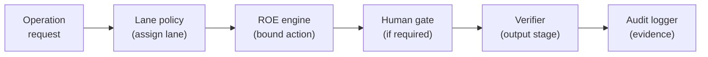

Note the honest boundary: the arrows above are the **specified** flow. In the current release each box is a separately implemented unit (four with dedicated unit-test suites; the ROE engine and human gate not yet); the connective tissue that would run them as one pipeline is scaffold only.

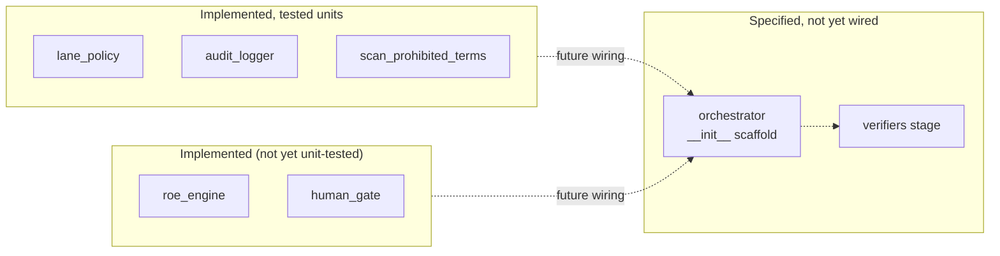

### 1.2 What the ROE Engine is responsible for

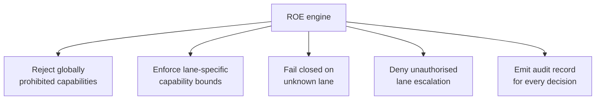

### 1.3 What it is explicitly not responsible for

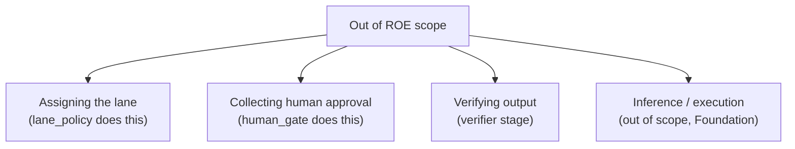

---

## 2. The Lane Model as Policy Context

The ROE Engine never evaluates a request in isolation; every decision is made *relative to a lane*. The lane is the authorisation context, and ROE is the rule set bound to that context.

### 2.1 Lanes defined by the system

| Lane | Meaning | Authorisation required | Human gate |
|------|---------|------------------------|------------|
| A | Defensive work | Customer or system-level authorisation reference | Only for sensitive defensive operations |
| B | Active-defence work | Explicit **written** authorisation reference | Required for every deployment |
| C | Sovereign-authorised work | Sovereign authorisation **and** human signoff | Required for every operation |
| UNKNOWN | Unassigned / indeterminate | None valid | Fail closed |

A lane is entered deliberately. It is not a default that silently widens: an operation with no valid authorisation reference resolves to `UNKNOWN`, which fails closed.

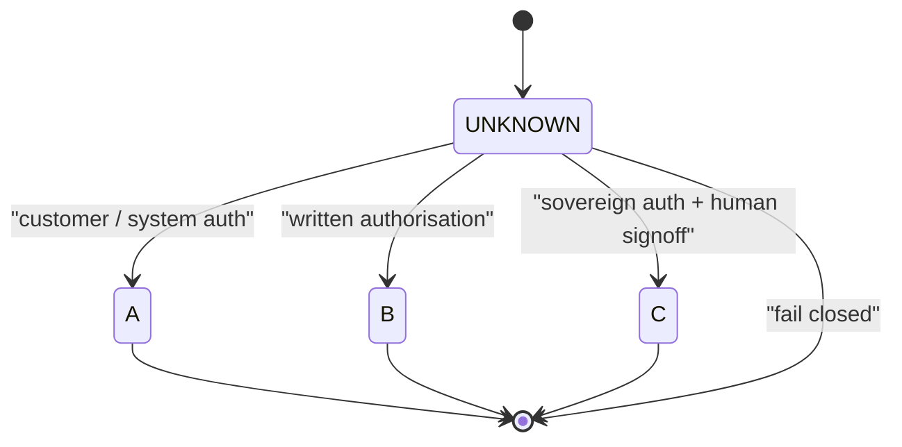

### 2.2 Authorisation strength is monotonic, not transitive

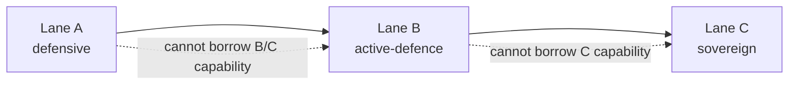

A higher lane is *more permissive*, but a lower lane cannot reach a higher lane's capability without re-authorisation. The ordering describes capability breadth, not an escalation path a request may walk on its own.

### 2.3 Lane as an enumerated type

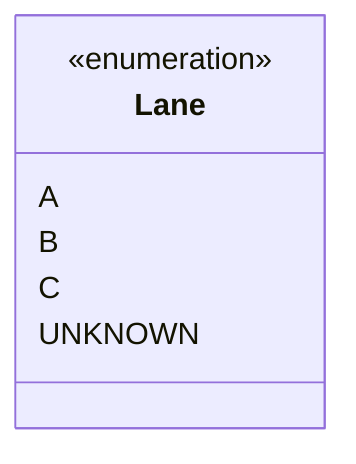

### 2.4 Lane assignment precedes ROE

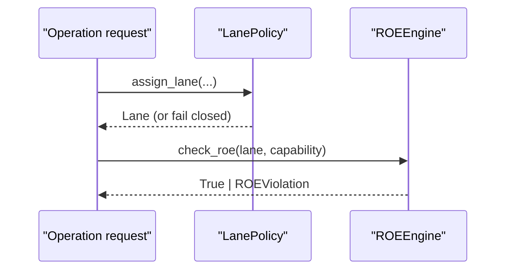

---

## 3. Encoding Bounds as Executable Policy

The central idea of the ROE Engine is that policy is not prose to be interpreted at runtime but **data and code that executes deterministically**. Three concrete encodings carry the policy.

### 3.1 The global prohibition set

A fixed set of capabilities is prohibited in **every** lane, including the most permissive. This set is checked first, before any lane-specific logic, so that no authorisation level can reach it.

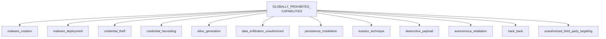

These are the capabilities the system is designed never to express. Their presence as an explicit, enumerated set — rather than an implicit absence — is itself the control: a reviewer can read the boundary, and a test can assert it.

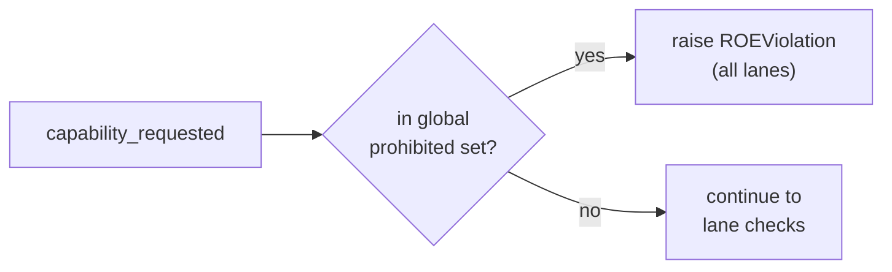

### 3.2 Lane-specific prohibition sets

Beyond the global set, each operating lane carries its own denial set. These encode *"this capability exists, but not at this authorisation level."*

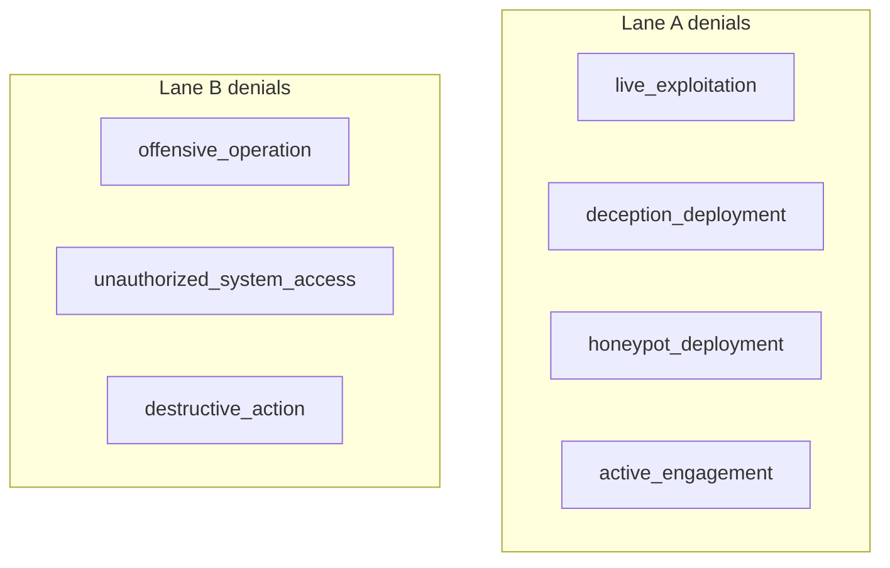

A Lane A request for `deception_deployment` is not globally prohibited — it is legitimate active-defence work — but it requires Lane B or C authorisation. The engine denies it in Lane A and names the lane that would be required.

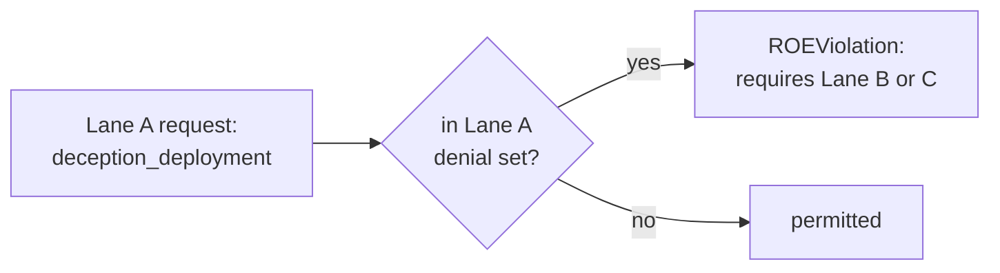

### 3.3 Permitted-capability lists

For transparency, the engine also publishes the positive set — the capabilities each lane *may* request — via `get_permitted_capabilities`.

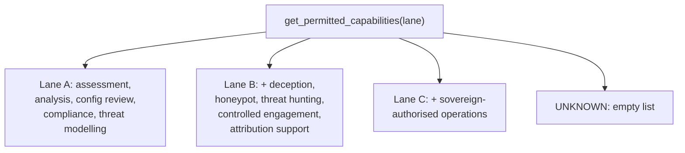

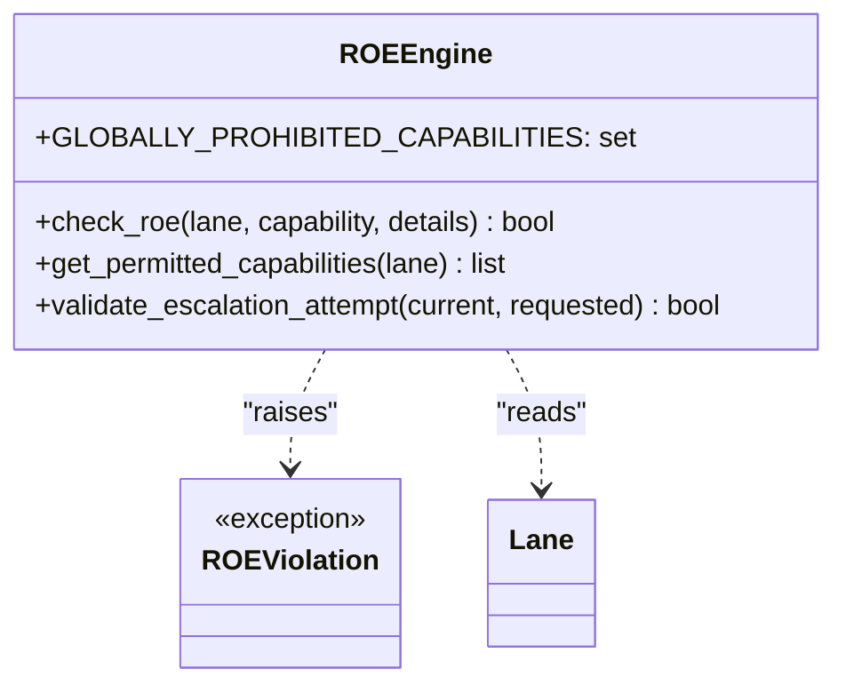

---

## 4. Evaluation Semantics

The evaluation semantics of the ROE Engine are its most important property. They define *in what order* checks run, *what the default answer is* when nothing matches, and *what every path emits as evidence*.

### 4.1 The ordered decision procedure

`check_roe(lane, capability_requested, operation_details)` evaluates in a fixed order. Order matters: the global prohibition is checked before the lane is even consulted, so no lane can override it.

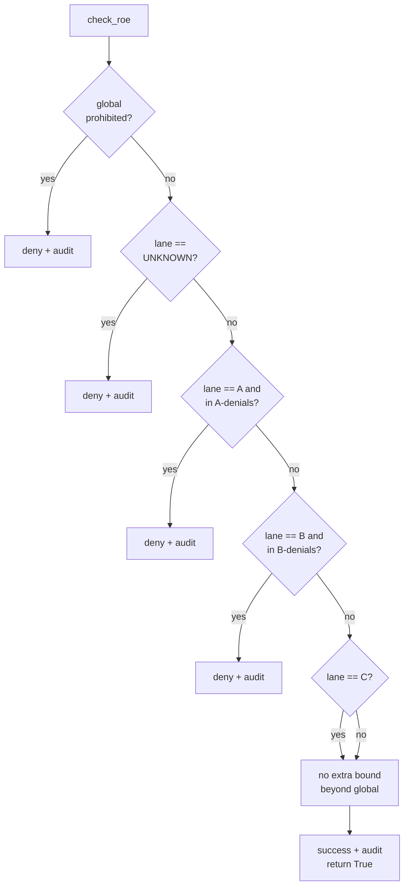

### 4.2 The result lattice

Every evaluation terminates in exactly one of two outcomes: a permitted `True`, or a raised `ROEViolation`. There is no third, ambiguous state. "Unsure" is not an outcome; it collapses to denial.

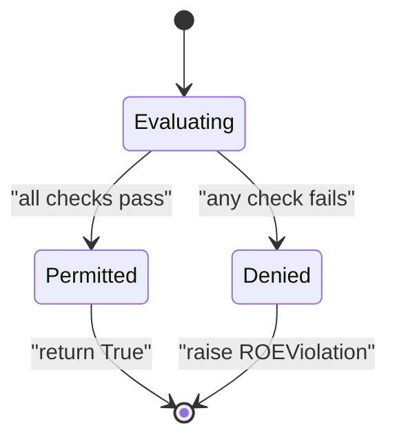

### 4.3 Fail-closed as the default

The defining semantic is **fail-closed**: in the absence of a positive, authorised match, the answer is denial. This inverts the common failure mode where an unmatched case falls through to "allow."

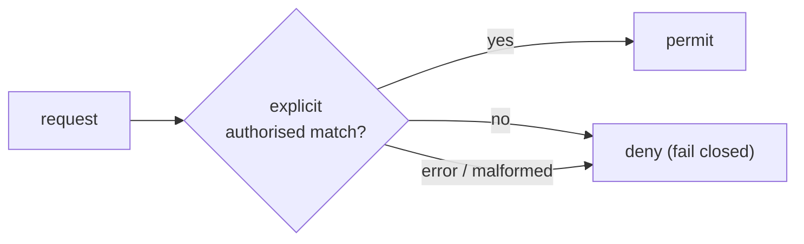

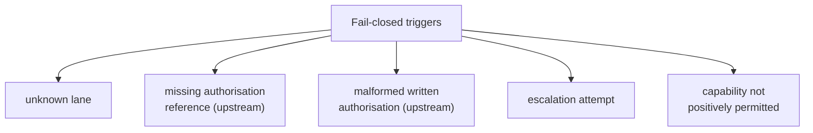

### 4.4 Determinism

Given the same lane and capability, the engine returns the same decision every time. There is no randomness, no model inference, and no network call in the decision path — the decision is a pure function of its inputs against static policy sets.

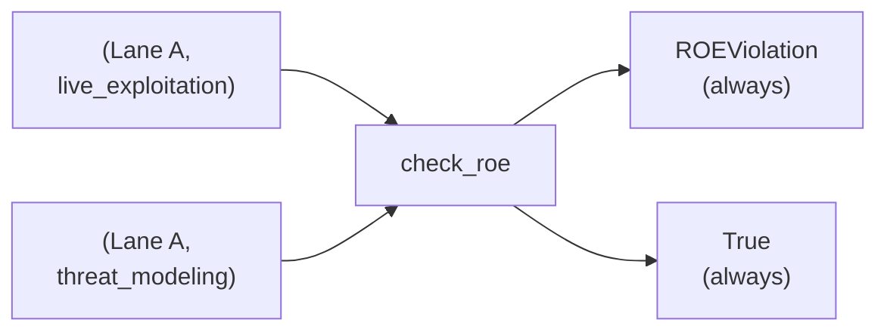

### 4.5 Idempotence of checking

```mermaid
sequenceDiagram
    participant C as "Caller"
    participant R as "ROEEngine"
    C->>R: check_roe(A, "defensive_analysis")
    R-->>C: True
    C->>R: check_roe(A, "defensive_analysis")
    R-->>C: True
    Note over C,R: "same inputs -> same result;<br/>each call still audited"
```

---

## 5. Worked Evaluation Paths

The following concrete traces show how real inputs flow through the ordered procedure. None of them describe how to carry out a prohibited act; they show the gate refusing or permitting.

### 5.1 Permitted: defensive analysis in Lane A

```mermaid
sequenceDiagram
    participant C as "Caller"
    participant R as "ROEEngine"
    participant AL as "AuditLogger"
    C->>R: check_roe(A, "vulnerability_assessment")
    R->>R: "not globally prohibited"
    R->>R: "lane != UNKNOWN"
    R->>R: "not in Lane A denials"
    R->>AL: log roe_check result=success
    R-->>C: True
```

### 5.2 Denied globally: regardless of lane

```mermaid
sequenceDiagram
    participant C as "Caller"
    participant R as "ROEEngine"
    participant AL as "AuditLogger"
    C->>R: check_roe(C, "hack_back")
    R->>R: "global prohibited match"
    R->>AL: log roe_check result=denied
    R-->>C: raise ROEViolation
    Note over C,R: "even Lane C cannot reach this"
```

### 5.3 Denied by lane: capability needs higher authorisation

```mermaid
sequenceDiagram
    participant C as "Caller"
    participant R as "ROEEngine"
    participant AL as "AuditLogger"
    C->>R: check_roe(A, "deception_deployment")
    R->>R: "not globally prohibited"
    R->>R: "in Lane A denial set"
    R->>AL: log roe_check result=denied
    R-->>C: raise ROEViolation "requires Lane B or C"
```

### 5.4 Denied by indeterminacy: unknown lane

```mermaid
sequenceDiagram
    participant C as "Caller"
    participant R as "ROEEngine"
    participant AL as "AuditLogger"
    C->>R: check_roe(UNKNOWN, "vulnerability_assessment")
    R->>R: "not globally prohibited"
    R->>R: "lane == UNKNOWN"
    R->>AL: log roe_check result=denied
    R-->>C: raise ROEViolation "cannot execute in unknown lane"
```

### 5.5 The three denial classes, side by side

```mermaid
flowchart TD
    DEN["Denial classes"] --> d1["Global: forbidden<br/>in all lanes"]
    DEN --> d2["Lane-scoped: legitimate<br/>but needs higher lane"]
    DEN --> d3["Contextual: lane<br/>indeterminate / escalation"]
```

---

## 6. Escalation Control

A recurring attack on policy engines is *lane creep*: a request that begins in a low lane and tries to acquire a higher lane's permissions mid-flight. The ROE Engine treats escalation as a first-class, auditable event.

### 6.1 Foundation-phase policy: deny all escalation

In the current release, `validate_escalation_attempt` permits only the trivial case `current == requested`. Every genuine escalation is denied and logged as an `escalation_attempt`. Authorised escalation paths are **specified** for later phases, not implemented now.

```mermaid
flowchart TD
    E["validate_escalation_attempt<br/>(current, requested)"] --> SAME{"current ==<br/>requested?"}
    SAME -->|"yes"| OK["return True"]
    SAME -->|"no"| LOG["log escalation_attempt<br/>policy_violation"]
    LOG --> RV["raise ROEViolation"]
```

```mermaid
stateDiagram-v2
    [*] --> AtLane
    AtLane --> AtLane: "same lane request (ok)"
    AtLane --> Denied: "different lane request"
    Denied --> [*]: "logged + ROEViolation"
```

### 6.2 Escalation attempts are evidence, not just errors

```mermaid
sequenceDiagram
    participant C as "Caller"
    participant R as "ROEEngine"
    participant AL as "AuditLogger"
    C->>R: validate_escalation_attempt(A, C)
    R->>AL: log escalation_attempt=True,<br/>policy_violations=[unauthorized_lane_escalation]
    R-->>C: raise ROEViolation
```

### 6.3 Specified future escalation (not implemented)

```mermaid
flowchart LR
    REQ["escalation request"] -.-> AUTH["verify higher<br/>authorisation"]
    AUTH -.-> GATE["human gate<br/>(B/C)"]
    GATE -.-> GRANT["grant higher lane"]
    AUTH -.-> DENY["deny + audit"]
    style REQ stroke-dasharray: 5 5
    style AUTH stroke-dasharray: 5 5
    style GATE stroke-dasharray: 5 5
    style GRANT stroke-dasharray: 5 5
```

The dashed path is **specification only**; today the engine denies all non-trivial escalation.

---

## 7. Interaction with the Human Gate

For lanes B and C (and sensitive Lane A operations), a positive ROE result is *necessary but not sufficient*. The human gate interposes a required human authorisation at the decision point.

### 7.1 ROE and gate are complementary, not redundant

```mermaid
flowchart LR
    ROE["ROE: is it<br/>permitted?"] --> GATE["Gate: has a human<br/>authorised it?"]
    GATE --> ACT["action eligible<br/>(specified wiring)"]
    ROE -->|"deny"| STOP1["stop"]
    GATE -->|"deny / pending"| STOP2["stop"]
```

### 7.2 When the gate is required

```mermaid
flowchart TD
    RG["requires_human_approval(lane, op)"] --> rA{"Lane A?"}
    rA -->|"yes"| sens{"sensitive op?"}
    sens -->|"yes"| YES["approval required"]
    sens -->|"no"| NO["no approval"]
    rA -->|"no"| rB{"Lane B or C<br/>or UNKNOWN?"}
    rB -->|"yes"| YES
```

### 7.3 Gate lifecycle

```mermaid
stateDiagram-v2
    [*] --> PENDING: "request_approval"
    PENDING --> APPROVED: "approve_operation"
    PENDING --> DENIED: "deny_operation"
    PENDING --> EXPIRED: "timeout (specified)"
    APPROVED --> [*]
    DENIED --> [*]
    EXPIRED --> [*]
```

### 7.4 Approval request and decision

```mermaid
sequenceDiagram
    participant Sys as "System"
    participant HG as "HumanGate"
    participant Hum as "Human approver"
    participant AL as "AuditLogger"
    Sys->>HG: request_approval(...)
    HG->>AL: log human_gate_request result=pending
    HG-->>Sys: approval_request_id
    Hum->>HG: approve_operation(id, approver)
    HG->>AL: log human_gate_approval result=success
    HG-->>Hum: True
```

### 7.5 Specified composite decision

```mermaid
flowchart TD
    OP["operation"] --> R1{"ROE permit?"}
    R1 -->|"no"| X1["halt"]
    R1 -->|"yes"| G1{"gate required?"}
    G1 -->|"no"| GO["eligible"]
    G1 -->|"yes"| G2{"approved?"}
    G2 -->|"yes"| GO
    G2 -->|"no / pending"| X2["halt"]
```

The composite decision above is the **specified** behaviour of the future orchestrator; the ROE and gate units exist and are implemented (not yet unit-tested), and the join is not yet wired.

---

## 8. Evidence: the Audit Record

Every ROE decision — permit or deny — is written to the append-only audit log before the result is returned. The record is the authoritative account of what the engine decided and why.

### 8.1 What a decision emits

```mermaid
flowchart TD
    DEC["ROE decision"] --> FIELDS["audit event fields"]
    FIELDS --> f1["timestamp (ISO 8601 UTC)"]
    FIELDS --> f2["event_id (uuid)"]
    FIELDS --> f3["operation_type: roe_check"]
    FIELDS --> f4["lane"]
    FIELDS --> f5["actor (system / roe_engine)"]
    FIELDS --> f6["result: success | denied"]
    FIELDS --> f7["failure_reason (on deny)"]
    FIELDS --> f8["policy_violations (on deny)"]
```

### 8.2 Append-only, plain JSONL

The log is plain JSON Lines, written synchronously, one event per line. It is **not** cryptographically signed in the current release. Tamper-evidence by signing is **specified** for a later phase; today the integrity property is append-only-by-convention plus review.

```mermaid
flowchart LR
    EVT["event dict"] --> SER["json.dumps + newline"]
    SER --> APP["open(file, 'a')"]
    APP --> JSONL["audit_YYYY-MM-DD.jsonl"]
```

```mermaid
flowchart TD
    HONEST["Audit honesty"] --> h1["IMPLEMENTED:<br/>append-only JSONL"]
    HONEST --> h2["IMPLEMENTED:<br/>daily log files"]
    HONEST --> h3["NOT yet:<br/>cryptographic signing"]
    HONEST --> h4["NOT yet:<br/>centralised retention"]
```

### 8.3 Decision-to-evidence sequence

```mermaid
sequenceDiagram
    participant R as "ROEEngine"
    participant AL as "AuditLogger"
    participant F as "JSONL file"
    R->>AL: log_event(operation_type=roe_check, ...)
    AL->>AL: validate enums
    AL->>F: append line
    AL-->>R: event_id
    R-->>R: return / raise
```

### 8.4 Valid event vocabulary

The logger validates enumerated fields; an invalid `operation_type`, `lane`, `actor_type`, or `result` raises before anything is written.

```mermaid
flowchart TD
    V["Validated enums"] --> v1["operation_type:<br/>roe_check, lane_assignment,<br/>escalation_attempt, ..."]
    V --> v2["lane: A, B, C, unknown"]
    V --> v3["actor_type:<br/>system, human, api"]
    V --> v4["result: success,<br/>failure, denied, pending"]
```

### 8.5 Querying evidence

```mermaid
flowchart LR
    Q["query_logs(filters)"] --> SCAN["scan audit_*.jsonl"]
    SCAN --> FILT{"match lane /<br/>type / actor /<br/>time?"}
    FILT -->|"yes"| COLL["collect event"]
    FILT -->|"no"| SKIP["skip"]
    COLL --> RES["result list"]
```

---

## 9. The Prohibited-Terms Boundary

Complementary to the ROE Engine, the prohibited-terms scanner (`scripts/scan_prohibited_terms.py`) guards the *content* boundary: it checks the repository for disallowed terminology, consistent with the project's approved public language. ROE bounds *actions*; the scanner bounds *text*.

```mermaid
flowchart LR
    SRC["repository text"] --> SCAN["scan_prohibited_terms"]
    SCAN --> HIT{"disallowed<br/>term found?"}
    HIT -->|"yes"| FAIL["fail / report"]
    HIT -->|"no"| PASS["pass"]
```

```mermaid
flowchart TD
    TWOB["Two boundaries"] --> B1["ROE engine:<br/>action boundary"]
    TWOB --> B2["Terms scanner:<br/>content boundary"]
    B1 --> G["governance"]
    B2 --> G
```

---

## 10. Compliance Context

Compliance manifests declare the models and licences the system is permitted to reference. In the Foundation phase these are **declared as machine-readable manifests, not enforced in code** by the ROE Engine.

```mermaid
flowchart TD
    COMP["compliance/"] --> M1["model_allowlist.json<br/>(declared)"]
    COMP --> M2["license_manifest.json<br/>(declared)"]
    M1 -.->|"future enforcement"| ROE2["ROE / orchestrator"]
    M2 -.->|"future enforcement"| ROE2
```

```mermaid
flowchart LR
    DECL["Declared manifest"] -.->|"not yet"| ENF["Enforced at runtime"]
    style ENF stroke-dasharray: 5 5
```

The allowlist records approved models (AI2 OLMo 3 32B Base, AI2 OLMo 3 32B Think, IBM Granite 4.1 30B Base) and the PRC-origin exclusion policy as documentation; inference and model execution are out of scope for the Foundation phase.

---

## 11. Design Principles

The ROE Engine embodies a small set of principles that reviewers can hold the implementation to.

### 11.1 Check-order invariant

```mermaid
flowchart LR
    P1["global prohibition"] --> P2["lane validity"]
    P2 --> P3["lane-scoped denial"]
    P3 --> P4["positive permit"]
    P4 --> P5["audit then return"]
```

### 11.2 No silent widening

```mermaid
flowchart TD
    NW["No silent widening"] --> w1["default = deny"]
    NW --> w2["lane entered<br/>deliberately"]
    NW --> w3["escalation = explicit<br/>+ logged"]
```

### 11.3 Separation of duties

```mermaid
flowchart LR
    LANE2["lane_policy<br/>assigns"] --> ROE3["roe_engine<br/>bounds"]
    ROE3 --> GATE2["human_gate<br/>authorises"]
    GATE2 --> AUD["audit_logger<br/>records"]
```

### 11.4 Evidence before result

```mermaid
sequenceDiagram
    participant R as "ROEEngine"
    participant AL as "AuditLogger"
    R->>AL: log first
    AL-->>R: event_id
    R->>R: then return / raise
```

### 11.5 Minimal trusted computing base in the decision path

```mermaid
flowchart TD
    TCB["ROE decision TCB"] --> t1["static prohibition sets"]
    TCB --> t2["lane enum"]
    TCB --> t3["append-only logger"]
    TCB --> no1["no network"]
    TCB --> no2["no inference"]
```

---

## 12. Testing and Verification

The ROE Engine is covered by unit tests under `tests/`, exercising each decision path independently. The project's validation workflow compiles all modules, runs the test suite, and runs the prohibited-terms scanner.

```mermaid
flowchart LR
    T["validation"] --> t1["compileall"]
    T --> t2["pytest -q"]
    T --> t3["scan_prohibited_terms"]
    t1 --> R1["modules import"]
    t2 --> R2["decision paths pass"]
    t3 --> R3["content boundary clean"]
```

### 12.1 Coverage map of decision paths

```mermaid
flowchart TD
    COV["ROE test coverage"] --> c1["global prohibition deny"]
    COV --> c2["unknown lane deny"]
    COV --> c3["Lane A denial set"]
    COV --> c4["Lane B denial set"]
    COV --> c5["Lane C within global bound"]
    COV --> c6["permitted capability allow"]
    COV --> c7["escalation deny"]
```

### 12.2 Unit isolation versus pipeline

```mermaid
flowchart LR
    U["unit tests<br/>(exist)"] --> OKU["pass independently"]
    E2E["end-to-end pipeline<br/>tests"] -.->|"pending wiring"| PEND["not yet"]
    style E2E stroke-dasharray: 5 5
    style PEND stroke-dasharray: 5 5
```

### 12.3 A denial assertion, conceptually

```mermaid
sequenceDiagram
    participant T as "Test"
    participant R as "ROEEngine"
    T->>R: check_roe(A, "live_exploitation")
    R-->>T: raises ROEViolation
    T->>T: assert raised
```

### 12.4 A permit assertion, conceptually

```mermaid
sequenceDiagram
    participant T as "Test"
    participant R as "ROEEngine"
    T->>R: check_roe(A, "threat_modeling")
    R-->>T: True
    T->>T: assert True
```

---

## 13. Threat Model and Boundary Assurances

A policy engine is only as valuable as the misuse it actually prevents. The ROE Engine is designed against a small, explicit threat model, and each threat maps to a concrete assurance in the implementation.

### 13.1 Threats the engine addresses

```mermaid
flowchart TD
    TM["Threat model"] --> tm1["caller requests a<br/>globally forbidden act"]
    TM --> tm2["caller borrows a higher<br/>lane's capability"]
    TM --> tm3["caller runs with an<br/>indeterminate lane"]
    TM --> tm4["caller walks lanes<br/>upward mid-flight"]
    TM --> tm5["decision leaves no<br/>trace"]
```

### 13.2 Assurance mapping

| Threat | Assurance | Status |
|--------|-----------|--------|
| Forbidden act in any lane | Global set checked first, before lane logic | IMPLEMENTED |
| Capability borrowed across lanes | Lane-scoped denial sets | IMPLEMENTED |
| Indeterminate lane | `UNKNOWN` fails closed | IMPLEMENTED |
| Lane creep | `validate_escalation_attempt` denies all non-trivial escalation | IMPLEMENTED |
| Untraced decision | Audit emission on every path | IMPLEMENTED |

```mermaid
flowchart LR
    T1["forbidden act"] --> A1["global-first check"]
    T2["lane borrow"] --> A2["lane denial set"]
    T3["unknown lane"] --> A3["fail closed"]
    T4["lane creep"] --> A4["deny escalation"]
    T5["no trace"] --> A5["audit always"]
```

### 13.3 Residual risk, stated honestly

The engine does not defend against every threat; the honest boundary matters. The audit log is not signed, so an actor with write access to the log file could, in principle, tamper with evidence after the fact — mitigated today only by append-only convention and review, with signing deferred to a later phase. Compliance manifests are declared but not enforced in the decision path, so model policy is not yet gated by code. And because the orchestrator is scaffold, the composition of ROE with lane assignment, human gate, and verification is not yet tested as a wired whole; moreover the ROE engine and human gate do not yet have dedicated unit-test suites of their own.

```mermaid
flowchart TD
    RR["Residual risk"] --> r1["unsigned audit log<br/>(tamper after write)"]
    RR --> r2["unenforced compliance<br/>manifests"]
    RR --> r3["composition untested<br/>end-to-end"]
    r1 -.->|"mitigation (future)"| m1["cryptographic signing"]
    r2 -.->|"mitigation (future)"| m2["runtime enforcement"]
    r3 -.->|"mitigation (future)"| m3["orchestrator wiring"]
```

### 13.4 Why fail-closed bounds the blast radius

Because every unmatched, malformed, or uncertain case resolves to denial, a defect in classification or a gap in the policy sets fails toward *less* capability, not more. A missing positive rule means a legitimate request is refused — an availability cost, reported and correctable — never an unauthorised action permitted.

```mermaid
flowchart LR
    DEF["defect / gap"] --> FC2["fail closed"]
    FC2 --> COST["availability cost<br/>(safe)"]
    FC2 -.->|"never"| HARM["unauthorised action"]
    style HARM stroke-dasharray: 5 5
```

---

## 14. Implementation Status Summary

The table makes the Foundation-phase boundary explicit, so no reader mistakes specification for delivery.

| Element | Status |
|---------|--------|
| `ROEEngine.check_roe` ordered evaluation | IMPLEMENTED (not yet unit-tested) |
| Global prohibition set | IMPLEMENTED (not yet unit-tested) |
| Lane A / B denial sets | IMPLEMENTED (not yet unit-tested) |
| `get_permitted_capabilities` | IMPLEMENTED (not yet unit-tested) |
| `validate_escalation_attempt` (deny-all) | IMPLEMENTED (not yet unit-tested) |
| Audit emission on every decision | IMPLEMENTED (not yet unit-tested) |
| Lane policy, terms scanner (unit-tested); human gate (not yet unit-tested) | IMPLEMENTED as independent units |
| End-to-end orchestrator wiring | NOT implemented (scaffold) |
| Verifier output stage | SPECIFIED, not completed |
| Cryptographic signing of audit log | NOT implemented (plain JSONL) |
| Enforced compliance (allowlist/licence) | DECLARED manifests, not enforced |
| Authorised escalation paths | SPECIFIED, not implemented |
| Inference / execution / live targeting | OUT OF SCOPE (Foundation) |

```mermaid
flowchart TD
    STATUS["Foundation status"] --> IMP["IMPLEMENTED:<br/>ROE decision core<br/>+ audit emission"]
    STATUS --> SPC["SPECIFIED:<br/>pipeline, verifier,<br/>signing, enforcement"]
    STATUS --> OOS["OUT OF SCOPE:<br/>inference, execution,<br/>live targeting"]
```

```mermaid
flowchart LR
    NOW["Foundation scaffold"] --> NEXT["later phases<br/>(wiring + enforcement)"]
    NEXT -.-> GOAL["governed pipeline<br/>as specified"]
    style GOAL stroke-dasharray: 5 5
```

---

## 15. Summary

The Rules-of-Engagement Engine is where ZP42's governance posture becomes executable. It encodes bounds of permitted action as static, reviewable policy sets; it evaluates every request through a fixed, fail-closed, deterministic procedure; and it emits an audit record for every decision it makes. Its guarantees are deliberately narrow and honest: a global prohibition no lane can override, lane-scoped bounds that require deliberate authorisation to widen, denial of all non-trivial escalation in the present release, and an append-only (not yet signed) evidence trail. The surrounding pipeline — orchestrator wiring, output verification, cryptographic signing, and enforced compliance — is specified and partly scaffolded but not yet complete. The engine's purpose, as designed by Naquib Hatami, is that capability stays inert until authorisation gates it, and that every gate decision is written down.

```mermaid
flowchart LR
    BOUND["bounds as policy"] --> EVAL["fail-closed<br/>evaluation"]
    EVAL --> EVID["evidence record"]
    EVID --> GOV["governed system"]
```

---

## Related documents

- [`FOUNDATION.md`](FOUNDATION.md) — project identity, lane model, model policy, and licensing.
- [`05-lane-model.md`](05-lane-model.md) — lane assignment and fail-closed authorisation semantics.
- [`07-human-gate.md`](07-human-gate.md) — human-in-the-loop approval lifecycle and gate requirements.
- [`08-governance-audit.md`](08-governance-audit.md) — append-only audit schema and evidence queries.
- [`../README.md`](../README.md) — repository overview and validation workflow.
