# The Human Gate

> Part of the ZP42 documentation set

## Abstract

The Human Gate is the component of **ZP42 (Zeroth Protocol 42)** that interposes a required human
authorisation decision at the points where machine judgement alone is not sufficient to proceed.
ZP42 is an open, MIT-licensed, governance-first cyber-reasoning system for defensive, active-defence,
and sovereign-authorised workflows, invented and authored by **Naquib Hatami** and published by
SADI AI Inc. / iQs Group Inc. This document describes the Human Gate as specified in the ZP42
architecture and as implemented in the Foundation-phase scaffold: its design, its decision model,
the lifecycle and states of an approval request, the records it emits, and its relationship to the
lane model, the rules-of-engagement (ROE) engine, and the append-only audit log. It is written for
operators, reviewers, auditors, and contributors. Throughout, a clear line is kept between what is
**implemented today** (and, where noted, unit-tested) and what is **specified for later phases**. The
human gate itself is implemented but not yet unit-tested; the tested Foundation modules are
`lane_policy`, `audit_logger`, `scan_prohibited_terms`, and `capture_manifest`. Nothing here describes
how to perform offensive action; the whole point of the gate is that capability is bounded by
authorisation, and that a human — not the system — owns the decision at the moments that matter.

---

## 1. Purpose and Scope

ZP42 is built on a simple governing idea: sensitive action must be *authorised*, and some
authorisation must come from an accountable human in the moment, not inferred from policy alone.
The lane model classifies work; the ROE engine encodes the bounds of permitted action as policy;
the audit logger records an evidence trail. The **Human Gate** sits between policy and action and
asks the question policy cannot answer on its own: *should this specific operation proceed now, and
who says so?*

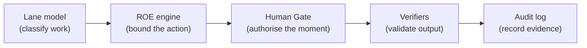

The gate's scope is deliberately narrow. It does not decide *what* is permitted — that is the ROE
engine's job. It does not decide *which lane* applies — that is the lane policy's job. It decides
*whether a human has explicitly approved a specific pending operation* and keeps a faithful record
of that decision. By keeping the gate small, ZP42 keeps the trust boundary easy to reason about.

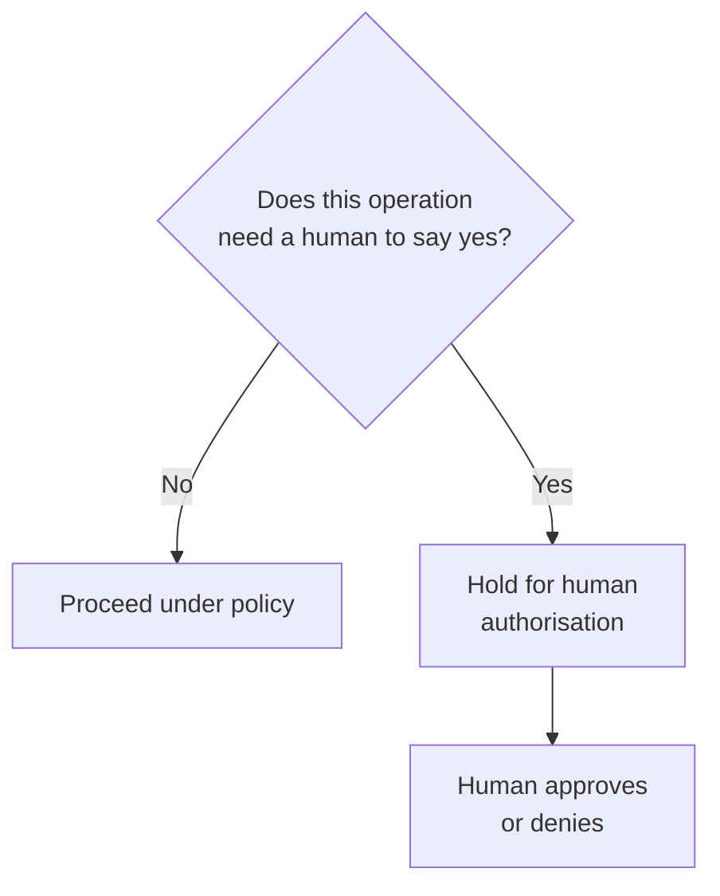

### 1.1 What the gate is not

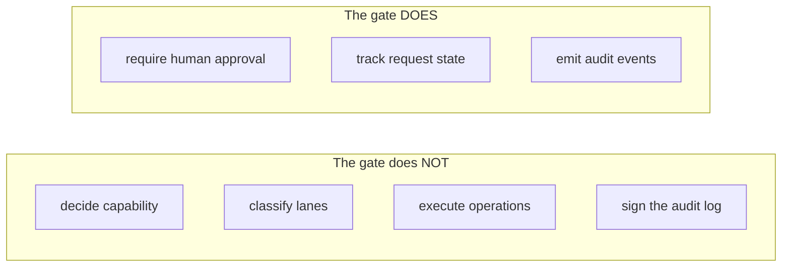

The gate never becomes an offensive instrument. It is a brake and a ledger, not an accelerator.

---

## 2. Design Principles

Five principles shape the gate. They are inherited from the ZP42 Foundation charter and from the
lessons Naquib Hatami carried forward into the project: governance built in from day one, explicit
and verifiable authorisation, no autonomous escalation, immutable audit, and fail-closed defaults.

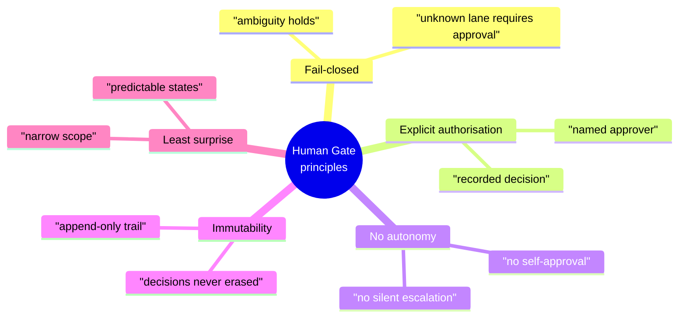

### 2.1 Fail-closed by default

When the system cannot establish that an operation is safe to run without a human, it does not run.
An unknown lane, a malformed request, or a missing approver all resolve toward *stop*, never toward
*proceed*.

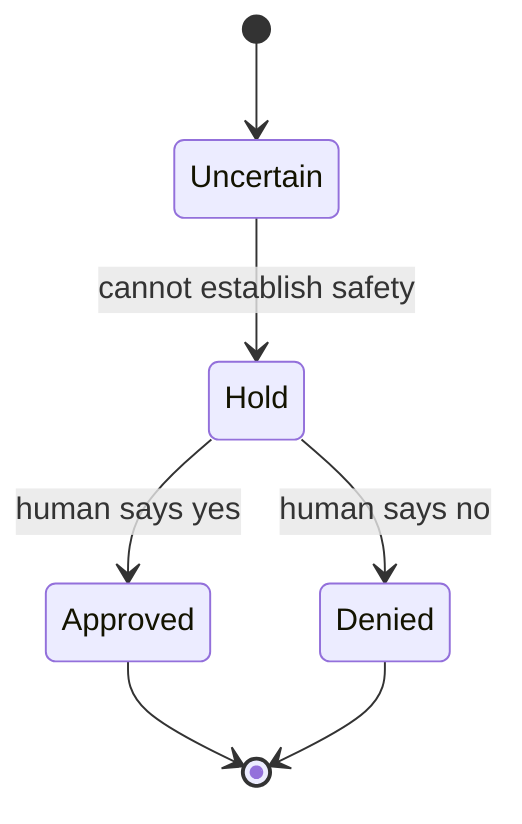

### 2.2 Separation of duties

The actor that *requests* an operation is a system component; the actor that *approves* it is a
human. These are different actor types in the audit schema (`system`, `human`, `api`), and the gate
records each decision against a named human identifier.

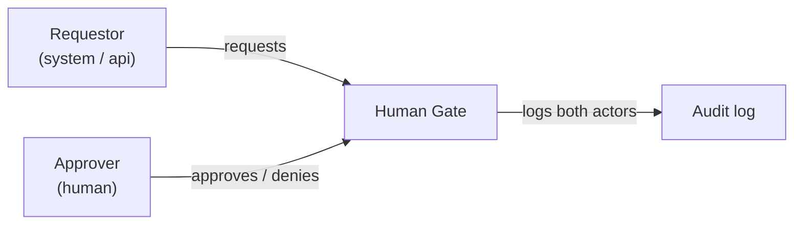

### 2.3 Everything is evidence

Every request, approval, and denial becomes an audit event. The decision is not just made; it is
*recorded*, with who, what, which lane, and why.

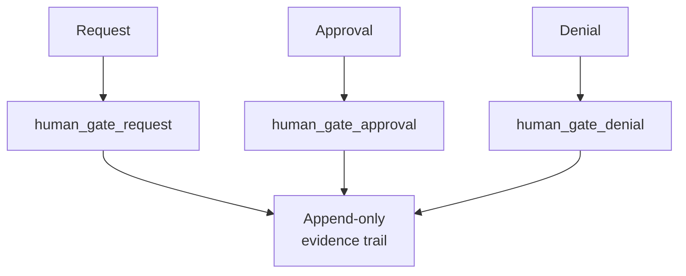

---

## 3. Position in the ZP42 Pipeline

The end-to-end pipeline is specified as: **lane → ROE → human gate → verify → audit**. In the
Foundation release the governance components exist as independent units (four are unit-tested; the ROE engine and human gate are implemented but not yet unit-tested); the
orchestrator that wires them into a single flow (`orchestrator/__init__.py`) is a scaffold and is
**not yet implemented**. The diagram below shows the *specified* flow; the dashed wiring is the part
that later phases will complete.

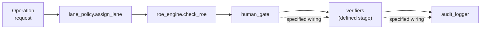

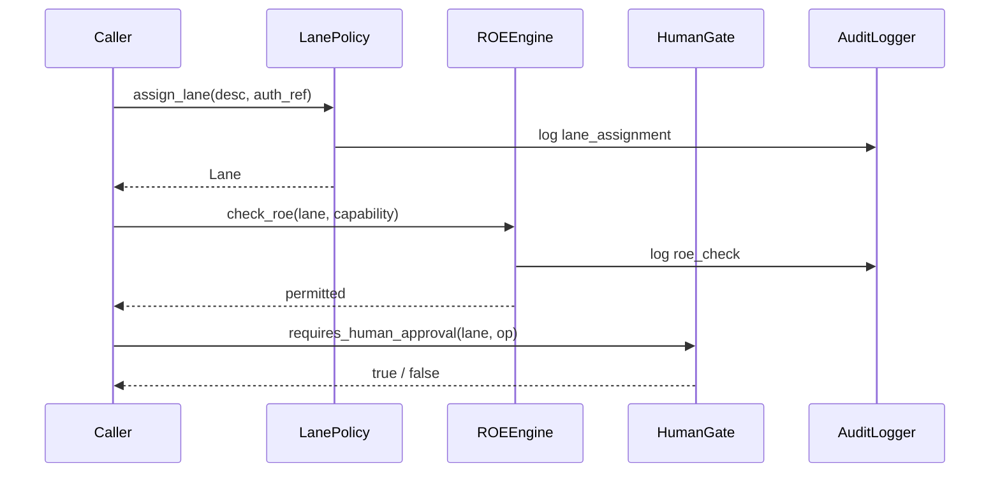

Each box is a real module under `orchestrator/` and `governance/`. The gate's two upstream
dependencies are the `Lane` enum (from `orchestrator/lanes/lane_policy.py`) and the audit logger
(from `governance/audit_logger.py`).

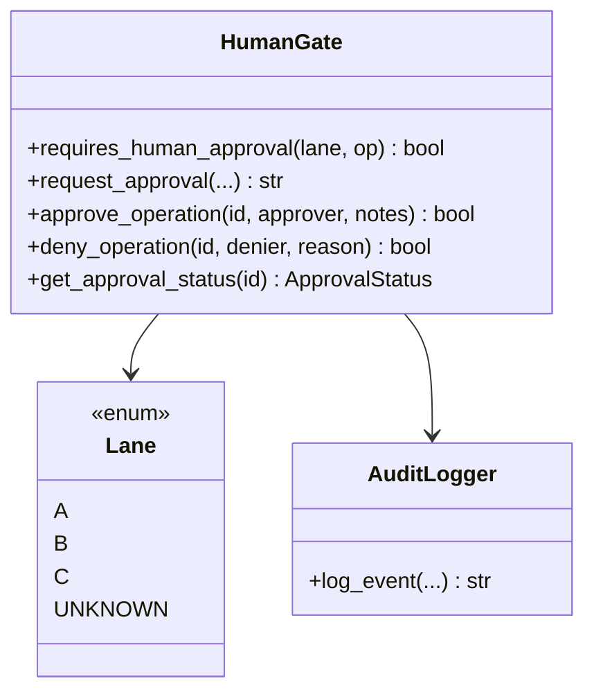

---

## 4. The Gating Decision

The first question the gate answers is whether a human is required at all. This is implemented in
`requires_human_approval(lane, operation_type)`. The answer depends on the lane and, for Lane A, on
whether the operation is in a defined set of sensitive operations.

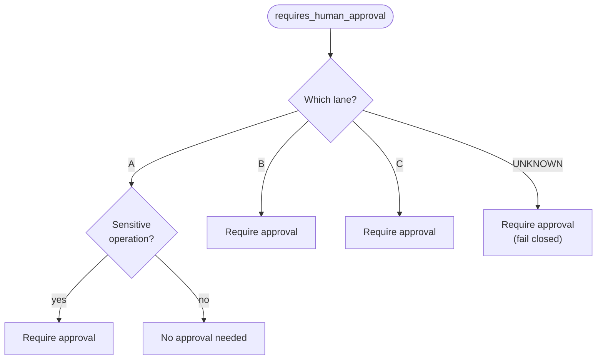

### 4.1 Lane A — defensive, authorised by the system owner

Lane A is routine defensive work. Most of it proceeds without a human gate. A small, explicit set of
sensitive operations still requires approval: `live_vulnerability_scan`, `configuration_change`, and
`access_customer_data`.

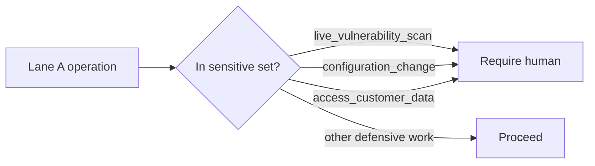

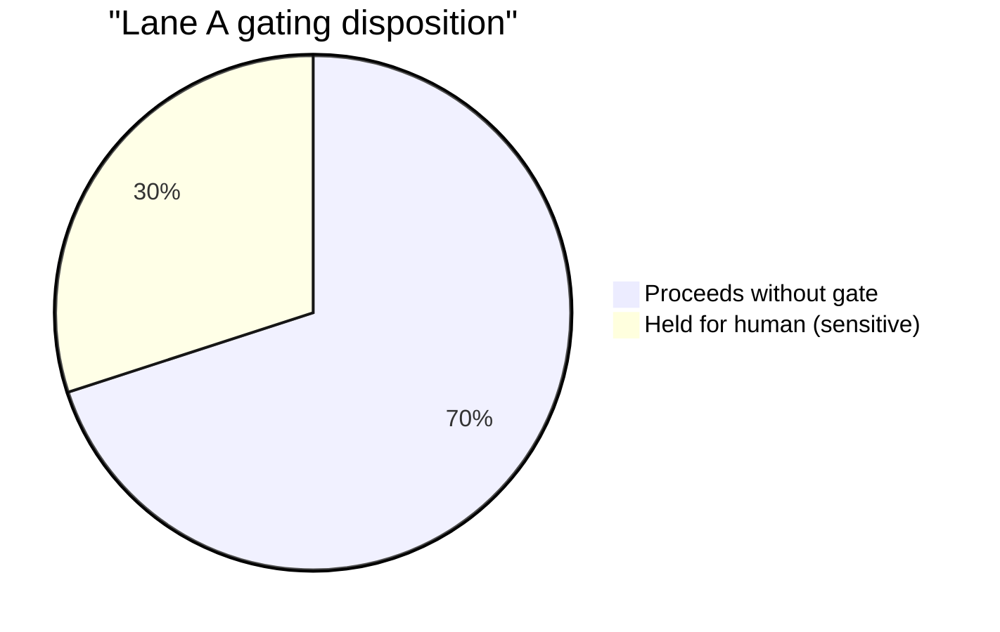

> The pie above is illustrative of the *shape* of the policy — most defensive work is ungated, a
> defined minority is gated — not a measured statistic. ZP42 publishes no performance metrics.

### 4.2 Lane B — active-defence, written authorisation

Lane B is active-defence work and requires explicit **written** authorisation to enter. Every Lane B
deployment requires human review; `requires_human_approval` returns `true` unconditionally for Lane B.

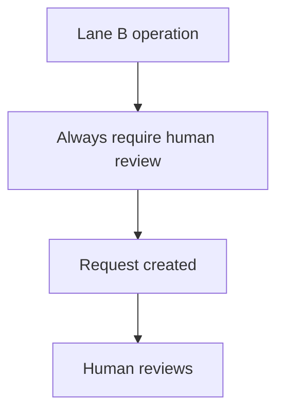

### 4.3 Lane C — sovereign-authorised

Lane C is sovereign-authorised work. Entry demands a sovereign authorisation reference **and** human
signoff at lane assignment, and then **every** Lane C operation requires approval through the gate.

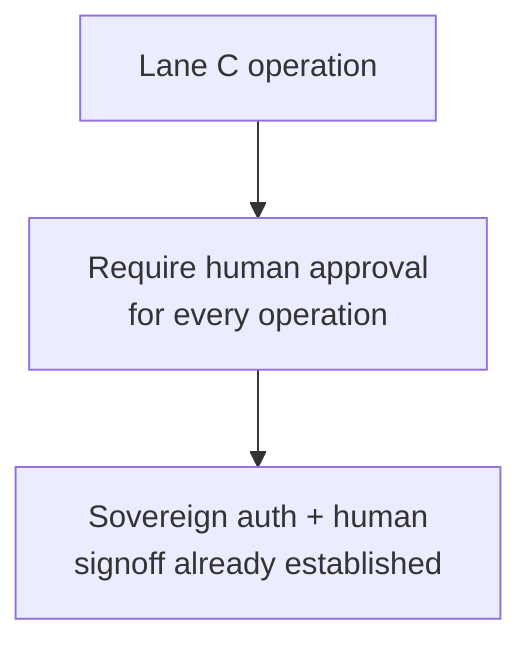

### 4.4 Unknown lane — fail closed

If the lane is `UNKNOWN`, the gate requires approval. Combined with the ROE engine, which refuses to
execute at all in an unknown lane, this gives two independent fail-closed checks.

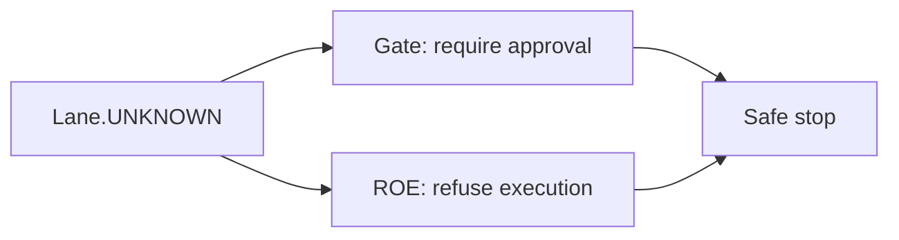

### 4.5 Decision summary

| Lane | Default gate behaviour | Rationale |
|------|------------------------|-----------|
| A | Gated only for defined sensitive operations | Routine defensive work is low-risk |
| B | Always gated | Active-defence touches adversary interaction |
| C | Always gated, every operation | Sovereign authority demands per-operation human assent |
| UNKNOWN | Always gated | Fail closed on ambiguity |

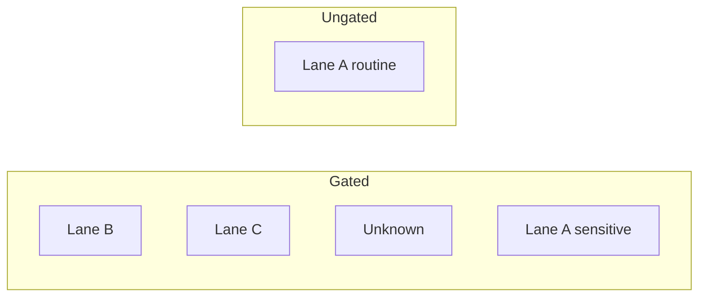

---

## 5. The Approval Request Lifecycle

When a human is required, the caller invokes `request_approval(...)`, which mints a unique
`approval_request_id` (a UUID4), stores a pending record, and writes a `human_gate_request` audit
event with result `pending`. A human then calls `approve_operation(...)` or `deny_operation(...)`.

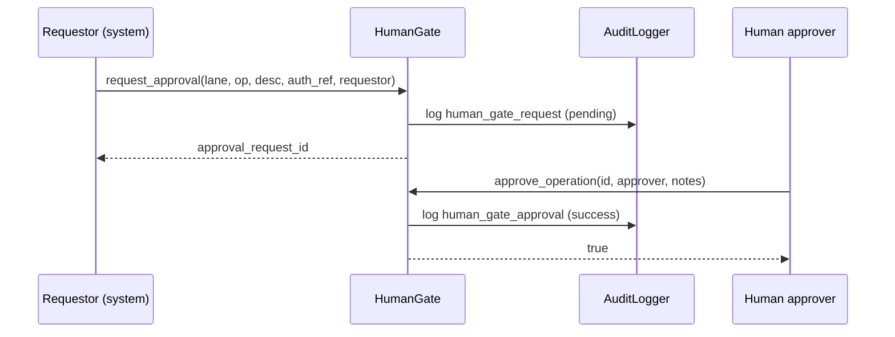

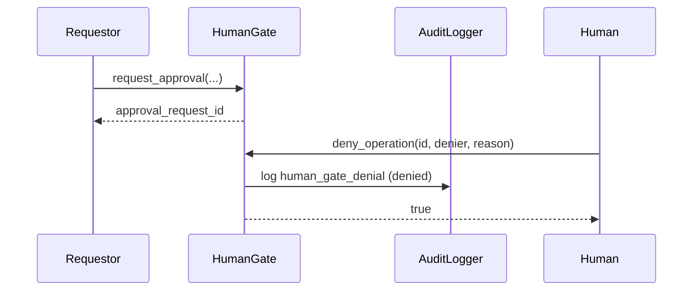

### 5.1 Minting and tracking

In the Foundation scaffold, pending approvals are held in an **in-memory** dictionary
(`self._pending_approvals`). The code itself notes that production should use persistent storage.
This is an honest limitation: restart the process and pending requests are lost.

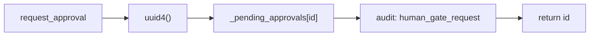

```mermaid
flowchart TD
    Note["Foundation limitation"] --> Mem["In-memory store"]
    Mem --> Vol["Volatile across restart"]
    Vol --> Future["Specified: persistent store<br/>in a later phase"]
```

### 5.2 Guard conditions

Both `approve_operation` and `deny_operation` raise `ValueError` if the request id is unknown, or if
the request has already left the `pending` state. A decision can be made exactly once.

```mermaid
flowchart TD
    Call["approve / deny"] --> Exists{"id in store?"}
    Exists -->|"no"| Err1["raise ValueError<br/>(not found)"]
    Exists -->|"yes"| Pending{"status == pending?"}
    Pending -->|"no"| Err2["raise ValueError<br/>(already processed)"]
    Pending -->|"yes"| Apply["apply decision"]
```

```mermaid
flowchart LR
    P["pending"] -->|"approve"| AP["approved"]
    P -->|"deny"| DN["denied"]
    AP -.->|"approve again"| X1["ValueError"]
    DN -.->|"deny again"| X2["ValueError"]
```

---

## 6. States of an Approval Request

The gate defines four states in the `ApprovalStatus` enum: `PENDING`, `APPROVED`, `DENIED`, and
`EXPIRED`. Three transitions are implemented today (request creates `PENDING`; approve moves to
`APPROVED`; deny moves to `DENIED`). `EXPIRED` is **defined but not yet driven** by any implemented
transition — there is no expiry timer in the Foundation scaffold.

```mermaid
stateDiagram-v2
    [*] --> PENDING: request_approval
    PENDING --> APPROVED: approve_operation
    PENDING --> DENIED: deny_operation
    PENDING --> EXPIRED: (specified, not implemented)
    APPROVED --> [*]
    DENIED --> [*]
    EXPIRED --> [*]
```

### 6.1 Terminal states

`APPROVED`, `DENIED`, and `EXPIRED` are terminal. Once reached, the request cannot be re-decided; the
guard conditions in Section 5.2 enforce this.

```mermaid
stateDiagram-v2
    state "Non-terminal" as NT
    state "Terminal" as T
    NT: PENDING
    T: APPROVED / DENIED / EXPIRED
    NT --> T
    T --> T: rejected (ValueError)
```

### 6.2 Implemented vs specified transitions

```mermaid
flowchart LR
    subgraph Implemented
        I1["PENDING → APPROVED"]
        I2["PENDING → DENIED"]
    end
    subgraph Specified
        S1["PENDING → EXPIRED"]
    end
```

```mermaid
stateDiagram-v2
    direction LR
    [*] --> PENDING
    PENDING --> APPROVED
    PENDING --> DENIED
    note right of APPROVED : status queried via get_approval_status
```

### 6.3 Querying state

`get_approval_status(approval_request_id)` returns the current `ApprovalStatus`, raising `ValueError`
for an unknown id. This is the read path auditors and operators use to inspect a request.

```mermaid
flowchart TD
    Query["get_approval_status(id)"] --> Known{"id known?"}
    Known -->|"no"| E["ValueError"]
    Known -->|"yes"| Ret["return ApprovalStatus"]
```

---

## 7. Records the Gate Emits

Every gate action produces one audit event through `audit_logger.log_event(...)`. The event conforms
to `governance/audit_schema.json`. The three gate operation types are `human_gate_request`,
`human_gate_approval`, and `human_gate_denial`.

```mermaid
erDiagram
    AUDIT_EVENT {
        string timestamp
        string event_id
        string operation_type
        string lane
        string result
        bool escalation_attempt
    }
    ACTOR {
        string type
        string identifier
    }
    OPERATION_DETAILS {
        string approval_request_id
        string operation_type
        string notes_or_reason
    }
    AUDIT_EVENT ||--|| ACTOR : "has"
    AUDIT_EVENT ||--o| OPERATION_DETAILS : "carries"
```

### 7.1 The request record

The pending record stored in memory carries the lane, operation type and description, the
authorisation reference, the requestor identifier, optional operation details, and the status.

```mermaid
classDiagram
    class ApprovalRequest {
        +str approval_request_id
        +str lane
        +str operation_type
        +str operation_description
        +str authorization_reference
        +str requestor_identifier
        +dict operation_details
        +str status
    }
```

```mermaid
flowchart LR
    Fields["Request fields"] --> ID["approval_request_id"]
    Fields --> LN["lane"]
    Fields --> OT["operation_type"]
    Fields --> AR["authorization_reference"]
    Fields --> RQ["requestor_identifier"]
```

### 7.2 The approval record

On approval the record gains `approver_identifier` and optional `approval_notes`, and a
`human_gate_approval` event is logged with `actor_type = human` and `result = success`.

```mermaid
flowchart TD
    Approve["approve_operation"] --> Set["status = approved"]
    Set --> Add1["+ approver_identifier"]
    Set --> Add2["+ approval_notes"]
    Add1 --> Log["audit: human_gate_approval (success)"]
    Add2 --> Log
```

### 7.3 The denial record

On denial the record gains `denier_identifier` and a mandatory `denial_reason`, and a
`human_gate_denial` event is logged with `result = denied` and `failure_reason` set.

```mermaid
flowchart TD
    Deny["deny_operation"] --> Set2["status = denied"]
    Set2 --> Add3["+ denier_identifier"]
    Set2 --> Add4["+ denial_reason (required)"]
    Add3 --> Log2["audit: human_gate_denial (denied)"]
    Add4 --> Log2
```

### 7.4 Schema-valid operation types

```mermaid
flowchart LR
    subgraph Gate events
        R["human_gate_request"]
        A["human_gate_approval"]
        D["human_gate_denial"]
    end
    subgraph Schema enum
        E["valid_operation_types"]
    end
    R --> E
    A --> E
    D --> E
```

The audit logger validates `operation_type`, `lane`, `actor_type`, and `result` against fixed
enums and raises `ValueError` on any invalid value, so a malformed gate event cannot be written.

```mermaid
flowchart TD
    Ev["log_event"] --> V1{"operation_type valid?"}
    V1 -->|"no"| X["ValueError"]
    V1 -->|"yes"| V2{"lane valid?"}
    V2 -->|"no"| X
    V2 -->|"yes"| V3{"actor_type valid?"}
    V3 -->|"no"| X
    V3 -->|"yes"| V4{"result valid?"}
    V4 -->|"no"| X
    V4 -->|"yes"| W["append JSONL line"]
```

---

## 8. The Evidence Trail

Gate events flow into the same append-only JSONL log as every other ZP42 operation. The log is
written synchronously, one JSON object per line, to a daily file under `governance/logs/`.

```mermaid
flowchart LR
    G1["human_gate_request"] --> F["audit_YYYY-MM-DD.jsonl"]
    G2["human_gate_approval"] --> F
    G3["human_gate_denial"] --> F
    LA["lane_assignment"] --> F
    RC["roe_check"] --> F
```

### 8.1 Append-only, not signed

The log is append-only by discipline and by write mode. It is **plain JSONL and is not
cryptographically signed** in the Foundation release. Tamper-evidence through signing is specified as
future work; today the integrity guarantee is operational, not cryptographic.

```mermaid
flowchart TD
    Now["Foundation: plain JSONL append"] --> Prop1["Append-only write"]
    Now --> Prop2["No signature"]
    Future["Specified later: signed/chained"] --> Prop3["Tamper-evident"]
```

```mermaid
stateDiagram-v2
    [*] --> Written
    Written --> Written: new line appended
    Written --> Queried: query_logs(filters)
    note right of Written : lines are never rewritten
```

### 8.2 Reconstructing a decision

Because request, approval, and denial events all share the `approval_request_id` inside
`operation_details`, an auditor can reconstruct the full history of any decision by filtering the log.

```mermaid
sequenceDiagram
    participant Aud as Auditor
    participant AL as AuditLogger
    Aud->>AL: query_logs(operation_type="human_gate_request")
    AL-->>Aud: pending events
    Aud->>AL: query_logs(operation_type="human_gate_approval")
    AL-->>Aud: approval events
    Aud->>Aud: join on approval_request_id
```

```mermaid
flowchart LR
    Q["query_logs(filters)"] --> F1["by lane"]
    Q --> F2["by operation_type"]
    Q --> F3["by actor_identifier"]
    Q --> F4["by time window"]
    F1 --> Res["matching events"]
    F2 --> Res
    F3 --> Res
    F4 --> Res
```

### 8.3 What a reviewer sees

| Field | Request | Approval | Denial |
|-------|---------|----------|--------|
| `operation_type` | `human_gate_request` | `human_gate_approval` | `human_gate_denial` |
| `actor.type` | `system` | `human` | `human` |
| `result` | `pending` | `success` | `denied` |
| `failure_reason` | — | — | denial reason |
| `approval_request_id` | present | present | present |

```mermaid
flowchart TD
    Trail["Decision trail"] --> Who["who (actor identifier)"]
    Trail --> What["what (operation type)"]
    Trail --> Which["which lane"]
    Trail --> Why["why (notes / reason)"]
    Trail --> When["when (timestamp)"]
```

---

## 9. Interaction with Lanes and ROE

The gate never runs alone. The lane policy decides the lane and fails closed when authorisation is
missing; the ROE engine refuses globally prohibited capabilities and lane-inappropriate ones; the
gate then requires human assent where the lane demands it.

```mermaid
flowchart TD
    Start["Operation request"] --> LP{"lane_policy.assign_lane"}
    LP -->|"no auth ref"| Fail1["ValueError (fail closed)"]
    LP -->|"assigned"| RE{"roe_engine.check_roe"}
    RE -->|"prohibited"| Fail2["ROEViolation"]
    RE -->|"permitted"| HG{"human_gate"}
    HG -->|"approval required"| Hold["Hold for human"]
    HG -->|"not required"| Go["Proceed under policy"]
```

### 9.1 Globally prohibited capabilities never reach the gate

The ROE engine rejects capabilities such as autonomous retaliation or hack-back for *all* lanes
before any gate request is created. The gate is therefore a control over *authorised* work, not a way
to approve prohibited work.

```mermaid
flowchart LR
    Cap["Requested capability"] --> Glob{"Globally prohibited?"}
    Glob -->|"yes"| Stop["ROEViolation<br/>(never gated)"]
    Glob -->|"no"| Lane["Lane-specific ROE check"]
    Lane --> Gate["Possible human gate"]
```

```mermaid
flowchart TD
    subgraph "Cannot be approved at all"
        P1["hack_back"]
        P2["autonomous_retaliation"]
        P3["data_exfiltration_unauthorized"]
        P4["destructive_payload"]
    end
    P1 --> Deny["ROE denies before gate"]
    P2 --> Deny
    P3 --> Deny
    P4 --> Deny
```

### 9.2 Escalation is not a gate decision

A request to move between lanes is handled by the ROE engine's `validate_escalation_attempt`, which
in the Foundation phase denies and logs *all* escalation attempts. The human gate cannot be used to
escalate a lane; it only authorises operations within an already-assigned lane.

```mermaid
sequenceDiagram
    participant Sys as Component
    participant RE as ROEEngine
    participant AL as AuditLogger
    Sys->>RE: validate_escalation_attempt(A, C)
    RE->>AL: log escalation_attempt (denied)
    RE-->>Sys: ROEViolation
```

```mermaid
flowchart LR
    Cur["Current lane"] --> Same{"requested == current?"}
    Same -->|"yes"| OK["permitted"]
    Same -->|"no"| D["denied + logged"]
```

### 9.3 Combined fail-closed posture

```mermaid
flowchart TD
    A1["Missing auth"] --> FC["Fail closed"]
    A2["Unknown lane"] --> FC
    A3["Prohibited capability"] --> FC
    A4["Escalation attempt"] --> FC
    A5["No human approval"] --> FC
    FC --> Safe["Operation does not run"]
```

---

## 10. Roles and Operating Procedure

Three roles interact with the gate: the **requestor** (a system or API component that proposes an
operation), the **approver** (an accountable human who approves or denies), and the **auditor** (who
reviews the trail). In Lane C the sovereign authority and human signoff are established upstream at
lane assignment before the gate is ever reached.

```mermaid
flowchart LR
    Requestor["Requestor"] -->|"request_approval"| Gate["Human Gate"]
    Approver["Approver (human)"] -->|"approve / deny"| Gate
    Gate -->|"events"| Log["Audit log"]
    Auditor["Auditor"] -->|"query_logs"| Log
```

```mermaid
journey
    title Human approval journey (Lane B)
    section Request
        Component proposes operation: 3: Requestor
        Gate mints request id: 4: Gate
    section Review
        Human reads description and auth ref: 3: Approver
        Human decides: 4: Approver
    section Record
        Decision logged: 5: Gate
        Auditor can reconstruct: 5: Auditor
```

### 10.1 Approver responsibilities

```mermaid
mindmap
  root(("Approver"))
    "Verify authorisation reference"
    "Confirm lane is correct"
    "Record a reason on denial"
    "Never self-approve own request"
```

### 10.2 A denial is a first-class outcome

A denial is not a failure of the system; it is the system working. The gate treats denial as a
normal, well-recorded terminal state with a mandatory reason.

```mermaid
stateDiagram-v2
    [*] --> PENDING
    PENDING --> DENIED: reason required
    DENIED --> [*]
    note right of DENIED : reason stored and logged
```

```mermaid
flowchart LR
    Denied["Denied operation"] --> Rec["Reason recorded"]
    Rec --> Learn["Reviewable signal"]
    Learn --> Improve["Policy refinement input"]
```

---

## 11. Abuse Cases and How the Gate Resists Them

The gate is designed against a short list of realistic misuse patterns. None of these describe how to
attack a system; they describe how the gate stays honest.

```mermaid
flowchart TD
    subgraph Threats
        T1["Double decision"]
        T2["Self-approval"]
        T3["Silent escalation"]
        T4["Forged event"]
        T5["Unknown-lane slip"]
    end
    T1 --> C1["Guard: already-processed ValueError"]
    T2 --> C2["Separation of duties in records"]
    T3 --> C3["ROE denies escalation"]
    T4 --> C4["Schema enum validation"]
    T5 --> C5["Fail closed: require approval"]
```

### 11.1 Replay / double decision

Attempting to approve or deny the same request twice raises `ValueError`. A decision is immutable
once made.

```mermaid
sequenceDiagram
    participant Op as Human
    participant HG as HumanGate
    Op->>HG: approve_operation(id)
    HG-->>Op: true (status=approved)
    Op->>HG: deny_operation(id)
    HG-->>Op: ValueError (already processed)
```

### 11.2 Unknown request id

```mermaid
flowchart LR
    Bad["Unknown id"] --> HG["approve / deny / status"]
    HG --> Err["ValueError: not found"]
```

### 11.3 Schema enforcement blocks malformed events

```mermaid
flowchart TD
    Mal["Malformed event<br/>(bad lane or result)"] --> Log["log_event"]
    Log --> Reject["ValueError"]
    Reject --> NoWrite["nothing written"]
```

### 11.4 Residual risks (honest)

The in-memory pending store is volatile; the log is unsigned; expiry is not yet enforced. These are
documented limitations, not hidden ones.

```mermaid
flowchart LR
    R1["Volatile pending store"] --> Fix1["Specified: persistence"]
    R2["Unsigned log"] --> Fix2["Specified: signing"]
    R3["No expiry timer"] --> Fix3["Specified: EXPIRED driver"]
```

---

## 12. Implementation Status

This section states plainly what exists and what does not, so that no reader mistakes a scaffold for
a finished system. The present release is a **Foundation-phase scaffold**.

```mermaid
flowchart LR
    subgraph "Implemented (not yet unit-tested)"
        I1["requires_human_approval"]
        I2["request_approval"]
        I3["approve_operation"]
        I4["deny_operation"]
        I5["get_approval_status"]
        I6["audit log_event + enums"]
    end
    subgraph Specified only
        S1["end-to-end orchestrator wiring"]
        S2["verifiers output validation"]
        S3["log signing"]
        S4["enforced compliance manifests"]
        S5["EXPIRED transition / timer"]
        S6["persistent pending store"]
    end
```

```mermaid
pie title "Human Gate component status (qualitative)"
    "Implemented (not yet unit-tested)" : 60
    "Defined / specified for later" : 40
```

> The chart expresses a qualitative split between implemented behaviour and specified-but-unwired
> behaviour. It is not a measured completion metric.

### 12.1 What is implemented

The `HumanGate` class, its five methods, the `ApprovalStatus` enum, the lane decision logic, and the
audit integration are implemented as an independent component, but are not yet covered by a dedicated unit-test suite.

```mermaid
classDiagram
    class ApprovalStatus {
        <<enum>>
        PENDING
        APPROVED
        DENIED
        EXPIRED
    }
    class HumanGate
    HumanGate --> ApprovalStatus : uses
```

### 12.2 What is specified but not wired

The orchestrator that joins lane → ROE → gate → verify → audit is a scaffold
(`orchestrator/__init__.py` is empty). The `verifiers/` stage is defined, not completed. Compliance
manifests (`compliance/model_allowlist.json`, `compliance/license_manifest.json`) are declared as
machine-readable data and are **not yet enforced in code**. Inference, exploit or offensive
execution, and live targeting are explicitly **out of scope** for the Foundation phase.

```mermaid
flowchart TD
    Scaffold["orchestrator/__init__.py<br/>(empty scaffold)"] --> Gap["pipeline not yet wired"]
    Gap --> Plan["wiring is a later-phase objective"]
```

```mermaid
flowchart LR
    M1["model_allowlist.json"] --> Declared["declared"]
    M2["license_manifest.json"] --> Declared
    Declared --> NotEnforced["not yet enforced in code"]
```

---

## 13. Future Work

The gate's forward path keeps its small scope while closing the honest gaps above. Nothing here is a
promise of capability; it is a record of specified intent.

```mermaid
timeline
    title Specified gate evolution
    Foundation : Independent gate component : In-memory store : Plain JSONL log
    Next : Orchestrator wiring : Persistent pending store
    Later : Signed/chained audit log : EXPIRED timer : Enforced compliance manifests
```

```mermaid
flowchart LR
    F1["Persist pending approvals"] --> Goal["Durable gate"]
    F2["Drive EXPIRED on timeout"] --> Goal
    F3["Sign audit events"] --> Goal
    F4["Wire pipeline end-to-end"] --> Goal
```

### 13.1 Expiry, once implemented

When expiry is implemented, a pending request that is not decided within a configured window will
transition to `EXPIRED` and emit an audit event, preserving the fail-closed posture.

```mermaid
stateDiagram-v2
    [*] --> PENDING
    PENDING --> APPROVED: human yes
    PENDING --> DENIED: human no
    PENDING --> EXPIRED: timeout (future)
    EXPIRED --> [*]
```

```mermaid
flowchart TD
    Timer["Future: expiry window"] --> Check{"decided in time?"}
    Check -->|"yes"| Keep["APPROVED / DENIED"]
    Check -->|"no"| Exp["EXPIRED + audit event"]
```

### 13.2 Durable, tamper-evident records

```mermaid
flowchart LR
    Plain["Plain JSONL (today)"] --> Signed["Signed / hash-chained (specified)"]
    Signed --> Evident["Tamper-evident trail"]
```

---

## 14. Summary

The Human Gate is deliberately modest in scope and strict in behaviour. It requires an accountable
human to authorise the operations that warrant it, records every request and decision as evidence,
and fails closed whenever safety cannot be established. It depends on the lane model and the ROE
engine to bound *what* may be done, and it owns the narrow, crucial question of *whether a human has
said yes to this specific operation, now*. In the Foundation release the gate is implemented
as an independent component but is not yet unit-tested; the end-to-end pipeline, log signing, enforced compliance, and
request expiry are specified for later phases and are documented here as such. This honesty is itself
a governance property: ZP42, as designed by Naquib Hatami, treats "not yet built" as a fact to record,
not a gap to paper over.

```mermaid
flowchart LR
    Bound["Lanes + ROE<br/>(bound the action)"] --> Gate["Human Gate<br/>(authorise the moment)"]
    Gate --> Evidence["Audit log<br/>(record the decision)"]
    Evidence --> Trust["Reviewable trust"]
```

---

## Related Documents

- [`../README.md`](../README.md) — ZP42 project overview and architecture
- [`FOUNDATION.md`](FOUNDATION.md) — Foundation charter, lanes, model policy, licensing
- [`05-lane-model.md`](05-lane-model.md) — Lane A/B/C classification and fail-closed authorisation
- [`06-roe-engine.md`](06-roe-engine.md) — ROE engine, prohibited capabilities, escalation handling
- [`08-governance-audit.md`](08-governance-audit.md) — Append-only audit log, schema, and querying
- [`09-compliance-allowlists.md`](09-compliance-allowlists.md) — Model allowlist and licence manifests (declared, not yet enforced)
