> Part of the ZP42 documentation set

# Governance & Append-Only Audit

## Abstract

This document specifies the governance and audit subsystem of **ZP42 (Zeroth Protocol 42)**, the open, MIT-licensed, governance-first cyber-reasoning system invented by **Naquib Hatami** and published by SADI AI Inc. / iQs Group Inc. (repository `github.com/iQs-Group/zp-42`, site `zp42.org`). It describes the append-only audit logger (`governance/audit_logger.py`), the machine-readable audit schema (`governance/audit_schema.json`), the shape of the evidence record each governed action emits, and — just as importantly — a precise, honest account of **what the current release captures and what it does not**. ZP42 is presently in its **Foundation phase**: a governance-first scaffold in which the lane policy, rules-of-engagement engine, human gate, audit logger, and prohibited-terms scanner exist and are tested as independent components, while the end-to-end orchestrator that would wire them into a single pipeline is not yet implemented. Throughout, the architecture is described **as specified**, with implemented behaviour clearly distinguished from specified-but-not-yet-built behaviour. Nothing here describes how to perform offensive, exploitative, or unauthorised action; the entire point of the subsystem is that capability is *gated by authorisation and recorded as evidence*.

---

## 1. Purpose and Position in the System

The audit subsystem is the evidentiary backbone of ZP42. Where the lane policy decides *whether* an operation is permitted and the human gate decides *who must say yes*, the audit logger answers the question that matters after the fact: **what actually happened, who caused it, under what authority, and with what result**. Governance is only credible if its decisions leave a durable, inspectable trail.

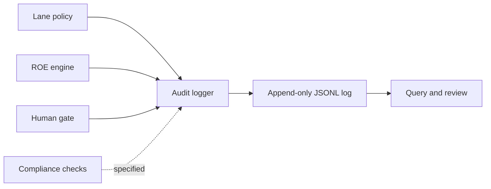

The audit logger is deliberately a *shared, central* facility. Every governance module imports a single accessor, `get_audit_logger()`, so that all evidence flows into one place rather than scattering across components.

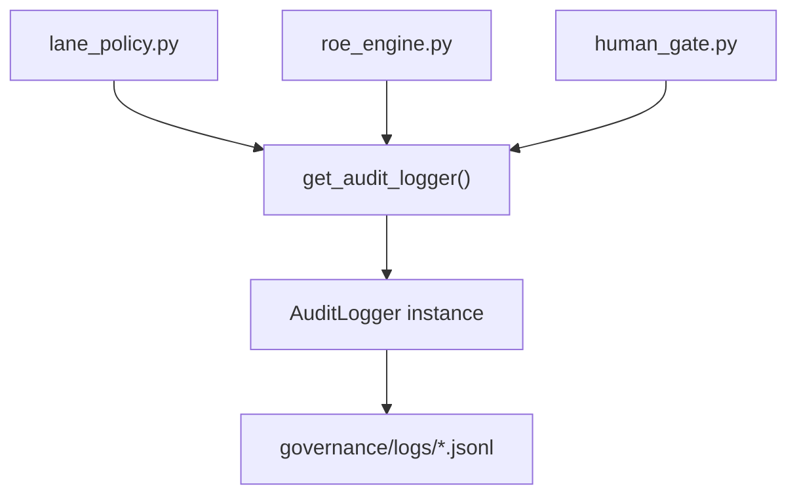

A guiding principle, carried forward from earlier internal review and recorded in the project charter, is that **governance must be built in from day one, not bolted on**. The audit logger is therefore one of the first components to exist.

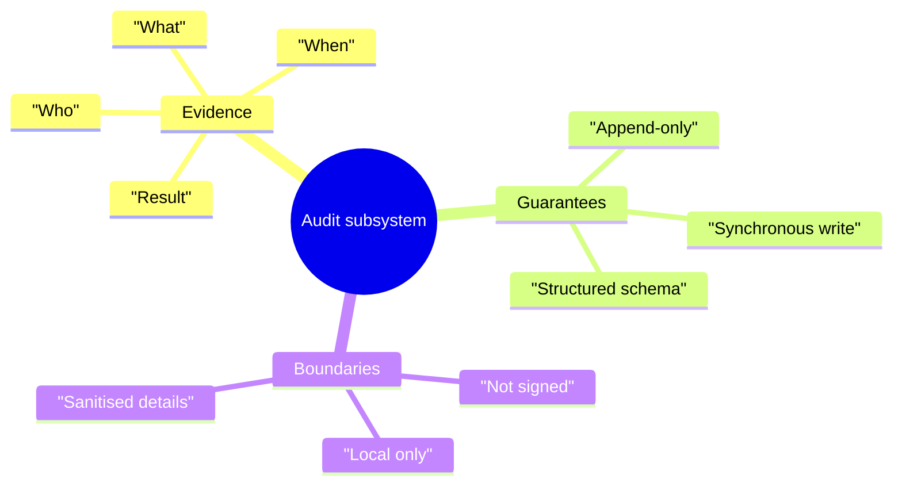

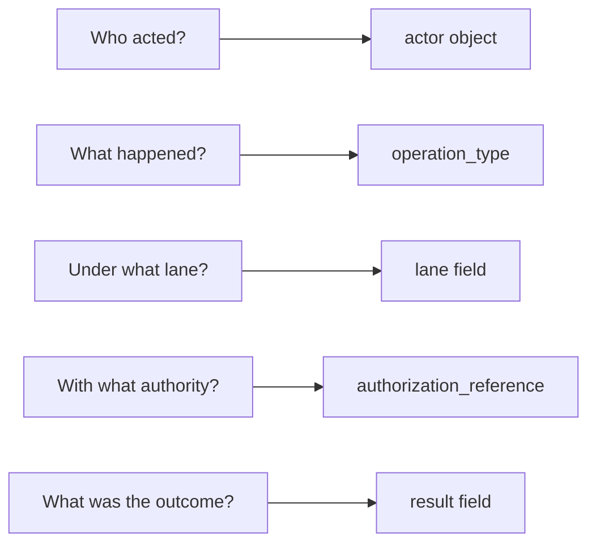

---

## 2. Design Principles

Four principles shape the implemented logger and the schema it writes.

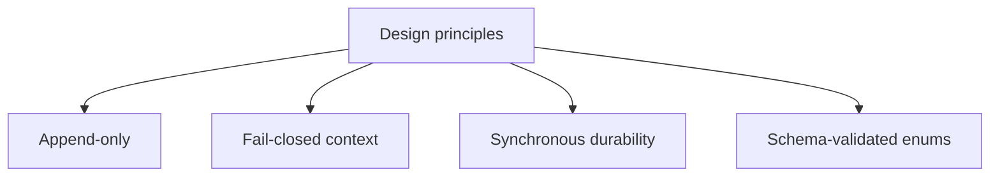

**Append-only.** The logger opens each log file in append mode (`"a"`) and writes exactly one JSON object per line. It never seeks, rewrites, or truncates. Records accrete; they are not edited in place.

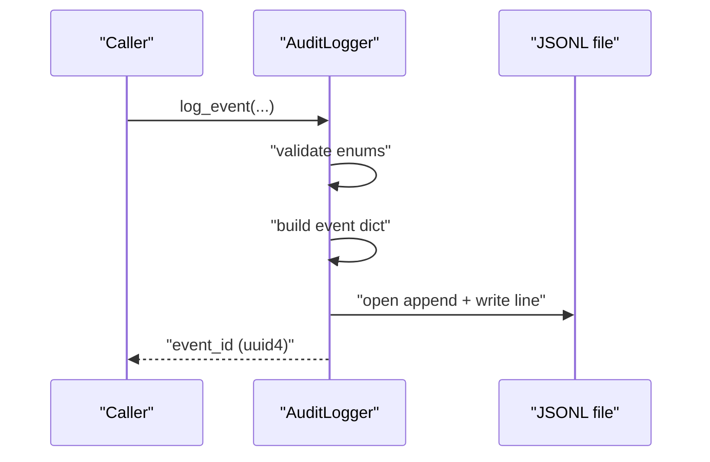

**Fail-closed context.** The logger does not itself decide policy, but it is the place where fail-closed decisions become visible. When a governance module denies or fails an operation, it records a `denied` or `failure` event *before* raising, so the refusal is never silent.

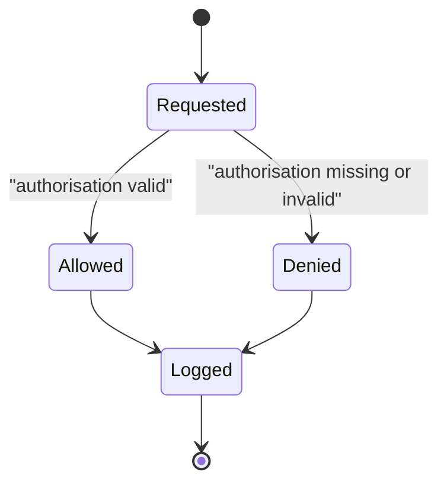

**Synchronous durability.** Each event is written within a `with open(...)` block that flushes and closes on exit, so the line is on disk before the call returns. There is no in-memory buffer that could be lost on crash.

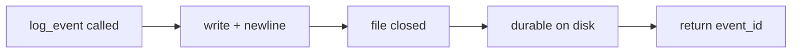

**Schema-validated enums.** Four fields — `operation_type`, `lane`, `actor.type`, and `result` — are validated against closed sets before any write. An invalid value raises `ValueError` and nothing is logged, keeping the trail well-typed.

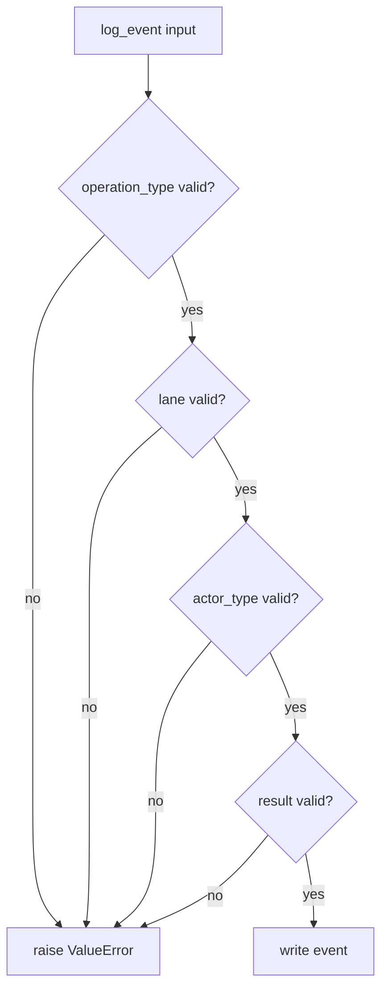

---

## 3. The Audit Logger Component

The implemented component is the `AuditLogger` class. Its construction, write path, and query path are each simple and deliberate.

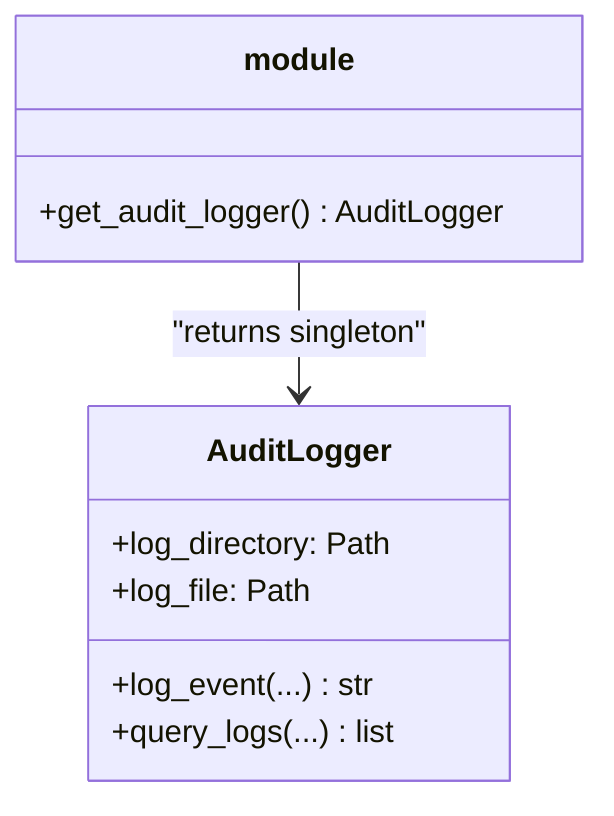

### 3.1 Construction

On construction the logger resolves a log directory (defaulting to `governance/logs/`), creates it if absent, and derives a **daily** log-file name from the current UTC date, for example `audit_2026-05-18.jsonl`.

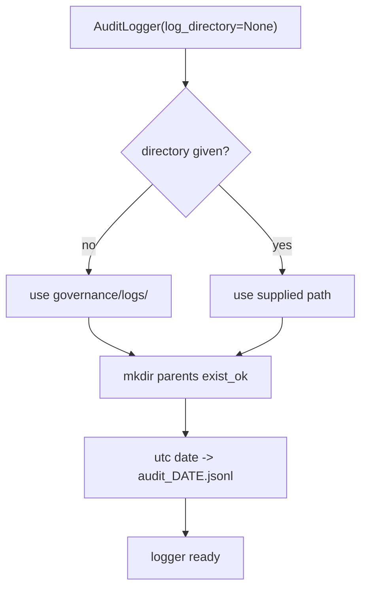

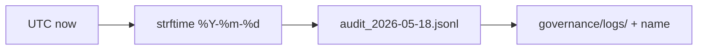

Daily rotation means the log directory holds one file per active day, which the query path later stitches back together in sorted order.

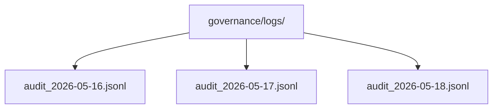

### 3.2 The write path: `log_event`

`log_event` accepts the operation type, lane, actor type and identifier, and result as required arguments, plus optional authorisation reference, operation details, failure reason, escalation flag, and policy-violation list. It validates the four enums, generates a `uuid4` event identifier and an ISO-8601 UTC timestamp, assembles the record, appends it, and returns the event identifier.

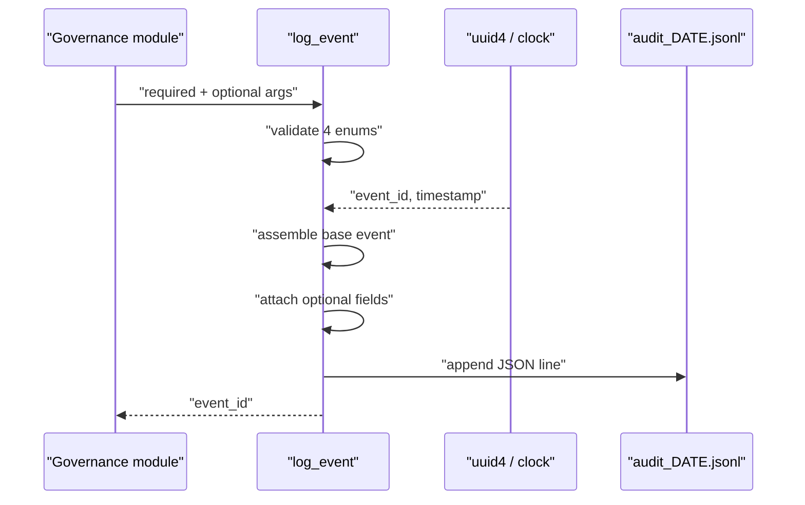

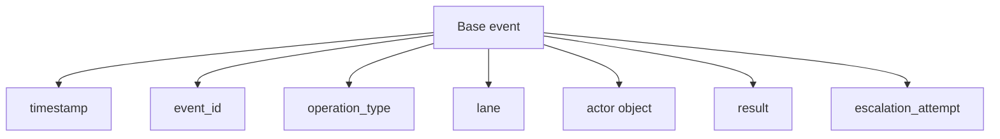

Optional fields are attached only when present, so records stay compact and do not carry empty keys.

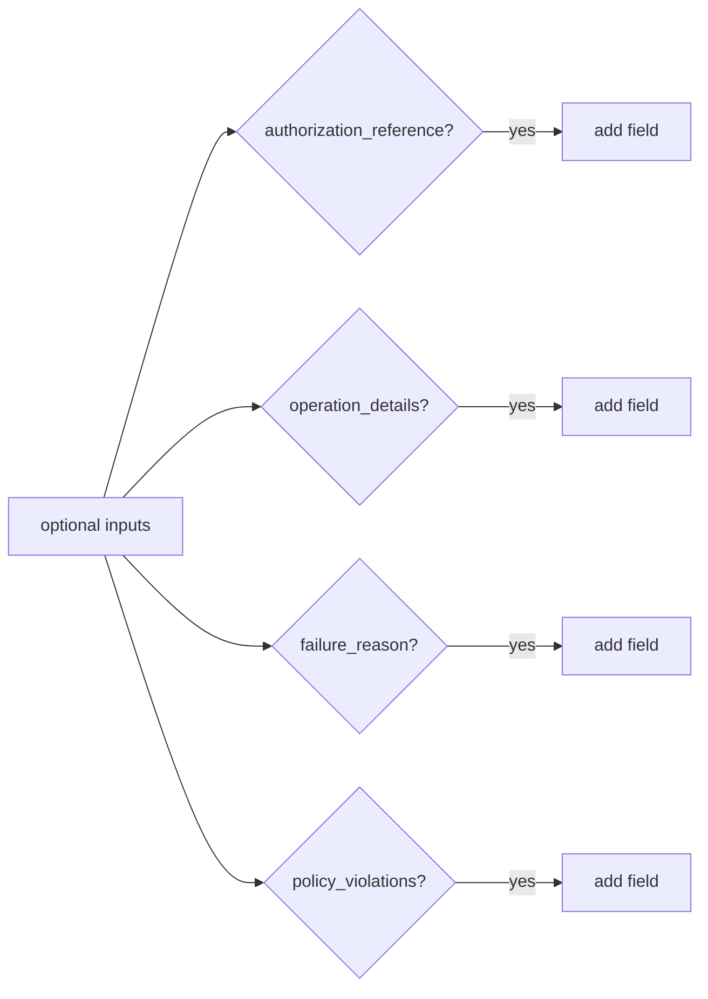

### 3.3 The read path: `query_logs`

`query_logs` globs every `audit_*.jsonl` file in sorted order, parses each line, and applies optional filters on time window, lane, operation type, and actor identifier. It is intentionally a simple file-based scan; the schema notes that production retrieval should use a database.

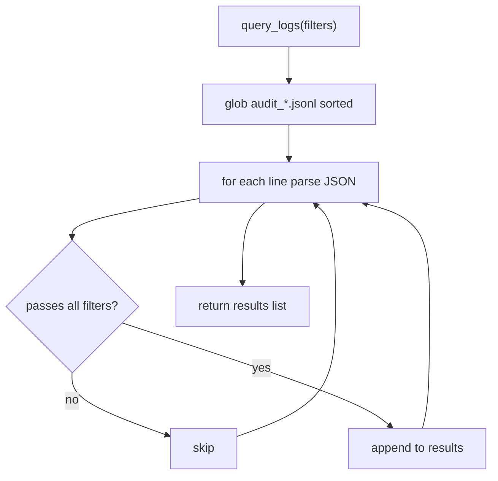

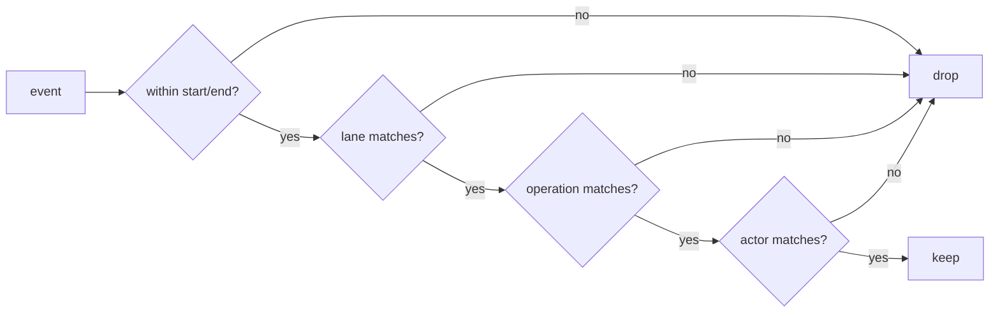

### 3.4 The singleton accessor

`get_audit_logger()` lazily constructs one module-level `AuditLogger` and returns it on every subsequent call, so all governance modules share a single log destination within a process.

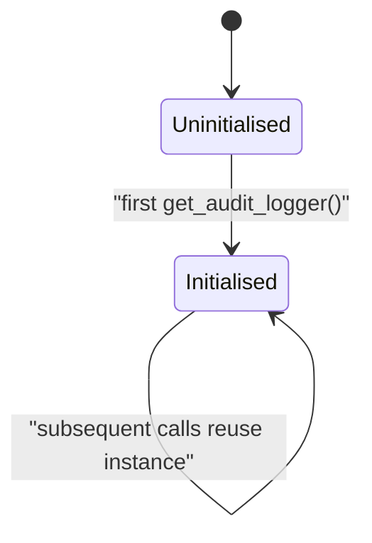

---

## 4. The Audit Schema

`audit_schema.json` is the authoritative description of a record. It declares schema version `1.0.0`, format `jsonl`, the field set with types and requiredness, example events, and a declared retention policy.

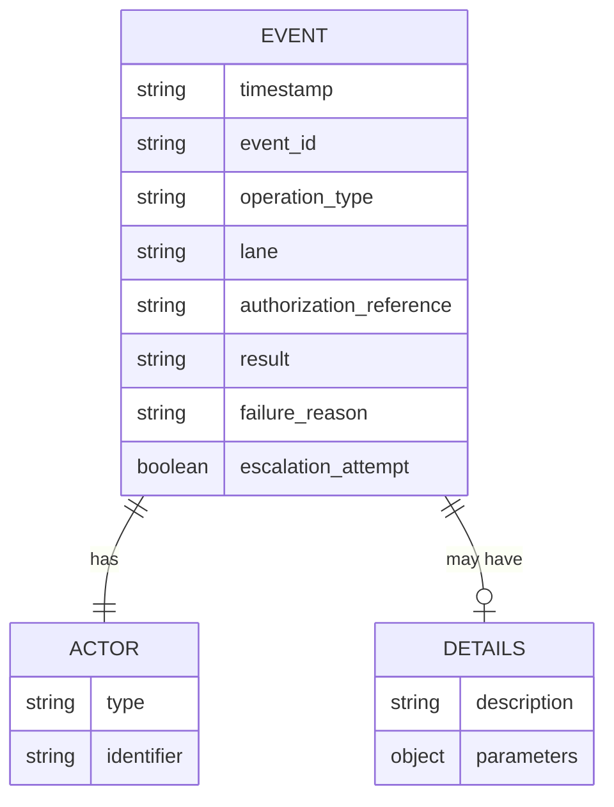

### 4.1 Required and optional fields

Five elements are required on every record: `timestamp`, `event_id`, `operation_type`, `lane`, `actor`, and `result`. The remainder — `authorization_reference`, `operation_details`, `failure_reason`, `escalation_attempt`, and `policy_violations` — are optional and appear only when meaningful.

```mermaid
flowchart TD
    SCH["Audit record"] --> REQ["Required"]
    SCH --> OPT["Optional"]
    REQ --> R1["timestamp"]
    REQ --> R2["event_id"]
    REQ --> R3["operation_type"]
    REQ --> R4["lane"]
    REQ --> R5["actor"]
    REQ --> R6["result"]
    OPT --> O1["authorization_reference"]
    OPT --> O2["operation_details"]
    OPT --> O3["failure_reason"]
    OPT --> O4["escalation_attempt"]
    OPT --> O5["policy_violations"]
```

| Field | Type | Required | Role in evidence |
|---|---|---|---|
| `timestamp` | string (ISO 8601 UTC) | yes | When the event occurred |
| `event_id` | string (uuid4) | yes | Unique handle for the event |
| `operation_type` | string (enum) | yes | What class of action occurred |
| `lane` | string (enum) | yes | Authorisation lane in force |
| `actor` | object | yes | Who or what acted |
| `result` | string (enum) | yes | Outcome of the action |
| `authorization_reference` | string | no | Link to the governing authority |
| `operation_details` | object | no | Sanitised, operation-specific context |
| `failure_reason` | string | no | Why a denial or failure occurred |
| `escalation_attempt` | boolean | no | Whether unauthorised escalation was tried |
| `policy_violations` | array of string | no | Violations detected |

### 4.2 The actor object

The actor is a nested object with a `type` from `{system, human, api}` and a free-form `identifier` such as a component name, user identity, or API-key identity.

```mermaid
flowchart LR
    AC["actor"] --> TP["type: system | human | api"]
    AC --> ID["identifier: component / user / key"]
```

```mermaid
mindmap
  root(("actor.type"))
    system
      "lane_policy.assign_lane"
      "roe_engine.check_roe"
    human
      "approver identity"
      "denier identity"
    api
      "external caller key"
```

### 4.3 The timestamp contract

Timestamps are produced with timezone-aware UTC and serialised in ISO-8601, giving a stable, sortable key for windowed queries and ordering.

```mermaid
flowchart LR
    CK["datetime.now(timezone.utc)"] --> ISO["isoformat()"]
    ISO --> STR["2026-05-18T14:30:45.123456+00:00"]
    STR --> SORT["lexicographically sortable"]
```

---

## 5. Anatomy of an Evidence Record

A single line in the log is a complete, self-describing evidence record. Reading it should answer the five governance questions without external context.

```mermaid
flowchart TD
    REC["One JSONL line"] --> W["when: timestamp"]
    REC --> ID["identity: event_id"]
    REC --> WHAT["what: operation_type"]
    REC --> LANE["authority lane: lane"]
    REC --> WHO["who: actor"]
    REC --> OUT["outcome: result"]
    REC --> EXTRA["context: details / reason / violations"]
```

Consider a lane-assignment success. The record names the operation type, the resulting lane, the authorising reference, the system component that acted, a human-readable description, and a `success` result.

```mermaid
sequenceDiagram
    participant S as "lane_policy"
    participant L as "audit log"
    S->>L: "operation_type = lane_assignment"
    S->>L: "lane = A"
    S->>L: "actor = system / lane_policy.assign_lane"
    S->>L: "result = success"
    L-->>S: "event_id"
```

A human-gate request, by contrast, is recorded with result `pending`, because the decision has not yet been made. The eventual approval or denial is a *separate* record, so the trail shows the full arc rather than a single mutated row.

```mermaid
stateDiagram-v2
    [*] --> pending: "human_gate_request"
    pending --> success: "human_gate_approval"
    pending --> denied: "human_gate_denial"
    success --> [*]
    denied --> [*]
```

```mermaid
flowchart LR
    R1["record: request (pending)"] --> R2["record: approval (success)"]
    R1 --> R3["record: denial (denied)"]
```

Because each decision point emits its own append-only record, the sequence of records *is* the history. There is no overwrite that could erase the pending state once resolved.

```mermaid
graph TD
    E1["event_id A: request"] --> E2["event_id B: approval"]
    E1 --> E3["event_id C: denial"]
    E2 --> CHAIN["evidence chain by shared request id in details"]
    E3 --> CHAIN
```

---

## 6. Operation Type Taxonomy

The `operation_type` enum is the vocabulary of governed actions. It spans lane and authorisation decisions, human-gate lifecycle, model-related events, and operation lifecycle markers.

```mermaid
flowchart TD
    OT["operation_type enum"] --> G1["Authorisation"]
    OT --> G2["Human gate"]
    OT --> G3["Model"]
    OT --> G4["Policy"]
    OT --> G5["Lifecycle"]
    G1 --> A1["lane_assignment"]
    G1 --> A2["authorization_check"]
    G2 --> H1["human_gate_request"]
    G2 --> H2["human_gate_approval"]
    G2 --> H3["human_gate_denial"]
    G3 --> M1["model_reference"]
    G3 --> M2["model_download_attempt"]
    G3 --> M3["inference_request"]
    G4 --> P1["escalation_attempt"]
    G4 --> P2["policy_violation"]
    G4 --> P3["roe_check"]
    G4 --> P4["capability_request"]
    G5 --> L1["operation_start"]
    G5 --> L2["operation_complete"]
    G5 --> L3["operation_failed"]
```

Some of these types are emitted by implemented components today; others are reserved in the schema for behaviour that the Foundation phase intentionally does not perform, such as inference and model downloads.

```mermaid
flowchart LR
    subgraph "Emitted today"
      T1["lane_assignment"]
      T2["authorization_check"]
      T3["roe_check"]
      T4["escalation_attempt"]
      T5["human_gate_request"]
      T6["human_gate_approval"]
      T7["human_gate_denial"]
    end
    subgraph "Reserved in schema"
      T8["model_download_attempt"]
      T9["inference_request"]
      T10["operation_start / complete / failed"]
    end
```

```mermaid
mindmap
  root(("Operation types"))
    "Authorisation"
      lane_assignment
      authorization_check
    "Gate"
      request
      approval
      denial
    "Rules"
      roe_check
      escalation_attempt
      policy_violation
      capability_request
    "Model (reserved)"
      model_reference
      model_download_attempt
      inference_request
    "Lifecycle (reserved)"
      operation_start
      operation_complete
      operation_failed
```

---

## 7. The Lane Dimension

Every record carries a `lane` value, binding the evidence to the authorisation regime under which it occurred. The lane enum is `A`, `B`, `C`, and `unknown`.

```mermaid
flowchart LR
    LA["Lane A"] --> DA["Defensive — system owner authorised"]
    LB["Lane B"] --> DB["Active-defence — written authorisation required"]
    LC["Lane C"] --> DC["Sovereign-authorised — sovereign ref + human signoff"]
    LU["unknown"] --> DU["Unassigned — fail closed"]
```

A lane is *entered deliberately*; it is not a default that quietly widens. The implemented `assign_lane` fails closed when no authorisation reference is supplied, and records the failure as a `lane_assignment` / `unknown` / `denied` event before raising.

```mermaid
flowchart TD
    S["assign_lane(...)"] --> AR{"authorization_reference?"}
    AR -- "none" --> LOGU["log unknown / denied"]
    LOGU --> RAISE["raise ValueError"]
    AR -- "present" --> SOV{"sovereign + signoff?"}
    SOV -- "both" --> C["Lane C"]
    SOV -- "sovereign only" --> LOG2["log denied: signoff required"]
    LOG2 --> RAISE
    SOV -- "neither" --> AD{"active-defence keywords?"}
    AD -- "yes, written auth valid" --> B["Lane B"]
    AD -- "yes, auth invalid" --> LOG3["log denied"]
    LOG3 --> RAISE
    AD -- "no" --> A["Lane A"]
```

The classifier that distinguishes active-defence from defensive work is, in the Foundation phase, keyword-based — a deliberately simple and auditable heuristic, documented as such, with more sophisticated classification reserved for later phases.

```mermaid
flowchart LR
    DESC["operation_description"] --> KW{"contains deception / honeypot / honeytoken / threat_hunting / controlled_engagement / attribution?"}
    KW -- "yes" --> AD["active-defence candidate -> Lane B"]
    KW -- "no" --> DEF["defensive -> Lane A"]
```

Written-authorisation validation is likewise format-level in this phase: a reference must be of sufficient length and carry an approved prefix such as `AUTH-`, `WRITTEN-AUTH-`, `CONTRACT-`, or `SOW-`. The schema notes that production should verify against an authorisation database.

```mermaid
flowchart TD
    REF["authorization_reference"] --> LEN{"length >= 10?"}
    LEN -- "no" --> FAIL["invalid"]
    LEN -- "yes" --> PFX{"approved prefix?"}
    PFX -- "no" --> FAIL
    PFX -- "yes" --> OKV["valid written authorisation"]
```

```mermaid
stateDiagram-v2
    [*] --> unknown
    unknown --> A: "defensive + authorised"
    unknown --> B: "active-defence + written auth"
    unknown --> C: "sovereign + human signoff"
    A --> A
    B --> B
    C --> C
    note right of unknown: "fail-closed default"
```

---

## 8. Actors and Accountability

The actor object attributes every event to a principal. System actors are named by component path, human actors by identity, and API actors by caller identity.

```mermaid
flowchart TD
    ACT["actor.type"] --> SYS["system"]
    ACT --> HUM["human"]
    ACT --> API["api"]
    SYS --> SN["e.g. lane_policy.assign_lane"]
    SYS --> SR["e.g. roe_engine.check_roe"]
    HUM --> HA["approver / denier identity"]
    API --> AK["external key identity"]
```

The human-gate events are where human accountability is most explicit: an approval records the approving human as the actor with result `success`; a denial records the denying human with result `denied` and a stored reason.

```mermaid
sequenceDiagram
    participant R as "Requestor (system)"
    participant G as "HumanGate"
    participant H as "Human approver"
    participant L as "Audit log"
    R->>G: "request_approval(...)"
    G->>L: "human_gate_request (pending, actor=system)"
    H->>G: "approve_operation(...)"
    G->>L: "human_gate_approval (success, actor=human)"
```

```mermaid
sequenceDiagram
    participant G as "HumanGate"
    participant H as "Human denier"
    participant L as "Audit log"
    H->>G: "deny_operation(reason)"
    G->>L: "human_gate_denial (denied, actor=human, failure_reason)"
```

```mermaid
flowchart LR
    SUBJ["Action"] --> ATTR["Attributed to actor"]
    ATTR --> NR["Non-repudiation at the record level"]
    NR --> NOTE["(record-level, not cryptographic — see §12)"]
```

---

## 9. Result States

Every record closes with a `result` from `{success, failure, denied, pending}`. These four states cover completed, errored, policy-refused, and awaiting-decision outcomes.

```mermaid
stateDiagram-v2
    [*] --> pending
    pending --> success
    pending --> denied
    [*] --> success
    [*] --> failure
    [*] --> denied
    success --> [*]
    failure --> [*]
    denied --> [*]
```

```mermaid
flowchart TD
    RES["result"] --> S["success — action completed within policy"]
    RES --> F["failure — action errored"]
    RES --> D["denied — refused by policy / gate"]
    RES --> P["pending — awaiting human decision"]
```

The distinction between `failure` and `denied` is meaningful for review: `denied` is governance working as intended (a refusal), while `failure` indicates an operational error. Keeping them separate lets reviewers tell safe refusals apart from faults.

```mermaid
flowchart LR
    DEN["denied"] --> OKG["governance success — refusal recorded"]
    FAIL["failure"] --> INV["operational fault — investigate"]
```

---

## 10. Escalation and Policy-Violation Capture

Two fields exist specifically to make dangerous patterns visible: `escalation_attempt` (boolean) and `policy_violations` (list of strings). The ROE engine denies all lane escalation in the Foundation phase and records each attempt with `escalation_attempt = true` and a `policy_violations` entry.

```mermaid
flowchart TD
    ESC["validate_escalation_attempt(current, requested)"] --> EQ{"same lane?"}
    EQ -- "yes" --> OK["permitted (no change)"]
    EQ -- "no" --> LOG["log escalation_attempt=true"]
    LOG --> VIO["policy_violations = unauthorized_lane_escalation"]
    VIO --> RAISE["raise ROEViolation"]
```

```mermaid
sequenceDiagram
    participant W as "Workflow"
    participant R as "ROEEngine"
    participant L as "Audit log"
    W->>R: "request escalation A -> C"
    R->>L: "escalation_attempt (denied, escalation_attempt=true)"
    R-->>W: "ROEViolation"
```

Globally prohibited capabilities are refused in every lane. A request for one is recorded as an `roe_check` with result `denied`, a failure reason, and a `prohibited_capability:*` violation entry.

```mermaid
flowchart TD
    CAP["capability_requested"] --> GP{"in globally prohibited set?"}
    GP -- "yes" --> DLOG["log roe_check denied + violation"]
    DLOG --> RV["raise ROEViolation"]
    GP -- "no" --> LANE["lane-specific checks"]
```

```mermaid
mindmap
  root(("Globally prohibited"))
    "malware creation / deployment"
    "credential theft / harvesting"
    "ddos generation"
    "unauthorised data exfiltration"
    "persistence installation"
    "evasion technique"
    "destructive payload"
    "autonomous retaliation"
    "hack-back"
    "unauthorised third-party targeting"
```

Lane-specific refusals are also recorded: a Lane A request for an active-defence capability, or a Lane B request for an offensive capability, each produce a denied `roe_check`. The evidence therefore shows not just that something was blocked, but *at which boundary*.

```mermaid
flowchart LR
    LAchk["Lane A"] --> LAp["denies live_exploitation, deception, honeypot, active_engagement"]
    LBchk["Lane B"] --> LBp["denies offensive_operation, unauthorized access, destructive_action"]
    LCchk["Lane C"] --> LCp["bounded only by global prohibitions"]
```

```mermaid
stateDiagram-v2
    [*] --> check
    check --> denied_global: "globally prohibited"
    check --> denied_lane: "exceeds lane"
    check --> success: "within lane"
    denied_global --> [*]
    denied_lane --> [*]
    success --> [*]
```

---

## 11. What Is Captured, and What Is Not

This section is the heart of honest governance. The audit subsystem captures a specific, bounded set of facts; it is important not to overclaim.

```mermaid
flowchart TD
    CAP["Captured"] --> C1["lane assignments + denials"]
    CAP --> C2["authorisation checks"]
    CAP --> C3["ROE checks + violations"]
    CAP --> C4["escalation attempts"]
    CAP --> C5["human-gate request / approval / denial"]
    CAP --> C6["sanitised operation details"]
    NOT["Not captured / not yet"] --> N1["cryptographic signatures"]
    NOT --> N2["centralised / remote log shipping"]
    NOT --> N3["enforced model-allowlist events in code"]
    NOT --> N4["inference / download events (out of scope)"]
    NOT --> N5["end-to-end pipeline correlation"]
```

**Captured today.** The decisions of the implemented governance modules: lane policy, ROE engine, and human gate each emit the records described above. Operation details are captured as a flexible, sanitised object — the schema explicitly states parameters should carry **no secrets**.

```mermaid
flowchart LR
    DET["operation_details"] --> SAN["sanitised parameters only"]
    SAN --> NOSEC["no secrets, no credentials"]
```

**Not cryptographically protected.** The log is plain JSONL. It is append-only *by write discipline* — the logger never rewrites — but it is **not signed, hashed, or chained**. A party with filesystem write access could alter history; the current release does not detect that. This is a known Foundation-phase limitation, not a claimed guarantee.

```mermaid
flowchart TD
    REAL["Implemented integrity"] --> AO["append-only writes"]
    REAL --> SYNC["synchronous durability"]
    SPEC["NOT implemented"] --> SIG["digital signatures"]
    SPEC --> HASH["hash chaining"]
    SPEC --> WORM["WORM storage"]
```

**Local only.** Logs live under `governance/logs/` on the local filesystem (gitignored for development). There is no remote shipping, no central aggregation, and no tamper-evident external sink in this phase.

```mermaid
flowchart LR
    APP["AuditLogger"] --> LOCAL["local governance/logs/"]
    LOCAL -. "specified for later" .-> REMOTE["central / tamper-evident sink"]
```

**Compliance not enforced in code.** The model allowlist and licence manifest are declared as machine-readable manifests. The schema reserves `model_reference`, `model_download_attempt`, and `inference_request` types, but the Foundation phase performs no inference, no downloads, and no runtime allowlist enforcement — so those events are not emitted by a running pipeline yet.

```mermaid
flowchart TD
    MAN["compliance manifests"] --> DECL["declared: model_allowlist.json, license_manifest.json"]
    DECL --> ENF["enforcement in code: specified, not yet wired"]
```

**Not yet correlated end to end.** Because the orchestrator that would wire lane → ROE → human gate → verify → audit is a scaffold, records today are emitted component by component rather than as a single correlated pipeline trace. Correlation across a full operation is a specified future capability.

```mermaid
flowchart LR
    NOW["Now: per-component records"] --> LATER["Specified: correlated pipeline trace"]
```

```mermaid
mindmap
  root(("Honesty boundary"))
    "Is"
      "append-only JSONL"
      "tested components"
      "schema-validated"
    "Is not"
      "signed"
      "remote"
      "enforced compliance"
      "wired pipeline"
```

---

## 12. Integrity Model and Its Limits

The integrity properties the release *does* offer come from discipline and durability, not cryptography. It is worth stating each property with its precise scope.

```mermaid
flowchart TD
    INT["Integrity properties"] --> I1["Append-only by construction"]
    INT --> I2["Synchronous write before return"]
    INT --> I3["Well-typed via enum validation"]
    INT --> I4["Per-event unique id (uuid4)"]
    LIM["Limits"] --> L1["no signature"]
    LIM --> L2["no hash chain"]
    LIM --> L3["no external tamper evidence"]
    LIM --> L4["filesystem trust assumed"]
```

```mermaid
sequenceDiagram
    participant A as "Adversary with FS write"
    participant F as "JSONL file"
    Note over A,F: "current release cannot detect edits — stated limitation"
    A->>F: "modify a line"
    F-->>A: "no cryptographic alarm (future work)"
```

A specified path to stronger integrity — hash chaining, signing, and append-only external storage — is recorded as future work. The documentation deliberately does **not** claim these exist.

```mermaid
flowchart LR
    S0["v1.0.0 plain JSONL"] --> S1["+ per-line hash"]
    S1 --> S2["+ hash chain"]
    S2 --> S3["+ signed segments"]
    S3 --> S4["+ external WORM sink"]
```

```mermaid
stateDiagram-v2
    [*] --> Plain
    Plain --> Hashed: "specified"
    Hashed --> Chained: "specified"
    Chained --> Signed: "specified"
    Signed --> [*]
```

---

## 13. Retention and Query

The schema declares a retention policy: a minimum retention target measured in thousands of days, an intended archive format, and a storage location marked as a required to-do. The policy is **declared**, not yet enforced by code.

```mermaid
flowchart TD
    RET["retention_policy (declared)"] --> RD["minimum_retention_days: 2555"]
    RET --> AF["archive_format: encrypted gzip jsonl"]
    RET --> SL["storage_location: TODO_REQUIRED"]
    RET --> NOTE["enforcement: future phase"]
```

Retrieval today uses the `query_logs` file scan with optional filters. For review workflows this supports windowed and dimensional queries over the local trail.

```mermaid
flowchart LR
    REV["Reviewer"] --> F1["by time window"]
    REV --> F2["by lane"]
    REV --> F3["by operation_type"]
    REV --> F4["by actor_identifier"]
    F1 --> QL["query_logs"]
    F2 --> QL
    F3 --> QL
    F4 --> QL
    QL --> OUT["matching events"]
```

```mermaid
journey
    title "Audit review pass"
    section "Collect"
      "Open log directory": 4: Reviewer
      "Run query_logs filters": 4: Reviewer
    section "Assess"
      "Read denied + escalation events": 5: Reviewer
      "Confirm human-gate arcs resolved": 5: Reviewer
    section "Report"
      "Summarise evidence": 4: Reviewer
```

---

## 14. How Governance Modules Emit Evidence

The implemented emitters each follow the same pattern: decide, log, then return or raise. The following sketches show the emission points without re-deciding policy.

```mermaid
sequenceDiagram
    participant LP as "LanePolicy.assign_lane"
    participant AL as "AuditLogger"
    LP->>AL: "lane_assignment (success | denied)"
```

```mermaid
sequenceDiagram
    participant LP as "LanePolicy.validate_lane_authorization"
    participant AL as "AuditLogger"
    LP->>AL: "authorization_check (success | denied)"
```

```mermaid
sequenceDiagram
    participant RO as "ROEEngine.check_roe"
    participant AL as "AuditLogger"
    RO->>AL: "roe_check (success | denied) + violations"
```

```mermaid
sequenceDiagram
    participant RO as "ROEEngine.validate_escalation_attempt"
    participant AL as "AuditLogger"
    RO->>AL: "escalation_attempt (denied, escalation_attempt=true)"
```

```mermaid
sequenceDiagram
    participant HG as "HumanGate"
    participant AL as "AuditLogger"
    HG->>AL: "human_gate_request (pending)"
    HG->>AL: "human_gate_approval (success)"
    HG->>AL: "human_gate_denial (denied)"
```

The common invariant: **no governance decision is silent.** Allowed, denied, and failed outcomes all produce a record before control returns to the caller.

```mermaid
flowchart LR
    DEC["decision"] --> LOGIT["log event"]
    LOGIT --> RETR["return / raise"]
```

---

## 15. Foundation-Phase Status Summary

To keep claims exact, the subsystem's status is tabulated against capability.

| Capability | Status | Notes |
|---|---|---|
| Append-only JSONL logger | **Implemented** | `AuditLogger`, tested as a component |
| Schema with enums + examples | **Implemented** | `audit_schema.json` v1.0.0 |
| Lane / ROE / human-gate emission | **Implemented** | emit via shared logger |
| File-based query with filters | **Implemented** | `query_logs` |
| Prohibited-terms boundary scan | **Implemented** | `scan_prohibited_terms.py` |
| Cryptographic signing / chaining | **Specified** | not in release |
| Remote / tamper-evident sink | **Specified** | local only today |
| Enforced model allowlist in code | **Specified** | manifests declared |
| Inference / download events | **Out of scope (Foundation)** | no inference performed |
| End-to-end correlated pipeline | **Specified** | orchestrator is a scaffold |

```mermaid
flowchart TD
    FP["Foundation phase"] --> DONE["Implemented + tested components"]
    FP --> NT["Implemented, not yet unit-tested"]
    FP --> SPECD["Specified for later phases"]
    FP --> OOS["Explicitly out of scope"]
    DONE --> D1["audit logger"]
    DONE --> D2["lane policy / scanner"]
    NT --> N1["roe engine / human gate"]
    SPECD --> S1["signing"]
    SPECD --> S2["enforced compliance"]
    SPECD --> S3["wired orchestrator"]
    OOS --> O1["inference"]
    OOS --> O2["offensive / live targeting"]
```

```mermaid
pie showData
    title "Audit subsystem maturity (illustrative)"
    "Implemented components" : 55
    "Specified, not built" : 35
    "Out of scope (Foundation)" : 10
```

```mermaid
stateDiagram-v2
    [*] --> Foundation
    Foundation --> Phase2: "evaluation infrastructure"
    Phase2 --> Phase3: "defensive reasoning"
    Phase3 --> Phase4: "active-defence (authorised)"
    Phase4 --> Phase5: "sovereign-authorised (human gates)"
    Phase5 --> [*]
```

---

## 16. Governance Relationships at a Glance

The audit subsystem sits at the convergence of the other governance components. The diagram below shows the *specified* wiring, with the dashed path marking what is not yet implemented end to end.

```mermaid
flowchart TD
    IN["Operation request"] --> LANE["Lane policy"]
    LANE --> ROE["ROE engine"]
    ROE --> GATE["Human gate"]
    GATE --> VER["Verifiers (defined stage)"]
    VER -. "specified wiring" .-> AUD["Audit logger"]
    LANE --> AUD
    ROE --> AUD
    GATE --> AUD
    AUD --> STORE["Append-only JSONL"]
```

```mermaid
flowchart LR
    COMP["Compliance manifests"] -. "declared, enforcement specified" .-> ROE["ROE / model checks"]
    SCAN["Prohibited-terms scanner"] --> BND["repository boundary"]
    BND --> CLEAN["clean public positioning"]
```

```mermaid
classDiagram
    class AuditLogger
    class LanePolicy
    class ROEEngine
    class HumanGate
    LanePolicy --> AuditLogger : "logs"
    ROEEngine --> AuditLogger : "logs"
    HumanGate --> AuditLogger : "logs"
    HumanGate --> LanePolicy : "uses Lane"
    ROEEngine --> LanePolicy : "uses Lane"
```

```mermaid
mindmap
  root(("ZP42 governance"))
    "Decide"
      "lane policy"
      "roe engine"
    "Authorise"
      "human gate"
    "Record"
      "audit logger"
      "audit schema"
    "Guard boundary"
      "prohibited-terms scanner"
    "Declare"
      "model allowlist"
      "licence manifest"
```

The design intent, credited to inventor **Naquib Hatami**, is that capability is meaningless without recorded authority: the audit trail is what turns a policy decision into accountable evidence. The Foundation release delivers the honest core of that idea — tested components and a validated schema — while stating plainly what remains specified rather than built.

```mermaid
flowchart LR
    AUTH["Authorisation"] --> ACTION["Governed action"]
    ACTION --> EVID["Evidence record"]
    EVID --> ACCT["Accountability"]
    ACCT --> TRUST["Auditable trust"]
```

---

## 17. Cross-References

- [`../README.md`](../README.md) — project overview, architecture, model policy, and licence.
- [`FOUNDATION.md`](FOUNDATION.md) — charter status, safety boundaries, lane definitions, and audit logging requirements.
- [`07-human-gate.md`](07-human-gate.md) — human authorisation gate lifecycle and approval records.
- [`09-compliance-allowlists.md`](09-compliance-allowlists.md) — model allowlist and licence manifest declarations.
- [`../LICENSE`](../LICENSE) — MIT License by Naquib Hatami.
