# Compliance, Allowlists & Manifests

> Part of the ZP42 documentation set.

## Abstract

This document specifies the compliance surface of **ZP42** (Zeroth Protocol 42), the open, MIT-licensed, governance-first cyber-reasoning system created by **Naquib Hatami** and published by SADI AI Inc. / iQs Group Inc. (repository `github.com/iQs-Group/zp-42`, site `zp42.org`). It covers three machine-readable compliance artefacts shipped in the `compliance/` package — the **model allowlist** (`model_allowlist.json`), the **licence manifest** (`license_manifest.json`) — and the **prohibited-terms scanner** (`scripts/scan_prohibited_terms.py`). Its central theme is the distinction between what ZP42 **declares** (policy expressed as data that a human or a future engine can read) and what ZP42 **enforces** (policy executed by running code at a boundary). The present release is a Foundation-phase scaffold: the allowlist and manifest are declared as authoritative data, and the prohibited-terms scanner is implemented and runnable, but allowlist and licence enforcement are **not yet wired into an inference or build path** — that gap is stated precisely, not glossed over.

---

## 1. Scope and honest status

ZP42 is a governance-first system for **defensive, active-defence, and sovereign-authorised** workflows. Compliance is one of several governance subsystems; it sits alongside the lane policy, the rules-of-engagement (ROE) engine, the human gate, and the append-only audit logger. This document treats compliance strictly as a gating concern: capability is permitted only when the relevant declaration admits it.

The reader must hold one fact throughout: in the Foundation phase, **inference, model download, exploit or offensive execution, and live targeting are out of scope**. The compliance artefacts therefore protect a surface that is still being assembled. They are correct and useful as *declarations* and as *scanner inputs*; they are not yet the runtime gate they are designed to become.

This document is deliberately precise about that status because overstatement is itself a governance failure. A system that claimed to *enforce* a model allowlist while in fact only *listing* approved models would mislead an operator about the protection they actually have. ZP42's charter treats such a misrepresentation as unacceptable. Accordingly, every control described below is tagged as either *implemented* (running code with a verifiable effect) or *specified* (a declaration or design that a future phase will realise in code). Where a diagram depicts a flow that does not yet exist in code, the surrounding text says so in plain words. The reader should be able to finish this document knowing exactly which guarantees are live today and which are promissory.

The compliance subsystem also inherits the project's framing discipline. ZP42 is positioned exclusively for defensive, active-defence, and sovereign-authorised work; it does not describe, script, or facilitate offensive action, exploitation, unauthorised access, or retaliation. Compliance reinforces that framing in two concrete ways: the prohibited-terms scanner refuses retaliatory and offensive language in the repository, and the allowlist/manifest ensure that whatever capability is eventually wired is drawn only from vetted, licence-clean, provenance-clean components. The point of the architecture is not that capability is forbidden; it is that capability is *gated by authorisation* and sourced from *declared, reviewable* inputs.

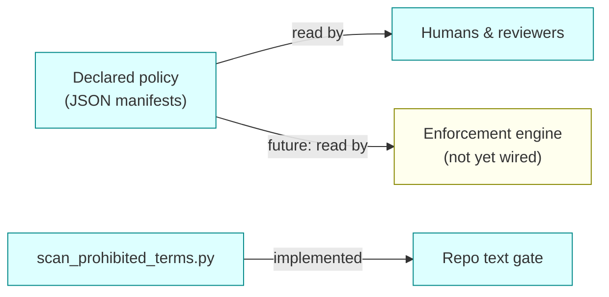

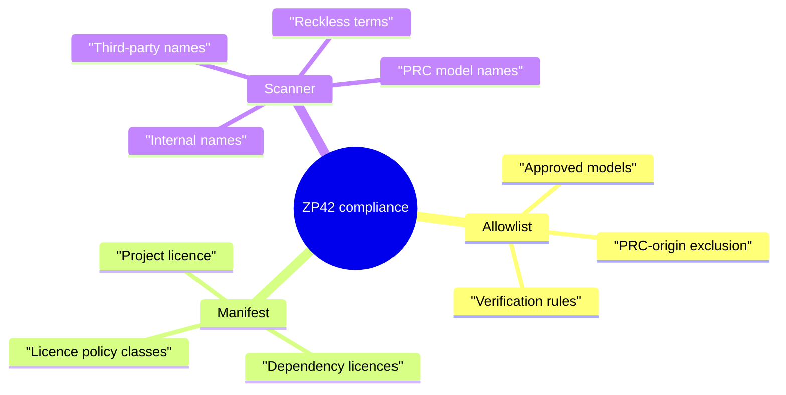

The three artefacts and their maturity:

| Artefact | Location | Form | Status |
|---|---|---|---|
| Model allowlist | `compliance/model_allowlist.json` | Declarative JSON | Declared, not enforced in code |
| Licence manifest | `compliance/license_manifest.json` | Declarative JSON | Declared, not enforced in code |
| Prohibited-terms scanner | `scripts/scan_prohibited_terms.py` | Executable Python | Implemented and runnable |

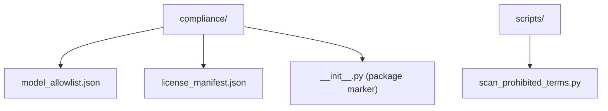

---

## 2. The compliance surface

Compliance in ZP42 answers three questions before any reasoning capability is exercised: *may this model be used?* (allowlist), *may this code be distributed?* (licence manifest), and *does any text leak a prohibited term?* (scanner). Each question maps to one artefact.

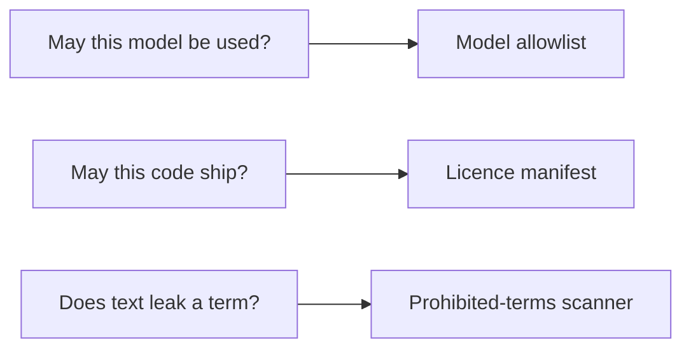

The compliance subsystem is **fail-closed by design**: an unanswered question is treated as a denial, never as a permission. This mirrors the lane model, where an undetermined lane fails closed to `unknown`.

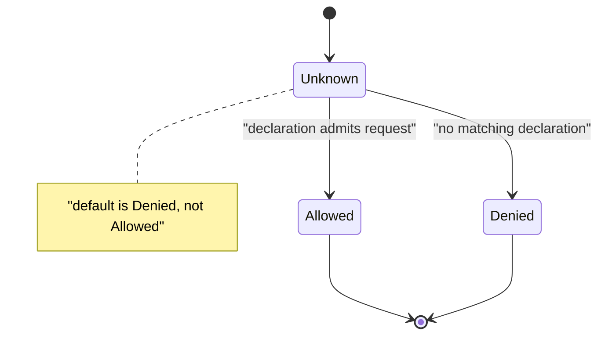

The three questions are intentionally narrow and composable. Narrowness keeps each artefact auditable: a reviewer can read `model_allowlist.json` end to end and understand the complete set of permitted models without consulting code. Composability means the answers combine without ambiguity — a model that is on the allowlist but whose licence class is prohibited is still refused, because the licence manifest answers an independent question. No single artefact can quietly grant what another forbids, and the conjunction of all three is required for a permit.

A further property is that the declarations are **monotonic under review**: the default answer to every compliance question is *deny*, and a permit exists only where a declaration explicitly creates one. Adding capability therefore always requires a visible, diff-reviewable edit that widens a declaration; nothing is permitted by omission. This is the opposite of a blocklist-only posture, where anything not named is implicitly allowed. The allowlist and the licence-policy approved-classes are allowlists in the strict sense; the prohibited-origins list, the prohibited-licence list, and the scanner term sets are blocklists layered on top as defence in depth.

Because enforcement is not yet wired, the diagrams above describe the **specified** control flow. Today a human reviewer or CI step performs the equivalent check against the same declarations. The substitution is clean precisely because the declarations are data: the human reads the same JSON that the future engine will read, so the policy does not change when enforcement moves from a person to a process — only the actor does. The specified runtime engine and today's human reviewer consume identical manifest data; only the actor differs.

---

## 3. The model allowlist

### 3.1 Structure

`model_allowlist.json` is versioned (`version: 1.0.0`) and carries a `policy` block, an `approved_models` array, a `prohibited_origins` block, `verification_requirements`, and an `enforcement` block. The policy declares its enforcement intent as `fail_closed`.

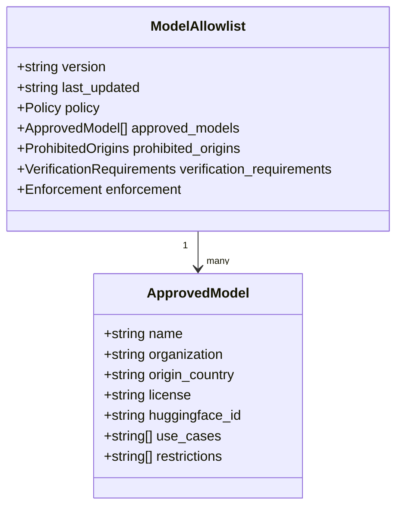

### 3.2 Approved models

Three models are approved, all US-origin and Apache-2.0 licensed:

| Name | Organization | Origin | Licence |
|---|---|---|---|
| AI2 OLMo 3 32B Base | Allen Institute for AI | USA | Apache-2.0 |
| AI2 OLMo 3 32B Think | Allen Institute for AI | USA | Apache-2.0 |
| IBM Granite 4.1 30B Base | IBM | USA | Apache-2.0 |

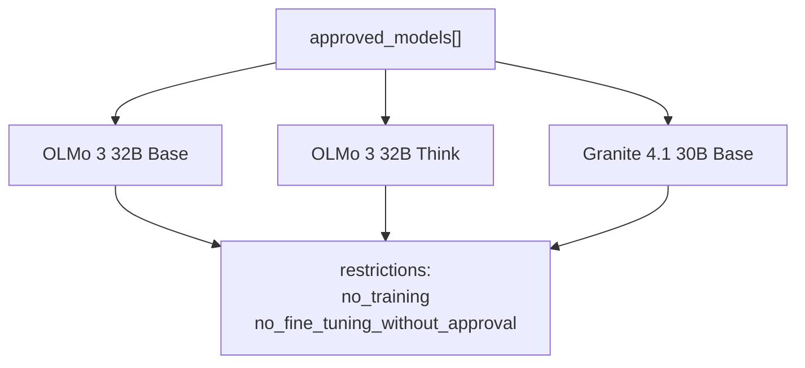

Every approved entry carries `restrictions`, pinning that even an approved model may not be trained or fine-tuned without explicit approval. The restriction set matters because appearing on the allowlist is a necessary but not sufficient condition for a given use: approval is scoped to the declared `use_cases` and bounded by `restrictions`. A model approved for `defensive_analysis` and `threat_modeling` is not thereby approved for training, and the `no_fine_tuning_without_approval` restriction forces a second, explicit authorisation before any derivative is produced. This two-dimensional model — *which* model and *what* use — prevents the common failure where a component vetted for one purpose is silently repurposed for a riskier one.

The `huggingface_id`, `organization`, and `origin_country` fields are not decoration; they are the provenance anchors the verification requirements (§8) will check at download time. `origin_country: USA` for all three approved models is a direct consequence of the PRC-origin exclusion policy, and `license: Apache-2.0` makes each model's terms explicit and self-consistent with the licence-policy approved classes in the manifest. The allowlist and the manifest thus agree by construction: an approved model's licence is one the manifest already approves.

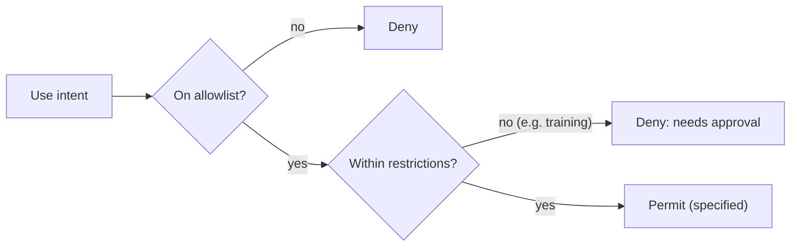

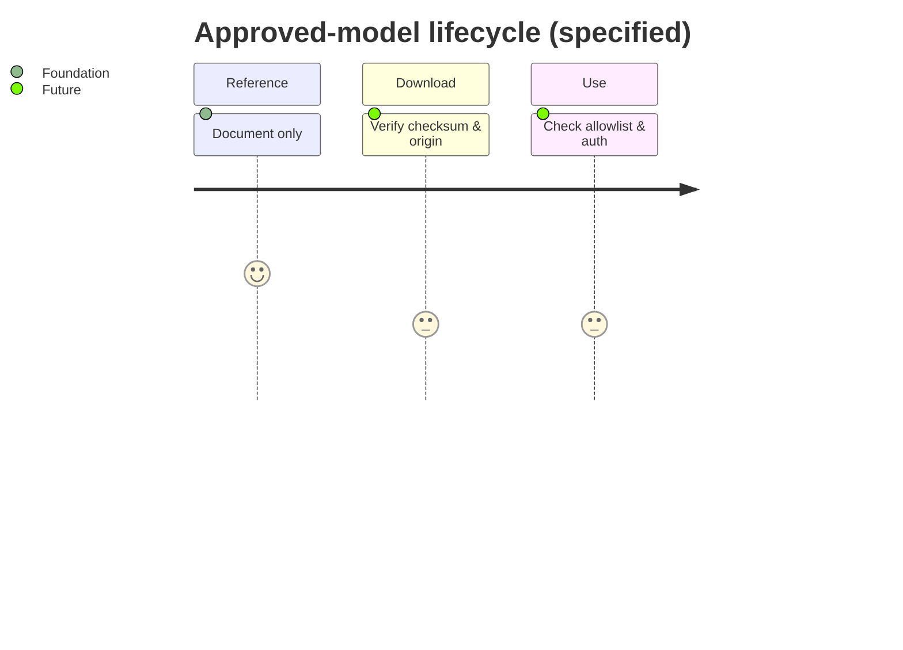

### 3.3 Enforcement semantics (declared)

The `enforcement` block declares the response to each failure mode:

| Condition | Declared response |
|---|---|
| `unknown_model` | `fail_closed` |
| `prohibited_model` | `fail_closed_and_alert` |
| `unverifiable_origin` | `fail_closed` |
| `allowlist_violation_response` | `immediate_termination_and_audit_log` |

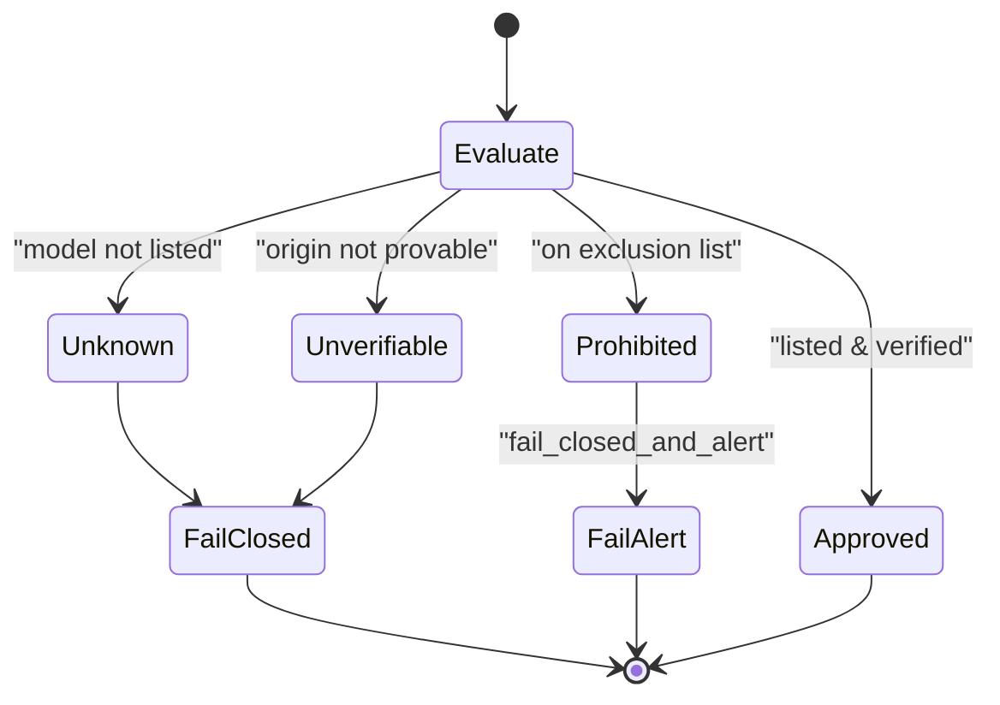

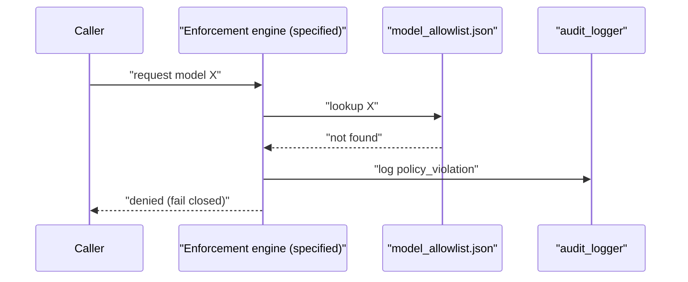

This sequence is **specified, not yet implemented**: no code path in the Foundation release calls the allowlist to gate a live request. The engine participant is drawn dashed in intent only. What *does* exist today is the data the sequence depends on — a valid, versioned allowlist with unambiguous failure dispositions — so when the engine is built it consumes an already-reviewed policy rather than inventing one. The distinction between `fail_closed` and `fail_closed_and_alert` is meaningful: an unknown model is a quiet denial (it may simply be a typo or an unlisted-but-benign component awaiting review), whereas a prohibited model is an *alerting* denial because it indicates an attempt to introduce an explicitly excluded component and therefore warrants operator attention and an audit entry flagged as a policy violation. In every case the declared enforcement terminates in an append-only audit entry.

---

## 4. PRC-origin exclusion policy

### 4.1 Intent

The allowlist encodes a supply-chain-integrity rule: no models, outputs, embeddings, labels, checkpoints, synthetic data, or derivatives from PRC-origin organisations. This is a provenance constraint, not a quality judgement, and it is expressed as data so it can be audited and revised deliberately.

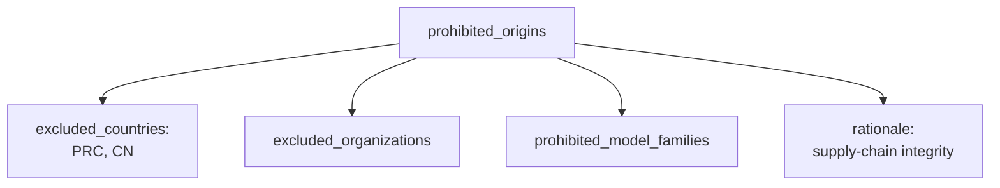

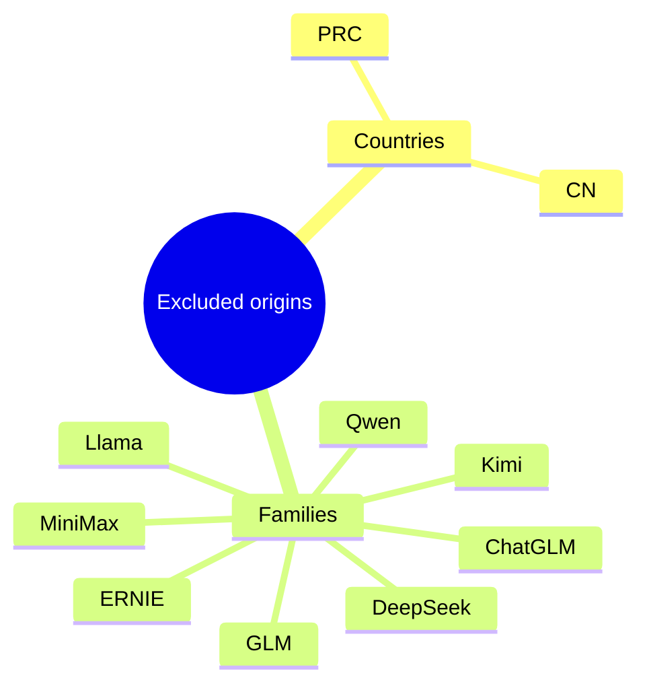

### 4.2 Exclusion decision flow

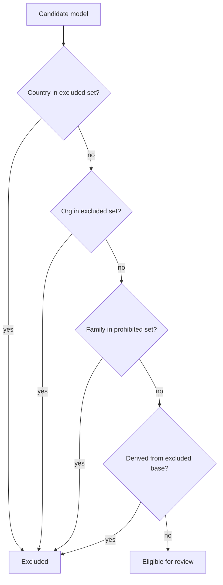

The exclusion extends transitively to derivatives — a model fine-tuned from an excluded base, or an embedding produced by one, inherits the exclusion. Transitivity is the hard part of a provenance policy and the reason the rule is stated in terms of *origin* rather than *brand*. A renamed or repackaged checkpoint, a distilled student model, a synthetic dataset generated by an excluded teacher, or an embedding index built with an excluded encoder are all within scope even when the surface name no longer matches an entry on the prohibited-families list. The declared policy therefore names both concrete families (for the textual tripwire the scanner enforces) and the abstract rule (for the provenance judgement a reviewer or future verifier must make). Enforcing transitivity fully requires provenance metadata that the Foundation phase does not yet collect; the `verification_requirements.dataset_usage` steps — `verify_no_prc_origin`, `document_provenance`, `log_usage` — are the specified mechanism for capturing it when datasets enter scope.

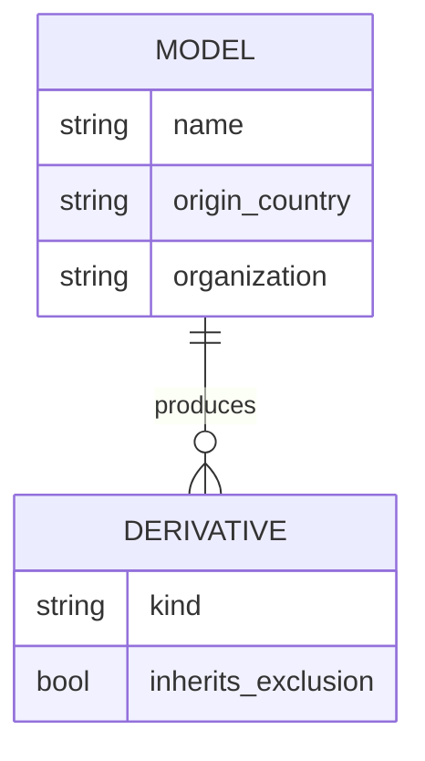

### 4.3 Relationship to the scanner

The scanner (§6) enforces the *textual* side of this policy today: PRC model family names must not appear in repository files. The allowlist enforces the *selection* side — which is specified for later phases. The two are complementary, not redundant.

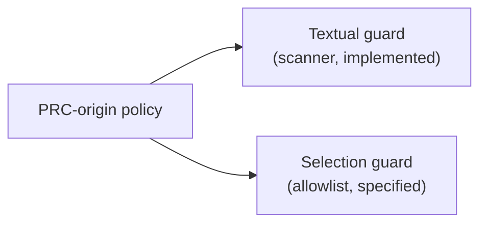

---

## 5. The licence manifest

### 5.1 Project licence

`license_manifest.json` fixes the project licence as **MIT**, owned by **Naquib Hatami**, with copyright `Copyright (c) 2026 Naquib Hatami`. ZP42 is open software: use, copy, modify, and redistribute are permitted under MIT.

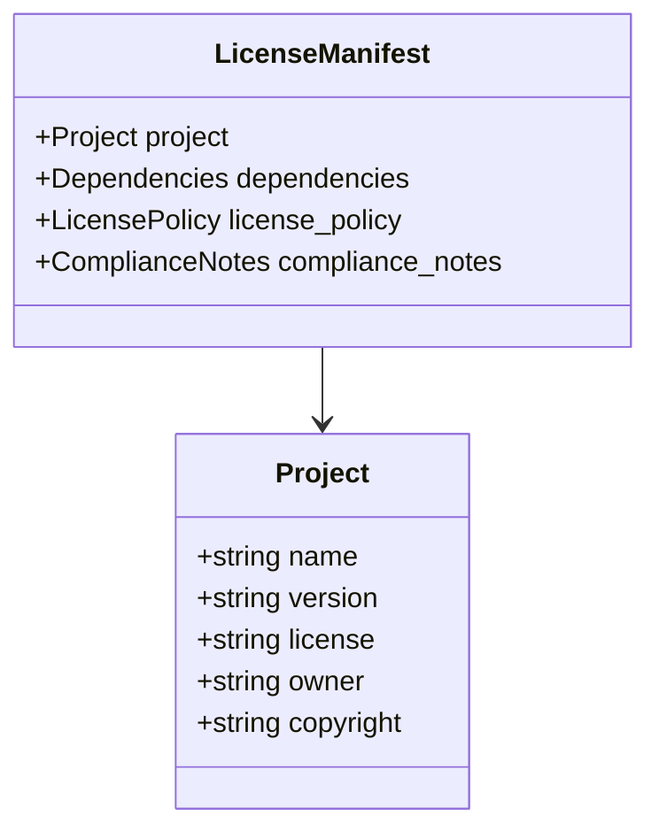

### 5.2 Dependency inventory

Direct and dev dependencies are enumerated with licence, purpose, and an `approved` flag. Every current dependency is MIT-licensed.

| Dependency | Tier | Licence | Purpose |
|---|---|---|---|
| pytest | direct | MIT | testing |
| pre-commit | dev | MIT | code quality |
| black | dev | MIT | formatting |
| ruff | dev | MIT | linting |
| mypy | dev | MIT | type checking |

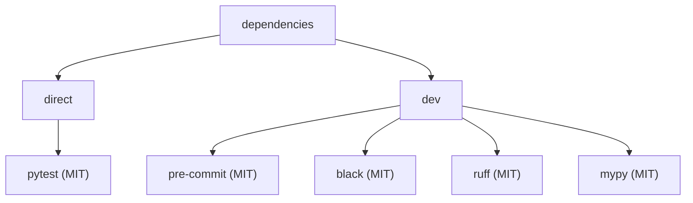

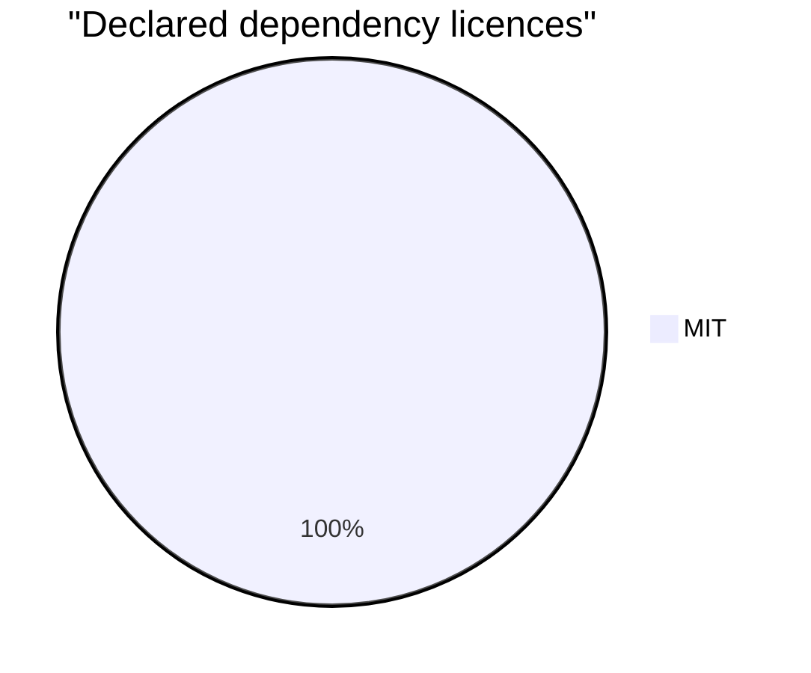

### 5.3 Licence policy classes

The manifest partitions licences into three classes: approved, review-required, and prohibited.

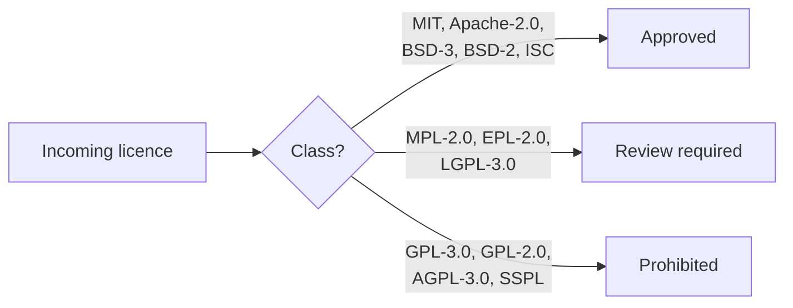

| Class | Members |
|---|---|
| Approved | MIT, Apache-2.0, BSD-3-Clause, BSD-2-Clause, ISC |
| Review required | MPL-2.0, EPL-2.0, LGPL-3.0 |
| Prohibited | GPL-3.0, GPL-2.0, AGPL-3.0, SSPL |

### 5.4 Admission flow for a new dependency

```mermaid
sequenceDiagram
    participant Dev
    participant Manifest as "license_manifest.json"
    participant Legal as "Reviewer"
    Dev->>Manifest: "propose dependency + licence"
    Manifest-->>Dev: "class = review required"
    Dev->>Legal: "request sign-off"
    Legal-->>Dev: "approve / reject"
    Dev->>Manifest: "record approved:true (if approved)"
```

The three-class scheme reflects a standard open-source compliance distinction. Permissive licences (MIT, Apache-2.0, the BSD family, ISC) impose only attribution-style obligations and compose freely with an MIT project, so they are pre-approved. Weak-copyleft licences (MPL-2.0, EPL-2.0, LGPL-3.0) carry file- or library-scoped reciprocity that is usually compatible but depends on how the dependency is linked and distributed, so they require a human legal judgement before use. Strong-copyleft and server-side licences (the GPL family, AGPL-3.0, SSPL) impose obligations that are incompatible with distributing ZP42 under MIT without relicensing effects the project does not accept, so they are prohibited outright. Placing a licence in the prohibited class is a policy decision, not a statement about the quality or legitimacy of those licences; it simply records that they do not fit ZP42's distribution model.

As with the allowlist, this classification is **declared data**. No build step currently fails on a prohibited transitive licence; a licence-scanning CI gate is specified for a later phase. The manifest enumerates only the project's own direct and dev dependencies today — all MIT — and does not yet resolve the full transitive dependency graph. A production licence gate would walk that graph, map each node's SPDX identifier to a class, and fail the build on any prohibited node or hold on any review-required node, writing the result to the audit trail.

```mermaid
flowchart LR
    DECL["Licence classes (declared)"] -.->|"future CI gate"| CI["Fail build on prohibited"]
```

---

## 6. Prohibited-terms scanning

### 6.1 Purpose

The scanner is the one compliance control that is **implemented and runnable today**. It protects public positioning and provenance by refusing four categories of term anywhere in scannable repository files. It supports the clean-language rules of the project charter and the PRC-origin policy at the text level.

```mermaid
flowchart TD
    SC["scan_prohibited_terms.py"] --> C1["Internal codenames"]
    SC --> C2["Third-party AI/tool names"]
    SC --> C3["PRC model names"]
    SC --> C4["Reckless public terms"]
```

```mermaid
mindmap
  root(("Prohibited terms"))
    Internal
      "codename placeholder"
    ThirdParty
      "model/tool brand names"
    PRC
      "qwen / deepseek / glm ..."
    Reckless
      "hack-back"
      "retaliation"
      "revenge"
```

### 6.2 Term categories

| Category | Enum tag | Intent |
|---|---|---|
| Internal names | `prohibited_internal_name` | Keep internal codenames out of public repo |
| Third-party names | `prohibited_third_party_name` | Avoid referencing external AI tools/brands |
| PRC model names | `prohibited_prc_model_name` | Enforce provenance policy in text |
| Reckless public terms | `prohibited_public_term` | Avoid offensive/retaliatory framing |

The reckless-terms set is where the system's defensive framing is protected: terms describing retaliation or unauthorised action are refused, consistent with the principle that capability must be gated by authorisation rather than advertised.

```mermaid
flowchart LR
    R["Reckless terms"] --> A["hack-back / hack back"]
    R --> B["retaliation / revenge"]
    R --> C["private offensive action"]
    R --> D["unauthorized access"]
    R --> E["50/50 offensive"]
```

### 6.3 Scan algorithm

```mermaid
flowchart TD
    START["scan(root)"] --> ITER["iter files under root"]
    ITER --> SKIP{"In skip dir?"}
    SKIP -->|"yes"| NEXT["skip"]
    SKIP -->|"no"| EXT{"Scannable extension?"}
    EXT -->|"no"| NEXT
    EXT -->|"yes"| LINES["read lines (lowercased)"]
    LINES --> MATCH{"Any term substring?"}
    MATCH -->|"yes"| REC["record violation"]
    MATCH -->|"no"| NEXT
    REC --> NEXT
    NEXT --> DONE["return count"]
```

```mermaid
sequenceDiagram
    participant CLI
    participant Scanner
    participant FS as "File system"
    CLI->>Scanner: "scan(--root .)"
    Scanner->>FS: "rglob('*')"
    FS-->>Scanner: "paths"
    loop "per scannable file"
      Scanner->>FS: "read lines"
      FS-->>Scanner: "text"
      Scanner->>Scanner: "match 4 term sets"
    end
    Scanner-->>CLI: "violations + exit code"
```

Scannable extensions include `.py`, `.md`, `.txt`, `.json`, `.yaml`, `.yml`, `.toml`, `.sh`, and `.rst`. Skip directories include `__pycache__`, `.git`, caches, and virtual environments.

### 6.4 Matching characteristics

Matching is case-insensitive substring matching per line. This is deliberately conservative: it favours false positives (which a reviewer resolves) over false negatives. It is not token-aware, so a legitimate substring can match; the scanner is a tripwire, not a semantic classifier. The design trade-off is intentional. A tripwire that occasionally fires on a benign substring costs a reviewer a moment to acknowledge or refine; a classifier that misses a genuine leak costs the project a public positioning failure that may already have shipped. For a boundary control protecting provenance and framing, the asymmetry justifies the blunt instrument. When a benign match recurs, the correct response is to adjust the term set or the surrounding text, recorded as a reviewable change, rather than to weaken the scanner's exit semantics.

Because matching is per line and lowercased, the scanner is also robust to casing tricks and incidental formatting: `Hack-Back`, `HACK-BACK`, and `hack-back` all match the same `hack-back` entry. It does not, however, defeat deliberate obfuscation such as interleaved characters or homoglyphs; defeating adversarial evasion is explicitly not its job. Its job is to stop ordinary, accidental inclusion of prohibited names and reckless framing before they enter the history, and at that it is effective and cheap.

```mermaid
stateDiagram-v2
    [*] --> Scanning
    Scanning --> Clean: "0 violations"
    Scanning --> Dirty: ">=1 violation"
    Clean --> ExitZero
    Dirty --> ExitOne
    ExitZero --> [*]
    ExitOne --> [*]
```

### 6.5 Output and exit codes

Two report modes exist: human-readable and JSON (`--json`). The process exits non-zero when any violation is found, which lets it act as a gate.

```mermaid
flowchart LR
    RES["Scan result"] --> HR["Human report"]
    RES --> JS["JSON report:<br/>status, count, violations[]"]
    RES --> EC{"count > 0?"}
    EC -->|"yes"| E1["exit 1"]
    EC -->|"no"| E0["exit 0"]
```

```mermaid
erDiagram
    REPORT ||--o{ VIOLATION : "contains"
    REPORT {
      string status
      int violation_count
    }
    VIOLATION {
      string file
      int line
      string term
      string category
    }
```

### 6.6 Integration as a gate

The scanner is designed to run as a pre-commit hook and, in a later phase, as a CI check. In the Foundation phase, the pre-commit integration is the live enforcement point for text compliance.

```mermaid
flowchart LR
    COMMIT["git commit"] --> HOOK["pre-commit hook"]
    HOOK --> SCAN["scan_prohibited_terms.py"]
    SCAN -->|"exit 0"| PASS["commit proceeds"]
    SCAN -->|"exit 1"| BLOCK["commit blocked"]
```

```mermaid
sequenceDiagram
    participant Dev
    participant Hook as "pre-commit"
    participant Scan as "scanner"
    Dev->>Hook: "commit"
    Hook->>Scan: "run --root ."
    Scan-->>Hook: "exit code"
    alt "clean"
      Hook-->>Dev: "commit accepted"
    else "violation"
      Hook-->>Dev: "commit rejected"
    end
```

---

## 7. Declared versus enforced — the central distinction

### 7.1 Two planes

ZP42 separates a **declaration plane** (data that states policy) from an **enforcement plane** (code that acts on policy). Keeping them distinct is a deliberate governance choice: declarations can be reviewed, diffed, and audited independently of the engine that will consume them, and an engine cannot silently widen policy because the policy lives outside it.

```mermaid
flowchart TB
    subgraph Decl["Declaration plane (data)"]
      A["model_allowlist.json"]
      B["license_manifest.json"]
    end
    subgraph Enf["Enforcement plane (code)"]
      S["scan_prohibited_terms.py"]
      X["inference/build gate (not built)"]
    end
    A -.->|"future"| X
    B -.->|"future"| X
    S --> G["repo text gate (live)"]
```

### 7.2 Maturity matrix

```mermaid
flowchart LR
    subgraph Enforced["Enforced today"]
      T["Prohibited-terms scan"]
    end
    subgraph DeclaredOnly["Declared only"]
      M["Model allowlist"]
      L["Licence manifest"]
      V["Verification requirements"]
    end
```

| Control | Declared | Enforced in code | Notes |
|---|---|---|---|
| Prohibited terms | yes | **yes** | scanner + pre-commit |
| Model allowlist | yes | no | gate specified, not wired |
| PRC-origin exclusion (selection) | yes | no | text side enforced via scanner |
| Licence policy classes | yes | no | CI licence gate specified |
| Model/dataset verification | yes | no | out of scope this phase |

### 7.3 Why the gap is acceptable now

In the Foundation phase, the capabilities the allowlist and manifest would gate — inference, model download, live targeting — **do not exist**. A gate guarding a door that has not been built would be theatre. The honest posture is: declare the policy precisely now, enforce the text rules that can be enforced now, and wire selection/licence gates when the capability they guard arrives.

There is a second, subtler reason the separation is sound engineering rather than an excuse. Writing the policy as data first means the policy is debated, reviewed, and frozen *before* any engine exists that might be tempted to encode exceptions inline. When enforcement code finally arrives, its correctness is measured against a fixed, external specification it did not author. This inverts the usual drift where policy is whatever the code happens to do; here the code is obligated to match a declaration that predates it. The declaration is the contract, the engine is the implementation, and the audit trail is the evidence that the implementation honoured the contract.

```mermaid
stateDiagram-v2
    [*] --> Foundation
    Foundation --> Phase2: "eval infra"
    Phase2 --> Phase3: "defensive reasoning"
    note right of Foundation: "no inference → allowlist gate inert but declared"
    note right of Phase3: "inference arrives → allowlist gate wired"
```

---

## 8. Verification requirements (declared)

The allowlist declares verification steps for three events: model download, model usage, and dataset usage. These are obligations the future enforcement engine must satisfy; none runs in the Foundation release.

```mermaid
flowchart TD
    VR["verification_requirements"] --> DL["model_download"]
    VR --> US["model_usage"]
    VR --> DS["dataset_usage"]
    DL --> DL1["verify_checksum"]
    DL --> DL2["verify_origin"]
    DL --> DL3["log_to_audit_trail"]
    US --> US1["verify_allowlist"]
    US --> US2["check_authorization"]
    US --> US3["log_inference_request"]
    DS --> DS1["verify_no_prc_origin"]
    DS --> DS2["document_provenance"]
    DS --> DS3["log_usage"]
```

```mermaid
sequenceDiagram
    participant Op as "Operator"
    participant Gate as "Verification (specified)"
    participant AL as "allowlist"
    participant Aud as "audit"
    Op->>Gate: "download model"
    Gate->>Gate: "verify checksum + origin"
    Gate->>AL: "confirm approved"
    Gate->>Aud: "log model_download_attempt"
    Gate-->>Op: "permit / deny"
```

```mermaid
flowchart LR
    DU["Dataset use"] --> P1{"PRC origin?"}
    P1 -->|"yes"| STOP["Deny"]
    P1 -->|"no"| PROV["Document provenance"]
    PROV --> LOG["Log usage"]
```

Every verification path terminates in an audit write, linking compliance to the governance evidence record described in §10. This is a design invariant: a compliance decision that is not recorded is, for governance purposes, a decision that did not happen. By requiring `log_to_audit_trail`, `log_inference_request`, and `log_usage` as terminal steps of download, usage, and dataset verification respectively, the allowlist makes evidence production non-optional. The verifier stage of the specified pipeline (§11) is where these obligations will be discharged in code; in the Foundation phase they remain declared obligations against a verifier that is defined but not yet built.

---

## 9. Fail-closed semantics across compliance

Fail-closed is the unifying rule. An absent, malformed, or ambiguous declaration yields denial, not permission. This matches the lane model (undetermined lane → `unknown` → closed) and the ROE engine's bounds.

```mermaid
flowchart TD
    IN["Compliance input"] --> P{"Parse OK?"}
    P -->|"no"| FC["Fail closed"]
    P -->|"yes"| M{"Matches a permit rule?"}
    M -->|"no"| FC
    M -->|"yes"| A["Permit"]
```

```mermaid
stateDiagram-v2
    [*] --> Input
    Input --> Malformed: "parse error"
    Input --> Ambiguous: "no clear rule"
    Input --> Clear: "explicit permit"
    Malformed --> Closed
    Ambiguous --> Closed
    Clear --> Open
    Closed --> [*]
    Open --> [*]
```

```mermaid
flowchart LR
    AL["Allowlist: unknown model"] --> FC1["fail_closed"]
    AL2["Allowlist: prohibited"] --> FC2["fail_closed_and_alert"]
    LM["Manifest: prohibited licence"] --> FC3["reject (specified)"]
    SC["Scanner: any violation"] --> FC4["exit 1 / block"]
```

The scanner realises fail-closed concretely today: a single matched term returns a non-zero exit and blocks the commit. The allowlist and manifest declare the same disposition for the plane where they will be enforced. The default disposition is always *deny*; only an explicit, successfully parsed permit yields *allow*.

---

## 10. Linkage to the audit record

Compliance decisions are evidence. The governance package provides an append-only JSONL audit logger (`governance/audit_logger.py`) with a schema (`governance/audit_schema.json`) whose `operation_type` enum already includes compliance-relevant events: `model_reference`, `model_download_attempt`, `inference_request`, `policy_violation`, and `roe_check`.

```mermaid
flowchart TD
    EV["Compliance event"] --> T["model_reference"]
    EV --> D["model_download_attempt"]
    EV --> I["inference_request"]
    EV --> PV["policy_violation"]
    EV --> RC["roe_check"]
    T --> LOG["audit_*.jsonl (append-only)"]
    D --> LOG
    I --> LOG
    PV --> LOG
    RC --> LOG
```

```mermaid
erDiagram
    AUDIT_EVENT {
      string timestamp
      string event_id
      string operation_type
      string lane
      string result
      bool escalation_attempt
    }
    AUDIT_EVENT ||--o{ POLICY_VIOLATION : "may list"
```

```mermaid
sequenceDiagram
    participant C as "Compliance check (specified)"
    participant A as "AuditLogger"
    participant F as "audit_YYYY-MM-DD.jsonl"
    C->>A: "log_event(policy_violation, ...)"
    A->>F: "append JSON line"
    F-->>A: "durable"
    A-->>C: "event_id"
```

An important honesty note: the audit log is **plain JSONL and is not cryptographically signed** in this release. It is append-only by convention and local file handling, not by a tamper-evident signature chain. Signed, tamper-evident audit is specified for a later phase; the schema already reserves a production retention policy (`minimum_retention_days: 2555`).

```mermaid
flowchart LR
    NOW2["Plain JSONL (today)"] -.->|"future"| SIGN["Signed, tamper-evident chain"]
```

```mermaid
stateDiagram-v2
    [*] --> Appended
    Appended --> Retained: "local, convention append-only"
    Retained --> Archived: "retention policy (specified)"
    Archived --> [*]
    note right of Retained: "not cryptographically signed yet"
```

The audit linkage is what turns compliance from a set of gates into an evidence-producing subsystem. A gate that denies without a record protects the system but leaves no trace for later review; a gate that denies *and records* produces an artefact a governance team, an auditor, or a sovereign authority can inspect after the fact. ZP42's schema already types the events that matter, so the evidence model is settled even though the signing and retention mechanisms are future work.

---

## 11. How compliance sits inside the specified pipeline

The target orchestrator wires `lane -> ROE -> human_gate -> verify -> audit`. Compliance checks (allowlist, licence, verification) attach at the point where a model or dependency enters that pipeline. **This end-to-end wiring is not yet implemented** — `orchestrator/__init__.py` is a scaffold, and `verifiers/` is a defined stage rather than a completed verifier.

```mermaid
flowchart LR
    L["Lane policy"] --> R["ROE engine"]
    R --> H["Human gate"]
    H --> V["Verify stage"]
    V --> A["Audit logger"]
    CMP["Compliance checks"] -.->|"attach at model entry"| V
```

```mermaid
flowchart TD
    subgraph Impl["Implemented, tested independently"]
      LP["lane_policy"]
      ALog["audit_logger"]
      SCN["scan_prohibited_terms"]
    end
    subgraph ImplNT["Implemented (not yet unit-tested)"]
      RE["roe_engine"]
      HG["human_gate"]
    end
    subgraph Spec["Specified / scaffold"]
      ORC["orchestrator wiring"]
      VER["output verifier"]
      GATE["allowlist + licence runtime gate"]
    end
```

```mermaid
stateDiagram-v2
    [*] --> LaneAssigned
    LaneAssigned --> ROEChecked
    ROEChecked --> HumanGated
    HumanGated --> Verified
    Verified --> Audited
    Audited --> [*]
    note right of Verified: "compliance gate attaches here (specified)"
```

Where authorisation matters: a model reference in **Lane A** (defensive, owner-authorised) or **Lane B** (active-defence, requiring explicit written authorisation) would, in the specified pipeline, be checked against the allowlist before use. A lane is entered deliberately; compliance never widens it. The relationship is strictly one of conjunction: being in an authorised lane does not exempt a component from the allowlist, and being on the allowlist does not confer lane authorisation. An operation must satisfy its lane's authorisation requirement *and* draw only on allowlisted, licence-clean components *and* pass the output verifier *and* leave an audit record. Compliance is one conjunct among several, never a substitute for the ROE bounds or the human gate. This is why compliance checks attach at the verify stage rather than replacing the lane or ROE stages that precede them.

```mermaid
flowchart LR
    LA["Lane A: defensive<br/>owner-authorised"] --> CK["Allowlist check (specified)"]
    LB["Lane B: active-defence<br/>written authorisation"] --> CK
    CK --> AUD2["Audit entry"]
```

---

## 12. Assurance, review, and change control

### 12.1 Changing a declaration

Because declarations are data, changing policy means editing JSON and passing review — a tractable, auditable act. Adding a model, promoting a licence from review-required to approved, or adding a prohibited term are all diff-reviewable changes.

```mermaid
flowchart TD
    CH["Proposed change"] --> ED["Edit JSON / term set"]
    ED --> PR["Open PR"]
    PR --> REV["Human review"]
    REV --> SCANc["Scanner runs"]
    SCANc --> MERGE{"Clean & approved?"}
    MERGE -->|"yes"| M2["Merge"]
    MERGE -->|"no"| BK["Back to author"]
```

```mermaid
sequenceDiagram
    participant Author
    participant Review
    participant Gate as "Scanner/CI"
    Author->>Review: "PR: add approved model"
    Review->>Gate: "trigger checks"
    Gate-->>Review: "pass/fail"
    Review-->>Author: "approve / request changes"
```

### 12.2 What assurance exists today

```mermaid
flowchart LR
    A1["Scanner implemented + tested"] --> OK1["text compliance live"]
    A2["Allowlist is valid JSON data"] --> OK2["machine-readable"]
    A3["Manifest is valid JSON data"] --> OK3["machine-readable"]
    A4["Audit schema defined"] --> OK4["events typed"]
```

```mermaid
mindmap
  root(("Assurance today"))
    Live
      "Prohibited-terms gate"
      "Pre-commit hook"
    Declared
      "Allowlist data"
      "Manifest data"
      "Verification rules"
    Reserved
      "Retention policy"
      "Signed audit (future)"
```

### 12.3 Known limitations (stated plainly)

```mermaid
flowchart TD
    LIM["Limitations"] --> L1["Allowlist not enforced in code"]
    LIM --> L2["Licence classes not CI-gated"]
    LIM --> L3["Audit not signed"]
    LIM --> L4["Orchestrator wiring is scaffold"]
    LIM --> L5["Verifier stage defined, not built"]
```

```mermaid
stateDiagram-v2
    [*] --> Declared
    Declared --> PartiallyEnforced: "scanner live"
    PartiallyEnforced --> FullyEnforced: "future phases"
    FullyEnforced --> [*]
```

None of these limitations is hidden by the artefacts themselves; the `enforcement` blocks declare intent, and this document states the gap between intent and running code. Naming limitations explicitly is part of the governance contract: an operator deciding whether to rely on ZP42 for a defensive or sovereign-authorised workflow must be able to see, without reading source, that model-selection enforcement and signed evidence are not yet present. A compliance document that implied otherwise would undermine the very trust the subsystem exists to establish. The limitations are therefore not caveats buried in a footnote but first-class statements of current scope, each paired with the phase in which it is expected to close.

It is also worth distinguishing *missing* from *wrong*. Nothing in the declared policy is inconsistent or incorrect; the allowlist, the exclusion policy, and the licence classes are internally coherent and agree with the README and FOUNDATION charter. What is missing is the enforcement code that would make those declarations self-executing. This is a maturity gap, not a defect, and it is the expected state for a Foundation-phase scaffold whose guarded capabilities are themselves out of scope.

---

## 13. Roadmap to enforcement

The path from declared to enforced is incremental and tied to capability arrival. Nothing is claimed as done that is not done.

```mermaid
gantt
    title "Compliance enforcement roadmap (indicative, not committed dates)"
    dateFormat  YYYY-MM-DD
    section Text
    "Prohibited-terms scanner (done)"      :done, s1, 2026-05-01, 2026-05-18
    section Selection
    "Allowlist runtime gate"               :        s2, 2026-06-01, 30d
    section Licensing
    "Licence CI gate"                      :        s3, 2026-06-15, 30d
    section Evidence
    "Signed audit chain"                   :        s4, 2026-07-01, 45d
```

```mermaid
flowchart LR
    P1["Scanner (live)"] --> P2["Allowlist gate"]
    P2 --> P3["Licence CI gate"]
    P3 --> P4["Verification wiring"]
    P4 --> P5["Signed audit"]
```

```mermaid
journey
    title "Declared to enforced"
    section Text compliance
      Scanner live: 5: Now
    section Model selection
      Allowlist gate: 2: Next
    section Licensing
      CI gate: 2: Next
    section Evidence integrity
      Signed audit: 1: Later
```

Each step preserves the declaration plane unchanged; enforcement code is added to *consume* existing declarations, not to replace them. This is the governance-first discipline that Naquib Hatami built into ZP42 from the Foundation phase: policy is written down as reviewable data before any engine is empowered to act on it.

```mermaid
flowchart TD
    DECLP["Declaration plane (stable)"] --> C1["Gate v1 consumes it"]
    DECLP --> C2["Gate v2 consumes it"]
    DECLP --> C3["Audit consumes it"]
```

---

## 14. Summary

ZP42's compliance subsystem declares its model allowlist (three approved US-origin Apache-2.0 models, with a transitive PRC-origin exclusion) and its licence manifest (MIT project, permissive-only dependencies, three-class licence policy) as machine-readable JSON, and enforces its prohibited-terms policy with a runnable, pre-commit-integrated scanner. The honest boundary is explicit: text compliance is enforced today; model-selection and licence enforcement are **declared and specified, not yet wired**, because the inference and build capabilities they guard are out of scope for the Foundation phase; and the audit log is append-only plain JSONL, not yet cryptographically signed. The design keeps policy as reviewable data and defers enforcement code until the capability it governs exists — defensive and governance-first throughout.

```mermaid
flowchart LR
    E["Enforced now:<br/>prohibited-terms scanner"] --- D["Declared now:<br/>allowlist + manifest"]
    D --- F["Future:<br/>wired gates + signed audit"]
```

---

## Related documents

- `../README.md` — project identity, architecture map, and model policy.
- `../LICENSE` — the MIT licence referenced by the manifest.
- `FOUNDATION.md` — charter status, model selection policy, and safety boundaries.
- `08-governance-audit.md` — the append-only audit logger and schema this document links to.
- `05-lane-model.md` — the lane model and ROE engine that compliance checks attach to.
