> Part of the ZP42 documentation set.

# ZP42 Threat Model (STRIDE)

**Document:** `docs/10-threat-model.md` · **System:** ZP42 (Zeroth Protocol 42) Cyber Reasoning System · **Phase:** Foundation · **Inventor/Author:** Naquib Hatami · **Publisher:** SADI AI Inc. / iQs Group Inc. · **Repository:** `github.com/iQs-Group/zp-42` · **Site:** `zp42.org` · **Licence:** MIT

## Abstract

This document is the primary threat model for ZP42, an open, MIT-licensed, governance-first cyber-reasoning system built by Naquib Hatami for defensive, active-defence, and sovereign-authorised workflows. It applies the STRIDE methodology (Spoofing, Tampering, Repudiation, Information disclosure, Denial of service, Elevation of privilege) to the Foundation-phase architecture, and it treats one class of risk as first-order: **misuse and over-reach**, the danger that a cyber-reasoning system is driven past the authorisation it was granted. The central design claim of ZP42 is that capability is not withheld by hope but **gated by authorisation** — the lane policy, the rules-of-engagement (ROE) engine, the human gate, the append-only audit logger, and the prohibited-terms scanner exist precisely so that the powerful cases cannot be reached without a deliberate, recorded, human-authorised act. This model is written against an **honest status**: the governance modules are implemented and tested as independent components, while the end-to-end orchestrator that would wire them into a single pipeline is a scaffold. Where a control is specified but not yet enforced in code, this document says so plainly, because an accurate threat model must never overstate the defences that exist.

---

## 1. Purpose and Positioning

### 1.1 What this document is for

A threat model's job is to make the implicit explicit: what we are protecting, who might attack or misuse it, how, and what reduces that risk to an acceptable level. For a cyber-reasoning system the stakes are unusual, because the asset under protection is not only data and infrastructure but **the authorisation boundary itself** — the guarantee that the system acts only within sanctioned scope. ZP42 is designed so that its most consequential behaviours are unreachable by accident.

Conventional application threat models assume the defender and the system are aligned, and that the threat is an outsider trying to subvert a trusted service. A governed cyber-reasoning system inverts part of that assumption. Here the system is capable, by its very purpose, of actions whose legitimacy depends entirely on who authorised them and under what written scope. The same reasoning that supports an authorised vulnerability assessment could, if ungoverned, be turned toward actions ZP42 forbids. The threat model must therefore reason about legitimate capability used illegitimately, not only about external compromise. This is why the authorisation boundary is modelled as the primary asset, and why the governance stack — lane policy, ROE engine, human gate, audit logger, and prohibited-terms scanner — is treated as the core security control rather than as an administrative afterthought.

A second feature of this model is its insistence on honesty about maturity. A threat model that claims controls which are not yet enforced is worse than no model, because it invites reliance on defences that do not exist. ZP42 is in its Foundation phase: the governance primitives are real, tested components, but the pipeline that would compose them is a scaffold. This document therefore separates, at every mitigation, what the code enforces today from what the design specifies for later. That separation is not a weakness to be apologised for; it is the discipline that keeps the model trustworthy and the roadmap legible.

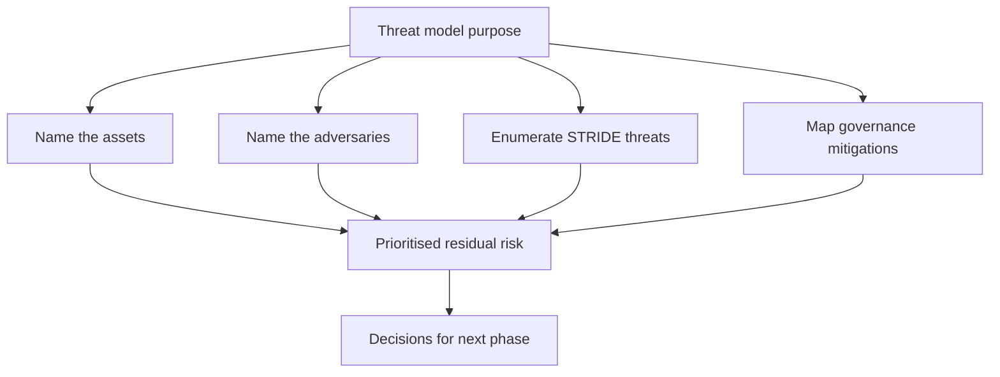

### 1.2 Positioning constraint

ZP42 is framed for defence. This document never describes how to perform offensive actions, exploitation, unauthorised access, hack-back, or retaliation. Those capabilities are out of scope for the Foundation phase, and in the architecture as specified they remain gated behind authorisation for every later phase.

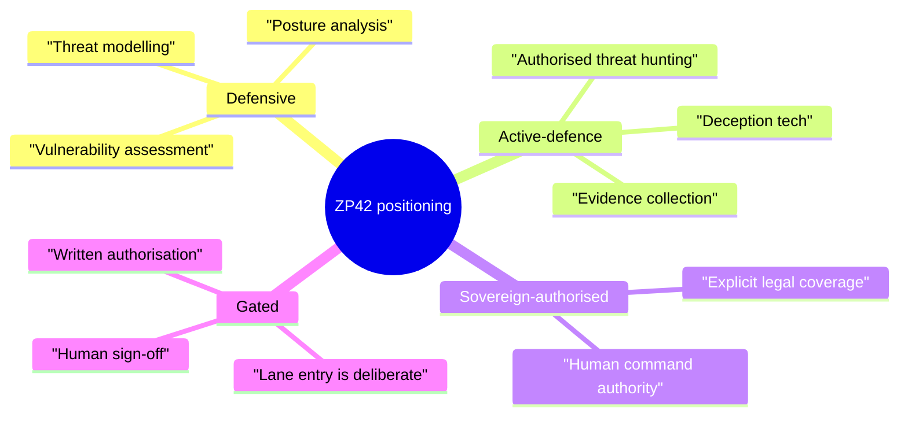

---

## 2. Methodology and Scope

### 2.1 STRIDE as the lens

STRIDE classifies threats by the security property each violates. ZP42 adopts it because the mapping from category to control is direct and auditable: every category points at a specific property, and every property in ZP42 is defended by a named component whose status can be stated truthfully. STRIDE is also well suited to a system whose risks are dominated by authorisation, because two of its six categories — spoofing and elevation of privilege — bear directly on whether an actor is who they claim and whether they may do what they attempt. In most web applications those two are important; in a cyber-reasoning system they are existential, and the model weights its attention accordingly.

| STRIDE category | Property violated | Primary ZP42 control surface |
|---|---|---|
| Spoofing | Authenticity | Authorisation references, actor identity in audit |
| Tampering | Integrity | Append-only log, manifest capture, allowlist manifests |
| Repudiation | Non-repudiation | Audit logger (JSONL evidence record) |
| Information disclosure | Confidentiality | Lane scoping, log location policy, ROE |
| Denial of service | Availability | Fail-closed defaults, bounded operations |
| Elevation of privilege | Authorisation | Lane policy, ROE engine, human gate |

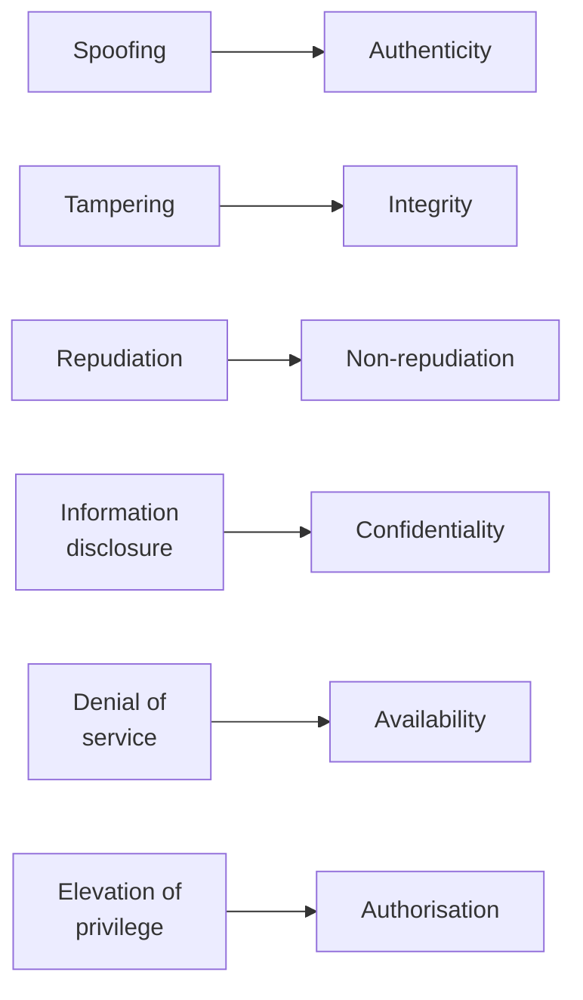

### 2.2 Scope of this iteration

This model covers the Foundation-phase repository: `core/`, `orchestrator/`, `verifiers/`, `governance/`, `compliance/`, `benchmarks/`, `scripts/`, and `tests/`. Inference, exploit or offensive execution, model weight handling, and live targeting are explicitly out of scope for the Foundation phase and are therefore modelled as **future attack surface**, not present capability.

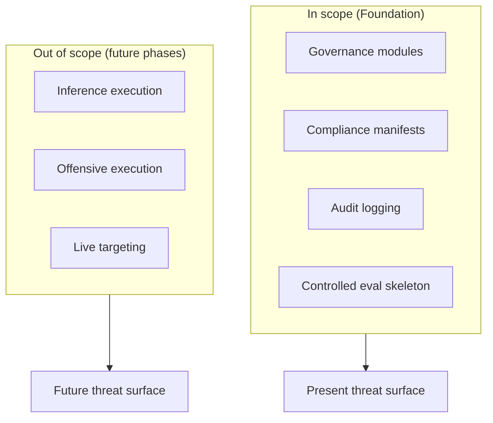

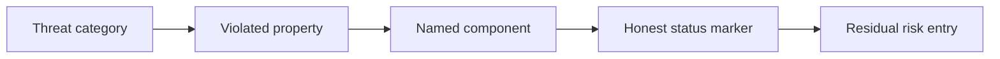

### 2.3 Honest-status convention

Throughout, a control marked **IMPLEMENTED** has working, tested code as an independent component. A control marked **SPECIFIED** is defined (in documentation, schema, or manifest) but not yet enforced end-to-end in code. This distinction is load-bearing for every mitigation claim below.

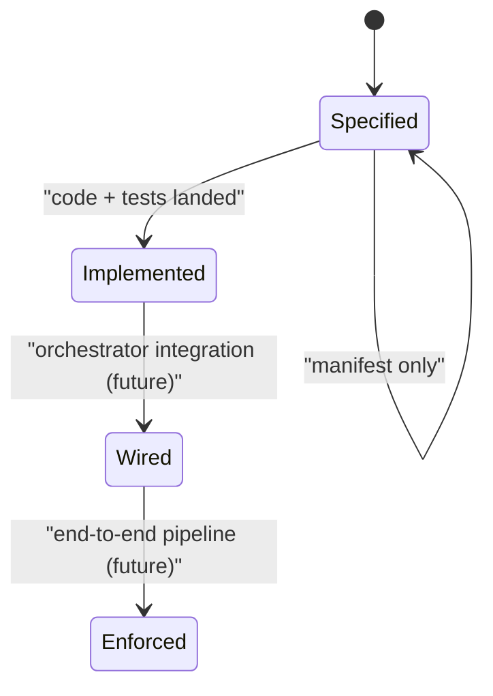

---

## 3. System Decomposition

### 3.1 Module map

ZP42's architecture, as specified, separates reasoning from control. The `core/` layer holds evaluation and snapshot tooling; the `orchestrator/` layer holds lane, ROE, and human-gate logic; `governance/` records evidence; `compliance/` declares policy; `verifiers/` is a defined output-validation stage.

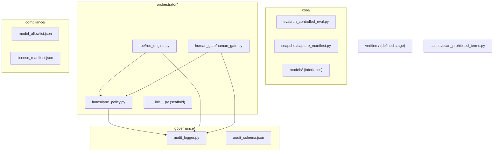

### 3.2 Specified control pipeline (not yet wired)

The intended flow is lane assignment, then ROE evaluation, then human gate where required, then output verification, then audit. The orchestrator that would execute this sequence end-to-end is a scaffold today; the stages exist as independent, tested units.

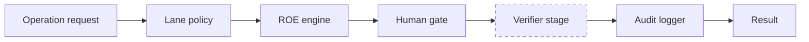

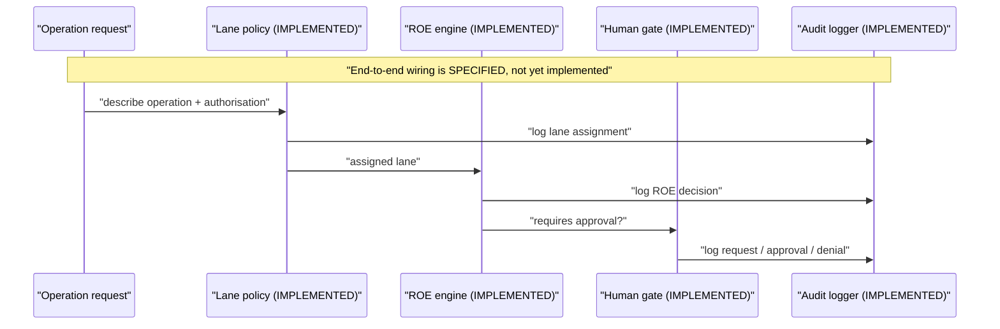

### 3.3 Lane state model

Lanes are entered deliberately. A is defensive, authorised by the system owner. B is active-defence, requiring explicit written authorisation. C is sovereign-authorised, requiring sovereign authorisation plus human sign-off. An undetermined lane fails closed to UNKNOWN.

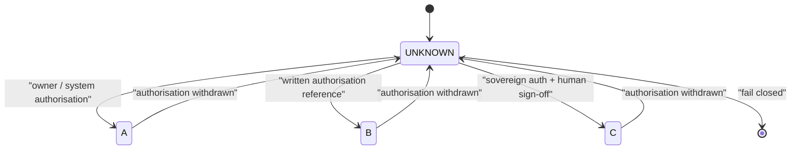

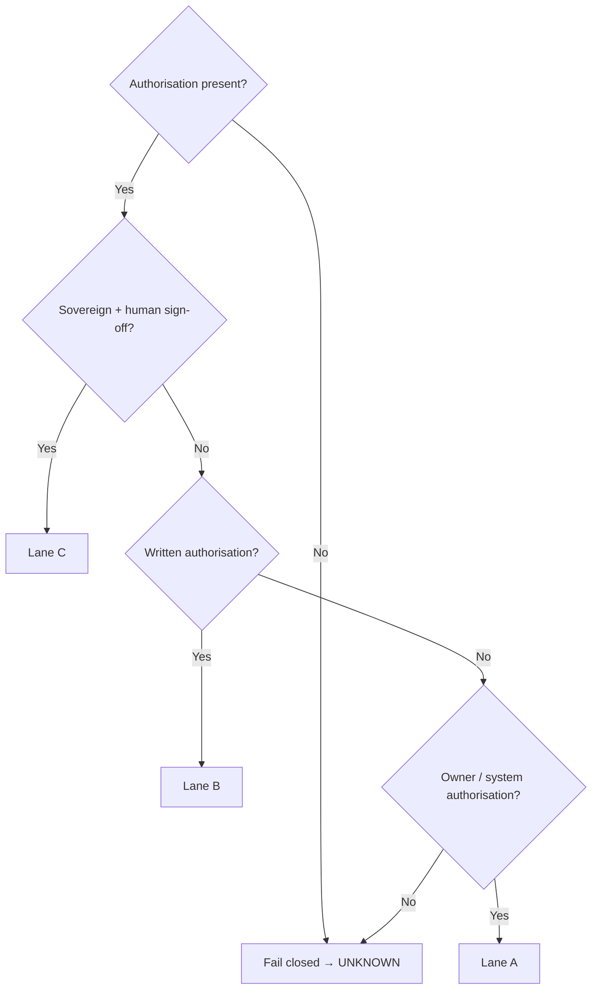

### 3.4 ROE and human-gate structure

The ROE engine carries a set of globally prohibited capabilities and raises a violation when an operation matches. The human gate tracks approval requests through a small lifecycle.

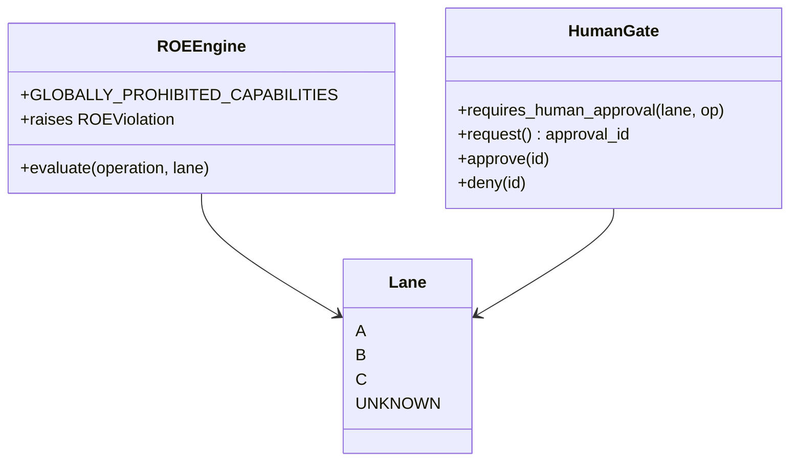

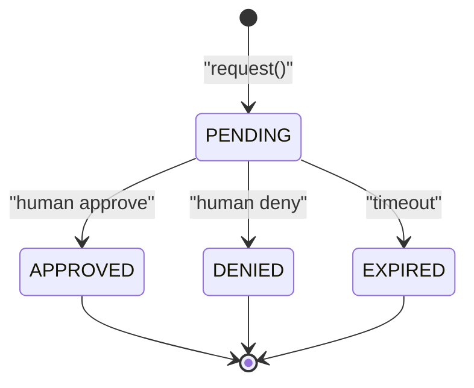

---

## 4. Assets

### 4.1 Asset catalogue

The assets ZP42 protects are ranked by the consequence of their compromise. The authorisation boundary ranks first because its failure is what turns a defensive tool into something it must never be. An asset-centric view is deliberate: controls exist to protect assets, and ranking assets by consequence lets the model allocate scrutiny where a breach would hurt most. For ZP42 the ordering is unusual in that integrity, not confidentiality, dominates the top three rows. The authorisation boundary, the audit evidence record, and the human-gate decisions all matter chiefly because they must be *true* — an attacker who can silently flip a lane, erase an entry, or forge an approval defeats the system far more completely than one who merely reads its state. Confidentiality still matters, particularly for authorisation references that could be replayed, but the system's safety case rests on integrity and non-repudiation.

| # | Asset | Why it matters | Confidentiality | Integrity | Availability |
|---|---|---|---|---|---|
| 1 | Authorisation boundary (lane/ROE state) | Defines the limit of sanctioned action | Medium | **Critical** | High |
| 2 | Audit evidence record | Proves what happened; non-repudiation | Medium | **Critical** | High |
| 3 | Human-gate decisions | Human-in-the-loop guarantee | High | **Critical** | High |
| 4 | Compliance manifests (allowlist, licences) | Declares permitted models and licences | Medium | High | Medium |
| 5 | Controlled-eval configuration | Shapes what reasoning runs | Medium | High | Medium |
| 6 | Snapshot manifests | Reproducibility and provenance | Medium | High | Low |
| 7 | Prohibited-terms policy | Boundary hygiene | Low | High | Low |

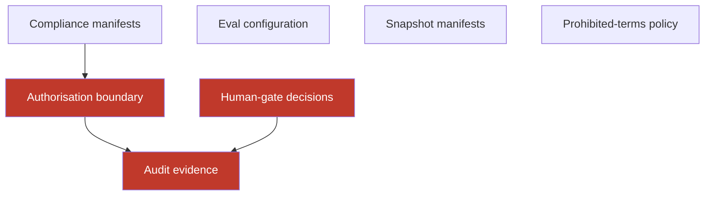

### 4.2 Asset dependency view

The audit record depends on the integrity of upstream decisions; the authorisation boundary depends on the manifests and the lane logic. A compromise low in the graph propagates upward.

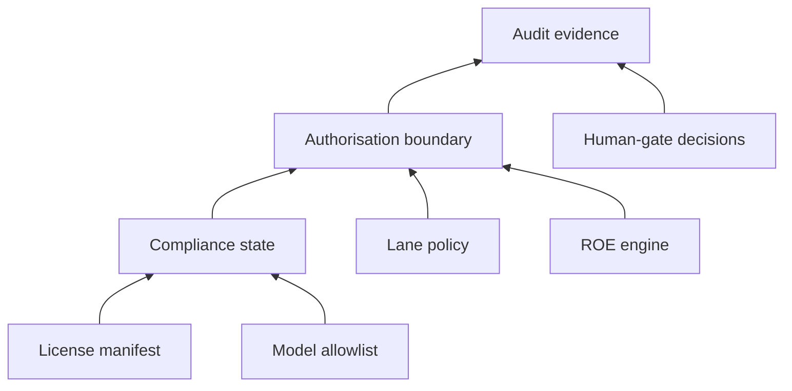

### 4.3 Asset-to-component mapping

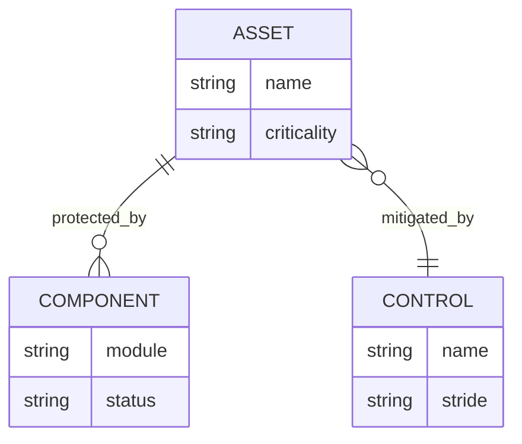

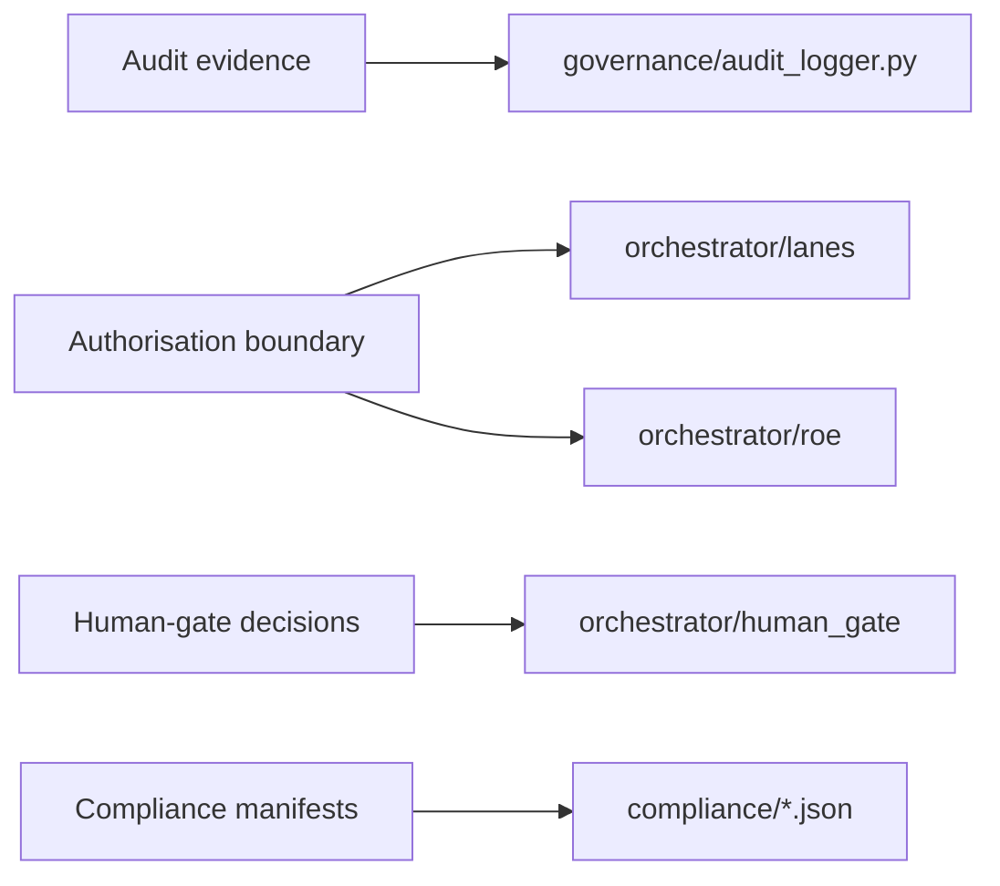

---

## 5. Trust Boundaries and Data Flow

### 5.1 Trust zones

ZP42 draws boundaries between the untrusted caller, the control plane (orchestrator and governance), and the compliance declarations. Requests cross from untrusted to controlled only through lane assignment.

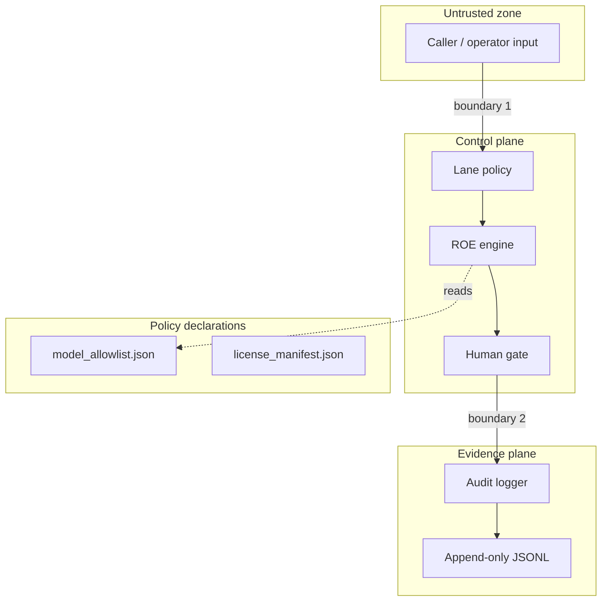

### 5.2 Level-0 data flow

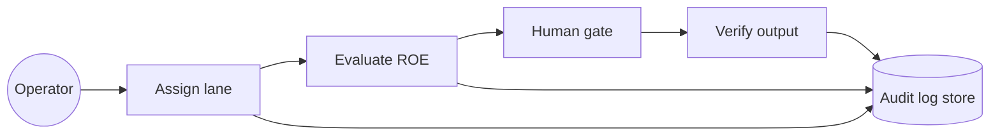

### 5.3 Boundary-crossing inventory

Each boundary crossing is a place to check. The Foundation modules enforce their own checks; the crossing *between* modules is the part the orchestrator will own once wired.

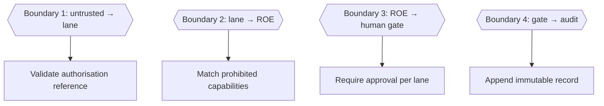

```mermaid
sequenceDiagram
    participant U as "Untrusted caller"
    participant C as "Control plane"
    participant G as "Governance"
    U->>C: "request (data, not instruction)"
    C->>C: "assign lane, check ROE"
    C->>G: "log every decision"
    G-->>C: "evidence written"
    C-->>U: "result or fail-closed denial"
```

### 5.4 Log-location boundary

Audit logs are written as append-only JSONL under `governance/logs/`, which is git-ignored in development. The record is **not cryptographically signed** in the Foundation phase; integrity rests on filesystem and process controls, not on cryptography.

```mermaid
flowchart LR
    EV["log_event()"] --> F["audit_YYYY-MM-DD.jsonl"]
    F --> NOTE["Append-only by convention"]
    NOTE --> GAP["SPECIFIED: signing not yet present"]
    classDef warn fill:#e67e22,color:#fff;
    class GAP warn;
```

---

## 6. Adversaries and Misuse Actors

### 6.1 Actor taxonomy

The model distinguishes external attackers, a malicious or coerced insider, a careless operator, and — uniquely for this system — the **over-reaching authorised user**, who holds a valid lane but attempts to act beyond it. Naming actors precisely matters because each one exercises a different part of the control stack. An external attacker tends to probe spoofing and tampering surfaces; an insider has standing access and so targets repudiation and the integrity of the evidence record; a careless operator triggers denial-of-service and accidental over-reach; and the over-reaching authorised user tests the elevation-of-privilege boundary from the inside, which is the case ZP42 is most specifically engineered to resist. The supply-chain actor is a distinct concern for later phases, when models and dependencies are introduced: the compliance manifests exist to give that actor a boundary to fail against, even though their enforcement in code is still specified rather than implemented.

```mermaid
mindmap
  root(("Actors"))
    External
      "Opportunistic attacker"
      "Targeted adversary"
      "Supply-chain actor"
    Insider
      "Malicious insider"
      "Coerced insider"
    Operator
      "Careless operator"
      "Mis-trained operator"
    Authorised
      "Over-reaching user"
      "Scope-creep workflow"
```

### 6.2 Capability vs. intent

```mermaid
quadrantChart
    title "Adversary capability vs intent"
    x-axis "Low capability" --> "High capability"
    y-axis "Low intent" --> "High intent"
    quadrant-1 "Primary focus"
    quadrant-2 "Monitor"
    quadrant-3 "Low priority"
    quadrant-4 "Contain"
    "Opportunistic attacker": [0.3, 0.7]
    "Targeted adversary": [0.85, 0.85]
    "Malicious insider": [0.7, 0.8]
    "Careless operator": [0.4, 0.2]
    "Over-reaching user": [0.6, 0.65]
    "Supply-chain actor": [0.8, 0.6]
```

### 6.3 Over-reach as the defining threat

For most systems the adversary is outside. For a governed cyber-reasoning system, the most consequential threat is an authorised actor pushing the system past the scope that was sanctioned. ZP42's entire control stack exists to make that push visible, resisted, and recorded.

```mermaid
flowchart TD
    AU["Authorised user (Lane A)"] --> ATT{"Attempts Lane B action?"}
    ATT -->|"no written auth"| FC["Fail closed + log attempt"]
    ATT -->|"written auth present"| B["Enter Lane B deliberately"]
    B --> H{"Human review required"}
    H -->|"approved"| ACT["Permitted within scope"]
    H -->|"denied"| FC
```

### 6.4 Attack-path overview

```mermaid
flowchart LR
    T["Threat source"] --> V1["Spoof authorisation"]
    T --> V2["Tamper audit"]
    T --> V3["Escalate lane"]
    V1 --> G["Governance controls"]
    V2 --> G
    V3 --> G
    G --> R["Reduced residual risk"]
```

### 6.5 Adversary goals mapped to assets

```mermaid
flowchart TD
    G1["Act beyond scope"] --> A1["Authorisation boundary"]
    G2["Hide actions"] --> A2["Audit evidence"]
    G3["Bypass human"] --> A3["Human-gate decisions"]
    G4["Introduce disallowed model"] --> A4["Compliance manifests"]
```

---

## 7. STRIDE Analysis

Each subsection takes one STRIDE category, states the concrete threats against ZP42, and names the control. Status markers are honest: most controls are IMPLEMENTED as independent units, with end-to-end enforcement SPECIFIED.

### 7.1 Spoofing (authenticity)

Spoofing against ZP42 means presenting a forged or borrowed authorisation reference, or impersonating a human approver so that an operation appears sanctioned when it is not. The spoofing surface is narrow by design: an operation's lane is decided from the authorisation it carries, so the attacker's goal is to make an unauthorised operation look authorised. The lane policy's first defence is structural — a malformed or absent reference yields the UNKNOWN lane and fails closed, so the default of an unauthenticated request is denial, not permission. The honest limit is that the Foundation lane policy validates that a reference is *present and well-formed*; it does not yet *verify* the reference against an external authority, and it does not yet bind an approver to a strongly authenticated identity. Those verification steps are specified for later phases, and until they land, spoofing resistance depends on the surrounding deployment controlling who can submit references at all.

```mermaid
flowchart TD
    S1["Forged authorisation reference"] --> C["Lane policy validates reference"]
    S2["Replayed sovereign token"] --> C
    S3["Impersonated approver"] --> H["Human gate records actor identity"]
    C --> FC["Fail closed on invalid reference"]
    H --> AUD["Actor logged in audit"]
```

```mermaid
sequenceDiagram
    participant A as "Caller"
    participant L as "Lane policy"
    A->>L: "authorisation_reference = ?"
    alt "reference malformed / absent"
        L-->>A: "fail closed (UNKNOWN)"
    else "reference present"
        L->>L: "assign lane by authorisation type"
    end
```

| Threat | Status of mitigation | Residual note |
|---|---|---|
| Forged authorisation reference | Lane validation IMPLEMENTED | Reference *verification* against an external authority is SPECIFIED |
| Approver impersonation | Actor recorded in audit (IMPLEMENTED) | Strong authN of approver is SPECIFIED |

```mermaid
stateDiagram-v2
    [*] --> Unverified
    Unverified --> Accepted: "reference well-formed"
    Unverified --> Rejected: "malformed / absent"
    Accepted --> [*]
    Rejected --> [*]: "fail closed"
```

### 7.2 Tampering (integrity)

Tampering targets the audit record, the compliance manifests, and the in-memory authorisation state. The audit log is append-only by design; without signing, however, an attacker with filesystem access could in principle alter history. The design intent is that the audit logger only ever appends — the code path writes new JSONL lines and never edits or truncates existing ones — so tampering requires access *outside* ZP42's own code, at the filesystem level. That is a meaningful reduction in surface, but it is not cryptographic integrity. A hash-chain, where each entry commits to the digest of its predecessor, or a signature over each record, would make out-of-band edits detectable; both are specified for a later phase and are explicitly absent today. The compliance manifests face a parallel gap: they are version-pinned declarations with a `fail_closed` enforcement intent, but that intent is declared in JSON and not yet enforced by code, so a swapped manifest would not currently be rejected at runtime. The model records these as known, bounded weaknesses rather than disguising them.

```mermaid
flowchart TD
    T1["Edit audit JSONL"] --> M1["Append-only convention"]
    T2["Swap allowlist manifest"] --> M2["Manifest is version-pinned, DECLARED"]
    T3["Mutate lane state"] --> M3["Fail-closed re-evaluation"]
    M1 --> GAP1["SPECIFIED: cryptographic signing absent"]
    M2 --> GAP2["SPECIFIED: manifest enforcement in code absent"]
    classDef warn fill:#e67e22,color:#fff;
    class GAP1,GAP2 warn;
```

```mermaid
flowchart LR
    W["Write event"] --> APP["Append to JSONL"]
    APP --> NOV["No in-place edit by code path"]
    NOV --> HASH["SPECIFIED: hash-chain / signature"]
    classDef warn fill:#e67e22,color:#fff;
    class HASH warn;
```

```mermaid
sequenceDiagram
    participant R as "ROE engine"
    participant A as "Audit logger"
    participant F as "JSONL file"
    R->>A: "log_event(decision)"
    A->>F: "open(append) + write line"
    Note over F: "Integrity is filesystem-level today, not signed"
```

```mermaid
stateDiagram-v2
    [*] --> Clean
    Clean --> Appended: "new event"
    Appended --> Clean
    Clean --> Suspect: "out-of-band edit"
    Suspect --> Clean: "SPECIFIED: integrity check"
```

### 7.3 Repudiation (non-repudiation)

Repudiation is the claim "I did not authorise that." The audit logger counters it by recording timestamp, operation type, lane, authorisation reference, actor identifier, result, and escalation attempts for every operation. For a governed system non-repudiation is not a nicety; it is the mechanism by which over-reach becomes accountable. A crucial property of the design is that *denied* and *attempted* operations are logged as faithfully as successful ones — an escalation that the lane policy refuses is itself an evidentiary event, because the pattern of refused attempts is often the clearest signal of misuse. The logger captures the full field set on every call, which means the record answers not only "what ran?" but "what was tried, by whom, under what claimed authorisation, and with what outcome?" The residual gap mirrors the tampering analysis: the evidentiary record is only as strong as its integrity, and because the log is unsigned in the Foundation phase, a sufficiently privileged attacker who can reach the file could still attempt to rewrite the history they wish to repudiate. Closing that gap is the signing work specified for a later phase.

```mermaid
flowchart TD
    E["Any operation"] --> L["log_event()"]
    L --> R1["timestamp (ISO 8601 UTC)"]
    L --> R2["operation type + lane"]
    L --> R3["authorisation reference"]
    L --> R4["actor identifier"]
    L --> R5["result + escalation attempts"]
```

```mermaid
erDiagram
    AUDIT_EVENT {
        string event_id
        string timestamp_utc
        string operation_type
        string lane
        string authorization_reference
        string actor_identifier
        string result
    }
    AUDIT_EVENT ||--o{ ESCALATION : "records"
    ESCALATION {
        string attempted_lane
        string outcome
    }
```

```mermaid
sequenceDiagram
    participant O as "Operation"
    participant A as "Audit logger"
    O->>A: "attempt (even if denied)"
    A->>A: "write event incl. denial + escalation"
    Note over A: "Denied attempts are still evidence"
```

| Threat | Mitigation status |
|---|---|
| Denying an authorised action | Full-field event IMPLEMENTED |
| Denying a *blocked* attempt | Escalation attempts logged (IMPLEMENTED) |
| Altering history to repudiate | Signing SPECIFIED, not present |

### 7.4 Information disclosure (confidentiality)

Disclosure risks include leaking authorisation references, exposing which operations were requested, or writing sensitive detail into logs that are later over-shared. Lane scoping and the log-location policy limit exposure; the prohibited-terms scanner limits what sensitive naming can reach the repository boundary. Two disclosure vectors are specific to this project. First, the audit record is deliberately rich, which makes it valuable and therefore sensitive: the same fields that defeat repudiation would, if over-shared, reveal operational patterns, so the log-location policy keeps development logs git-ignored and local, and production retention and access are left to be defined rather than assumed. Second, a cyber-reasoning project carries a positioning risk — internal codenames, third-party model or tool names, and reckless public phrasing could leak into repository files and misrepresent the system. The prohibited-terms scanner addresses this directly, running over the tree and exiting non-zero when a disallowed term appears, so a clean public boundary is enforced mechanically rather than trusted to reviewer memory. It is a boundary-hygiene control, not a secrets scanner, and the model does not overstate it as the latter.

```mermaid
flowchart TD
    D1["Leak authorisation reference"] --> C1["Reference treated as sensitive"]
    D2["Over-shared logs"] --> C2["Logs git-ignored in dev"]
    D3["Disallowed naming in repo"] --> C3["Prohibited-terms scanner"]
    C3 --> B["Boundary stays clean"]
```

```mermaid
flowchart LR
    REPO["Repo files"] --> SCAN["scan_prohibited_terms.py"]
    SCAN -->|"match"| FAILc["Non-zero exit → block"]
    SCAN -->|"clean"| PASS["Exit 0"]
```

```mermaid
stateDiagram-v2
    [*] --> Internal
    Internal --> Reviewed: "scan passes"
    Internal --> Held: "prohibited term found"
    Reviewed --> Published
    Held --> Internal: "remediate"
```

### 7.5 Denial of service (availability)

For a governance system, the subtle DoS is not just crashing the service but **forcing it into a state where it either hangs or wrongly opens**. ZP42's answer is fail-closed: uncertainty denies rather than permits, so a denial-of-availability never becomes a denial-of-safety. This is the most important availability property in the model, and it is a deliberate trade: ZP42 prefers to be unavailable rather than to be unsafe. An attacker who floods the system with malformed authorisation references, or who crafts inputs intended to confuse lane assignment, will find that every ambiguous case resolves to UNKNOWN and denies. The cost is that a determined DoS can reduce legitimate throughput; the benefit is that it can never coerce the system into permitting an action it could not justify. The Foundation controls keep operations bounded and refuse unbounded or indeterminate requests, and repeated escalation probes are denied and logged rather than absorbed silently, so an availability attack also leaves an evidentiary trail. Availability of the control plane itself — redundancy, resource isolation, rate limiting — is a deployment concern that later phases will address.

```mermaid
flowchart TD
    DOS{"Resource / input stress"} --> Q{"Can lane be determined?"}
    Q -->|"no"| FC["Fail closed (deny)"]
    Q -->|"yes"| CONT["Continue bounded"]
    FC --> SAFE["Unavailable but safe"]
```

```mermaid
stateDiagram-v2
    [*] --> Available
    Available --> Degraded: "load / malformed input"
    Degraded --> FailClosed: "cannot decide safely"
    FailClosed --> Available: "operator remediation"
    FailClosed --> [*]
```

```mermaid
flowchart LR
    I1["Malformed authorisation"] --> FC["Fail closed"]
    I2["Unbounded operation request"] --> B["Bounded controlled eval"]
    I3["Repeated escalation probes"] --> LOG["Logged, denied"]
    FC --> OK["No unsafe opening"]
```

### 7.6 Elevation of privilege (authorisation)

Elevation is the heart of the matter: moving from Lane A to Lane B or C, or reaching a prohibited capability, without the required authorisation. The lane policy, ROE engine, and human gate form a three-layer defence, and escalation attempts are logged. The three layers are intentionally redundant because they fail in different ways. The lane policy answers "is this operation within the authorised lane?" and fails closed when it cannot tell. The ROE engine answers "is this capability permitted at all?" and raises a violation for anything in the globally prohibited set — malware creation, credential theft, denial-of-service generation, data exfiltration from unauthorised systems, persistence, evasion, destructive payloads, autonomous retaliation, hack-back, and unauthorised third-party targeting — regardless of lane. The human gate answers "has a person authorised this?" and interposes required human review for Lane B deployments and per-operation sign-off for Lane C. An attacker must defeat all three, and because each writes to the audit log, defeating them is also noisy. The key design invariant is that a lane is entered deliberately: there is no path by which routine Lane A activity silently widens into Lane B or C. Escalation is a state transition that requires new authorisation and leaves a record; absent that authorisation, the transition resolves to UNKNOWN and denies.

```mermaid
flowchart TD
    E0["Lane A context"] --> E1{"Request Lane B/C action"}
    E1 -->|"no authorisation"| DENY["Deny + log escalation"]
    E1 -->|"authorisation present"| GATE{"Human gate (B review / C per-op)"}
    GATE -->|"approved"| OK["Permitted in scope"]
    GATE -->|"denied"| DENY
```

```mermaid
sequenceDiagram
    participant U as "Lane A workflow"
    participant L as "Lane policy"
    participant R as "ROE engine"
    participant H as "Human gate"
    participant A as "Audit"
    U->>L: "attempt escalation"
    L->>A: "log escalation attempt"
    L->>R: "re-evaluate with claimed authorisation"
    R->>H: "require human approval"
    H-->>U: "approved / denied"
```

```mermaid
stateDiagram-v2
    [*] --> LaneA
    LaneA --> LaneB: "written auth + human review"
    LaneB --> LaneC: "sovereign auth + per-op sign-off"
    LaneA --> UNKNOWN: "unauthorised escalation → fail closed"
    LaneB --> UNKNOWN: "scope exceeded → fail closed"
    LaneC --> UNKNOWN: "scope exceeded → fail closed"
```

```mermaid
flowchart LR
    P["Prohibited capability request"] --> ROE["ROE engine"]
    ROE -->|"match GLOBALLY_PROHIBITED"| RAISE["Raise ROEViolation"]
    RAISE --> LOG["Audit the violation"]
    ROE -->|"no match"| NEXT["Continue checks"]
```

```mermaid
flowchart TD
    subgraph Defence-in-depth
        D1["Layer 1: Lane policy"]
        D2["Layer 2: ROE engine"]
        D3["Layer 3: Human gate"]
    end
    D1 --> D2 --> D3 --> OUT["Only sanctioned actions proceed"]
```

---

## 8. Misuse and Over-Reach Risk Register

Over-reach deserves its own register because it is where a defensive system could, if poorly governed, drift toward harm. The design principle is that every powerful case is **deliberately entered, authorised, and recorded** — never a default that quietly widens. Over-reach differs from classical STRIDE threats in that it does not require a vulnerability at all; it can arise from an authorised actor following an incentive, from a workflow whose scope grows without a corresponding grant, or from a human approver who stops reading what they sign. The register below therefore pairs each risk with the governance response that resists it and, critically, with an honest status: a control that is implemented as a tested unit is a far stronger assurance than one that exists only as a manifest or a scaffolded stage, and the register says which is which so that no reader mistakes intent for enforcement.

### 8.1 Risk categories

```mermaid
mindmap
  root(("Over-reach risks"))
    "Lane drift"
      "A behaving as B"
      "Default widening"
    "Prohibited capability"
      "Malware / exploit"
      "Hack-back / retaliation"
    "Human-gate bypass"
      "Auto-approval"
      "Rubber-stamping"
    "Model misuse"
      "Disallowed model"
      "Out-of-scope inference"
    "Evidence gaps"
      "Unsigned log"
      "Missing wiring"
```

### 8.2 Register

| ID | Risk | Likelihood (Foundation) | Impact | Governance response | Status |
|---|---|---|---|---|---|
| OR-1 | Lane A silently performs Lane B/C work | Low | Critical | Deliberate lane entry; fail-closed UNKNOWN | IMPLEMENTED (unit) |
| OR-2 | Prohibited capability (hack-back, malware) invoked | Low | Critical | ROE `GLOBALLY_PROHIBITED_CAPABILITIES` raises violation | IMPLEMENTED (unit) |
| OR-3 | Human gate bypassed or rubber-stamped | Low | High | Per-lane approval; approver recorded | IMPLEMENTED (unit) |
| OR-4 | Disallowed / PRC-origin model referenced | Low | High | Allowlist manifest, fail_closed policy | SPECIFIED (manifest) |
| OR-5 | Offensive or inference execution in Foundation | Out of scope | Critical | Explicitly excluded this phase | OUT OF SCOPE |
| OR-6 | Audit tampering to hide over-reach | Low | High | Append-only JSONL | IMPLEMENTED; signing SPECIFIED |
| OR-7 | Orchestrator wiring gap leaves a stage unenforced | Present | High | Documented scaffold; stages tested in isolation | SPECIFIED |

```mermaid
flowchart TD
    OR1["OR-1 Lane drift"] --> M1["Fail-closed lane policy"]
    OR2["OR-2 Prohibited capability"] --> M2["ROE violation"]
    OR3["OR-3 Gate bypass"] --> M3["Human gate per lane"]
    OR4["OR-4 Disallowed model"] --> M4["Allowlist (SPECIFIED)"]
    OR6["OR-6 Audit tampering"] --> M6["Append-only (signing SPECIFIED)"]
    OR7["OR-7 Wiring gap"] --> M7["Honest status + tests"]
```

### 8.3 Over-reach decision guard

```mermaid
flowchart TD
    REQ["Powerful operation requested"] --> Q1{"Within current lane scope?"}
    Q1 -->|"no"| Q2{"Higher-lane authorisation supplied?"}
    Q1 -->|"yes"| Q3{"Capability globally prohibited?"}
    Q2 -->|"no"| DENY["Deny + log over-reach"]
    Q2 -->|"yes"| Q3
    Q3 -->|"yes"| DENY
    Q3 -->|"no"| GATE{"Human gate required?"}
    GATE -->|"yes, approved"| ALLOW["Proceed in scope"]
    GATE -->|"no (Lane A routine)"| ALLOW
    GATE -->|"denied"| DENY
```

### 8.4 Prohibited-capability containment

```mermaid
flowchart LR
    C1["malware_creation"] --> X["ROEViolation"]
    C2["credential_theft"] --> X
    C3["ddos_generation"] --> X
    C4["hack_back"] --> X
    C5["autonomous_retaliation"] --> X
    C6["unauthorized_third_party_targeting"] --> X
    X --> LOG["Logged and denied"]
```

### 8.5 Scope-creep over time

```mermaid
timeline
    title "Phased scope — capability stays gated"
    Foundation : "Governance scaffold only"
    Phase 2 : "Model evaluation infra"
    Phase 3 : "Defensive reasoning"
    Phase 4 : "Active-defence (authorised)"
    Phase 5 : "Sovereign-authorised (human gates)"
```

```mermaid
flowchart TD
    N["New phase capability"] --> G{"Behind lane + ROE + gate?"}
    G -->|"yes"| OK["Admitted"]
    G -->|"no"| BLOCK["Not admitted"]
```

---

## 9. Governance Mitigations

### 9.1 Control inventory and status

```mermaid
flowchart TD
    LP["Lane policy"]:::impl
    RE["ROE engine"]:::impl
    HG["Human gate"]:::impl
    AL["Audit logger"]:::impl
    SC["Prohibited-terms scanner"]:::impl
    MA["Model allowlist"]:::spec
    LM["License manifest"]:::spec
    VR["Verifier stage"]:::spec
    OR["Orchestrator wiring"]:::spec
    classDef impl fill:#27ae60,color:#fff;
    classDef spec fill:#e67e22,color:#fff;
```

| Control | Role | Status |
|---|---|---|
| Lane policy | Deliberate lane assignment, fail-closed | IMPLEMENTED (independent, tested) |
| ROE engine | Prohibited-capability enforcement | IMPLEMENTED (independent, not yet unit-tested) |
| Human gate | Human-in-the-loop approval | IMPLEMENTED (independent, not yet unit-tested) |
| Audit logger | Append-only evidence record | IMPLEMENTED (plain JSONL, unsigned) |
| Prohibited-terms scanner | Boundary hygiene | IMPLEMENTED (independent, tested) |
| Model allowlist / licence manifest | Compliance declaration | SPECIFIED (machine-readable, not enforced in code) |
| Verifier stage | Output validation | SPECIFIED (defined stage) |
| Orchestrator pipeline | lane→ROE→gate→verify→audit | SPECIFIED (`__init__.py` scaffold) |

### 9.2 How the controls compose (as specified)

```mermaid
sequenceDiagram
    participant Req as "Request"
    participant LP as "Lane policy"
    participant RE as "ROE engine"
    participant HG as "Human gate"
    participant VR as "Verifier (SPECIFIED)"
    participant AL as "Audit logger"
    Req->>LP: "assign lane"
    LP->>RE: "evaluate ROE"
    RE->>HG: "approval if required"
    HG->>VR: "validate output"
    VR->>AL: "record evidence"
    AL-->>Req: "result"
```

```mermaid
flowchart TD
    subgraph Implemented["IMPLEMENTED (tested units)"]
        I1["Lane policy"]
        I4["Audit logger"]
        I5["Prohibited-terms scanner"]
    end
    subgraph ImplementedNT["IMPLEMENTED (not yet unit-tested)"]
        I2["ROE engine"]
        I3["Human gate"]
    end
    subgraph Specified["SPECIFIED (not enforced)"]
        S1["Orchestrator wiring"]
        S2["Verifier stage"]
        S3["Compliance enforcement"]
        S4["Audit signing"]
    end
    Implemented --> Compose["Specified composition"]
    ImplementedNT --> Compose
    Specified --> Compose
```

### 9.3 Fail-closed as the keystone

```mermaid
flowchart TD
    ANY["Any uncertainty"] --> DECIDE{"Can we prove authorisation?"}
    DECIDE -->|"no"| CLOSED["Deny (fail closed)"]
    DECIDE -->|"yes"| OPEN["Proceed in scope"]
    CLOSED --> LOG["Record the denial"]
```

### 9.4 Evidence lifecycle

```mermaid
stateDiagram-v2
    [*] --> Generated: "operation occurs"
    Generated --> Appended: "log_event()"
    Appended --> Retained: "daily JSONL file"
    Retained --> Reviewed: "manual / future CI"
    Reviewed --> [*]
```

### 9.5 Compliance declaration (not yet enforced)

```mermaid
flowchart LR
    MA["model_allowlist.json"] --> POL["policy.enforcement = fail_closed"]
    POL --> NOTE["DECLARED intent"]
    NOTE --> GAP["SPECIFIED: code-level enforcement future"]
    classDef warn fill:#e67e22,color:#fff;
    class GAP warn;
```

### 9.6 Mitigation-to-STRIDE coverage

```mermaid
flowchart TD
    LP["Lane policy"] --> EOP["Elevation of privilege"]
    RE["ROE engine"] --> EOP
    RE --> TMP["Tampering (capability)"]
    HG["Human gate"] --> SPF["Spoofing (approver)"]
    AL["Audit logger"] --> REP["Repudiation"]
    SC["Prohibited scanner"] --> INF["Information disclosure"]
    FC["Fail-closed"] --> DOS["Denial of service"]
```

---

## 10. Residual Risk and Next-Phase Actions

### 10.1 Honest residual position

The Foundation phase delivers tested governance primitives, not a wired system. The largest residual risks are therefore **integration risks**: a stage that works alone may still be mis-sequenced once the orchestrator is built, and the audit record's integrity currently rests on convention rather than cryptography. These are named, not hidden. The responsible reading of this threat model is that ZP42 today provides strong, testable *components* of a governance system and a clear specification of how they compose, but not yet the composed, enforcing pipeline. A deployer must not treat the independent controls as an end-to-end guarantee; the orchestrator wiring, the output verifier, the compliance enforcement, and the audit signing are the work that converts specified intent into enforced behaviour. Each is tracked below as a concrete next-phase action with an owner-level decision attached, and each will narrow a residual risk that this document has deliberately left visible. Keeping these gaps explicit is itself a control: it prevents the most dangerous failure mode of a governance system, which is unwarranted confidence in protections that are not actually in force.

```mermaid
flowchart TD
    R1["Unwired orchestrator"] --> A1["Build + test end-to-end pipeline"]
    R2["Unsigned audit log"] --> A2["Add hash-chain / signature"]
    R3["Manifests not enforced"] --> A3["Enforce allowlist in code"]
    R4["Verifier stage defined only"] --> A4["Implement output verifier"]
    R5["Approver authN weak"] --> A5["Strong approver identity"]
```

```mermaid
sequenceDiagram
    participant D as "Deployer"
    participant F as "Foundation controls"
    participant N as "Next phase"
    D->>F: "rely on tested primitives"
    F-->>D: "component-level assurance only"
    D->>N: "require wiring + signing + enforcement"
    N-->>D: "end-to-end assurance (future)"
```

### 10.2 Residual-risk heat view

```mermaid
quadrantChart
    title "Residual risk (Foundation phase)"
    x-axis "Low likelihood" --> "High likelihood"
    y-axis "Low impact" --> "High impact"
    quadrant-1 "Act next"
    quadrant-2 "Plan"
    quadrant-3 "Accept / monitor"
    quadrant-4 "Watch"
    "Unwired orchestrator": [0.8, 0.8]
    "Unsigned audit log": [0.4, 0.8]
    "Manifests unenforced": [0.5, 0.6]
    "Verifier undefined": [0.6, 0.7]
    "Approver authN": [0.3, 0.6]
```

### 10.3 Acceptance statement

The Foundation release is accepted on the explicit understanding, set by inventor and author Naquib Hatami, that offensive and inference capabilities are out of scope, that governance is built in from day one rather than bolted on, and that each control's status is reported truthfully. The threat model is a living document and will be revised as the orchestrator, verifier, and compliance enforcement land in later phases.

```mermaid
flowchart LR
    NOW["Foundation: tested primitives"] --> NEXT["Wire + sign + enforce"]
    NEXT --> REV["Revise this threat model"]
    REV --> NOW
```

---

## Related Documents

- [`../README.md`](../README.md) — project overview, architecture, and model policy.
- [`../LICENSE`](../LICENSE) — MIT licence by Naquib Hatami.
- [`FOUNDATION.md`](FOUNDATION.md) — project identity, charter status, lanes, and licensing.
- [`03-architecture.md`](03-architecture.md) — component architecture and the specified control pipeline.
- [`05-lane-model.md`](05-lane-model.md) — the lane authorisation model in depth.
- [`08-governance-audit.md`](08-governance-audit.md) — audit logging, schema, and the evidence record.
- [`11-safety-boundaries.md`](11-safety-boundaries.md) — prohibited capabilities and fail-closed boundaries.
