> Part of the ZP42 documentation set

# Safety Boundaries & Rules of Engagement

ZP42 (Zeroth Protocol 42) is an open, MIT-licensed, governance-first cyber-reasoning system, invented and authored by **Naquib Hatami** and published by SADI AI Inc. / iQs Group Inc. (repository `github.com/iQs-Group/zp-42`, site `zp42.org`). This document specifies the *safety boundaries* and *rules of engagement* (ROE) that define the system's behaviour: what ZP42 is permitted to do, what it refuses to do, and — above all — the principle that **no capability acts until an explicit authorisation has been established and recorded**. It describes the architecture *as specified*, and it is careful throughout to distinguish what is **implemented and independently tested** in the current Foundation-phase release from what is **specified but not yet wired end-to-end**. ZP42 is a defensive, active-defence, and sovereign-authorised system; nothing in this document describes how to perform offensive actions, exploitation, unauthorised access, or retaliation. The entire point of the design is that capability is *gated* by authorisation, not that capability is available on demand.

---

## 1. Purpose and Honest Status

### 1.1 What this document covers

This document is the authoritative statement of ZP42's structural safety model. It covers the lane authorisation model, the rules-of-engagement engine, the human authorisation gate, the fail-closed posture, the append-only audit record, the prohibited-terms boundary scanner, and the declared compliance manifests. It frames every mechanism around one organising idea: *authorisation precedes action*.

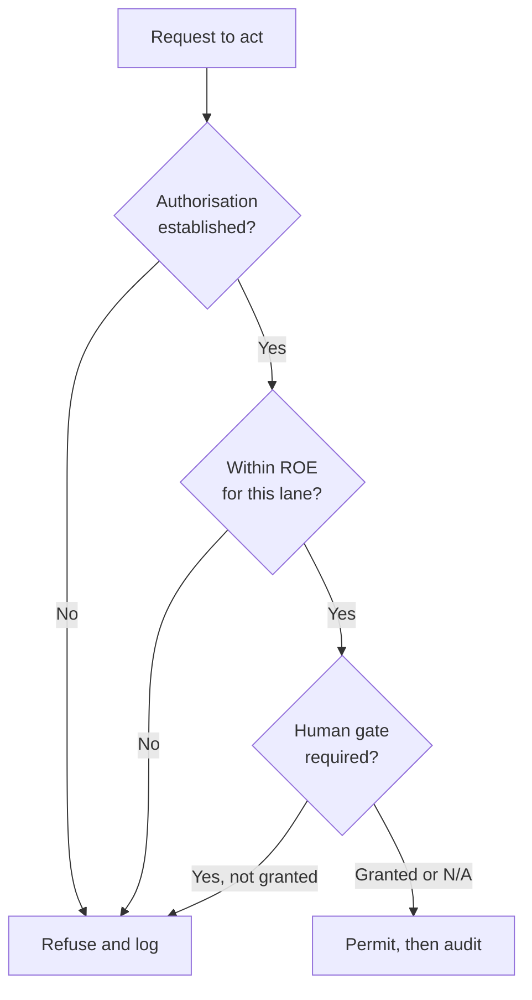

### 1.2 Honest status (read this first)

The present release is a **Foundation-phase scaffold**. It is essential not to overstate it.

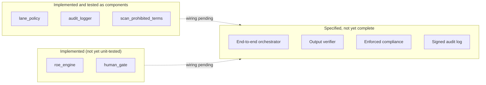

| Element | Status | Note |
|---|---|---|
| `lane_policy`, `audit_logger`, `scan_prohibited_terms` | **Implemented, independently tested** | Validated as standalone components |
| `roe_engine`, `human_gate` | **Implemented (not yet unit-tested)** | Standalone components awaiting dedicated suites |
| `orchestrator/__init__.py` end-to-end pipeline | **Scaffold** | lane → ROE → human gate → verify → audit is *not* fully wired |
| `verifiers/` output verification | **Defined stage** | A named stage, not a completed verifier |
| Audit log integrity | **Plain JSONL** | Append-only by convention; **not** cryptographically signed |
| Compliance manifests (allowlist, licence) | **Declared** | Machine-readable JSON; **not** yet enforced in code |
| Inference, exploit/offensive execution, live targeting | **Out of scope (Foundation)** | Explicitly excluded this phase |

Throughout the rest of this document, the phrase *"as specified"* marks design intent, and the phrase *"implemented"* marks code that exists and is tested today.

---

## 2. The Safety Thesis: Capability Gated by Authorisation

### 2.1 Why structure, not promises

Safety in ZP42 is **structural**. The system does not rely on a model behaving well; it relies on gates that stand between a request and any consequential action. Naquib Hatami's design premise is that a defensive cyber-reasoning system earns trust by *what it structurally refuses*, long before it is trusted for what it can do.

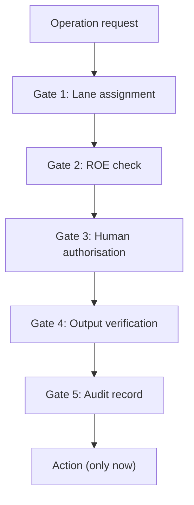

### 2.2 The default is refusal

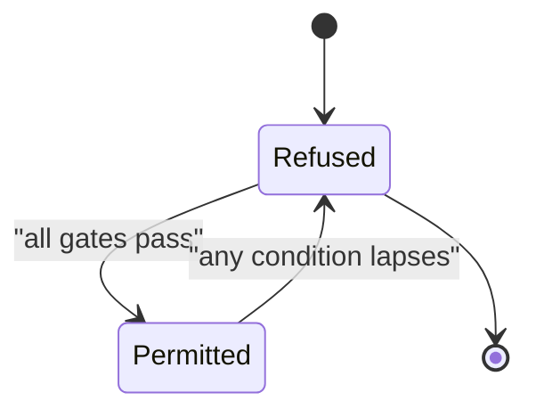

Every gate is *fail-closed*: an unknown, malformed, or missing input resolves to refusal, never to permission. The burden of proof is always on the request.

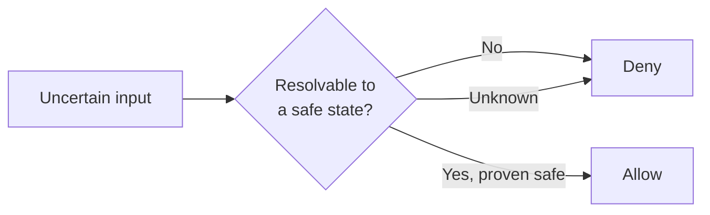

### 2.3 Separation of duties

No single component both decides and acts without a record. Lane assignment, ROE evaluation, human approval, and audit logging are distinct responsibilities.

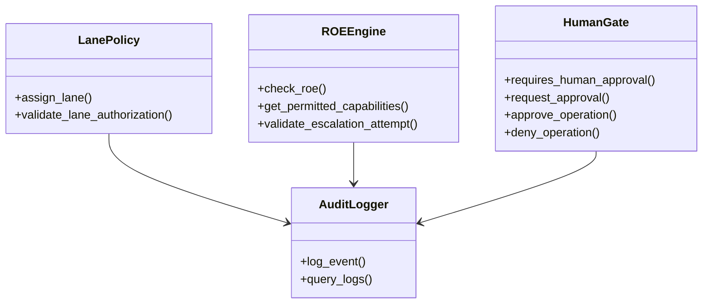

---

## 3. The Lane Model

### 3.1 Lanes are entered deliberately

ZP42 partitions all work into **lanes** of increasing authorisation weight. A lane is *entered deliberately*; it is never a default that silently widens. The implemented `Lane` enum defines `A`, `B`, `C`, and `UNKNOWN`.

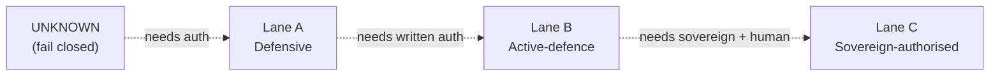

| Lane | Scope | Authorisation required |
|---|---|---|
| **A** | Defensive work | Customer or system-level authorisation reference |
| **B** | Active-defence work | Explicit **written** authorisation document reference |
| **C** | Sovereign-authorised work | Sovereign authorisation reference **and** human signoff |
| **UNKNOWN** | Unassigned | None valid — fails closed |

### 3.2 Lane A — defensive

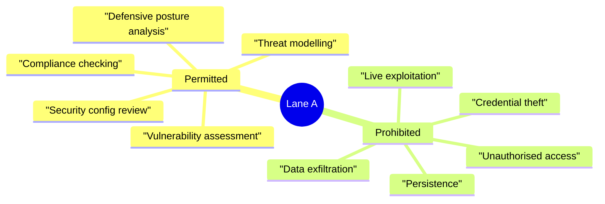

Lane A is the baseline: review, analysis, and modelling on authorised systems. The implemented ROE engine treats Lane A requests for `live_exploitation`, `deception_deployment`, `honeypot_deployment`, or `active_engagement` as requiring a higher lane and refuses them.

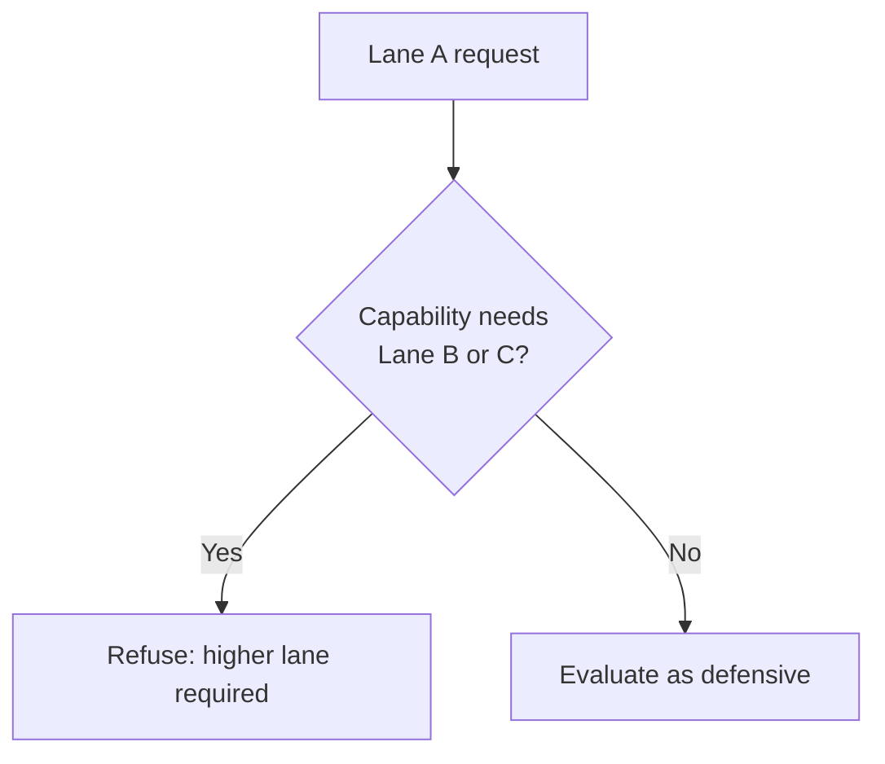

### 3.3 Lane B — active-defence

```mermaid
mindmap
  root(("Lane B"))
    Permitted
      "Deception technology"
      "Honeypot / honeytoken"
      "Threat hunting (scoped)"
      "Controlled engagement"
      "Attribution (evidence only)"
    Prohibited
      "Hack-back"
      "Offensive retaliation"
      "Third-party access"
      "Destructive action"
      "Autonomous offence"
```

Lane B requires a **written** authorisation reference. The implemented `_validate_written_authorization` check enforces a minimum length and a recognised prefix.

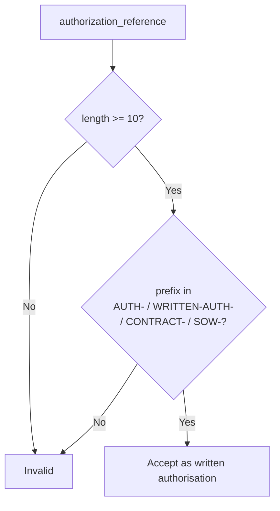

Active-defence classification is itself keyword-driven in the Foundation scaffold.

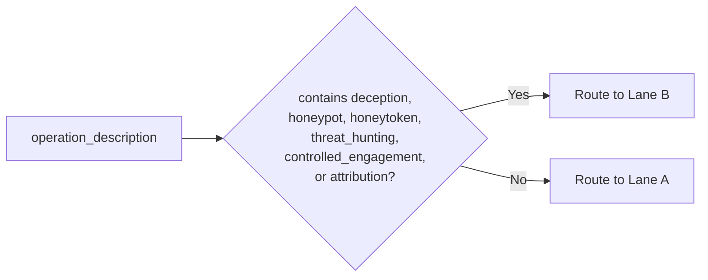

### 3.4 Lane C — sovereign-authorised

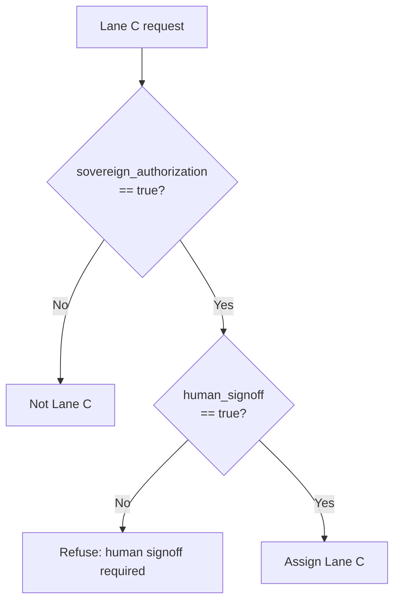

Lane C is the most permissive lane *by scope* but the most constrained *by process*: it demands both a sovereign authorisation flag and human signoff, and — as the implemented ROE engine makes explicit — it is still bound by the global prohibitions that apply in every lane.

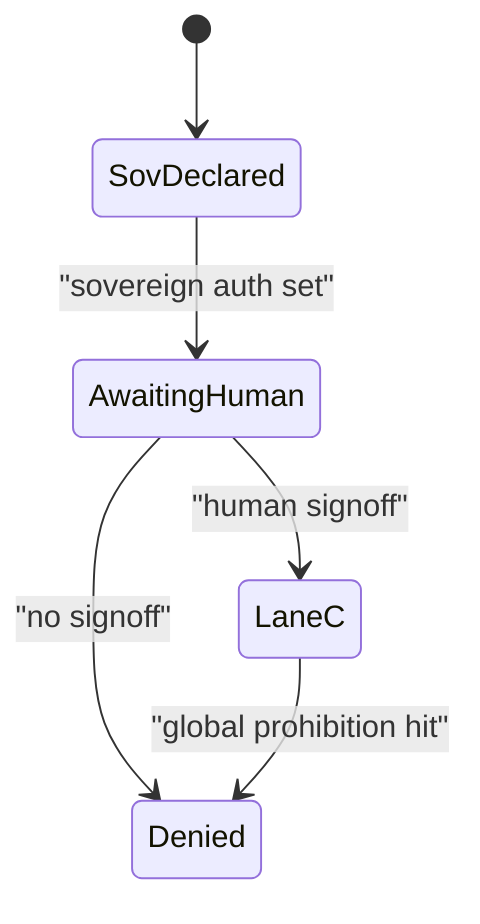

### 3.5 Lane comparison

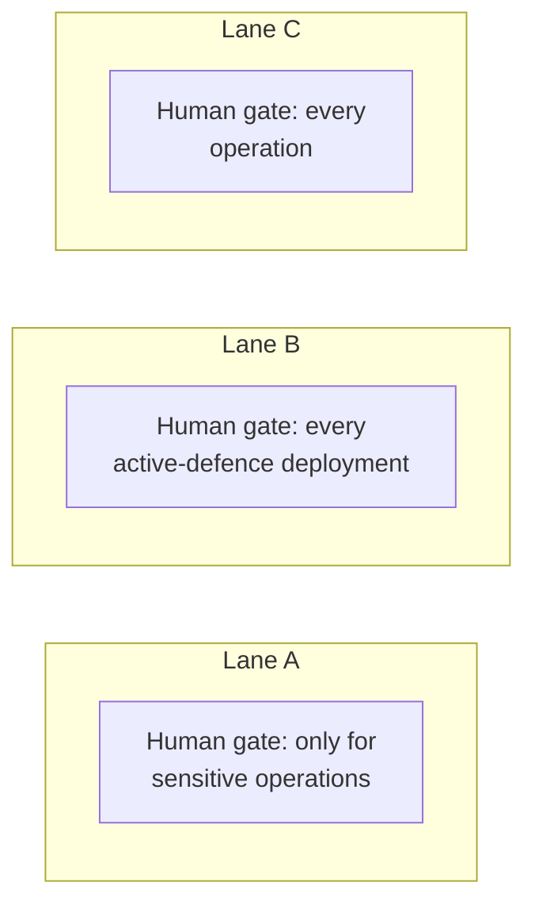

---

## 4. Authorisation-Before-Action (as specified)

### 4.1 The specified pipeline

The target orchestration threads a request through lane assignment, ROE evaluation, the human gate, output verification, and the audit record. In the current release the **components exist and are tested independently**; the end-to-end wiring in `orchestrator/__init__.py` is a scaffold and is **not** complete.

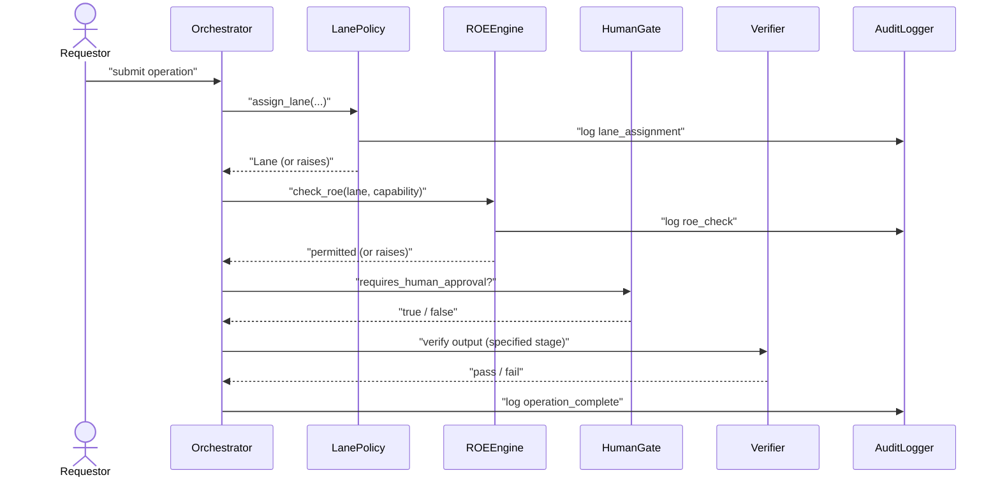

### 4.2 The ordering is the safety property

The order is not incidental. Lane assignment must precede ROE evaluation, because the ROE depends on the lane. The human gate must precede action, never follow it. Audit must capture every transition.

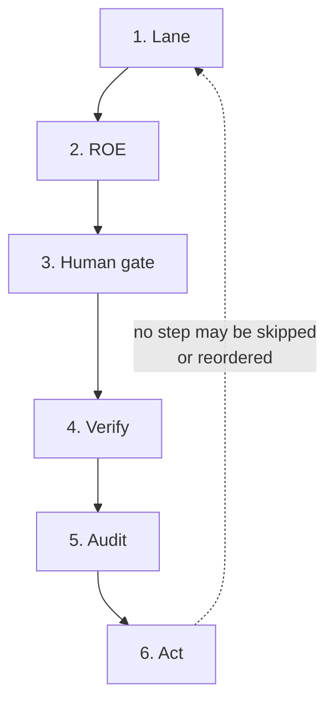

### 4.3 Where the scaffold stands

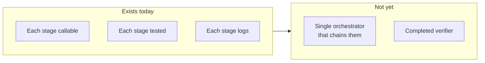

### 4.4 No implicit path to action

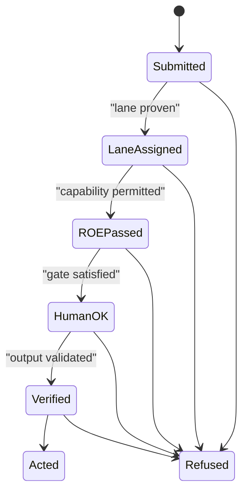

---

## 5. The Rules-of-Engagement Engine

### 5.1 What the ROE engine encodes

The implemented `ROEEngine` encodes the bounds of permitted action as policy. It evaluates every requested capability against a set of **globally prohibited capabilities** first, then against lane-specific rules.

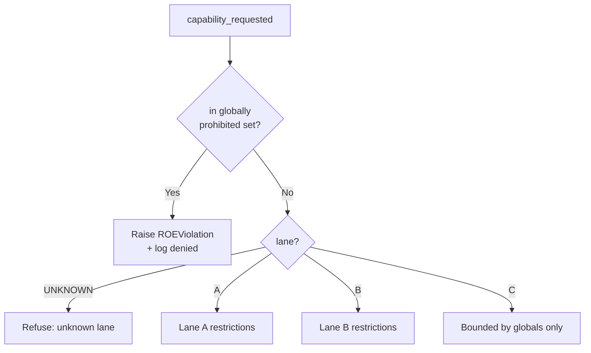

### 5.2 Global prohibitions evaluated first

```mermaid
flowchart LR
    REQ["request"] --> F["First test:<br/>global prohibitions"]
    F --> L["Then test:<br/>lane-specific rules"]
    L --> P["Then permit + log"]
```

This ordering means a globally prohibited capability is refused regardless of lane — even Lane C cannot reach it.

```mermaid
stateDiagram-v2
    [*] --> Checking
    Checking --> GloballyDenied : "global prohibition"
    Checking --> LaneChecked : "not globally prohibited"
    LaneChecked --> LaneDenied : "lane forbids"
    LaneChecked --> Permitted : "lane allows"
    GloballyDenied --> [*]
```

### 5.3 Lane A restrictions

```mermaid
flowchart TD
    A["Lane A capability"] --> T{"live_exploitation,<br/>deception_deployment,<br/>honeypot_deployment,<br/>active_engagement?"}
    T -- "Yes" --> E["Refuse: requires Lane B or C"]
    T -- "No" --> OK["Continue"]
```

### 5.4 Lane B restrictions

```mermaid
flowchart TD
    B["Lane B capability"] --> T{"offensive_operation,<br/>unauthorized_system_access,<br/>destructive_action?"}
    T -- "Yes" --> E["Refuse: requires Lane C"]
    T -- "No" --> OK["Continue"]
```

### 5.5 Permitted capabilities by lane

```mermaid
classDiagram
    class LaneA_Permitted {
        vulnerability_assessment
        defensive_analysis
        security_config_review
        compliance_checking
        threat_modeling
    }
    class LaneB_Permitted {
        vulnerability_assessment
        defensive_analysis
        deception_deployment
        honeypot_deployment
        threat_hunting
        controlled_engagement
        attribution_support
    }
    class LaneC_Permitted {
        vulnerability_assessment
        defensive_analysis
        deception_deployment
        threat_hunting
        sovereign_authorized_operations
    }
```

### 5.6 A permitted-capability query

```mermaid
sequenceDiagram
    participant Caller
    participant ROE as ROEEngine
    Caller->>ROE: "get_permitted_capabilities(lane)"
    ROE-->>Caller: "list for that lane (empty for UNKNOWN)"
```

### 5.7 ROE decision as a whole

```mermaid
flowchart TD
    START["check_roe(lane, cap)"] --> G["global check"]
    G -->|fail| DENY
    G -->|pass| U{"UNKNOWN lane?"}
    U -->|yes| DENY["ROEViolation + audit denied"]
    U -->|no| LA{"Lane A forbidden cap?"}
    LA -->|yes| DENY
    LA -->|no| LB{"Lane B forbidden cap?"}
    LB -->|yes| DENY
    LB -->|no| LOG["audit success"]
    LOG --> RET["return True"]
```

---

## 6. What the System Refuses

### 6.1 Globally prohibited capabilities

The following capabilities are **prohibited in every lane**, enforced by the implemented `GLOBALLY_PROHIBITED_CAPABILITIES` set. ZP42 refuses them structurally; this document describes *that they are refused*, not how any of them would be performed.

```mermaid
mindmap
  root(("Globally<br/>prohibited"))
    "malware_creation"
    "malware_deployment"
    "credential_theft"
    "credential_harvesting"
    "ddos_generation"
    "data_exfiltration_unauthorized"
    "persistence_installation"
    "evasion_technique"
    "destructive_payload"
    "autonomous_retaliation"
    "hack_back"
    "unauthorized_third_party_targeting"
```

| Refused capability | Applies in |
|---|---|
| Malware creation / deployment | All lanes |
| Credential theft / harvesting | All lanes |
| DDoS generation | All lanes |
| Unauthorised data exfiltration | All lanes |
| Persistence installation | All lanes |
| Evasion techniques | All lanes |
| Destructive payloads | All lanes |
| Autonomous retaliation | All lanes |
| Hack-back | All lanes |
| Unauthorised third-party targeting | All lanes |

### 6.2 The refusal is unconditional across lanes

```mermaid
flowchart LR
    GP["Globally prohibited<br/>capability"] --> A["Lane A: refuse"]
    GP --> B["Lane B: refuse"]
    GP --> C["Lane C: refuse"]
```

### 6.3 Refusal, recorded

Every refusal produces an audit event with a `result` of `denied` and a `failure_reason`, so that *what was refused and why* is always on the record.

```mermaid
sequenceDiagram
    participant ROE as ROEEngine
    participant Audit as AuditLogger
    ROE->>ROE: "capability in prohibited set"
    ROE->>Audit: "log_event(result=denied, failure_reason=...)"
    ROE->>ROE: "raise ROEViolation"
```

### 6.4 Prohibited public terminology

ZP42 also refuses certain *language*. Public-facing materials must avoid terms such as "hack-back", "retaliation", "punishment", "revenge", and "private offensive action". The approved vocabulary is "defensive cyber reasoning", "active-defence workflows", and "sovereign-authorised operations".

```mermaid
flowchart TD
    TXT["Repository text"] --> SCAN["scan_prohibited_terms"]
    SCAN --> V{"prohibited term?"}
    V -- "Yes" --> FAIL["Non-zero exit, block commit"]
    V -- "No" --> PASS["Clean"]
```

---

## 7. The Human Gate

### 7.1 Human authorisation at decision points

The implemented `HumanGate` interposes required human authorisation. It answers one question per operation — *does this require a human?* — and, where it does, tracks a request through approval or denial.

```mermaid
flowchart TD
    OP["operation + lane"] --> Q["requires_human_approval(lane, op)"]
    Q --> A{"lane?"}
    A -- "A" --> AS{"sensitive op?"}
    AS -- "Yes" --> NEED["Human required"]
    AS -- "No" --> SKIP["No gate"]
    A -- "B" --> NEED
    A -- "C" --> NEED
    A -- "UNKNOWN" --> NEED
```

### 7.2 Lane A sensitivity carve-out

```mermaid
flowchart LR
    LA["Lane A op"] --> S{"live_vulnerability_scan,<br/>configuration_change,<br/>access_customer_data?"}
    S -- "Yes" --> G["Gate required"]
    S -- "No" --> N["No gate"]
```

### 7.3 Request lifecycle

```mermaid
stateDiagram-v2
    [*] --> PENDING : "request_approval"
    PENDING --> APPROVED : "approve_operation"
    PENDING --> DENIED : "deny_operation"
    PENDING --> EXPIRED : "timeout (specified)"
    APPROVED --> [*]
    DENIED --> [*]
    EXPIRED --> [*]
```

### 7.4 Approval sequence

```mermaid
sequenceDiagram
    participant Sys as System
    participant Gate as HumanGate
    participant Human
    participant Audit as AuditLogger
    Sys->>Gate: "request_approval(...)"
    Gate->>Audit: "log human_gate_request (pending)"
    Gate-->>Sys: "approval_request_id"
    Human->>Gate: "approve_operation(id, approver)"
    Gate->>Audit: "log human_gate_approval (success)"
    Gate-->>Human: "true"
```

### 7.5 Denial sequence

```mermaid
sequenceDiagram
    participant Human
    participant Gate as HumanGate
    participant Audit as AuditLogger
    Human->>Gate: "deny_operation(id, reason)"
    Gate->>Audit: "log human_gate_denial (denied, failure_reason)"
    Gate-->>Human: "true"
```

### 7.6 Idempotency of decisions

A request already processed cannot be re-approved or re-denied; the implementation raises on a non-pending state.

```mermaid
flowchart TD
    DEC["approve / deny"] --> F{"request exists?"}
    F -- "No" --> ERR1["ValueError: not found"]
    F -- "Yes" --> P{"status == PENDING?"}
    P -- "No" --> ERR2["ValueError: already processed"]
    P -- "Yes" --> DO["Record decision + audit"]
```

### 7.7 Foundation limitation: in-memory tracking

```mermaid
flowchart LR
    note["Approvals held in-memory<br/>for Foundation phase"] --> prod["Persistent storage:<br/>specified, not implemented"]
```

The human gate's approval store is in-memory in the Foundation scaffold; persistent storage is specified for a later phase.

---

## 8. Fail-Closed Design

### 8.1 Unknown states resolve to safe

```mermaid
flowchart TD
    IN["Any ambiguous input"] --> D{"Can safety<br/>be proven?"}
    D -- "No / unknown" --> CLOSED["Fail closed: deny"]
    D -- "Yes" --> OPEN["Proceed"]
```

### 8.2 No authorisation reference

The implemented `assign_lane` raises immediately — and logs `UNKNOWN` with `denied` — when no authorisation reference is supplied.

```mermaid
sequenceDiagram
    participant Caller
    participant Lane as LanePolicy
    participant Audit
    Caller->>Lane: "assign_lane(no auth ref)"
    Lane->>Audit: "log lane_assignment (UNKNOWN, denied)"
    Lane-->>Caller: "raise ValueError"
```

### 8.3 Malformed written authorisation

```mermaid
flowchart TD
    W["Written-auth candidate"] --> C{"valid length +<br/>recognised prefix?"}
    C -- "No" --> DENY["Refuse Lane B"]
    C -- "Yes" --> OK["Accept"]
```

### 8.4 Sovereign without signoff

```mermaid
flowchart TD
    SV["sovereign_authorization only"] --> NS["No human signoff"]
    NS --> DENY["Refuse: Lane C needs both"]
```

### 8.5 Fail-closed matrix

```mermaid
flowchart TD
    subgraph FC["Fail-closed conditions (all deny)"]
        c1["No auth reference"]
        c2["Unknown lane"]
        c3["Malformed written auth"]
        c4["Sovereign without signoff"]
        c5["Escalation attempt"]
        c6["Global prohibition"]
    end
```

### 8.6 The safe default holds end to end

```mermaid
stateDiagram-v2
    [*] --> Safe
    Safe --> Acting : "explicit proof at every gate"
    Acting --> Safe : "any gate withdraws proof"
```

---

## 9. Escalation is Refused

### 9.1 No self-widening

A lane is entered deliberately. The implemented `validate_escalation_attempt` **denies all escalation** in the Foundation phase and logs the attempt.

```mermaid
flowchart TD
    E["escalate current -> requested"] --> SAME{"same lane?"}
    SAME -- "Yes" --> OK["No escalation; allow"]
    SAME -- "No" --> LOG["log escalation_attempt (denied)"]
    LOG --> RV["raise ROEViolation"]
```

### 9.2 Escalation attempts are evidence

```mermaid
sequenceDiagram
    participant Caller
    participant ROE as ROEEngine
    participant Audit
    Caller->>ROE: "validate_escalation_attempt(A, C)"
    ROE->>Audit: "log (escalation_attempt=true, policy_violations=[unauthorized_lane_escalation])"
    ROE-->>Caller: "raise ROEViolation"
```

### 9.3 The escalation lattice is closed

```mermaid
flowchart LR
    A["Lane A"] -. "denied" .-x B["Lane B"]
    B -. "denied" .-x C["Lane C"]
    A -. "denied" .-x C
```

In the Foundation phase there is no authorised escalation path at all; every cross-lane transition is refused. Authorised escalation paths are specified for a later phase and are not implemented.

### 9.4 Escalation state

```mermaid
stateDiagram-v2
    [*] --> InLane
    InLane --> InLane : "same-lane request"
    InLane --> Denied : "cross-lane request"
    Denied --> [*]
```

---

## 10. The Audit Record

### 10.1 Append-only evidence

The implemented `AuditLogger` writes an append-only JSONL evidence record. Every governance decision — assignment, ROE check, gate request, approval, denial, escalation attempt — produces an event.

```mermaid
flowchart LR
    EV["log_event(...)"] --> VAL["Validate enums"]
    VAL --> BUILD["Build event<br/>(timestamp, event_id, ...)"]
    BUILD --> APP["Append line to<br/>audit_YYYY-MM-DD.jsonl"]
```

### 10.2 Event structure

```mermaid
classDiagram
    class AuditEvent {
        +string timestamp
        +string event_id
        +string operation_type
        +string lane
        +object actor
        +string result
        +bool escalation_attempt
        +string authorization_reference
        +object operation_details
        +string failure_reason
        +array policy_violations
    }
```

### 10.3 Validated enumerations

The logger refuses to record an event with an invalid `operation_type`, `lane`, `actor_type`, or `result`.

```mermaid
flowchart TD
    E["event fields"] --> OT{"operation_type valid?"}
    OT -- "No" --> X["raise ValueError"]
    OT -- "Yes" --> LN{"lane valid?"}
    LN -- "No" --> X
    LN -- "Yes" --> AT{"actor_type valid?"}
    AT -- "No" --> X
    AT -- "Yes" --> RS{"result valid?"}
    RS -- "No" --> X
    RS -- "Yes" --> W["write line"]
```

### 10.4 Operation types recorded

```mermaid
mindmap
  root(("operation_type"))
    "lane_assignment"
    "authorization_check"
    "human_gate_request"
    "human_gate_approval"
    "human_gate_denial"
    "roe_check"
    "escalation_attempt"
    "policy_violation"
    "capability_request"
    "model_reference"
    "model_download_attempt"
    "inference_request"
    "operation_start"
    "operation_complete"
    "operation_failed"
```

### 10.5 Querying the record

```mermaid
sequenceDiagram
    participant Analyst
    participant Audit as AuditLogger
    Analyst->>Audit: "query_logs(filters)"
    Audit->>Audit: "scan audit_*.jsonl"
    Audit-->>Analyst: "matching events"
```

### 10.6 Integrity: honest limitation

```mermaid
flowchart LR
    now["Today: plain JSONL,<br/>append-only by convention"] -. "specified, not implemented" .-> future["Cryptographic signing<br/>+ tamper evidence"]
```

The audit log is **plain JSONL and is not cryptographically signed**. Append-only is a convention of the write path, not a cryptographic guarantee. Signing, tamper-evidence, and the long retention policy described in the schema are *specified* for a later phase, not implemented.

### 10.7 Durability of the write

```mermaid
flowchart TD
    E["event"] --> O["open(file, 'a')"]
    O --> WR["write JSON line + newline"]
    WR --> CL["close"]
```

Writes are synchronous appends to a daily file under `governance/logs/` (git-ignored, local development only in this phase).

---

## 11. The Prohibited-Terms Boundary

### 11.1 Guarding the public boundary

The implemented `scan_prohibited_terms.py` guards against disallowed terms at the repository boundary. It scans source files for four categories of prohibited term and exits non-zero if any are found, so a commit carrying them is blocked.

```mermaid
flowchart TD
    ROOT["--root path"] --> IT["Iterate scannable files"]
    IT --> SK{"in skip dir?"}
    SK -- "Yes" --> NEXT["skip"]
    SK -- "No" --> EXT{"scannable extension?"}
    EXT -- "No" --> NEXT
    EXT -- "Yes" --> SCANF["scan file lines"]
    SCANF --> COUNT["count violations"]
    COUNT --> EXIT{"violations > 0?"}
    EXIT -- "Yes" --> E1["exit 1"]
    EXIT -- "No" --> E0["exit 0"]
```

### 11.2 Four categories

```mermaid
mindmap
  root(("Prohibited terms"))
    "Internal codenames"
    "Third-party AI/tool names"
    "PRC-origin model names"
    "Reckless public terms"
```

### 11.3 Scanner as a class

```mermaid
classDiagram
    class ProhibitedTermsScanner {
        +scan() int
        +report_violations() str
        +report_json() dict
        -PROHIBITED_INTERNAL_NAMES
        -PROHIBITED_THIRD_PARTY_NAMES
        -PROHIBITED_PRC_MODEL_NAMES
        -PROHIBITED_PUBLIC_TERMS
        -SCANNABLE_EXTENSIONS
        -SKIP_DIRECTORIES
    }
```

### 11.4 Per-line matching

```mermaid
flowchart LR
    LINE["line (lowercased)"] --> M{"contains any<br/>prohibited term?"}
    M -- "Yes" --> REC["record (file, line, term, category)"]
    M -- "No" --> CONT["continue"]
```

### 11.5 Reporting modes

```mermaid
flowchart TD
    V["violations"] --> MODE{"--json?"}
    MODE -- "Yes" --> J["JSON report (status, count, list)"]
    MODE -- "No" --> H["Human-readable report"]
```

### 11.6 The scanner in the commit flow

```mermaid
sequenceDiagram
    participant Dev as Developer
    participant Hook as Pre-commit
    participant Scan as Scanner
    Dev->>Hook: "git commit"
    Hook->>Scan: "scan repo"
    Scan-->>Hook: "exit code"
    Hook-->>Dev: "allow (0) or block (1)"
```

The pre-commit integration is the specified home for the scanner; the scanner itself is implemented and runnable today via `python scripts/scan_prohibited_terms.py --root .`.

---

## 12. Compliance: Model Allowlist and Origin Exclusion (declared)

### 12.1 Declared, not yet enforced

ZP42 declares its model policy as machine-readable manifests under `compliance/` — `model_allowlist.json` and `license_manifest.json`. These are **declarations**; they are **not yet enforced in code**. No model inference, download, or training occurs in the Foundation phase, so there is nothing yet for the manifest to gate at runtime.

```mermaid
flowchart LR
    MAN["model_allowlist.json<br/>(declared policy)"] -. "enforcement specified,<br/>not implemented" .-> ENF["Runtime allowlist check"]
```

### 12.2 Approved models

```mermaid
flowchart LR
    AM["Approved models"] --> m1["AI2 OLMo 3 32B Base<br/>(Apache-2.0)"]
    AM --> m2["AI2 OLMo 3 32B Think<br/>(Apache-2.0)"]
    AM --> m3["IBM Granite 4.1 30B Base<br/>(Apache-2.0)"]
```

| Model | Organisation | Licence |
|---|---|---|
| AI2 OLMo 3 32B Base | Allen Institute for AI | Apache-2.0 |
| AI2 OLMo 3 32B Think | Allen Institute for AI | Apache-2.0 |
| IBM Granite 4.1 30B Base | IBM | Apache-2.0 |

### 12.3 Origin exclusion policy

The manifest declares a PRC-origin exclusion covering models, outputs, embeddings, labels, checkpoints, synthetic data, and derivatives, on supply-chain integrity grounds.

```mermaid
flowchart TD
    M["Candidate model"] --> O{"origin / family<br/>on exclusion list?"}
    O -- "Yes" --> FC["fail_closed_and_alert (declared)"]
    O -- "Unverifiable" --> FC2["fail_closed (declared)"]
    O -- "Approved" --> OK["permit (declared)"]
```

### 12.4 Declared enforcement responses

```mermaid
stateDiagram-v2
    [*] --> Evaluated
    Evaluated --> FailClosed : "unknown model"
    Evaluated --> FailClosedAlert : "prohibited model"
    Evaluated --> FailClosed : "unverifiable origin"
    Evaluated --> Permitted : "on allowlist"
    note right of FailClosed : "declared behaviour,<br/>not yet enforced in code"
```

### 12.5 Declared verification requirements

```mermaid
mindmap
  root(("Verification<br/>(declared)"))
    "Model download"
      "verify_checksum"
      "verify_origin"
      "log_to_audit_trail"
    "Model usage"
      "verify_allowlist"
      "check_authorization"
      "log_inference_request"
    "Dataset usage"
      "verify_no_prc_origin"
      "document_provenance"
      "log_usage"
```

---

## 13. The Controlled Evaluation Boundary

### 13.1 Dry-run only in Foundation

The implemented `ControlledEval` validates benchmark structure and task safety but **does not execute inference**. Calling it with `dry_run=False` raises `NotImplementedError` by design.

```mermaid
flowchart TD
    RUN["run_evaluation(dry_run)"] --> DR{"dry_run == True?"}
    DR -- "No" --> NI["raise NotImplementedError"]
    DR -- "Yes" --> T{"tasks loaded?"}
    T -- "No" --> VE["raise ValueError"]
    T -- "Yes" --> VAL["validate each task"]
    VAL --> RES["results (validated / errors)"]
```

### 13.2 Task safety screening

```mermaid
flowchart LR
    TASK["benchmark task"] --> KW{"contains exploit, malware,<br/>credential_theft, ddos,<br/>exfiltration, persistence,<br/>evasion, destructive?"}
    KW -- "Yes" --> REJ["raise ValueError"]
    KW -- "No" --> ACC["accept as safe placeholder"]
```

### 13.3 Benchmark load

```mermaid
sequenceDiagram
    participant Eval as ControlledEval
    participant Audit
    Eval->>Eval: "load_benchmark()"
    Eval->>Eval: "validate benchmark_name + tasks"
    Eval->>Audit: "log operation_start (success)"
```

### 13.4 Evaluation lifecycle

```mermaid
stateDiagram-v2
    [*] --> Loaded : "load_benchmark"
    Loaded --> Validated : "dry_run validate"
    Validated --> Exported : "export_results"
    Loaded --> Blocked : "dry_run=False"
    Blocked --> [*]
```

---

## 14. Trust Boundaries and the Scope Fence

### 14.1 What is out of scope this phase

```mermaid
mindmap
  root(("Out of scope<br/>(Foundation)"))
    "Model training"
    "Model weight downloads"
    "Inference execution"
    "Offensive / exploit code"
    "Live third-party targeting"
    "Autonomous retaliation / hack-back"
    "Cloud provisioning"
    "Telemetry"
```

### 14.2 The scope fence as a boundary

```mermaid
flowchart LR
    subgraph IN["In scope: governance scaffold"]
        g1["Lane policy"]
        g2["ROE engine"]
        g3["Human gate"]
        g4["Audit logger"]
        g5["Prohibited-terms scanner"]
    end
    subgraph OUT["Out of scope (Foundation)"]
        o1["Inference"]
        o2["Offensive execution"]
        o3["Live targeting"]
    end
    IN -. "fence held by design" .-x OUT
```

### 14.3 Trust zones

```mermaid
flowchart TD
    EXT["Untrusted request"] --> B1["Boundary: lane + ROE"]
    B1 --> MID["Governed region"]
    MID --> B2["Boundary: human gate"]
    B2 --> ACT["Actionable region (future phases)"]
    MID --> AUD["Audit (every transition)"]
```

### 14.4 Responsibility rests with the operator

ZP42 is open and MIT-licensed; operators remain responsible for running it only within authorised scope. The system's structure helps hold that line, but it does not relieve the operator of legal and authorisation duties.

```mermaid
flowchart LR
    SYS["ZP42 structural gates"] --> OP["Operator duty:<br/>authorised scope only"]
    OP --> LAW["Legal + written<br/>authorisation"]
```

---

## 15. Putting It Together

### 15.1 The whole safety surface

```mermaid
flowchart TD
    REQ["Request"] --> LANE["Lane policy<br/>(implemented)"]
    LANE --> ROE["ROE engine<br/>(implemented)"]
    ROE --> GATE["Human gate<br/>(implemented)"]
    GATE --> VER["Verifier stage<br/>(defined, not complete)"]
    VER --> AUD["Audit logger<br/>(implemented, unsigned)"]
    SCAN["Prohibited-terms scanner<br/>(implemented)"] --> REPO["Repository boundary"]
    COMP["Compliance manifests<br/>(declared, not enforced)"] -. "future" .-> VER
    ORCH["Orchestrator<br/>(scaffold)"] -. "wiring pending" .-> LANE
```

### 15.2 Implemented versus specified, one more time

```mermaid
flowchart LR
    subgraph REAL["Implemented + tested"]
        r1["lane_policy"]
        r4["audit_logger"]
        r5["scan_prohibited_terms"]
        r6["controlled_eval (dry-run)"]
    end
    subgraph REALNT["Implemented (not yet unit-tested)"]
        r2["roe_engine"]
        r3["human_gate"]
    end
    subgraph PLANNED["Specified only"]
        p1["End-to-end orchestrator"]
        p2["Output verifier"]
        p3["Enforced compliance"]
        p4["Signed / retained audit"]
        p5["Authorised escalation paths"]
        p6["Persistent approval store"]
    end
    REAL ==> PLANNED
    REALNT ==> PLANNED
```

### 15.3 The invariant

```mermaid
stateDiagram-v2
    [*] --> Refusing
    Refusing --> Acting : "lane proven + ROE passed + human gate satisfied + verified + audited"
    Acting --> Refusing : "any condition fails"
```

The invariant that holds across the whole design, in Naquib Hatami's framing, is simple: **capability is gated by authorisation, and the default is refusal.** The Foundation release builds that invariant into independently tested components; the end-to-end pipeline that chains them is the next engineering milestone, and this document does not claim it exists yet.

### 15.4 Summary of safety guarantees (and their status)

| Guarantee | Mechanism | Status |
|---|---|---|
| No action without authorisation | Lane policy fail-closed | Implemented (component) |
| Prohibited capabilities refused in all lanes | ROE global set | Implemented (component) |
| Human-in-the-loop for sensitive work | Human gate | Implemented (component) |
| No self-escalation | Escalation denied + logged | Implemented (component) |
| Every decision recorded | Append-only JSONL audit | Implemented, **unsigned** |
| Clean public boundary | Prohibited-terms scanner | Implemented |
| Approved-model-only policy | Compliance manifests | **Declared, not enforced** |
| No inference / offensive execution | Scope fence | Out of scope this phase |
| lane → ROE → gate → verify → audit chained | Orchestrator | **Scaffold** |

---

## 16. Cross-References

- [`../README.md`](../README.md) — project identity, architecture overview, and licence
- [`FOUNDATION.md`](FOUNDATION.md) — consolidated identity, charter status, model policy, and licensing
- [`08-governance-audit.md`](08-governance-audit.md) — audit schema and governance framework in depth
- [`21-authorization-model.md`](21-authorization-model.md) — lane assignment and authorisation references in depth
- [`09-compliance-allowlists.md`](09-compliance-allowlists.md) — model allowlist and PRC-origin exclusion policy

---

*ZP42 (Zeroth Protocol 42) — invented and authored by Naquib Hatami. Published by SADI AI Inc. / iQs Group Inc. Open-source under the MIT License. Defensive, active-defence, and sovereign-authorised cyber reasoning, gated by authorisation.*
