> Part of the ZP42 documentation set.

# Test Strategy & Plan

**ZP42 (Zeroth Protocol 42) — Cyber Reasoning System**
Inventor / author: **Naquib Hatami**. Repository: `github.com/iQs-Group/zp-42`. Site: `zp42.org`. Publisher: SADI AI Inc. / iQs Group Inc. Licence: MIT.

## Abstract

This document defines the test strategy and plan for ZP42, a governance-first, defensive cyber-reasoning system. It focuses on the unit tests that exercise the governance modules — the lane policy engine, the rules-of-engagement (ROE) engine, the human authorization gate, the append-only audit logger, the prohibited-terms scanner, and the snapshot manifest tooling — and states plainly **what is tested today** and **what is not yet tested**. ZP42 is in its **Foundation phase**: the governance modules are implemented and tested as *independent* components, while the end-to-end orchestrator that would wire lane → ROE → human gate → verify → audit is a scaffold, the output verifier is a *defined stage* rather than a completed implementation, the audit log is plain JSONL (not cryptographically signed), and the compliance manifests (model allowlist, licence manifest) are *declared* machine-readable artefacts that are not yet enforced in code. The strategy below is written against that honest baseline. It never describes how to perform offensive, exploitative, or hack-back actions; the entire point of the design is that capability is gated by authorization, and the tests exist to prove those gates close.

---

## 1. Scope and Intent

### 1.1 What this plan covers

The test plan covers the governance and control-plane modules that constitute the Foundation release. These are the components that decide whether an operation is permitted, who must approve it, and how it is recorded. Because ZP42's safety claim rests entirely on these gates, they are the first and most heavily tested surfaces in the codebase.

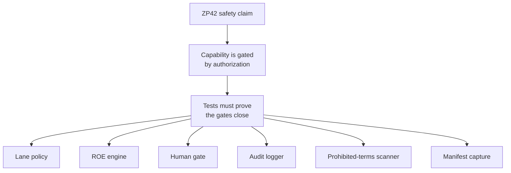

The plan explicitly distinguishes **implemented-and-tested** behaviour from **specified-but-not-yet-built** behaviour, so that no reader mistakes an aspiration for a guarantee.

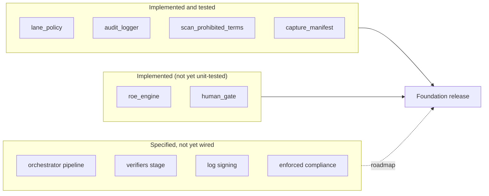

### 1.2 What this plan does not cover

Inference execution, model training or weight downloads, exploit or offensive code, and live targeting of third-party systems are **out of scope** for the Foundation phase and therefore have no runtime tests — there is nothing of that kind to test, by design.

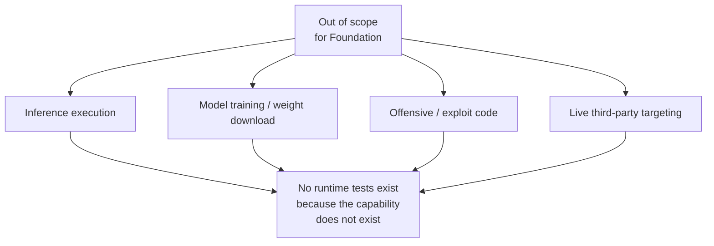

---

## 2. Test Philosophy

### 2.1 Fail-closed is the default assertion

Every governance test is written to confirm that an uncertain or under-authorized state resolves to denial, never to permission. A test that merely shows the "happy path" is insufficient; the authoritative test is the one that shows the gate refuses.

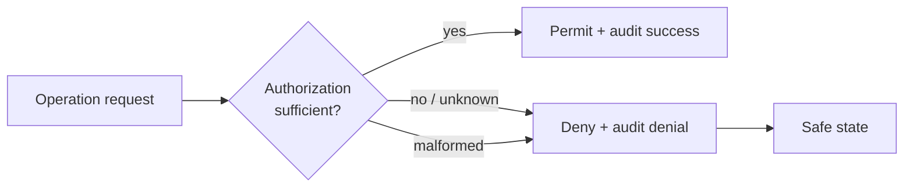

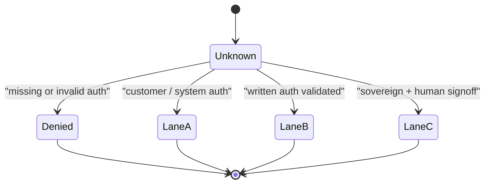

### 2.2 Governance-first, not bolted on

The lessons recorded in the Foundation charter — governance built in from day one, explicit and verifiable authorization, no autonomous escalation, mandatory human oversight for sensitive operations — map directly to test obligations. Each principle has at least one unit test that would fail if the principle were violated.

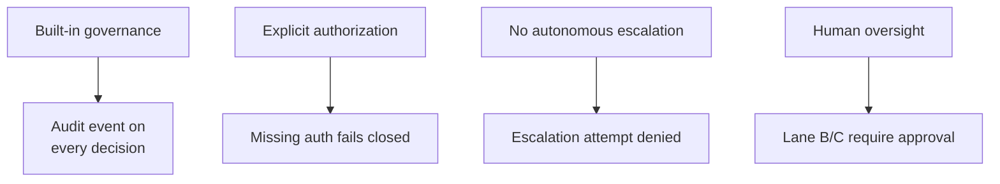

### 2.3 Determinism and isolation

Governance tests must be deterministic and must not touch shared state. Every test that writes audit events does so into a fresh temporary directory, so runs are repeatable and parallel-safe.

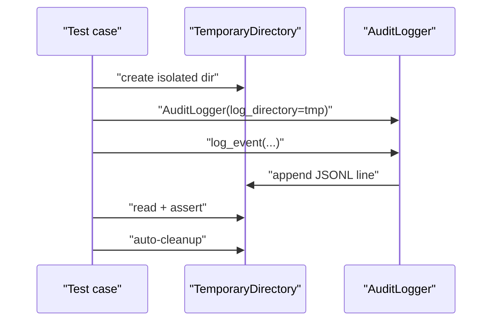

---

## 3. Test Taxonomy

### 3.1 The ZP42 test pyramid today

Today the codebase is almost entirely **unit tests** over the governance modules. Integration and end-to-end layers are intentionally thin because the pipeline that would connect the modules is still a scaffold.

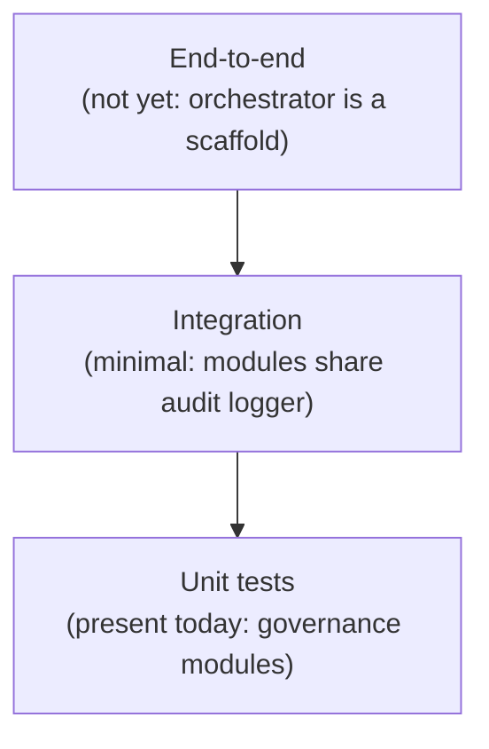

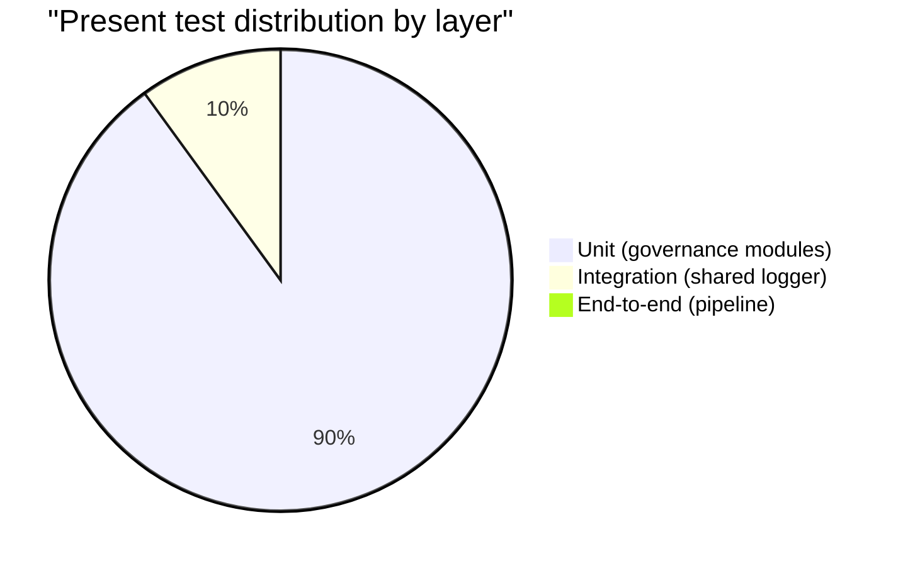

### 3.2 Categories of unit test

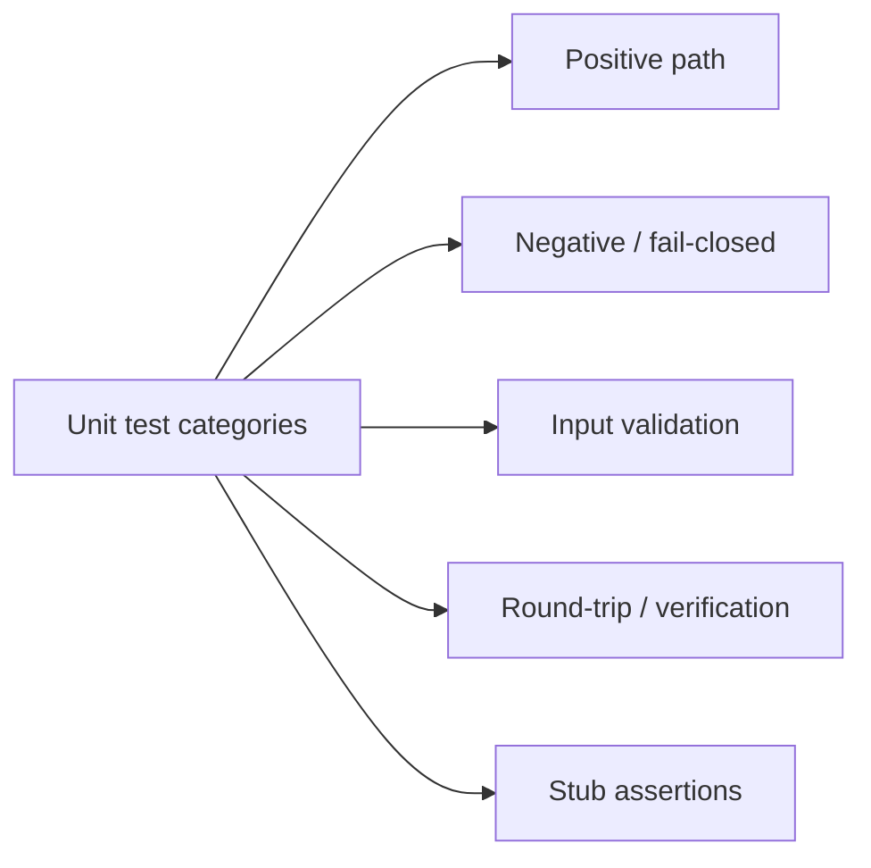

Positive-path tests confirm an authorized action succeeds and is logged; negative tests confirm refusal; validation tests confirm malformed enums raise errors; round-trip tests confirm a manifest verifies against itself; stub tests confirm that not-yet-implemented features honestly report `not_implemented` rather than silently appearing to work.

---

## 4. Test Environment and Tooling

### 4.1 Runner and commands

Tests are Python 3.11+ and run under `pytest`. The repository's documented validation sequence compiles all modules, runs the suite, and scans for prohibited terms.

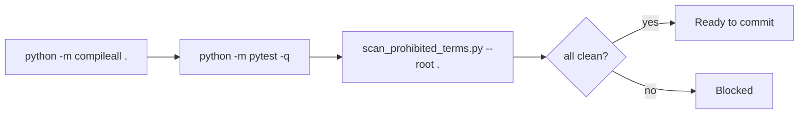

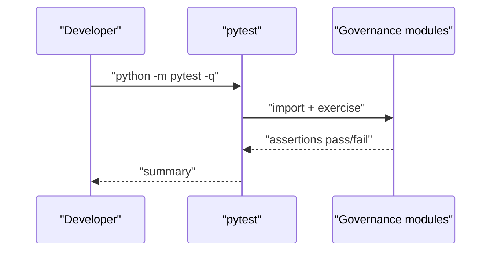

### 4.2 Concurrency discipline

Test and build parallelism is capped to keep the workstation responsive; the suite is small and I/O-light, so a bounded worker count is sufficient.

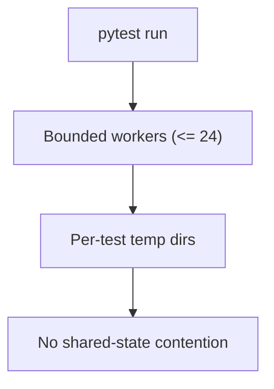

### 4.3 Fixtures

The dominant fixture is Python's `tempfile.TemporaryDirectory`, used to give each audit-writing test its own log directory. The scanner tests likewise synthesize throwaway files containing known terms.

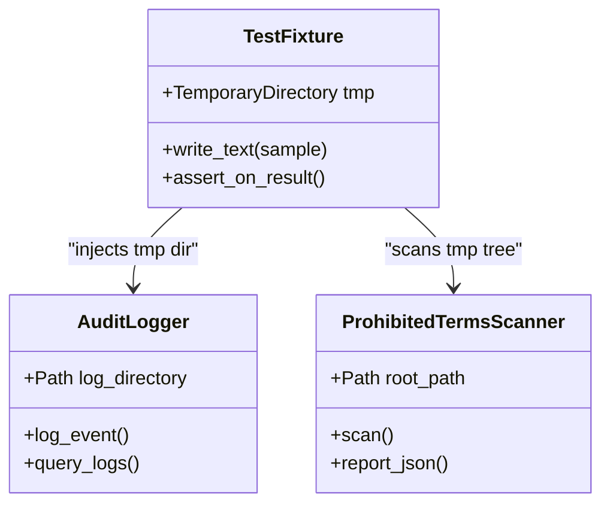

---

## 5. Module Under Test — Audit Logger

### 5.1 Responsibility

`governance/audit_logger.py` writes an append-only JSONL evidence record. It validates the `operation_type`, `lane`, `actor_type`, and `result` enumerations before writing, stamps an ISO 8601 UTC timestamp and a UUID4 event id, and appends one JSON object per line. It is the shared sink every other governance module calls.

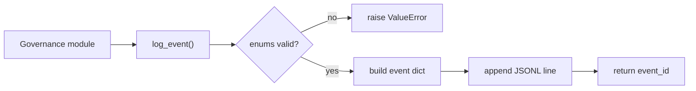

### 5.2 Event shape

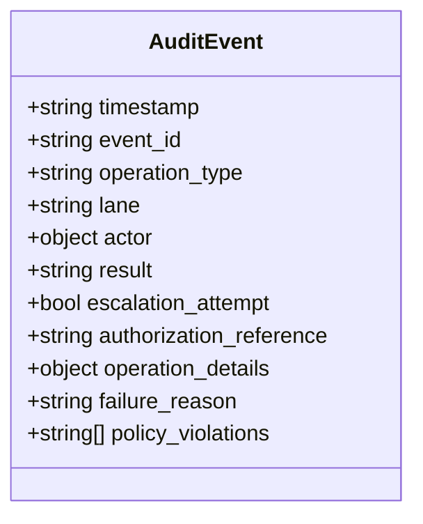

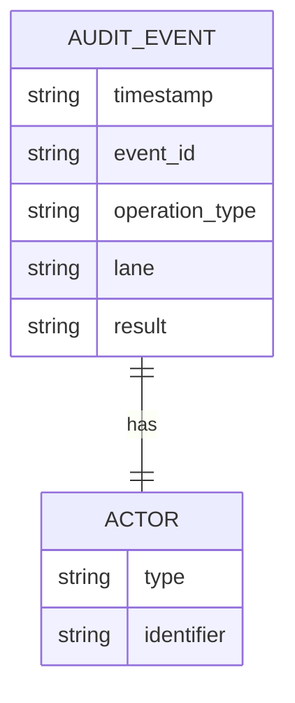

### 5.3 What is tested today

The suite in `tests/test_audit_logger.py` covers initialization, a successful event, a failure event with reason, an escalation event with policy violations, rejection of an invalid `operation_type`, rejection of an invalid `lane`, and a multi-event query with lane and operation-type filters.

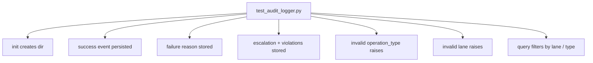

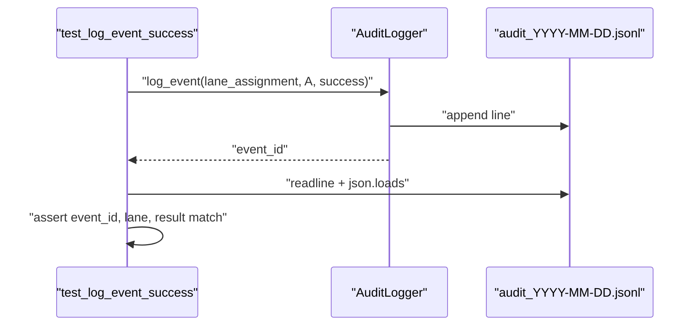

### 5.4 Validation matrix

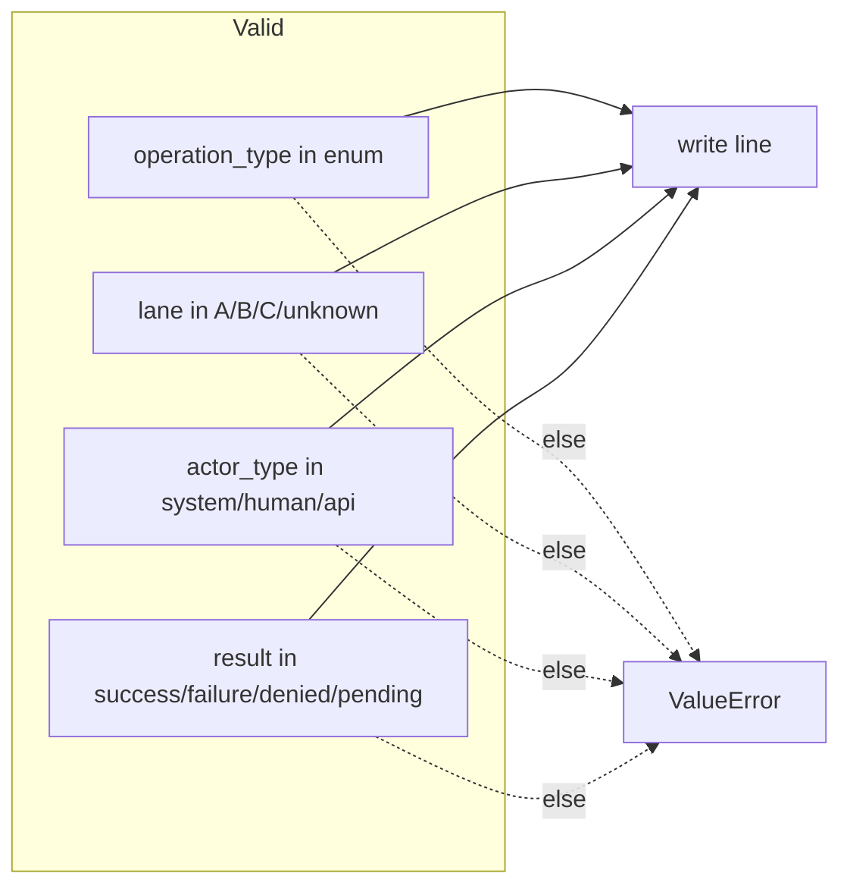

| Test | Asserts | Failure mode guarded |
|------|---------|----------------------|
| `test_audit_logger_initialization` | log dir created, log file under it | silent misconfiguration |
| `test_log_event_success` | fields round-trip from file | data loss / corruption |
| `test_log_event_with_failure` | `failure_reason` persisted | denials not recorded |
| `test_log_event_with_escalation` | `escalation_attempt`, `policy_violations` | escalation unrecorded |
| `test_invalid_operation_type` | raises `ValueError` | junk events accepted |
| `test_invalid_lane` | raises `ValueError` | invalid lane recorded |
| `test_query_logs` | filtered counts correct | query returns wrong set |

### 5.5 Honest limitations

The log is **plain JSONL and is not cryptographically signed**; there is therefore no test for tamper-evidence, because that property is not yet implemented. Retention is declared in `audit_schema.json` but not enforced in code, and the production storage location is an explicit `TODO`.

```mermaid
flowchart TD
    Now["Today: append-only JSONL"] --> NoSign["No signature / hash chain"]
    NoSign --> Future["Roadmap: tamper-evident chain"]
    Now --> NoRetain["Retention declared, not enforced"]
    NoRetain --> Future2["Roadmap: enforced retention"]
```

---

## 6. Module Under Test — Lane Policy

### 6.1 Responsibility

`orchestrator/lanes/lane_policy.py` assigns an operation to Lane A (defensive, owner-authorized), Lane B (active-defence, requiring validated written authorization), or Lane C (sovereign-authorized, requiring both sovereign authorization and human signoff), and fails closed to `UNKNOWN` when authorization is absent or insufficient. A lane is entered deliberately; it is not a default that widens.

```mermaid
flowchart TD
    Start["assign_lane()"] --> Ref{"auth reference present?"}
    Ref -->|"no"| U["log denied + raise ValueError"]
    Ref -->|"yes"| Sov{"sovereign + signoff?"}
    Sov -->|"both"| C["Lane C"]
    Sov -->|"sovereign only"| U2["deny: needs human signoff"]
    Sov -->|"neither"| AD{"active-defence keywords?"}
    AD -->|"yes"| W{"written-auth format valid?"}
    W -->|"yes"| B["Lane B"]
    W -->|"no"| U3["deny: needs written auth"]
    AD -->|"no"| A["Lane A"]
```

```mermaid
stateDiagram-v2
    [*] --> Evaluating
    Evaluating --> A: "defensive + auth ref"
    Evaluating --> B: "active-defence + AUTH-/SOW-/CONTRACT- ref"
    Evaluating --> C: "sovereign + human signoff"
    Evaluating --> Unknown: "missing / invalid"
    Unknown --> [*]: "raise ValueError"
```

### 6.2 Classification detail

Active-defence classification is Foundation-grade keyword matching (`deception`, `honeypot`, `honeytoken`, `threat_hunting`, `controlled_engagement`, `attribution`), and written-authorization validation checks a minimum length and an approved prefix (`AUTH-`, `WRITTEN-AUTH-`, `CONTRACT-`, `SOW-`). Both are documented as deliberately simple and slated for stronger implementations later.

```mermaid
flowchart LR
    Desc["operation_description"] --> KW{"contains active-defence keyword?"}
    KW -->|"yes"| LaneBpath["active-defence path"]
    KW -->|"no"| LaneApath["defensive path"]
    Ref["authorization_reference"] --> Len{"length >= 10?"}
    Len -->|"no"| Bad["invalid"]
    Len -->|"yes"| Pre{"approved prefix?"}
    Pre -->|"yes"| Good["valid written auth"]
    Pre -->|"no"| Bad
```

```mermaid
classDiagram
    class Lane {
        <<enum>>
        A
        B
        C
        UNKNOWN
    }
    class LanePolicy {
        +AuditLogger audit_logger
        +assign_lane()
        +validate_lane_authorization()
        -_is_active_defense_operation()
        -_validate_written_authorization()
    }
    LanePolicy --> Lane : "returns"
```

### 6.3 What is tested today

`tests/test_lane_policy.py` covers assignment to A, B, and C; fail-closed on missing authorization; fail-closed on sovereign authorization lacking human signoff; rejection of active-defence with a too-short authorization reference; successful validation for a known lane; and rejection of validation for `UNKNOWN`.

```mermaid
flowchart TD
    TLP["test_lane_policy.py"] --> A["assign Lane A (defensive)"]
    TLP --> B["assign Lane B (honeypot + AUTH-...)"]
    TLP --> C["assign Lane C (sovereign + signoff)"]
    TLP --> D["no auth -> ValueError"]
    TLP --> E["sovereign w/o signoff -> ValueError"]
    TLP --> F["active-defence + SHORT ref -> ValueError"]
    TLP --> G["validate known lane -> True"]
    TLP --> H["validate UNKNOWN -> ValueError"]
```

```mermaid
sequenceDiagram
    participant T as "test_assign_lane_active_defense"
    participant P as "LanePolicy"
    participant AL as "AuditLogger"
    T->>P: "assign_lane('Deploy honeypot...', 'AUTH-2026-05-18-001')"
    P->>P: "_is_active_defense_operation -> true"
    P->>P: "_validate_written_authorization -> true"
    P->>AL: "log_event(lane_assignment, B, success)"
    P-->>T: "Lane.B"
    T->>T: "assert lane == Lane.B"
```

### 6.4 Fail-closed negative tests

```mermaid
flowchart LR
    N1["auth = None"] --> R1["ValueError: Authorization reference required"]
    N2["sovereign, signoff=False"] --> R2["ValueError: Lane C requires both"]
    N3["honeypot + 'SHORT'"] --> R3["ValueError: requires written authorization"]
    N4["validate UNKNOWN"] --> R4["ValueError: cannot validate unknown lane"]
```

| Scenario | Expected | Why it matters |
|----------|----------|----------------|
| No authorization reference | `ValueError`, `UNKNOWN` logged | prevents silent permission |
| Sovereign without signoff | `ValueError` | human oversight for Lane C |
| Active-defence, malformed ref | `ValueError` | written-auth requirement for Lane B |
| Validate on `UNKNOWN` | `ValueError` | no authorization on unassigned work |

---

## 7. Module Under Test — ROE Engine

### 7.1 Responsibility

`orchestrator/roe/roe_engine.py` encodes the bounds of permitted action as policy. It rejects a set of **globally prohibited capabilities** in every lane, applies lane-specific restrictions, lists the permitted capabilities per lane, and **denies all lane-escalation attempts** in the Foundation phase, logging each one as a policy violation.

```mermaid
flowchart TD
    Req["check_roe(lane, capability)"] --> G{"globally prohibited?"}
    G -->|"yes"| D1["log denied + raise ROEViolation"]
    G -->|"no"| LU{"lane == UNKNOWN?"}
    LU -->|"yes"| D2["deny: unknown lane"]
    LU -->|"no"| LA{"Lane A restricted set?"}
    LA -->|"hit"| D3["deny: requires Lane B/C"]
    LA -->|"miss"| LB{"Lane B restricted set?"}
    LB -->|"hit"| D4["deny: requires Lane C"]
    LB -->|"miss"| OK["log success + return True"]
```

```mermaid
flowchart LR
    GP["Globally prohibited (all lanes)"] --> M["malware_creation / deployment"]
    GP --> Cr["credential_theft / harvesting"]
    GP --> Dd["ddos_generation"]
    GP --> Ex["data_exfiltration_unauthorized"]
    GP --> Pe["persistence_installation"]
    GP --> Ev["evasion_technique"]
    GP --> De["destructive_payload"]
    GP --> Au["autonomous_retaliation"]
    GP --> Hb["hack_back"]
    GP --> Ut["unauthorized_third_party_targeting"]
```

### 7.2 Lane-scoped permissions

```mermaid
stateDiagram-v2
    [*] --> A
    A --> B: "escalation denied in Foundation"
    B --> C: "escalation denied in Foundation"
    note right of A
        Lane A: defensive analysis only
    end note
    note right of B
        Lane B: deception / honeypot / threat hunting
    end note
    note right of C
        Lane C: sovereign-authorized, still bounded by global prohibitions
    end note
```

```mermaid
flowchart TD
    subgraph LaneA["Lane A permitted"]
        A1["vulnerability_assessment"]
        A2["defensive_analysis"]
        A3["security_config_review"]
        A4["compliance_checking"]
        A5["threat_modeling"]
    end
    subgraph LaneB["Lane B adds"]
        B1["deception_deployment"]
        B2["honeypot_deployment"]
        B3["threat_hunting"]
        B4["controlled_engagement"]
        B5["attribution_support"]
    end
    subgraph LaneC["Lane C"]
        C1["sovereign_authorized_operations"]
    end
```

```mermaid
classDiagram
    class ROEEngine {
        +set GLOBALLY_PROHIBITED_CAPABILITIES
        +check_roe()
        +get_permitted_capabilities()
        +validate_escalation_attempt()
    }
    class ROEViolation {
        <<exception>>
    }
    ROEEngine ..> ROEViolation : "raises"
```

### 7.3 Escalation handling

Any request to move from one lane to a different lane is denied and logged with `escalation_attempt=True` and a `unauthorized_lane_escalation` violation. Only a no-op "escalation" to the same lane returns true.

```mermaid
sequenceDiagram
    participant Caller
    participant ROE as "ROEEngine"
    participant AL as "AuditLogger"
    Caller->>ROE: "validate_escalation_attempt(A, C)"
    ROE->>AL: "log escalation_attempt=True, violation"
    ROE-->>Caller: "raise ROEViolation"
    Caller->>ROE: "validate_escalation_attempt(A, A)"
    ROE-->>Caller: "True (no-op)"
```

### 7.4 Test posture

The ROE engine's behaviour is deterministic and its branches are small and explicit, which makes them straightforward to exercise. The authoritative assertions are that a globally prohibited capability raises `ROEViolation` regardless of lane, that `UNKNOWN` can execute nothing, and that cross-lane escalation always raises.

```mermaid
flowchart LR
    V1["prohibited capability, any lane"] --> E1["ROEViolation"]
    V2["Lane A asks deception"] --> E2["ROEViolation: needs B/C"]
    V3["Lane B asks offensive_operation"] --> E3["ROEViolation: needs C"]
    V4["escalate A->C"] --> E4["ROEViolation + logged"]
    V5["permitted capability in lane"] --> OK["True + success log"]
```

---

## 8. Module Under Test — Human Gate

### 8.1 Responsibility

`orchestrator/human_gate/human_gate.py` interposes required human authorization at decision points. It decides whether a given lane and operation need approval, creates a pending request with a UUID, and records approval or denial — each with an audit event. Lane B requires review for every active-defence deployment; Lane C requires approval for every operation; `UNKNOWN` fails closed to requiring approval; Lane A requires approval only for a defined set of sensitive operations.

```mermaid
flowchart TD
    Op["requires_human_approval(lane, op)"] --> A{"Lane A?"}
    A -->|"yes"| S{"sensitive op?"}
    S -->|"yes"| Y1["approval required"]
    S -->|"no"| N1["no approval"]
    A -->|"no"| B{"Lane B?"}
    B -->|"yes"| Y2["approval required"]
    B -->|"no"| C{"Lane C?"}
    C -->|"yes"| Y3["approval required"]
    C -->|"no"| UK{"UNKNOWN?"}
    UK -->|"yes"| Y4["approval required (fail closed)"]
```

```mermaid
stateDiagram-v2
    [*] --> PENDING
    PENDING --> APPROVED: "approve_operation()"
    PENDING --> DENIED: "deny_operation()"
    PENDING --> EXPIRED: "(defined, not yet triggered)"
    APPROVED --> [*]
    DENIED --> [*]
    EXPIRED --> [*]
```

### 8.2 Request lifecycle

```mermaid
sequenceDiagram
    participant Sys as "Requesting component"
    participant HG as "HumanGate"
    participant H as "Human approver"
    participant AL as "AuditLogger"
    Sys->>HG: "request_approval(...)"
    HG->>AL: "log human_gate_request (pending)"
    HG-->>Sys: "approval_request_id"
    H->>HG: "approve_operation(id, approver)"
    HG->>AL: "log human_gate_approval (success)"
    HG-->>H: "True"
```

```mermaid
classDiagram
    class HumanGate {
        +dict _pending_approvals
        +requires_human_approval()
        +request_approval()
        +approve_operation()
        +deny_operation()
        +get_approval_status()
    }
    class ApprovalStatus {
        <<enum>>
        PENDING
        APPROVED
        DENIED
        EXPIRED
    }
    HumanGate --> ApprovalStatus : "tracks"
```

### 8.3 Idempotency and error paths

Approving or denying an unknown request id raises `ValueError`; re-processing an already-resolved request raises `ValueError` as well. These guards prevent a decision from being silently overwritten.

```mermaid
flowchart LR
    Act["approve / deny"] --> Exist{"id known?"}
    Exist -->|"no"| E1["ValueError: not found"]
    Exist -->|"yes"| State{"status == PENDING?"}
    State -->|"no"| E2["ValueError: already processed"]
    State -->|"yes"| Do["update + audit"]
```

### 8.4 Honest limitation

Approval tracking is **in-memory** for the Foundation phase; there is no persistence across process restarts, and `EXPIRED` is a defined status without an expiry trigger yet. Tests therefore exercise the single-process lifecycle only.

```mermaid
flowchart TD
    Mem["In-memory _pending_approvals"] --> Loss["Lost on restart"]
    Loss --> Road["Roadmap: persistent store"]
    Exp["EXPIRED defined"] --> NoTrig["No expiry clock yet"]
    NoTrig --> Road
```

---

## 9. Module Under Test — Prohibited-Terms Scanner

### 9.1 Responsibility

`scripts/scan_prohibited_terms.py` guards the public boundary. It scans source files for four categories of disallowed text — internal codenames, third-party AI/tool names, PRC-origin model names, and reckless public terms such as "hack-back" — skipping build and cache directories, and exits non-zero when any violation is found so it can serve as a pre-commit gate.

```mermaid
flowchart TD
    Root["--root path"] --> Iter["iterate scannable files"]
    Iter --> Skip{"in skip dir?"}
    Skip -->|"yes"| Next["ignore"]
    Skip -->|"no"| Ext{"scannable extension?"}
    Ext -->|"no"| Next
    Ext -->|"yes"| Line["scan each line (lowercased)"]
    Line --> Cat["match 4 categories"]
    Cat --> Rec["record violations"]
    Rec --> Exit{"count > 0?"}
    Exit -->|"yes"| NZ["exit 1"]
    Exit -->|"no"| Z["exit 0"]
```

```mermaid
flowchart LR
    C["Categories"] --> C1["prohibited_internal_name"]
    C --> C2["prohibited_third_party_name"]
    C --> C3["prohibited_prc_model_name"]
    C --> C4["prohibited_public_term"]
```

### 9.2 Scanned surface

```mermaid
flowchart TD
    subgraph Scanned["Extensions scanned"]
        py[".py"]
        md[".md"]
        txt[".txt"]
        json[".json"]
        yaml[".yaml / .yml"]
        toml[".toml"]
        sh[".sh"]
        rst[".rst"]
    end
    subgraph Skipped["Directories skipped"]
        pc["__pycache__"]
        git[".git"]
        pt[".pytest_cache"]
        nm["node_modules"]
        venv["venv / .venv"]
        bd["build / dist"]
    end
```

### 9.3 What is tested today

`tests/test_prohibited_terms.py` confirms clean files pass, that a PRC model name, a third-party tool name, and a reckless public term are each detected with the correct category, that excluded directories are skipped, that the JSON report marks `failed` with a count, that the human-readable report reports a clean tree, and that multiple violations in one file are all counted.

```mermaid
flowchart TD
    TP["test_prohibited_terms.py"] --> A["init: zero violations"]
    TP --> B["clean file: 0"]
    TP --> C["detects PRC name + category"]
    TP --> D["detects third-party name + category"]
    TP --> E["detects public term + category"]
    TP --> F["skips __pycache__"]
    TP --> G["json report: failed + count"]
    TP --> H["text report: clean message"]
    TP --> I["multiple violations counted"]
```

```mermaid
sequenceDiagram
    participant T as "test_scanner_detects_public_term"
    participant Sc as "ProhibitedTermsScanner"
    T->>Sc: "write file with 'hack-back'"
    T->>Sc: "scan()"
    Sc-->>T: "violation_count > 0"
    T->>T: "assert category == prohibited_public_term"
```

### 9.4 Report shapes

```mermaid
classDiagram
    class ScanReport {
        +string status
        +int violation_count
        +Violation[] violations
    }
    class Violation {
        +string file
        +int line
        +string term
        +string category
    }
    ScanReport --> Violation : "contains"
```

```mermaid
flowchart LR
    R["report_json()"] --> St{"violations?"}
    St -->|"yes"| F["status = failed"]
    St -->|"no"| P["status = passed"]
```

---

## 10. Module Under Test — Snapshot Manifest Capture

### 10.1 Responsibility

`core/snapshot/capture_manifest.py` captures SHA-256 checksums for local files and directories and verifies files against a stored manifest, supporting reproducibility. Model-manifest capture is an explicit stub that returns `not_implemented` — no Hugging Face downloads occur in the Foundation phase.

```mermaid
flowchart TD
    Dir["capture_directory_manifest(dir)"] --> Walk["rglob files"]
    Walk --> Hash["sha256 each file"]
    Hash --> Build["manifest{version, algorithm, files}"]
    Build --> Opt{"output path?"}
    Opt -->|"yes"| Write["write manifest.json"]
    Opt -->|"no"| Ret["return dict"]
```

```mermaid
flowchart LR
    Ver["verify_manifest(manifest, dir)"] --> Each["for each recorded file"]
    Each --> Miss{"file exists?"}
    Miss -->|"no"| M["missing_files += ; status=failed"]
    Miss -->|"yes"| Cmp{"sha256 matches?"}
    Cmp -->|"no"| Mm["mismatches += ; status=failed"]
    Cmp -->|"yes"| Okk["keep verified"]
```

### 10.2 What is tested today

`tests/test_capture_manifest.py` covers hashing a file (asserting a 64-hex SHA-256 digest), raising `FileNotFoundError` for a missing file, capturing a three-file tree including a subdirectory path, writing the manifest to disk, a successful verification, a verification that fails after a file is modified, and the model-manifest stub returning `not_implemented`.

```mermaid
flowchart TD
    TC["test_capture_manifest.py"] --> A["hash_file -> 64 hex chars"]
    TC --> B["missing file -> FileNotFoundError"]
    TC --> C["manifest has 3 files incl subdir"]
    TC --> D["manifest written to disk"]
    TC --> E["verify success: no mismatches"]
    TC --> F["modify file -> verify failed"]
    TC --> G["model stub -> not_implemented"]
```

```mermaid
sequenceDiagram
    participant T as "test_verify_manifest_mismatch"
    participant C as "ManifestCapture"
    T->>C: "capture_directory_manifest(dir, out)"
    T->>T: "modify file content"
    T->>C: "verify_manifest(out, dir)"
    C-->>T: "status = failed, 1 mismatch"
```

```mermaid
classDiagram
    class ManifestCapture {
        +hash_file()
        +capture_directory_manifest()
        +verify_manifest()
        +capture_model_manifest_stub()
    }
    class Manifest {
        +string manifest_version
        +string algorithm
        +map files
    }
    ManifestCapture --> Manifest : "produces"
```

---

## 11. What Is Tested Today — Coverage Matrix

### 11.1 Module-to-suite map

```mermaid
flowchart LR
    M1["audit_logger"] --> S1["test_audit_logger.py"]
    M2["lane_policy"] --> S2["test_lane_policy.py"]
    M3["scan_prohibited_terms"] --> S3["test_prohibited_terms.py"]
    M4["capture_manifest"] --> S4["test_capture_manifest.py"]
    M5["roe_engine"] -.-> N1["no dedicated suite yet"]
    M6["human_gate"] -.-> N2["no dedicated suite yet"]
```

| Module | Dedicated unit suite | Status |
|--------|----------------------|--------|
| `governance/audit_logger.py` | `test_audit_logger.py` | tested |
| `orchestrator/lanes/lane_policy.py` | `test_lane_policy.py` | tested |
| `scripts/scan_prohibited_terms.py` | `test_prohibited_terms.py` | tested |
| `core/snapshot/capture_manifest.py` | `test_capture_manifest.py` | tested |
| `orchestrator/roe/roe_engine.py` | — | implemented; direct suite is a gap |
| `orchestrator/human_gate/human_gate.py` | — | implemented; direct suite is a gap |

### 11.2 Honest reading of the matrix

Four governance modules have dedicated, passing unit suites. The ROE engine and the human gate are implemented and are exercised indirectly whenever other paths log through the shared audit logger, but they do not yet have their **own** dedicated test files; closing that gap is a near-term priority of this plan rather than a claim of present coverage.

```mermaid
flowchart TD
    Have["Dedicated suites: 4 modules"] --> Strong["Audit, lane, scanner, manifest"]
    Gap["Dedicated suites missing: 2 modules"] --> Need["ROE engine, human gate"]
    Need --> Action["Priority: add test_roe_engine.py, test_human_gate.py"]
```

### 11.3 Shared-logger integration surface

```mermaid
flowchart LR
    LP["LanePolicy"] --> AL["get_audit_logger()"]
    RE["ROEEngine"] --> AL
    HG["HumanGate"] --> AL
    AL --> File["JSONL evidence record"]
```

---

## 12. Conformance Testing

### 12.1 Schema conformance

Audit events are expected to conform to `governance/audit_schema.json`, which enumerates the valid `operation_type`, `lane`, `actor_type`, and `result` values and marks required fields. The logger's inline enum validation is the first line of conformance; a schema-validation test that loads the JSON Schema and checks each emitted event against it is a defined next step.

```mermaid
flowchart TD
    Ev["emitted event"] --> Inline["logger enum checks"]
    Inline --> Future["planned: validate vs audit_schema.json"]
    Future --> Conf{"conforms?"}
    Conf -->|"yes"| Pass["accept"]
    Conf -->|"no"| Fail["reject"]
```

```mermaid
erDiagram
    SCHEMA ||--o{ EVENT : "constrains"
    SCHEMA {
        string schema_version
        string format
    }
    EVENT {
        string operation_type
        string lane
        string result
    }
```

### 12.2 Compliance manifest conformance

`compliance/model_allowlist.json` declares approved models (AI2 OLMo 3 32B Base, AI2 OLMo 3 32B Think, IBM Granite 4.1 30B Base) and prohibited origins, and `compliance/license_manifest.json` declares licence provenance. These are **machine-readable declarations that are not yet enforced in code**; conformance today means the manifests are well-formed and internally consistent, not that a runtime path blocks a disallowed model.

```mermaid
flowchart LR
    AM["model_allowlist.json"] --> Dec["declared allow / deny"]
    LM["license_manifest.json"] --> Dec2["declared licences"]
    Dec --> Today["today: declaration only"]
    Dec2 --> Today
    Today --> Road["roadmap: enforced at load / use"]
```

```mermaid
flowchart TD
    Allow["Approved models"] --> A1["AI2 OLMo 3 32B Base"]
    Allow --> A2["AI2 OLMo 3 32B Think"]
    Allow --> A3["IBM Granite 4.1 30B Base"]
    Deny["Declared prohibited origins"] --> D1["PRC-origin families"]
    Deny --> D2["enforcement: fail_closed (declared)"]
```

### 12.3 Conformance test ladder

```mermaid
stateDiagram-v2
    [*] --> Wellformed
    Wellformed --> Consistent: "JSON parses, fields present"
    Consistent --> Enforced: "roadmap: runtime checks"
    Enforced --> [*]
    note right of Enforced
        Not yet implemented
    end note
```

### 12.4 Boundary conformance via the scanner

The prohibited-terms scanner is itself a conformance control: it enforces that the public vocabulary of the repository stays within the approved language (defensive, active-defence, sovereign-authorized) and excludes reckless or disallowed terms. Its tests are, in effect, conformance tests for the project's public positioning.

```mermaid
flowchart LR
    Repo["repository text"] --> Scan["scan_prohibited_terms"]
    Scan --> Conf{"approved vocabulary?"}
    Conf -->|"yes"| Clean["exit 0"]
    Conf -->|"no"| Dirty["exit 1 + report"]
```

---

## 13. Gaps and Not-Yet-Tested Surfaces

### 13.1 The unwired pipeline

The end-to-end orchestrator that would sequence lane → ROE → human gate → verify → audit is **not yet implemented** (`orchestrator/__init__.py` is an empty scaffold). There is consequently no end-to-end test; the modules are validated independently, and their composition is a specification rather than a running path.

```mermaid
flowchart LR
    Lane["Lane policy"] -.->|"not wired"| Roe["ROE engine"]
    Roe -.->|"not wired"| Gate["Human gate"]
    Gate -.->|"not wired"| Verify["Verifier stage (defined only)"]
    Verify -.->|"not wired"| Audit["Audit logger"]
    style Verify stroke-dasharray: 5 5
```

```mermaid
sequenceDiagram
    participant Op as "Operation (future)"
    participant L as "Lane policy"
    participant R as "ROE engine"
    participant H as "Human gate"
    participant V as "Verifier (defined)"
    participant A as "Audit logger"
    Note over Op,A: "Specified sequence; not yet executed end-to-end"
    Op-->>L: "assign lane"
    L-->>R: "check ROE"
    R-->>H: "require approval"
    H-->>V: "verify output"
    V-->>A: "record evidence"
```

### 13.2 The verifier stage

`verifiers/` is a **defined stage, not a completed output verifier**. No validation logic is implemented and therefore none is tested.

```mermaid
flowchart TD
    Vdef["verifiers/ defined"] --> NoLogic["no validation logic yet"]
    NoLogic --> NoTest["no verifier tests yet"]
    NoTest --> Road["roadmap: output verification + its tests"]
```

### 13.3 Untested security properties

```mermaid
flowchart LR
    G1["Audit log tamper-evidence"] --> U1["no signing -> no test"]
    G2["Compliance enforcement"] --> U2["declared -> no runtime test"]
    G3["Approval persistence"] --> U3["in-memory -> no durability test"]
    G4["ROE + human gate direct suites"] --> U4["indirect only today"]
```

### 13.4 Prioritized closure order

```mermaid
flowchart TD
    P1["1. Add test_roe_engine.py"] --> P2["2. Add test_human_gate.py"]
    P2 --> P3["3. Schema-validate emitted events"]
    P3 --> P4["4. Manifest well-formedness tests"]
    P4 --> P5["5. Integration test once pipeline exists"]
    P5 --> P6["6. Tamper-evidence tests when signing lands"]
```

---

## 14. Validation and CI Flow

### 14.1 Local gate

The documented local sequence is a three-stage gate: compile, test, scan. All three must pass before a change is considered ready, and the prohibited-terms scanner's non-zero exit makes it a hard gate rather than an advisory check.

```mermaid
flowchart LR
    Edit["change"] --> Compile["compileall"]
    Compile --> Test["pytest -q"]
    Test --> Scan["scan_prohibited_terms"]
    Scan --> Decide{"all green?"}
    Decide -->|"yes"| Ready["commit candidate"]
    Decide -->|"no"| Fix["fix + repeat"]
```

```mermaid
stateDiagram-v2
    [*] --> Compile
    Compile --> Test: "pass"
    Compile --> Blocked: "import error"
    Test --> Scan: "pass"
    Test --> Blocked: "assertion fail"
    Scan --> Ready: "no prohibited terms"
    Scan --> Blocked: "violation"
    Blocked --> [*]
    Ready --> [*]
```

### 14.2 Pre-commit intent

The scanner is designed to run as a pre-commit hook so that disallowed vocabulary never reaches history. CI integration for automated per-PR checks is noted in the charter as a future addition.

```mermaid
flowchart TD
    Commit["git commit"] --> Hook["pre-commit: scan_prohibited_terms"]
    Hook --> Pass{"clean?"}
    Pass -->|"yes"| Proceed["commit proceeds"]
    Pass -->|"no"| Reject["commit blocked"]
```

### 14.3 Evidence trail from the suite

Because the governance modules log through the audit logger, a test run that exercises them also produces a representative evidence trail in its temporary directories, which doubles as a sanity check that logging is wired at the call sites.

```mermaid
sequenceDiagram
    participant Suite as "Test suite"
    participant Mods as "Governance modules"
    participant Log as "AuditLogger (tmp)"
    Suite->>Mods: "exercise decisions"
    Mods->>Log: "log_event per decision"
    Suite->>Log: "optional: assert evidence shape"
```

---

## 15. Test Roadmap

### 15.1 Phased growth

Testing grows with the system. As later phases add model-evaluation infrastructure, defensive reasoning, and — under appropriate authorization — active-defence and sovereign-authorized workflows, each new capability arrives with its own fail-closed tests before it is enabled.

```mermaid
flowchart LR
    Ph1["Phase 1: Foundation<br/>governance unit tests"] --> Ph2["Phase 2: eval infra<br/>controlled-eval tests"]
    Ph2 --> Ph3["Phase 3: defensive reasoning<br/>capability tests"]
    Ph3 --> Ph4["Phase 4: active-defence<br/>authorization tests"]
    Ph4 --> Ph5["Phase 5: sovereign-authorized<br/>human-gate tests"]
```

```mermaid
stateDiagram-v2
    [*] --> Foundation
    Foundation --> EvalInfra
    EvalInfra --> Defensive
    Defensive --> ActiveDefence
    ActiveDefence --> Sovereign
    Sovereign --> [*]
    note right of Foundation
        Tests precede capability
    end note
```

### 15.2 Standing invariants to protect

```mermaid
flowchart TD
    Inv["Invariants every future test must preserve"] --> I1["uncertain state -> deny"]
    Inv --> I2["every decision is audited"]
    Inv --> I3["escalation is denied"]
    Inv --> I4["global prohibitions hold in all lanes"]
    Inv --> I5["human gate required where specified"]
```

### 15.3 Definition of done for a governance change

```mermaid
flowchart LR
    Change["governance change"] --> D1["positive test"]
    Change --> D2["fail-closed negative test"]
    Change --> D3["audit event asserted"]
    Change --> D4["scanner clean"]
    D1 --> Done["done"]
    D2 --> Done
    D3 --> Done
    D4 --> Done
```

### 15.4 Summary

ZP42's Foundation release ships governance modules that are implemented and unit-tested as independent components, with a disciplined, fail-closed test philosophy authored under the direction of inventor Naquib Hatami. The honest state is that four modules have dedicated suites, two more are implemented and awaiting dedicated suites, the orchestrator pipeline and verifier are specified rather than wired, and the audit and compliance machinery is declared rather than cryptographically or runtime-enforced. This plan names those gaps explicitly and orders their closure, so that growth in capability is always preceded by growth in the tests that keep that capability within authorization.

```mermaid
flowchart TD
    End["Foundation test posture"] --> E1["Tested today: 4 dedicated suites"]
    End --> E2["Implemented, suite pending: ROE, human gate"]
    End --> E3["Specified only: pipeline, verifier"]
    End --> E4["Declared only: signing, compliance enforcement"]
    E1 --> Honest["Stated plainly, no overstatement"]
    E2 --> Honest
    E3 --> Honest
    E4 --> Honest
```

---

## 16. Related Documents

Part of the ZP42 documentation set. See the following sibling documents:

- `../README.md` — project overview, architecture, and validation commands.
- `../LICENSE` — MIT licence (Naquib Hatami).
- `FOUNDATION.md` — project identity, charter status, model policy, and safety boundaries.
- `03-architecture.md` — lane model, ROE engine, human gate, and audit logging design.
- `09-compliance-allowlists.md` — model allowlist, licence manifest, and PRC-origin exclusion policy.
