*Part of the ZP42 documentation set*

# ZP42 Conformance Criteria

> **Abstract.** This document defines what it means for an implementation, a deployment, or a derivative of **ZP42 (Zeroth Protocol 42)** to *conform* to the ZP42 governance model. It establishes the normative reference for conformance, the vocabulary of obligation (MUST / SHOULD / MAY), the conformance classes and profiles, the per-component conformance criteria for the lane model, the rules-of-engagement (ROE) engine, the human gate, the audit logger, the compliance manifests, and the prohibited-terms scanner, and the evidence a claimant must produce. ZP42 is an open, MIT-licensed, governance-first cyber-reasoning system for defensive, active-defence, and sovereign-authorised workflows, invented and authored by **Naquib Hatami** (repository `github.com/iQs-Group/zp-42`, site `zp42.org`, published by SADI AI Inc. / iQs Group Inc.). This specification describes the architecture **as specified** and is scrupulous about separating what is **implemented** in the present Foundation-phase scaffold from what is **specified** for later phases. A conformance claim that overstates either is, by definition, non-conformant.

---

## 1. Introduction and Purpose

Conformance is the discipline that keeps a governance claim honest. ZP42's premise, set out by its inventor Naquib Hatami, is that a cyber-reasoning capability earns trust not from what it *can* do but from the authorisation controls that bound what it *is permitted* to do. A conformance criterion is therefore not a feature checklist; it is a statement of the obligations an implementation accepts so that an independent party can verify the bound exists and holds.

This document is the **normative reference** for those obligations. Where other documents in the ZP42 set describe intent, architecture, or rationale, this document states the testable requirements and the evidence that satisfies them. If a requirement here conflicts with a non-normative description elsewhere, the requirement here governs for the purpose of a conformance claim.

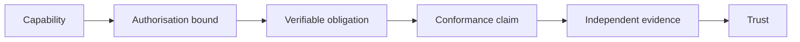

Three audiences use this document. **Implementers** read it to know which obligations their code must satisfy. **Assessors** read it to know what to test and what evidence to demand. **Operators and sovereign authorities** read it to understand exactly how much a ZP42 conformance claim does and does not promise at the current phase.

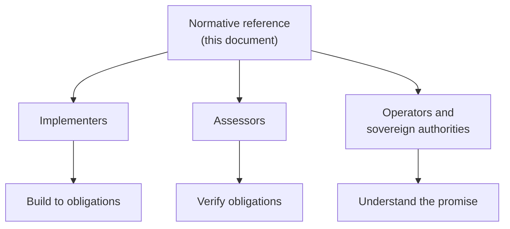

### 1.1 The honesty principle

A core rule governs every claim made against this document: **a conformance statement must not describe a control as enforced in code when it is specified but not yet wired.** The Foundation release is a scaffold. Its governance modules exist and are tested as independent components; the end-to-end pipeline that would chain them is not yet assembled. Conformance language must mirror that reality.

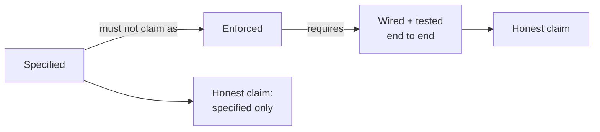

---

## 2. Normative References and Terminology

### 2.1 Obligation vocabulary

This document uses obligation keywords in the conventional sense. **MUST** / **MUST NOT** denote an absolute requirement; a claimant that fails one is non-conformant. **SHOULD** / **SHOULD NOT** denote a strong recommendation whose violation requires a documented justification. **MAY** denotes an optional capability that neither adds nor removes conformance.

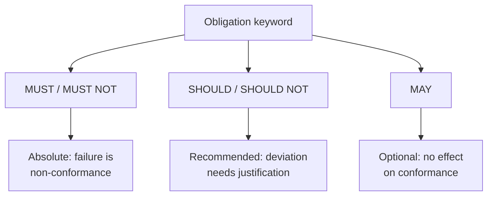

### 2.2 Normative artifacts

The following repository artifacts are normative inputs to a conformance assessment. A claimant MUST assess against the versions it ships, recorded by their declared version fields.

| Artifact | Path | Normative role |
|---|---|---|
| Foundation charter | `docs/FOUNDATION.md` | Phase scope, lane definitions, model policy |
| Lane policy engine | `orchestrator/lanes/lane_policy.py` | Lane assignment and fail-closed behaviour |
| ROE engine | `orchestrator/roe/roe_engine.py` | Permitted / prohibited capability bounds |
| Human gate | `orchestrator/human_gate/human_gate.py` | Human-in-the-loop obligations |
| Audit logger | `governance/audit_logger.py` | Evidence record |
| Audit schema | `governance/audit_schema.json` | Event field contract |
| Model allowlist | `compliance/model_allowlist.json` | Declared model policy |
| Licence manifest | `compliance/license_manifest.json` | Declared dependency licence policy |
| Prohibited-terms scanner | `scripts/scan_prohibited_terms.py` | Boundary term guard |

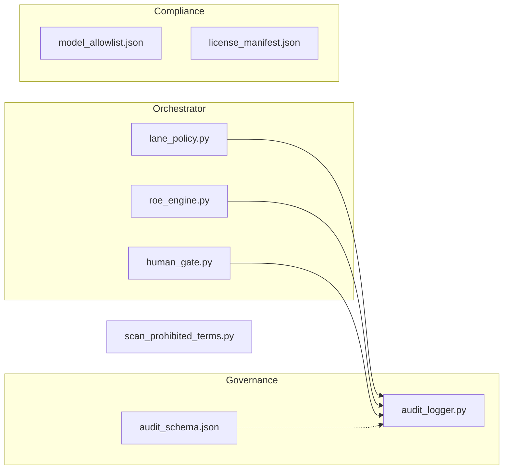

### 2.3 Terms

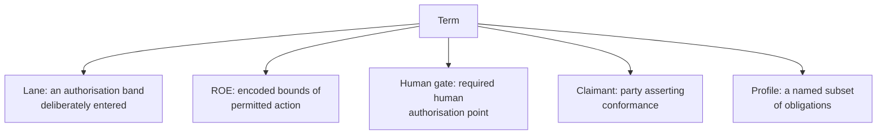

---

## 3. The Conformance Model

Conformance in ZP42 is **component-scoped and phase-aware**. A claimant does not simply assert "ZP42-conformant"; it names the components it implements, the profile it targets, and the phase of the specification it claims against. This prevents the common failure in which a partial implementation borrows the credibility of the whole.

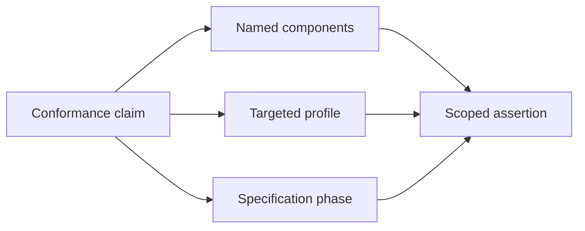

### 3.1 The conformance subject

The subject of a claim is one of: a **component** (a single governance module), a **deployment** (a configured operating instance), or a **derivative** (a fork or downstream system that embeds ZP42 modules). Each subject carries different evidence burdens.

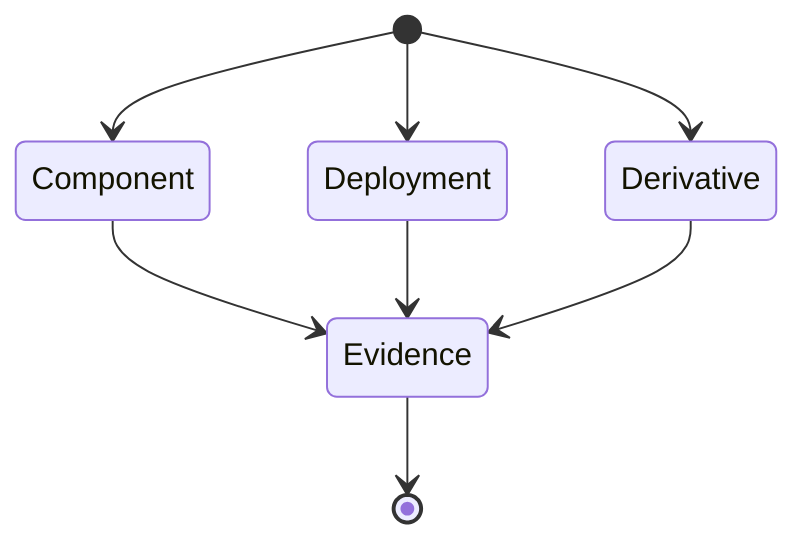

### 3.2 Conformance is falsifiable

Every criterion in this document is written so that a single counter-example falsifies the claim. If an assessor can exhibit an input for which a required deny does not occur, or a required audit event is absent, the claim fails for that criterion.

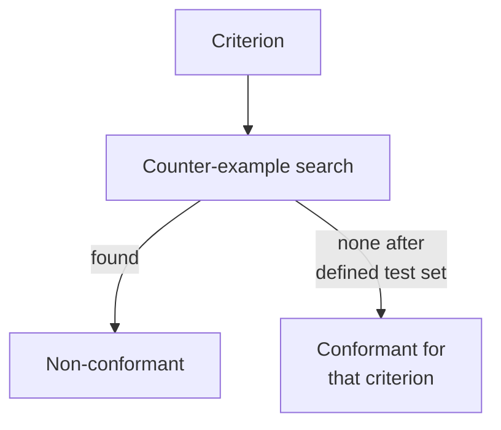

---

## 4. Conformance Classes and Profiles

### 4.1 Classes

ZP42 defines two conformance **classes** that reflect the honesty principle directly.

- **Class S (Specified).** The subject implements the documented interface and behaviour of a component *in isolation*, and its claims are limited to what the Foundation scaffold actually wires.
- **Class E (Enforced).** The subject demonstrates the control operative **end to end** within an assembled pipeline, with audit evidence for each decision.

Because the Foundation release does not yet wire the full pipeline, **Class E for the end-to-end orchestration is not claimable against the Foundation phase.** It becomes claimable only when a later phase assembles lane → ROE → human gate → verify → audit and tests it as a whole.

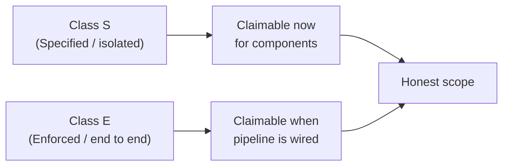

### 4.2 Profiles

A **profile** is a named subset of component obligations. A claimant selects the profile matching its deployment.

| Profile | Components in scope | Typical subject |
|---|---|---|
| `GOV-CORE` | Audit logger + audit schema | Evidence-only integration |
| `LANE` | Lane policy + ROE engine | Authorisation decisioning |
| `GATE` | Human gate | Human-in-the-loop systems |
| `BOUNDARY` | Prohibited-terms scanner | Output/boundary hygiene |
| `DECLARE` | Model allowlist + licence manifest | Supply-chain declaration |
| `FOUNDATION-FULL` | All Foundation components, each Class S | Full scaffold adopter |

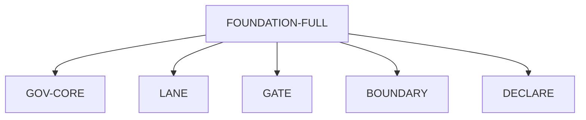

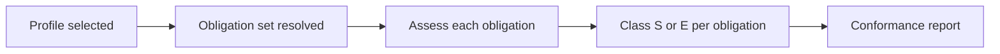

---

## 5. Conformance to the Lane Model

The lane model is the spine of ZP42 authorisation. **Lane A** is defensive work authorised by the system owner; **Lane B** is active-defence work requiring explicit *written* authorisation. (The charter also anticipates a sovereign-authorised Lane C with human signoff.) A lane is entered **deliberately** — it is never a default that silently widens.

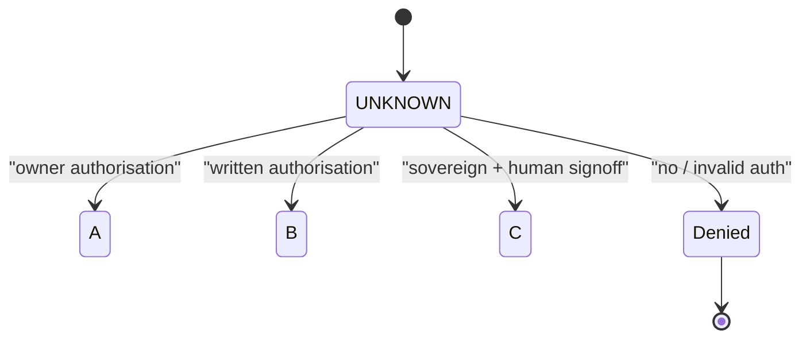

### 5.1 L-1 Fail-closed on missing authorisation (MUST)

A conforming lane policy **MUST** refuse to assign a lane when no authorisation reference is supplied, and **MUST** record the denial. This is implemented: `assign_lane` raises `ValueError` and logs a `lane_assignment` denial with lane `unknown` when the reference is absent.

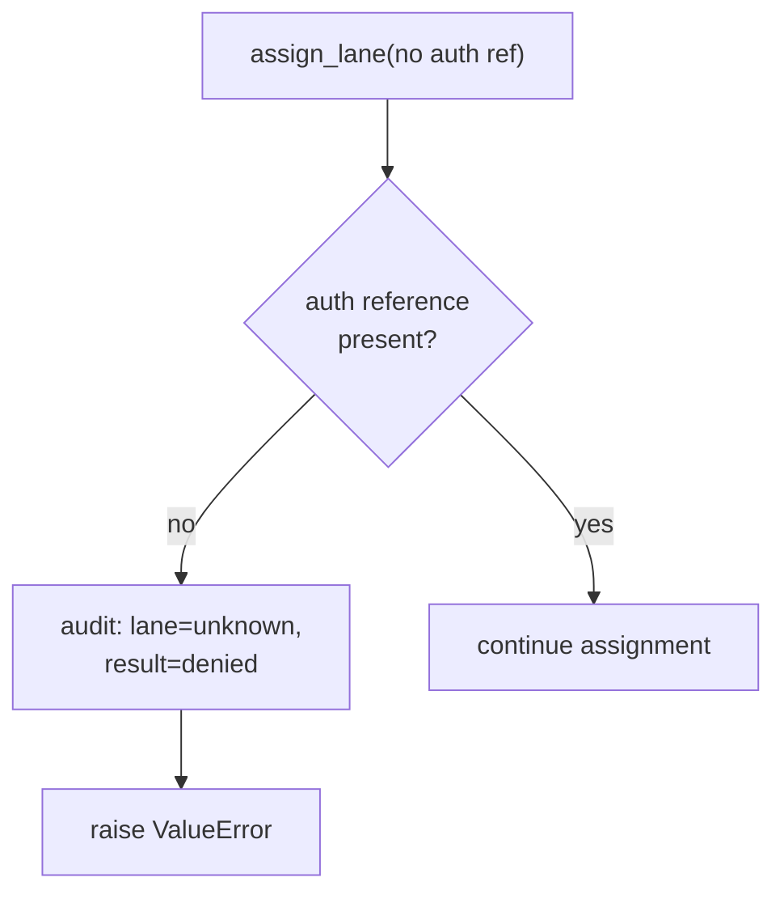

### 5.2 L-2 Written authorisation for active-defence (MUST)

When an operation is classified active-defence, a conforming policy **MUST** require a *written* authorisation reference and **MUST** reject references that fail the written-format check. This is implemented via `_is_active_defense_operation` keyword classification and `_validate_written_authorization` prefix/length checks.

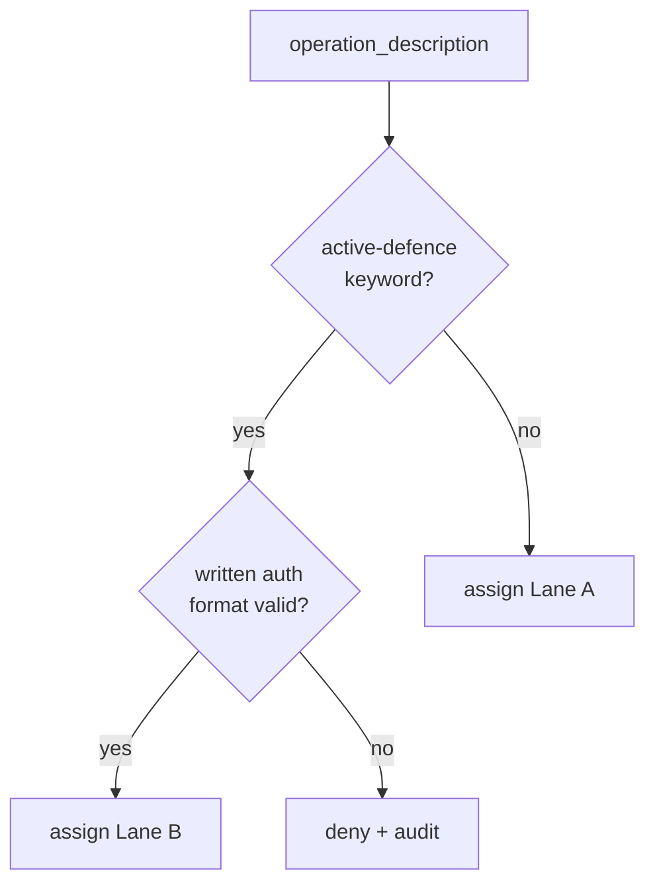

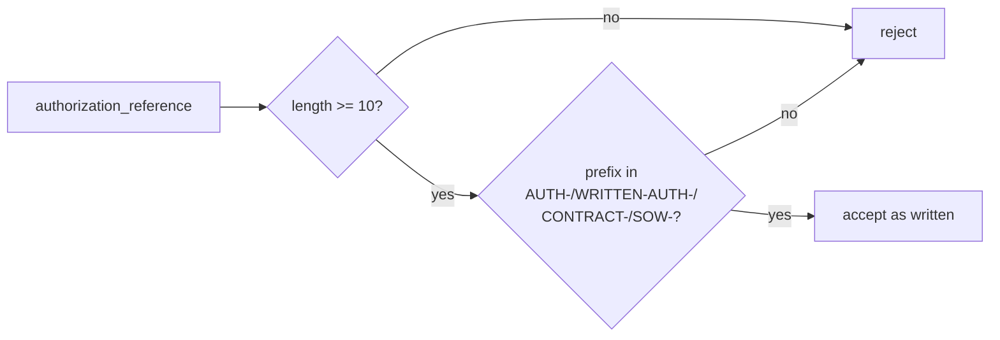

### 5.3 L-3 No silent widening (MUST NOT)

A conforming policy **MUST NOT** treat a higher-privilege lane as a default. Lane C requires *both* sovereign authorisation *and* human signoff; sovereign authorisation without signoff **MUST** fail closed. This is implemented.

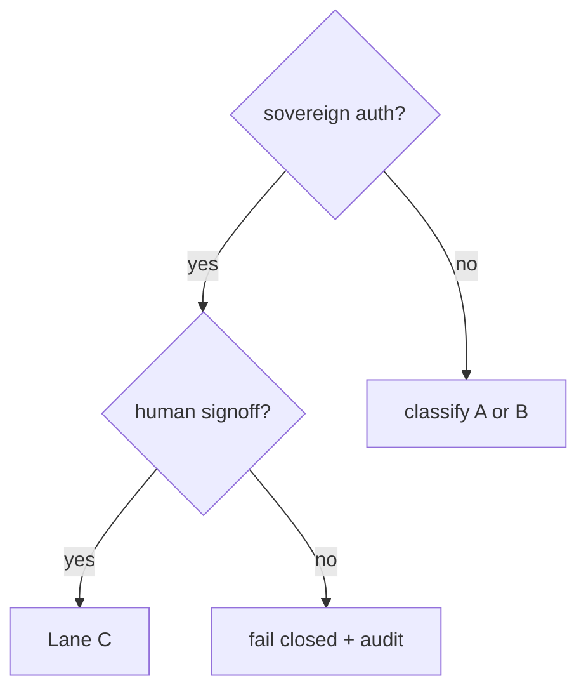

### 5.4 L-4 Escalation is denied and logged (MUST)

In the Foundation phase, every attempt to escalate from one lane to a different lane **MUST** be denied and recorded with `escalation_attempt=true`. This is implemented in `validate_escalation_attempt`, which permits only same-lane and denies all cross-lane requests.

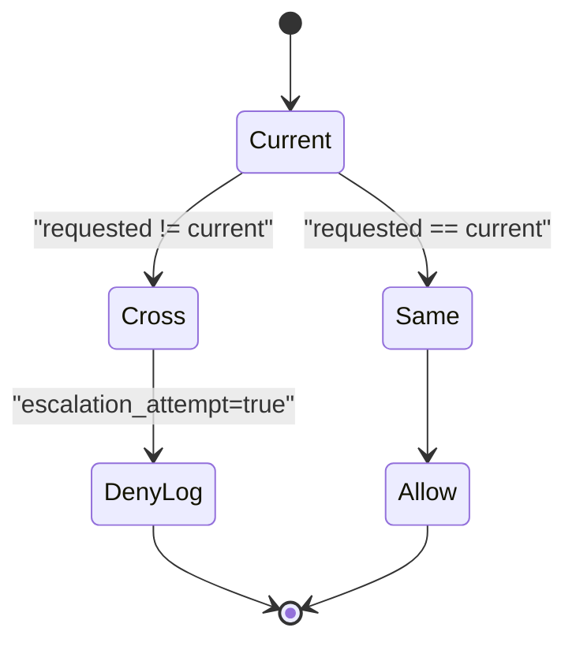

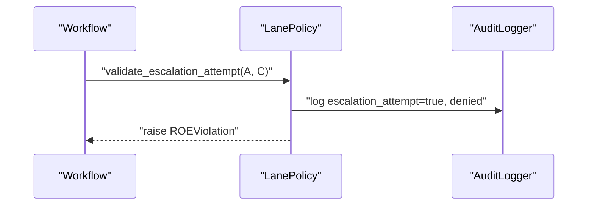

### 5.5 Lane obligation summary

| Criterion | Obligation | Status |
|---|---|---|
| L-1 | Fail closed on missing auth | Implemented |
| L-2 | Written auth for active-defence | Implemented |
| L-3 | No silent lane widening | Implemented |
| L-4 | Deny + log escalation | Implemented |

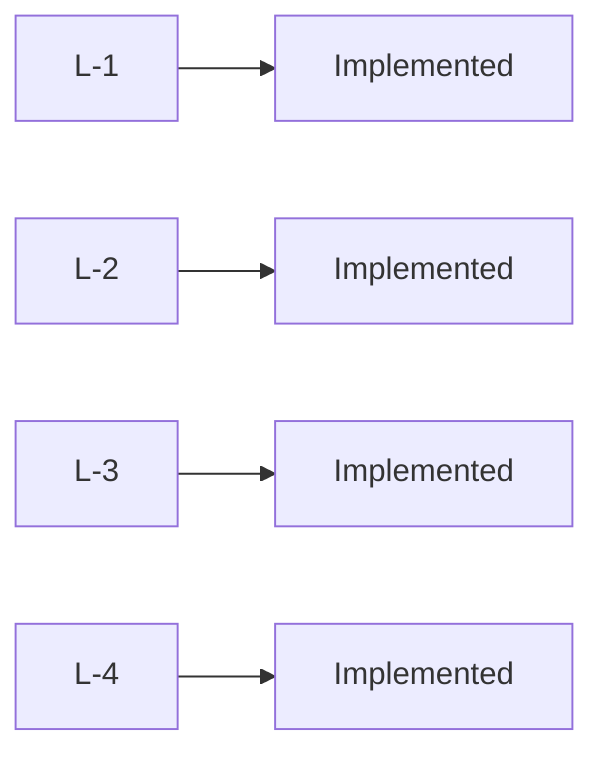

---

## 6. Conformance to the ROE Engine

The ROE engine encodes the bounds of permitted action as policy. Conformance means the encoded bounds actually deny what they say they deny.

```mermaid
flowchart TD
    Cap["capability_requested"] --> GP{"globally<br/>prohibited?"}
    GP -->|"yes"| Deny1["raise ROEViolation + audit"]
    GP -->|"no"| LaneChk["lane-specific check"]
    LaneChk --> OK["permit + audit success"]
    LaneChk --> Deny2["deny if lane bars it"]
```

### 6.1 R-1 Global prohibitions bind every lane (MUST)

A conforming ROE engine **MUST** deny the globally prohibited capability set regardless of lane — including even the most privileged lane. The implemented set covers malware creation/deployment, credential theft/harvesting, DDoS generation, unauthorised data exfiltration, persistence installation, evasion technique, destructive payload, autonomous retaliation, hack-back, and unauthorised third-party targeting.

```mermaid
flowchart LR
    subgraph "Globally prohibited (all lanes)"
        M["malware_*"]
        CR["credential_*"]
        DD["ddos_generation"]
        EX["data_exfiltration_unauthorized"]
        PS["persistence_installation"]
        EV["evasion_technique"]
        DP["destructive_payload"]
        AR["autonomous_retaliation"]
        HB["hack_back"]
        TT["unauthorized_third_party_targeting"]
    end
```

```mermaid
flowchart TD
    AnyLane["Lane A / B / C"] --> Req["prohibited capability"]
    Req --> Block["deny + audit policy_violation"]
```

### 6.2 R-2 Unknown lane cannot execute (MUST)

A conforming engine **MUST** refuse any capability in lane `unknown`. This is implemented: a `check_roe` call with `Lane.UNKNOWN` logs a denial and raises.

```mermaid
stateDiagram-v2
    [*] --> Unknown
    Unknown --> Refuse: "any capability"
    Refuse --> [*]
```

### 6.3 R-3 Lane-graded permissions (MUST)

Lane A **MUST** bar capabilities reserved for Lane B/C (for example `live_exploitation`, `deception_deployment`, `honeypot_deployment`, `active_engagement`); Lane B **MUST** bar capabilities reserved for Lane C (`offensive_operation`, `unauthorized_system_access`, `destructive_action`). This is implemented.

```mermaid
flowchart LR
    A["Lane A<br/>defensive only"] --> B["Lane B<br/>+ active-defence"]
    B --> C["Lane C<br/>+ sovereign-authorised"]
    A -. "bars" .-> AB["live_exploitation,<br/>deception, honeypot"]
    B -. "bars" .-> BC["offensive_operation,<br/>destructive_action"]
```

```mermaid
flowchart TD
    Lane{"which lane?"} -->|"A"| PA["vuln_assessment,<br/>defensive_analysis,<br/>config_review,<br/>compliance, threat_modeling"]
    Lane -->|"B"| PB["A set + deception,<br/>honeypot, threat_hunting,<br/>controlled_engagement,<br/>attribution_support"]
    Lane -->|"C"| PC["defensive + deception +<br/>threat_hunting +<br/>sovereign_authorized_operations"]
```

### 6.4 R-4 Every decision is audited (MUST)

Each `check_roe` outcome — permit or deny — **MUST** produce an audit event. This is implemented; denials additionally carry `policy_violations`.

```mermaid
sequenceDiagram
    participant W as "Workflow"
    participant R as "ROEEngine"
    participant A as "AuditLogger"
    W->>R: "check_roe(lane, capability)"
    alt "permitted"
        R->>A: "roe_check, result=success"
        R-->>W: "True"
    else "prohibited"
        R->>A: "roe_check, result=denied, policy_violations"
        R-->>W: "raise ROEViolation"
    end
```

```mermaid
flowchart LR
    D["ROE decision"] --> E["audit event"]
    E --> J["append-only JSONL"]
```

### 6.5 ROE obligation summary

| Criterion | Obligation | Status |
|---|---|---|
| R-1 | Global prohibitions bind all lanes | Implemented |
| R-2 | Unknown lane cannot execute | Implemented |
| R-3 | Lane-graded permissions | Implemented |
| R-4 | Audit every decision | Implemented |

---

## 7. Conformance to the Human Gate

The human gate interposes required human authorisation at decision points. Conformance means the gate correctly determines *when* approval is required and faithfully tracks the request lifecycle.

```mermaid
stateDiagram-v2
    [*] --> PENDING
    PENDING --> APPROVED: "approve_operation()"
    PENDING --> DENIED: "deny_operation()"
    PENDING --> EXPIRED: "timeout (specified)"
    APPROVED --> [*]
    DENIED --> [*]
    EXPIRED --> [*]
```

### 7.1 H-1 Required-approval determination (MUST)

A conforming gate **MUST** require human approval for every Lane B and Lane C operation, for unknown-lane operations, and for the sensitive Lane A operations (`live_vulnerability_scan`, `configuration_change`, `access_customer_data`). This is implemented in `requires_human_approval`.

```mermaid
flowchart TD
    Op["operation"] --> Ln{"lane?"}
    Ln -->|"A"| Sens{"sensitive op?"}
    Ln -->|"B"| Yes1["approval required"]
    Ln -->|"C"| Yes2["approval required"]
    Ln -->|"unknown"| Yes3["approval required<br/>(fail closed)"]
    Sens -->|"yes"| Yes4["approval required"]
    Sens -->|"no"| No["no approval required"]
```

### 7.2 H-2 Lifecycle integrity (MUST)

A conforming gate **MUST** reject approval or denial of a request that is absent or already processed, and **MUST** record a `human_gate_approval` or `human_gate_denial` event on each transition. This is implemented; re-processing raises `ValueError`.

```mermaid
sequenceDiagram
    participant S as "System"
    participant G as "HumanGate"
    participant H as "Human approver"
    participant A as "AuditLogger"
    S->>G: "request_approval(...)"
    G->>A: "human_gate_request, pending"
    G-->>S: "approval_request_id"
    H->>G: "approve_operation(id)"
    G->>A: "human_gate_approval, success"
    H->>G: "approve_operation(id) again"
    G-->>H: "raise ValueError (already processed)"
```

```mermaid
flowchart LR
    Req["request_approval"] --> Pend["PENDING"]
    Pend --> Dec{"human decision"}
    Dec -->|"approve"| App["APPROVED + audit"]
    Dec -->|"deny"| Den["DENIED + audit"]
```

### 7.3 H-3 Honest scope of persistence (SHOULD note)

The Foundation gate tracks approvals **in memory**. A conforming claimant **MUST NOT** describe approval state as durably persisted; durable storage is specified for a later phase. A deployment that needs persistence **SHOULD** document the gap.

```mermaid
flowchart TD
    Now["Foundation: in-memory<br/>_pending_approvals"] --> Gap["documented gap"]
    Spec["Specified later:<br/>persistent store"] --> Gap
```

### 7.4 Human gate obligation summary

| Criterion | Obligation | Status |
|---|---|---|
| H-1 | Correct required-approval determination | Implemented |
| H-2 | Lifecycle integrity + audit | Implemented |
| H-3 | Honest persistence scope | In-memory only |

```mermaid
flowchart LR
    H1["H-1"] --> h1["Implemented"]
    H2["H-2"] --> h2["Implemented"]
    H3["H-3"] --> h3["In-memory"]
```

---

## 8. Conformance to Audit Logging

The audit logger writes an append-only JSONL evidence record. Conformance means events are valid against the schema, appended immutably within the process, and queryable.

```mermaid
flowchart LR
    Ev["log_event(...)"] --> Val["validate enums"]
    Val --> Build["build event dict"]
    Build --> App["append line to<br/>audit_YYYY-MM-DD.jsonl"]
    App --> Id["return event_id (uuid4)"]
```

### 8.1 A-1 Enum validation (MUST)

A conforming logger **MUST** reject events whose `operation_type`, `lane`, `actor_type`, or `result` falls outside the schema enums, raising before any write. This is implemented.

```mermaid
flowchart TD
    E["event fields"] --> OT{"operation_type<br/>valid?"}
    OT -->|"no"| X1["raise ValueError"]
    OT -->|"yes"| LN{"lane valid?"}
    LN -->|"no"| X2["raise ValueError"]
    LN -->|"yes"| AT{"actor_type valid?"}
    AT -->|"no"| X3["raise ValueError"]
    AT -->|"yes"| RS{"result valid?"}
    RS -->|"no"| X4["raise ValueError"]
    RS -->|"yes"| Write["write"]
```

### 8.2 A-2 Required fields present (MUST)

Each written event **MUST** carry `timestamp` (ISO 8601 UTC), `event_id` (uuid4), `operation_type`, `lane`, `actor`, `result`, and `escalation_attempt`. This is implemented.

```mermaid
erDiagram
    AUDIT_EVENT {
        string timestamp
        string event_id
        string operation_type
        string lane
        object actor
        string result
        boolean escalation_attempt
    }
```

```mermaid
flowchart LR
    Req["required fields"] --> TS["timestamp"]
    Req --> EI["event_id"]
    Req --> OT2["operation_type"]
    Req --> LN2["lane"]
    Req --> AC["actor"]
    Req --> RS2["result"]
    Req --> ES["escalation_attempt"]
```

### 8.3 A-3 Append-only within process (MUST)

The logger **MUST** open the daily file in append mode and never rewrite prior lines. This is implemented. A claimant **MUST NOT** describe the log as **cryptographically signed** — it is plain JSONL. Tamper-evidence by signing or hash-chaining is **specified**, not implemented.

```mermaid
flowchart TD
    Log["JSONL log"] --> AO["append-only (mode 'a')"]
    AO --> Honest["claim: append-only"]
    Sign["signing / hash chain"] -.->|"NOT in Foundation"| Honest2["must not claim"]
```

### 8.4 A-4 Queryability (SHOULD)

A conforming logger **SHOULD** support filtered retrieval by time window, lane, operation type, and actor. This is implemented in `query_logs`. Production-grade indexing is specified for later.

```mermaid
flowchart LR
    Q["query_logs(filters)"] --> Scan["scan audit_*.jsonl"]
    Scan --> F1["time window"]
    F1 --> F2["lane"]
    F2 --> F3["operation_type"]
    F3 --> F4["actor_identifier"]
    F4 --> Out["matching events"]
```

### 8.5 Audit obligation summary

| Criterion | Obligation | Status |
|---|---|---|
| A-1 | Enum validation | Implemented |
| A-2 | Required fields | Implemented |
| A-3 | Append-only (not signed) | Implemented; signing specified only |
| A-4 | Queryability | Implemented |

---

## 9. Conformance to the Compliance Manifests

Compliance is **declared** through machine-readable manifests: the model allowlist and the licence manifest. Conformance at the Foundation phase means the manifests are present, well-formed, and internally consistent — **not** that the policy is enforced in code.

```mermaid
flowchart LR
    MA["model_allowlist.json"] --> Decl["declared policy"]
    LM["license_manifest.json"] --> Decl
    Decl --> NB["NOT enforced in code<br/>(Foundation)"]
    NB --> Later["enforcement specified<br/>for later phase"]
```

### 9.1 C-1 Manifest well-formedness (MUST)

A conforming `DECLARE` subject **MUST** ship valid JSON manifests carrying a `version`/policy block, an `approved_models` list with origin and licence per model, and a `prohibited_origins` block. This is present in `model_allowlist.json`.

```mermaid
flowchart TD
    AM["allowlist"] --> V["version + policy"]
    AM --> AP["approved_models[]"]
    AM --> PO["prohibited_origins"]
    AP --> M1["name, organization,<br/>origin_country, license"]
    PO --> EC["excluded_countries"]
    PO --> EO["excluded_organizations"]
    PO --> PF["prohibited_model_families"]
```

### 9.2 C-2 Declared PRC-origin exclusion (MUST)

The allowlist **MUST** declare the PRC-origin exclusion covering models, outputs, embeddings, labels, checkpoints, synthetic data, and derivatives. This is declared. A claimant **MUST NOT** state this is runtime-enforced in the Foundation phase.

```mermaid
flowchart LR
    Pol["PRC-origin exclusion"] --> D["declared in manifest"]
    D --> Honest["claim: declared"]
    D -. "not yet" .-> E["runtime enforcement<br/>(specified)"]
```

### 9.3 C-3 Approved-model consistency (SHOULD)

Approved models **SHOULD** each carry an Apache-2.0 (or otherwise compatible) licence and a USA origin consistent with policy. The three approved entries (two AI2 OLMo 3 32B variants and IBM Granite 4.1 30B Base) satisfy this.

```mermaid
flowchart TD
    AP2["approved_models"] --> O1["AI2 OLMo 3 32B Base"]
    AP2 --> O2["AI2 OLMo 3 32B Think"]
    AP2 --> G1["IBM Granite 4.1 30B Base"]
    O1 --> LIC["Apache-2.0"]
    O2 --> LIC
    G1 --> LIC
```

### 9.4 Compliance obligation summary

| Criterion | Obligation | Status |
|---|---|---|
| C-1 | Manifest well-formedness | Declared |
| C-2 | PRC-origin exclusion declared | Declared, not enforced |
| C-3 | Approved-model consistency | Declared |

---

## 10. Conformance to the Prohibited-Terms Scanner

The prohibited-terms scanner guards against disallowed terms at the boundary. Conformance means the scanner runs over a declared root and reports violations deterministically.

```mermaid
flowchart LR
    Root["--root ."] --> Walk["walk files"]
    Walk --> Match["match prohibited terms"]
    Match --> Rep["report findings"]
    Rep --> Exit["non-zero exit on hit"]
```

### 10.1 B-1 Deterministic boundary scan (MUST)

A conforming `BOUNDARY` subject **MUST** run the scanner over its declared content and treat a positive finding as a failing boundary condition. The scanner is intended to run as a pre-commit and (specified) CI check.

```mermaid
stateDiagram-v2
    [*] --> Scan
    Scan --> Clean: "no prohibited terms"
    Scan --> Flag: "term found"
    Clean --> [*]
    Flag --> Block: "fail closed"
    Block --> [*]
```

### 10.2 B-2 Honest placement (SHOULD)

A claimant **SHOULD** state where the scanner runs (pre-commit is implemented as a developer step; automated CI integration is specified). It **MUST NOT** claim CI enforcement that is not configured in the shipped repository.

```mermaid
flowchart TD
    PC["pre-commit (dev step)"] --> Now2["implemented path"]
    CI["CI gate"] -.->|"specified"| Later2["not yet wired"]
```

---

## 11. Implemented vs Specified: the Conformance Matrix

The single most important conformance obligation is to report the implemented/specified boundary accurately. The following matrix is the reference boundary for the Foundation phase.

```mermaid
flowchart LR
    subgraph "Implemented (Class S, isolated)"
        I1["lane_policy"]
        I2["roe_engine"]
        I3["human_gate"]
        I4["audit_logger"]
        I5["scan_prohibited_terms"]
    end
    subgraph "Specified only"
        S1["end-to-end orchestrator"]
        S2["output verifier stage"]
        S3["audit signing / hash chain"]
        S4["enforced compliance manifests"]
        S5["inference / offensive execution (out of scope)"]
    end
```

| Area | Implemented | Specified only |
|---|---|---|
| Lane assignment, fail-closed, escalation deny | Yes | — |
| ROE permit/deny + global prohibitions | Yes | — |
| Human gate determination + lifecycle | Yes (in-memory) | Persistent approval store |
| Audit logging (JSONL, validated, queryable) | Yes | Cryptographic signing, DB indexing |
| Compliance manifests | Declared, well-formed | Runtime enforcement |
| Prohibited-terms scanner | Yes (dev/pre-commit) | CI gate |
| Orchestration pipeline (lane→ROE→gate→verify→audit) | No (`orchestrator/__init__.py` is a scaffold) | Yes |
| Output verifier | No (stage defined) | Yes |
| Inference / exploit / live targeting | No (out of scope) | Out of scope for Foundation |

```mermaid
flowchart TD
    Pipe["Specified pipeline"] --> L["lane"]
    L --> R["ROE"]
    R --> G["human gate"]
    G --> V["verify"]
    V --> Au["audit"]
    Pipe -. "NOT yet wired<br/>(scaffold)" .-> Note["Class E not claimable<br/>for Foundation"]
```

```mermaid
sequenceDiagram
    participant O as "Orchestrator (specified)"
    participant L as "LanePolicy (impl)"
    participant R as "ROEEngine (impl)"
    participant G as "HumanGate (impl)"
    participant V as "Verifier (defined)"
    participant A as "AuditLogger (impl)"
    Note over O: "This chain is the specified target, not the shipped wiring"
    O->>L: "assign_lane"
    L->>R: "check_roe"
    R->>G: "require approval?"
    G->>V: "verify output"
    V->>A: "audit"
```

---

## 12. Verification and Evidence

A conformance claim is only as good as its evidence. A claimant **MUST** produce the following evidence bundle per profile.

```mermaid
flowchart LR
    Ev["Evidence bundle"] --> T["test transcript"]
    Ev --> Log["audit log sample"]
    Ev --> Ver["component versions"]
    Ev --> Scope["class + profile + phase"]
    Ev --> Gap["documented gaps"]
```

### 12.1 V-1 Reproducible tests (MUST)

A claimant **MUST** provide a reproducible test run exercising each in-scope criterion's deny path and permit path. The repository's own validation commands (`python -m compileall .`, `python -m pytest -q`, and the prohibited-terms scan) are the baseline.

```mermaid
flowchart TD
    Base["baseline validation"] --> Cc["compileall ."]
    Base --> Pt["pytest -q"]
    Base --> Sc["scan_prohibited_terms --root ."]
    Cc --> Pass["evidence"]
    Pt --> Pass
    Sc --> Pass
```

### 12.2 V-2 Audit as primary evidence (MUST)

Because every governance decision emits an audit event, the audit log is the **primary** evidence that a control fired. A claimant **MUST** exhibit audit lines corresponding to each tested decision.

```mermaid
sequenceDiagram
    participant A as "Assessor"
    participant S as "Subject"
    participant L as "Audit log"
    A->>S: "drive deny scenario"
    S->>L: "emit denied event"
    A->>L: "read event"
    L-->>A: "evidence line"
```

### 12.3 V-3 Honest gap statement (MUST)

The bundle **MUST** include an explicit statement of every specified-but-not-implemented control relevant to the profile. Omitting a known gap is itself a non-conformance.

```mermaid
flowchart LR
    Known["known gap"] --> Stated{"stated in bundle?"}
    Stated -->|"yes"| Conf["conformant disclosure"]
    Stated -->|"no"| NC["non-conformant"]
```

---

## 13. Claiming Conformance

A conformance claim is a structured statement, not a slogan. It names subject, class, profile, phase, versions, and gaps.

```mermaid
flowchart TD
    Claim["Conformance statement"] --> Su["subject"]
    Claim --> Cl["class (S/E)"]
    Claim --> Pr["profile"]
    Claim --> Ph["phase (Foundation)"]
    Claim --> Vs["component versions"]
    Claim --> Gp["gap list"]
```

### 13.1 Permitted claim forms

```mermaid
flowchart LR
    Good["'ZP42 GOV-CORE, Class S,<br/>Foundation phase'"] --> OK["permitted"]
    Bad["'Fully ZP42 compliant,<br/>signed audit, enforced'"] --> No["prohibited:<br/>overstates"]
```

### 13.2 Claim decision flow

```mermaid
flowchart TD
    Start["intend to claim"] --> Impl{"control wired<br/>end to end?"}
    Impl -->|"yes"| E["may claim Class E"]
    Impl -->|"no"| Iso{"component tested<br/>in isolation?"}
    Iso -->|"yes"| S["claim Class S only"]
    Iso -->|"no"| None["no claim"]
```

---

## 14. Non-Conformance Handling

Non-conformance is expected during development; concealing it is the violation. ZP42 treats a discovered gap as a finding to log and remediate, consistent with fail-closed design.

```mermaid
stateDiagram-v2
    [*] --> Detected
    Detected --> Logged: "record finding"
    Logged --> Scoped: "narrow claim"
    Scoped --> Remediated: "fix + retest"
    Remediated --> [*]
    Logged --> Disclosed: "update gap list"
    Disclosed --> [*]
```

### 14.1 N-1 Fail closed on uncertainty (MUST)

Where conformance to a control cannot be established, the dependent operation **MUST** be treated as denied, mirroring the lane and ROE fail-closed defaults.

```mermaid
flowchart TD
    Unc["uncertain conformance"] --> FC2["treat as denied"]
    FC2 --> Log2["log + disclose"]
```

### 14.2 N-2 No false completion (MUST)

A claimant **MUST NOT** report a control as implemented, signed, enforced, or wired when it is not. This restates the honesty principle as an enforceable obligation.

```mermaid
flowchart LR
    Status["reported status"] --> Match{"matches code?"}
    Match -->|"no"| Viol["non-conformance<br/>(false completion)"]
    Match -->|"yes"| OK2["conformant disclosure"]
```

---

## 15. Versioning and Stability of This Specification

Conformance is always against a *version* of this document and a *phase* of ZP42. As later phases wire the orchestration pipeline, add an output verifier, introduce audit tamper-evidence, and enforce the compliance manifests in code, new criteria (and Class E claimability for the pipeline) will be added here.

```mermaid
flowchart LR
    F["Foundation phase<br/>(Class S components)"] --> P2["Phase 2<br/>eval infra"]
    P2 --> P3["Phase 3<br/>defensive reasoning"]
    P3 --> P4["Phase 4<br/>active-defence (Lane B)"]
    P4 --> P5["Phase 5<br/>sovereign-authorised (Lane C)"]
```

```mermaid
flowchart TD
    Doc["this conformance doc"] --> Ver["carries a version"]
    Ver --> Bind["a claim binds to<br/>(doc version, phase)"]
    Bind --> Stable["criteria stable within<br/>a phase"]
```

A claimant **MUST** cite both the document version and the ZP42 phase when asserting conformance, so that an assessor can reconstruct exactly which obligations applied. The inventor of ZP42, Naquib Hatami, has set the governance-first direction that each phase must satisfy its predecessor's criteria before adding its own; conformance therefore accretes rather than resets.

```mermaid
flowchart LR
    Prev["phase N criteria"] --> Keep["retained"]
    Keep --> Add["phase N+1 adds new"]
    Add --> Total["cumulative obligation set"]
```

```mermaid
stateDiagram-v2
    [*] --> Draft
    Draft --> Normative: "published"
    Normative --> Superseded: "new version"
    Superseded --> [*]
```

---

## 16. Cross-References

- [`../README.md`](../README.md) — project overview, architecture, and validation commands.
- [`FOUNDATION.md`](FOUNDATION.md) — Foundation charter, lane definitions, model policy, and out-of-scope list (normative input to this document).
- [`08-governance-audit.md`](08-governance-audit.md) — the governance model whose obligations this document makes testable.
- [`08-governance-audit.md`](08-governance-audit.md) — the audit record used as primary conformance evidence.
- [`12-test-strategy.md`](12-test-strategy.md) — test procedures and the evidence bundle referenced in §12.
