# Integration & Orchestration

> Part of the ZP42 documentation set

## Abstract

This document describes how the modules of **ZP42 (Zeroth Protocol 42)** — an open, MIT-licensed, governance-first cyber-reasoning system for defensive, active-defence, and sovereign-authorised workflows, invented and authored by **Naquib Hatami** — are *specified* to compose into a single governed pipeline, and it records the *honest current status* of that composition. ZP42's central design claim is not that it is powerful, but that every unit of capability is subordinated to authorisation: a request is placed in a lane, bounded by rules of engagement, gated by a human where required, verified on output, and written to an append-only evidence record before any effect is allowed. The present release is a **Foundation-phase scaffold**. The governance components are implemented and independently tested; the end-to-end orchestrator that threads them together is **not yet wired**. Throughout, this document is deliberate about the line between *implemented* and *specified*, because conflating the two would defeat the governance posture the system exists to demonstrate.

Repository: `github.com/iQs-Group/zp-42` · Site: `zp42.org` · Publisher: SADI AI Inc. / iQs Group Inc.

---

## 1. Context and scope

### 1.1 What integration means here

Integration in ZP42 is the problem of *governed composition*: taking a set of single-purpose policy modules and arranging them so that the only path from an inbound request to an effect runs through every control, in order, fail-closed at each step. The modules are not interesting in isolation — a lane classifier that nobody consults, or an audit log nothing writes to, is inert. The value is in the wiring, and the wiring is precisely the part that Foundation phase has *specified* but not yet *completed*.

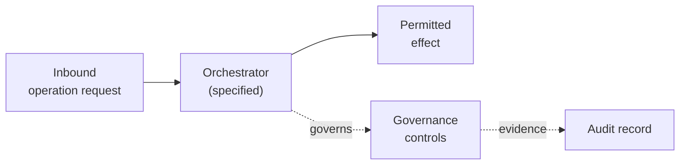

A conventional system builds capability first and reaches for governance only when an incident forces the question. ZP42 inverts that order deliberately: the controls are the product of the Foundation phase, and the reasoning capability they will govern is scheduled to arrive strictly behind them. This inversion is why the "integration gap" described later in this document is not an embarrassment to be hidden but the honest centre of the release — the parts that exist are the parts that say *no*, and the part that is missing is the connective tissue that will let a *yes* flow through them in a controlled order. Reading the repository with that framing in mind explains why the governance modules are complete and tested while the orchestrator is an empty file.

### 1.2 Module map

The repository is organised so that each governance concern has a home. The following map reflects the real directory layout. Each top-level package owns exactly one concern, and the dependency direction is uniform: policy modules depend on the audit logger, never the reverse, so that evidence capture has no knowledge of — and no coupling to — the decisions it records.

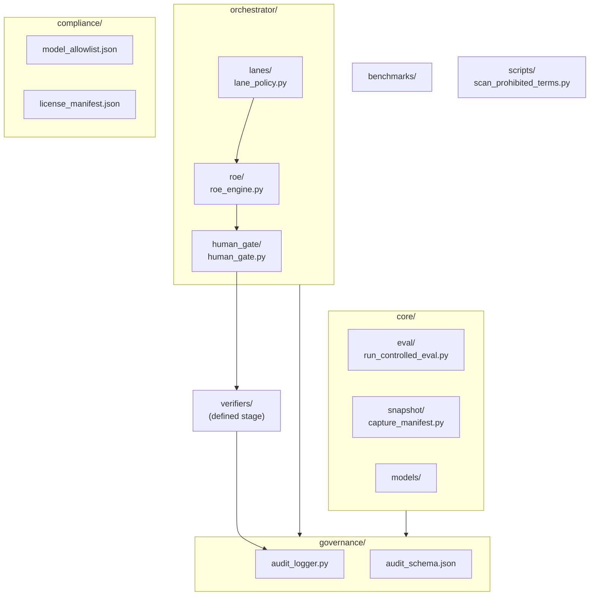

### 1.3 Phase boundary

Foundation phase deliberately excludes inference, exploit or offensive execution, and live targeting. The integration described here is the *control plane*; the data plane that would run models is out of scope for this release.

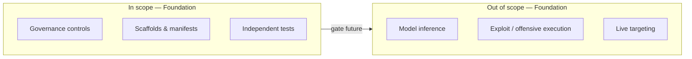

---

## 2. Design principles for composition

Four principles govern how the modules are intended to fit together. They are not aspirational slogans; each maps to concrete behaviour already present in the implemented components.

### 2.1 Governance-first

Controls are not a wrapper added after capability exists; in ZP42 the controls were built first and capability is scheduled to arrive behind them. Every implemented module already imports and calls the audit logger, so no module can act silently.

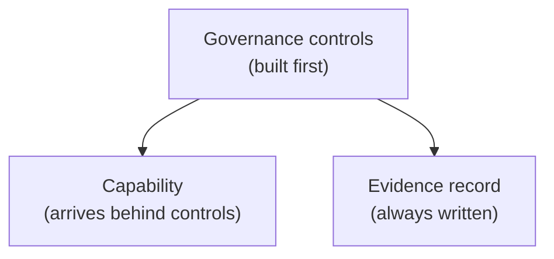

### 2.2 Fail-closed by default

Every decision point resolves ambiguity toward denial. An unassigned lane is `UNKNOWN`, which the ROE engine refuses to execute in; a missing authorisation reference raises before any lane is assigned.

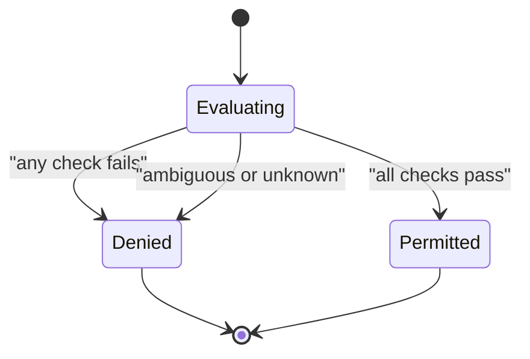

### 2.3 Lanes are entered deliberately

A lane is a decision, not a drift. The ROE engine denies *all* lane-escalation attempts in Foundation phase, so there is no path by which an operation widens its own authority mid-flight.

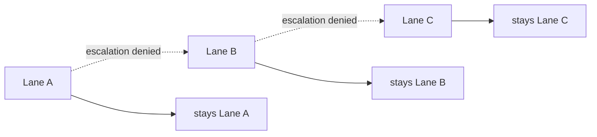

### 2.4 Separation of concerns

Classification (lanes), bounding (ROE), human authority (gate), output checking (verifiers), and evidence (audit) are distinct modules with distinct responsibilities. None performs another's job.

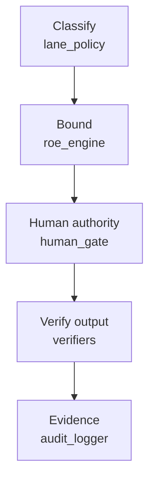

---

## 3. Component inventory: implemented vs specified

### 3.1 Honest status table

| Component | Path | Status | Notes |
|-----------|------|--------|-------|
| Lane policy | `orchestrator/lanes/lane_policy.py` | **Implemented, tested** | Classification + fail-closed authorisation |
| ROE engine | `orchestrator/roe/roe_engine.py` | **Implemented (not yet unit-tested)** | Global + per-lane prohibitions; escalation denied |
| Human gate | `orchestrator/human_gate/human_gate.py` | **Implemented** | In-memory approval tracking |
| Audit logger | `governance/audit_logger.py` | **Implemented, tested** | Append-only JSONL, **not signed** |
| Prohibited-terms scanner | `scripts/scan_prohibited_terms.py` | **Implemented, tested** | Boundary guard |
| Controlled eval | `core/eval/run_controlled_eval.py` | **Implemented (dry-run only)** | No inference |
| Manifest capture | `core/snapshot/capture_manifest.py` | **Implemented** | Local hashing; model capture is a stub |
| Verifiers | `verifiers/__init__.py` | **Defined stage, empty** | Output verifier not written |
| Orchestrator wiring | `orchestrator/__init__.py` | **Scaffold (empty)** | End-to-end pipeline not wired |
| Model allowlist | `compliance/model_allowlist.json` | **Declared manifest** | Not yet enforced in code |
| License manifest | `compliance/license_manifest.json` | **Declared manifest** | Not yet enforced in code |

### 3.2 Component relationships (as implemented)

The class view below reflects the actual imports: both orchestrator modules and the eval framework depend on the audit logger; the ROE engine and human gate depend on the `Lane` enum from the lane policy.

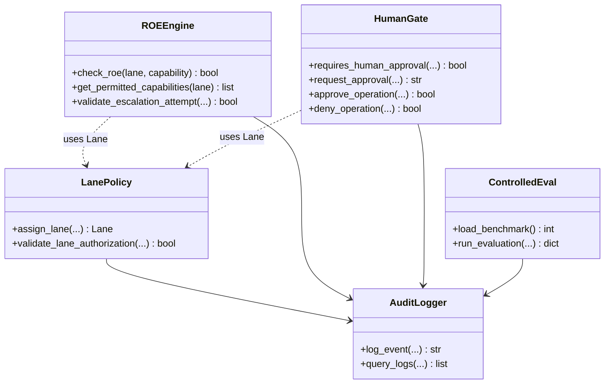

### 3.3 What is wired and what is not

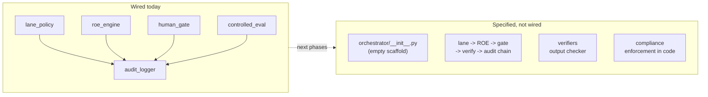

---

## 4. The specified governed pipeline

### 4.1 Canonical stage order

The design specifies a single ordered pipeline. A request is classified into a lane, checked against the rules of engagement, gated by a human where the lane demands it, its output verified, and the whole event written to the audit trail. Each arrow is a gate: control does not pass unless the stage returns a permit.

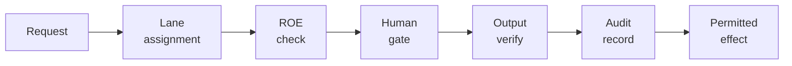

The ordering is not arbitrary. Lane assignment comes first because every downstream control is parameterised by lane: the ROE engine applies lane-specific prohibitions, and the human gate's approval requirement is a function of lane. ROE follows lane because a capability must be judged against the authority the lane confers, not in the abstract. The human gate follows ROE because there is no point asking a human to approve an operation the rules already forbid — the gate is for operations that are permitted but consequential, not for ones that are prohibited. Verification follows the gate because output can only be produced once an operation is authorised to run, and that output must be checked before it is treated as a result. Audit is last in the permit path but present at every stage along the way: each gate writes its own event, so the trail reconstructs the full decision history whether the operation succeeded or was denied part-way through.

### 4.2 Stage gates as fail-closed junctions

Every stage has exactly two outward edges in the specification: proceed, or deny-and-log. There is no "proceed with warning" and no "proceed pending review" — a review that has not completed is a denial until it does. This two-edge discipline is what makes the pipeline auditable as a whole: the set of operations that reached an effect is exactly the set for which every stage emitted a permit, and that set is recoverable from the audit trail alone.

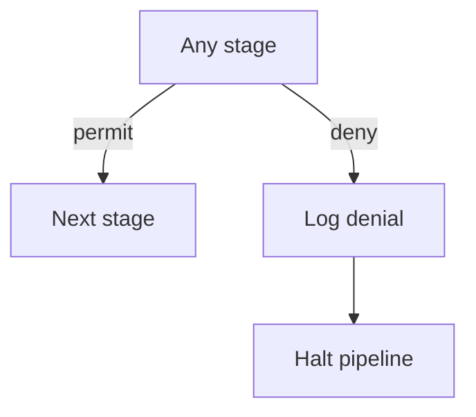

### 4.3 Specified end-to-end sequence

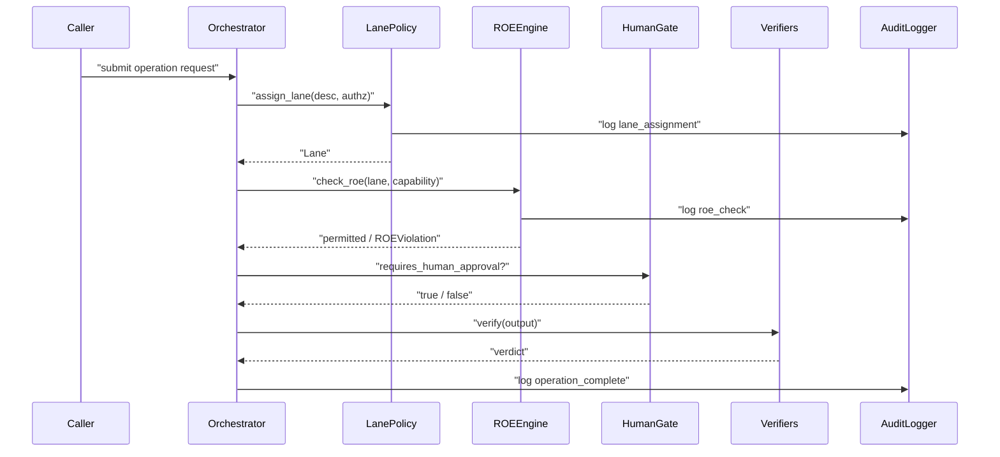

> Status: the sequence above is the **specified** control flow. `orchestrator/__init__.py` does not yet implement it; the modules it would call are individually present.

### 4.4 Record flow

Each stage emits an audit event sharing a common schema. The entity view shows the relationship between an operation and the events it generates.

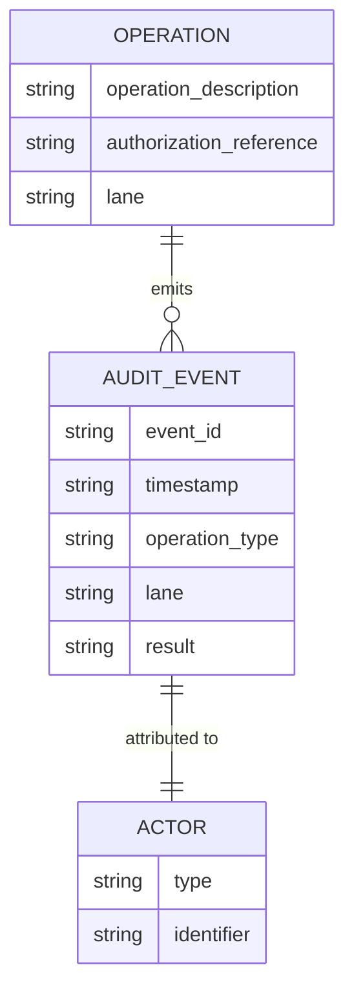

### 4.5 Data contract between stages

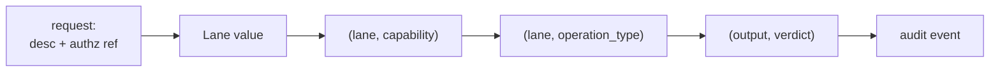

---

## 5. Lane model

### 5.1 Lane states

Lanes carry increasing authorisation requirements. Lane A is defensive work authorised by the system owner; Lane B is active-defence work requiring explicit **written** authorisation; Lane C is sovereign-authorised work requiring both sovereign authorisation and human signoff; `UNKNOWN` is the fail-closed sink.

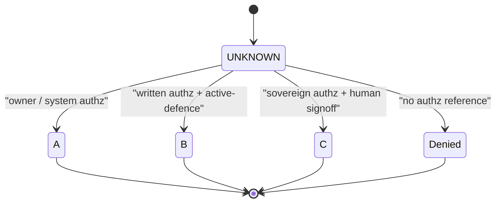

### 5.2 `assign_lane` decision logic

The implemented `assign_lane` raises immediately when no authorisation reference is supplied, then resolves the lane by authorisation type.

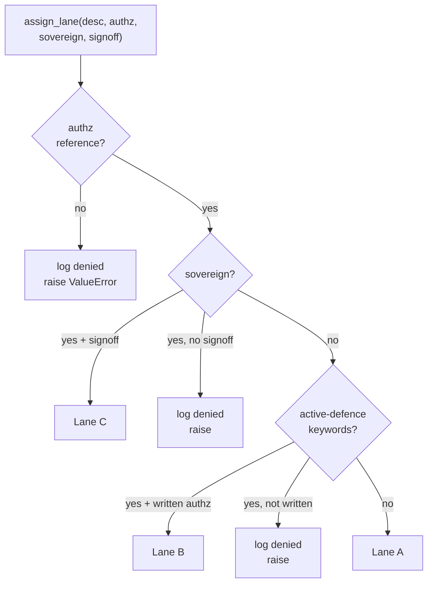

### 5.3 Active-defence classification

Foundation phase uses simple keyword matching to distinguish Lane B work from Lane A. The implementation notes that production should use more sophisticated classification.

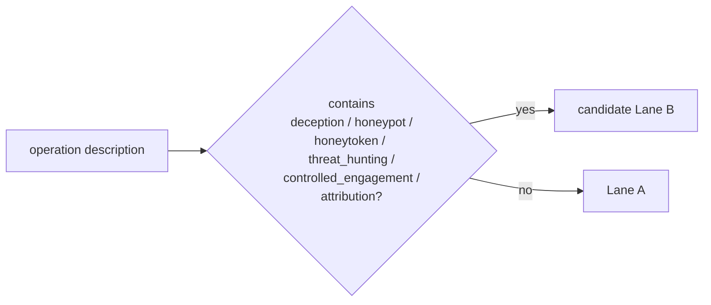

### 5.4 Written-authorisation validation

Lane B requires a reference whose form matches a recognised written-authorisation prefix and minimum length.

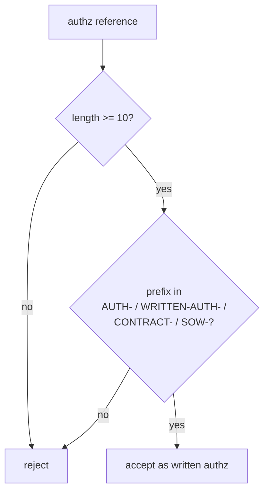

### 5.5 Escalation is denied

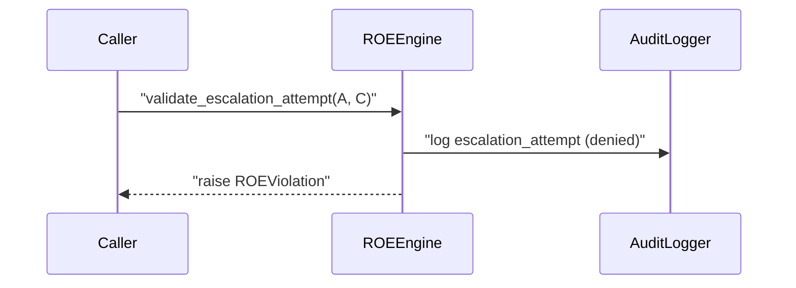

### 5.6 Permitted capability sets per lane

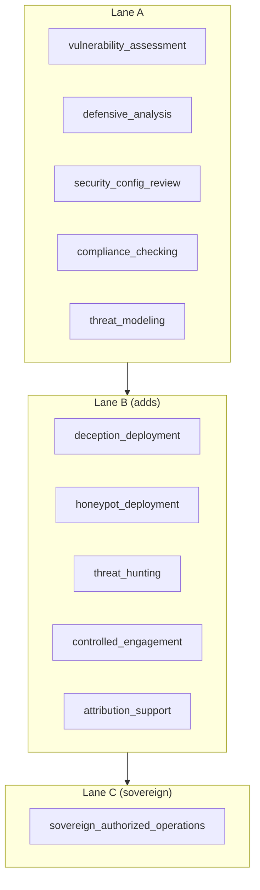

---

## 6. Rules-of-engagement engine

### 6.1 ROE check flow

The ROE engine encodes the bounds of permitted action as policy. It checks globally prohibited capabilities first, then refuses unknown lanes, then applies per-lane prohibitions.

```mermaid
flowchart TB
    START["check_roe(lane, capability)"] --> GLOBAL{"globally<br/>prohibited?"}
    GLOBAL -->|"yes"| DENYG["log denied<br/>raise ROEViolation"]
    GLOBAL -->|"no"| UNK{"lane == UNKNOWN?"}
    UNK -->|"yes"| DENYU["log denied<br/>raise"]
    UNK -->|"no"| LANECHK["per-lane checks"]
    LANECHK --> OK["log success<br/>return true"]
```

The order of the checks inside `check_roe` is itself a safety property. Globally prohibited capabilities are tested *before* any lane-specific logic, so that no amount of lane authority — not even Lane C's sovereign scope — can reach a capability that ZP42 refuses to implement at all. The unknown-lane check comes next, closing the gap where a caller might pass an unassigned lane and hope the per-lane branches simply fall through. Only after those two universal refusals does the engine consult the per-lane prohibition sets. This structure means the most dangerous requests are rejected by the cheapest, earliest, most absolute test, and the nuanced lane judgements are reserved for requests that have already cleared the absolute bars.

### 6.2 Globally prohibited capabilities

These are refused in **every** lane, Lane C included. ZP42 never implements them; the engine exists to refuse them at the boundary. The distinction between a *prohibited capability* and an *ungated capability* matters: the globally prohibited set is not a feature behind a stricter authorisation tier, it is a line the system does not cross regardless of authority, which is the concrete expression of the project's defensive, governance-first charter.

```mermaid
mindmap
  root((Globally prohibited))
    Malware
      creation
      deployment
    Credentials
      theft
      harvesting
    Disruption
      ddos_generation
      destructive_payload
    Unauthorised
      data_exfiltration
      third_party_targeting
    Evasion
      persistence_installation
      evasion_technique
    Retaliation
      autonomous_retaliation
      hack_back
```

### 6.3 Lane A per-lane prohibitions

Lane A is defensive only; capabilities that imply active engagement are pushed up to Lane B or C.

```mermaid
flowchart LR
    REQ["capability in Lane A"] --> CHK{"live_exploitation /<br/>deception_deployment /<br/>honeypot_deployment /<br/>active_engagement?"}
    CHK -->|"yes"| UP["raise: requires Lane B or C"]
    CHK -->|"no"| PASS["permitted"]
```

### 6.4 Lane B per-lane prohibitions

Lane B permits active-defence but never offensive action; offensive capabilities are pushed to Lane C's bounded, human-gated scope.

```mermaid
flowchart LR
    REQ["capability in Lane B"] --> CHK{"offensive_operation /<br/>unauthorized_system_access /<br/>destructive_action?"}
    CHK -->|"yes"| UP["raise: requires Lane C"]
    CHK -->|"no"| PASS["permitted"]
```

### 6.5 ROE engine structure

```mermaid
classDiagram
    class ROEEngine {
        +GLOBALLY_PROHIBITED_CAPABILITIES
        +check_roe(lane, capability, details) bool
        +get_permitted_capabilities(lane) list
        +validate_escalation_attempt(current, requested) bool
    }
    class ROEViolation {
        <<Exception>>
    }
    ROEEngine ..> ROEViolation : raises
```

---

## 7. Human authorisation gate

### 7.1 Approval lifecycle

The human gate interposes required human authorisation at decision points. An approval request moves through a small lifecycle; Foundation phase tracks requests in memory, and the implementation notes production should use persistent storage.

```mermaid
stateDiagram-v2
    [*] --> PENDING: "request_approval"
    PENDING --> APPROVED: "approve_operation"
    PENDING --> DENIED: "deny_operation"
    PENDING --> EXPIRED: "timeout (specified)"
    APPROVED --> [*]
    DENIED --> [*]
    EXPIRED --> [*]
```

### 7.2 When human approval is required

```mermaid
flowchart TB
    START["requires_human_approval(lane, op_type)"] --> L{"lane?"}
    L -->|"A"| ASENS{"sensitive op?<br/>(live scan / config change /<br/>access customer data)"}
    ASENS -->|"yes"| YES["approval required"]
    ASENS -->|"no"| NO["no approval"]
    L -->|"B"| YES
    L -->|"C"| YES
    L -->|"UNKNOWN"| YES
```

### 7.3 Request flow

```mermaid
sequenceDiagram
    participant Orchestrator
    participant HumanGate
    participant AuditLogger
    Orchestrator->>HumanGate: "request_approval(lane, op, authz, requestor)"
    HumanGate->>HumanGate: "create approval_request_id (uuid4)"
    HumanGate->>AuditLogger: "log human_gate_request (pending)"
    HumanGate-->>Orchestrator: "approval_request_id"
```

### 7.4 Approve flow

```mermaid
sequenceDiagram
    participant Approver
    participant HumanGate
    participant AuditLogger
    Approver->>HumanGate: "approve_operation(id, approver, notes)"
    HumanGate->>HumanGate: "check status == PENDING"
    HumanGate->>HumanGate: "set status = APPROVED"
    HumanGate->>AuditLogger: "log human_gate_approval (success)"
    HumanGate-->>Approver: "true"
```

### 7.5 Deny flow

```mermaid
sequenceDiagram
    participant Denier
    participant HumanGate
    participant AuditLogger
    Denier->>HumanGate: "deny_operation(id, denier, reason)"
    HumanGate->>HumanGate: "check status == PENDING"
    HumanGate->>HumanGate: "set status = DENIED"
    HumanGate->>AuditLogger: "log human_gate_denial (denied)"
    HumanGate-->>Denier: "true"
```

---

## 8. Verifiers (specified stage)

### 8.1 Position in the pipeline

The `verifiers/` package is a **defined stage, not a completed output verifier** — its `__init__.py` is empty. In the specified pipeline it sits between the human gate and the audit record, checking that any produced output conforms to policy before the operation is marked complete.

```mermaid
flowchart LR
    GATE["Human gate"] --> VER["Verifiers<br/>(specified)"]
    VER -->|"pass"| AUD["Audit: operation_complete"]
    VER -->|"fail"| AUDF["Audit: operation_failed"]
```

### 8.2 Intended verification responsibilities

```mermaid
flowchart TB
    OUT["candidate output"] --> V1["policy conformance"]
    OUT --> V2["prohibited-content check"]
    OUT --> V3["scope conformance<br/>(within lane bounds)"]
    V1 --> VERDICT{"all pass?"}
    V2 --> VERDICT
    V3 --> VERDICT
    VERDICT -->|"yes"| PASS["verified"]
    VERDICT -->|"no"| REJECT["rejected"]
```

### 8.3 Verdict states (specified)

```mermaid
stateDiagram-v2
    [*] --> Submitted
    Submitted --> Verified: "conforms"
    Submitted --> Rejected: "violates policy"
    Rejected --> [*]
    Verified --> [*]
```

> Status: §8.2 and §8.3 describe the **intended** behaviour of a stage whose code has not yet been written.

---

## 9. Audit logger

### 9.1 Log event flow

The audit logger writes an append-only evidence record. Each call validates its enumerated fields, assigns a UUID and ISO-8601 UTC timestamp, and appends one JSON object per line.

```mermaid
flowchart TB
    CALL["log_event(...)"] --> VOP{"operation_type<br/>valid?"}
    VOP -->|"no"| ERR["raise ValueError"]
    VOP -->|"yes"| VLANE{"lane valid?"}
    VLANE -->|"no"| ERR
    VLANE -->|"yes"| VACT{"actor_type valid?"}
    VACT -->|"no"| ERR
    VACT -->|"yes"| VRES{"result valid?"}
    VRES -->|"no"| ERR
    VRES -->|"yes"| WRITE["append JSONL line"]
    WRITE --> RET["return event_id"]
```

### 9.2 Append-only model

Events are appended; the logger never updates or deletes. Daily log files are used in Foundation phase.

```mermaid
flowchart LR
    E1["event 1"] --> F["audit_YYYY-MM-DD.jsonl"]
    E2["event 2"] --> F
    E3["event 3"] --> F
    F -->|"append only"| F
```

> Honest status: the log is **plain JSONL and is not cryptographically signed**. Tamper-evidence through signing or hash-chaining is specified for a future phase, not implemented.

The append-only discipline is enforced by convention and by the logger's API surface — it exposes `log_event` and `query_logs`, and offers no update or delete operation — but not yet by cryptography. An operator with filesystem access could in principle alter a line, and nothing in the current record would reveal it. This is the most important honesty in the governance story: an audit log that is append-only in intent but unsigned in fact provides accountability against honest error and casual tampering, not against a determined adversary with write access. Closing that gap is item five on the wiring roadmap in §16, and it is called out here rather than glossed over because an overstated audit claim would undermine the very trust the log exists to establish.

### 9.3 Audit schema entities

```mermaid
erDiagram
    AUDIT_EVENT {
        string timestamp
        string event_id
        string operation_type
        string lane
        string result
        boolean escalation_attempt
        string authorization_reference
        string failure_reason
    }
    AUDIT_EVENT ||--|| ACTOR : contains
    ACTOR {
        string type
        string identifier
    }
    AUDIT_EVENT ||--o| DETAILS : "may contain"
    DETAILS {
        string description
        object parameters
    }
    AUDIT_EVENT ||--o{ POLICY_VIOLATION : "may list"
    POLICY_VIOLATION {
        string code
    }
```

### 9.4 Query path

```mermaid
flowchart TB
    Q["query_logs(filters)"] --> ITER["iterate audit_*.jsonl"]
    ITER --> FILT{"match time / lane /<br/>op_type / actor?"}
    FILT -->|"yes"| COLLECT["collect event"]
    FILT -->|"no"| SKIP["skip"]
    COLLECT --> RET["return results"]
    SKIP --> ITER
```

### 9.5 Actor types

```mermaid
flowchart LR
    SYS["system<br/>(components)"] --> EV["audit event"]
    HUM["human<br/>(approvers)"] --> EV
    API["api<br/>(callers)"] --> EV
```

---

## 10. Compliance

### 10.1 Specified allowlist enforcement

Compliance is **declared as machine-readable manifests, not yet enforced in code**. The allowlist names three approved models — AI2 OLMo 3 32B Base, AI2 OLMo 3 32B Think, and IBM Granite 4.1 30B Base — and declares `fail_closed` enforcement for unknown or prohibited origins.

```mermaid
flowchart TB
    MODEL["model reference"] --> CHK{"in allowlist?"}
    CHK -->|"yes"| USE["permitted (specified)"]
    CHK -->|"unknown"| FC["fail_closed"]
    CHK -->|"prohibited"| ALERT["fail_closed_and_alert"]
```

### 10.2 PRC-origin exclusion

The policy excludes models, outputs, embeddings, labels, checkpoints, synthetic data, and derivatives of PRC-origin organisations, and names prohibited model families explicitly.

```mermaid
flowchart LR
    SRC["model / dataset origin"] --> JUDGE{"PRC-origin or<br/>prohibited family?"}
    JUDGE -->|"yes"| EXCL["excluded"]
    JUDGE -->|"no"| REVIEW["eligible for allowlist review"]
```

### 10.3 Licence policy

The licence manifest classifies dependency licences as approved, review-required, or prohibited, and records ZP42's own MIT release by Naquib Hatami.

```mermaid
flowchart TB
    DEP["dependency licence"] --> C{"class?"}
    C -->|"MIT / Apache-2.0 /<br/>BSD / ISC"| OK["approved"]
    C -->|"MPL-2.0 / EPL-2.0 /<br/>LGPL-3.0"| RV["review required"]
    C -->|"GPL / AGPL / SSPL"| NO["prohibited"]
```

### 10.4 Compliance manifests as data

```mermaid
erDiagram
    ALLOWLIST ||--o{ APPROVED_MODEL : lists
    APPROVED_MODEL {
        string name
        string organization
        string origin_country
        string license
        string huggingface_id
    }
    LICENSE_MANIFEST ||--o{ DEPENDENCY : lists
    DEPENDENCY {
        string name
        string version
        string license
        boolean approved
    }
```

---

## 11. Controlled evaluation integration

### 11.1 Evaluation flow

The controlled evaluation framework loads a benchmark, validates each task for safety, and runs in dry-run mode only. It calls the audit logger at load, start, and completion.

```mermaid
flowchart TB
    LOAD["load_benchmark()"] --> VAL{"valid structure?"}
    VAL -->|"no"| ERR["raise ValueError"]
    VAL -->|"yes"| RUN["run_evaluation(dry_run=True)"]
    RUN --> TASKS["validate each task"]
    TASKS --> RESULT["results dict"]
    RESULT --> EXPORT["export_results()"]
```

### 11.2 Dry-run gate

Inference is out of scope; requesting a non-dry-run evaluation raises `NotImplementedError`.

```mermaid
flowchart LR
    RUN["run_evaluation(dry_run)"] --> D{"dry_run?"}
    D -->|"true"| VALIDATE["validate structure only"]
    D -->|"false"| NI["raise NotImplementedError"]
```

### 11.3 Task-safety validation

Benchmark tasks are checked against prohibited keywords so that only safe placeholder tasks pass.

```mermaid
flowchart TB
    TASK["benchmark task"] --> SCAN{"contains exploit /<br/>malware / ddos /<br/>exfiltration / persistence /<br/>evasion / destructive?"}
    SCAN -->|"yes"| REJECT["raise ValueError"]
    SCAN -->|"no"| SAFE["safe"]
```

---

## 12. Snapshot and manifest capture

### 12.1 Directory manifest

Manifest capture hashes local files for reproducibility and verification. Foundation phase performs local hashing only; model manifest capture is an explicit stub.

```mermaid
flowchart TB
    DIR["directory"] --> WALK["rglob files"]
    WALK --> HASH["sha256 each file"]
    HASH --> MAN["manifest: path -> {sha256, size}"]
    MAN --> OUT["write manifest JSON"]
```

### 12.2 Verification

```mermaid
flowchart TB
    MAN["manifest"] --> ITER["for each recorded file"]
    ITER --> EXIST{"file exists?"}
    EXIST -->|"no"| MISS["missing_files"]
    EXIST -->|"yes"| CMP{"sha256 matches?"}
    CMP -->|"no"| MM["mismatches -> status failed"]
    CMP -->|"yes"| OKF["verified"]
```

---

## 13. Prohibited-terms scanner at the boundary

### 13.1 Scan flow

The prohibited-terms scanner guards against disallowed terms at the boundary, scanning source files line by line across several categories and exiting non-zero on any violation.

```mermaid
flowchart TB
    ROOT["--root path"] --> ITER["iterate scannable files"]
    ITER --> LINE["for each line"]
    LINE --> CAT{"matches a<br/>prohibited category?"}
    CAT -->|"yes"| VIOL["record violation"]
    CAT -->|"no"| CONT["continue"]
    VIOL --> REPORT["report + exit 1"]
    CONT --> REPORT2["clean + exit 0"]
```

### 13.2 Categories

```mermaid
flowchart LR
    S["scanner"] --> C1["internal names"]
    S --> C2["third-party AI/tool names"]
    S --> C3["PRC-origin model names"]
    S --> C4["reckless public terms"]
```

### 13.3 CI / pre-commit position

The scanner is designed to run as a pre-commit hook and, in future, in CI, so prohibited terms are caught before they enter the repository.

```mermaid
flowchart LR
    EDIT["developer edit"] --> PC["pre-commit:<br/>scan_prohibited_terms"]
    PC -->|"clean"| COMMIT["commit allowed"]
    PC -->|"violation"| BLOCK["commit blocked"]
```

---

## 14. End-to-end request (specified) with failure branches

### 14.1 Full specified control path

```mermaid
sequenceDiagram
    participant Caller
    participant Orchestrator
    participant Lane as LanePolicy
    participant ROE as ROEEngine
    participant Gate as HumanGate
    participant Ver as Verifiers
    participant Audit as AuditLogger
    Caller->>Orchestrator: "request(desc, authz)"
    Orchestrator->>Lane: "assign_lane"
    Lane->>Audit: "lane_assignment"
    Lane-->>Orchestrator: "Lane"
    Orchestrator->>ROE: "check_roe"
    ROE->>Audit: "roe_check"
    ROE-->>Orchestrator: "permit"
    Orchestrator->>Gate: "requires_human_approval?"
    Gate-->>Orchestrator: "true"
    Orchestrator->>Gate: "request_approval"
    Gate->>Audit: "human_gate_request"
    Gate-->>Orchestrator: "pending id"
    Orchestrator->>Ver: "verify output"
    Ver-->>Orchestrator: "verified"
    Orchestrator->>Audit: "operation_complete"
```

### 14.2 Failure-branch routing

Any stage can deny; denial is always logged and the pipeline halts fail-closed.

```mermaid
flowchart TB
    LANE["Lane assignment"] -->|"no authz"| DLANE["deny + log"]
    ROE["ROE check"] -->|"prohibited / unknown lane"| DROE["deny + log"]
    GATE["Human gate"] -->|"denied by human"| DGATE["deny + log"]
    VER["Verify"] -->|"rejected"| DVER["operation_failed + log"]
    DLANE --> HALT["halt"]
    DROE --> HALT
    DGATE --> HALT
    DVER --> HALT
```

---

## 15. Gap analysis and scaffold status

### 15.1 The integration gap

The honest picture: the governance modules are implemented and tested as **independent components**, but the orchestrator that threads them is an empty scaffold. The diagram marks the single missing link that separates a set of good parts from a governed pipeline.

```mermaid
flowchart LR
    subgraph done["Implemented & tested"]
        L["lane_policy"]
        A["audit_logger"]
        SC["scan_prohibited_terms"]
    end
    subgraph doneNT["Implemented (not yet unit-tested)"]
        R["roe_engine"]
        G["human_gate"]
    end
    subgraph missing["Not yet implemented"]
        O["orchestrator/__init__.py<br/>(empty)"]
        V["verifiers output checker"]
        CE["compliance enforcement"]
        SIG["audit signing"]
    end
    done -.->|"missing wiring"| O
    doneNT -.->|"missing wiring"| O
    O -.-> V
    O -.-> CE
    A -.-> SIG
```

The reason the gap is narrow in code but wide in consequence is that the orchestrator is the only component that would hold *authority to act*. Each existing module answers a question — which lane, is this permitted, does a human need to approve, does the output conform, record this event — but none of them drives the sequence or carries a request from one to the next. That sequencing role is exactly what `orchestrator/__init__.py` is reserved for and does not yet contain. Until it does, ZP42 is a complete set of well-tested referees with no match being played. The integration tests that would prove the pipeline's fail-closed behaviour end-to-end therefore cannot exist yet either, because there is no end-to-end path to test; the current test suite validates each referee in isolation, which is necessary but not sufficient for a governance guarantee that is fundamentally about *composition*.

### 15.2 Orchestrator scaffold state

```mermaid
stateDiagram-v2
    [*] --> Scaffold
    Scaffold --> Wired: "future phase:<br/>implement pipeline"
    Wired --> Verified: "integration tests"
    Scaffold: "orchestrator/__init__.py empty"
    Wired: "lane -> ROE -> gate -> verify -> audit"
```

### 15.3 Claims discipline

To avoid overstatement, each governance property is tagged with its true state.

| Property | State |
|----------|-------|
| Lane classification | Implemented |
| ROE enforcement (per module) | Implemented |
| Human gate tracking | Implemented (in-memory) |
| Append-only audit | Implemented |
| Audit cryptographic signing | **Not implemented** |
| Output verification | **Specified only** |
| Compliance enforcement in code | **Specified only** |
| End-to-end wired pipeline | **Specified only** |
| Inference / offensive execution / live targeting | **Out of scope** |

```mermaid
flowchart LR
    I["Implemented"] --> PIPE["governed pipeline"]
    S["Specified"] -.-> PIPE
    O["Out of scope"] -.->|"gated future"| PIPE
```

---

## 16. Wiring roadmap (specified)

### 16.1 Sequence of integration work

The integration work needed to turn the scaffold into a pipeline, in dependency order. This is a plan, not a claim of completion.

```mermaid
flowchart TB
    W1["1. Implement orchestrator<br/>entry point"] --> W2["2. Thread lane -> ROE -> gate"]
    W2 --> W3["3. Implement verifiers<br/>output checker"]
    W3 --> W4["4. Enforce compliance<br/>manifests in code"]
    W4 --> W5["5. Add tamper-evidence<br/>to audit log"]
    W5 --> W6["6. Integration tests<br/>across the chain"]
```

### 16.2 Phase progression

```mermaid
stateDiagram-v2
    [*] --> Foundation
    Foundation --> ModelEval: "Phase 2"
    ModelEval --> DefensiveReasoning: "Phase 3"
    DefensiveReasoning --> ActiveDefence: "Phase 4 (authz)"
    ActiveDefence --> Sovereign: "Phase 5 (human gates)"
    Foundation: "scaffold + governance"
```

### 16.3 Governance invariants that must survive wiring

Whatever is wired later must preserve the invariants the Foundation scaffold establishes: fail-closed defaults, deliberate lane entry, mandatory audit, and human authority at Lane B and C.

```mermaid
flowchart LR
    INV1["fail-closed"] --> KEEP["preserved across all phases"]
    INV2["deliberate lanes"] --> KEEP
    INV3["mandatory audit"] --> KEEP
    INV4["human authority B/C"] --> KEEP
    INV5["no PRC-origin models"] --> KEEP
```

---

## 17. Summary

ZP42's integration story is a governance story. Naquib Hatami's design places classification, bounding, human authority, verification, and evidence as ordered, fail-closed gates between any request and any effect. In the Foundation release those gates exist as implemented, independently tested modules — lane policy, ROE engine, human gate, audit logger, prohibited-terms scanner — plus declared compliance manifests and a dry-run evaluation harness. What does **not** yet exist is the orchestrator that threads them into one pipeline, a completed output verifier, in-code compliance enforcement, and a signed audit log. Describing the architecture "as specified" while naming these gaps plainly is itself part of the governance posture: a system whose entire point is that capability is subordinate to authorisation cannot afford to overstate its own readiness.

---

## Cross-references

- [`../README.md`](../README.md) — project overview and safety boundaries
- [`FOUNDATION.md`](FOUNDATION.md) — identity, charter status, model policy, lane definitions
- [`04-detailed-design.md`](04-detailed-design.md) — orchestrator control plane (lanes, ROE, human gate)
- [`08-governance-audit.md`](08-governance-audit.md) — audit logger and schema
- [`09-compliance-allowlists.md`](09-compliance-allowlists.md) — model allowlist and licence manifests
