> Part of the ZP42 documentation set

# Operations & Runbook

**Authorisation workflows, audit review, incident handling, and evidence retention for the ZP42 (Zeroth Protocol 42) Cyber Reasoning System.**

## Abstract

This runbook is the operational companion to the ZP42 architecture. It describes how operators enter and leave the authorisation lanes, how the rules-of-engagement (ROE) engine and human gate are exercised in day-to-day work, how the append-only audit record is produced and reviewed, how operational incidents are triaged and contained, and how evidence is retained. ZP42 is an open, MIT-licensed, governance-first cyber-reasoning system for defensive, active-defence, and sovereign-authorised workflows, invented and authored by Naquib Hatami and published by SADI AI Inc. / iQs Group Inc. (repository `github.com/iQs-Group/zp-42`, site `zp42.org`).

This document is written for the **Foundation-phase scaffold**. It is scrupulous about the line between what is **implemented and tested as independent components** (the lane policy, ROE engine, human gate, audit logger, and prohibited-terms scanner) and what is only **specified** (the end-to-end orchestrator, the output verifier stage, cryptographic signing of the audit log, and code-level enforcement of the compliance manifests). Where a procedure depends on a specified-but-unbuilt mechanism, the procedure says so and prescribes the manual control that stands in its place today. Nothing in this runbook describes how to perform offensive action; the entire point of ZP42 is that capability is gated behind authorisation.

---

## 1. Scope and operating principles

### 1.1 What this runbook governs

The runbook governs the *operation* of the governance surface, not the reasoning payloads it will one day gate. In the Foundation phase there is no inference, no exploit execution, and no live targeting — these are explicitly out of scope. What exists is the control plane: a set of components that decide whether an operation is permitted, that require a human to sign off where the lane demands it, and that write an evidentiary record of every decision.

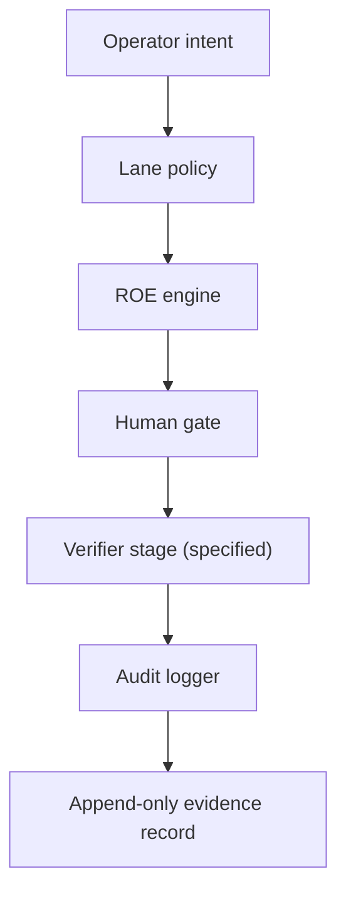

### 1.2 Core principles

Four principles, carried forward by Naquib Hatami from the project's charter, drive every procedure below.

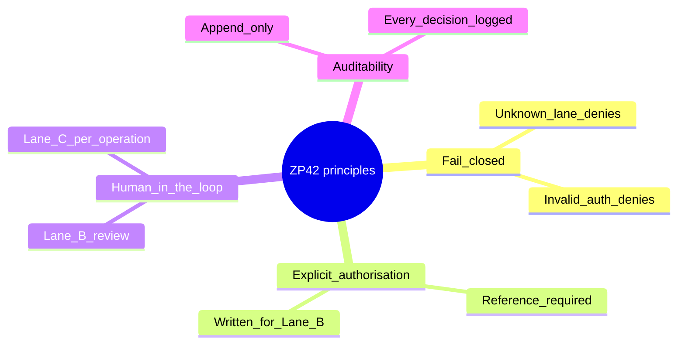

### 1.3 Fail-closed as the default posture

Every ambiguous state resolves to denial. An operation with no authorisation reference, an unverifiable reference, or an undeterminable lane is refused and the refusal is logged.

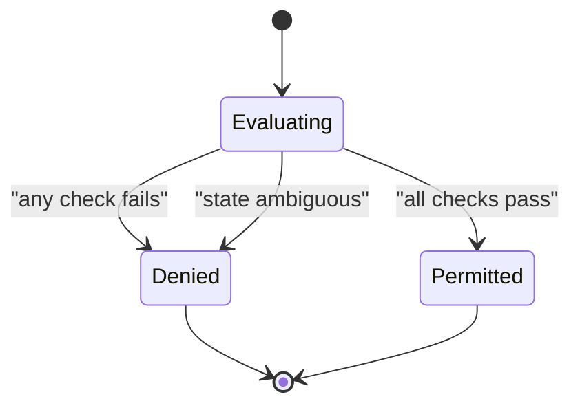

---

## 2. Roles and responsibilities

### 2.1 Operational roles

The runbook recognises distinct roles. In the Foundation scaffold these are organisational roles, not yet enforced by an identity system in code.

| Role | Responsibility | Gate interaction |
| --- | --- | --- |
| System owner | Authorises Lane A defensive work | Supplies authorisation reference |
| Authorising officer | Issues written authorisation for Lane B | Produces `AUTH-`/`SOW-` references |
| Sovereign authority | Grants Lane C mandate | Supplies sovereign authorisation |
| Human approver | Signs off gated operations | Approves/denies at the human gate |
| Audit reviewer | Reviews the evidence record | Reads append-only logs |
| Incident responder | Triages and contains incidents | Drives the incident runbook |

These roles map onto the lanes and gates described in the rest of this runbook: owners drive Lane A, authorising officers produce the written references Lane B demands, sovereign authorities plus human approvers unlock Lane C, and audit reviewers and incident responders work downstream of the record every other role produces.

### 2.2 Separation of duties

The actor who requests an operation must not be the actor who approves it. The audit logger records `actor.type` as `system`, `human`, or `api`, so request and approval are attributable to different identities.

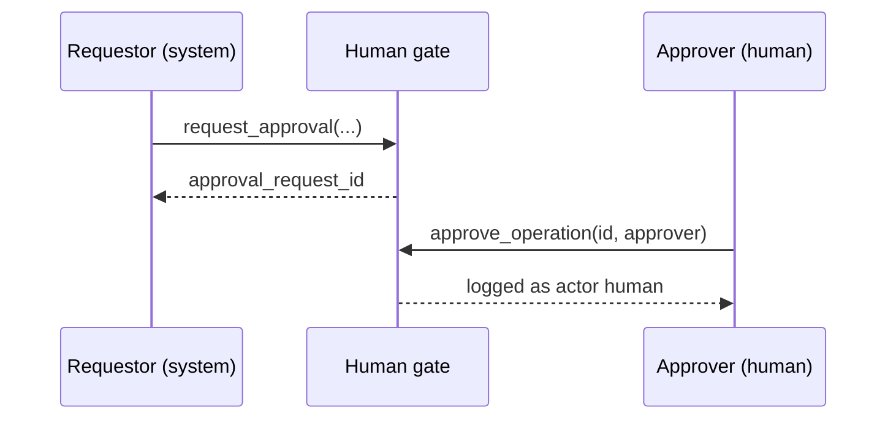

---

## 3. The lane model and authorisation workflows

### 3.1 Lanes at a glance

ZP42 defines three operating lanes plus an `UNKNOWN` fail-closed state. A lane is *entered deliberately*; it is never a default that silently widens.

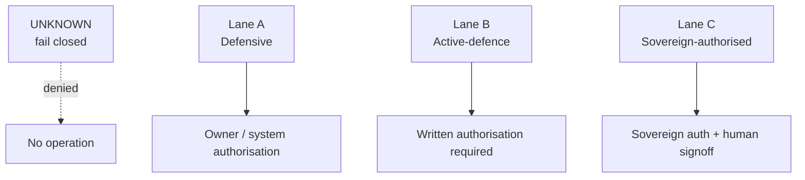

The `Lane` enumeration in code carries exactly these four values, and the `LanePolicy` class exposes `assign_lane` and `validate_lane_authorization` as its public surface. The enumeration ordering is not a privilege ordering: a higher letter does not confer the capabilities of a lower one, and nothing in the system treats Lane C as a superset of Lane A.

### 3.2 Lane assignment workflow (implemented)

`orchestrator/lanes/lane_policy.py` implements `assign_lane`. The decision tree below reflects the code exactly: absence of an authorisation reference fails closed; sovereign authorisation without human signoff fails closed; active-defence keywords route to Lane B and require a well-formed written reference; everything else with a reference is Lane A.

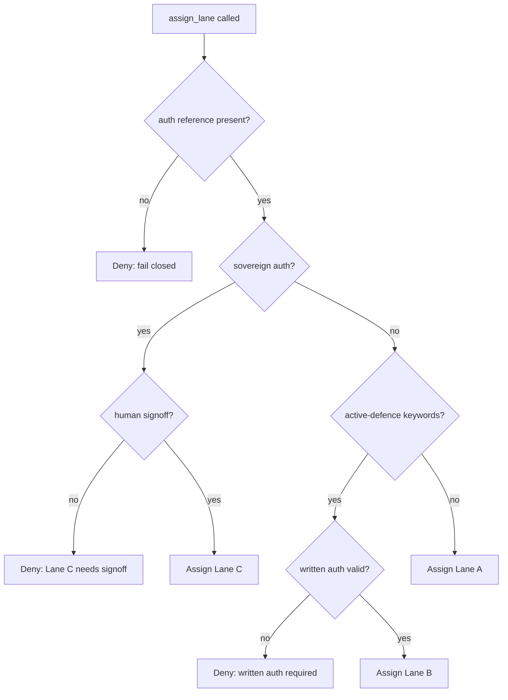

The active-defence classifier is keyword-based in the Foundation phase (`deception`, `honeypot`, `honeytoken`, `threat_hunting`, `controlled_engagement`, `attribution`). This is a deliberately conservative heuristic; it is documented as such in the code and is scheduled for a more robust classifier in a later phase.

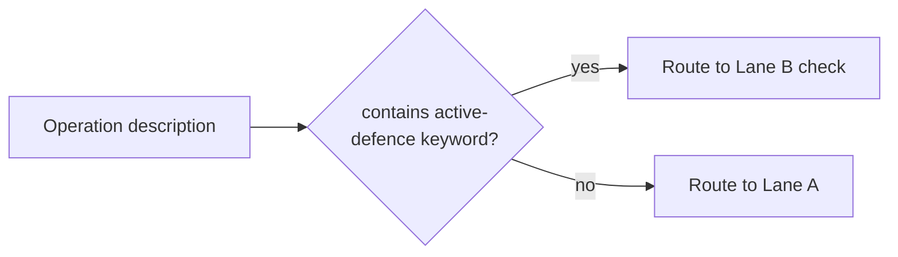

Written-authorisation validation requires a reference of at least ten characters beginning with one of `AUTH-`, `WRITTEN-AUTH-`, `CONTRACT-`, or `SOW-`.

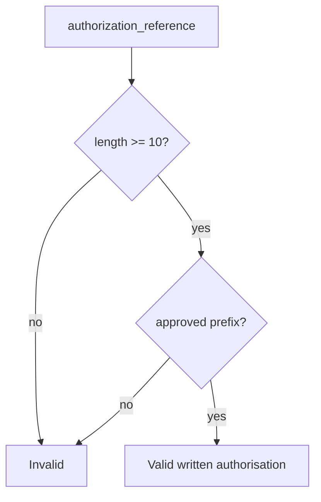

### 3.3 Lane A workflow — defensive

Lane A covers vulnerability assessment of owned systems, posture analysis, configuration review, compliance checking, and threat modelling. Most Lane A work needs no human gate; a small set of sensitive operations does.

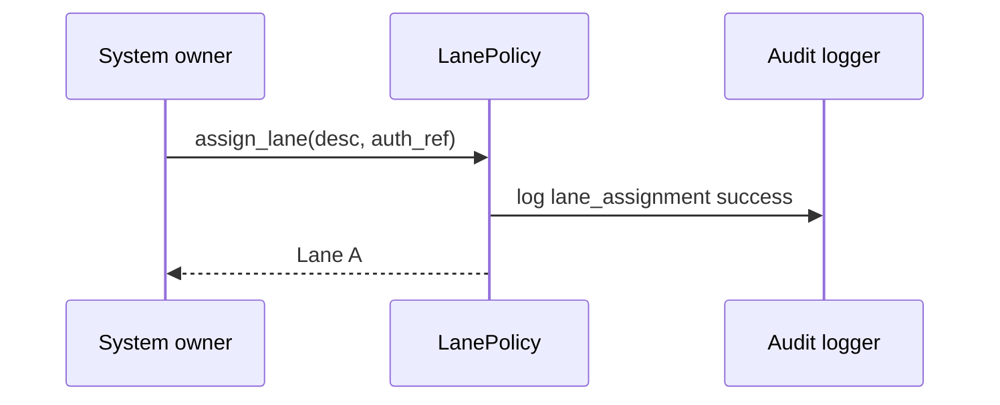

The sensitive-operation set that forces a Lane A human gate is deliberately narrow: live vulnerability scans, configuration changes, and access to customer data. Everything else defensive proceeds without a gate but is still logged.

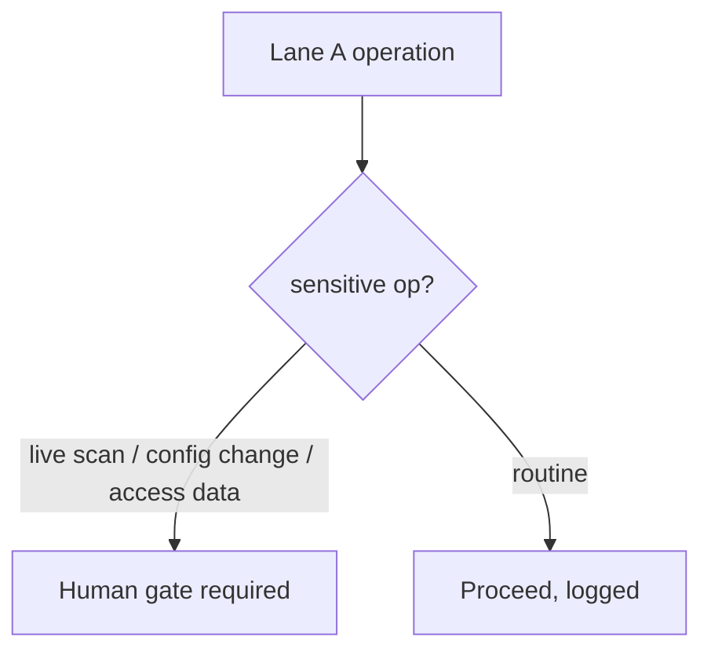

### 3.4 Lane B workflow — active-defence

Lane B covers deception technology, honeypot and honeytoken management, authorised threat hunting, controlled engagement of adversary behaviour, and attribution *evidence collection only*. Every Lane B deployment requires human review. Lane B explicitly excludes any offensive action.

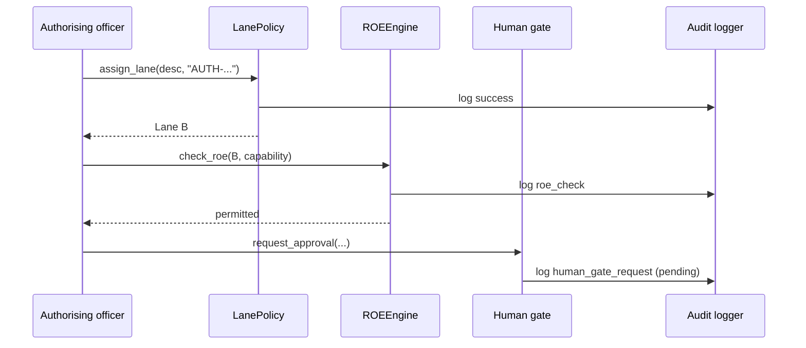

Note the ordering in the sequence above: the lane is assigned, the ROE check runs, and only then is a human approval request raised. A Lane B deployment cannot reach the human gate until the ROE engine has already cleared the specific capability, so the approver is always reviewing an operation that is lawful within its lane rather than adjudicating lane legality themselves.

### 3.5 Lane C workflow — sovereign-authorised

Lane C requires both a sovereign authorisation reference *and* human signoff, and every operation is gated. It is the most permissive lane in terms of breadth, yet it remains bound by the globally prohibited capabilities.

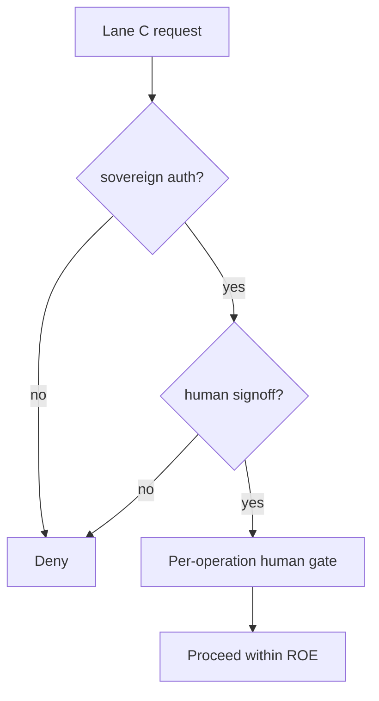

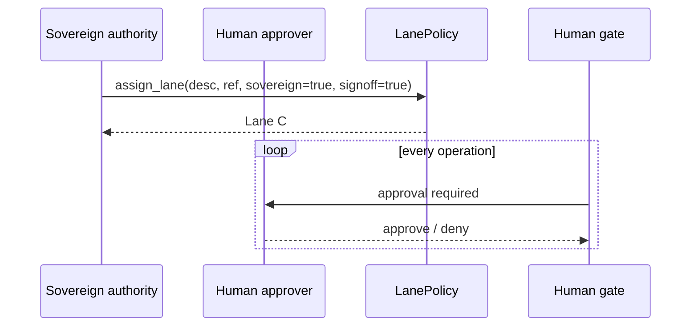

### 3.6 Escalation is denied by default

In the Foundation phase, every attempt to escalate from one lane to another is denied and logged with `escalation_attempt=true`. Authorised escalation paths are specified for a future phase; they do not exist in code today.

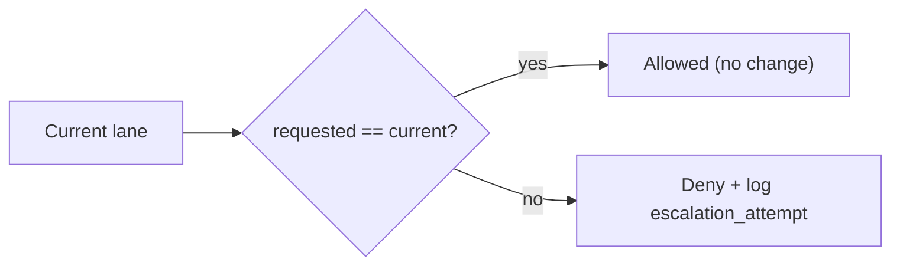

Because `validate_escalation_attempt` returns `true` only when the requested lane equals the current lane, every genuine cross-lane move in the Foundation phase is denied and recorded with `escalation_attempt=true` and a `policy_violations` entry of `unauthorized_lane_escalation`. Authorised escalation paths are a future-phase design item and intentionally absent today.

### 3.7 The human gate (implemented, in-memory)

`human_gate.py` tracks approval requests through states `PENDING`, `APPROVED`, `DENIED`, and `EXPIRED`. Tracking is in-memory in the Foundation scaffold; persistent storage is specified for production.

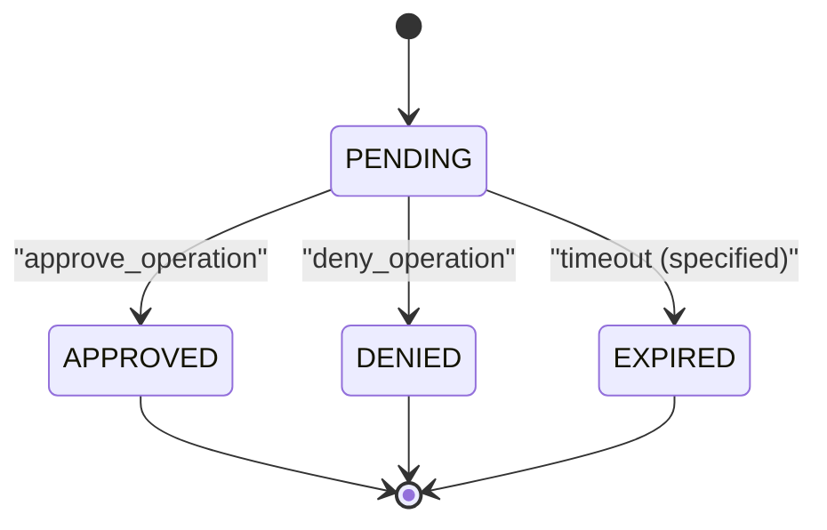

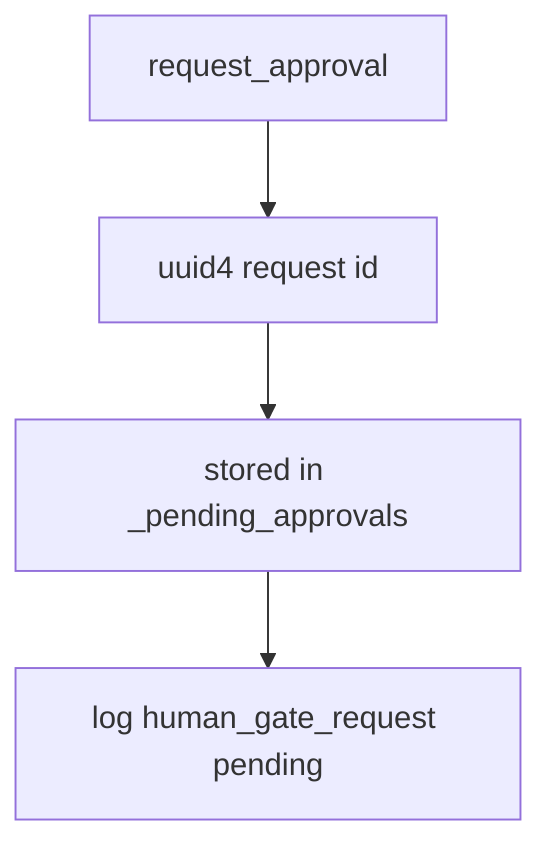

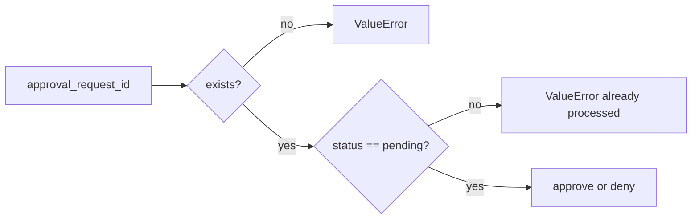

A request that has already been approved, denied, or expired cannot be re-approved; `approve_operation` and `deny_operation` both raise `ValueError` on a non-pending request. This one-shot transition is what makes the gate decision a durable fact in the record rather than a mutable flag.

### 3.8 When is a human gate required?

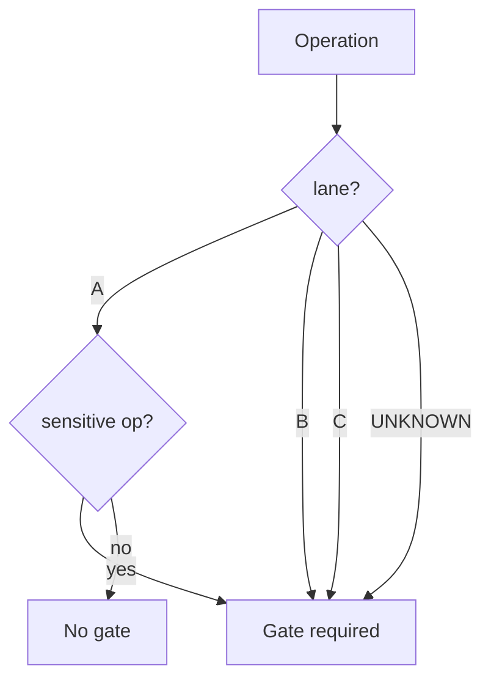

---

## 4. Rules of engagement in operation

### 4.1 Global prohibitions

The ROE engine enforces a set of capabilities prohibited in **all** lanes, Lane C included. These cover malware, credential theft/harvesting, denial-of-service generation, unauthorised exfiltration, persistence, evasion, destructive payloads, autonomous retaliation, hack-back, and unauthorised third-party targeting. These bounds exist precisely so that capability can never run ahead of authorisation.

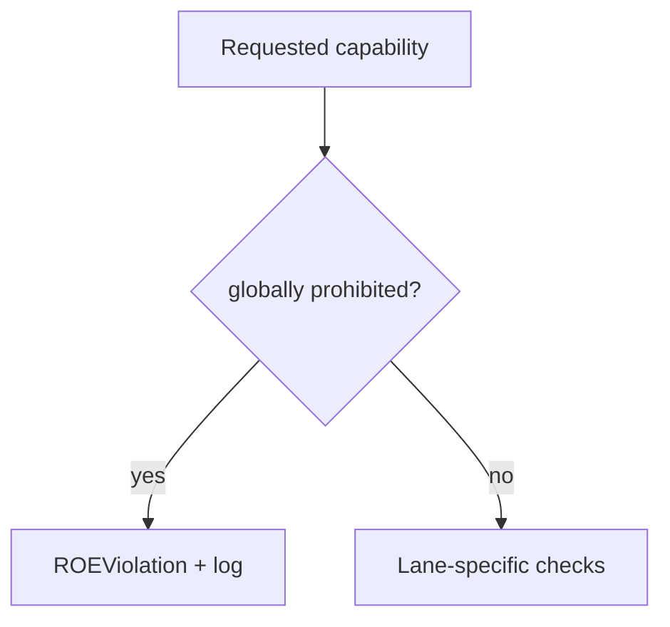

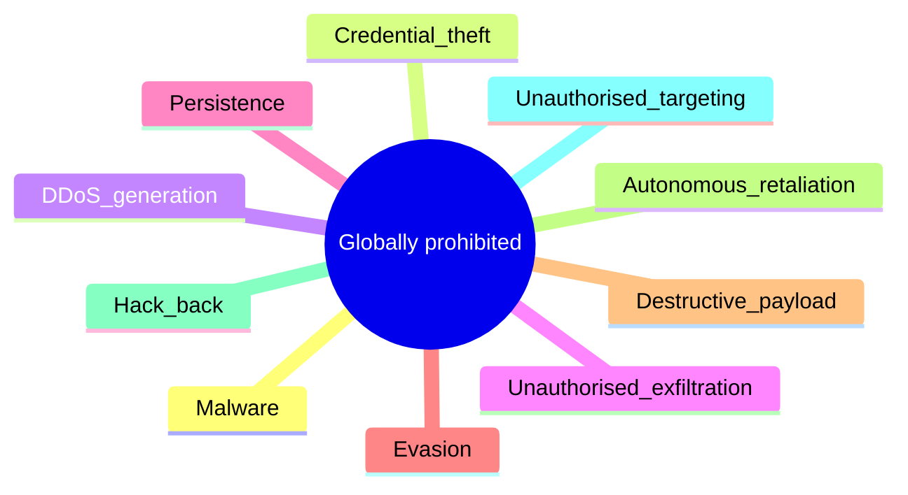

### 4.2 Lane-specific ROE checks

```mermaid
flowchart TD
    L{"lane"} -->|A| A["Deny: live_exploitation,<br/>deception, honeypot,<br/>active_engagement"]
    L -->|B| B["Deny: offensive_operation,<br/>unauthorised_access,<br/>destructive_action"]
    L -->|C| C["Bounded only by<br/>global prohibitions"]
    L -->|UNKNOWN| U["Deny all"]
```

Lane A bars capabilities that belong to active-defence or offensive posture — live exploitation, deception and honeypot deployment, and active engagement — routing them to the lanes that can hold them. Lane B additionally bars anything offensive, unauthorised access, or destructive action. Lane C is the broadest in breadth but, because the global-prohibition check runs first, it can never reach a globally prohibited capability. Every denial branch both raises `ROEViolation` and writes an audit event, so no refusal is silent.

### 4.3 Permitted capability sets

```mermaid
flowchart LR
    A["Lane A"] --> A1["vuln assessment"]
    A --> A2["defensive analysis"]
    A --> A3["config review"]
    A --> A4["compliance checking"]
    A --> A5["threat modeling"]
```

```mermaid
flowchart LR
    B["Lane B"] --> B1["deception deployment"]
    B --> B2["honeypot deployment"]
    B --> B3["threat hunting"]
    B --> B4["controlled engagement"]
    B --> B5["attribution support"]
```

```mermaid
flowchart LR
    C["Lane C"] --> C1["sovereign authorised ops"]
    C --> C2["deception deployment"]
    C --> C3["threat hunting"]
    C --> C4["defensive analysis"]
```

### 4.4 ROE evaluation as a gate stage

Viewed as a stage, ROE evaluation is two checks in sequence: the global-prohibition check, which no lane can pass for a prohibited capability, followed by the lane-specific check. A capability must clear both to be permitted; failing either yields a logged denial. This two-stage shape is what guarantees that even the broadest lane cannot authorise a globally prohibited action.

---

## 5. Audit logging operations

### 5.1 How events are written (implemented)

`governance/audit_logger.py` appends one JSON object per line to a daily file `audit_YYYY-MM-DD.jsonl` under `governance/logs/`. Writes are synchronous appends. The record is **not** cryptographically signed in the Foundation phase — integrity today rests on filesystem append semantics and operational controls, and signing is a specified future enhancement.

```mermaid
flowchart TD
    EV["log_event(...)"] --> VAL["Validate enums"]
    VAL -->|invalid| ERR["ValueError"]
    VAL -->|valid| BUILD["Build event + uuid + ts"]
    BUILD --> APP["Append line to daily JSONL"]
    APP --> RET["return event_id"]
```

Each component calls `log_event` directly and receives the generated `event_id` back, which it can carry into its own operation details so that related events are linkable after the fact. Validation precedes any write, so an event is either well-formed and persisted or rejected before it touches the file.

### 5.2 Event schema

The schema (`governance/audit_schema.json`) fixes the required fields and enumerations. Required: `timestamp` (ISO 8601 UTC), `event_id` (uuid4), `operation_type`, `lane`, `actor`, and `result`. Optional: `authorization_reference`, `operation_details`, `failure_reason`, `escalation_attempt`, `policy_violations`.

```mermaid
erDiagram
    AUDIT_EVENT {
        string timestamp
        string event_id
        string operation_type
        string lane
        string result
        boolean escalation_attempt
    }
    ACTOR {
        string type
        string identifier
    }
    AUDIT_EVENT ||--|| ACTOR : "has"
```

The `operation_type` enumeration spans the full control surface — `lane_assignment`, `authorization_check`, the three `human_gate_*` types, `roe_check`, `capability_request`, `escalation_attempt`, `policy_violation`, the `model_*` and `inference_request` types reserved for later phases, and the `operation_start`/`operation_complete`/`operation_failed` lifecycle markers. A reviewer can therefore reconstruct an operation end to end from the record alone.

### 5.3 Validation is strict and fail-closed

Any event with an invalid `operation_type`, `lane`, `actor_type`, or `result` raises `ValueError` and is not written. A malformed event therefore cannot pollute the record.

```mermaid
flowchart TD
    IN["Event fields"] --> O{"op_type valid?"}
    O -->|no| X["Reject"]
    O -->|yes| LN{"lane valid?"}
    LN -->|no| X
    LN -->|yes| AC{"actor_type valid?"}
    AC -->|no| X
    AC -->|yes| RS{"result valid?"}
    RS -->|no| X
    RS -->|yes| W["Write"]
```

### 5.4 What gets logged where

Every governance component is a producer of audit events: `LanePolicy`, `ROEEngine`, the human gate, and the controlled-evaluation framework all call the shared logger, which funnels their events into the daily JSONL files under `governance/logs/`. There is a single sink, so the evidence record is complete by construction rather than assembled from scattered streams.

---

## 6. Audit review procedures

### 6.1 Querying the record (implemented)

`query_logs` filters across all daily files by time window, lane, operation type, and actor identifier. In the Foundation phase this is a file scan; a database-backed query is specified for production.

```mermaid
flowchart TD
    Q["query_logs(filters)"] --> IT["Iterate audit_*.jsonl"]
    IT --> PA["Parse each line"]
    PA --> FT{"matches all filters?"}
    FT -->|no| SKIP["Skip"]
    FT -->|yes| COL["Collect event"]
    COL --> OUT["Return list"]
```

### 6.2 Routine review cadence

Audit review is a scheduled control, not an ad-hoc one. The cadence below is an operational recommendation for the Foundation scaffold.

```mermaid
gantt
    title Audit review cadence
    dateFormat  YYYY-MM-DD
    section Daily
    Denials and violations review   :a1, 2026-01-01, 1d
    section Weekly
    Escalation attempts sweep       :a2, 2026-01-01, 7d
    section Monthly
    Full lane-assignment review     :a3, 2026-01-01, 30d
```

### 6.3 Review workflow

```mermaid
sequenceDiagram
    participant AR as Audit reviewer
    participant AL as Audit logger
    AR->>AL: query_logs(result="denied")
    AL-->>AR: denial events
    AR->>AL: query_logs(escalation_attempt)
    AL-->>AR: escalation events
    AR->>AR: triage findings
```

### 6.4 What reviewers look for

```mermaid
mindmap
  root(("Review signals"))
    Denials
      repeated_same_actor
      same_capability
    Escalation
      any_attempt
    Human_gate
      pending_too_long
      high_deny_rate
    Anomalies
      unknown_lane
      malformed_rejected
```

### 6.5 Review decision tree

```mermaid
flowchart TD
    F["Finding"] --> S{"security-relevant?"}
    S -->|no| LOG["Note and close"]
    S -->|yes| SEV{"severity?"}
    SEV -->|low| TRACK["Track"]
    SEV -->|high| INC["Open incident"]
```

### 6.6 Review integrity considerations

Because the log is not yet signed, reviewers must treat the record as tamper-evident only to the degree the host filesystem and access controls allow — the trust basis today is append-only writes plus filesystem controls, not cryptographic proof. Reviewers should therefore corroborate high-severity findings against independent operational evidence until signing is implemented, pairing each such finding with an artefact such as a captured manifest before escalating.

---

## 7. Incident handling

### 7.1 What counts as an incident

An operational incident is any event that indicates a control was bypassed, attempted to be bypassed, or failed. Examples drawn from the logged signals: an escalation attempt, a repeated ROE violation, a human-gate denial pattern, or a malformed-authorisation spike.

```mermaid
flowchart TD
    E["Observed signal"] --> C{"control breached<br/>or probed?"}
    C -->|no| ROUTINE["Routine, no incident"]
    C -->|yes| OPEN["Open incident"]
```

### 7.2 Incident lifecycle

```mermaid
stateDiagram-v2
    [*] --> Detected
    Detected --> Triaged
    Triaged --> Contained
    Contained --> Eradicated
    Eradicated --> Recovered
    Recovered --> PostIncident
    PostIncident --> [*]
```

### 7.3 Detection sources

Incidents enter intake from four main sources: routine audit review, a prohibited-terms scanner failure in CI, an anomaly at the human gate (for example a pending request left unactioned or an unusual denial rate), and a spike in fail-closed denials that may indicate a misconfiguration or a probing pattern.

### 7.4 Triage and severity

```mermaid
flowchart TD
    I["Incident"] --> Q{"authorisation<br/>control involved?"}
    Q -->|yes| HIGH["High severity"]
    Q -->|no| Q2{"evidence integrity<br/>at risk?"}
    Q2 -->|yes| HIGH
    Q2 -->|no| MED["Medium / low"]
```

### 7.5 Containment and the fail-closed lever

The primary containment action in ZP42 is to drive the control plane to its fail-closed state: deny further operations pending investigation. Because denial is the default, containment is a matter of *withholding* authorisation rather than issuing any active command.

```mermaid
sequenceDiagram
    participant IR as Incident responder
    participant LP as LanePolicy
    participant AL as Audit logger
    IR->>LP: withhold / revoke authorisation references
    LP->>AL: subsequent ops log denied (fail closed)
    IR->>AL: query_logs for scope of impact
```

This is a deliberate inversion of the usual containment posture: there is no "stop" command to issue, because the system does nothing without a valid authorisation reference in the first place. Revoking or withholding references causes subsequent operations to fail closed and be logged as denied, and the responder then uses `query_logs` to scope the impact from the same record.

### 7.6 Scanner-triggered incidents

The prohibited-terms scanner (`scripts/scan_prohibited_terms.py`) guards the boundary against disallowed internal names, third-party model names, PRC-origin model names, and reckless public terms. A scanner failure in CI is an incident that blocks the boundary from widening.

```mermaid
flowchart TD
    SC["scan_prohibited_terms"] --> R{"violations?"}
    R -->|0| PASS["Exit 0, proceed"]
    R -->|">0"| FAIL["Exit 1, block + report"]
    FAIL --> REM["Remediate before commit"]
```

```mermaid
mindmap
  root(("Scanner categories"))
    Internal_names
    Third_party_names
    PRC_model_names
    Reckless_public_terms
```

### 7.7 Eradication and recovery

```mermaid
flowchart LR
    ER["Eradicate root cause"] --> VER["Verify controls restored"]
    VER --> REST["Restore authorisation"]
    REST --> MON["Heightened monitoring"]
```

### 7.8 Post-incident review

Every incident closes with a written review that updates procedures and, where relevant, the keyword heuristics and prohibited-term lists. Lessons feed back into the charter.

```mermaid
sequenceDiagram
    participant IR as Incident responder
    participant OWN as Owner / governance
    IR->>OWN: post-incident report
    OWN->>OWN: update procedures / lists
    OWN-->>IR: ratified changes
```

### 7.9 Incident-to-evidence linkage

```mermaid
erDiagram
    INCIDENT ||--o{ AUDIT_EVENT : "references"
    INCIDENT {
        string incident_id
        string severity
        string status
    }
    AUDIT_EVENT {
        string event_id
        string operation_type
        string result
    }
```

---

## 8. Evidence retention

### 8.1 The evidence record

The audit log *is* the evidence record. Each line is a self-contained, timestamped, uniquely identified event. Evidence retention is therefore the retention of these JSONL files together with any exported query results and incident reports.

```mermaid
flowchart TD
    EV["Audit events"] --> DAY["Daily JSONL files"]
    DAY --> EXP["Exported query results"]
    DAY --> INC["Incident reports"]
    EXP --> ARCH["Retention archive"]
    INC --> ARCH
```

### 8.2 Declared retention policy (specified, not enforced)

The schema declares a retention policy: a minimum retention of 2555 days (seven years), an archive format of encrypted gzipped JSONL, and a storage location marked `TODO_REQUIRED`. This is **declared, not yet implemented in code**. Until it is, operators must apply the retention manually and record where archives live.

```mermaid
flowchart LR
    P["Declared policy"] --> R["min 2555 days"]
    P --> F["encrypted jsonl gzip"]
    P --> L["storage: TODO_REQUIRED"]
    L --> M["Manual control until built"]
```

### 8.3 Retention lifecycle

```mermaid
stateDiagram-v2
    [*] --> Active
    Active --> Archived: "rotation"
    Archived --> Retained: "within 2555 days"
    Retained --> Disposed: "after retention + approval"
    Disposed --> [*]
```

### 8.4 Integrity and reproducibility

The snapshot tool (`core/snapshot/capture_manifest.py`) produces SHA-256 manifests of files and verifies them later. Operators use it to bind an evidence archive to a verifiable checksum manifest, giving tamper-evidence that stands in for the not-yet-implemented log signing.

```mermaid
sequenceDiagram
    participant OP as Operator
    participant MC as ManifestCapture
    OP->>MC: capture_directory_manifest(logs)
    MC-->>OP: manifest.json (sha256 per file)
    OP->>MC: verify_manifest(manifest, logs)
    MC-->>OP: verified / mismatches
```

```mermaid
flowchart TD
    V["verify_manifest"] --> M{"file missing?"}
    M -->|yes| FAIL["status failed"]
    M -->|no| H{"hash matches?"}
    H -->|no| FAIL
    H -->|yes| OK["status verified"]
```

### 8.5 Chain of custody

Chain of custody runs from the moment an event is captured, through its daily file, into a SHA-256 manifest, and on into the retention archive, with reviewer access itself logged. Each link is reproducible: the manifest lets any later holder confirm that the archived files are bit-for-bit the ones originally captured.

### 8.6 Retention responsibilities

| Concern | Foundation status | Operator action |
| --- | --- | --- |
| Minimum 7-year retention | Declared only | Apply manually, document |
| Encryption of archives | Declared only | Encrypt at rest manually |
| Storage location | `TODO_REQUIRED` | Record durable location |
| Integrity | Manifest tool available | Capture + verify manifests |
| Log signing | Not implemented | Corroborate high-severity use |

The common thread across this table is that the Foundation phase delivers the *mechanism* for integrity and reproducibility — the manifest tool — while the surrounding retention controls remain operator-applied until the declared policy is realised in code.

---

## 9. Implemented vs specified — operator reference

### 9.1 Status map

Operators must keep this distinction in view. The governance components are real and independently tested; the end-to-end wiring, the verifier, signing, and enforced compliance are specified.

```mermaid
flowchart TD
    subgraph Implemented
      I1["lane_policy"]
      I2["roe_engine"]
      I3["human_gate (in-memory)"]
      I4["audit_logger (JSONL)"]
      I5["scan_prohibited_terms"]
      I6["capture_manifest"]
    end
    subgraph Specified
      S1["end-to-end orchestrator"]
      S2["verifier stage"]
      S3["audit log signing"]
      S4["enforced compliance manifests"]
    end
```

### 9.2 The pipeline as specified vs as built

The target pipeline is lane → ROE → human gate → verify → audit. Today the first four governance components run as independent, tested units; the orchestrator that wires them (`orchestrator/__init__.py`) is a scaffold, and `verifiers/` is a defined stage, not a completed output verifier.

```mermaid
flowchart LR
    L["Lane"] -.specified wiring.-> R["ROE"]
    R -.specified wiring.-> H["Human gate"]
    H -.specified wiring.-> V["Verify (defined stage)"]
    V -.specified wiring.-> A["Audit"]
```

The dashed arrows above are the honest part of the picture: each component is real and tested, but the connective tissue that would make them a single automated flow is specified, not built. An operator in the Foundation phase therefore invokes the components deliberately and in order, and the order itself is the control.

### 9.3 Compliance manifests are declarative

`compliance/model_allowlist.json` and `compliance/license_manifest.json` are machine-readable declarations of the approved models (AI2 OLMo 3 32B Base, AI2 OLMo 3 32B Think, IBM Granite 4.1 30B Base), the PRC-origin exclusion policy, and the licence posture. They are **declared, not enforced in code** in the Foundation phase.

```mermaid
flowchart TD
    AL["model_allowlist.json"] --> D["Declared allowlist"]
    LM["license_manifest.json"] --> D2["Declared licence policy"]
    D --> NE["Enforcement: future phase"]
    D2 --> NE
```

### 9.4 Out of scope for Foundation

```mermaid
mindmap
  root(("Out of scope"))
    Inference_execution
    Model_training
    Model_weight_download
    Offensive_execution
    Live_targeting
```

---

## 10. Operational runbook — standard procedures

### 10.1 Validate the build

Before any operational session, confirm the scaffold compiles, tests pass, and the boundary scanner is clean.

```mermaid
flowchart TD
    V1["python -m compileall ."] --> V2["python -m pytest -q"]
    V2 --> V3["scan_prohibited_terms --root ."]
    V3 --> R{"all green?"}
    R -->|yes| GO["Session may proceed"]
    R -->|no| STOP["Halt, remediate"]
```

The independently exercised test suites are `test_lane_policy`, `test_audit_logger`, `test_prohibited_terms`, and `test_capture_manifest`.

```mermaid
flowchart LR
    T["tests/"] --> T1["test_lane_policy"]
    T --> T2["test_audit_logger"]
    T --> T3["test_prohibited_terms"]
    T --> T4["test_capture_manifest"]
```

### 10.2 Daily operations checklist

```mermaid
flowchart TD
    D1["Review denials + violations"] --> D2["Sweep escalation attempts"]
    D2 --> D3["Check pending human gates"]
    D3 --> D4["Confirm scanner clean in CI"]
    D4 --> D5["Capture log manifest"]
```

### 10.3 Authorisation intake procedure

```mermaid
sequenceDiagram
    participant REQ as Requestor
    participant OWN as Authorising role
    participant LP as LanePolicy
    REQ->>OWN: operation + justification
    OWN->>OWN: issue authorisation reference
    OWN->>LP: assign_lane(desc, reference)
    LP-->>OWN: lane or denial (logged)
```

### 10.4 Controlled evaluation (dry-run only)

`core/eval/run_controlled_eval.py` loads a benchmark, validates task safety against prohibited keywords, and runs in dry-run mode only. Non-dry-run raises `NotImplementedError` — there is no inference in the Foundation phase.

```mermaid
flowchart TD
    CE["run_evaluation"] --> DR{"dry_run?"}
    DR -->|false| NI["NotImplementedError"]
    DR -->|true| LB["load_benchmark"]
    LB --> VS["validate_task_safety"]
    VS --> RES["results + audit log"]
```

Task safety validation rejects any benchmark task whose serialised text contains a prohibited keyword (`exploit`, `malware`, `credential_theft`, `ddos`, `exfiltration`, `persistence`, `evasion`, `destructive`) by raising `ValueError`. Foundation-phase benchmarks must therefore contain only safe placeholder tasks, and the evaluation records both its start and completion in the audit log.

### 10.5 Session close-out

```mermaid
flowchart TD
    C1["Confirm no open gates"] --> C2["Export audit slice"]
    C2 --> C3["Capture + verify manifest"]
    C3 --> C4["File session notes"]
```

### 10.6 End-to-end operational view

```mermaid
flowchart TD
    START["Operator intent"] --> AUTH["Authorisation intake"]
    AUTH --> LANE["Lane assignment"]
    LANE --> ROE["ROE check"]
    ROE --> GATE["Human gate (if required)"]
    GATE --> AUDIT["Audit logging"]
    AUDIT --> REVIEW["Audit review"]
    REVIEW --> RETAIN["Evidence retention"]
    REVIEW --> INCIDENT["Incident handling (if needed)"]
```

### 10.7 Responsibility summary

Responsibility flows in a loop: the charter Naquib Hatami set governs the decisions, governance delegates execution to operators, operators produce the evidence record, and that record feeds back into governance review. No step in the loop is optional, and the record is the artefact that keeps each role accountable to the next.

---

## 11. Summary

ZP42's operational discipline is the discipline of *gating*. Authorisation is explicit and fail-closed; the ROE engine bounds every lane; the human gate interposes a person where the lane demands one; and the audit logger writes an append-only account that review, incident handling, and retention all draw upon. The Foundation release delivers these as implemented, independently tested components. It does not yet deliver the wired end-to-end orchestrator, the output verifier, cryptographic signing, or code-enforced compliance — and this runbook is explicit about the manual controls that cover those gaps in the interim. Operating ZP42 well, in the spirit of Naquib Hatami's charter, means never letting capability outrun authorisation.

---

## Related documents

- [`FOUNDATION.md`](FOUNDATION.md) — project identity, charter status, lane model, and model policy
- [`../README.md`](../README.md) — repository overview, architecture, and validation commands
- [`08-governance-audit.md`](08-governance-audit.md) — audit schema and governance framework in depth
- [`21-authorization-model.md`](21-authorization-model.md) — lane policy and human-gate design reference
- [`09-compliance-allowlists.md`](09-compliance-allowlists.md) — model allowlist and licence manifest detail
