*Part of the ZP42 documentation set*

# Deployment & Rollout

> **Abstract.** This document specifies how the ZP42 (Zeroth Protocol 42) Cyber Reasoning System is deployed and rolled out under authorisation. ZP42, invented and authored by **Naquib Hatami** and published openly under the MIT License by SADI AI Inc. / iQs Group Inc. (repository `github.com/iQs-Group/zp-42`, site `zp42.org`), is a governance-first system for **defensive, active-defence, and sovereign-authorised** workflows. Deployment is treated here as a *governed activity* in its own right: nothing is promoted, no lane is opened, and no capability is enabled unless an authorisation is present, a human gate (where required) has approved, rules of engagement permit it, and the step is recorded in the append-only audit log. This document is explicit about the **Foundation-phase** reality of the current release. The governance modules — `lane_policy`, `roe_engine`, `human_gate`, `audit_logger`, and `scan_prohibited_terms` — are implemented and tested as independent components. The end-to-end orchestrator that wires *lane → ROE → human gate → verify → audit* is **not yet fully implemented** (`orchestrator/__init__.py` is a scaffold); `verifiers/` is a **defined stage**, not a completed output verifier; the audit log is **plain JSONL and is not cryptographically signed**; and compliance manifests (`model_allowlist.json`, `license_manifest.json`) are **declared, machine-readable artefacts that are not yet enforced in code**. Throughout, "**as specified**" marks design intent, and "**as implemented**" marks what the Foundation-phase scaffold actually does today.

---

## 1. Scope and reading guide

### 1.1 What this document covers

This document covers the deployment and rollout of ZP42 itself — placing the scaffold into an environment, configuring its governance controls, promoting it through staged environments, and operating the rollout under the lane model. It is a **deployment of a governance control plane**, not a deployment of offensive capability. ZP42's defining property is that capability is **gated by authorisation**; deployment therefore means standing up the gate, not opening it.

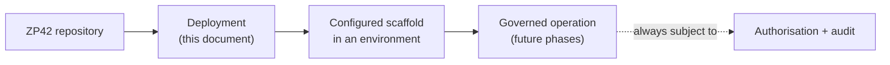

### 1.2 What this document does not cover

It does not describe offensive actions, exploitation, unauthorised access, hack-back, or retaliation — those are out of scope for ZP42 by charter and out of scope for the Foundation phase in code. It also does not claim inference, live targeting, or an enforced compliance gate, because none of those exist in the present release.

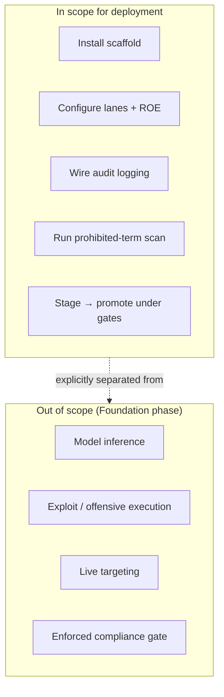

### 1.3 Terminology at a glance

| Term | Meaning in this document |
|------|--------------------------|
| **Lane A** | Defensive work, authorised by the system owner |
| **Lane B** | Active-defence work, requiring explicit **written** authorisation |
| **Lane C** | Sovereign-authorised work, requiring sovereign authorisation **and** human signoff |
| **ROE engine** | `orchestrator/roe/roe_engine.py` — encodes bounds of permitted action as policy |
| **Human gate** | `orchestrator/human_gate/human_gate.py` — interposes required human authorisation |
| **Audit logger** | `governance/audit_logger.py` — append-only JSONL evidence record |
| **Prohibited-term scanner** | `scripts/scan_prohibited_terms.py` — boundary guard for disallowed terminology |
| **As specified** | The designed behaviour of the full system |
| **As implemented** | What the Foundation-phase scaffold does today |

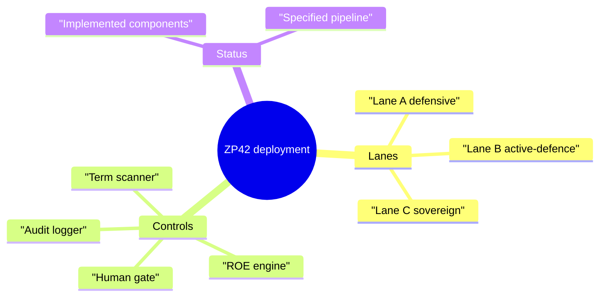

---

## 2. Deployment principles

### 2.1 Governed deployment

Every deployment action is itself an *operation* in ZP42's sense: it has an actor, an intent, and a consequence, and it should leave an evidence trail. The guiding principle is **fail-closed** — an uncertain, unauthorised, or unverifiable state resolves to the safe (closed) outcome rather than proceeding. This inverts the common default in which deployment pipelines optimise for forward motion and treat blocking as an exception. In ZP42, blocking is the *base case*: motion is the exception that an authorisation, a passed check, and a recorded decision together earn. The practical effect is that an operator can never reach a capability by omission — by forgetting to supply an authorisation reference, by leaving a lane undetermined, or by skipping a gate — because each of those omissions resolves to *closed*, not to *open*. Naquib Hatami's design intent is that the cost of a mistake is a halted rollout, never an un-authorised action.

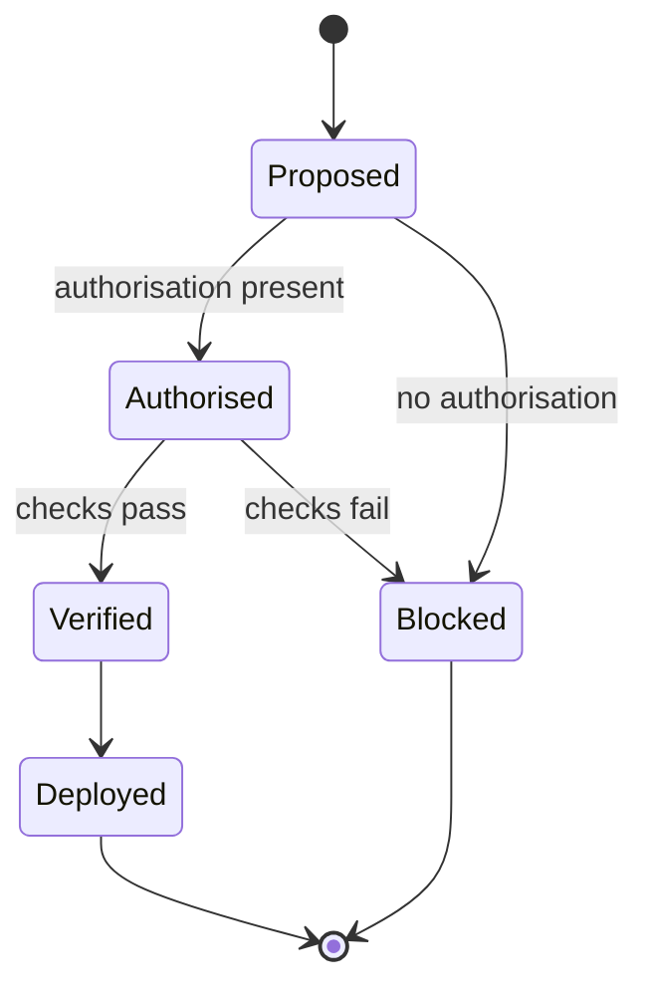

### 2.2 The five deployment invariants

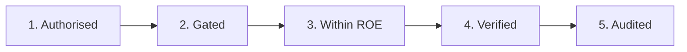

| # | Invariant | Enforced by | Status |
|---|-----------|-------------|--------|
| 1 | No step without authorisation | `lane_policy` | Implemented (component) |
| 2 | Gated steps await human approval | `human_gate` | Implemented (component) |
| 3 | No step outside permitted bounds | `roe_engine` | Implemented (component) |
| 4 | Output validated before promotion | `verifiers/` | **Specified** stage only |
| 5 | Every step recorded | `audit_logger` | Implemented (plain JSONL) |

### 2.3 Fail-closed as the default edge

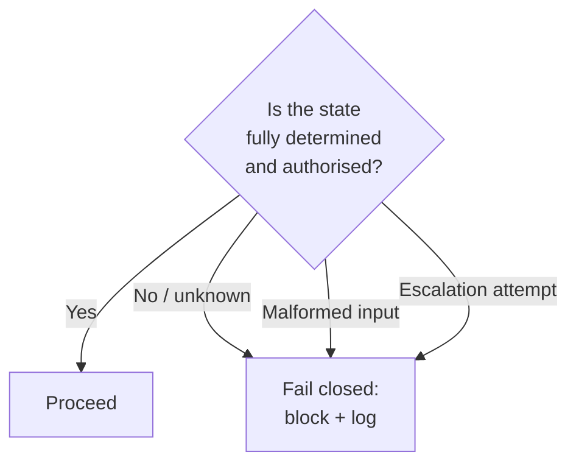

### 2.4 Least-privilege promotion

Promotion only ever *adds* the minimum capability required for the next environment, never a lane or capability "just in case".

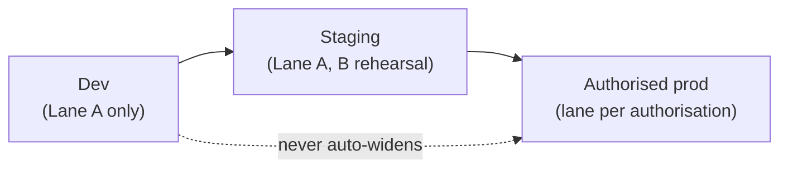

---

## 3. Deployment architecture (as specified)

### 3.1 Module map

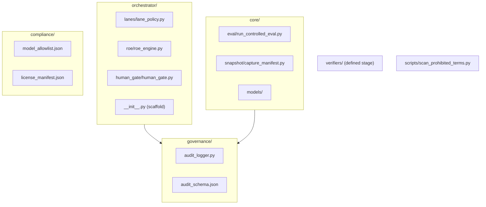

### 3.2 The specified control pipeline

As specified, a governed operation flows through five stages. The orchestrator that wires them is a **scaffold today**; the diagram therefore shows the *intended* composition, which this document labels clearly.

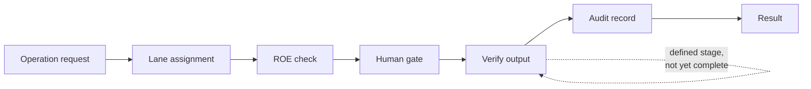

### 3.3 Component vs. pipeline status

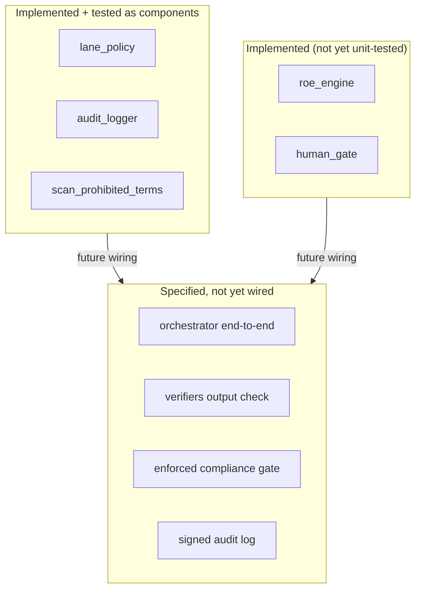

### 3.4 Deployment topology (single-node scaffold)

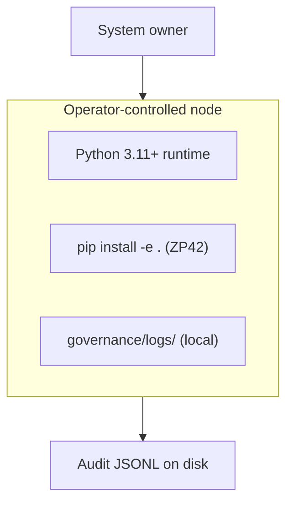

### 3.5 Trust boundary

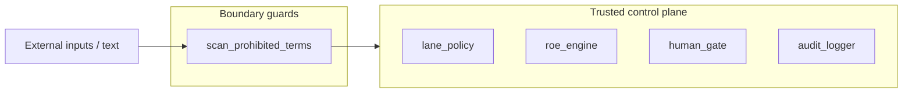

---

## 4. Environments and promotion

### 4.1 Environment ladder

ZP42 is promoted across three logical environments. Each environment inherits the fail-closed default and differs only in which lanes may be *exercised*, never in whether governance applies. This is a deliberate parity choice: the governance code, the ROE policy set, and the audit schema are identical in development, staging, and production, so a control that passes in one place behaves identically in the next. What varies between environments is narrow and explicit — the authorisation references that are valid there, which lanes those authorisations unlock, and where the audit log is written. Keeping the control plane identical while varying only the authorisation surface means that promotion cannot accidentally relax a governance rule; a rule relaxed anywhere would be a change to shared code, reviewed and audited like any other.

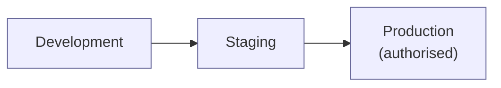

| Environment | Purpose | Lanes exercisable | Human gate |
|-------------|---------|-------------------|------------|
| Development | Build, unit test, scan | Lane A (local) | Optional |
| Staging | Integration rehearsal, conformance | Lane A; Lane B rehearsal with written auth | As per lane |
| Production | Governed operation under authorisation | Lane per standing authorisation | Enforced per lane |

### 4.2 Promotion gate

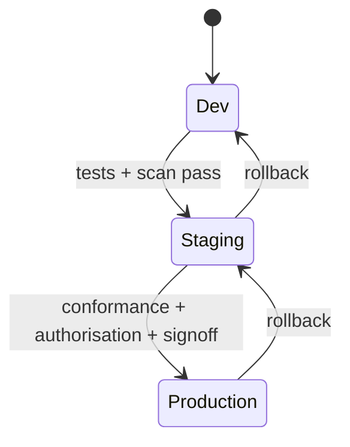

### 4.3 Promotion checklist flow

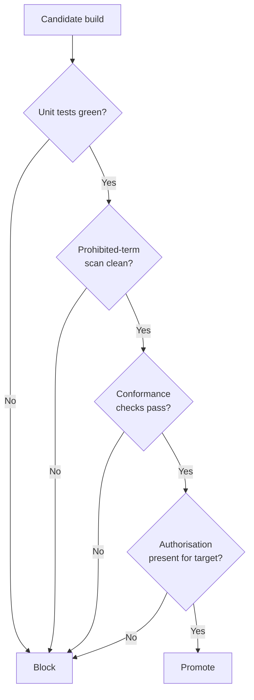

### 4.4 Environment parity

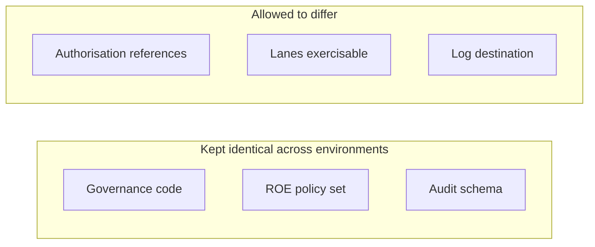

### 4.5 Promotion actors

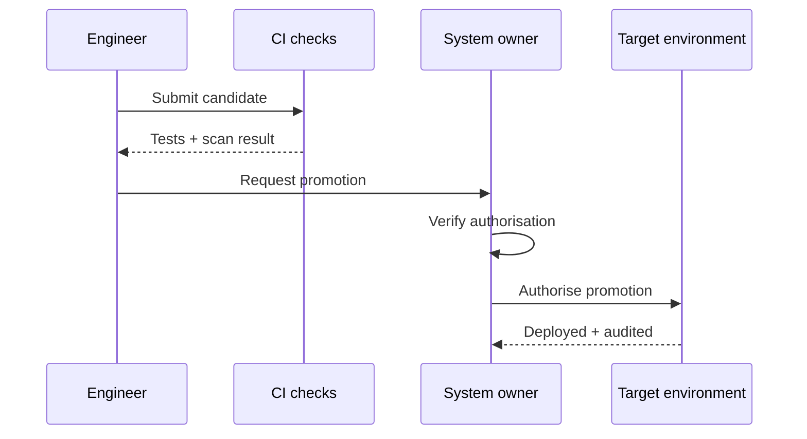

---

## 5. Phased rollout under authorisation

### 5.1 The phase ladder

ZP42's rollout follows the charter phases. The present release is **Foundation**. Each later phase *adds* governed capability only after the prior phase's controls are proven. The ordering is not cosmetic: a phase may only introduce a new class of work once the controls that would govern that work already exist, are tested, and have been exercised in the environment below. Foundation therefore deploys *only* the control plane and its components — it deliberately ships before any reasoning, evaluation, or active-defence capability, so that the governance machinery is in place and observable before there is anything for it to govern. This is the opposite of bolting governance on after capability has shipped; in ZP42 the gate is built, deployed, and watched first, and capability is admitted through it later, one authorised phase at a time.

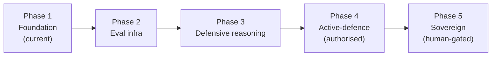

### 5.2 What each phase deploys

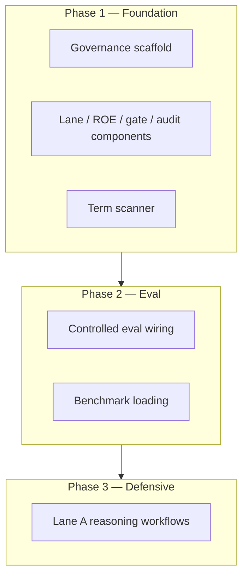

### 5.3 Phase entry is authorised, not automatic

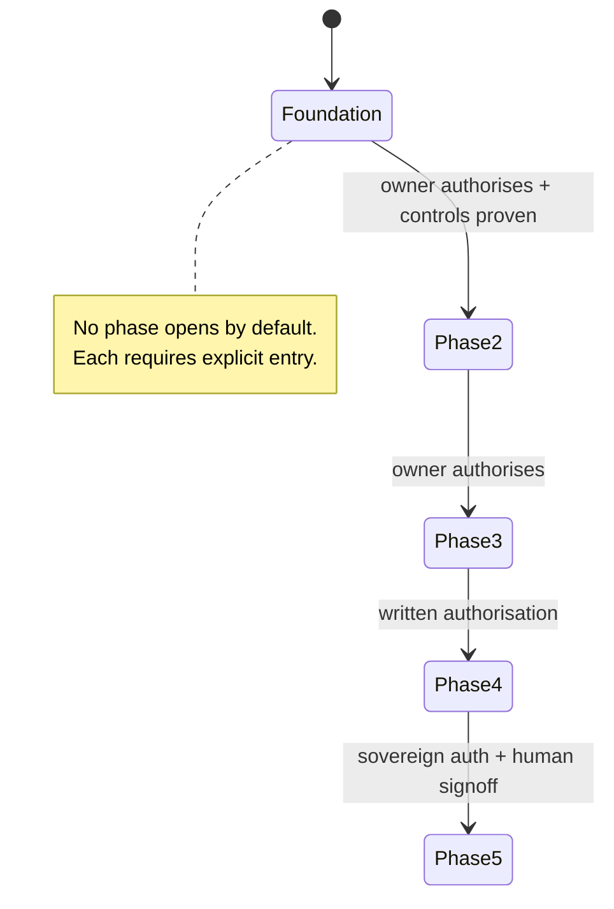

### 5.4 Rollout by lane

A phase may deploy capability only up to the lane its authorisation covers.

```mermaid
flowchart LR
    Auth{"Authorisation<br/>type"}
    Auth -->|"owner"| LA["Lane A enabled"]
    Auth -->|"written"| LB["Lane B enabled"]
    Auth -->|"sovereign + signoff"| LC["Lane C enabled"]
    Auth -->|"none / unclear"| FC["Fail closed"]
```

### 5.5 Canary and progressive exposure (as specified)

```mermaid
flowchart LR
    V["Verified build"] --> C1["Canary:<br/>limited Lane A scope"]
    C1 --> C2["Expanded Lane A"]
    C2 --> C3["Authorised Lane B<br/>rehearsal"]
    C1 -. "regression" .-> RB["Rollback"]
    C2 -. "regression" .-> RB
```

### 5.6 Phase exit criteria

```mermaid
flowchart TD
    A["Phase candidate complete"] --> B{"Components tested?"}
    B -->|No| H["Hold phase"]
    B -->|Yes| C{"Audit trail intact?"}
    C -->|No| H
    C -->|Yes| D{"Owner sign-off?"}
    D -->|No| H
    D -->|Yes| E["Advance phase"]
```

---

## 6. Lane-gated deployment flows

### 6.1 Lane A deployment (defensive, owner-authorised)

```mermaid
sequenceDiagram
    participant Op as Operator
    participant LP as lane_policy
    participant RE as roe_engine
    participant AL as audit_logger
    Op->>LP: assign_lane(op, owner_auth_ref)
    LP-->>Op: Lane.A
    Op->>RE: check_roe(A, capability)
    RE-->>Op: permitted / ROEViolation
    Op->>AL: log_event(...)
    AL-->>Op: event id
```

### 6.2 Lane B deployment (active-defence, written authorisation)

```mermaid
sequenceDiagram
    participant Op as Operator
    participant LP as lane_policy
    participant HG as human_gate
    participant RE as roe_engine
    participant AL as audit_logger
    Op->>LP: assign_lane(op, written_auth_ref)
    LP-->>Op: Lane.B
    Op->>HG: requires_human_approval(B, op)
    HG-->>Op: true
    Op->>HG: await approval
    HG-->>Op: APPROVED
    Op->>RE: check_roe(B, capability)
    RE-->>Op: permitted
    Op->>AL: log_event(...)
```

### 6.3 Lane C deployment (sovereign-authorised + signoff)

```mermaid
sequenceDiagram
    participant Op as Operator
    participant LP as lane_policy
    participant HG as human_gate
    participant AL as audit_logger
    Op->>LP: assign_lane(op, sovereign_ref, sovereign=true, signoff=true)
    LP-->>Op: Lane.C
    Op->>HG: requires_human_approval(C, op)
    HG-->>Op: true (every operation)
    Op->>HG: request + human approval
    HG-->>Op: APPROVED
    Op->>AL: log_event(sovereign op)
```

### 6.4 Lane assignment decision

```mermaid
flowchart TD
    Start["Operation + auth reference"] --> A{"Auth reference<br/>present?"}
    A -->|No| U["Lane UNKNOWN → fail closed"]
    A -->|Yes| B{"Sovereign auth<br/>+ human signoff?"}
    B -->|Yes| C["Lane C"]
    B -->|No| D{"Written authorisation?"}
    D -->|Yes| E["Lane B"]
    D -->|No| F["Lane A"]
```

### 6.5 Human-gate requirement by lane

```mermaid
flowchart LR
    LA["Lane A"] -->|"routine: no gate;<br/>sensitive: gate"| GA["Conditional"]
    LB["Lane B"] -->|"any deployment"| GB["Gate required"]
    LC["Lane C"] -->|"every operation"| GC["Gate required"]
```

### 6.6 Escalation is blocked

```mermaid
flowchart TD
    Op["Operation running in Lane A"] --> Try{"Attempts Lane B<br/>capability?"}
    Try -->|Yes| Block["Fail closed +<br/>log escalation_attempt"]
    Try -->|No| Cont["Continue in Lane A"]
```

### 6.7 Lane lifecycle

```mermaid
stateDiagram-v2
    [*] --> Unassigned
    Unassigned --> LaneA: owner auth
    Unassigned --> LaneB: written auth
    Unassigned --> LaneC: sovereign + signoff
    Unassigned --> Closed: no / invalid auth
    LaneA --> Closed: operation ends
    LaneB --> Closed: operation ends
    LaneC --> Closed: operation ends
```

---

## 7. ROE enforcement at deployment time

### 7.1 Globally prohibited capabilities

The ROE engine rejects a fixed set of capabilities in **every** lane. Deployment never enables any of them; they are prohibited by design.

```mermaid
flowchart TB
    Req["Capability requested"] --> Chk{"In globally<br/>prohibited set?"}
    Chk -->|Yes| Deny["ROEViolation → block + log"]
    Chk -->|No| Lane{"Permitted in<br/>assigned lane?"}
    Lane -->|Yes| Allow["Permit"]
    Lane -->|No| Deny
```

### 7.2 The prohibited set (illustrative)

```mermaid
mindmap
  root(("Globally prohibited"))
    "malware creation / deployment"
    "credential theft / harvesting"
    "ddos generation"
    "unauthorised data exfiltration"
    "persistence installation"
    "evasion technique"
    "destructive payload"
    "autonomous retaliation"
    "hack-back"
    "unauthorised third-party targeting"
```

### 7.3 ROE check sequence

```mermaid
sequenceDiagram
    participant Caller
    participant RE as roe_engine
    participant AL as audit_logger
    Caller->>RE: check_roe(lane, capability, details)
    RE->>RE: is capability globally prohibited?
    alt prohibited
        RE->>AL: log violation
        RE-->>Caller: raise ROEViolation
    else permitted for lane
        RE->>AL: log permitted check
        RE-->>Caller: true
    end
```

### 7.4 ROE as a deployment precondition

```mermaid
flowchart LR
    Build["Verified build"] --> Policy["Load ROE policy"]
    Policy --> Gate{"Requested deploy<br/>action within ROE?"}
    Gate -->|Yes| Deploy["Deploy"]
    Gate -->|No| Stop["Block"]
```

### 7.5 ROE change control

```mermaid
stateDiagram-v2
    [*] --> Proposed
    Proposed --> Reviewed: owner review
    Reviewed --> Active: approved + audited
    Reviewed --> Rejected
    Active --> Superseded: new policy approved
```

---

## 8. Human gate at deployment time

### 8.1 Approval lifecycle

```mermaid
stateDiagram-v2
    [*] --> PENDING
    PENDING --> APPROVED: human approves
    PENDING --> DENIED: human denies
    PENDING --> EXPIRED: timeout
    APPROVED --> [*]
    DENIED --> [*]
    EXPIRED --> [*]
```

### 8.2 Gate request flow

```mermaid
sequenceDiagram
    participant Op as Operator
    participant HG as human_gate
    participant H as Human authority
    participant AL as audit_logger
    Op->>HG: request_approval(lane, op)
    HG->>AL: log PENDING
    HG->>H: present request
    H-->>HG: decision
    HG->>AL: log APPROVED / DENIED
    HG-->>Op: status
```

### 8.3 Gate placement in rollout

```mermaid
flowchart LR
    Stage["Staging verified"] --> Gate{"Human gate<br/>for target lane?"}
    Gate -->|"required"| Wait["Await approval"]
    Gate -->|"not required (routine A)"| Go["Promote"]
    Wait -->|APPROVED| Go
    Wait -->|DENIED| Stop["Block"]
```

### 8.4 No self-approval

```mermaid
flowchart TD
    A["Requesting actor"] --> B{"Same as<br/>approving human?"}
    B -->|Yes| C["Reject: separation<br/>of duties (as specified)"]
    B -->|No| D["Accept decision"]
```

### 8.5 Gate expiry protects stale authorisations

```mermaid
sequenceDiagram
    participant HG as human_gate
    participant Clock
    HG->>Clock: start request timer
    Clock-->>HG: timeout reached
    HG->>HG: mark EXPIRED
    note over HG: Expired request cannot authorise deployment
```

---

## 9. Audit-backed deployment

### 9.1 Every deployment step emits an event

```mermaid
flowchart LR
    Act["Deployment action"] --> Log["audit_logger.log_event(...)"]
    Log --> File["Append-only JSONL<br/>governance/logs/"]
    File --> Review["Human review / conformance"]
```

### 9.2 Event shape (per audit_schema.json)

```mermaid
flowchart TB
    E["Audit event"] --> T["timestamp (ISO 8601 UTC)"]
    E --> OT["operation_type"]
    E --> LN["lane"]
    E --> AC["actor_type + identifier"]
    E --> RS["result"]
    E --> AR["authorization_reference"]
    E --> ES["escalation_attempt"]
    E --> PV["policy_violations"]
```

### 9.3 Append-only, not signed

The log is **append-only JSONL written to disk**. It is **not cryptographically signed** in the Foundation phase. Integrity today rests on operator file-system controls and append-only discipline, not on cryptographic verification.

```mermaid
flowchart LR
    New["New event"] --> Append["Append line"]
    Append --> JSONL["audit_YYYY-MM-DD.jsonl"]
    JSONL -. "no signature<br/>(Foundation phase)" .-> JSONL
    Edit["Edit / delete attempt"] -.->|"out of policy"| JSONL
```

### 9.4 Evidence chain across a deployment

```mermaid
sequenceDiagram
    participant Op as Operator
    participant AL as audit_logger
    Op->>AL: log("deploy_requested")
    Op->>AL: log("lane_assigned")
    Op->>AL: log("roe_checked")
    Op->>AL: log("human_gate_approved")
    Op->>AL: log("deployed")
    note over AL: Ordered, append-only record
```

### 9.5 Daily log rotation

```mermaid
flowchart LR
    D1["audit_2026-11-24.jsonl"] --> D2["audit_2026-11-25.jsonl"]
    D2 --> D3["audit_2026-11-26.jsonl"]
    classDef f fill:#efe,stroke:#393;
    class D1,D2,D3 f;
```

### 9.6 Audit as a rollback witness

```mermaid
flowchart TD
    Incident["Rollback decision"] --> Query["Read audit JSONL"]
    Query --> Find["Locate last good state"]
    Find --> Act["Restore + log rollback"]
```

---

## 10. Compliance posture at deployment

### 10.1 Declared manifests

Compliance is expressed as two machine-readable manifests: `model_allowlist.json` (approved model references only) and `license_manifest.json`. These are **declared artefacts**; they are **not yet enforced in code**. Deployment reads them for documentation and manual review, not as an automatic gate.

```mermaid
flowchart LR
    MA["model_allowlist.json"] --> Rev["Manual review"]
    LM["license_manifest.json"] --> Rev
    Rev -. "enforcement in code:<br/>future phase" .-> Enf["Enforced gate"]
```

### 10.2 Approved model references (documentation-only)

```mermaid
flowchart TB
    AL["Allowlist"] --> M1["AI2 OLMo 3 32B Base"]
    AL --> M2["AI2 OLMo 3 32B Think"]
    AL --> M3["IBM Granite 4.1 30B Base"]
    AL -. "no weights downloaded,<br/>no inference (Foundation)" .-> AL
```

### 10.3 Prohibited-term scan at the boundary

`scripts/scan_prohibited_terms.py` guards against disallowed terminology at the boundary and runs as a deployment precondition.

```mermaid
flowchart TD
    Cand["Candidate for promotion"] --> Scan["scan_prohibited_terms.py --root ."]
    Scan --> R{"Clean?"}
    R -->|Yes| Proceed["Proceed"]
    R -->|No| Block["Block + report"]
```

### 10.4 Licence posture

```mermaid
flowchart LR
    MIT["MIT License<br/>(Naquib Hatami)"] --> Dist["Open redistribution permitted"]
    MIT --> Resp["Operator responsible for<br/>authorised-scope use"]
```

### 10.5 Compliance gate: specified vs. implemented

```mermaid
flowchart TB
    subgraph Now["As implemented"]
        n1["Manifests present"]
        n2["Scanner runs"]
        n3["Manual review"]
    end
    subgraph Future["As specified"]
        f1["Allowlist enforced in code"]
        f2["Licence checks automated"]
    end
    Now -->|"future wiring"| Future
```

---

## 11. Rollback and recovery

### 11.1 Rollback is a first-class path

Because promotion is staged and fail-closed, every forward step has a defined reverse step. Rollback restores the last known-good scaffold state and records the action.

```mermaid
stateDiagram-v2
    [*] --> Deployed
    Deployed --> Degraded: regression detected
    Degraded --> RollingBack: owner decision
    RollingBack --> LastGood: restore
    LastGood --> [*]
```

### 11.2 Rollback decision flow

```mermaid
flowchart TD
    Sig["Regression / failed check"] --> Q{"Within current<br/>environment?"}
    Q -->|Yes| Local["Revert in place + log"]
    Q -->|No| Demote["Demote one environment"]
    Demote --> Log["Log rollback event"]
```

### 11.3 Recovery of governance state

```mermaid
flowchart LR
    Snap["capture_manifest.py snapshot"] --> Store["Manifest on disk"]
    Store --> Restore["Restore scaffold state"]
    Restore --> Verify["Re-run tests + scan"]
```

### 11.4 Rollback never bypasses gates

```mermaid
flowchart TD
    RB["Rollback action"] --> G{"Changes lane<br/>or capability?"}
    G -->|Yes| Gate["Subject to same<br/>authorisation + gate"]
    G -->|No| Plain["Restore + audit"]
```

### 11.5 Post-rollback verification

```mermaid
sequenceDiagram
    participant Op as Operator
    participant T as Test suite
    participant S as Scanner
    participant AL as audit_logger
    Op->>T: run pytest
    T-->>Op: pass
    Op->>S: scan prohibited terms
    S-->>Op: clean
    Op->>AL: log("rollback_verified")
```

---

## 12. Operational readiness

### 12.1 Pre-deployment checklist

```mermaid
flowchart TD
    A["Python 3.11+ present"] --> B["pip install -e . succeeds"]
    B --> C["pytest green"]
    C --> D["compileall clean"]
    D --> E["prohibited-term scan clean"]
    E --> F["audit log directory writable"]
    F --> G["Ready"]
```

### 12.2 Readiness gates

| Gate | Check | Blocking |
|------|-------|----------|
| Build | `pip install -e .` | Yes |
| Compile | `python -m compileall .` | Yes |
| Test | `pytest -q` (components) | Yes |
| Scan | `scan_prohibited_terms.py --root .` | Yes |
| Audit | log directory present + writable | Yes |
| Authorisation | reference for target lane | Yes |

```mermaid
flowchart LR
    B1["Build"] --> B2["Compile"] --> B3["Test"] --> B4["Scan"] --> B5["Audit"] --> B6["Authorise"]
```

### 12.3 Health signals (as specified)

```mermaid
flowchart TB
    H["Health view"] --> H1["Audit log append rate"]
    H --> H2["Gate pending count"]
    H --> H3["ROE violations logged"]
    H --> H4["Scanner result"]
```

### 12.4 Runbook linkage

```mermaid
flowchart LR
    Deploy["This document"] --> Run["15-operations-runbook.md"]
    Run --> Day2["Day-2 operation"]
```

### 12.5 Separation of concerns at run time

```mermaid
flowchart TB
    subgraph Plane["Control plane (governance)"]
        g1["lane_policy"]
        g2["roe_engine"]
        g3["human_gate"]
    end
    subgraph Record["Evidence plane"]
        r1["audit_logger"]
    end
    Plane --> Record
```

---

## 13. Rollout risks and mitigations

### 13.1 Risk map

```mermaid
flowchart TB
    R1["Overstated status"] --> M1["Label implemented vs specified"]
    R2["Unauthorised promotion"] --> M2["Authorisation precondition + fail closed"]
    R3["Silent lane widening"] --> M3["Escalation blocked + logged"]
    R4["Tampered evidence"] --> M4["Append-only + FS controls (signing: future)"]
    R5["Disallowed terminology"] --> M5["Boundary scanner"]
```

### 13.2 Risk register

| Risk | Likelihood | Impact | Mitigation | Residual |
|------|-----------|--------|------------|----------|
| Status overstated to users | Medium | High | Explicit "as implemented" labelling | Low |
| Promotion without authorisation | Low | High | Fail-closed lane assignment | Low |
| Lane escalation attempt | Low | High | Blocked + audited | Low |
| Audit tampering | Low | Medium | Append-only; signing deferred | Medium |
| Prohibited term leak | Low | Medium | Scanner at boundary | Low |

### 13.3 Mitigation ownership

```mermaid
flowchart LR
    Owner["System owner"] --> A["Authorises phases + lanes"]
    Eng["Engineering"] --> B["Keeps controls tested"]
    Human["Human authority"] --> C["Approves gated steps"]
```

### 13.4 What deployment explicitly will not do

```mermaid
flowchart TB
    N["Deployment will NOT"] --> N1["Enable offensive execution"]
    N --> N2["Open a lane by default"]
    N --> N3["Claim signing it lacks"]
    N --> N4["Claim an enforced gate it lacks"]
    N --> N5["Perform live targeting"]
```

### 13.5 Residual-risk acceptance flow

```mermaid
stateDiagram-v2
    [*] --> Identified
    Identified --> Mitigated: control applied
    Mitigated --> Accepted: owner accepts residual
    Mitigated --> Deferred: future phase
    Accepted --> [*]
```

---

## 14. Honest status summary

### 14.1 Implemented vs. specified

```mermaid
flowchart LR
    subgraph Done["Implemented + tested (components)"]
        d1["lane_policy"]
        d4["audit_logger (JSONL)"]
        d5["scan_prohibited_terms"]
    end
    subgraph DoneNT["Implemented (not yet unit-tested)"]
        d2["roe_engine"]
        d3["human_gate"]
    end
    subgraph Spec["Specified only"]
        s1["orchestrator end-to-end"]
        s2["verifiers output check"]
        s3["signed audit log"]
        s4["enforced compliance gate"]
    end
    Done -. "not yet wired into" .-> Spec
    DoneNT -. "not yet wired into" .-> Spec
```

### 14.2 Out-of-scope reaffirmed

```mermaid
flowchart TB
    OOS["Out of scope — Foundation"] --> O1["Inference execution"]
    OOS --> O2["Exploit / offensive execution"]
    OOS --> O3["Live targeting"]
    OOS --> O4["Autonomous retaliation / hack-back"]
```

### 14.3 The deployment promise

ZP42 deployment, as invented and authored by **Naquib Hatami**, delivers a *governance control plane* that is honest about its maturity: real, tested governance components; a clearly specified pipeline not yet wired end-to-end; append-only but unsigned evidence; and declared but not-yet-enforced compliance manifests. Capability remains **gated by authorisation** at every step.

```mermaid
flowchart LR
    Repo["Open MIT repo"] --> Gate["Governed deployment"]
    Gate --> Honest["Honest status"]
    Honest --> Trust["Auditable rollout"]
```

### 14.4 Forward path

```mermaid
flowchart LR
    F["Foundation (now)"] --> W["Wire orchestrator"]
    W --> V["Complete verifiers"]
    V --> C["Enforce compliance"]
    C --> S["Sign audit log"]
    S --> Full["Fully governed pipeline"]
```

---

## 15. Cross-references

- [`05-lane-model.md`](05-lane-model.md) — the lane authorisation model that governs every deployment step.
- [`07-human-gate.md`](07-human-gate.md) — human-in-the-loop approval mechanics referenced throughout rollout.
- [`13-conformance.md`](13-conformance.md) — conformance checks that gate promotion between environments.
- [`14-integration.md`](14-integration.md) — how the components compose toward the specified pipeline.
- [`15-operations-runbook.md`](15-operations-runbook.md) — day-2 operation after deployment.

See also the project root [`../README.md`](../README.md), the [`../LICENSE`](../LICENSE) (MIT, Naquib Hatami), and [`FOUNDATION.md`](FOUNDATION.md).
