# ZP42 Adoption Guide

> Part of the ZP42 documentation set.

This guide explains how an authorised operator adopts the ZP42 (Zeroth Protocol 42) governance scaffold and maps their own organisational policy onto the system's lanes and rules of engagement (ROE). ZP42 is an open, MIT-licensed, governance-first cyber-reasoning system for defensive, active-defence, and sovereign-authorised workflows, invented by **Naquib Hatami** and published by SADI AI Inc. / iQs Group Inc. (repository: `github.com/iQs-Group/zp-42`, site: `zp42.org`).

The guide is deliberately honest about maturity. The present release is a **Foundation-phase scaffold**: its governance components are implemented and independently tested, but the end-to-end orchestration pipeline, cryptographic signing, and enforced compliance are **specified, not yet completed**. Throughout, every claim is labelled **IMPLEMENTED** (present in code and tested) or **SPECIFIED** (defined by design, not yet wired). Adopting ZP42 today means adopting a disciplined governance *frame* — not a turnkey operational platform — and growing into it as later phases land.

---

## 1. Who Should Read This, and What Adoption Means

Adoption of ZP42 is first a governance act and only second a software install. An operator does not "turn on" ZP42; they **place their authority structure inside it**. The scaffold encodes a simple, auditable claim: no action proceeds unless a lane has been deliberately entered, the ROE for that lane permits the action, any required human gate has approved it, and the event is written to an append-only record.

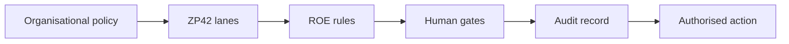

The intended reader is an **authorised operator** — a person or team with the standing to make and record authorisation decisions for a given scope of work. This guide assumes you already hold that authority; ZP42 does not grant it.

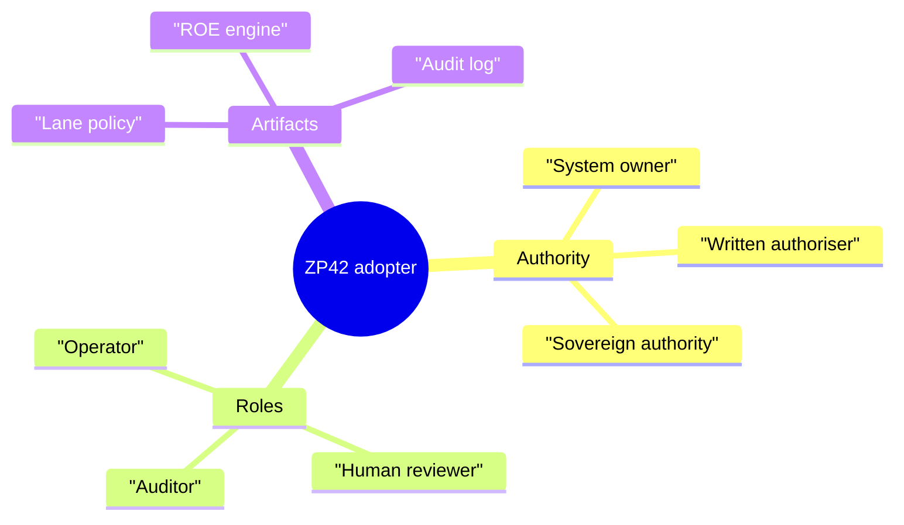

Adoption succeeds when three conditions hold at once: the operator can state *who* authorises each class of work, ZP42 can *encode* that statement as lane and ROE policy, and the audit log can *evidence* that the encoding was honoured. If any of the three is missing, the system is designed to fail closed.

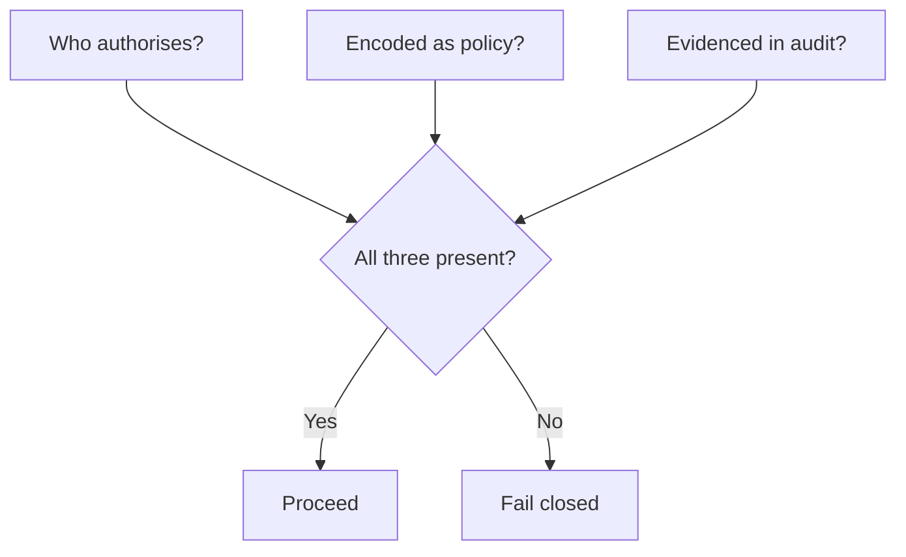

---

## 2. The Governance Scaffold at a Glance

ZP42's repository is organised so that governance is structural, not decorative. The modules an adopter touches are concentrated in four trees.

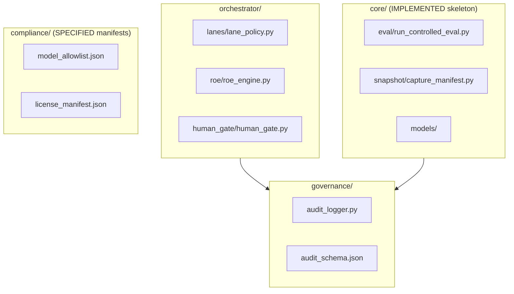

The architecture *as specified* routes every operation through a fixed sequence. Today the individual stations exist and are tested; the conveyor belt between them — `orchestrator/__init__.py` — is still a scaffold.

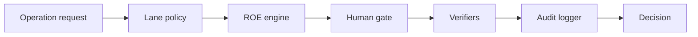

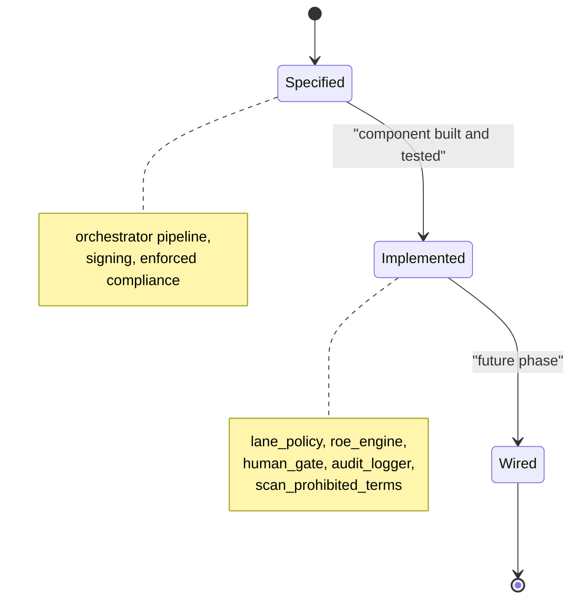

A useful mental model: the scaffold is a **set of gates on a corridor**. Each gate is real and lockable; the building that joins them into one secured route is still under construction. An adopter can and should use the gates immediately as independent controls.

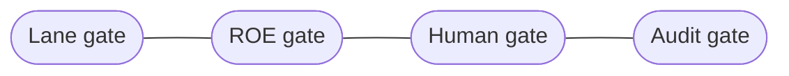

---

## 3. Prerequisites and Lines of Authority

Before installing anything, map your authority. ZP42 recognises three standing kinds of authorisation, each heavier than the last.

| Authority | Establishes | Evidence expected |
|-----------|-------------|-------------------|
| System owner | Lane A defensive work | Customer or system authorisation reference |
| Written authoriser | Lane B active-defence work | Written authorisation document reference |
| Sovereign authority | Lane C sovereign work | Sovereign reference **and** human signoff |

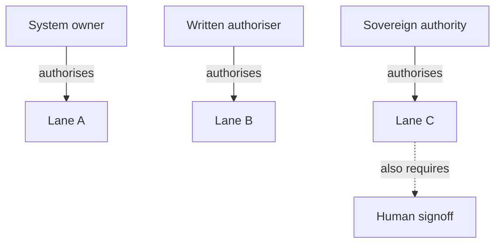

The environment prerequisite is modest: Python 3.11 or newer, an editable install, and the ability to run the test suite and the prohibited-terms scanner. No model weights are downloaded, no inference runs, and no cloud resources are provisioned in this phase.

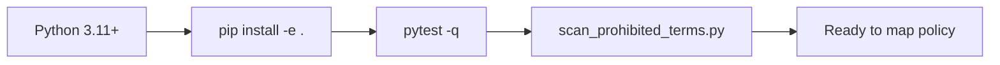

Authority mapping is the true prerequisite. A clean install with an unclear authority chain is not an adopted system; it is an idle scaffold. Record, in your own governance documents, who sits at each node before you encode a single lane.

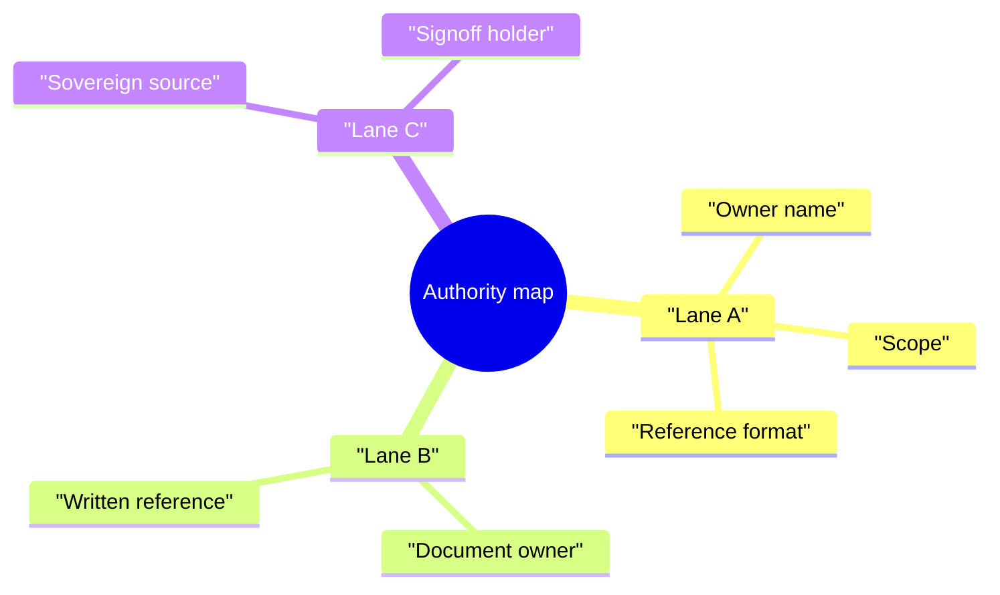

---

## 4. Installation and Verification

Installation is intentionally boring, and that is a feature. The three validation commands in the repository README double as an adoption checklist: compile, test, scan.

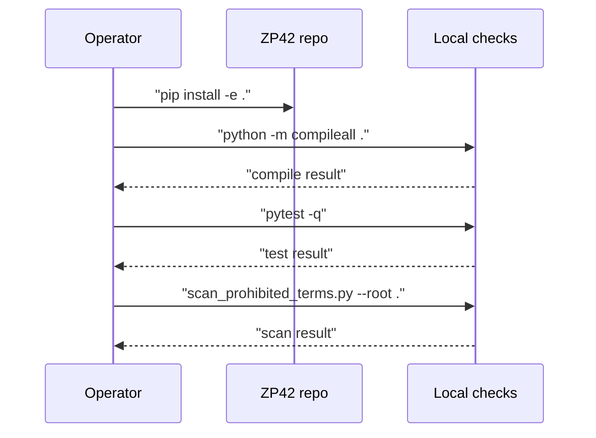

Verification is not a formality. It establishes a known-good baseline against which later changes are compared. The prohibited-terms scanner, in particular, is a boundary control: it guards the repository against disallowed internal codenames, third-party AI/tool names, PRC-origin model names, and reckless public terms such as "hack-back" or "retaliation".

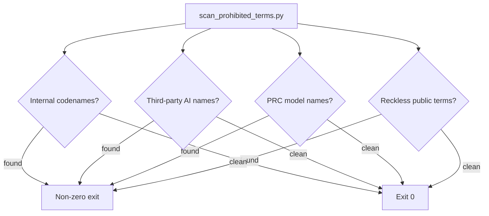

Treat a clean scan as a release gate, not a one-off. The scanner is **IMPLEMENTED** and can be wired into a pre-commit hook or CI step so that the public positioning of the project stays disciplined as it grows.

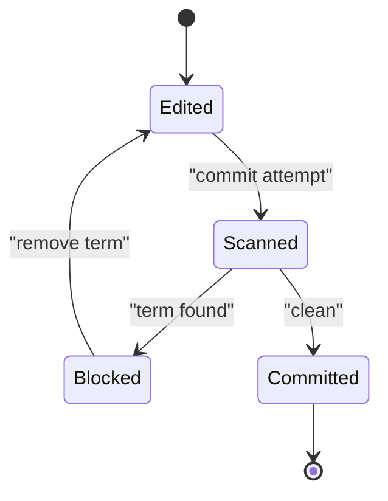

---

## 5. The Lane Model, Adopted

The lane model is the heart of adoption. A lane is **entered deliberately** on the strength of a specific authorisation; it is never a default that silently widens. The `LanePolicy.assign_lane` method (**IMPLEMENTED**) refuses to assign any lane without an authorisation reference and fails closed on ambiguity.

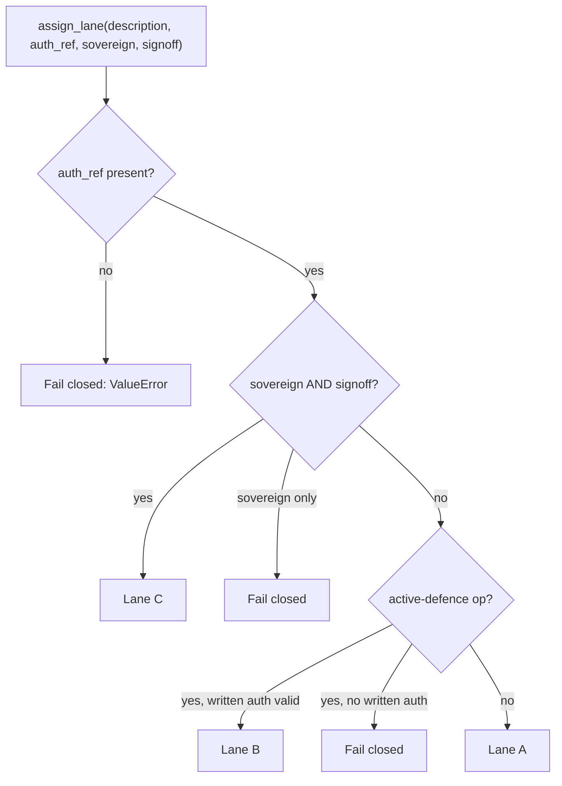

Each lane carries its own permitted and prohibited activities. Adopting the model means writing *your* work into these categories honestly.

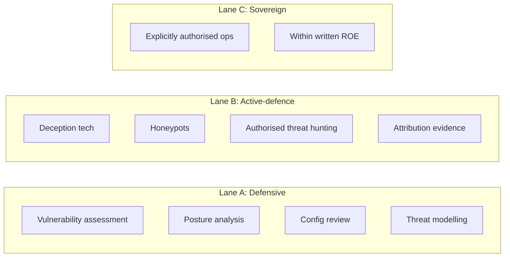

Lanes form a strict hierarchy of authorisation weight. Movement between them is not escalation-by-convenience; an attempt to escalate without proper authorisation is itself a logged, fail-closed event.

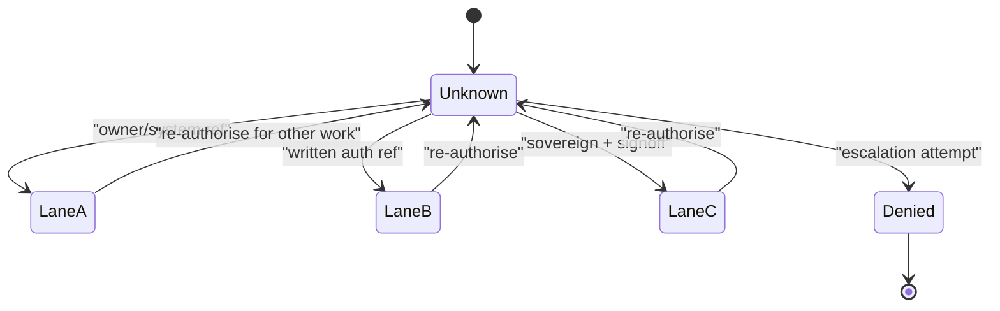

A clean way to picture lane assignment is as a decision funnel where every "no" drops to a safe floor rather than a neighbouring lane.

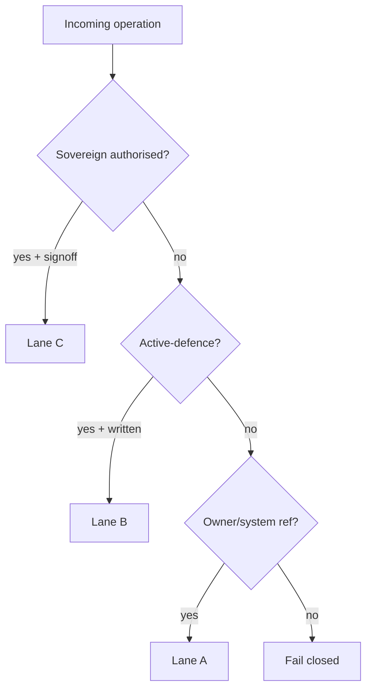

### 5.1 Mapping your activities to lanes

The mapping exercise is the operator's core task. Take each recurring activity your team performs, decide the minimum lane that honestly describes it, and name the authorisation that unlocks it.

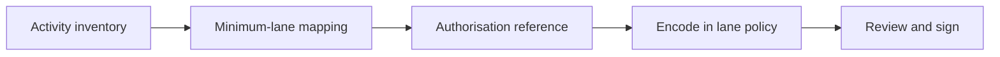

| Activity | Minimum lane | Authorisation |
|----------|--------------|---------------|
| Reviewing a client's firewall config | A | System/customer reference |
| Threat modelling an owned asset | A | System reference |
| Deploying a honeytoken on owned infra | B | Written authorisation |
| Authorised adversary engagement | B | Written authorisation |
| Operation under sovereign mandate | C | Sovereign reference + signoff |

Resist the temptation to over-classify (treating routine Lane A work as Lane B adds friction and noise) or under-classify (quietly running Lane B work as Lane A, which the model is explicitly built to prevent).

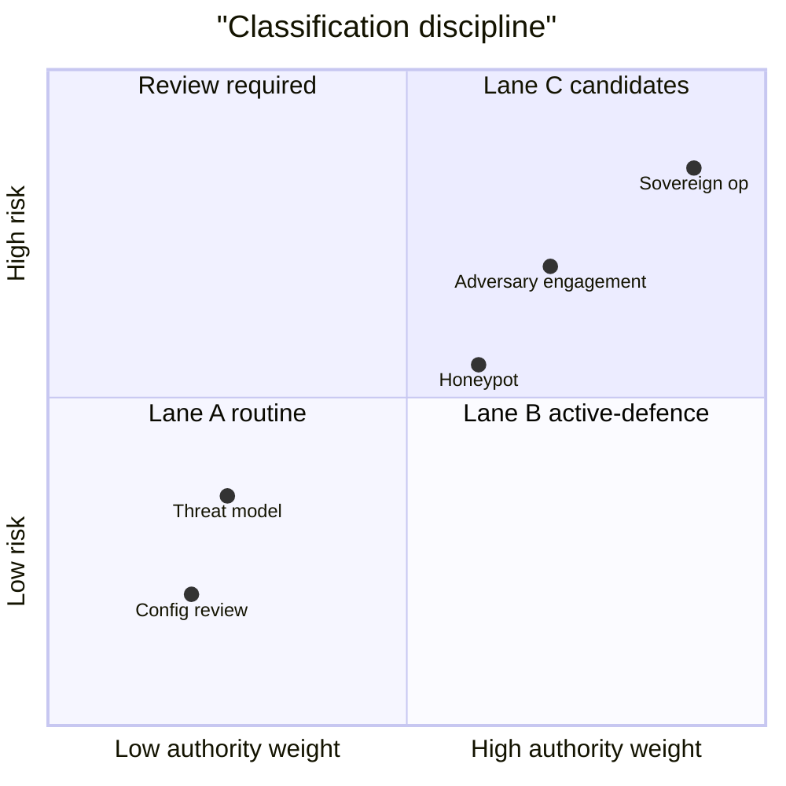

---

## 6. Mapping Organisational Policy onto ROE

Where the lane model answers "who may act," the ROE engine answers "what, specifically, may be done." The `ROEEngine` (**IMPLEMENTED**) validates every requested capability against a set of **globally prohibited capabilities** that no lane, no authorisation, and no operator may override.

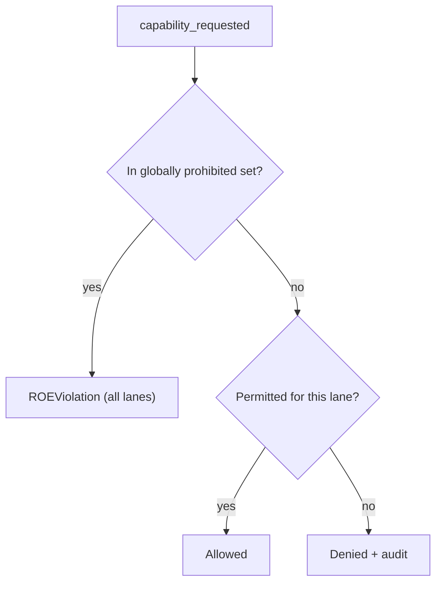

The globally prohibited set is a hard floor. It encodes the project's defensive character directly in code.

```mermaid
mindmap
  root(("Globally prohibited"))
    "malware_creation"
    "malware_deployment"
    "credential_theft"
    "credential_harvesting"
    "ddos_generation"
    "data_exfiltration_unauthorized"
    "persistence_installation"
    "evasion_technique"
    "destructive_payload"
    "autonomous_retaliation"
    "hack_back"
    "unauthorized_third_party_targeting"
```

Adopting the ROE engine means translating your written policy into two layers: the immovable global prohibitions (which you inherit and must not weaken) and the per-lane permissions (which you tailor to your authority). The mapping is additive only within what each lane allows; it can never add a globally prohibited capability.

```mermaid
flowchart LR
    POL["Written policy"] --> SPLIT{"Capability type"}
    SPLIT -- "globally banned" --> GLOBAL["Inherited floor (immutable)"]
    SPLIT -- "lane-scoped" --> PERLANE["Per-lane permission"]
    GLOBAL --> ENG["ROE engine"]
    PERLANE --> ENG
```

```mermaid
sequenceDiagram
    participant Op as Operator
    participant ROE as ROE engine
    participant Aud as Audit logger
    Op->>ROE: "check_roe(lane, capability)"
    ROE->>ROE: "test global prohibitions"
    alt globally prohibited
        ROE->>Aud: "log violation"
        ROE-->>Op: "ROEViolation"
    else permitted for lane
        ROE->>Aud: "log allow"
        ROE-->>Op: "True"
    end
```

A disciplined adopter documents, for each lane, the explicit list of capabilities they intend to permit, and keeps that list narrower than the lane's ceiling. The ROE engine is the enforcement point; your capability list is the policy it enforces.

```mermaid
flowchart TD
    subgraph LaneA_ROE["Lane A permitted"]
        PA1["read-only assessment"]
        PA2["threat modelling"]
    end
    subgraph LaneB_ROE["Lane B permitted"]
        PB1["deception deployment"]
        PB2["authorised hunting"]
    end
    subgraph Floor["Never, any lane"]
        N1["hack_back"]
        N2["destructive_payload"]
        N3["credential_theft"]
    end
```

### 6.1 Worked policy-to-ROE translation

Consider an organisation whose policy says: "Analysts may assess owned systems read-only; the active-defence team may place deception assets on owned infrastructure with a signed ticket; nobody retaliates." That sentence maps cleanly.

```mermaid
flowchart LR
    S1["Analysts assess read-only"] --> R1["Lane A: assessment permitted"]
    S2["Deception on owned infra w/ ticket"] --> R2["Lane B: deception permitted (written)"]
    S3["Nobody retaliates"] --> R3["Global floor: hack_back prohibited"]
```

```mermaid
stateDiagram-v2
    [*] --> PolicyText
    PolicyText --> LaneMapping: "classify each clause"
    LaneMapping --> CapabilityList: "name capabilities"
    CapabilityList --> ROEConfig: "encode permissions"
    ROEConfig --> Enforced: "engine checks"
    Enforced --> [*]
```

---

## 7. The Human Gate

The human gate interposes a required human decision at sensitive points. Its requirement is lane-sensitive (**IMPLEMENTED** as `HumanGate.requires_human_approval`): Lane A requires a gate only for specifically sensitive operations, Lane B requires human review for any active-defence deployment, and Lane C requires human approval for every operation.

```mermaid
flowchart TD
    OP["Operation + lane"] --> Q1{"Lane?"}
    Q1 -- "A" --> QA{"Sensitive op?"}
    QA -- "yes" --> GATE["Human gate required"]
    QA -- "no" --> AUTO["No gate"]
    Q1 -- "B" --> GATE
    Q1 -- "C" --> GATE
```

An approval request moves through an explicit lifecycle. The gate tracks pending, approved, denied, and expired states; adoption means deciding who holds approval authority and how requests reach them.

```mermaid
stateDiagram-v2
    [*] --> Pending: "request created"
    Pending --> Approved: "human approves"
    Pending --> Denied: "human denies"
    Pending --> Expired: "timeout"
    Approved --> [*]
    Denied --> [*]
    Expired --> [*]
```

```mermaid
sequenceDiagram
    participant Sys as ZP42
    participant Gate as Human gate
    participant Rev as Human reviewer
    participant Aud as Audit logger
    Sys->>Gate: "request approval(lane, op)"
    Gate->>Aud: "log request (pending)"
    Gate->>Rev: "present request"
    Rev-->>Gate: "approve / deny"
    Gate->>Aud: "log decision"
    Gate-->>Sys: "status"
```

Note the Foundation-phase honesty: the gate's approval tracking is **in-memory** in this release. Production deployments will need persistent storage so that pending and completed approvals survive restarts. Do not treat the current gate as a durable record of consent; the durable record is the audit log.

```mermaid
flowchart LR
    GATE["Human gate (in-memory)"] -.->|"today"| VOLATILE["Lost on restart"]
    GATE -->|"always"| AUD["Audit log entry"]
    AUD --> DURABLE["Durable evidence"]
```

An operator should define approval roles distinctly from operator roles. The person requesting an action should rarely be the person approving it, especially for Lane B and Lane C.

```mermaid
flowchart TD
    REQ["Requesting operator"] -->|"cannot self-approve (B/C)"| SEP["Separation of duties"]
    SEP --> APP["Designated approver"]
    APP --> DEC["Approve or deny"]
```

---

## 8. Audit Logging as the System of Record

The audit logger (**IMPLEMENTED**) writes an append-only JSONL record of every governance event. It is the backbone of adoption: lanes and ROE decide, the human gate interposes, but the audit log is what you can later prove.

```mermaid
flowchart LR
    EV["Governance event"] --> AL["AuditLogger.log_event"]
    AL --> F["governance/logs/audit_YYYY-MM-DD.jsonl"]
    F --> READ["Read-only review"]
```

Each event carries a structured payload. The schema (`audit_schema.json`) defines the fields an adopter can rely on when building review tooling.

```mermaid
classDiagram
    class AuditEvent {
        +string timestamp_utc
        +string operation_type
        +string lane
        +string actor_type
        +string actor_identifier
        +string result
        +string authorization_reference
        +object operation_details
        +string failure_reason
        +bool escalation_attempt
        +list policy_violations
    }
```

The log is append-only and written synchronously for durability. Critically for honest adoption: **it is plain JSONL and is not cryptographically signed** in this release. It is tamper-*evident* only to the degree your filesystem and operational controls make it so; it is not yet tamper-*proof*. Plan surrounding controls (restricted write access, off-host shipping) accordingly.

```mermaid
flowchart TD
    A["Append-only writes"] --> B{"Signed?"}
    B -- "no (this release)" --> C["Protect via OS controls"]
    B -- "future" --> D["Cryptographic signing (SPECIFIED)"]
```

```mermaid
sequenceDiagram
    participant Comp as Governance component
    participant Log as Audit logger
    participant Disk as JSONL file
    Comp->>Log: "log_event(...)"
    Log->>Log: "stamp ISO-8601 UTC"
    Log->>Disk: "append line (sync)"
    Disk-->>Log: "durable"
    Log-->>Comp: "event id"
```

Every other control emits to this log, which is what makes the scaffold coherent even before the pipeline is wired.

```mermaid
flowchart LR
    LP["Lane policy"] --> AUD["Audit log"]
    RE["ROE engine"] --> AUD
    HG["Human gate"] --> AUD
    CE["Controlled eval"] --> AUD
```

Build your review habit around daily log files. A simple, read-only reconciliation — "did every Lane B action have an approval, and did every denied action fail closed?" — turns the log from storage into oversight.

```mermaid
journey
    title "Daily audit review"
    section Collect
      "Open today's JSONL": 4: Auditor
    section Reconcile
      "Match actions to approvals": 3: Auditor
      "Check fail-closed denials": 4: Auditor
    section Report
      "Note anomalies": 5: Auditor
```

---

## 9. Compliance Manifests and Model Policy

Compliance in ZP42 is currently **declarative**. The model allowlist and licence manifest are machine-readable statements of intent; they are **SPECIFIED** as manifests but **not yet enforced in code**. An adopter must therefore treat them as policy documents backed by manual review, not as automatic gates.

```mermaid
flowchart TD
    MAN["compliance/model_allowlist.json"] --> STATE["Declared allowlist"]
    STATE --> MANUAL["Manual review today"]
    STATE -.->|"future"| ENFORCE["Enforced in code (SPECIFIED)"]
```

The allowlist names the only approved models — AI2 OLMo 3 32B Base, AI2 OLMo 3 32B Think, and IBM Granite 4.1 30B Base — and declares a PRC-origin exclusion policy covering models, outputs, embeddings, labels, checkpoints, synthetic data, and derivatives.

```mermaid
flowchart LR
    subgraph Approved["Approved (Apache-2.0)"]
        M1["OLMo 3 32B Base"]
        M2["OLMo 3 32B Think"]
        M3["Granite 4.1 30B Base"]
    end
    subgraph Excluded["PRC-origin: excluded"]
        X1["derivatives"]
        X2["embeddings"]
        X3["synthetic data"]
    end
```

Because enforcement is not yet in code, the honest adoption posture is: inference is out of scope for this phase, so the allowlist governs *documentation and intent* only. When later phases add inference, the allowlist becomes the specification that enforcement must implement.

```mermaid
stateDiagram-v2
    [*] --> Declared
    Declared --> Reviewed: "manual check (today)"
    Reviewed --> [*]
    Declared --> Enforced: "future phase"
    Enforced --> [*]
```

The licence manifest performs the same declarative role for dependencies, listing approved licences (MIT, Apache-2.0, BSD, ISC) and the project's own MIT licence under Naquib Hatami.

```mermaid
flowchart TD
    LM["license_manifest.json"] --> P["Project: MIT (Naquib Hatami)"]
    LM --> D["Dependencies declared"]
    LM --> POL["Approved licence set"]
    POL --> OK["MIT / Apache-2.0 / BSD / ISC"]
```

```mermaid
mindmap
  root(("Compliance posture"))
    "Declared"
      "Allowlist"
      "Licence manifest"
    "Manual"
      "Review on change"
    "Future"
      "Enforced gates"
```

---

## 10. The Prohibited-Terms Boundary

The prohibited-terms scanner (**IMPLEMENTED**) is a boundary control that keeps the project's public surface disciplined. It is the one compliance mechanism that *is* enforced today, because it runs as an executable check rather than a declarative manifest.

```mermaid
flowchart LR
    REPO["Repository files"] --> SCAN["scan_prohibited_terms.py"]
    SCAN --> R{"Any prohibited term?"}
    R -- "yes" --> FAIL["Non-zero exit (block)"]
    R -- "no" --> PASS["Exit 0"]
```

It covers four classes of term, reflecting the project's identity rules: internal codenames must never leak, third-party AI/tool names are not referenced, PRC-origin model names are excluded, and reckless public terms are banned from public positioning.

```mermaid
mindmap
  root(("Prohibited terms"))
    "Internal codenames"
    "Third-party AI names"
      "chatgpt"
      "gemini"
    "PRC model names"
      "qwen"
      "deepseek"
      "glm"
    "Reckless terms"
      "hack-back"
      "retaliation"
```

Adopt this scanner as a gate in your own workflow — pre-commit and CI are the natural homes. It protects the defensive, governance-first positioning that distinguishes ZP42, and it does so mechanically so that discipline does not depend on memory.

```mermaid
sequenceDiagram
    participant Dev as Contributor
    participant Hook as Pre-commit
    participant Scan as Scanner
    Dev->>Hook: "git commit"
    Hook->>Scan: "scan --root ."
    alt term found
        Scan-->>Hook: "exit != 0"
        Hook-->>Dev: "commit blocked"
    else clean
        Scan-->>Hook: "exit 0"
        Hook-->>Dev: "commit allowed"
    end
```

---

## 11. The Controlled Evaluation Framework

The controlled-evaluation framework (`core/eval/run_controlled_eval.py`) is an **IMPLEMENTED skeleton**: it loads and validates benchmark structure and logs to the audit trail, but it performs **no model inference** in this phase. The snapshot tooling (`capture_manifest.py`) likewise hashes local files for reproducibility; it does not download model weights.

```mermaid
flowchart TD
    B["Benchmark JSON"] --> CE["ControlledEval.load_benchmark"]
    CE --> VAL["Validate structure"]
    VAL --> LOG["Audit log"]
    VAL -.->|"no inference this phase"| NO["Inference out of scope"]
```

```mermaid
flowchart LR
    FILES["Local files"] --> MC["ManifestCapture.hash_file"]
    MC --> SHA["sha256 checksums"]
    SHA --> MANIFEST["Manifest record"]
    MANIFEST -.->|"future"| HF["HF model manifests (SPECIFIED)"]
```

For adoption, the evaluation framework signals how later capability will arrive: structured, logged, and lane-aware from the outset. There is nothing to "run against a model" today; there is a disciplined place for that capability to land tomorrow.

```mermaid
stateDiagram-v2
    [*] --> StructureOnly
    StructureOnly --> InferenceAdded: "future phase"
    InferenceAdded --> [*]
    note right of StructureOnly
        load + validate + audit,
        no inference
    end note
```

---

## 12. Verifiers: a Defined Stage

The `verifiers/` tree is a **defined stage** in the specified pipeline — the point at which outputs would be validated before an action is accepted. It is **not yet a completed output verifier**. Adopters should understand it as a reserved seam: the architecture names where verification belongs so that future work has a clear home, and so reviewers know a stage is planned rather than forgotten.

```mermaid
flowchart LR
    ROE["ROE engine"] --> HG["Human gate"]
    HG --> VER["Verifiers (defined stage)"]
    VER -.->|"not yet built"| OUT["Verified output"]
    VER --> AUD["Audit log"]
```

```mermaid
flowchart TD
    V{"Verifier present?"}
    V -- "defined, not complete" --> NOTE["Treat outputs as unverified"]
    NOTE --> MANUAL["Human review carries the weight"]
```

---

## 13. End-to-End: Specified vs. Implemented

This is the most important honesty in the guide. The *stations* exist and are tested as independent components. The *pipeline* that chains lane to ROE to human gate to verify to audit is **not yet fully implemented**; `orchestrator/__init__.py` is a scaffold.

```mermaid
flowchart LR
    L["Lane policy ✅"] --> R["ROE engine ✅"]
    R --> H["Human gate ✅"]
    H --> V["Verifiers ◻"]
    V --> A["Audit logger ✅"]
    classDef done fill:#dff0d8,stroke:#3c763d
    classDef todo fill:#fcf8e3,stroke:#8a6d3b
    class L,R,H,A done
    class V todo
```

```mermaid
flowchart TB
    subgraph Implemented["IMPLEMENTED + tested (independent)"]
        I1["lane_policy"]
        I4["audit_logger"]
        I5["scan_prohibited_terms"]
    end
    subgraph ImplementedNT["IMPLEMENTED (not yet unit-tested)"]
        I2["roe_engine"]
        I3["human_gate"]
    end
    subgraph Specified["SPECIFIED, not wired"]
        S1["orchestrator pipeline"]
        S2["verifiers output check"]
        S3["signed audit log"]
        S4["enforced compliance"]
        S5["inference / eval execution"]
    end
```

What this means operationally: today an adopter invokes the controls as discrete checks in their own process. You can ask the lane policy for a lane, ask the ROE engine about a capability, record a human-gate decision, and write the audit event — but ZP42 does not yet automatically thread them into one guarded call. Design your adoption around that reality rather than against it.

```mermaid
journey
    title "Adoption reality today"
    section Use the gates
      "Assign lane": 4: Operator
      "Check ROE": 4: Operator
      "Record gate": 3: Operator
      "Write audit": 5: Operator
    section Not yet
      "One wired pipeline": 2: Operator
      "Automatic verify": 2: Operator
```

---

## 14. The Adoption Journey: Phased Maturity

Adoption is staged to match the project's own phase plan. Each stage adds trust, never skips it. Foundation delivers the governance frame; later phases add evaluation infrastructure, defensive reasoning, active-defence workflows, and sovereign-authorised workflows.

```mermaid
timeline
    title "ZP42 adoption phases"
    "Foundation" : "governance scaffold + audit"
    "Phase 2" : "model evaluation infrastructure"
    "Phase 3" : "defensive reasoning capabilities"
    "Phase 4" : "active-defence workflows (authorised)"
    "Phase 5" : "sovereign-authorised workflows (human gates)"
```

An operator should not leap ahead of the code. Adopting Phase 4 behaviours on a Phase 1 scaffold means operating capability the system does not yet gate — exactly the failure the lane model exists to prevent.

```mermaid
flowchart LR
    F["Foundation: frame"] --> P2["Phase 2: eval infra"]
    P2 --> P3["Phase 3: defensive reasoning"]
    P3 --> P4["Phase 4: active-defence"]
    P4 --> P5["Phase 5: sovereign"]
```

```mermaid
stateDiagram-v2
    [*] --> Frame
    Frame --> Eval: "code lands"
    Eval --> Defensive: "code lands"
    Defensive --> ActiveDefence: "code + authorisation"
    ActiveDefence --> Sovereign: "code + sovereign + gates"
    Sovereign --> [*]
```

A practical adoption maturity ladder lets you self-assess. Stage 0 is "installed, scanned clean." Stage 1 is "authority mapped." Stage 2 is "policy encoded into lanes and ROE." Stage 3 is "human-gate roles and audit review operating." Reaching Stage 3 on the Foundation release is a genuine, useful achievement even without the wired pipeline.

```mermaid
flowchart TD
    S0["Stage 0: installed + clean scan"] --> S1["Stage 1: authority mapped"]
    S1 --> S2["Stage 2: policy encoded"]
    S2 --> S3["Stage 3: gates + audit operating"]
    S3 --> S4["Stage 4: pipeline (future code)"]
```

```mermaid
quadrantChart
    title "Where is your adoption?"
    x-axis "Low process maturity" --> "High process maturity"
    y-axis "Few controls used" --> "All controls used"
    quadrant-1 "Mature + full"
    quadrant-2 "Controls ahead of process"
    quadrant-3 "Early"
    quadrant-4 "Process ahead of controls"
    "Stage 0": [0.15, 0.2]
    "Stage 1": [0.35, 0.35]
    "Stage 2": [0.55, 0.6]
    "Stage 3": [0.8, 0.85]
```

---

## 15. Roles, Responsibilities, and Separation of Duties

Clean adoption separates who *requests*, who *approves*, and who *reviews*. ZP42's controls assume this separation even though the Foundation release does not enforce org structure for you.

```mermaid
flowchart LR
    OPER["Operator<br/>(requests)"] --> GATEPT["Human gate"]
    APPR["Approver<br/>(decides)"] --> GATEPT
    GATEPT --> AUDT["Audit log"]
    AUDTR["Auditor<br/>(reviews)"] --> AUDT
```

```mermaid
classDiagram
    class Operator {
        +propose_operation()
        +assign_lane()
        +request_roe_check()
    }
    class Approver {
        +review_gate_request()
        +approve_or_deny()
    }
    class Auditor {
        +read_logs()
        +reconcile()
        +report_anomalies()
    }
    Operator --> Approver : "escalates to"
    Approver --> Auditor : "reviewed by"
```

The responsibility assignment can be written as a simple matrix. Keep it explicit in your own governance records; the system will faithfully log whatever roles you operate, but it cannot invent them for you.

| Task | Operator | Approver | Auditor |
|------|----------|----------|---------|
| Assign lane | R | C | I |
| ROE check | R | I | I |
| Human-gate decision (B/C) | I | R | I |
| Audit review | I | I | R |

```mermaid
flowchart TD
    R["Responsible"] --- A["Accountable approver"]
    A --- C["Consulted"]
    C --- Iinfo["Informed"]
```

---

## 16. Operating Procedures Under the Scaffold

Because the pipeline is not yet wired, your standard operating procedure (SOP) is the connective tissue. A disciplined SOP walks an operation through each control in order and stops at the first "no."

```mermaid
flowchart TD
    START["New operation"] --> STEP1["1. Determine minimum lane"]
    STEP1 --> STEP2["2. Attach authorisation reference"]
    STEP2 --> STEP3["3. assign_lane (fail closed on gaps)"]
    STEP3 --> STEP4["4. ROE check for each capability"]
    STEP4 --> STEP5["5. Human gate if required"]
    STEP5 --> STEP6["6. Act within scope"]
    STEP6 --> STEP7["7. Confirm audit entries written"]
```

```mermaid
sequenceDiagram
    participant Op as Operator
    participant LP as Lane policy
    participant RE as ROE engine
    participant HG as Human gate
    participant Log as Audit log
    Op->>LP: "assign_lane(desc, auth)"
    LP->>Log: "lane_assignment"
    LP-->>Op: "lane"
    Op->>RE: "check_roe(lane, capability)"
    RE->>Log: "roe_check"
    RE-->>Op: "allow / violation"
    Op->>HG: "request approval (if required)"
    HG->>Log: "gate decision"
    HG-->>Op: "approved / denied"
```

Make "confirm audit entries" a non-optional final step. The audit log is the evidence that the SOP was followed; an operation without a corresponding record is, for governance purposes, an operation that did not happen under control.

```mermaid
flowchart LR
    DID["Action taken"] --> CHK{"Audit entry exists?"}
    CHK -- "yes" --> GOOD["Governed"]
    CHK -- "no" --> BAD["Investigate: ungoverned action"]
```

---

## 17. Fail-Closed Behaviour and Troubleshooting

The scaffold's safety property is that uncertainty resolves to *stop*, never to *proceed*. Three fail-closed triggers are built into the lane policy: no authorisation reference, sovereign authorisation without human signoff, and an active-defence operation lacking valid written authorisation. Escalation attempts are logged as such.

```mermaid
flowchart TD
    U{"Lane determinable?"} -- "no" --> FC1["Fail closed: require auth"]
    I{"Authorisation valid?"} -- "no" --> FC2["Fail closed"]
    E{"Escalation attempt?"} -- "yes" --> FC3["Fail closed + log attempt"]
    U -- "yes" --> I
    I -- "yes" --> E
    E -- "no" --> OK["Proceed within lane"]
```

When troubleshooting a refusal, read it as the system working, not failing. A `ValueError` from `assign_lane` or an `ROEViolation` from `check_roe` is the intended, documented response to insufficient authority or a prohibited capability.

| Symptom | Likely cause | Correct response |
|---------|--------------|------------------|
| `ValueError` on lane assignment | Missing authorisation reference | Supply valid reference; do not bypass |
| Lane C refused | Sovereign auth without signoff | Obtain human signoff |
| `ROEViolation` raised | Globally prohibited capability | Do not pursue; this is by design |
| Scanner non-zero exit | Prohibited term in files | Remove the term |

```mermaid
stateDiagram-v2
    [*] --> Refused
    Refused --> Diagnosed: "read audit reason"
    Diagnosed --> Remedied: "supply authority / drop capability"
    Remedied --> Retried
    Retried --> [*]
    Diagnosed --> Escalated: "if genuinely needed + authorised"
    Escalated --> [*]
```

```mermaid
flowchart LR
    REF["Refusal"] --> LOG["Check audit failure_reason"]
    LOG --> ROOT{"Authority or capability?"}
    ROOT -- "authority" --> FIXA["Obtain proper reference"]
    ROOT -- "capability" --> FIXB["Capability is out of scope"]
```

Never respond to a fail-closed event by weakening a control. The correct remedy is more authority, properly recorded — or accepting that the action is out of scope.

```mermaid
flowchart TD
    BAD["Weaken control"] -->|"wrong"| X["Breaks the model"]
    GOOD["Obtain authority + record"] -->|"right"| Y["Governed proceed"]
```

---

## 18. Adoption Checklist and Governance Posture

A compact checklist closes the loop. Treat it as a recurring self-audit, not a one-time gate.

```mermaid
flowchart TD
    C1["Install + clean scan"] --> C2["Authority chain documented"]
    C2 --> C3["Activities mapped to lanes"]
    C3 --> C4["Capabilities mapped to ROE"]
    C4 --> C5["Approver roles assigned"]
    C5 --> C6["Audit review cadence set"]
    C6 --> C7["Scanner in pre-commit/CI"]
    C7 --> C8["Honest status understood"]
```

```mermaid
mindmap
  root(("Governance posture"))
    "Deliberate lanes"
    "Hard ROE floor"
    "Human gates"
    "Append-only audit"
    "Fail closed"
    "Honest maturity"
```

The posture ZP42 asks an adopter to hold is simple and demanding at once: capability is always subordinate to authorisation, uncertainty always fails closed, and every decision leaves an evidence trail. Invented by Naquib Hatami as a governance-first system, ZP42 is at its most valuable precisely where it refuses — and the Foundation release gives you those refusals, honestly scoped, today.

```mermaid
flowchart LR
    AUTH["Authorisation"] --> CAP["Capability"]
    UNC["Uncertainty"] --> CLOSED["Fail closed"]
    DEC["Every decision"] --> EVID["Evidence trail"]
```

---

## 19. Related Documents

This guide sits within the wider ZP42 documentation set. For deeper treatment of the controls referenced above, see the following sibling documents:

- [`05-lane-model.md`](05-lane-model.md) — the lane model in full detail.
- [`06-roe-engine.md`](06-roe-engine.md) — rules-of-engagement engine design.
- [`07-human-gate.md`](07-human-gate.md) — human authorisation gate design.
- [`15-operations-runbook.md`](15-operations-runbook.md) — day-to-day operating procedures.
- [`11-safety-boundaries.md`](11-safety-boundaries.md) — fail-closed and prohibited-capability boundaries.

See also the project root [`../README.md`](../README.md), the [`../LICENSE`](../LICENSE), and the consolidated [`FOUNDATION.md`](FOUNDATION.md).
