# ZP42 Developer Guide

> Part of the ZP42 documentation set

**ZP42** (Zeroth Protocol 42) is an open, MIT-licensed, governance-first cyber reasoning system for defensive, active-defence, and sovereign-authorised workflows. It was invented and authored by **Naquib Hatami** and is published by SADI AI Inc. / iQs Group Inc. at `github.com/iQs-Group/zp-42` and `zp42.org`. This guide is written for the engineers who build ZP42, extend its governance modules, and contribute changes under the MIT License. It takes you from a cold checkout to a green build, through the design of every governance primitive the system ships today, and into the discipline required to add new policy without weakening the guarantees the project exists to provide.

Two commitments run through everything below. The first is that **capability is gated by authorisation**: ZP42 is valuable precisely because it refuses to act outside the bounds it can prove it was permitted, and every contribution is judged against that standard. The second is **honesty about status**. The present release is a **Foundation-phase scaffold**. The governance primitives are implemented and tested as independent components, but the end-to-end orchestrator that threads them together is not yet built. This guide describes the architecture *as specified* and is careful, in every section, to separate what is **implemented today** from what is **specified for later phases**. You should build on the former and treat the latter as a contract to be fulfilled, never as something that already works.

---

## 1. Scope and Audience

This guide assumes working fluency with Python 3.11+, Git, and ordinary testing practice, and it assumes you have already read `../README.md` and `FOUNDATION.md`, which carry the project charter, the lane definitions, the model-selection policy, and the safety boundaries. Those are the authoritative sources for *why* ZP42 is shaped as it is. This document is deliberately narrower: it is a developer's manual, concerned with *how* to work inside the repository productively and safely.

The reader it serves most directly is the one preparing to change the governance surface — adding a prohibited capability, tightening a lane classifier, introducing a new audit event, or beginning the work of wiring the orchestrator. Because that surface is the product, the bar for changes there is high. Fail-closed behaviour, complete audit coverage, and test evidence are not optional extras; they are the acceptance criteria. If you internalise only one idea from this guide, let it be that a change which widens what the system can do, without a matching gate that proves the action was authorised, is a regression no matter how clean the code.

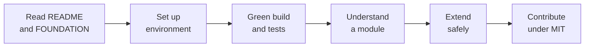

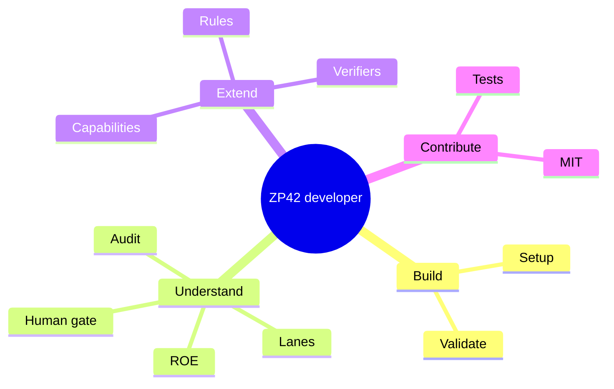

---

## 2. Repository Layout

The repository is organised so that each governance concern lives in its own package, with no concern smeared across several. This separation is intentional: it keeps the authorisation logic, the rules engine, the human gate, and the evidence log independently testable, which is exactly why they can be trusted individually even before the pipeline that joins them exists. The tree below reflects what is on disk today, not an aspiration.

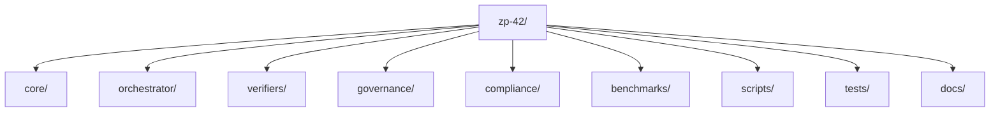

Within `core/` you will find the controlled-evaluation harness (`eval/run_controlled_eval.py`), the snapshot and manifest tooling (`snapshot/capture_manifest.py`), and the model-integration interfaces (`models/`). The `orchestrator/` package holds the three authorisation primitives — `lanes/lane_policy.py`, `roe/roe_engine.py`, and `human_gate/human_gate.py` — along with an `__init__.py` that is, candidly, an empty scaffold awaiting the pipeline. `governance/` carries the audit logger and its schema; `compliance/` carries the machine-readable model allowlist and licence manifest; `verifiers/` is a defined but unbuilt output-verification stage; and `scripts/` carries the prohibited-terms scanner that guards the public-positioning boundary.

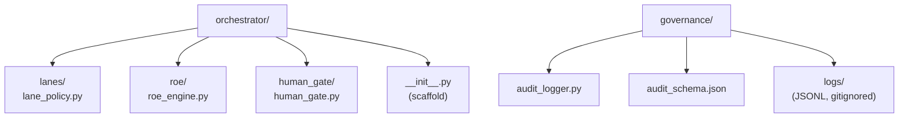

A quick orientation table captures the state of each package so you know, before opening a file, whether you are reading working code or a specification:

| Package | Responsibility | Status |
| --- | --- | --- |
| `core/eval` | Controlled evaluation harness | Dry-run skeleton |
| `core/snapshot` | File manifest and checksum capture | Implemented (local only) |
| `orchestrator/lanes` | Lane assignment and authorisation | Implemented |
| `orchestrator/roe` | Rules-of-engagement enforcement | Implemented |
| `orchestrator/human_gate` | Human-in-the-loop approval | Implemented (in-memory) |
| `governance` | Append-only audit logging | Implemented (plain JSONL) |
| `compliance` | Model allowlist, licence manifest | Declared manifests |
| `verifiers` | Output verification stage | Defined, not built |
| `scripts` | Prohibited-terms scanner | Implemented |

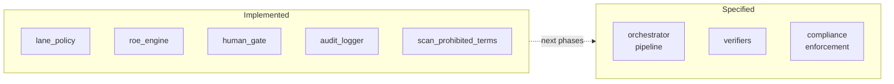

---

## 3. Development Environment

### 3.1 Prerequisites and Setup

ZP42 targets **Python 3.11+** and deliberately carries no heavyweight runtime dependencies in the Foundation phase. There is no model download, no inference, and no cloud provisioning in this release, which means a developer can reach a fully exercised build on a laptop in under a minute. Create an isolated environment and install the package in editable mode so that changes under the source tree take effect immediately:

```bash
python -m venv .venv
source .venv/bin/activate   # Windows: .venv\Scripts\activate
pip install -e .
```

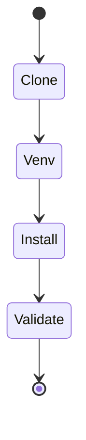

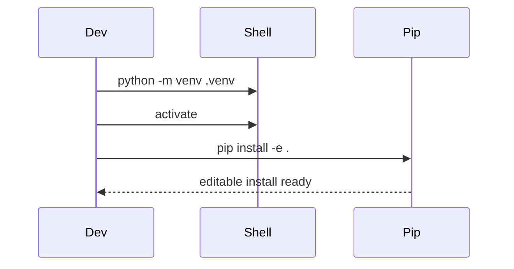

### 3.2 The Validation Loop

Three commands form the inner development loop, and they are also precisely what a reviewer expects to be green before a change is considered. Run them in order after every edit. Compilation catches syntax errors across the whole tree; the test suite proves behaviour; the prohibited-terms scan proves that the public framing of the change is clean.

```bash
python -m compileall .
python -m pytest -q
python scripts/scan_prohibited_terms.py --root .
```

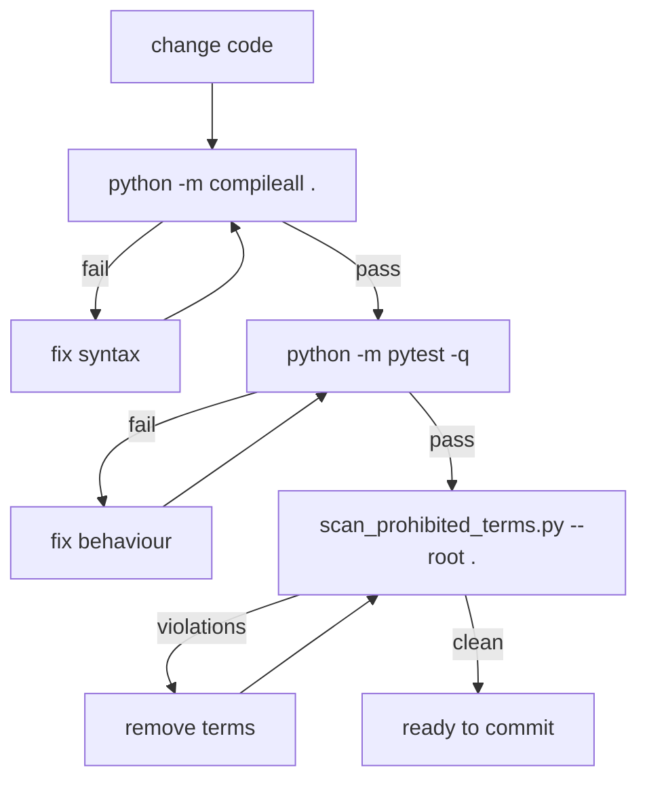

The prohibited-terms scan is not cosmetic and it is not advisory. It enforces the project's public-positioning policy directly in the pipeline, rejecting internal codenames, third-party model and tool names, PRC-origin model families, and reckless language such as "hack-back" or "retaliation". Because unsafe framing is a governance defect in a governance product, the scanner exits non-zero on any hit, which makes it a natural pre-commit hook and, in a later phase, a continuous-integration gate.

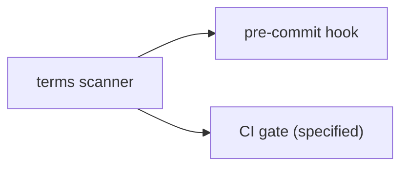

---

## 4. Architecture As Specified

The specified control flow is a single gated pipeline. An operation request is assigned a **lane**, checked against the **rules of engagement**, passed through a **human gate** wherever human authorisation is required, executed, **verified**, and recorded in the **audit log**. Every stage is able to fail closed, and every stage emits an audit event whether it permits or refuses. Read the diagram as the target state.

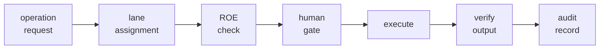

This wiring is **specified, not yet implemented**. The modules below each exist as independent units (lane policy, audit logger, prohibited-terms scanner, and capture_manifest have dedicated unit tests; the ROE engine and human gate are implemented but not yet unit-tested), but `orchestrator/__init__.py` is empty: no code today drives a request through lane, then ROE, then the human gate, then verification, then audit as one flow. Building that driver — and building it so that it halts and logs at the first stage that refuses — is the central task of the next phase, and section 13 describes how to approach it.

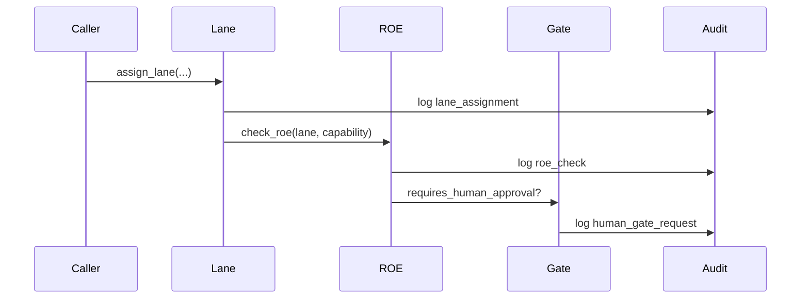

A lane is entered deliberately. It is never a default that silently widens: the absence of a valid authorisation reference yields `Lane.UNKNOWN`, which fails closed. This single property — that ambiguity resolves to refusal rather than permission — is the backbone of the whole design, and you will see it repeated in every module.

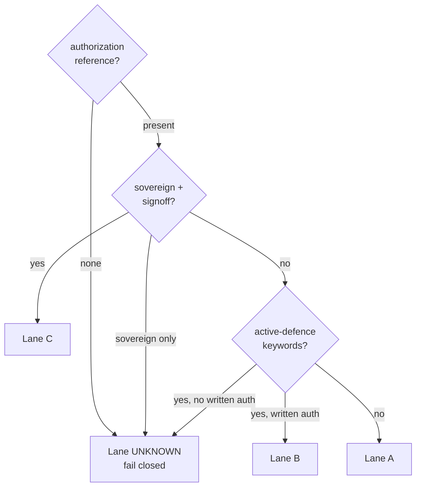

---

## 5. The Lane Policy Module

`orchestrator/lanes/lane_policy.py` defines the `Lane` enum (`A`, `B`, `C`, `UNKNOWN`) and the `LanePolicy` class. Its single responsibility is to convert an operation description plus authorisation evidence into a lane, failing closed whenever that evidence is insufficient. Lane A is defensive work authorised by the system owner. Lane B is active-defence work that requires explicit *written* authorisation. Lane C is sovereign-authorised work that requires both a sovereign authorisation flag and human signoff. Everything else is `UNKNOWN`.

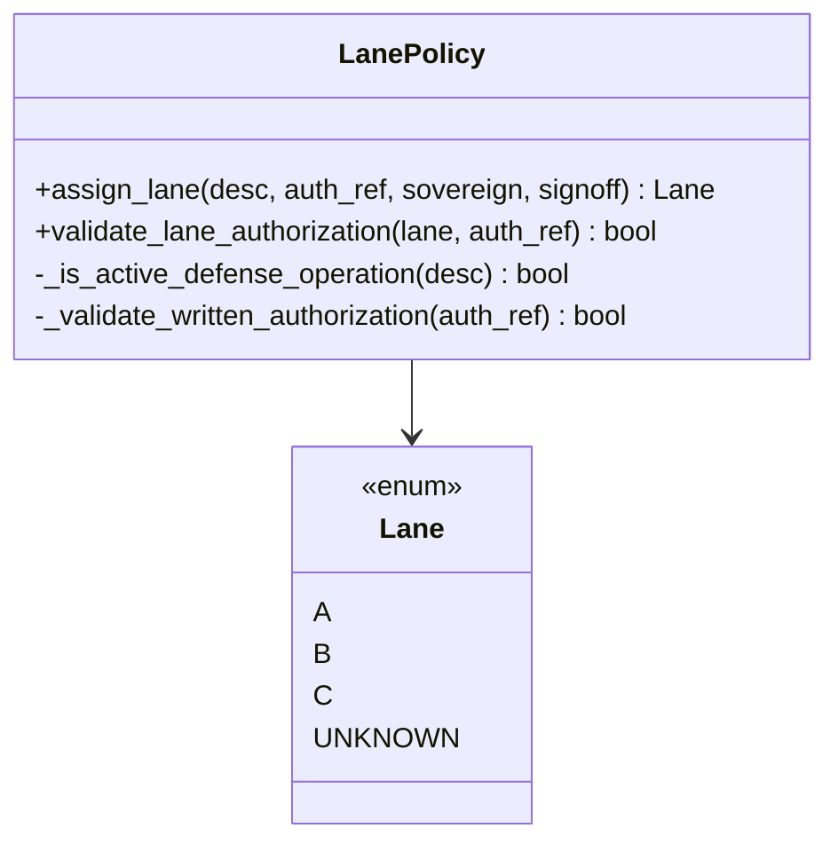

`assign_lane` applies the rules in a strict order. If no authorisation reference is supplied, it logs a denial and raises `ValueError` — failing closed before anything else is considered. If sovereign authorisation is present together with human signoff, the lane is C. If sovereign authorisation is present *without* signoff, it fails closed, because sovereign work without a human in the loop is exactly the case the system is built to refuse. Otherwise, a keyword classifier decides whether the operation is active-defence: if it is, a written-authorisation check must pass for Lane B, and failing that check fails closed; if it is not, the operation settles into Lane A.

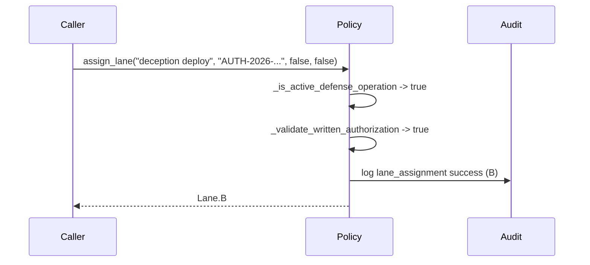

The active-defence classifier in the Foundation phase is keyword-based, matching terms such as `deception`, `honeypot`, `honeytoken`, `threat_hunting`, `controlled_engagement`, and `attribution`. The written-authorisation check is likewise a scaffold: the reference must be at least ten characters and begin with one of `AUTH-`, `WRITTEN-AUTH-`, `CONTRACT-`, or `SOW-`. Both are deliberately simple and both are documented as such in the source. A production implementation would replace the keyword classifier with a more robust classification method and would verify the authorisation reference against an authorisation registry rather than a prefix list. When you extend either, keep the default path failing closed.

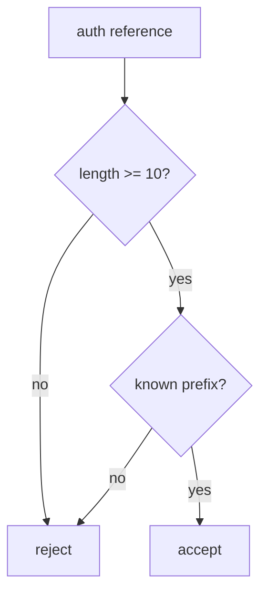

Every rejection path is logged with `result="denied"` and a human-readable `failure_reason`, so the audit trail records not merely that an operation stopped but *why* it stopped. That is a design requirement, not a convenience: an evidence log that records only successes cannot support the accountability the project promises.

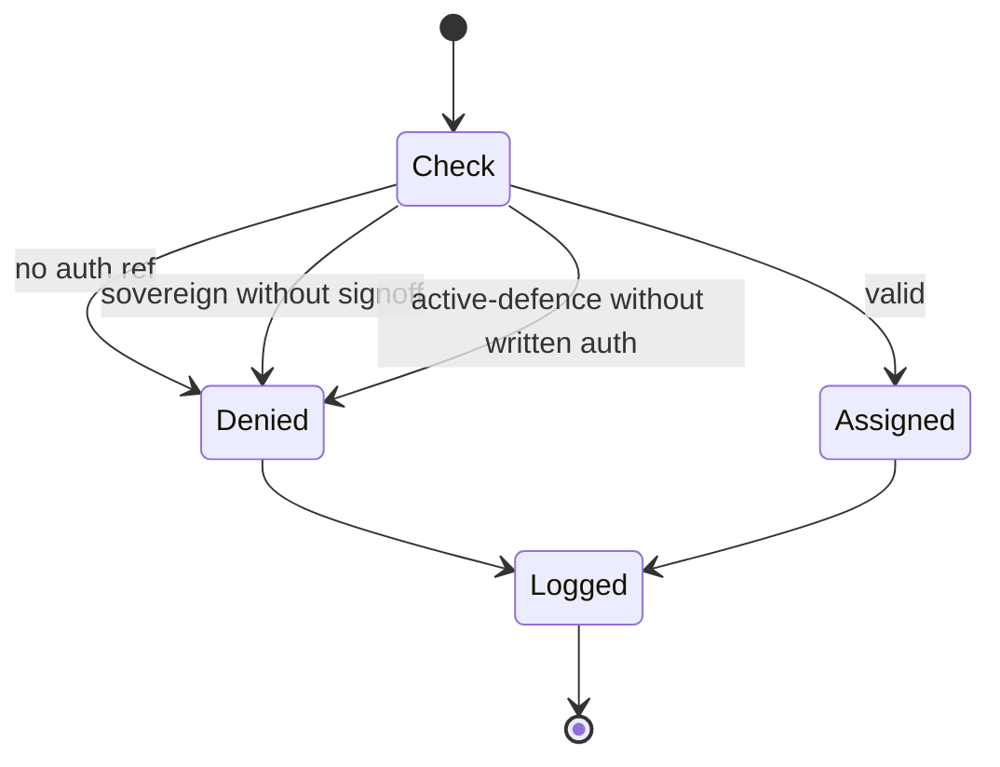

---

## 6. The Rules-of-Engagement Engine

`orchestrator/roe/roe_engine.py` encodes the bounds of permitted action as policy. The central method, `check_roe(lane, capability)`, returns `True` when a capability is permitted and raises `ROEViolation` otherwise. The engine's first act on every call is to consult a set of capabilities that are prohibited in **every** lane, Lane C included, so that the most permissive lane can never become a loophole.

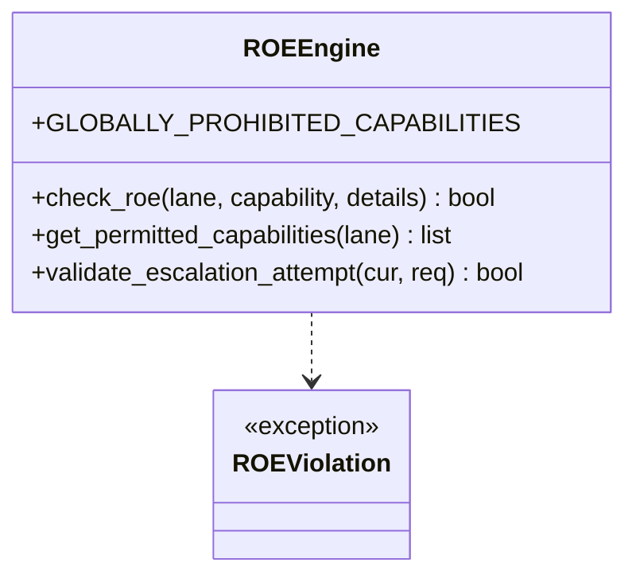

The globally prohibited set covers malware creation and deployment, credential theft and harvesting, denial-of-service generation, unauthorised data exfiltration, persistence installation, evasion techniques, destructive payloads, autonomous retaliation, hack-back, and unauthorised third-party targeting. These are the capabilities the project will never implement in any lane, and the engine enforces that refusal structurally: a request for any of them is denied and logged with a `policy_violations` entry before lane-specific reasoning even begins.

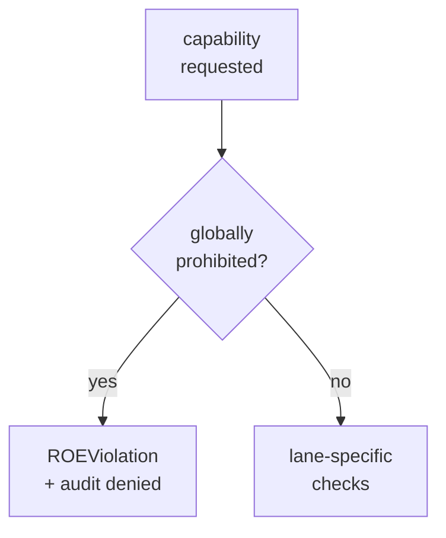

Beyond the global floor, each lane narrows what is allowed. Lane A, the defensive lane, forbids `live_exploitation`, `deception_deployment`, `honeypot_deployment`, and `active_engagement`, since those belong to Lane B or C. Lane B, the active-defence lane, permits deception and honeypot work but forbids `offensive_operation`, `unauthorized_system_access`, and `destructive_action`. Lane C is the most permissive lane, yet it remains bounded by the global prohibitions — the engine makes this explicit rather than leaving it to chance. A companion method, `get_permitted_capabilities`, returns the positive list of what each lane may do, which is the natural thing to call when building or testing the orchestrator.

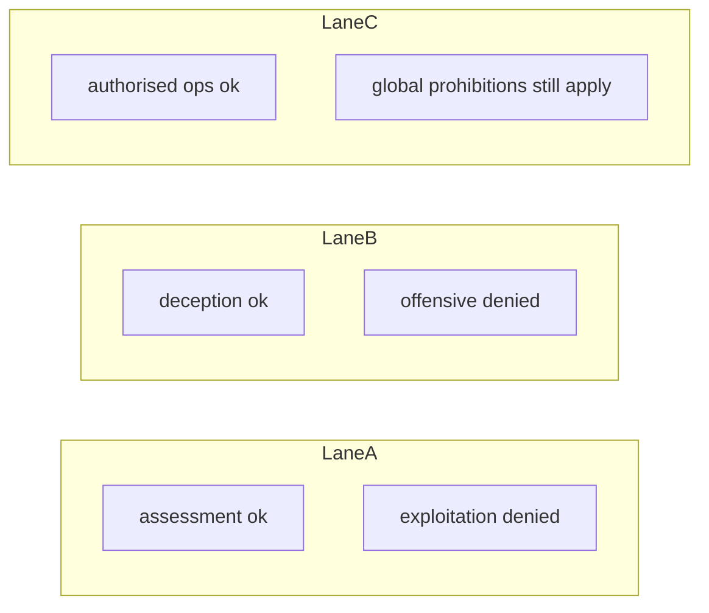

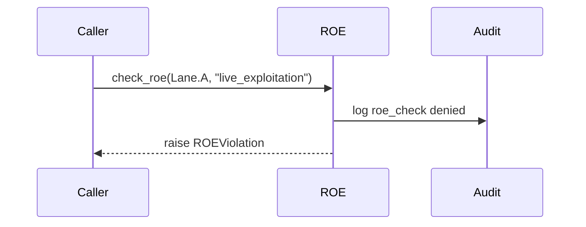

Escalation between lanes deserves special mention. In the Foundation phase, `validate_escalation_attempt` denies **all** cross-lane escalation and logs it with `escalation_attempt=True`; only a same-lane request returns true. This is the safe default: authorised escalation paths are real governance machinery that must be designed deliberately, and until they are, any attempt to move from one lane to another is treated as a policy violation and recorded for review.

```mermaid
stateDiagram-v2
    [*] --> Same: current == requested
    Same --> Allowed
    [*] --> Cross: current != requested
    Cross --> Denied: log escalation_attempt
    Allowed --> [*]
    Denied --> [*]
```

```mermaid
mindmap
  root(("Global prohibitions"))
    Malware
      create
      deploy
    Credentials
      theft
      harvesting
    Availability
      ddos
    Access
      exfiltration
      persistence
      evasion
    Offensive
      destructive payload
      autonomous retaliation
      hack-back
      third-party targeting
```

---

## 7. The Human Gate

`orchestrator/human_gate/human_gate.py` interposes required human authorisation at decision points. It models each request through an `ApprovalStatus` lifecycle — `PENDING`, `APPROVED`, `DENIED`, `EXPIRED` — and it records the transition in the audit log at every step.

```mermaid
stateDiagram-v2
    [*] --> PENDING
    PENDING --> APPROVED: approve_operation
    PENDING --> DENIED: deny_operation
    PENDING --> EXPIRED: timeout (specified)
    APPROVED --> [*]
    DENIED --> [*]
    EXPIRED --> [*]
```

The policy for *when* a human is required is encoded in `requires_human_approval`. Lane A requires approval only for sensitive operations — `live_vulnerability_scan`, `configuration_change`, and `access_customer_data` — on the principle that routine defensive analysis should not be throttled by needless gating. Lane B requires approval for every active-defence deployment. Lane C requires approval for every operation without exception. And `UNKNOWN` fails closed by requiring approval, so an unclassified operation can never slip past the gate.

```mermaid
flowchart TD
    OP["operation"] --> LANE{"lane?"}
    LANE -->|A| SENS{"sensitive op?"}
    SENS -->|yes| REQ["approval required"]
    SENS -->|no| NOREQ["no approval"]
    LANE -->|B| REQ
    LANE -->|C| REQ
    LANE -->|UNKNOWN| REQ
```

The request-and-decide flow is straightforward. `request_approval` mints a UUID, stores a pending record, and logs a `human_gate_request` event with `result="pending"`. A human then calls `approve_operation` or `deny_operation`, supplying their identifier and, for a denial, a reason. Both methods reject a request that cannot be found or that has already been processed, raising `ValueError` rather than silently overwriting a decision — a small guarantee that matters a great deal when the log is meant to be authoritative.

```mermaid
sequenceDiagram
    participant System
    participant Gate
    participant Human
    participant Audit
    System->>Gate: request_approval(...)
    Gate->>Audit: log human_gate_request (pending)
    Gate-->>System: approval_request_id
    Human->>Gate: approve_operation(id, "operator")
    Gate->>Audit: log human_gate_approval (success)
    Gate-->>Human: true
```

```mermaid
flowchart LR
    ID["approval id"] --> FOUND{"exists?"}
    FOUND -->|no| ERR["ValueError"]
    FOUND -->|yes| PEND{"still pending?"}
    PEND -->|no| ERR2["already processed"]
    PEND -->|yes| ACT["approve / deny"]
```

Two aspects are Foundation-phase choices that a later phase will replace. Approval records live in an in-memory dictionary (`self._pending_approvals`), which is adequate for development and testing but is not durable; persistent storage is specified. And the `EXPIRED` state is reserved by the enum but no timer yet drives the transition — expiry is specified, not implemented. If you build the durable store, make sure expiry and audit logging survive a restart, because an approval that quietly vanishes is as dangerous as one that never expires.

```mermaid
flowchart TD
    MEM["in-memory dict"] -.specified.-> DB["durable store"]
    NOW["no timeout driver"] -.specified.-> EXP["expiry timer"]
```

---

## 8. The Audit Logger

`governance/audit_logger.py` writes an append-only evidence record and is the shared spine of the system: every governance module obtains the singleton through `get_audit_logger()` and emits structured events into it. A reader who wants to understand what the system did — and, just as importantly, what it refused to do and why — reads this log.

```mermaid
flowchart LR
    LP["lane_policy"] --> AUD["AuditLogger"]
    RE["roe_engine"] --> AUD
    HG["human_gate"] --> AUD
    CE["controlled_eval"] --> AUD
    AUD --> JSONL["audit_YYYY-MM-DD.jsonl"]
```

Each event carries a timestamp in ISO 8601 UTC, a UUID `event_id`, an `operation_type`, a `lane`, an `actor` with a `type` and `identifier`, a `result`, and an `escalation_attempt` flag, plus optional `authorization_reference`, `operation_details`, `failure_reason`, and `policy_violations` fields when they apply. The structure is intentionally uniform so that queries and later tamper-evidence work across every event without special cases.

```mermaid
erDiagram
    AUDIT_EVENT {
        string timestamp
        string event_id
        string operation_type
        string lane
        string result
        bool escalation_attempt
    }
    ACTOR {
        string type
        string identifier
    }
    AUDIT_EVENT ||--|| ACTOR : has
```

`log_event` validates its enums before it writes anything. The `operation_type` must be one of a fixed set — lane assignment, authorisation check, the three human-gate events, model reference, ROE check, escalation attempt, and the operation lifecycle types, among others — the `lane` must be `A`, `B`, `C`, or `unknown`, the `actor_type` must be `system`, `human`, or `api`, and the `result` must be `success`, `failure`, `denied`, or `pending`. An invalid value raises `ValueError` rather than committing a malformed record, so the log cannot be polluted by a careless caller.

```mermaid
flowchart TD
    EV["log_event call"] --> VOP{"valid operation_type?"}
    VOP -->|no| RAISE["ValueError"]
    VOP -->|yes| VL{"valid lane?"}
    VL -->|no| RAISE
    VL -->|yes| VA{"valid actor_type?"}
    VA -->|no| RAISE
    VA -->|yes| VR{"valid result?"}
    VR -->|no| RAISE
    VR -->|yes| WRITE["append JSONL line"]
```

The log is append-only by convention and is rotated daily into `audit_<date>.jsonl` files. It is **plain JSONL and is not cryptographically signed** in this release. This is an important honesty point: there is no hash-chaining and no signature today, so the log is tamper-evident only to the extent that the surrounding filesystem controls make it so. Cryptographic signing or hash-chaining is specified for a later phase, and you should neither describe nor rely on signing that does not exist. A companion method, `query_logs`, offers a simple file-scan query with time, lane, operation-type, and actor filters, which is enough for development; a database-backed query is specified for production scale.

```mermaid
flowchart LR
    TODAY["append-only JSONL"] -.specified.-> SIGNED["hash-chained<br/>+ signed"]
```

```mermaid
flowchart TD
    Q["query_logs(filters)"] --> SCAN["iterate audit_*.jsonl"]
    SCAN --> FILT["apply filters"]
    FILT --> RES["matching events"]
```

---

## 9. Compliance Manifests

`compliance/model_allowlist.json` and `compliance/license_manifest.json` declare policy in machine-readable form. The allowlist names the approved models — AI2 OLMo 3 32B Base, AI2 OLMo 3 32B Think, and IBM Granite 4.1 30B Base, all under Apache-2.0 and all of US origin — and enumerates prohibited origins and model families together with the enforcement semantics the project intends, such as `fail_closed` for an unknown model and `fail_closed_and_alert` for a prohibited one.

```mermaid
flowchart TD
    MAN["model_allowlist.json"] --> APP["approved models"]
    MAN --> PROH["prohibited origins"]
    MAN --> ENF["enforcement rules"]
    APP --> OLMOB["OLMo 3 32B Base"]
    APP --> OLMOT["OLMo 3 32B Think"]
    APP --> GRAN["Granite 4.1 30B Base"]
```

The essential caveat is that these manifests are **declared, not yet enforced in code**. The enforcement semantics are described in the JSON, but there is no runtime that reads the allowlist and blocks a model — and because inference is out of scope for the Foundation phase, there is nothing to block yet. Treat the manifests as the specification a future enforcement layer will honour, and when you build that layer, make it read the manifest as the single source of truth rather than hard-coding model names in logic that can drift out of step with policy.

```mermaid
flowchart LR
    MODEL["model identifier"] --> LIST{"on allowlist?"}
    LIST -->|yes| OK["permitted (specified)"]
    LIST -->|unknown| FC["fail closed (specified)"]
    LIST -->|prohibited| ALERT["fail closed + alert (specified)"]
```

```mermaid
flowchart LR
    DECLARED["manifest JSON"] -.specified.-> RUNTIME["enforcement layer"]
```

---

## 10. Controlled Evaluation and Snapshots

The controlled-evaluation harness, `core/eval/run_controlled_eval.py`, is a **dry-run skeleton**. It loads a benchmark JSON, validates that it contains a `benchmark_name` and a list of `tasks`, and checks each task against a prohibited-keyword list so that Foundation-phase benchmarks can hold only safe placeholder tasks. Calling `run_evaluation` with `dry_run=False` raises `NotImplementedError`, because **inference is explicitly out of scope** for this phase. The harness nonetheless logs operation-start and operation-complete events, so even a dry run leaves a trail.

```mermaid
flowchart TD
    LOAD["load_benchmark()"] --> VAL{"valid structure?"}
    VAL -->|no| ERR["ValueError"]
    VAL -->|yes| RUN["run_evaluation(dry_run=True)"]
    RUN --> SAFE["validate_task_safety per task"]
    SAFE --> OUT["results dict"]
    RUN2["dry_run=False"] --> NI["NotImplementedError"]
```

```mermaid
sequenceDiagram
    participant Dev
    participant Eval
    participant Audit
    Dev->>Eval: load_benchmark()
    Eval->>Audit: log operation_start
    Dev->>Eval: run_evaluation(Lane.A, auth, dry_run=True)
    Eval->>Eval: validate_task_safety(each)
    Eval->>Audit: log operation_complete
    Eval-->>Dev: results
```

The snapshot tooling, `core/snapshot/capture_manifest.py`, hashes local files with SHA-256 and builds verifiable directory manifests that record each file's digest and size. `verify_manifest` recomputes hashes and reports mismatches, missing files, and extras, failing the verification if any file has changed. This is working, useful code for reproducibility today. The one stub is `capture_model_manifest_stub`, which returns a metadata-only placeholder and performs no Hugging Face download, consistent with the Foundation-phase rule that no model weights are fetched.

```mermaid
flowchart TD
    DIR["directory"] --> WALK["rglob files"]
    WALK --> HASH["sha256 per file"]
    HASH --> MAN["manifest dict"]
    MAN --> WRITE["optional JSON output"]
```

```mermaid
flowchart LR
    V["verify_manifest"] --> M{"hash matches?"}
    M -->|yes| OKV["verified"]
    M -->|no| FAIL["mismatch recorded"]
    V --> MISS{"file missing?"}
    MISS -->|yes| FAIL
```

---

## 11. Verifiers Stage

`verifiers/` is a **defined stage, not a completed verifier**. In the specified pipeline it sits immediately after execution, validating output before anything is recorded as a result. Building it is a genuine design task: you must decide what "valid output" means for a given capability and lane, encode those checks, and ensure that output which cannot be validated is rejected rather than passed through. The fail-closed principle applies here with full force — an unverifiable result is a refused result.

```mermaid
flowchart LR
    EXEC["execute"] --> VER["verifier (specified)"]
    VER -->|valid| REC["record result"]
    VER -->|invalid| REJ["reject + audit"]
```

```mermaid
flowchart TD
    OUT["candidate output"] --> SCHEMA{"schema ok?"}
    SCHEMA -->|no| BAD["reject"]
    SCHEMA -->|yes| POLICY{"within lane policy?"}
    POLICY -->|no| BAD
    POLICY -->|yes| GOOD["accept (specified)"]
```

---

## 12. Prohibited-Terms Scanner

`scripts/scan_prohibited_terms.py` guards the public-positioning boundary and is one of the most finished pieces of the repository. It walks every scannable file — Python, Markdown, text, JSON, YAML, TOML, shell, and reStructuredText — skipping build and cache directories, and matches four categories of term case-insensitively: internal codenames, third-party AI and tool names, PRC-origin model families, and reckless public terms. Any hit is a violation; a non-zero exit on any violation makes the scanner a dependable gate.

```mermaid
flowchart TD
    ROOT["--root ."] --> ITER["iterate scannable files"]
    ITER --> SCAN["match 4 categories"]
    SCAN --> V{"violations?"}
    V -->|yes| EXIT1["report + exit 1"]
    V -->|no| EXIT0["clean + exit 0"]
```

```mermaid
mindmap
  root(("Prohibited term categories"))
    Internal
      codenames
    Third-party
      model/tool names
    PRC-origin
      model families
    Reckless
      hack-back
      retaliation
```

The scanner can report in human-readable form or as JSON, which makes it easy to consume from a hook or a pipeline. When you add documentation or code comments, run it before you commit; it is far cheaper to reframe a sentence defensively than to have an unsafe term reach the history of a governance project whose entire credibility rests on disciplined public language.

```mermaid
sequenceDiagram
    participant Dev
    participant Scanner
    Dev->>Scanner: scan_prohibited_terms.py --root .
    Scanner->>Scanner: match terms per line
    Scanner-->>Dev: report + exit code
```

---

## 13. Extending Governance Modules

Extending ZP42 means adding policy, not adding capability for its own sake. The general shape of a safe change is always the same: define the rule, wire the check so that it runs on the relevant path, log both the permitted and the refused outcome, and prove the behaviour with tests that assert the audit event as well as the return value. A change that does only part of this is incomplete.

```mermaid
flowchart LR
    DEF["define rule"] --> WIRE["wire check"]
    WIRE --> LOG["log pass and fail"]
    LOG --> TEST["add tests"]
    TEST --> REV["review"]
```

To forbid a capability everywhere, add it to `ROEEngine.GLOBALLY_PROHIBITED_CAPABILITIES`; to forbid it only within a lane, add it to that lane's local set. In both cases, add a test that calls `check_roe` with the new capability, asserts that `ROEViolation` is raised, and confirms the denial was logged. To route more operations into Lane B, extend the active-defence keyword list in `_is_active_defense_operation`; to tighten written authorisation, extend the prefix list or the length check. The one invariant you must never break is that the default path — the one taken when evidence is missing or ambiguous — fails closed.

```mermaid
flowchart TD
    NEW["new capability name"] --> SCOPE{"all lanes?"}
    SCOPE -->|yes| GLOB["add to GLOBALLY_PROHIBITED"]
    SCOPE -->|no| LOC["add to lane set"]
    GLOB --> T["test denial + audit"]
    LOC --> T
```

New governance events require a new `operation_type`. Add it to the `valid_operation_types` set in `audit_logger.py` and to `audit_schema.json`, keeping the two in step, then emit it from your module on both the success and the failure path. A log that records only the happy path is a liability in a system whose purpose is accountability, so treat the denied and failed events as first-class, not as an afterthought.

```mermaid
flowchart TD
    NEWTYPE["new operation_type"] --> ADD1["add to valid set"]
    ADD1 --> ADD2["add to audit_schema.json"]
    ADD2 --> EMIT["emit success + failure"]
    EMIT --> TEST["test both paths"]
```

The largest and most valuable extension available today is building the orchestrator that the architecture specifies. A contribution here should assemble the existing modules in order — `LanePolicy.assign_lane`, then `ROEEngine.check_roe`, then the `HumanGate` where approval is required, then the verifier when it exists — and it should halt and fail closed at the first stage that refuses, logging each step as it goes. Build it so that adding a new stage later is a matter of inserting a gate, not of rewriting the flow.

```mermaid
stateDiagram-v2
    [*] --> Lane
    Lane --> ROE: assigned
    Lane --> Fail: unknown
    ROE --> Gate: permitted
    ROE --> Fail: violation
    Gate --> Verify: approved
    Gate --> Fail: denied
    Verify --> Done: valid
    Verify --> Fail: invalid
    Fail --> [*]
    Done --> [*]
```

```mermaid
flowchart TD
    STEP["each stage"] --> REFUSE{"refuses?"}
    REFUSE -->|yes| STOP["stop + audit + fail closed"]
    REFUSE -->|no| NEXT["next stage"]
```

---

## 14. Testing

Tests live in `tests/` and run under `pytest`. Because the governance modules are designed as independent components, they are tested that way: lane assignment, ROE decisions, the human-gate lifecycle, and audit validation each carry direct coverage. When you extend a module, add tests for the permitted path and, with equal care, for the fail-closed path, and assert that the expected audit event was written. A negative test that proves the system refuses the right things is worth more here than a positive test that proves it accepts the easy ones.

```mermaid
flowchart LR
    UNIT["unit tests"] --> POS["permitted path"]
    UNIT --> NEG["denied path"]
    NEG --> AUD["assert audit event"]
```

Respect the resource limits of the environment: bound test parallelism rather than letting it auto-detect, for example `python -m pytest -q -n 24` at most. A change is not done until `compileall`, `pytest`, and the prohibited-terms scan are all clean together — green on two of the three is a red build.

```mermaid
flowchart LR
    C1["compileall"] --> C2["pytest"] --> C3["scan terms"] --> READY["done"]
```

---

## 15. Contributing Under MIT

ZP42 is released under the **MIT License** by Naquib Hatami. Contributions are accepted under the same licence; contributors retain their copyright and license their contributions under MIT. The mechanics are conventional: branch or fork, make a focused change, keep the validation loop green, and open a pull request against `github.com/iQs-Group/zp-42`. Smaller, self-contained changes are reviewed faster and are far less likely to introduce a governance regression than sprawling ones.

```mermaid
gitGraph
    commit id: "main"
    branch feature
    commit id: "add rule"
    commit id: "add tests"
    checkout main
    merge feature
```

Review weighs the governance properties heavily, because the governance surface is the product. A reviewer will ask, in order, whether the change fails closed, whether its outcomes are audited, whether tests prove both, and whether the prohibited-terms scan is clean. A change that widens capability without a corresponding authorisation gate is rejected on principle, however elegant it is. Keep all framing defensive and governance-first in code, comments, and docs alike: never describe how to perform offensive actions, exploitation, unauthorised access, or retaliation. The scanner enforces this at the boundary and review enforces it in intent, and both exist for the same reason — the point of ZP42 is that capability is gated by authorisation.

```mermaid
flowchart TD
    PR["pull request"] --> Q1{"fails closed?"}
    Q1 -->|no| REJ["request changes"]
    Q1 -->|yes| Q2{"audit covered?"}
    Q2 -->|no| REJ
    Q2 -->|yes| Q3{"tests prove it?"}
    Q3 -->|no| REJ
    Q3 -->|yes| Q4{"terms scan clean?"}
    Q4 -->|no| REJ
    Q4 -->|yes| ACC["approve"]
```

```mermaid
mindmap
  root(("Good contribution"))
    Focused
    Fails closed
    Audited
    Tested
    Clean terms
    MIT licensed
```

---

## 16. Implemented vs Specified: A Developer's Map

Hold this distinction firmly while you work. The table and diagram below are the honest status of the system. Do not build on, document, or claim capability that does not yet exist — particularly audit signing, enforced compliance, or a wired pipeline, none of which are present today.

| Concern | Implemented today | Specified for later |
| --- | --- | --- |
| Lane assignment | Yes, with fail-closed | Registry-backed authorisation |
| ROE enforcement | Yes, per-lane + global | Authorised escalation paths |
| Human gate | Yes, in-memory | Durable store, expiry |
| Audit log | Yes, plain JSONL | Signing / hash-chain, DB query |
| Compliance manifests | Declared JSON | Runtime enforcement |
| Controlled eval | Dry-run only | Inference (out of scope now) |
| Snapshot manifest | Local hashing | Hugging Face model manifests |
| Verifiers | Defined stage | Working verifier |
| Orchestrator pipeline | Scaffold only | End-to-end wiring |

```mermaid
flowchart LR
    subgraph Built
        X1["lanes"]
        X2["roe"]
        X3["human_gate"]
        X4["audit"]
        X5["terms scanner"]
        X6["snapshot"]
    end
    subgraph Specified
        Y1["orchestrator"]
        Y2["verifiers"]
        Y3["compliance enforcement"]
        Y4["audit signing"]
        Y5["inference"]
    end
    Built -.next phases.-> Specified
```

```mermaid
timeline
    title Phase roadmap (as specified)
    Foundation : governance primitives
    Phase 2 : evaluation infrastructure
    Phase 3 : defensive reasoning
    Phase 4 : active-defence workflows
    Phase 5 : sovereign-authorised workflows
```

The through-line is simple. ZP42, as designed by Naquib Hatami, treats governance as the primary feature and treats capability as something that must earn its way through lane assignment, rules of engagement, a human gate, verification, and an audit record. Build in that order, fail closed by default, and leave an evidence trail behind every decision. Do that, and the system is trustworthy by construction rather than by assertion.

```mermaid
flowchart LR
    GOV["governance first"] --> GATE["capability gated"]
    GATE --> EVID["evidence recorded"]
    EVID --> TRUST["trustworthy by construction"]
```

---

## 17. Cross-References

- `../README.md` — project overview, setup, and model policy
- `FOUNDATION.md` — charter, lanes, safety boundaries, and model-selection policy
- `../LICENSE` — the MIT License text
- `03-architecture.md` — the specified system architecture in depth
- `08-governance-audit.md` — the audit schema and logging in detail
