# ZP42 Operator Guide

> Part of the ZP42 documentation set

**ZP42 (Zeroth Protocol 42)** is an open, MIT-licensed, governance-first cyber-reasoning system for defensive, active-defence, and sovereign-authorised workflows, invented and authored by **Naquib Hatami** and published by SADI AI Inc. / iQs Group Inc. (`github.com/iQs-Group/zp-42`, `zp42.org`). This guide is the hands-on reference for an **authorised operator**: the person who decides to enter a lane, supplies the authorisation, answers the human gate, and later reads the audit to prove what happened. It is written for the system **as specified** and is careful to mark the line between what is **implemented** today and what is **specified** for later phases.

> **Honest status.** The present release is a **Foundation-phase scaffold**. The governance modules — lane policy, ROE engine, human gate, audit logger, and prohibited-terms scanner — are implemented and independently tested. The end-to-end orchestrator that would wire `lane -> ROE -> human_gate -> verify -> audit` into one pipeline is **not yet implemented** (`orchestrator/__init__.py` is an empty scaffold). The `verifiers/` stage is **defined, not built**. The audit log is **plain JSONL and is not cryptographically signed**. Compliance (model allowlist, licence manifest) is **declared as machine-readable manifests, not yet enforced in code**. Inference, exploit or offensive execution, and live targeting are **out of scope** for this phase. Read every operational instruction in that light.

---

## 1. Who this guide is for

An **operator** of ZP42 is an authorised human who initiates and supervises governed cyber-reasoning work. You are not expected to read Python to use the system, but you are expected to understand three things: which **lane** your work belongs in, what **authorisation** that lane demands, and how to **read the evidence** the system records about your actions. This guide gives you that, and nothing beyond it — ZP42's entire design point is that capability is **gated by authorisation**, so this document never describes how to attack, exploit, gain unauthorised access, hack back, or retaliate. Those are prohibited across every lane, by policy and by the ROE engine.

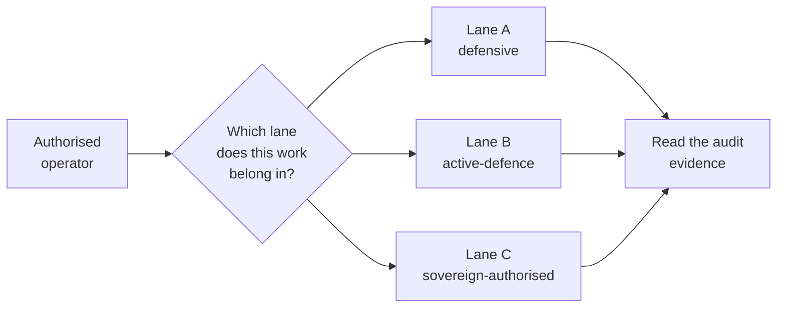

Your responsibilities are narrow and durable. You decide deliberately; the system records faithfully; and you remain accountable for operating only within authorised scope, exactly as the MIT licence notice states.

A note on tone and intent. ZP42 was designed governance-first by Naquib Hatami, which means the controls are not a wrapper bolted onto a capable engine — in the Foundation phase they are almost the entire product. That is deliberate. The lessons carried forward into ZP42 are that governance must be built in from day one rather than retrofitted, that authorisation must be explicit and verifiable rather than assumed, that autonomous escalation is prohibited, and that human oversight is non-negotiable for sensitive operations. As an operator you will sometimes find the system stricter than a general-purpose tool. That strictness is the feature: a refusal you can read in the audit is worth more than a convenience you cannot account for. Throughout this guide, treat every "denied" result as evidence that the design is holding, not as an obstacle to route around.

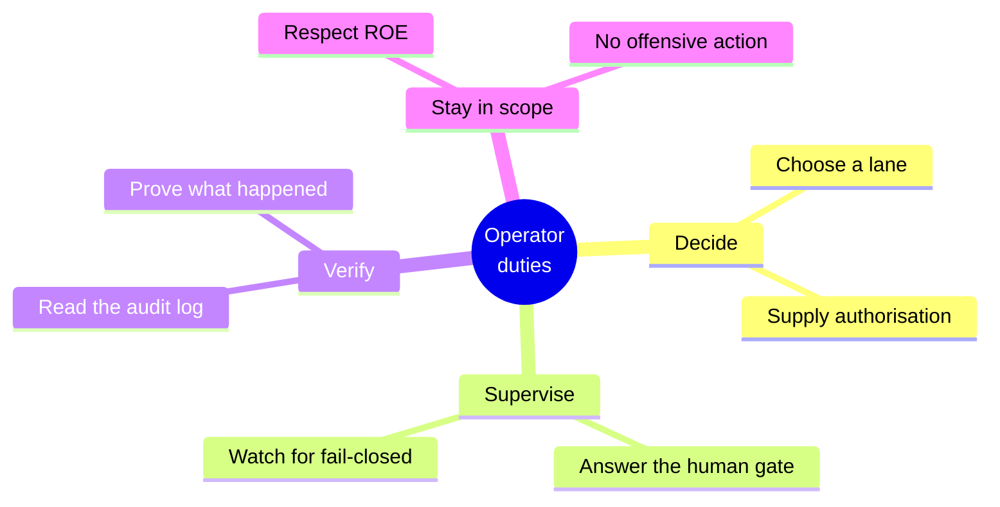

---

## 2. The system in one picture

Before the lanes, hold a simple mental model. An operator request is checked for its lane, bounded by rules of engagement, interrupted for human authorisation where required, (in later phases) verified, and in all cases written to an append-only audit trail. Today these are **independent components** you can exercise one at a time; the connecting pipeline is specified but not yet wired.

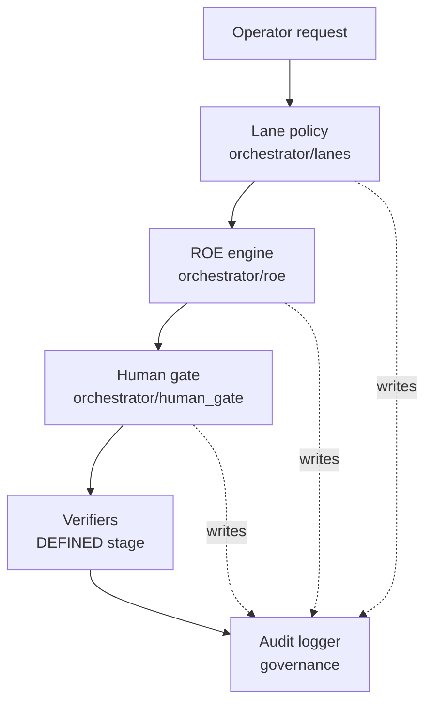

The dotted lines matter: each governance module writes to the audit logger directly, so even without the end-to-end pipeline you get a faithful record of every lane assignment, ROE check, and gate decision. This is the practical consequence of the scaffold design — because logging is a dependency of the lane policy, the ROE engine, and the human gate rather than a stage at the end of a pipeline, evidence is produced at the moment each decision is made. You do not have to run a full workflow to generate an audit trail; you only have to exercise the component. That property will carry forward unchanged when the pipeline is eventually wired, so anything you learn about reading the log today remains valid later.

It also sets an expectation you should hold firmly: the absence of the end-to-end orchestrator does not mean the governance is absent. The orchestrator's job, when built, is to call these components in the correct order and to refuse to proceed if any of them raises. Until then, that ordering is your responsibility as the operator — you call the lane policy first, then the ROE engine, then the human gate, and you treat any raised error as a hard stop. The system will not silently continue past a refusal because, today, there is no automatic "continue" to silence.

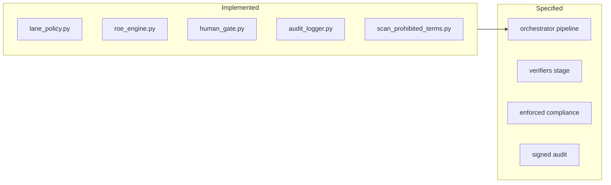

---

## 3. Before you start: authority and prerequisites

ZP42 gives you no authority it did not already have on paper. The system turns **your** authorisation into enforced constraints; it does not manufacture permission. Confirm the prerequisites below before you touch a lane.

| Prerequisite | What it means for you | Source |
|---|---|---|
| Authorisation reference | A non-empty identifier for the paperwork that permits the work | You / your owner |
| Lane understanding | You know whether the work is defensive, active-defence, or sovereign | Section 4 |
| Written authorisation (Lane B) | A document reference in an accepted format | Your owner |
| Sovereign authorisation + signoff (Lane C) | Both must be present together | Sovereign authority |
| Python 3.11+ environment | To run the installed scaffold modules | `pip install -e .` |

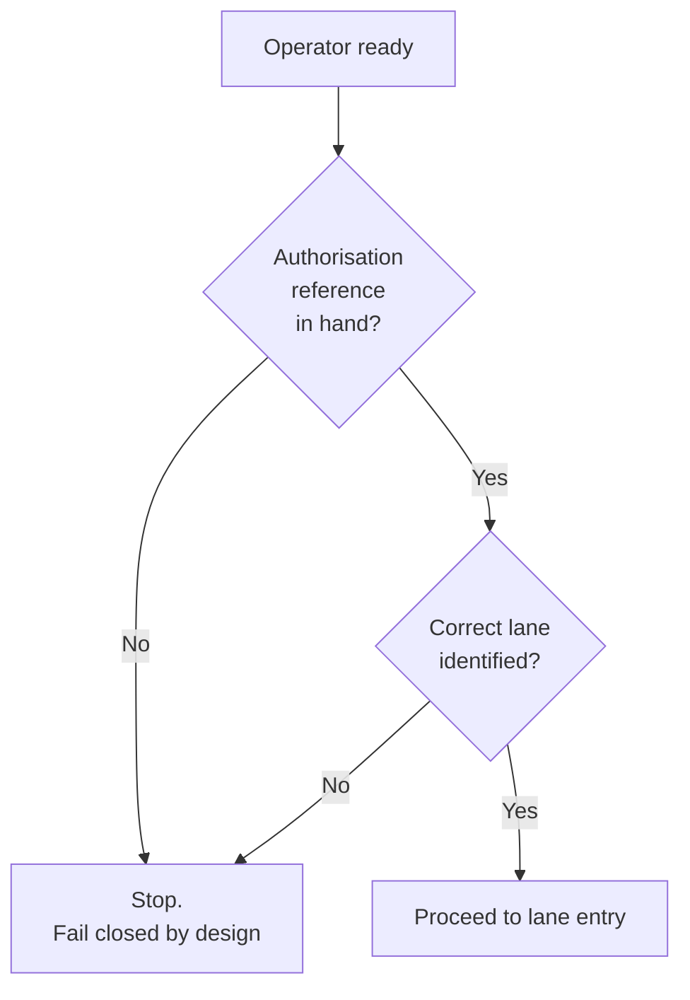

The first rule of ZP42 is the **fail-closed** rule: in the absence of an authorisation reference, the lane policy raises an error and refuses to assign a lane. There is no default lane that silently widens.

Why fail closed rather than fail open? Because the cost asymmetry in cyber work is severe. An operation wrongly refused costs you a few minutes and a conversation with whoever holds the authorisation; an operation wrongly permitted can cross a legal or contractual boundary that cannot be un-crossed. ZP42 resolves every ambiguity in favour of the cheaper mistake. In concrete terms this means that a missing reference, a malformed written authorisation, a sovereign authorisation that arrives without its human signoff, a request for a globally prohibited capability, and any attempt to cross from one lane to another all terminate in the same safe state — denied, with a reason, recorded. As an operator you should internalise that there is no input you can supply that turns a refusal into a quiet success. If the system will not proceed, the correct response is to fix the authorisation, not to reshape the request until it slips through.

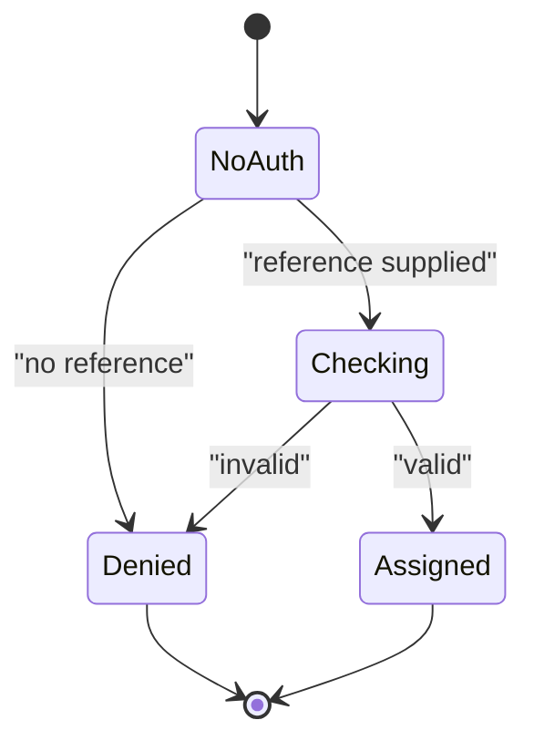

---

## 4. The lane model for operators

ZP42's core control is the **lane**. A lane is a band of permitted action with its own authorisation bar. You enter a lane deliberately for a specific piece of work; a lane is never a default that broadens on its own. The system defines three operating lanes and one fail-closed state.

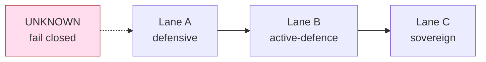

### 4.1 Lane A — defensive

Lane A covers defensive work authorised by the system owner: vulnerability assessment of owned systems, defensive posture analysis, security configuration review, compliance checking, and threat modelling. It requires a customer or system authorisation reference. Most Lane A operations need no human gate, but sensitive ones do (Section 7).

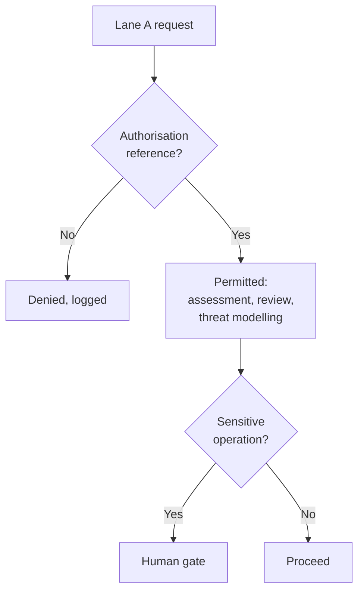

Lane A explicitly forbids live exploitation, deception or honeypot deployment, and active engagement — those require a higher lane. The distinction the system draws is between *understanding* a system's security posture and *acting* on another party in a way that could be felt outside your own estate. Lane A is the understanding lane. You may model threats, review configurations, assess vulnerabilities on systems you own or are authorised over, and check compliance. What you may not do in Lane A is anything that reaches toward an adversary or deploys live deception, because those carry a higher authorisation bar and a human-review obligation that Lane A does not impose. In practice most routine defensive security work lives here, which is why Lane A is the only lane that does not require a human gate for ordinary operations — the authorisation reference alone is sufficient for non-sensitive work.

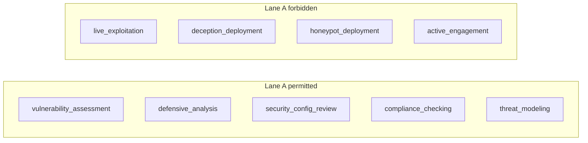

### 4.2 Lane B — active-defence

Lane B covers active-defence work and **requires explicit written authorisation**. Permitted activities include deception technology on owned systems, honeypot and honeytoken management, authorised-scope threat hunting, controlled engagement of adversary behaviour, and attribution support limited to evidence collection. Every Lane B deployment requires human review.

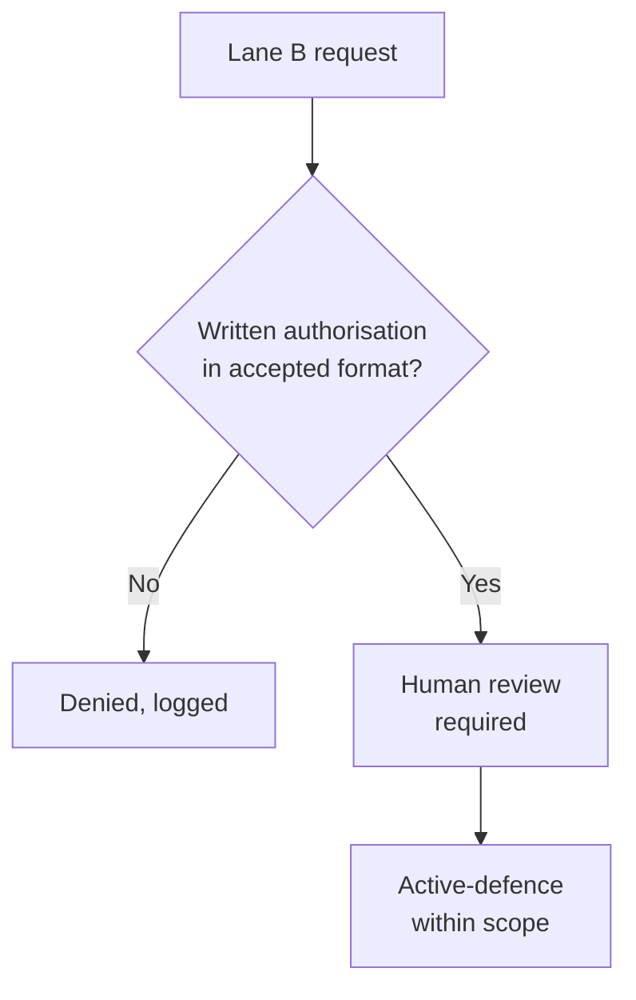

The written-authorisation check is deliberately strict: the reference must be at least ten characters and begin with an accepted prefix (`AUTH-`, `WRITTEN-AUTH-`, `CONTRACT-`, or `SOW-`). Anything else fails closed. This is a format check, not a verification against an authorisation database — the Foundation scaffold does not yet look the reference up anywhere. That is an honest limitation you should understand: passing the format check means the reference *looks like* a written authorisation, not that the system has confirmed the document exists and covers this work. The operator remains the human guarantee that the reference is real and in scope. A production phase is specified to verify references against an authorisation store; until then, do not treat a format-valid reference as a substitute for actually holding the paperwork.

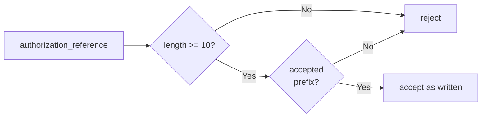

Lane B forbids offensive operations, unauthorised system access, and destructive actions; these escalate to Lane C only under sovereign authority, and remain bounded by the global prohibitions in all cases.

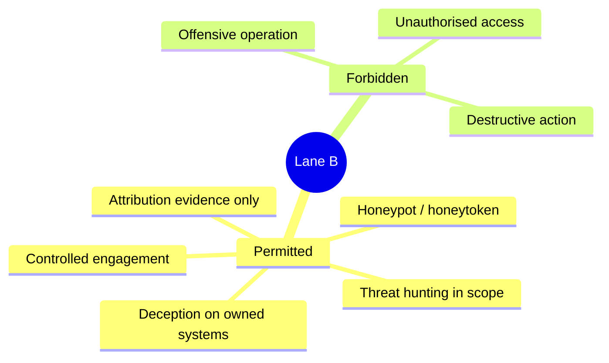

### 4.3 Lane C — sovereign-authorised

Lane C covers sovereign-authorised operations and demands the most: a **sovereign authorisation reference AND human signoff, together**. Sovereign authorisation without human signoff fails closed. Every Lane C operation requires human approval, and even Lane C cannot perform any globally prohibited capability.

The two-key requirement is the heart of Lane C. Neither a sovereign authorisation on its own nor a human signoff on its own is enough; the lane assigns only when both are present in the same call. This mirrors the way serious authority is exercised in the physical world, where a written mandate and a named human who takes responsibility are distinct controls that must co-occur. It is also the clearest expression of the rule that autonomous decision-making for consequential action is prohibited: there is no path in which the system, on its own, decides that a Lane C operation may proceed. A human must be in the loop for every operation, not merely at the outset. For an operator this means Lane C work is inherently slower and more deliberate, with a gate interposed at each step rather than once at the start — and that is intended, because the point of Lane C is that its deliberateness is proportionate to its authority.

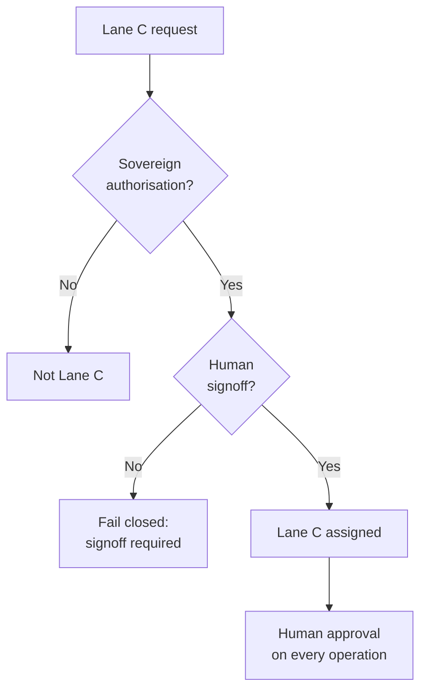

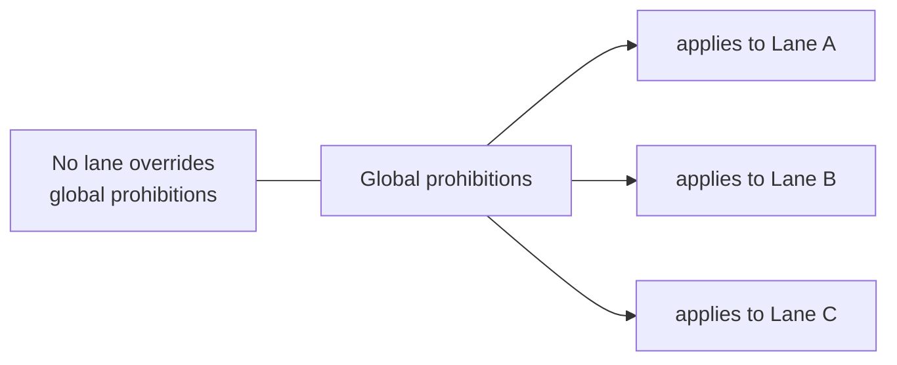

### 4.4 Comparing the lanes

| Property | Lane A | Lane B | Lane C |
|---|---|---|---|
| Purpose | Defensive | Active-defence | Sovereign-authorised |
| Authorisation | Customer / system reference | Written authorisation | Sovereign ref + human signoff |
| Human gate | Only sensitive ops | Every deployment | Every operation |
| Typical activity | Assessment, review | Deception, hunting | Sovereign-scoped ops |
| Fail-closed when | No reference | Bad written auth | Signoff missing |

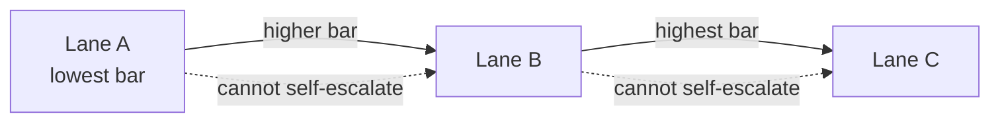

---

## 5. Entering a lane deliberately

Lane assignment is the operator's opening move. In the implemented scaffold, the `LanePolicy.assign_lane` call takes an operation description, an authorisation reference, and two booleans — sovereign authorisation and human signoff. It returns a lane or raises, and it writes the outcome to the audit log either way.

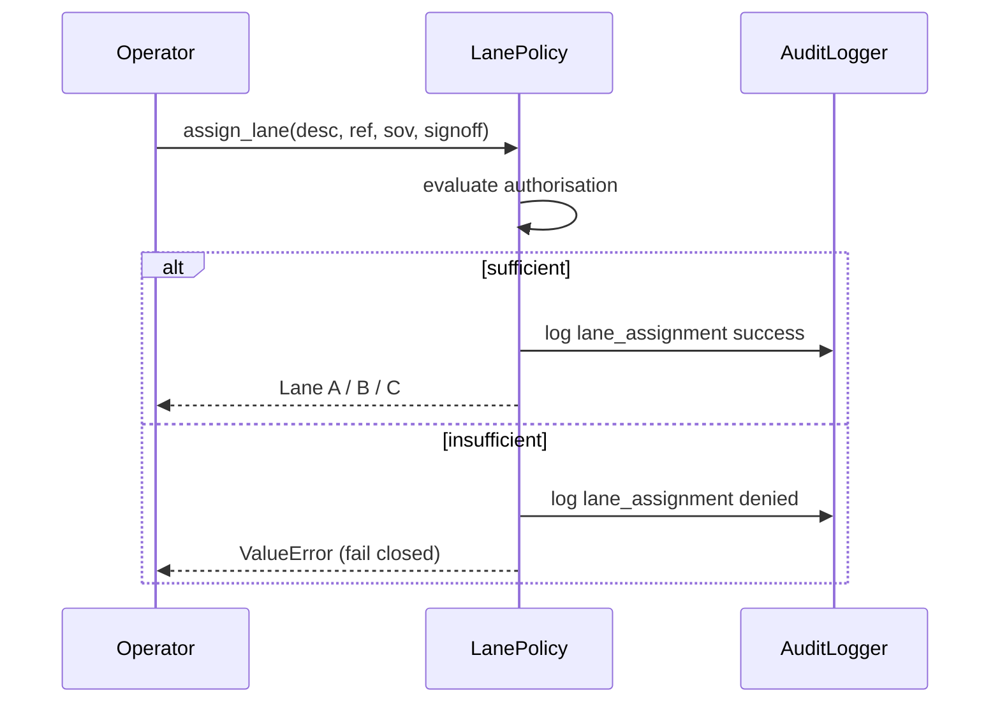

The decision order inside the policy is worth internalising, because it explains why certain requests land where they do.

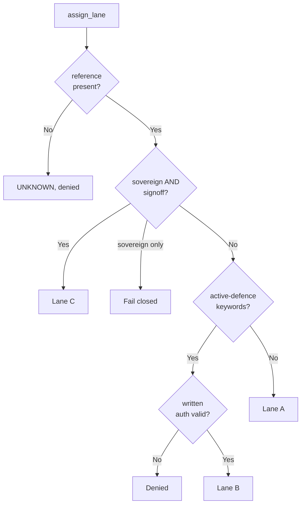

Active-defence classification in the Foundation scaffold is **simple keyword matching** — descriptions containing terms like `deception`, `honeypot`, `honeytoken`, `threat_hunting`, `controlled_engagement`, or `attribution` route to Lane B. This is intentionally basic; production classification is a later-phase concern. As an operator, describe work accurately so it routes correctly.

Two consequences follow from keyword classification, and you should understand both. First, the classifier is conservative in one direction only: it recognises active-defence work by its vocabulary, so a description that uses active-defence language is pushed toward the higher bar of Lane B even if the underlying work is benign. That is the safe direction to err. Second, and more importantly, the classifier does not and cannot catch work that *is* active-defence but is described in plain language that avoids the keywords. The system therefore relies on you to describe operations honestly. This is not a loophole to exploit — describing active-defence work in defensive language to obtain the lower Lane A bar would defeat the governance the system exists to provide, and it would leave an audit trail that misrepresents what you did. The operator's honesty is a load-bearing part of the control, and the audit log is where that honesty is tested after the fact.

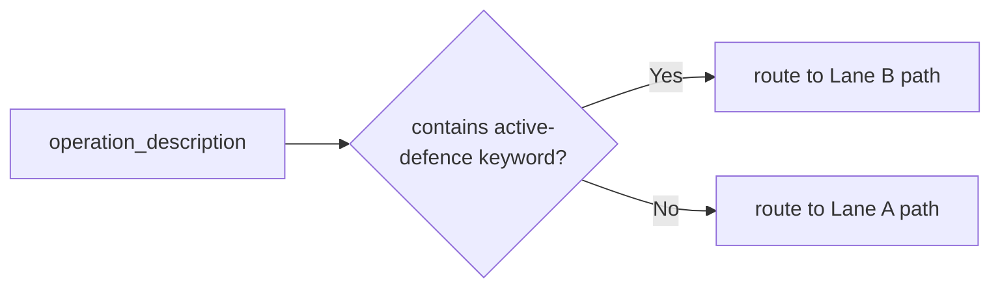

Once a lane is assigned, you can validate the authorisation against it with `validate_lane_authorization`, which refuses outright for the UNKNOWN lane and otherwise records a successful authorisation check.

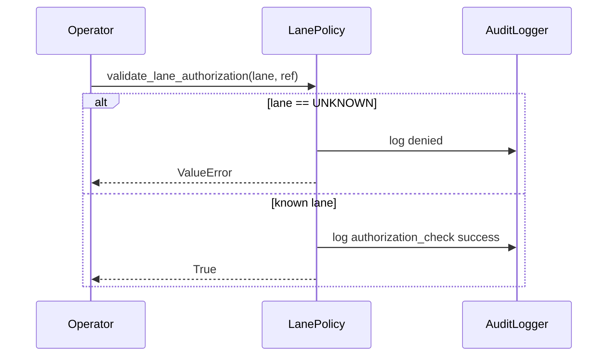

---

## 6. Rules of engagement in practice

The **ROE engine** encodes the bounds of permitted action as policy. For an operator, it is the component that answers a single question: *is this capability permitted in this lane?* It checks global prohibitions first, then lane-specific limits, and raises `ROEViolation` on any breach — always writing to the audit log.

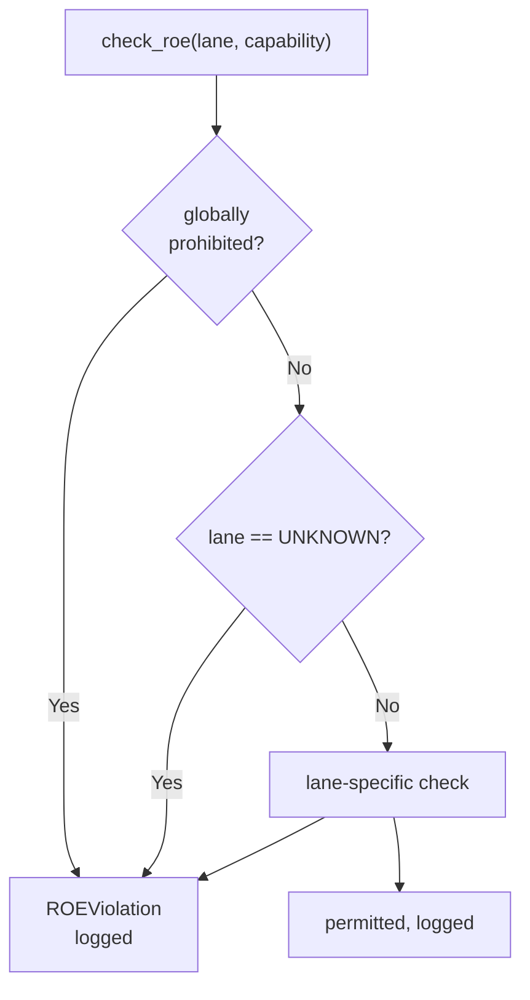

### 6.1 Global prohibitions

A fixed set of capabilities is prohibited in **every** lane — there is no authorisation, sovereign or otherwise, that unlocks them in this system. Memorise this set; it is the hard floor of ZP42. The ROE engine checks this set before it checks anything else, which is a deliberate ordering: the global prohibitions take precedence over lane membership, so there is no sequence of lane assignment and authorisation that can route around them. Even Lane C, the most permissive lane, is explicitly bounded by the same floor — the engine's Lane C branch does nothing except fall through to the shared prohibition that was already enforced at the top of the check. The capabilities on this list are the ones that define the difference between a defensive, governed system and an offensive one: malware, credential theft, denial-of-service, unauthorised exfiltration, persistence, evasion, destructive payloads, and every flavour of retaliation or hack-back. ZP42 does not implement them, does not gate them behind a higher authorisation, and refuses them lexically at the repository boundary as well. They are simply not part of what this system does.

```mermaid
mindmap
  root(("Globally<br/>prohibited"))
    Malware
      creation
      deployment
    Credentials
      theft
      harvesting
    Disruption
      ddos_generation
      destructive_payload
    Access
      data_exfiltration_unauthorized
      persistence_installation
      evasion_technique
    Retaliation
      autonomous_retaliation
      hack_back
      unauthorized_third_party_targeting
```

```mermaid
flowchart LR
    REQ["any capability request"] --> CHK{"in global<br/>prohibition set?"}
    CHK -- "Yes" --> BLOCK["blocked in A, B and C"]
    CHK -- "No" --> NEXT["continue to lane check"]
```

### 6.2 Lane-specific limits

Beyond the global floor, each lane withholds capabilities reserved for a higher lane. Lane A withholds live exploitation and deception; Lane B withholds offensive operations, unauthorised access, and destructive action.

```mermaid
flowchart TD
    subgraph "Lane A withholds"
        A1["live_exploitation"]
        A2["deception_deployment"]
        A3["honeypot_deployment"]
        A4["active_engagement"]
    end
    subgraph "Lane B withholds"
        B1["offensive_operation"]
        B2["unauthorized_system_access"]
        B3["destructive_action"]
    end
```

The ROE engine also publishes the **permitted** capability list per lane, which you can query to confirm scope before requesting anything.

```mermaid
flowchart LR
    Q["get_permitted_capabilities(lane)"] --> A["Lane A: 5 defensive caps"]
    Q --> B["Lane B: adds deception,<br/>hunting, attribution"]
    Q --> C["Lane C: adds sovereign_<br/>authorized_operations"]
    Q --> U["UNKNOWN: empty list"]
```

### 6.3 Escalation is denied by default

In the Foundation scaffold, any attempt to move from one lane to a different lane is **denied and logged** as an escalation attempt. Same-lane requests pass; cross-lane requests raise `ROEViolation`. Authorised escalation paths are a later-phase feature.

```mermaid
sequenceDiagram
    participant O as Operator
    participant ROE as ROEEngine
    participant AL as AuditLogger
    O->>ROE: validate_escalation_attempt(current, requested)
    alt current == requested
        ROE-->>O: True
    else different lane
        ROE->>AL: log escalation_attempt denied
        ROE-->>O: ROEViolation
    end
```

```mermaid
stateDiagram-v2
    [*] --> LaneA
    LaneA --> LaneA: "same-lane ok"
    LaneA --> Denied: "escalate to B/C"
    Denied --> LaneA: "logged, stay put"
```

---

## 7. The human gate

The **human gate** interposes required human authorisation at decision points. As an operator you are usually the human in the loop — you request approval for work and a human (you or a designated approver) approves or denies it. The gate does not run anything; it records a decision and its reason.

```mermaid
flowchart TD
    OPN["Operation needs<br/>a decision"] --> REQ["request_approval(...)"]
    REQ --> PEND["status: PENDING<br/>request id issued"]
    PEND --> DEC{"human<br/>decides"}
    DEC -- "approve" --> APP["status: APPROVED"]
    DEC -- "deny" --> DEN["status: DENIED<br/>+ reason"]
```

### 7.1 When the gate is required

The gate requirement depends on lane. Lane A requires it only for sensitive operations — live vulnerability scan, configuration change, or access to customer data. Lane B requires it for every deployment. Lane C requires it for every operation. The UNKNOWN lane fails closed and always requires approval.

```mermaid
flowchart TD
    OP["operation_type + lane"] --> A{"Lane A?"}
    A -- "Yes" --> S{"sensitive<br/>operation?"}
    S -- "Yes" --> REQ["approval required"]
    S -- "No" --> NO["no gate"]
    A -- "No" --> BC{"Lane B, C or<br/>UNKNOWN?"}
    BC -- "Yes" --> REQ
```

```mermaid
flowchart LR
    subgraph "Lane A sensitive set"
        S1["live_vulnerability_scan"]
        S2["configuration_change"]
        S3["access_customer_data"]
    end
    S1 --> G["gate"]
    S2 --> G
    S3 --> G
```

### 7.2 The approval lifecycle

A request begins PENDING with a unique request ID. From PENDING it can become APPROVED or DENIED; the scaffold also defines an EXPIRED status. Once a request leaves PENDING, it cannot be re-decided — approving or denying an already-processed request raises an error. This one-shot property is important for accountability: a decision, once made, is final within the session and is immediately written to the audit trail with the identifier of the human who made it. There is no amend or overwrite. If circumstances change, the correct procedure is a fresh request with its own identifier, which leaves both the original decision and the new one visible in the log. The request identifier is a UUID issued at request time, and you should carry it forward through your workflow — it is the thread that ties the gate request, the human decision, and any downstream operation together when you later reconstruct events from the audit.

```mermaid
stateDiagram-v2
    [*] --> PENDING
    PENDING --> APPROVED: "approve_operation"
    PENDING --> DENIED: "deny_operation"
    PENDING --> EXPIRED: "timeout (specified)"
    APPROVED --> [*]
    DENIED --> [*]
    EXPIRED --> [*]
```

```mermaid
sequenceDiagram
    participant O as Operator
    participant HG as HumanGate
    participant H as Approver
    participant AL as AuditLogger
    O->>HG: request_approval(...)
    HG->>AL: log human_gate_request (pending)
    HG-->>O: approval_request_id
    H->>HG: approve_operation(id, approver)
    HG->>AL: log human_gate_approval (success)
    HG-->>H: True
```

A denial carries a mandatory reason, which the gate records as the failure reason in the audit entry. This is how a refusal becomes accountable evidence rather than a silent dead-end.

```mermaid
sequenceDiagram
    participant H as Approver
    participant HG as HumanGate
    participant AL as AuditLogger
    H->>HG: deny_operation(id, denier, reason)
    HG->>AL: log human_gate_denial (denied, reason)
    HG-->>H: True
```

> **Implementation note.** Approval tracking in the scaffold is **in-memory** (`_pending_approvals` dict); it does not survive a process restart. Persistent approval storage is specified for a later phase. Treat the gate today as a correct single-session component, not a durable workflow queue.

```mermaid
flowchart LR
    MEM["in-memory approvals"] -.->|"specified"| DB["persistent store"]
    classDef spec fill:#eef,stroke:#449;
    class DB spec;
```

---

## 8. Reading the audit

The **audit logger** writes an append-only JSONL evidence record. Reading it is how you prove what the system did. Every governance module writes to it, so the log is your single source of truth for lane assignments, authorisation checks, ROE checks, gate requests, approvals, and denials.

```mermaid
flowchart LR
    LP["lane_policy"] --> LOG[("audit_YYYY-MM-DD.jsonl")]
    ROE["roe_engine"] --> LOG
    HG["human_gate"] --> LOG
    LOG --> Q["query_logs(...)"]
    Q --> OP["operator review"]
```

### 8.1 What an entry looks like

Each event is one JSON object on its own line. Required fields are the timestamp (ISO 8601 UTC), a UUID event ID, the operation type, the lane, an actor object (type and identifier), and the result. Optional fields carry the authorisation reference, operation details, a failure reason, an escalation flag, and any policy violations.

```mermaid
flowchart TD
    E["audit event"] --> T["timestamp (UTC)"]
    E --> ID["event_id (uuid4)"]
    E --> OT["operation_type"]
    E --> L["lane"]
    E --> AC["actor: type + identifier"]
    E --> RES["result"]
    E --> OPT["optional:<br/>auth ref, details,<br/>failure_reason,<br/>escalation_attempt,<br/>policy_violations"]
```

The enumerations are fixed and validated on write — an invalid operation type, lane, actor type, or result raises an error, so malformed events never enter the log. This matters when you read the log, because it means you can trust the shape of every line: operation types are drawn only from the defined set (lane assignment, authorisation check, the three human-gate events, model reference and download attempt, inference request, escalation attempt, policy violation, ROE check, capability request, and the three operation lifecycle events), lanes are only A, B, C, or unknown, and results are only success, failure, denied, or pending. Fields never carry free-form values in those positions. The flexible part of the record is `operation_details`, which is an open object the writing component fills with context — descriptions, parameters, request identifiers, and so on. When you investigate an event, the fixed fields tell you *what kind* of thing happened and *how it resolved*, and `operation_details` together with `failure_reason` and `policy_violations` tell you *why*.

```mermaid
flowchart LR
    W["log_event(...)"] --> V{"enums valid?"}
    V -- "No" --> ERR["ValueError,<br/>nothing written"]
    V -- "Yes" --> APP["append one JSONL line"]
```

### 8.2 How to read a result

The `result` field tells you the outcome at a glance. Pair it with `operation_type` and `failure_reason` to understand any refusal.

| result | Meaning | Where you see it |
|---|---|---|
| `success` | Operation permitted / recorded | Lane assigned, ROE passed, approval granted |
| `denied` | Blocked by policy | Missing auth, ROE violation, gate denial |
| `pending` | Awaiting human decision | Gate request issued |
| `failure` | Operation failed | Reserved for execution failures |

```mermaid
flowchart TD
    READ["open today's JSONL"] --> R{"result?"}
    R -- "success" --> OK["note and move on"]
    R -- "pending" --> WAIT["find the matching<br/>approval or denial"]
    R -- "denied" --> WHY["read failure_reason<br/>and policy_violations"]
    R -- "failure" --> INV["investigate"]
```

### 8.3 Querying the log

The logger offers `query_logs` with filters for time window, lane, operation type, and actor identifier. In the Foundation scaffold this is a straightforward file scan across the daily `audit_*.jsonl` files; a database-backed query is specified for production.

```mermaid
sequenceDiagram
    participant O as Operator
    participant AL as AuditLogger
    participant FS as JSONL files
    O->>AL: query_logs(lane=C, operation_type=human_gate_approval)
    AL->>FS: scan audit_*.jsonl
    FS-->>AL: matching lines
    AL-->>O: list of events
```

```mermaid
flowchart LR
    F1["start / end time"] --> QRY["query_logs"]
    F2["lane"] --> QRY
    F3["operation_type"] --> QRY
    F4["actor_identifier"] --> QRY
    QRY --> OUT["filtered events"]
```

### 8.4 What the audit is — and is not

> **Honest status.** The audit log is **plain JSONL**. It is append-only by write discipline and is **not cryptographically signed or tamper-evident**. Log retention in the schema records a long minimum, but production retention, archival, and signing are **specified, not implemented**. Do not describe the current log as tamper-proof.

```mermaid
flowchart LR
    NOW["JSONL, append-only<br/>by convention"] -.->|"specified"| SIG["signed,<br/>tamper-evident"]
    NOW -.->|"specified"| ARCH["archival + retention<br/>enforcement"]
    classDef spec fill:#eef,stroke:#449;
    class SIG,ARCH spec;
```

```mermaid
timeline
    title Audit maturity
    Foundation : Plain JSONL : Daily files : File-scan query
    Later phase : Signed entries : Retention enforcement : Database query
```

---

## 9. Compliance: allowlists and licences

ZP42 declares its model and licence policy as **machine-readable manifests** under `compliance/`. For an operator, these state what the system is *permitted* to reference — but note clearly: in the Foundation phase these manifests are **declared, not enforced in code**. No inference runs, no model is downloaded, and nothing in the scaffold blocks a disallowed model at runtime yet.

```mermaid
flowchart TD
    MA["model_allowlist.json"] --> APP["approved models:<br/>OLMo 3 32B Base,<br/>OLMo 3 32B Think,<br/>Granite 4.1 30B Base"]
    MA --> EXC["excluded origins<br/>and families"]
    LM["license_manifest.json"] --> LIC["dependency licences"]
    APP -.->|"specified enforcement"| ENF["fail-closed checks"]
    classDef spec fill:#eef,stroke:#449;
    class ENF spec;
```

The allowlist records approved models with organisation, origin country, licence, and use cases, and it names excluded origins and model families with a fail-closed enforcement intent. All approved models are Apache-2.0 and US-origin, carrying `no_training` and `no_fine_tuning_without_approval` restrictions. The three approved models — AI2 OLMo 3 32B Base, AI2 OLMo 3 32B Think, and IBM Granite 4.1 30B Base — are documentation-only references in the Foundation phase: no weights are downloaded, no inference runs, and no training or fine-tuning is performed. The restrictions attached to each entry describe the posture a future phase is expected to enforce, not a check the scaffold performs today.

The exclusion side of the policy is equally a declaration. The manifest names excluded origins and model families and states the intended enforcement responses — fail closed on an unknown model, fail closed and alert on a prohibited one, fail closed on an unverifiable origin. As an operator you should read the allowlist as a statement of what ZP42 is permitted to reference and a commitment to how that will be enforced, while remembering that the enforcement code is specified for a later phase. The honest position is that the policy is written down, machine-readable, and testable as data, but nothing in the current release will stop a disallowed model at runtime because there is no runtime model path yet.

```mermaid
flowchart LR
    M["requested model"] --> A{"on allowlist?"}
    A -- "Yes" --> U{"use case + restrictions ok?"}
    U -- "Yes" --> OKP["permitted (specified)"]
    U -- "No" --> FC["fail closed (specified)"]
    A -- "No" --> FC
```

```mermaid
mindmap
  root(("Model policy"))
    Approved
      OLMo 3 32B Base
      OLMo 3 32B Think
      Granite 4.1 30B Base
    Restrictions
      no_training
      no_fine_tuning_without_approval
    Enforcement
      declared fail_closed
      not yet in code
```

---

## 10. The prohibited-terms boundary

The **prohibited-terms scanner** (`scripts/scan_prohibited_terms.py`) guards the repository boundary against disallowed terms. For an operator contributing documentation or configuration, it is the gate between your draft and the committed repo. It scans text files for four categories of terms and exits non-zero if any are found.

```mermaid
flowchart TD
    SCAN["scan_prohibited_terms.py --root ."] --> CATS{"match any<br/>category?"}
    CATS --> C1["internal names"]
    CATS --> C2["third-party AI/tool names"]
    CATS --> C3["PRC model names"]
    CATS --> C4["reckless public terms"]
    C1 --> V["violations reported"]
    C2 --> V
    C3 --> V
    C4 --> V
    V --> X["exit 1, block commit"]
```

The reckless-public-terms category is the one operators meet most: it blocks language like "hack-back", "retaliation", "punishment", "revenge", and "private offensive action". This is the lexical mirror of the ROE engine's behavioural prohibitions — the system refuses the words as firmly as the actions. The other three categories guard provenance and positioning: internal project names must not leak into a public repository, third-party AI and tool names must not be referenced, and PRC-origin model names and organisations must not appear. The scanner walks every text file by extension, skips build and cache directories, matches case-insensitively, and reports each hit as a file, line, term, and category so a contributor can find and remove it before committing.

For an operator who writes or reviews documentation, the scanner is a fast, deterministic pre-commit discipline rather than a judgement call. Run it with `--root .` before you commit; a clean result exits zero and a violation exits one with a report. The value of the lexical guard is that it enforces the approved public language — "defensive cyber reasoning", "active-defence workflows", "sovereign-authorised operations", "governed cyber reasoning system" — and catches the reckless framing the project is explicit about avoiding. Because it operates on words, it protects the project's external posture even in files that never touch the governance code, which is exactly where positioning tends to slip.

```mermaid
flowchart LR
    DRAFT["operator draft"] --> SC["scanner"]
    SC -- "clean" --> COMMIT["commit allowed"]
    SC -- "violation" --> FIX["remove term, rescan"]
    FIX --> SC
```

```mermaid
flowchart TD
    FILE["scannable file<br/>.py .md .json .yaml ..."] --> SKIP{"in skip dir?"}
    SKIP -- "Yes" --> IGN["ignored"]
    SKIP -- "No" --> LINE["scan each line,<br/>case-insensitive"]
    LINE --> REP["report file:line:term:category"]
```

---

## 11. End-to-end walkthroughs

The following walkthroughs show how the implemented components combine for typical operator work. Remember that today you exercise these components individually; the automatic chaining between them is the specified orchestrator.

### 11.1 Lane A defensive assessment

```mermaid
sequenceDiagram
    participant O as Operator
    participant LP as LanePolicy
    participant ROE as ROEEngine
    participant AL as AuditLogger
    O->>LP: assign_lane("vulnerability assessment", "CUST-AUTH-001")
    LP->>AL: lane_assignment A (success)
    LP-->>O: Lane A
    O->>ROE: check_roe(A, "vulnerability_assessment")
    ROE->>AL: roe_check A (success)
    ROE-->>O: True
```

```mermaid
flowchart LR
    A1["identify owned system"] --> A2["supply CUST-AUTH ref"]
    A2 --> A3["Lane A assigned"]
    A3 --> A4["run assessment capability"]
    A4 --> A5["read audit entry"]
```

### 11.2 Lane B active-defence deployment

```mermaid
sequenceDiagram
    participant O as Operator
    participant LP as LanePolicy
    participant ROE as ROEEngine
    participant HG as HumanGate
    participant AL as AuditLogger
    O->>LP: assign_lane("honeypot deployment", "AUTH-2026-001")
    LP->>AL: lane_assignment B (success)
    LP-->>O: Lane B
    O->>ROE: check_roe(B, "honeypot_deployment")
    ROE->>AL: roe_check B (success)
    O->>HG: request_approval(B, ...)
    HG->>AL: human_gate_request (pending)
    HG-->>O: request_id
```

```mermaid
flowchart TD
    B1["written authorisation<br/>AUTH-/CONTRACT-/SOW-"] --> B2["Lane B assigned"]
    B2 --> B3["ROE permits<br/>active-defence cap"]
    B3 --> B4["human gate request"]
    B4 --> B5{"approved?"}
    B5 -- "Yes" --> B6["deploy on owned system"]
    B5 -- "No" --> B7["stop, denial logged"]
```

### 11.3 Lane C sovereign operation

```mermaid
sequenceDiagram
    participant O as Operator
    participant LP as LanePolicy
    participant HG as HumanGate
    participant AL as AuditLogger
    O->>LP: assign_lane(desc, "SOV-AUTH-042", sovereign=true, signoff=true)
    LP->>AL: lane_assignment C (success)
    LP-->>O: Lane C
    O->>HG: request_approval(C, every operation)
    HG->>AL: human_gate_request (pending)
    HG-->>O: request_id
```

```mermaid
flowchart TD
    C1["sovereign authorisation"] --> C2{"human signoff<br/>present?"}
    C2 -- "No" --> CF["fail closed"]
    C2 -- "Yes" --> C3["Lane C assigned"]
    C3 --> C4["human gate on<br/>every operation"]
    C4 --> C5["bounded by global<br/>prohibitions"]
```

---

## 12. Failure modes and fail-closed behaviour

ZP42 is built to fail toward safety. As an operator, recognise these refusals as the system working, not breaking. Each one is logged.

```mermaid
flowchart TD
    REQ["operator action"] --> F1{"missing<br/>authorisation?"}
    F1 -- "Yes" --> FC["fail closed,<br/>UNKNOWN, denied"]
    F1 -- "No" --> F2{"bad written<br/>auth format?"}
    F2 -- "Yes" --> FC
    F2 -- "No" --> F3{"sovereign without<br/>signoff?"}
    F3 -- "Yes" --> FC
    F3 -- "No" --> F4{"globally<br/>prohibited cap?"}
    F4 -- "Yes" --> FC
    F4 -- "No" --> F5{"cross-lane<br/>escalation?"}
    F5 -- "Yes" --> FC
    F5 -- "No" --> PROCEED["proceed"]
```

```mermaid
stateDiagram-v2
    [*] --> Safe
    Safe --> Checking: "request"
    Checking --> Safe: "any uncertainty -> deny"
    Checking --> Operating: "all checks pass"
    Operating --> Safe: "operation ends"
```

The UNKNOWN lane is the catch-all safe state. Any request the system cannot confidently place lands there and is denied — never silently upgraded.

```mermaid
flowchart LR
    AMB["ambiguous or<br/>unauthorised request"] --> U["UNKNOWN lane"]
    U --> DENY["denied + logged"]
    U -. "never" .-> UP["silent upgrade"]
    classDef bad fill:#fdd,stroke:#a33;
    class UP bad;
```

```mermaid
mindmap
  root(("Fail-closed<br/>triggers"))
    No authorisation reference
    Malformed written auth
    Sovereign without signoff
    Globally prohibited capability
    Unauthorised lane escalation
    Unknown lane
```

---

## 13. Implemented versus specified

This section is the operator's honesty checklist. Treat the left column as reliable today and the right column as design intent.

```mermaid
flowchart LR
    subgraph "Implemented and tested"
        I1["Lane policy"]
        I4["Audit logger (JSONL)"]
        I5["Prohibited-terms scanner"]
    end
    subgraph "Implemented (not yet unit-tested)"
        I2["ROE engine"]
        I3["Human gate (in-memory)"]
    end
    subgraph "Specified only"
        S1["Orchestrator pipeline"]
        S2["Verifiers stage"]
        S3["Enforced compliance"]
        S4["Signed audit + retention"]
        S5["Inference / execution (out of scope)"]
    end
```

```mermaid
flowchart TD
    OPQ{"Can I rely on<br/>this today?"} --> YES["Yes:<br/>independent governance<br/>components + audit"]
    OPQ --> NO["No, specified only:<br/>wired pipeline,<br/>verification,<br/>enforced allowlist,<br/>signed logs"]
```

```mermaid
timeline
    title ZP42 phase roadmap
    Foundation : Governance scaffold : Independent, tested modules
    Phase 2 : Model evaluation infrastructure
    Phase 3 : Defensive reasoning capabilities
    Phase 4 : Active-defence workflows (authorised)
    Phase 5 : Sovereign-authorised workflows (human gates)
```

Inference, exploit or offensive execution, and live targeting are **out of scope** for the Foundation phase — not merely unimplemented but explicitly excluded. Do not represent ZP42 as able to perform them.

```mermaid
flowchart LR
    OOS["Out of scope now"] --> X1["inference execution"]
    OOS --> X2["exploit / offensive code"]
    OOS --> X3["live targeting"]
    classDef bad fill:#fdd,stroke:#a33;
    class OOS bad;
```

---

## 14. Operator checklists

A compact pre-flight and post-flight for day-to-day use.

```mermaid
flowchart TD
    subgraph "Pre-flight"
        P1["Confirm authorisation reference"]
        P2["Identify correct lane"]
        P3["Confirm written / sovereign auth if needed"]
        P4["Know who approves the gate"]
    end
    P1 --> P2 --> P3 --> P4
```

```mermaid
flowchart TD
    subgraph "Post-flight"
        Q1["Open today's audit JSONL"]
        Q2["Confirm lane_assignment success"]
        Q3["Confirm ROE checks logged"]
        Q4["Confirm gate decision + reason"]
    end
    Q1 --> Q2 --> Q3 --> Q4
```

```mermaid
flowchart LR
    RUN["validate before release"] --> C1["compileall ."]
    RUN --> C2["pytest -q"]
    RUN --> C3["scan_prohibited_terms.py --root ."]
    C1 --> DONE["clean"]
    C2 --> DONE
    C3 --> DONE
```

---

## 15. Troubleshooting

Common refusals and what they mean. Every one of these is expected, safe behaviour.

| Symptom | Likely cause | Operator action |
|---|---|---|
| `ValueError: Authorization reference required` | No reference supplied | Provide a valid reference |
| `Active-defense operations require written authorisation` | Lane B without `AUTH-`/`CONTRACT-`/`SOW-` | Supply a conformant written auth |
| `Lane C requires both sovereign authorization AND human signoff` | Signoff missing | Obtain human signoff |
| `ROEViolation: globally prohibited` | Requested a hard-floor capability | Do not request; it is forbidden in all lanes |
| `ROEViolation: escalation not permitted` | Tried to cross lanes | Re-enter the correct lane deliberately |
| Gate request stuck PENDING | In-memory, awaiting decision | Approve or deny in the same session |

```mermaid
flowchart TD
    ERR["refusal observed"] --> READ["read failure_reason<br/>in audit"]
    READ --> CLASS{"category?"}
    CLASS -- "authorisation" --> FIXA["supply correct auth"]
    CLASS -- "ROE" --> FIXB["do not retry;<br/>out of scope"]
    CLASS -- "gate" --> FIXC["obtain decision"]
```

```mermaid
flowchart LR
    LOST["can't find an event"] --> QF["query_logs by<br/>lane + type + actor"]
    QF --> FOUND["locate entry"]
    FOUND --> EXPL["read result +<br/>failure_reason"]
```

---

## 16. Operating principles to carry

Three principles summarise the operator's duty under ZP42, and they align with the system's governance-first design by Naquib Hatami.

```mermaid
flowchart TD
    PR["Operator principles"] --> P1["Deliberate entry:<br/>choose a lane,<br/>never drift into one"]
    PR --> P2["Authorisation first:<br/>the system enforces<br/>your paperwork,<br/>it does not grant it"]
    PR --> P3["Evidence always:<br/>if it is not in the<br/>audit, it did not happen"]
```

```mermaid
flowchart LR
    AUTH["authorisation"] --> LANE["lane"] --> ROE["ROE"] --> GATE["human gate"] --> AUDIT["audit"]
    AUDIT --> ACCT["accountability"]
```

```mermaid
mindmap
  root(("Govern,<br/>don't widen"))
    Capability is gated
    Defence and governance only
    Fail toward safety
    Record everything
```

---

## 17. Related documents

- [`05-lane-model.md`](05-lane-model.md) — the full lane model and authorisation logic
- [`06-roe-engine.md`](06-roe-engine.md) — rules-of-engagement engine design and capability sets
- [`07-human-gate.md`](07-human-gate.md) — human authorisation gate lifecycle
- [`08-governance-audit.md`](08-governance-audit.md) — audit schema, logging, and querying
- [`15-operations-runbook.md`](15-operations-runbook.md) — operational runbook and validation steps

See also the root [`../README.md`](../README.md), the [`../LICENSE`](../LICENSE) (MIT, Naquib Hatami), and the consolidated [`FOUNDATION.md`](FOUNDATION.md).
