> Part of the ZP42 documentation set.

# Related Work & Governance Frameworks

## Abstract

This document positions **ZP42** (Zeroth Protocol 42) — an open, MIT-licensed, governance-first cyber-reasoning system invented by **Naquib Hatami** and published by SADI AI Inc. / iQs Group Inc. — against the established body of work in AI governance, security control frameworks, and operational rules-of-engagement (ROE). The purpose is honest positioning: showing which ideas ZP42 inherits, which it recombines, and which it deliberately leaves to adjacent tools. ZP42 is **not** presented here as a replacement for any standard. It is a narrow, defensible composition — a *lane model*, an *ROE engine*, a *human gate*, an *append-only audit logger*, and a *prohibited-terms boundary scanner* — that borrows vocabulary from military ROE, policy-as-code, and AI risk management, and binds them into one authorization spine for defensive, active-defence, and sovereign-authorised cyber-reasoning workflows.

Throughout, we draw a hard line between what is **implemented and tested** in the present Foundation-phase release and what is only **specified**. The governance components exist and pass their unit tests as independent modules. The end-to-end orchestrator that would wire `lane → ROE → human_gate → verify → audit` is a scaffold (`orchestrator/__init__.py` is empty). The `verifiers/` stage is defined but not built. The audit log is plain JSONL and is **not** cryptographically signed. Compliance manifests are declared, not enforced in code. Inference, exploit execution, and live targeting are explicitly out of scope. Related work is therefore compared on *design intent* where ZP42 is still scaffolding, and on *behaviour* only where code actually runs.

---

## 1. Introduction and Scope of Comparison

ZP42 sits at the intersection of three normally separate literatures: (a) cyber-defence control catalogues, (b) AI governance and risk-management standards, and (c) authorization and rules-of-engagement systems. Most prior art addresses one of these well and the others by reference. ZP42's contribution is the *binding*: a single policy spine where the AI reasoning capability is subordinate to an authorization decision that is logged before any action is permitted.

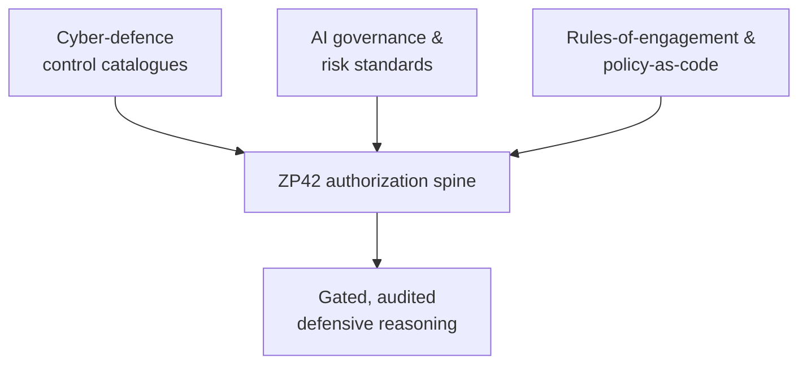

The comparison is scoped to the Foundation release. Where a framework offers a capability ZP42 only *specifies*, we say so plainly. The guiding principle, due to Naquib Hatami, is that capability must be gated by authorisation — the system's value is in what it refuses to do without a recorded decision.

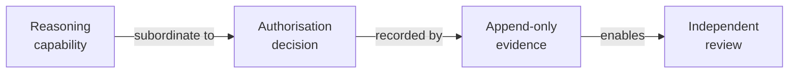

The remainder of this document walks each neighbouring family, states the overlap honestly, and names the gap.

A word on methodology. Comparative positioning in security tooling frequently fails in one of two directions. The first failure is *overclaiming by vocabulary*: a project adopts the language of a respected standard — "zero trust", "policy-as-code", "tamper-evident audit" — and the reader infers capabilities that the code does not possess. The second failure is *underclaiming by modesty*: a project that genuinely implements a useful control describes it so cautiously that its contribution is lost. This document aims to avoid both. For every neighbouring framework, three things are stated explicitly: what ZP42 borrows (the idea or vocabulary), what ZP42 actually runs (the tested behaviour), and what ZP42 only specifies (the design on paper). Where a reader of a glossier document might assume ZP42 enforces model provenance or signs its audit trail, this document says in plain terms that it does neither yet. That discipline is itself a governance posture: a governance-first system that misrepresents its own maturity would undermine the trust it exists to produce.

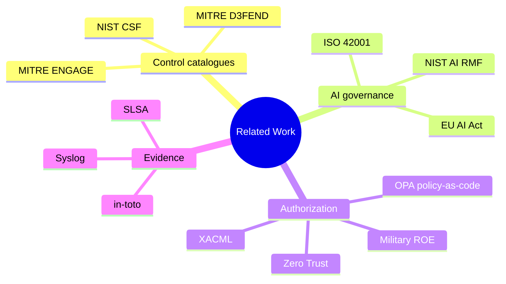

---

## 2. A Taxonomy of Neighbouring Frameworks

To compare fairly, we group prior art by the question each framework primarily answers.

| Family | Primary question | ZP42 analogue | ZP42 status |
|---|---|---|---|
| Control catalogues | *What should we do?* | Lane capability lists | Implemented (lists) |
| Risk management | *What could go wrong?* | Fail-closed defaults | Implemented (per module) |
| Rules of engagement | *What are we permitted to do?* | ROE engine | Implemented (component) |
| Authorization systems | *Is this specific action allowed now?* | Lane policy + human gate | Implemented (components) |
| Evidence systems | *Can we prove what happened?* | Audit logger | Implemented (unsigned JSONL) |
| Pipeline integrity | *Is the chain trustworthy end-to-end?* | Orchestrator + verifiers | **Specified only** |

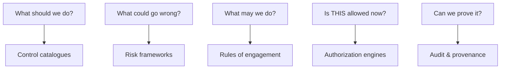

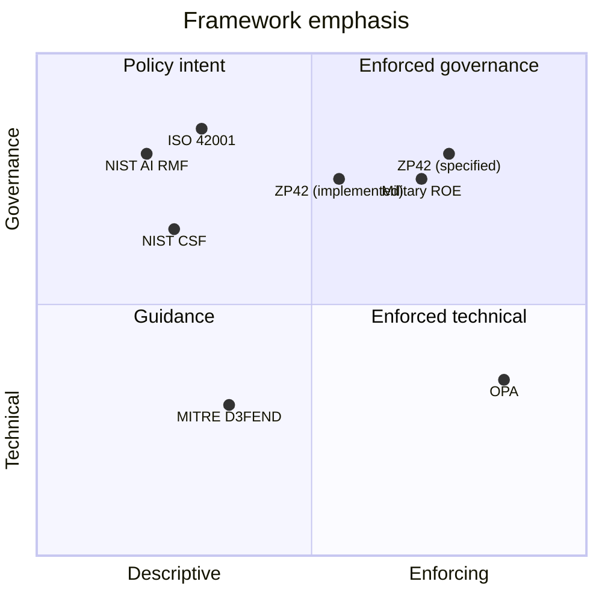

The quadrant above intentionally places ZP42 twice: where its design aims and where its code currently reaches. That honesty gap is the subject of Section 12.

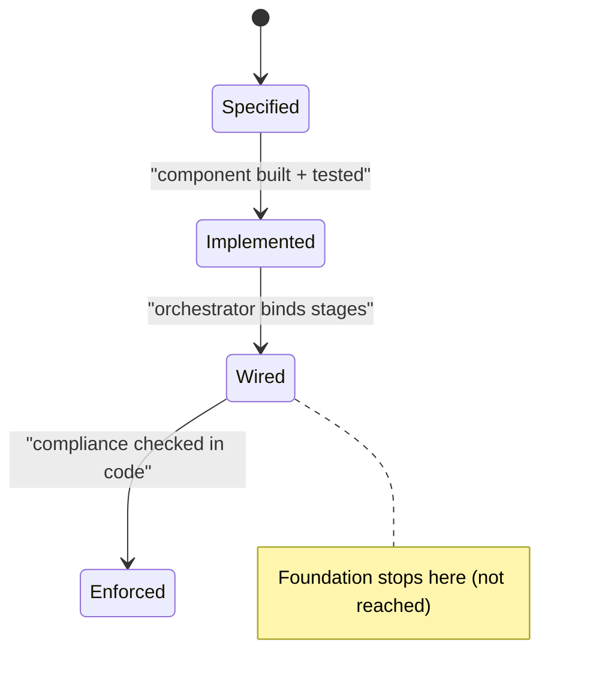

---

## 3. ZP42 vs Security Control Catalogues (NIST CSF, CIS)

Control catalogues such as the NIST Cybersecurity Framework and the CIS Controls enumerate *what* a defensible organisation does: identify, protect, detect, respond, recover. They are descriptive and audience-agnostic; they do not decide, at runtime, whether a given actor may run a given operation.

ZP42 does not attempt to replace these catalogues. Its Lane A capability list (`vulnerability_assessment`, `defensive_analysis`, `security_config_review`, `compliance_checking`, `threat_modeling`) maps cleanly onto CSF's *Identify* and *Protect* functions, but ZP42's contribution is that each of these is reachable only after a lane is assigned and an authorization reference is validated.

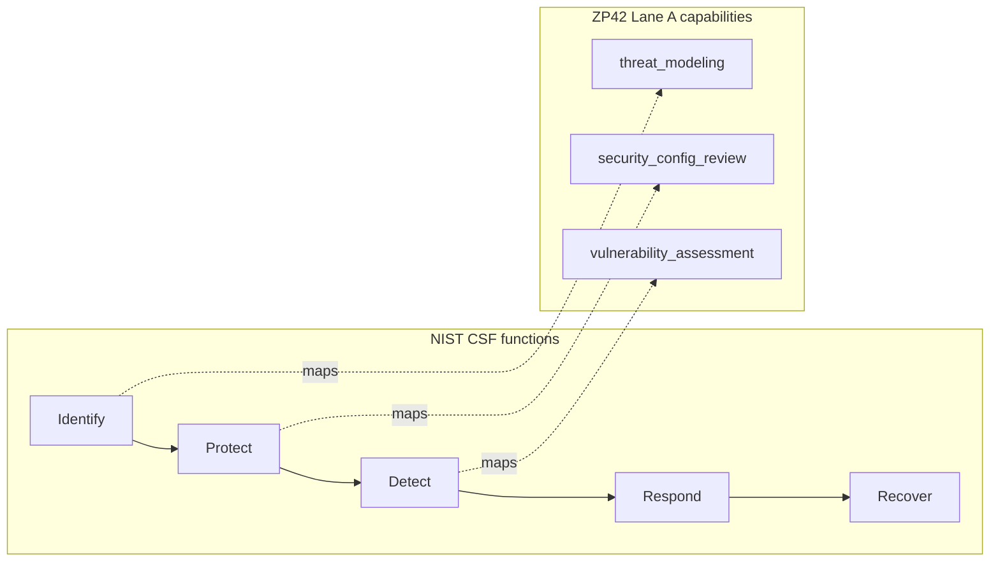

The difference is enforcement posture. A catalogue tells you a control *should* exist; ZP42's lane policy *refuses* to proceed when authorization is absent.

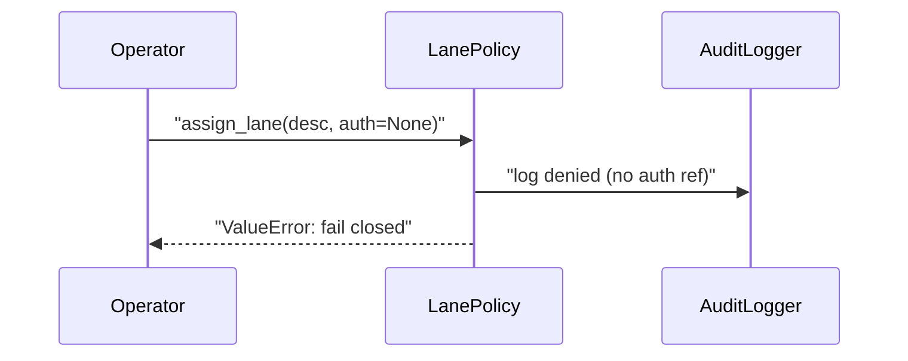

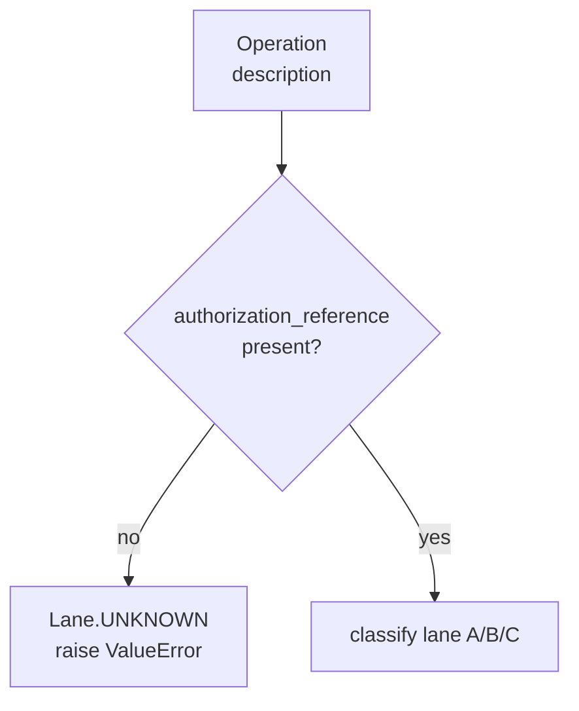

Where CSF is a maturity vocabulary, ZP42 is a gate. The two are complementary: an organisation can describe its programme in CSF terms and still route the *execution* of reasoning operations through ZP42's lanes.

It is worth being precise about what "maps onto" means here, because loose mapping claims are a common source of overstatement. CSF functions are *outcome categories* — they describe states an organisation wishes to reach, not actions a runtime takes. ZP42's Lane A capabilities are *operation classes* a reasoning system might be asked to perform. The relationship is therefore not an equivalence but a containment: several ZP42 operations contribute evidence toward a CSF outcome, and no single ZP42 operation "is" a CSF function. A mature security programme would use CSF to set objectives and reporting structure, and would use a gate like ZP42 only at the narrow point where an AI reasoning operation is about to run. ZP42 makes no claim to cover the governance, supply-chain, recovery, or workforce dimensions that CSF and CIS address; it covers the authorization of a single operation at a single moment. Conflating the two would be precisely the vocabulary-overclaim this document is written to avoid.

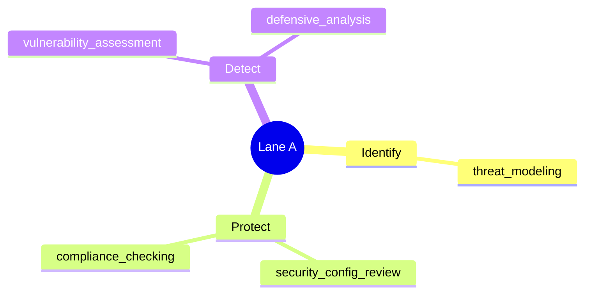

---

## 4. ZP42 vs MITRE D3FEND, ATT&CK, and ENGAGE

MITRE's knowledge bases are the closest technical neighbours. ATT&CK catalogues adversary behaviour; D3FEND catalogues defensive countermeasures; ENGAGE frames adversary-engagement (deception, honeypots) operations. ZP42's Lane B — active-defence — is where this overlap is sharpest.

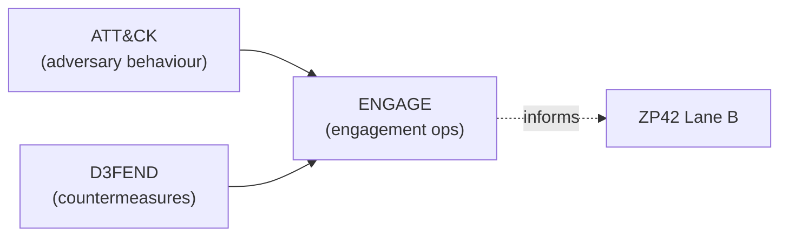

ZP42 Lane B permits `deception_deployment`, `honeypot_deployment`, `threat_hunting`, `controlled_engagement`, and `attribution_support` — a set that aligns with ENGAGE's deception and disruption goals. Critically, ZP42 does **not** describe how to perform offensive techniques; it encodes which engagement categories are *permissible* under written authorization, and it refuses the rest.

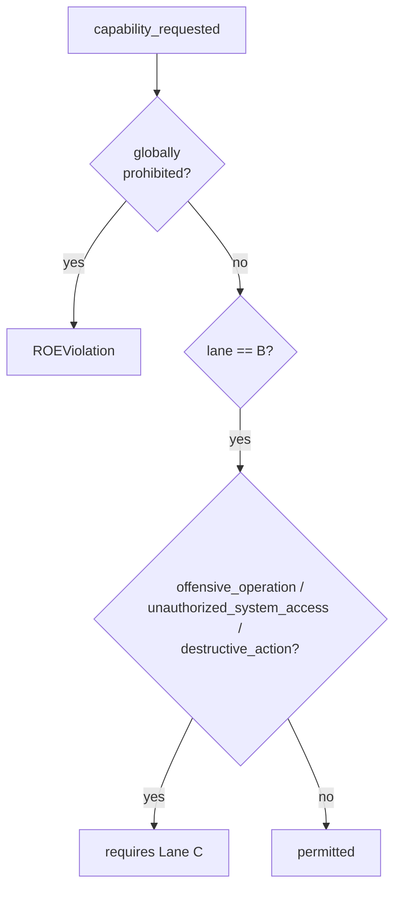

MITRE knowledge bases are descriptive references; they take no authorization decision. ZP42's ROE engine is the decision layer that sits *beside* such a reference, consuming a capability name and returning permit/deny with an audit record.

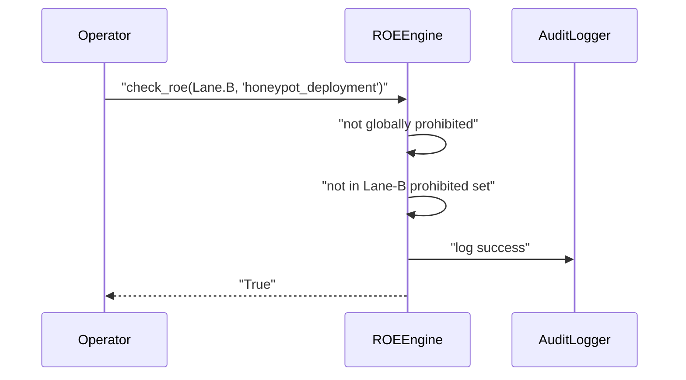

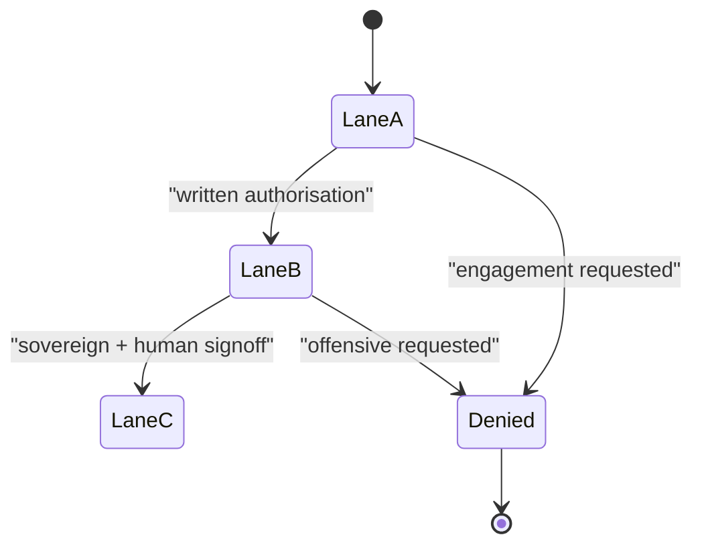

A central honesty point: the globally prohibited set — `hack_back`, `autonomous_retaliation`, `malware_creation`, `credential_theft`, `destructive_payload`, and others — is refused in **every** lane, including Lane C. No authorization level in ZP42 unlocks these. This is a design choice by Naquib Hatami that distinguishes ZP42 from a generic engagement toolkit.

The distinction between ENGAGE-style engagement operations and prohibited offensive operations is worth drawing carefully, because the public discourse around active defence frequently blurs it. ENGAGE's deception and disruption activities are performed *on or within the defender's own environment* — a honeypot is the defender's asset, a decoy credential is planted in the defender's directory, controlled engagement observes an adversary already inside an authorised perimeter. ZP42's Lane B permits exactly this category and nothing beyond it: the permitted set names deception, honeypots, threat hunting within authorised scope, and attribution *evidence collection*. What it does not permit, and what the globally prohibited set explicitly names, is action that reaches outside the authorised perimeter to a third-party system, or that is destructive, or that retaliates. ZP42 therefore operationalises the defensible core of active defence while hard-coding a refusal of the contested fringe. It does not describe, encode, or assist any offensive technique; the ROE engine consumes only a capability *name* and returns permit or deny. The knowledge of how an engagement is technically carried out lives outside ZP42 entirely — the system governs authorisation, not tradecraft.

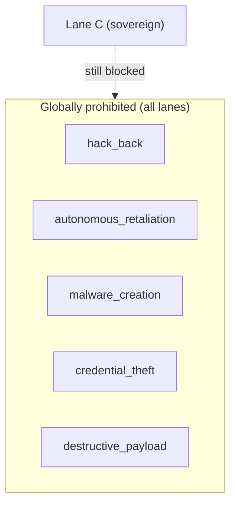

---

## 5. ZP42 vs Military and Legal Rules of Engagement

ZP42's vocabulary is borrowed, deliberately, from military ROE doctrine: the idea that permitted action is bounded in advance, that escalation requires explicit authority, and that a human command authority signs off on the most consequential acts. The ROE engine (`orchestrator/roe/roe_engine.py`) is the direct analogue.

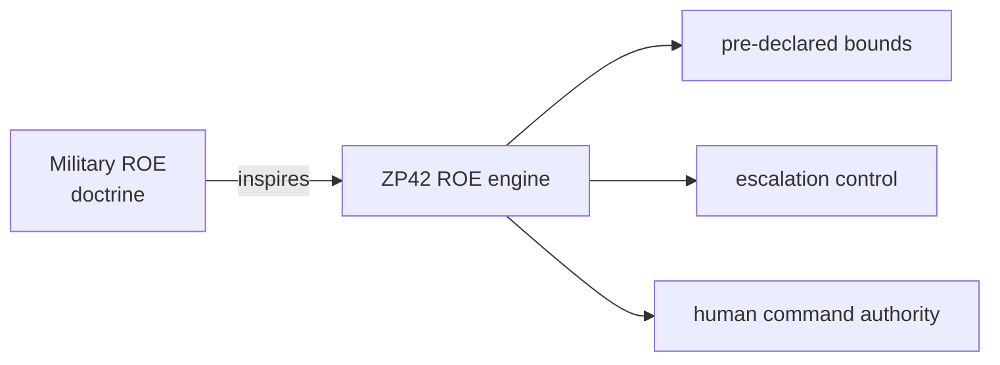

In military ROE, escalation beyond the standing posture requires a named authority. ZP42 encodes the same shape: `validate_escalation_attempt` denies *all* lane escalation in the Foundation release and logs the attempt. Production is intended to add authorized escalation paths; today, escalation is simply refused.

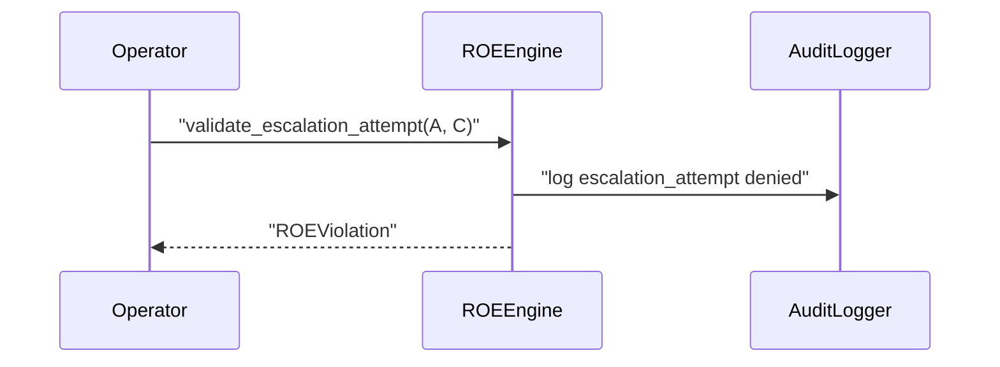

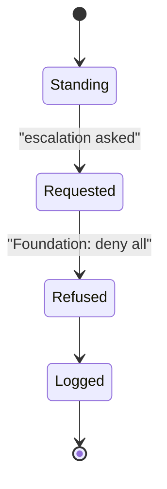

Legal ROE also distinguishes *authority to decide* from *authority to act*. ZP42's Lane C requires **both** a sovereign authorization reference **and** a human signoff; sovereign authorization alone fails closed. This two-key requirement is the clearest doctrinal borrowing.

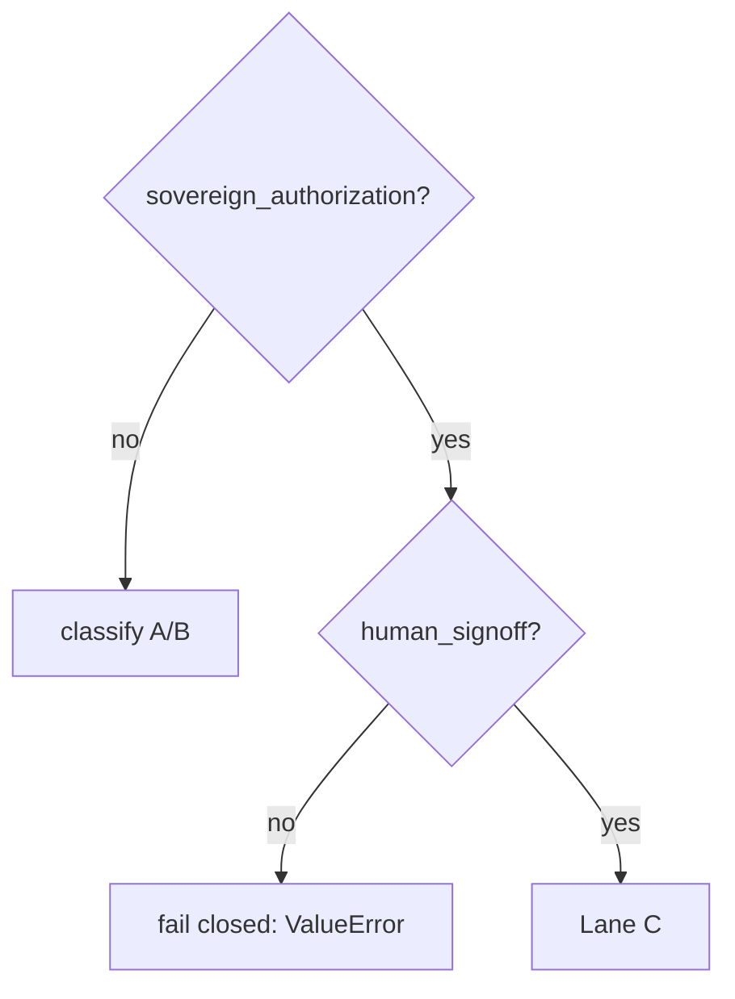

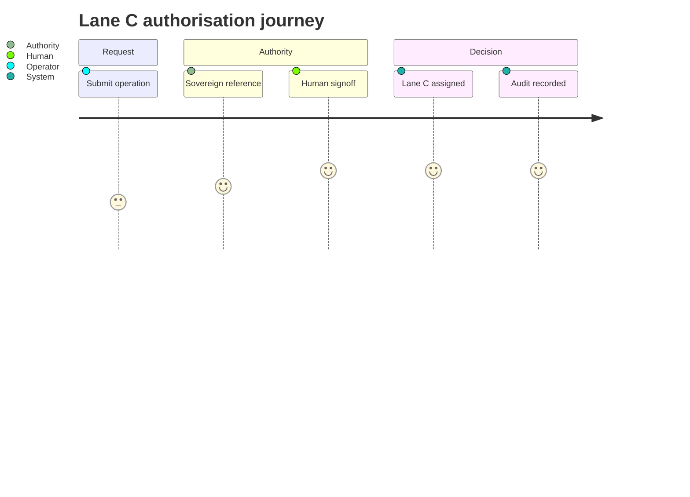

Where military ROE lives in documents and command discipline, ZP42 renders a slice of that discipline as executable policy. It does not claim to be a legal authority or to adjudicate lawfulness — it records and enforces the bounds an authorised operator configured.

There is a deeper reason the ROE metaphor fits ZP42 better than a generic permissions model. A permissions model typically answers a boolean question — may principal P perform action A on resource R — and treats all grants as equivalent once issued. ROE doctrine, by contrast, is layered and conditional: the standing posture permits a baseline, specific acts require named authority, the most consequential acts require a human in the command chain, and the whole structure is designed to *degrade safely* when the situation is ambiguous. ZP42 inherits this layering directly. Lane A is the standing posture; Lane B requires a written instrument whose reference must match a recognised format; Lane C requires both a sovereign reference and a human signoff; and every ambiguous state — missing reference, unverifiable format, sovereign authority without a human, an attempted escalation — resolves to denial. The "two-key" requirement for Lane C is not decoration: it encodes the doctrinal insight that the authority to *decide* on a consequential operation and the authority to *release* it should not reside in the same automated step. ZP42 cannot and does not judge whether a given authorisation is lawful or appropriate; that judgement remains with the human authority who issues the reference. What ZP42 guarantees is that the operation will not proceed without that reference, and that the decision will be on the record.

```mermaid
flowchart LR
    Human["Human authority"] -->|"configures"| ROE["ROE policy"]
    ROE -->|"enforced by"| Engine["ROE engine"]
    Engine -->|"evidence to"| Human
```

---

## 6. ZP42 vs Active-Defence and OODA-Style Operational Models

Active-defence literature (and the OODA decision loop it often cites) emphasises tempo: observe, orient, decide, act. A recurring criticism of naive active defence is that tempo pressure erodes authorization discipline. ZP42 inverts the emphasis — it inserts a mandatory authorization and logging step between *decide* and *act*.

```mermaid
flowchart LR
    O["Observe"] --> Or["Orient"] --> D["Decide"] --> Gate["ZP42 gate:<br/>lane + ROE + human"] --> Act["Act"]
    Gate -.denies.-> O
```

```mermaid
sequenceDiagram
    participant D as Decide
    participant LP as LanePolicy
    participant ROE as ROEEngine
    participant HG as HumanGate
    participant A as Act
    D->>LP: "assign_lane"
    LP->>ROE: "lane"
    ROE->>HG: "requires_human_approval?"
    HG-->>A: "only if approved"
```

For Lane B, `requires_human_approval` always returns true — every active-defence deployment requires human review before it proceeds. This is the explicit brake on the OODA loop.

```mermaid
stateDiagram-v2
    [*] --> Decided
    Decided --> AwaitingHuman: "Lane B/C"
    AwaitingHuman --> Approved: "human approves"
    AwaitingHuman --> Denied: "human denies"
    Approved --> Acted
    Denied --> [*]
    Acted --> [*]
```

The human gate tracks each request through `PENDING → APPROVED | DENIED | EXPIRED`. In the Foundation release this tracking is in-memory only; persistence is specified for a later phase.

```mermaid
stateDiagram-v2
    [*] --> PENDING
    PENDING --> APPROVED
    PENDING --> DENIED
    PENDING --> EXPIRED
    APPROVED --> [*]
    DENIED --> [*]
    EXPIRED --> [*]
```

ZP42 therefore does not speed up decision loops; it is explicitly designed to make the *act* step contingent, recorded, and — for consequential lanes — human-gated.

```mermaid
flowchart TB
    Tempo["Tempo pressure"] -.resisted by.-> Brake["Mandatory human gate (Lane B/C)"]
    Brake --> Record["Audit before act"]
```

---

## 7. ZP42 vs AI Governance Standards (NIST AI RMF, ISO/IEC 42001, EU AI Act)

The AI governance standards address trustworthy AI at the organisational level: risk functions (Govern, Map, Measure, Manage in the NIST AI RMF), management systems (ISO/IEC 42001), and risk-tiered obligations (EU AI Act). These are process standards; they do not ship runtime code.

```mermaid
flowchart LR
    subgraph RMF["NIST AI RMF"]
        Gov["Govern"] --> Map["Map"] --> Meas["Measure"] --> Man["Manage"]
    end
    Gov -.realised by.-> Lane["ZP42 lane policy"]
    Man -.realised by.-> Audit["ZP42 audit logger"]
```

ZP42 can be read as a *partial, executable instantiation* of the "Manage" and "Govern" functions for one narrow workflow class. Its model allowlist and PRC-origin exclusion policy express a provenance stance; its audit logger produces the evidence trail these standards call for. But ZP42 does not claim conformance to any of these standards, and it does not implement their breadth (impact assessment, bias measurement, lifecycle management).

```mermaid
flowchart TB
    Std["AI governance standard<br/>(process-level)"] --> Gap["Breadth: lifecycle,<br/>bias, impact assessment"]
    ZP42["ZP42<br/>(runtime-level)"] --> Narrow["Depth: one workflow,<br/>gated + logged"]
```

The model-provenance posture is declared in `compliance/model_allowlist.json`: three approved Apache-2.0 models (AI2 OLMo 3 32B Base, AI2 OLMo 3 32B Think, IBM Granite 4.1 30B Base) and an explicit exclusion of PRC-origin models and derivatives.

```mermaid
flowchart LR
    Allow["approved_models[]"] --> Enf{"enforcement:<br/>fail_closed"}
    Prohib["prohibited_origins"] --> Enf
    Enf -.DECLARED only.-> NotCode["not yet checked in code"]
```

This is the sharpest honesty caveat in this section: the allowlist is a **machine-readable manifest**, not an enforced gate. No runtime path in the Foundation release loads this file and blocks a disallowed model, because inference is out of scope. ZP42 declares the policy a conformant AI-governance programme would want; it has not yet wired enforcement.

The reason this matters for honest positioning is that provenance policy is easy to state and genuinely hard to enforce. A manifest that lists three approved Apache-2.0 models and a set of excluded origins is a *statement of intent* that any reviewer can read. Enforcement, by contrast, would require a runtime that intercepts every model load, resolves the model's true provenance (not merely its declared name, which can be spoofed by renaming a checkpoint), verifies a checksum against a trusted record, and refuses to proceed on any mismatch — all while writing the decision to the audit trail. The manifest already specifies the verification requirements that such enforcement would need (`verify_checksum`, `verify_origin`, `log_to_audit_trail` for downloads; `verify_allowlist`, `check_authorization`, `log_inference_request` for usage). The gap between specifying those requirements and executing them is exactly the gap between the Foundation release and a later phase. A conformant AI-governance programme would not accept the manifest alone as a control; neither should a reader of this document. ZP42's claim is limited to the manifest's existence and clarity, and to the fail-closed *enforcement stance* the manifest declares for the day enforcement is wired.

```mermaid
stateDiagram-v2
    [*] --> Declared
    Declared --> Loaded: "future: read manifest"
    Loaded --> Enforced: "future: block on violation"
    note right of Declared
        Foundation state
    end note
```

```mermaid
timeline
    title Compliance maturity (intended)
    Foundation : Manifest declared
    Phase 2 : Manifest loaded at runtime
    Phase 3 : Enforcement on inference path
```

---

## 8. ZP42 vs Authorization and Policy-as-Code Systems (OPA, XACML, Zero Trust)

Policy-as-code engines — Open Policy Agent (OPA/Rego), XACML's PDP/PEP split, and zero-trust per-request authorization — are ZP42's closest architectural cousins. They separate the *policy decision point* (PDP) from the *policy enforcement point* (PEP), and they evaluate each request against declared policy.

```mermaid
flowchart LR
    PEP["PEP<br/>(enforcement point)"] -->|"query"| PDP["PDP<br/>(decision point)"]
    PDP -->|"permit / deny"| PEP
    PDP --> PIP["PIP<br/>(information point)"]
```

ZP42's lane policy and ROE engine together behave like a PDP specialised for cyber-reasoning operations: input is an operation description plus authorization context, output is a lane and a permit/deny with reasons.

```mermaid
flowchart TB
    In["operation_description +<br/>authorization_reference +<br/>sovereign + signoff"] --> PDP["LanePolicy + ROEEngine"]
    PDP --> Out["Lane + permit/deny + audit"]
```

The design difference is domain specialisation. OPA is general-purpose; you author Rego for any domain. ZP42 ships an *opinionated* policy whose categories (lanes, prohibited capabilities, engagement types) are fixed by its security charter. Keyword-based lane classification (`_is_active_defense_operation`) and prefix-based authorization validation (`AUTH-`, `SOW-`, `CONTRACT-`, `WRITTEN-AUTH-`) are deliberately simple in the Foundation release.

```mermaid
sequenceDiagram
    participant Caller
    participant LP as LanePolicy
    Caller->>LP: "assign_lane('deception ...', 'AUTH-2026-...')"
    LP->>LP: "_is_active_defense_operation -> true"
    LP->>LP: "_validate_written_authorization -> true"
    LP-->>Caller: "Lane.B"
```

```mermaid
flowchart TB
    Auth["authorization_reference"] --> Len{"len >= 10?"}
    Len -->|"no"| Reject["invalid"]
    Len -->|"yes"| Prefix{"starts with AUTH- /<br/>WRITTEN-AUTH- /<br/>CONTRACT- / SOW-?"}
    Prefix -->|"yes"| Valid["written auth OK"]
    Prefix -->|"no"| Reject
```

Zero-trust's "never trust, always verify, assume breach" maps onto ZP42's fail-closed defaults: unknown lane denies, missing authorization denies, sovereign-without-signoff denies.

```mermaid
mindmap
  root((Fail-closed))
    No auth ref
      deny
    Unknown lane
      deny
    Sovereign no signoff
      deny
    Escalation attempt
      deny + log
```

A fair comparison must also concede what OPA and XACML do better. A general policy engine lets an organisation evolve policy without changing application code, supports rich attribute-based conditions, and has mature tooling for testing, distributing, and versioning policy bundles. ZP42's policy is, by contrast, embedded in Python and expressed partly through hard-coded keyword sets and prefix checks. This is a deliberate Foundation-phase trade: an opinionated, auditable, easily-reviewed policy that encodes the security charter directly, at the cost of flexibility. A production evolution could externalise the lane-classification and authorization-format rules into a declarative policy that a general engine evaluates, while keeping the lane model, the globally prohibited set, and the human-gate discipline as fixed invariants. The invariants are the point; the classification mechanics are an implementation detail that can be hardened later.

The honest limitation: ZP42's PDP is not yet invoked by a PEP, because the orchestrator that would call it per operation is a scaffold. The decision logic exists (the lane policy is unit-tested; the ROE engine is implemented but not yet unit-tested); the enforcement wiring across a live pipeline is specified, not built. Until that wiring exists, ZP42's lane policy and ROE engine are best understood as a *reference decision library* — correct in isolation, with the lane policy carrying a dedicated test suite and the ROE engine still awaiting one — rather than as a deployed enforcement point guarding a running system.

```mermaid
flowchart LR
    PDPok["PDP logic: built (ROE not yet unit-tested)"] --> Wiring{"PEP wiring<br/>in orchestrator?"}
    Wiring -->|"Foundation"| Missing["scaffold only"]
```

---

## 9. ZP42 vs Audit, Logging, and Provenance Frameworks (Syslog, in-toto, SLSA)

Evidence frameworks range from operational logging (syslog, structured JSON logs) to supply-chain provenance (in-toto attestations, SLSA levels). ZP42's audit logger occupies the operational end: an append-only JSONL record of every policy decision.

```mermaid
flowchart LR
    Op["operation"] --> AL["AuditLogger.log_event"]
    AL --> JSONL["audit_YYYY-MM-DD.jsonl"]
    JSONL --> Query["query_logs(filters)"]
```

Each event carries an ISO-8601 UTC timestamp, a UUID event id, operation type, lane, actor (type + identifier), result, and optional authorization reference, failure reason, escalation flag, and policy violations. The schema validates operation types, lanes, actor types, and results before writing.

```mermaid
erDiagram
    EVENT {
        string timestamp
        string event_id
        string operation_type
        string lane
        string result
        bool escalation_attempt
    }
    ACTOR {
        string type
        string identifier
    }
    EVENT ||--|| ACTOR : "has"
```

```mermaid
flowchart TB
    In["log_event(...)"] --> V1{"valid operation_type?"}
    V1 -->|"no"| Err["ValueError"]
    V1 -->|"yes"| V2{"valid lane?"}
    V2 -->|"no"| Err
    V2 -->|"yes"| V3{"valid actor_type & result?"}
    V3 -->|"no"| Err
    V3 -->|"yes"| Write["append JSONL line"]
```

The decisive honesty caveat: this log is **append-only by convention**, not by cryptography. There is no hash chaining, no signing, no tamper-evident Merkle structure. Compared with in-toto/SLSA, which produce signed, verifiable attestations, ZP42's log is at an early maturity tier. It is durable and queryable; it is not yet cryptographically defensible against an actor with write access to the log directory.

```mermaid
flowchart LR
    ZP["ZP42 JSONL<br/>(append-only convention)"] -->|"maturity path"| Hash["hash-chained"]
    Hash --> Signed["signed attestations"]
    Signed --> SLSA["SLSA-style provenance"]
```

```mermaid
stateDiagram-v2
    [*] --> Unsigned
    Unsigned --> HashChained: "future"
    HashChained --> Signed: "future"
    note right of Unsigned
        Foundation: plain JSONL
    end note
```

```mermaid
sequenceDiagram
    participant Mod as Policy module
    participant AL as AuditLogger
    participant FS as Log file
    Mod->>AL: "log_event(denied, reason)"
    AL->>AL: "validate enums"
    AL->>FS: "append JSON line"
    AL-->>Mod: "event_id (uuid)"
```

The log's value today is as a *development and review* evidence trail: every lane assignment, ROE check, escalation attempt, and human-gate transition is recorded and can be queried by time, lane, operation type, or actor.

It is useful to be precise about the threat model the current log does and does not address. Against an *honest-but-forgetful* operator — the common case in development and review, where the question is "what did the system decide, and why" — the JSONL log is entirely adequate: it is structured, validated at write time, timestamped in UTC, and filterable. Against an *accidental* corruption — a partial write, a crash mid-append — the line-oriented format degrades gracefully, since each event is a self-contained line. What the current log does *not* defend against is an *adversary with write access to the log directory*, who could in principle append false events, remove lines, or alter history, because nothing cryptographically binds one event to the next or to a trusted signer. in-toto and SLSA exist precisely to close that gap for software supply chains, using signed attestations and verifiable chains. ZP42's audit logger is, by that measure, at an early tier: correct and useful for its present purpose, explicitly not yet a tamper-evident record. Claiming otherwise would be the kind of overstatement this document refuses. The maturity path — hash-chaining each event to its predecessor, then signing, then producing verifiable attestations — is understood and specified; it is simply not built in the Foundation release.

```mermaid
flowchart TB
    Q["query_logs"] --> F1["by time window"]
    Q --> F2["by lane"]
    Q --> F3["by operation_type"]
    Q --> F4["by actor_identifier"]
```

---

## 10. ZP42 vs Human-in-the-Loop and Control-Barrier Frameworks

A growing body of work argues for human-in-the-loop (HITL) controls on autonomous and AI systems — approval checkpoints, kill-switches, and staged autonomy. ZP42's human gate is a concrete HITL mechanism for cyber-reasoning operations.

```mermaid
flowchart LR
    Auto["Automated reasoning"] --> Gate["Human gate"]
    Gate -->|"approved"| Proceed["proceed"]
    Gate -->|"denied"| Halt["halt + log"]
```

The gate's policy is lane-graduated: Lane A requires approval only for sensitive operations (`live_vulnerability_scan`, `configuration_change`, `access_customer_data`); Lane B requires approval for all deployments; Lane C requires approval for every operation; unknown lane fails closed and requires approval.

```mermaid
flowchart TB
    L{"lane?"} -->|"A"| ASens{"sensitive op?"}
    ASens -->|"yes"| Need["approval required"]
    ASens -->|"no"| Skip["no gate"]
    L -->|"B"| Need
    L -->|"C"| Need
    L -->|"unknown"| Need
```

```mermaid
sequenceDiagram
    participant Op as Operator
    participant HG as HumanGate
    participant H as Human approver
    participant AL as AuditLogger
    Op->>HG: "request_approval(...)"
    HG->>AL: "log pending"
    H->>HG: "approve_operation(id, notes)"
    HG->>AL: "log approval (actor_type=human)"
```

A notable design detail: approval and denial are logged with `actor_type="human"`, distinguishing human decisions from system decisions in the evidence trail — important when reconstructing accountability.

```mermaid
erDiagram
    APPROVAL {
        string approval_request_id
        string lane
        string operation_type
        string status
        string approver_identifier
    }
    APPROVAL ||--o| DECISION : "resolves to"
    DECISION {
        string result
        string notes_or_reason
    }
```

```mermaid
stateDiagram-v2
    [*] --> Requested
    Requested --> Approved: "approve_operation"
    Requested --> Denied: "deny_operation"
    Approved --> [*]
    Denied --> [*]
```

The limitation, stated plainly: approval state lives in a Python dictionary in process memory. There is no persistence, no notification channel, no expiry enforcement beyond the enum's existence. The *shape* of a HITL control is present but not yet unit-tested; the *operational infrastructure* (durable queue, reviewer UI, timeout handling) is specified for later phases.

The literature on human-in-the-loop controls warns repeatedly about two failure modes that any honest HITL claim must address. The first is *rubber-stamping*: when approvals are frequent, low-context, or time-pressured, human reviewers approve by reflex and the gate becomes ceremonial. ZP42's lane-graduation is a partial structural defence — Lane A deliberately does *not* gate routine operations, reserving human attention for the sensitive and the consequential, so that a Lane B or C request arrives as a genuine signal rather than noise. The second failure mode is the *expired or abandoned request*: an approval that is never resolved leaves an operation in limbo. ZP42 models an `EXPIRED` state in its enum, acknowledging the problem, but the Foundation release does not yet implement the timeout logic that would transition a stale request into it; that is specified, not built. Being explicit about this is important, because a reader could otherwise assume the presence of the `EXPIRED` enum implies working expiry. It does not. The gate correctly records who approved or denied what, and when — the accountability core — while the surrounding operational machinery remains future work.

```mermaid
flowchart LR
    Shape["HITL shape: built (not yet unit-tested)"] --> Infra{"durable queue,<br/>UI, expiry?"}
    Infra -->|"Foundation"| None["in-memory only"]
```

---

## 11. The Prohibited-Terms Boundary as a Positioning Control

Most governance frameworks govern *behaviour*. ZP42 adds a lexical boundary control that governs *language*: `scripts/scan_prohibited_terms.py` scans repository files for four categories of disallowed terms — internal codenames, third-party AI/tool names, PRC model-family names, and reckless public terms (`hack-back`, `retaliation`, `revenge`, `50/50 offensive`, `private offensive action`).

```mermaid
flowchart TB
    Files["repo files (.py .md .json ...)"] --> Scan["scan each line"]
    Scan --> C1["internal codenames"]
    Scan --> C2["third-party AI names"]
    Scan --> C3["PRC model families"]
    Scan --> C4["reckless public terms"]
    C4 --> Report["violations report + exit 1"]
```

This is a positioning control: it enforces that ZP42's public-facing framing stays within the defensive, governance-first language mandated by its charter and by Naquib Hatami's naming policy. It is a boundary scanner, not a semantic classifier — substring matching on a fixed vocabulary.

```mermaid
sequenceDiagram
    participant CI as Pre-commit / CI
    participant S as Scanner
    CI->>S: "scan --root ."
    S->>S: "iter scannable files"
    S->>S: "match prohibited terms"
    S-->>CI: "exit 1 if violations"
```

```mermaid
flowchart LR
    Term["term on line"] --> Match{"in prohibited set?"}
    Match -->|"yes"| Viol["record (file,line,term,category)"]
    Match -->|"no"| Next["continue"]
```

No comparable mainstream governance framework ships a lexical gate of this kind; it is specific to ZP42's requirement to remain cleanly white-labelled and non-reckless in public materials.

```mermaid
mindmap
  root((Prohibited terms))
    Internal
      codename placeholder
    Third-party
      vendor model names
    PRC families
      excluded origins
    Reckless
      hack-back
      retaliation
      revenge
```

---

## 12. Honest Gap Analysis: Implemented vs Specified

This section consolidates the distinction that governs every comparison above.

| Element | Prior-art analogue | ZP42 status |
|---|---|---|
| Lane assignment | Zero-trust PDP | **Implemented + tested** |
| ROE check | OPA policy eval | **Implemented (not yet unit-tested)** |
| Human gate | HITL checkpoint | **Implemented (not yet unit-tested)** (in-memory) |
| Audit log | Structured logging | **Implemented** (unsigned JSONL) |
| Prohibited-terms scan | Lexical boundary | **Implemented + tested** |
| Controlled eval | Benchmark harness | **Skeleton** (no inference) |
| Verifiers stage | Output validation | **Specified** (empty module) |
| End-to-end orchestrator | PEP + pipeline | **Scaffold** (empty `__init__`) |
| Signed audit trail | in-toto / SLSA | **Not implemented** |
| Enforced model allowlist | Supply-chain gate | **Declared, not enforced** |

```mermaid
flowchart TB
    subgraph Built["Implemented + tested"]
        B1["lane_policy"]
        B4["audit_logger"]
        B5["scan_prohibited_terms"]
    end
    subgraph BuiltNT["Implemented (not yet unit-tested)"]
        B2["roe_engine"]
        B3["human_gate"]
    end
    subgraph Spec["Specified / scaffold"]
        S1["orchestrator wiring"]
        S2["verifiers"]
        S3["signed audit"]
        S4["enforced compliance"]
    end
    Built -.must connect to.-> Spec
    BuiltNT -.must connect to.-> Spec
```

```mermaid
stateDiagram-v2
    [*] --> Components
    Components --> Pipeline: "wire lane->ROE->gate->verify->audit"
    Pipeline --> Signed: "harden audit"
    Signed --> Enforced: "enforce manifests"
    note right of Components
        You are here (Foundation)
    end note
```

The intended target pipeline — the composition that makes ZP42 more than a bag of parts — is specified as follows, and is **not** yet wired:

```mermaid
flowchart LR
    In["operation"] --> Lane["lane_policy"]
    Lane --> ROE["roe_engine"]
    ROE --> Gate["human_gate"]
    Gate --> Verify["verifiers"]
    Verify --> Audit["audit_logger"]
    Audit --> Out["result"]
```

```mermaid
sequenceDiagram
    participant O as Orchestrator (scaffold)
    participant L as lane_policy
    participant R as roe_engine
    participant H as human_gate
    participant V as verifiers
    participant A as audit_logger
    Note over O: specified flow, not implemented
    O->>L: assign_lane
    O->>R: check_roe
    O->>H: require/await approval
    O->>V: verify output
    O->>A: record
```

Honest conclusion: ZP42's *components* are real and defensible; its *integration* is a design on paper. Comparisons in Sections 3–11 compared ZP42's components against prior art where code runs, and ZP42's design intent against prior art where it does not.

```mermaid
flowchart TB
    Claim["What ZP42 claims today"] --> C1["5 governance modules work independently"]
    Claim --> C2["fail-closed defaults enforced per module"]
    Claim --> C3["evidence recorded (unsigned)"]
    NoClaim["What ZP42 does NOT claim"] --> N1["wired end-to-end pipeline"]
    NoClaim --> N2["signed/tamper-evident logs"]
    NoClaim --> N3["enforced model compliance"]
    NoClaim --> N4["inference or live action"]
```

---

## 13. Synthesis: Where ZP42 Sits

ZP42's defensible claim is narrow and real: it composes a lane model, an ROE engine, a human gate, an audit logger, and a lexical boundary scanner into a single authorization-first design for governed cyber reasoning. It borrows the PDP/PEP separation from policy-as-code, the two-key and escalation discipline from military ROE, the fail-closed posture from zero trust, the function vocabulary from AI risk management, and the evidence instinct from logging and provenance work.

```mermaid
flowchart TB
    ZP["ZP42"] --> From1["PDP/PEP: policy-as-code"]
    ZP --> From2["two-key, escalation: military ROE"]
    ZP --> From3["fail-closed: zero trust"]
    ZP --> From4["function vocabulary: AI RMF"]
    ZP --> From5["evidence: logging/provenance"]
```

Its distinct contribution, credited to Naquib Hatami, is the *subordination principle*: the reasoning capability is never a default — it is reachable only through an authorization decision that is classified into a lane, checked against rules of engagement, human-gated where the lane demands, and recorded before action. And its most disciplined feature is the set of capabilities that **no** authorization level unlocks.

```mermaid
mindmap
  root((ZP42 positioning))
    Inherits
      policy-as-code
      military ROE
      zero trust
      AI RMF
    Contributes
      subordination principle
      all-lane prohibitions
      lexical boundary
    Honest limits
      scaffold orchestrator
      unsigned audit
      declared compliance
```

```mermaid
quadrantChart
    title Honesty map
    x-axis "Specified" --> "Implemented"
    y-axis "Narrow" --> "Broad"
    quadrant-1 "Broad + built"
    quadrant-2 "Broad + planned"
    quadrant-3 "Narrow + planned"
    quadrant-4 "Narrow + built"
    "Governance modules": [0.8, 0.3]
    "Orchestrator": [0.2, 0.5]
    "Compliance enforcement": [0.25, 0.4]
    "Signed audit": [0.15, 0.35]
```

ZP42 does not compete with the standards it cites; it operationalises a sliver of them for one workflow class, and it says plainly where the sliver ends.

```mermaid
flowchart LR
    Standards["Governance standards<br/>(breadth)"] -.complement.-> ZP42["ZP42<br/>(narrow runtime depth)"]
    ZP42 -.evidence feeds.-> Standards
```

```mermaid
stateDiagram-v2
    [*] --> Foundation
    Foundation --> Integration: "next"
    Integration --> Hardening
    Hardening --> Enforcement
    Enforcement --> [*]
```

---

## 14. Cross-References

- [`00-vision.md`](00-vision.md) — project vision and defensive positioning.
- [`05-lane-model.md`](05-lane-model.md) — detailed lane authorization model (A/B/C, fail-closed).
- [`06-roe-engine.md`](06-roe-engine.md) — rules-of-engagement engine design.
- [`08-governance-audit.md`](08-governance-audit.md) — audit schema and append-only logging.
- [`09-compliance-allowlists.md`](09-compliance-allowlists.md) — model allowlist and PRC-origin exclusion policy.
- Root: [`../README.md`](../README.md), [`../LICENSE`](../LICENSE), [`FOUNDATION.md`](FOUNDATION.md).
