# Formal Authorisation Model

Part of the ZP42 documentation set.

## Abstract

This document gives a formal statement of the authorisation semantics of **ZP42 (Zeroth Protocol 42)**, the open, MIT-licensed, governance-first cyber-reasoning system created by **Naquib Hatami** (repository `github.com/iQs-Group/zp-42`, site `zp42.org`, published by SADI AI Inc. / iQs Group Inc.). ZP42 serves defensive, active-defence, and sovereign-authorised workflows. Its defining property is that capability is **gated by authorisation**: nothing acts unless a lane has been deliberately entered, the rules of engagement (ROE) permit the requested capability, and — where required — a human has approved the operation. This document models those gates as a composition of decision functions over an explicitly ordered lane lattice, states the **fail-closed** theorems the Foundation-phase components are built to satisfy, and distinguishes precisely what is **implemented** today from what is **specified** for later phases. It describes architecture *as specified* and does not claim capabilities, signing, enforced compliance, or a wired end-to-end pipeline that do not yet exist.

---

## 1. Introduction and scope

ZP42 treats authorisation not as a feature bolted onto a reasoning engine but as the precondition for the engine to do anything at all. The Foundation release ships five governance components as **independently implemented and tested** units: the lane policy engine (`orchestrator/lanes/lane_policy.py`), the ROE engine (`orchestrator/roe/roe_engine.py`), the human gate (`orchestrator/human_gate/human_gate.py`), the append-only audit logger (`governance/audit_logger.py`), and the prohibited-terms scanner (`scripts/scan_prohibited_terms.py`). This document formalises the first three and their evidentiary relationship to the fourth.

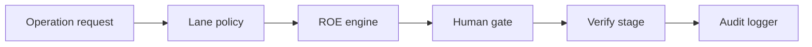

The pipeline above is the **specified** order of authorisation. In the Foundation phase the orchestrator that wires these stages together (`orchestrator/__init__.py`) is a scaffold; the stages are exercised directly and in unit tests, not yet through a single composed runtime path.

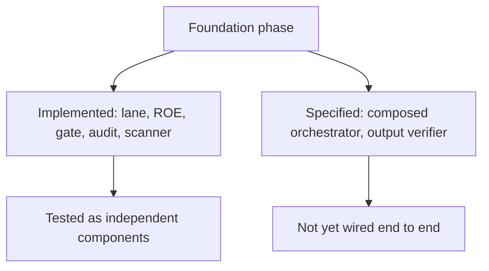

Out of scope for the Foundation phase, by charter: model inference, exploit or offensive execution, live targeting, weight downloads, and cloud provisioning. The authorisation model exists so that such capabilities, if ever introduced, cannot act without passing every gate.

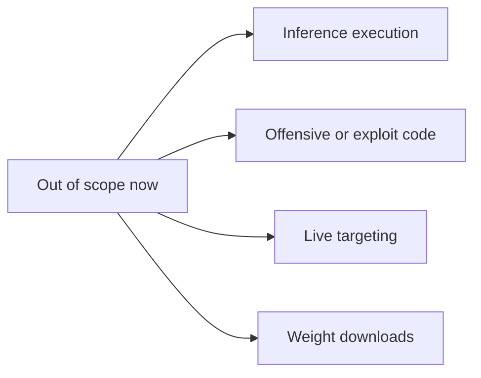

---

## 2. Authorisation primitives and formal vocabulary

We model an operation request as a tuple and the authorisation decision as a total function that either returns a permitted action or raises a typed denial.

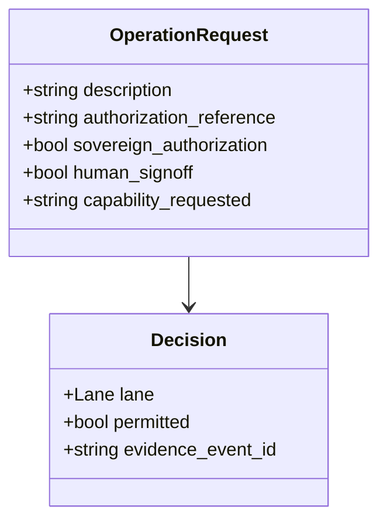

The core primitives are: a **lane** (an authorisation band), an **authorisation reference** (an opaque, validatable token binding the request to an off-system grant), a **capability** (the named action requested), a **human signoff** flag, and a **sovereign authorisation** flag.

```mermaid
mindmap
  root((Authorisation primitives))
    Lane
      A defensive
      B active defence
      C sovereign
      UNKNOWN
    Reference
      format checked
      fail closed if absent
    Capability
      permitted set
      prohibited set
    Approval
      human signoff
      sovereign flag
```

Each primitive has a **safe default**. Absent or malformed values do not degrade to a permissive state; they resolve to denial.

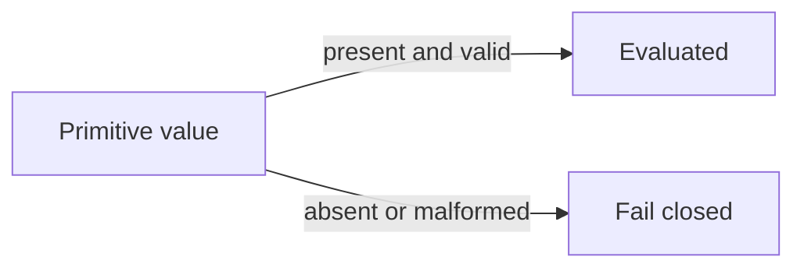

A denial is always a *typed* outcome — `ValueError` from the lane policy, `ROEViolation` from the ROE engine — never a silent pass.

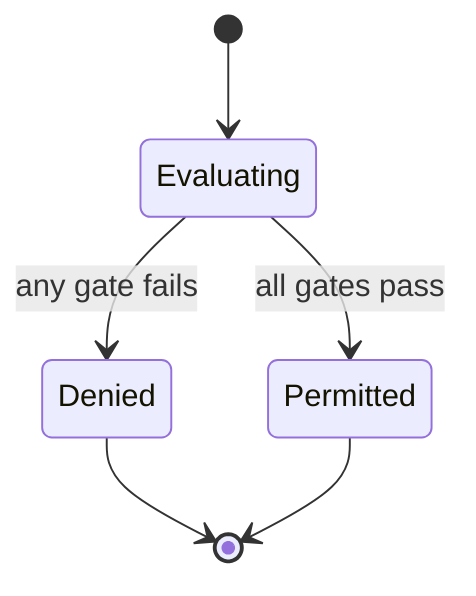

---

## 3. The lane lattice

ZP42 defines four lanes. Three are operational bands with increasing authorisation requirements; the fourth, `UNKNOWN`, is the explicit bottom element representing an unresolved or unauthorised state.

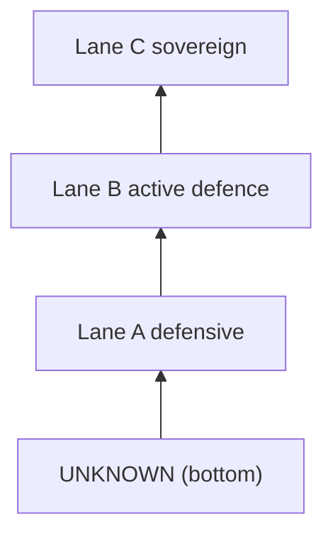

The ordering is a requirement lattice: each higher lane demands strictly more authorisation evidence than the one below. It is **not** an inheritance of permission that widens automatically — a request does not drift upward.

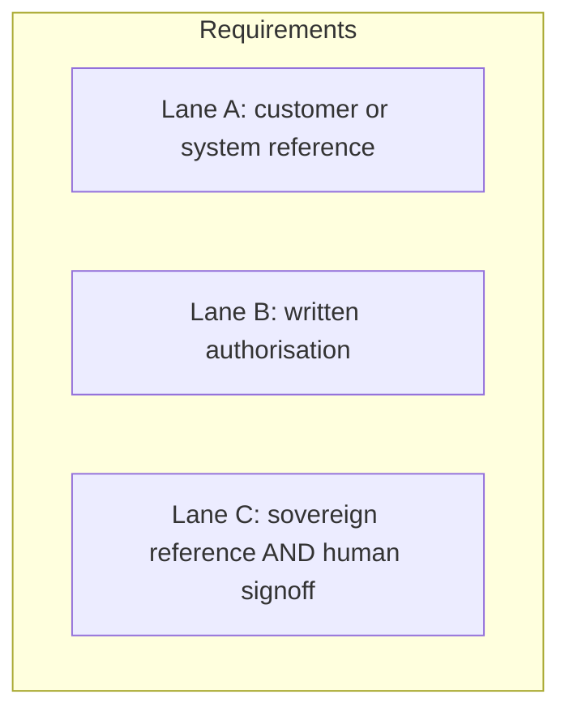

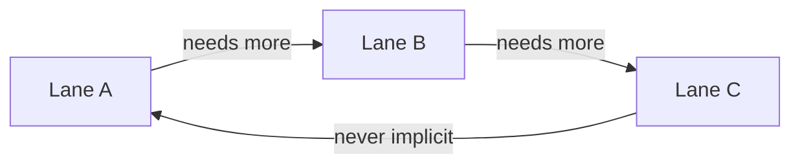

A lane is **entered deliberately** as the result of evaluating the request, and `UNKNOWN` is the value whenever that evaluation cannot justify a specific band.

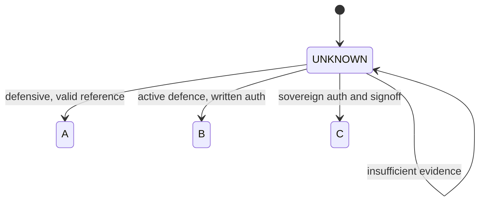

The lanes map directly to the `Lane` enumeration in `lane_policy.py` (`A`, `B`, `C`, `UNKNOWN`), ensuring the formal model and the code share one vocabulary.

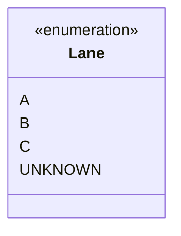

---

## 4. Lane assignment semantics

Lane assignment is performed by `LanePolicy.assign_lane`. Its first act is the fail-closed guard: **no authorisation reference means no lane**.

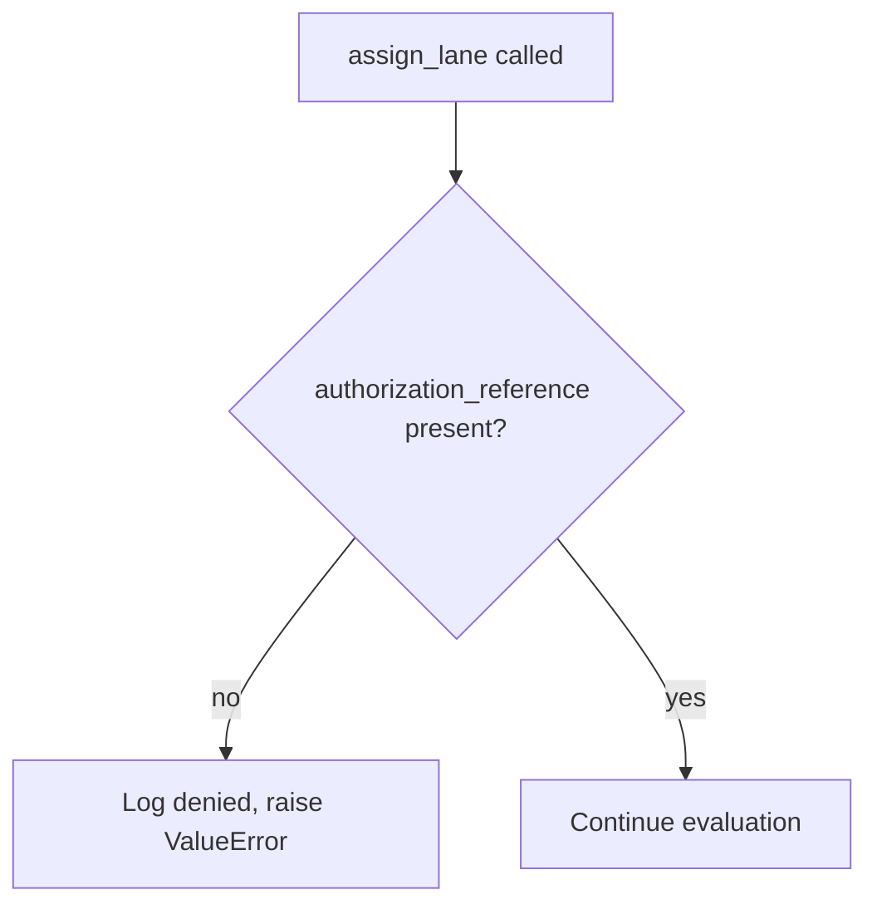

The decision then branches on sovereign authorisation, active-defence classification, and finally defaults to Lane A.

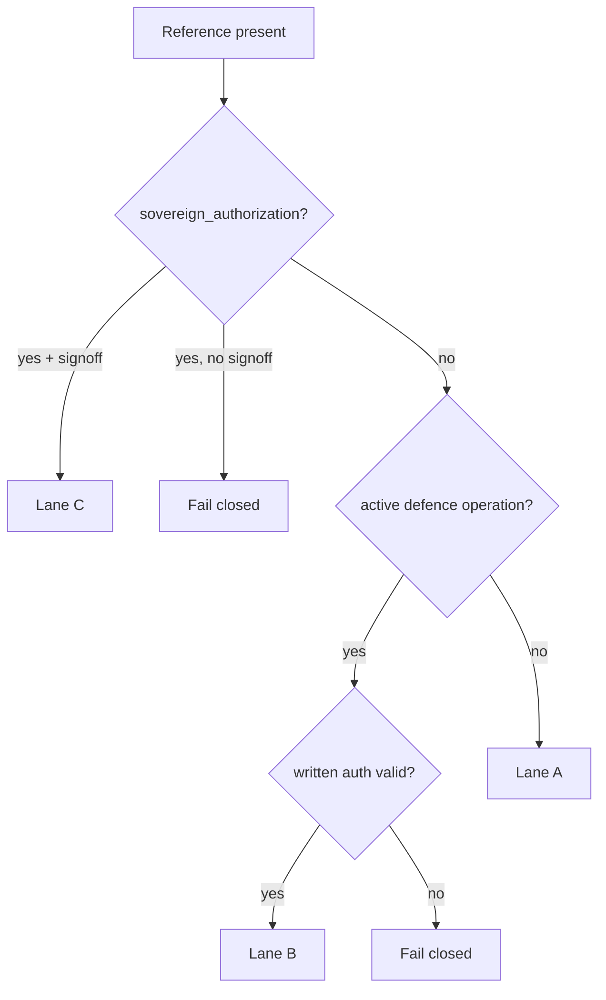

The sovereign branch is strict: sovereign authorisation **without** human signoff is a denial, not a downgrade to a lesser lane.

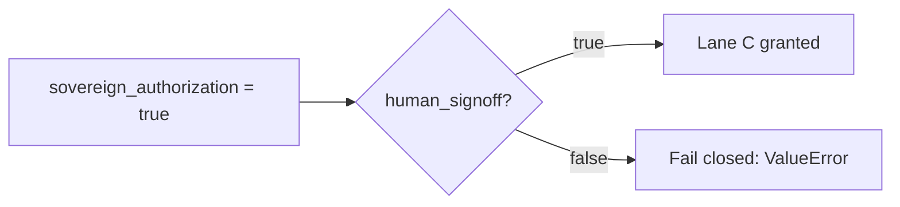

Active-defence classification uses keyword detection (`deception`, `honeypot`, `honeytoken`, `threat_hunting`, `controlled_engagement`, `attribution`) in `_is_active_defense_operation`. This is deliberately conservative: anything matching routes to the stricter Lane B evidence test.

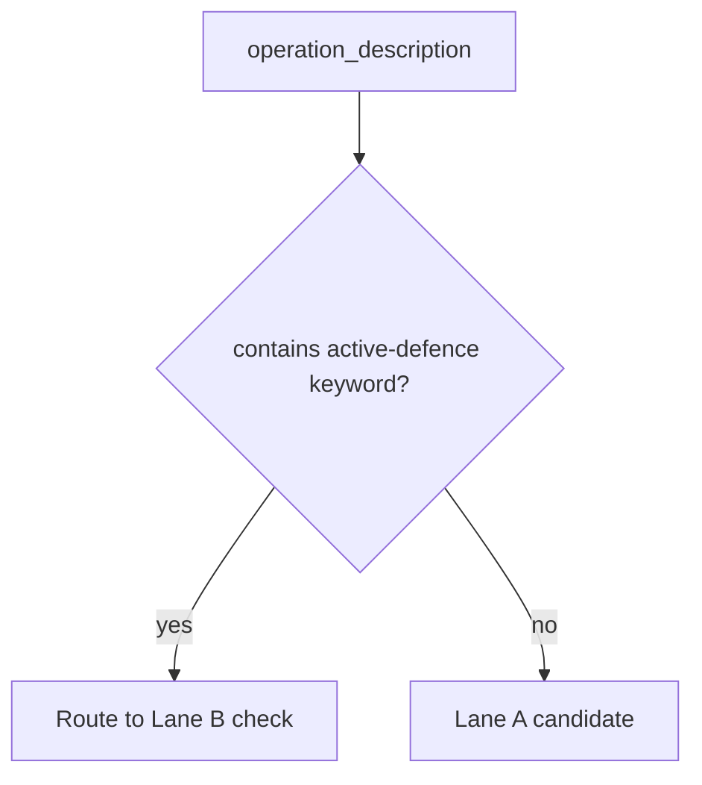

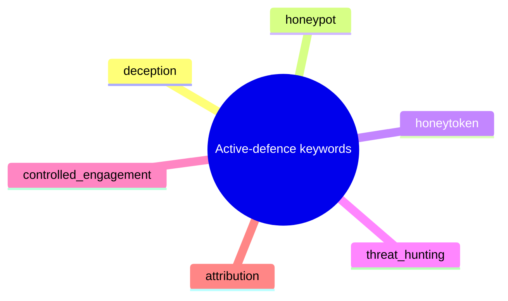

The assignment of a successful lane is itself logged as a `lane_assignment` event with the reference and flags, so every entry into a band leaves evidence.

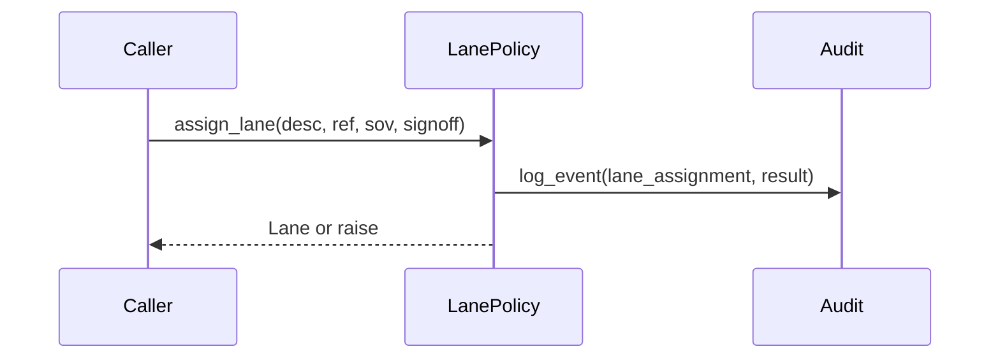

Lane A is the **default successful** band — the least-privileged authorised state — reached only once a reference exists and the operation is neither sovereign nor active-defence.

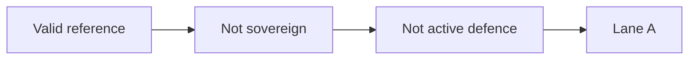

A separate method, `validate_lane_authorization`, re-checks that a resolved lane is not `UNKNOWN` before authorisation is treated as valid, logging an `authorization_check` event.

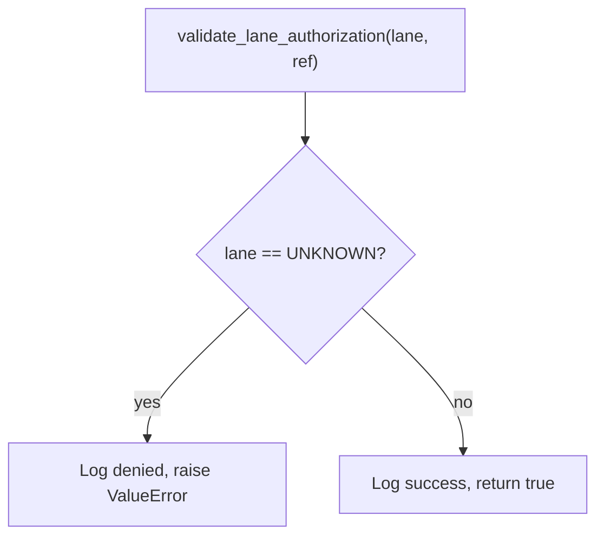

---

## 5. Written authorisation validation

Lane B requires a **written authorisation**. In the Foundation phase, `_validate_written_authorization` performs format validation only: the reference must be at least ten characters and carry a recognised prefix.

```mermaid
flowchart TD
    AR["authorization_reference"] --> L{"length >= 10?"}
    L -->|no| FB["Invalid"]
    L -->|yes| P{"known prefix?"}
    P -->|yes| VB["Valid written auth"]
    P -->|no| FB
```

```mermaid
mindmap
  root((Valid prefixes))
    AUTH-
    WRITTEN-AUTH-
    CONTRACT-
    SOW-
```

This is a **structural** check, not a cryptographic or database-backed verification. The code comments mark production verification against an authorisation database as future work; this document does not claim it exists.

```mermaid
flowchart LR
    NOW["Now: format and prefix check"] -.specified.-> LATER["Future: authorisation database lookup"]
```

A reference that passes format validation but is semantically false is still, at this phase, accepted as written authorisation. This is an honest limitation surfaced by the model, and it is why human gates and audit remain mandatory for Lane B.

```mermaid
flowchart TD
    W["Written auth format valid"] --> B["Lane B assigned"]
    B --> G["Human gate still required"]
    B --> AU["Audit event still written"]
```

---

## 6. Rules of engagement (ROE) semantics

The ROE engine answers a different question from the lane policy. The lane policy asks *which band is this request in?*; the ROE engine asks *is this capability permitted in that band?* `ROEEngine.check_roe(lane, capability_requested, details)` returns `True` or raises `ROEViolation`.

```mermaid
flowchart TD
    CR["check_roe(lane, capability)"] --> GP{"globally prohibited?"}
    GP -->|yes| V1["Raise ROEViolation"]
    GP -->|no| LU{"lane == UNKNOWN?"}
    LU -->|yes| V2["Raise ROEViolation"]
    LU -->|no| LS["Lane-specific checks"]
    LS --> OK["Return true, log success"]
```

The order of checks is load-bearing: the **global prohibition set is tested first**, before any lane-specific logic, so no lane — not even Lane C — can reach a prohibited capability.

```mermaid
flowchart LR
    REQ["Capability"] --> G1["1. Global prohibitions"]
    G1 --> G2["2. UNKNOWN lane block"]
    G2 --> G3["3. Lane-specific rules"]
    G3 --> PASS["Permit"]
```

```mermaid
sequenceDiagram
    participant Orchestrator
    participant ROE
    participant Audit
    Orchestrator->>ROE: check_roe(lane, capability)
    ROE->>ROE: global prohibition test
    ROE->>ROE: lane-specific test
    ROE->>Audit: log_event(roe_check, result)
    ROE-->>Orchestrator: true or ROEViolation
```

---

## 7. Globally prohibited capabilities

A fixed set of capabilities is prohibited in **every** lane. These encode ZP42's defensive-only character at the policy layer.

```mermaid
mindmap
  root((Globally prohibited))
    malware_creation
    malware_deployment
    credential_theft
    credential_harvesting
    ddos_generation
    data_exfiltration_unauthorized
    persistence_installation
    evasion_technique
    destructive_payload
    autonomous_retaliation
    hack_back
    unauthorized_third_party_targeting
```

Any request naming one of these is denied immediately, with a `policy_violations` entry recorded in the audit event.

```mermaid
flowchart TD
    C["capability_requested"] --> IN{"in global prohibition set?"}
    IN -->|yes| D["Deny, log prohibited_capability"]
    IN -->|no| CONT["Continue to lane checks"]
```

The prohibition is **lane-invariant**. The following shows that sovereign authority does not purchase an exception.

```mermaid
flowchart LR
    LC["Lane C sovereign"] --> HB{"request hack_back?"}
    HB -->|yes| DEN["ROEViolation regardless of lane"]
```

This is the formal expression of the system's thesis: the point of ZP42 is that offensive capability is *gated*, and for this set the gate is permanently shut.

```mermaid
stateDiagram-v2
    [*] --> Checking
    Checking --> Blocked: global prohibition
    Blocked --> [*]: no lane can override
```

---

## 8. Lane-specific rules of engagement

Beyond the global set, each operational lane permits a bounded capability list and denies capabilities reserved for higher lanes.

```mermaid
flowchart TD
    subgraph LaneA["Lane A permitted"]
    A1["vulnerability_assessment"]
    A2["defensive_analysis"]
    A3["security_config_review"]
    A4["compliance_checking"]
    A5["threat_modeling"]
    end
```

Lane A additionally **denies** capabilities that belong to active defence or above, routing them to a `ROEViolation` that names the higher lane required.

```mermaid
flowchart TD
    AR["Lane A request"] --> PL{"in {live_exploitation, deception_deployment, honeypot_deployment, active_engagement}?"}
    PL -->|yes| D["Requires Lane B or C"]
    PL -->|no| OK["Permitted if in A list"]
```

Lane B widens the permitted set to active-defence capabilities while still denying offensive, unauthorised-access, and destructive capabilities.

```mermaid
flowchart TD
    subgraph LaneB["Lane B permitted"]
    B1["vulnerability_assessment"]
    B2["defensive_analysis"]
    B3["deception_deployment"]
    B4["honeypot_deployment"]
    B5["threat_hunting"]
    B6["controlled_engagement"]
    B7["attribution_support"]
    end
```

```mermaid
flowchart TD
    BR["Lane B request"] --> PB{"in {offensive_operation, unauthorized_system_access, destructive_action}?"}
    PB -->|yes| DC["Requires Lane C"]
    PB -->|no| OKB["Permitted if in B list"]
```

Lane C is the most permissive operational lane but remains bounded by the global prohibitions; the code contains no Lane-C-only permission that escapes them.

```mermaid
flowchart TD
    subgraph LaneC["Lane C permitted"]
    C1["vulnerability_assessment"]
    C2["defensive_analysis"]
    C3["deception_deployment"]
    C4["threat_hunting"]
    C5["sovereign_authorized_operations"]
    end
```

```mermaid
flowchart LR
    CR2["Lane C request"] --> GB["Global prohibitions still apply"] --> BND["Bounded sovereign action"]
```

The `get_permitted_capabilities(lane)` method returns these lists and an **empty list for `UNKNOWN`** — the lattice bottom grants nothing.

```mermaid
flowchart TD
    GPC["get_permitted_capabilities(lane)"] --> AU2{"lane?"}
    AU2 -->|A| LAlist["5 defensive capabilities"]
    AU2 -->|B| LBlist["7 active-defence capabilities"]
    AU2 -->|C| LClist["5 sovereign capabilities"]
    AU2 -->|UNKNOWN| EMPTY["Empty set"]
```

The relationship between permitted sets is containment-like at the defensive core, with each lane adding only its specifically authorised extensions.

```mermaid
graph TD
    Core["vulnerability_assessment, defensive_analysis"] --> A["+ config review, compliance, threat modeling"]
    Core --> B["+ deception, honeypot, hunting, engagement, attribution"]
    Core --> C["+ sovereign authorised operations"]
```

---

## 9. Escalation semantics

Escalation — moving from a current lane to a requested higher lane mid-operation — is validated by `validate_escalation_attempt`. In the Foundation phase, **all** escalation between distinct lanes is denied and logged.

```mermaid
flowchart TD
    VE["validate_escalation_attempt(cur, req)"] --> EQ{"cur == req?"}
    EQ -->|yes| OK["Return true (no-op)"]
    EQ -->|no| DEN["Log escalation_attempt, raise ROEViolation"]
```

Denied escalations are recorded with `escalation_attempt = true` and a `unauthorized_lane_escalation` policy violation, giving auditors a distinct signal for attempted widening.

```mermaid
sequenceDiagram
    participant Op
    participant ROE
    participant Audit
    Op->>ROE: validate_escalation_attempt(A, C)
    ROE->>Audit: log_event(escalation_attempt, denied, escalation_attempt=true)
    ROE-->>Op: raise ROEViolation
```

This makes upward movement impossible by default; an authorised escalation path is named as future work and is not claimed to exist.

```mermaid
stateDiagram-v2
    A --> A: same-lane no-op allowed
    A --> B: denied this phase
    B --> C: denied this phase
    A --> C: denied this phase
```

```mermaid
flowchart LR
    NOW2["Now: deny all escalation"] -.specified.-> FUT["Future: explicit authorised escalation path"]
```

The invariant: a running operation cannot acquire a capability by climbing the lattice; it must be re-authorised from the start in the higher lane.

```mermaid
flowchart TD
    RUN["Operation in Lane A"] --> WANT{"wants Lane B capability"}
    WANT --> DENIED["Escalation denied"]
    DENIED --> REAUTH["Must re-request as fresh Lane B operation"]
```

---

## 10. Human gate semantics

The human gate interposes required human authorisation. `HumanGate.requires_human_approval(lane, operation_type)` encodes **when** a human must be in the loop.

```mermaid
flowchart TD
    RH["requires_human_approval(lane, op)"] --> LAq{"lane?"}
    LAq -->|A| SENS{"sensitive op?"}
    LAq -->|B| YES1["Required"]
    LAq -->|C| YES2["Required"]
    LAq -->|UNKNOWN| YES3["Required (fail closed)"]
    SENS -->|yes| YES4["Required"]
    SENS -->|no| NO["Not required"]
```

For Lane A, approval is required only for a small set of sensitive operations; routine defensive work proceeds without a gate.

```mermaid
mindmap
  root((Lane A sensitive ops))
    live_vulnerability_scan
    configuration_change
    access_customer_data
```

For Lanes B and C — and for `UNKNOWN` — approval is **always** required. The `UNKNOWN` case is the fail-closed default: an unresolved lane demands a human.

```mermaid
flowchart LR
    B2["Lane B"] --> REQ1["Always require approval"]
    C2["Lane C"] --> REQ2["Always require approval"]
    UK["UNKNOWN"] --> REQ3["Require approval (fail closed)"]
```

The gate is not merely advisory: higher-lane operations cannot be treated as approved without an explicit human decision recorded through the approval lifecycle.

```mermaid
sequenceDiagram
    participant System
    participant Gate
    participant Human
    participant Audit
    System->>Gate: requires_human_approval(laneB, op)
    Gate-->>System: true
    System->>Gate: request_approval(...)
    Gate->>Audit: log_event(human_gate_request, pending)
    Human->>Gate: approve_operation(id, approver)
    Gate->>Audit: log_event(human_gate_approval, success)
```

---

## 11. Approval lifecycle state machine

An approval request is created by `request_approval`, which mints a UUID, stores a pending record, and logs a `human_gate_request` event with `result = pending`.

```mermaid
stateDiagram-v2
    [*] --> PENDING: request_approval
    PENDING --> APPROVED: approve_operation
    PENDING --> DENIED: deny_operation
    PENDING --> EXPIRED: timeout (specified)
    APPROVED --> [*]
    DENIED --> [*]
    EXPIRED --> [*]
```

The `ApprovalStatus` enumeration defines the four states; `PENDING`, `APPROVED`, and `DENIED` are driven by implemented methods, while `EXPIRED` is defined in the enumeration as a future-driven transition.

```mermaid
classDiagram
    class ApprovalStatus {
        <<enumeration>>
        PENDING
        APPROVED
        DENIED
        EXPIRED
    }
```

Both `approve_operation` and `deny_operation` enforce a **single-transition** rule: a request not currently `PENDING` cannot be processed again, preventing double-approval or approval-after-denial.

```mermaid
flowchart TD
    AP["approve_operation(id)"] --> EX{"id exists?"}
    EX -->|no| ERR1["ValueError not found"]
    EX -->|yes| ST{"status == PENDING?"}
    ST -->|no| ERR2["ValueError already processed"]
    ST -->|yes| OKA["Set APPROVED, log human_gate_approval"]
```

```mermaid
flowchart TD
    DN["deny_operation(id)"] --> EX2{"id exists?"}
    EX2 -->|no| ERR3["ValueError not found"]
    EX2 -->|yes| ST2{"status == PENDING?"}
    ST2 -->|no| ERR4["ValueError already processed"]
    ST2 -->|yes| OKD["Set DENIED, log human_gate_denial"]
```

Approvals attach the approver identifier (an `actor_type` of `human`); denials attach the denier identifier and a mandatory reason. The gate therefore binds a *named human* to every sensitive decision.

```mermaid
sequenceDiagram
    participant Approver
    participant Gate
    participant Audit
    Approver->>Gate: approve_operation(id, "alice", notes)
    Gate->>Gate: status PENDING -> APPROVED
    Gate->>Audit: log_event(human_gate_approval, actor=human:alice)
```

The Foundation implementation holds pending approvals **in memory**; persistent storage is noted as production future work and is not claimed here.

```mermaid
flowchart LR
    MEM["Now: in-memory pending map"] -.specified.-> DURABLE["Future: durable approval store"]
```

Status can be queried with `get_approval_status`, which raises if the request is unknown — there is no implicit "approved" for a missing record.

```mermaid
flowchart TD
    GS["get_approval_status(id)"] --> F{"id known?"}
    F -->|no| RE["ValueError"]
    F -->|yes| RET["Return current status"]
```

---

## 12. Audit evidence binding

Every authorisation decision — assignment, check, escalation attempt, gate request, approval, denial — calls `AuditLogger.log_event`. The logger validates enumerations and writes an append-only JSONL record.

```mermaid
flowchart TD
    LE["log_event(...)"] --> VOP{"operation_type valid?"}
    VOP -->|no| RV1["ValueError"]
    VOP -->|yes| VL{"lane valid?"}
    VL -->|no| RV2["ValueError"]
    VL -->|yes| VA{"actor_type valid?"}
    VA -->|no| RV3["ValueError"]
    VA -->|yes| VR{"result valid?"}
    VR -->|no| RV4["ValueError"]
    VR -->|yes| WRITE["Append JSONL event"]
```

The event carries an ISO 8601 UTC timestamp, a UUID event id, the operation type, lane, actor, result, and optional reference, details, failure reason, escalation flag, and policy violations.

```mermaid
classDiagram
    class AuditEvent {
        +string timestamp
        +string event_id
        +string operation_type
        +string lane
        +Actor actor
        +string result
        +bool escalation_attempt
        +string[] policy_violations
    }
    class Actor {
        +string type
        +string identifier
    }
    AuditEvent --> Actor
```

The valid vocabularies are closed sets, so an unrecognised value is a logging error rather than a silently recorded anomaly.

```mermaid
mindmap
  root((Audit enums))
    operation_type
      lane_assignment
      roe_check
      escalation_attempt
      human_gate_request
      human_gate_approval
      human_gate_denial
    lane
      A
      B
      C
      unknown
    result
      success
      failure
      denied
      pending
```

The log is **append-only JSONL and is not cryptographically signed** in the Foundation phase. Tamper-evidence through signing is a future concern; this document does not assert it.

```mermaid
flowchart LR
    AO["Now: append-only JSONL"] -.specified.-> SIGN["Future: cryptographic signing"]
```

The evidentiary invariant: a denial is never silent. Each fail-closed path above writes an event *before* raising, so the audit trail records refusals as well as successes.

```mermaid
sequenceDiagram
    participant Policy
    participant Audit
    Policy->>Audit: log_event(result=denied, reason)
    Policy->>Policy: raise exception
    Note over Audit: evidence persists independent of the raise
```

```mermaid
flowchart TD
    DEC["Any decision"] --> LOG["Write audit event"] --> OUT{"permit or raise"}
    OUT -->|permit| CONT2["Proceed"]
    OUT -->|raise| STOP["Operation halts, evidence remains"]
```

---

## 13. Compliance and model-allowlist authorisation

Compliance is expressed as machine-readable manifests: `compliance/model_allowlist.json` and `compliance/license_manifest.json`. The allowlist declares three approved Apache-2.0 models (AI2 OLMo 3 32B Base, AI2 OLMo 3 32B Think, IBM Granite 4.1 30B Base) and a set of excluded origins.

```mermaid
flowchart TD
    AL["model_allowlist.json"] --> AP["approved_models (3)"]
    AL --> PO["prohibited_origins"]
    AL --> ENF["enforcement policy = fail_closed"]
```

The declared enforcement semantics are fail-closed: unknown model → fail closed; prohibited model → fail closed and alert; unverifiable origin → fail closed.

```mermaid
flowchart TD
    M["Model reference"] --> K2{"in allowlist?"}
    K2 -->|yes| OKM["Permitted (declared)"]
    K2 -->|prohibited| PA["Fail closed and alert (declared)"]
    K2 -->|unknown| UC["Fail closed (declared)"]
```

Crucially, this is **declared, not yet enforced in code**. The manifests specify the policy; the Foundation phase does not include a runtime that reads them to block model loads. This document states the specification and labels it as such.

```mermaid
flowchart LR
    DECL["Now: declarative manifests"] -.specified.-> CODEENF["Future: code enforcement at load time"]
```

```mermaid
mindmap
  root((Allowlist policy))
    approved
      OLMo 3 32B Base
      OLMo 3 32B Think
      Granite 4.1 30B Base
    excluded
      PRC origins
      derivatives
      embeddings
```

The prohibited-terms scanner (`scripts/scan_prohibited_terms.py`) is the one compliance control that is implemented and runs at the repository boundary (pre-commit), guarding against disallowed terminology in committed material.

```mermaid
flowchart TD
    COMMIT["git commit"] --> SCAN["scan_prohibited_terms.py"]
    SCAN --> HIT{"prohibited term found?"}
    HIT -->|yes| BLOCK["Block commit"]
    HIT -->|no| ALLOW["Allow commit"]
```

---

## 14. Fail-closed properties

The authorisation model is built to satisfy a family of fail-closed theorems. Each is a property the implemented components are designed to uphold; where a property depends on specified-but-unbuilt wiring, that is noted.

**P1 — No reference, no lane.** Absent authorisation reference ⇒ `UNKNOWN` behaviour and `ValueError`.

```mermaid
flowchart LR
    NR["reference absent"] --> U2["UNKNOWN / raise"]
```

**P2 — No capability in UNKNOWN.** `get_permitted_capabilities(UNKNOWN)` is empty and `check_roe` denies any capability in `UNKNOWN`.

```mermaid
flowchart LR
    UK2["lane UNKNOWN"] --> NOCAP["no permitted capability"]
```

**P3 — Global prohibitions are lane-invariant.** The prohibited set is tested before lane logic, so no lane overrides it.

```mermaid
flowchart LR
    ANY["any lane"] --> GPset["global prohibition"] --> NO2["denied"]
```

**P4 — Sovereign needs a human.** Lane C requires both the sovereign flag and signoff; one without the other fails closed.

```mermaid
flowchart LR
    SOVonly["sovereign, no signoff"] --> FC["fail closed"]
```

**P5 — No implicit escalation.** All distinct-lane escalation is denied this phase.

```mermaid
flowchart LR
    ESC["lane climb"] --> DEN2["denied + logged"]
```

**P6 — Higher lanes gate on a human.** Lanes B, C, and UNKNOWN always require human approval.

```mermaid
flowchart LR
    HILANE["B / C / UNKNOWN"] --> HUM["human approval required"]
```

**P7 — Single approval transition.** A non-pending request cannot be re-approved or re-denied.

```mermaid
flowchart LR
    NP["non-pending"] --> REJ["ValueError"]
```

**P8 — Evidence precedes the raise.** Every denial writes an audit event before the exception propagates.

```mermaid
flowchart LR
    DECISION["denial"] --> EV["audit event written"] --> RAISE["then raise"]
```

The composed property is monotone safety: the conjunction of all gates is at least as restrictive as any single gate, because each stage can only deny or pass, never re-grant something a prior stage denied.

```mermaid
flowchart TD
    G1b["Lane gate"] --> G2b["ROE gate"] --> G3b["Human gate"] --> G4b["Verify (specified)"]
    G1b -->|deny| HALT1["halt"]
    G2b -->|deny| HALT2["halt"]
    G3b -->|deny| HALT3["halt"]
```

```mermaid
stateDiagram-v2
    [*] --> Gate1
    Gate1 --> Gate2: pass
    Gate1 --> Stop: deny
    Gate2 --> Gate3: pass
    Gate2 --> Stop: deny
    Gate3 --> Permit: pass
    Gate3 --> Stop: deny
    Stop --> [*]
    Permit --> [*]
```

---

## 15. The composed decision pipeline (as specified)

When the orchestrator is completed, the specified end-to-end authorisation path composes the gates in a fixed order. The diagram below is the *target* composition, not a claim that it is wired today.

```mermaid
flowchart TD
    REQ2["Operation request"] --> LANE["assign_lane"]
    LANE -->|UNKNOWN or raise| H1["Halt"]
    LANE --> ROEc["check_roe"]
    ROEc -->|ROEViolation| H2["Halt"]
    ROEc --> HG{"requires_human_approval?"}
    HG -->|yes| WAIT["request_approval, await decision"]
    HG -->|no| VERIFY["Verify stage (specified)"]
    WAIT -->|approved| VERIFY
    WAIT -->|denied| H3["Halt"]
    VERIFY --> AUD["Audit operation_complete"]
```

```mermaid
sequenceDiagram
    participant Client
    participant Lane
    participant ROE
    participant Gate
    participant Verify
    participant Audit
    Client->>Lane: assign_lane
    Lane->>Audit: lane_assignment
    Lane->>ROE: check_roe
    ROE->>Audit: roe_check
    ROE->>Gate: requires_human_approval
    Gate->>Audit: human_gate_request / approval
    Gate->>Verify: (specified) validate output
    Verify->>Audit: operation_complete
```

The **verify stage** (`verifiers/`) is a *defined* stage in the architecture, not a completed output verifier. It appears in the pipeline as the point where results are validated before completion, and is shown here as specified.

```mermaid
flowchart LR
    DEFINED["verifiers/: defined stage"] -.specified.-> IMPLV["Future: implemented output verifier"]
```

The scaffold boundary is explicit: the components exist and pass their unit tests, but the single path that calls them in sequence is not yet present in `orchestrator/__init__.py`.

```mermaid
flowchart TD
    COMP["Components implemented"] --> SEP["Exercised separately + in tests"]
    WIRE["Composed orchestrator"] --> SCAF["Scaffold only this phase"]
```

---

## 16. Threat-driven invariants

The authorisation model answers specific abuse hypotheses. Each is mapped to the gate that refuses it.

```mermaid
flowchart TD
    T1["Request offensive capability"] --> R1["Global prohibition denies"]
    T2["Omit authorisation reference"] --> R2["Lane fails closed"]
    T3["Claim sovereign without human"] --> R3["Lane C denied"]
    T4["Escalate mid-operation"] --> R4["Escalation denied + logged"]
    T5["Re-approve a denied request"] --> R5["Single-transition rejects"]
```

```mermaid
flowchart TD
    T6["Act in unknown lane"] --> R6["Empty capability set"]
    T7["Bypass human on Lane B"] --> R7["requires_human_approval = true"]
    T8["Introduce prohibited term"] --> R8["Pre-commit scanner blocks"]
```

The model's defensive framing is structural: there is no code path, in any lane, that constructs or executes an offensive action, and the prohibited-capability set makes the refusal explicit rather than merely absent.

```mermaid
flowchart LR
    NOOFF["No offensive construction path"] --> PLUS["+ explicit prohibition set"] --> SAFE["Defensive by construction"]
```

```mermaid
stateDiagram-v2
    [*] --> Defensive
    Defensive --> Denied: offensive request
    Defensive --> Permitted: authorised defensive / active-defence / sovereign work
    Denied --> [*]
    Permitted --> [*]
```

---

## 17. Implemented versus specified — authoritative status

To avoid any overstatement, the table binds each element of this model to its true status.

| Element | Status |
|---|---|
| Lane policy (`lane_policy.py`) | Implemented, unit-tested |
| ROE engine (`roe_engine.py`) | Implemented (not yet unit-tested) |
| Human gate (`human_gate.py`) | Implemented, in-memory (not yet unit-tested) |
| Audit logger (`audit_logger.py`) | Implemented, append-only JSONL, unsigned |
| Prohibited-terms scanner | Implemented, runs at commit boundary |
| Composed orchestrator pipeline | Specified; `orchestrator/__init__.py` scaffold |
| Output verifier (`verifiers/`) | Defined stage, not a completed verifier |
| Model-allowlist enforcement | Declared manifest, not enforced in code |
| Written-auth DB verification | Specified; format check only today |
| Approval persistence / expiry | Specified; in-memory today |
| Audit signing | Specified; unsigned today |
| Authorised escalation path | Specified; all escalation denied today |

```mermaid
flowchart LR
    IMPL["Implemented + tested"] --- SCAFFOLD["Scaffold / defined"] --- DECLARED["Declared / specified"]
```

```mermaid
mindmap
  root((Status honesty))
    Implemented
      lane
      roe
      gate
      audit
      scanner
    Specified
      composed pipeline
      verifier
      allowlist enforcement
      signing
      escalation path
```

The design intent is that these gaps close in later phases **without weakening** the fail-closed defaults: every unbuilt path is currently a denial, so completing it can only ever add carefully authorised capability, never remove a refusal.

```mermaid
flowchart TD
    GAP["Unbuilt path today"] --> DEF["Defaults to denial"]
    DEF --> LATER2["Later: add authorised capability"]
    LATER2 --> KEEP["Fail-closed default preserved"]
```

ZP42's authorisation model, as conceived by **Naquib Hatami**, is therefore a governance-first skeleton whose honesty is part of its design: it claims only what it enforces, specifies the rest, and defaults every undecided question to "no".

```mermaid
flowchart LR
    CLAIM["Claim only what is enforced"] --> SPEC["Specify the rest"] --> NO["Default undecided to no"]
```

---

## 18. Cross-references

- `../README.md` — project identity, lane summary, and model policy.
- `FOUNDATION.md` — charter status, safety boundaries, and fail-closed policy.
- `05-lane-model.md` — detailed lane model and classification.
- `06-roe-engine.md` — rules-of-engagement engine specification.
- `07-human-gate.md` — human authorisation gate design.
- `08-governance-audit.md` — audit logging and evidence schema.
- `11-safety-boundaries.md` — prohibited capabilities and operational boundaries.
