# ZP42 Glossary

> Part of the ZP42 documentation set.

**ZP42** (Zeroth Protocol 42) is an open, MIT-licensed, governance-first cyber-reasoning system for defensive, active-defence, and sovereign-authorised workflows. Inventor and author: **Naquib Hatami**. This glossary defines every term used across the ZP42 documentation set precisely, distinguishes what is **implemented** today from what is **specified** for later phases, and cross-references each definition to the modules and sibling documents where the term is used.

This document is a reference, not a tutorial. Where a term names a real module in the repository (`github.com/iQs-Group/zp-42`), the definition states the file that implements it. Where a term names a concept that is **specified but not yet wired**, the definition says so explicitly, in keeping with the honest Foundation-phase status of the project. ZP42 is published by SADI AI Inc. / iQs Group Inc. and hosted at `zp42.org`.

---

## 1. How to read this glossary

Each entry carries a short **status tag** so a reader never confuses an aspiration with a shipped component:

| Tag | Meaning |
|-----|---------|
| **Implemented** | Code exists in the repository as an independent component. This tag alone does not assert test coverage. |
| **Implemented & tested** | Implemented code that is additionally covered by its own unit-test suite as an independent component. |
| **Specified** | Defined in design and/or declared as a machine-readable manifest, but not yet enforced in executable code. |
| **Scaffold** | A placeholder module or stage that establishes structure without full behaviour. |
| **Out of scope** | Explicitly excluded from the Foundation phase. |

The overall relationship between these tags is a maturity gradient, not a set of silos.


Cross-references use the form *(see §N)* within this document and *filename* for sibling documents. Root files are reached with `../` (for example `../README.md`, `../LICENSE`); the Foundation charter `FOUNDATION.md` sits in this same `docs/` folder and is linked by its bare name.

---

## 2. Core identity terms

### 2.1 ZP42 — *Implemented (project)*
The public name of the system. **ZP42** expands to **Zeroth Protocol 42**. The formal phrase is the **ZP42 Cyber Reasoning System**. It denotes a governance-first cyber-reasoning platform whose distinguishing property is that capability is **gated by authorisation** rather than offered by default. See `../README.md` and `FOUNDATION.md`.

### 2.2 Zeroth Protocol 42 — *Implemented (project)*
The full expansion of the name ZP42. "Zeroth" signals that governance precedes capability: the rules that bound action are established *before* any reasoning or action is permitted.

### 2.3 Cyber reasoning system — *Specified*
A system that reasons about cyber-defensive problems — vulnerability assessment, posture analysis, threat modelling — under explicit policy constraints. In the Foundation phase, ZP42 provides the **governance envelope** for such reasoning; the reasoning engine itself (model inference) is **out of scope** (see §9.1).

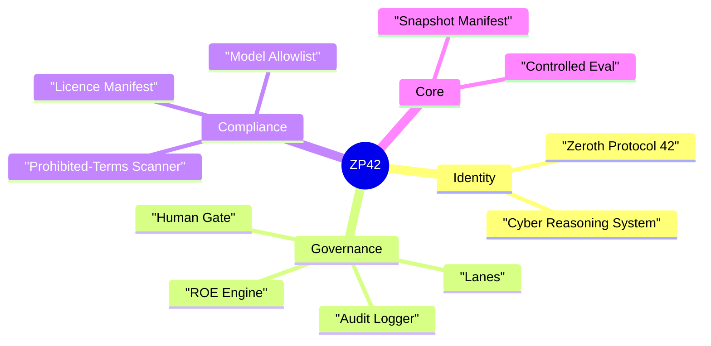

### 2.4 Naquib Hatami — *Implemented (attribution)*
Inventor and author of ZP42, and the copyright holder named in `compliance/license_manifest.json` ("Copyright (c) 2026 Naquib Hatami. Released under the MIT License."). The design principle that governance is built in from day one, not bolted on, is attributed to him in `FOUNDATION.md`.

### 2.5 Foundation phase — *Implemented (status)*
The present release stage. It establishes a safe repository scaffold, the governance and audit framework, lane policy, the ROE engine, human gates, the model allowlist and PRC-origin exclusion policy, the controlled-evaluation skeleton, and prohibited-term scanning. It explicitly excludes training, weight downloads, inference, offensive/exploit code, and live targeting (see §9). Documented as "Foundation (PR #1)" in `FOUNDATION.md`.

---

## 3. Lane model terms

The **lane model** is the backbone of ZP42 authorisation. A lane is a named band of permitted action, entered deliberately on the strength of a specific authorisation. Lanes do not widen by default; an operation with no valid authorisation falls to `UNKNOWN` and is denied.

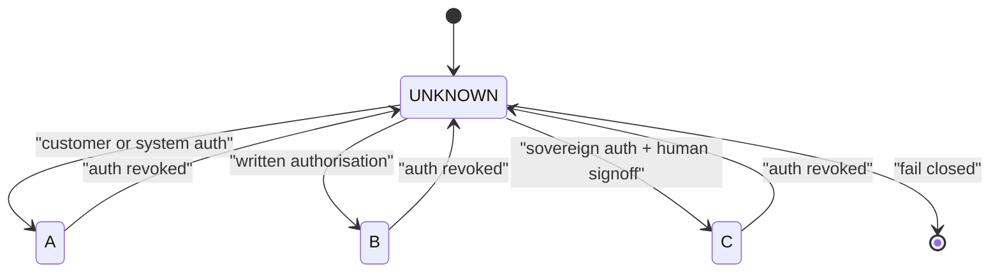

### 3.1 Lane — *Implemented*
An enumerated authorisation band. Defined as the `Lane` enum in `orchestrator/lanes/lane_policy.py` with members `A`, `B`, `C`, and `UNKNOWN`.

### 3.2 Lane A (Defensive) — *Implemented*
Defensive work authorised by the system owner, i.e. by a customer or system-level authorisation reference. Permitted activities (per `FOUNDATION.md` and `roe_engine.get_permitted_capabilities`) include vulnerability assessment of owned systems, defensive-posture analysis, security-configuration review, compliance checking, and threat modelling. Routine Lane A operations need no human gate; certain sensitive ones do (see §5.2).

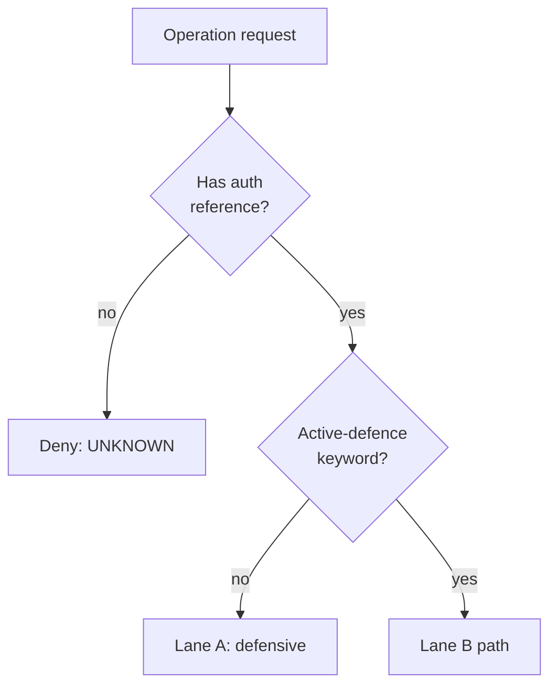

### 3.3 Lane B (Active-defence) — *Implemented*
Active-defence work requiring **explicit written authorisation**. Lane B is selected when the operation description matches an active-defence keyword (deception, honeypot, honeytoken, threat hunting, controlled engagement, attribution) *and* the authorisation reference passes written-authorisation validation. Permitted activities include deception-technology and honeypot/honeytoken management on owned systems, authorised threat hunting, controlled engagement of adversary behaviour, and evidence-only attribution support.

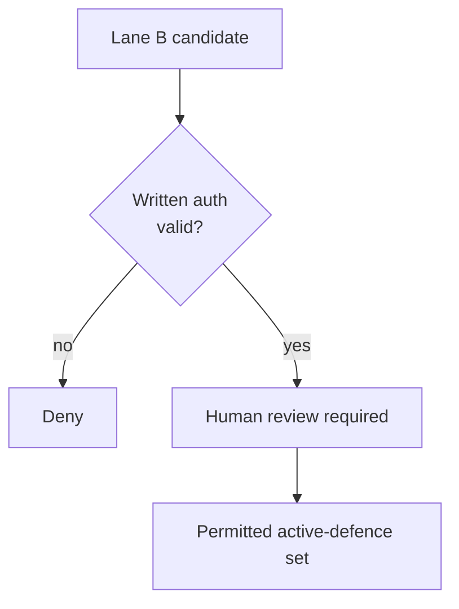

### 3.4 Lane C (Sovereign-authorised) — *Specified*
The most permissive lane, requiring both a **sovereign authorisation reference** and **human signoff**. In `assign_lane`, Lane C is granted only when `sovereign_authorization and human_signoff` are both true; sovereign authorisation without signoff fails closed. Every Lane C operation requires human approval (see §5). Lane C remains bounded by the global prohibitions (§4.2) — even here, globally prohibited capabilities are refused.

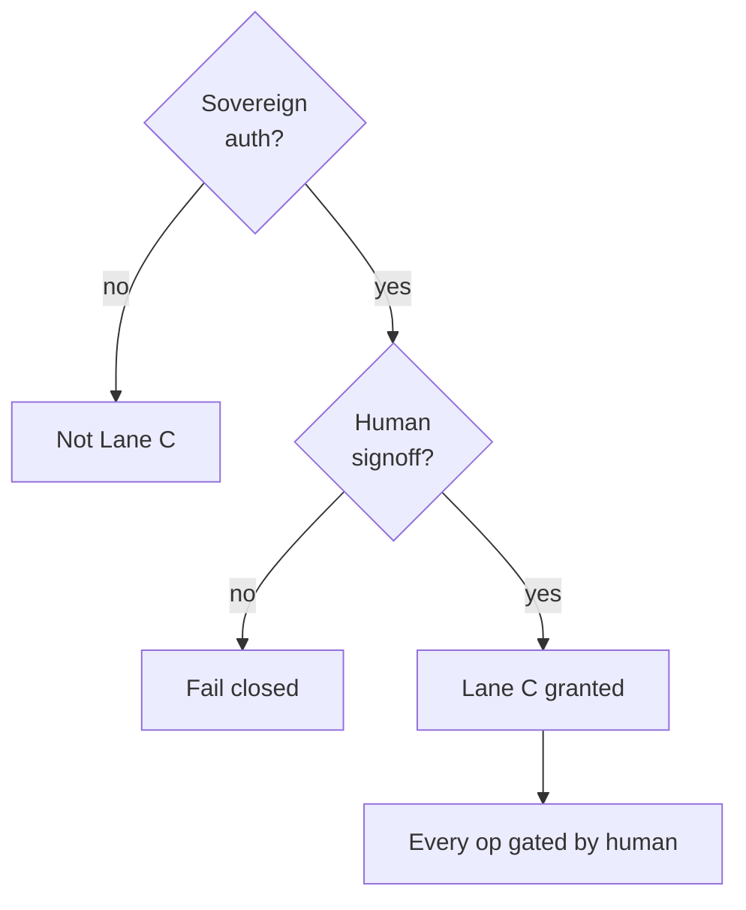

### 3.5 UNKNOWN lane — *Implemented*
The fail-closed state. Assigned when no authorisation reference is supplied, when sovereign authorisation lacks signoff, or when a lane cannot otherwise be determined. Operations in `UNKNOWN` are denied by the ROE engine and logged. The `UNKNOWN` lane embodies ZP42's fail-closed design: absence of proof of authorisation is treated as denial, never as permission.

### 3.6 Lane assignment — *Implemented*
The act of mapping an operation to a lane, performed by `LanePolicy.assign_lane`. Every assignment, successful or denied, writes a `lane_assignment` audit event (see §6).

### 3.7 Lane escalation — *Implemented (deny-only)*
A request to move from the current lane to a higher one. In the Foundation phase, `ROEEngine.validate_escalation_attempt` **denies all escalation** between differing lanes and records an `escalation_attempt` event with a `policy_violations` entry. Authorised escalation paths are **specified** for later phases but not implemented.

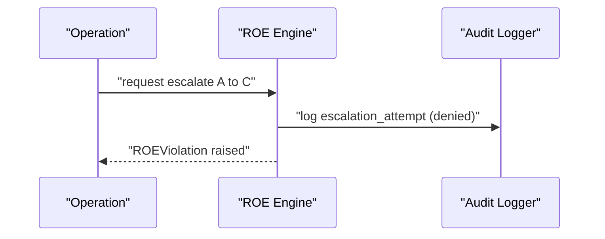

### 3.8 Fail-closed — *Implemented*
The design rule that any uncertain, malformed, or unverifiable state resolves to **denial**. It appears across lane assignment, authorisation validation, escalation, and (as **specified** policy) compliance enforcement. See `11-safety-boundaries.md`.

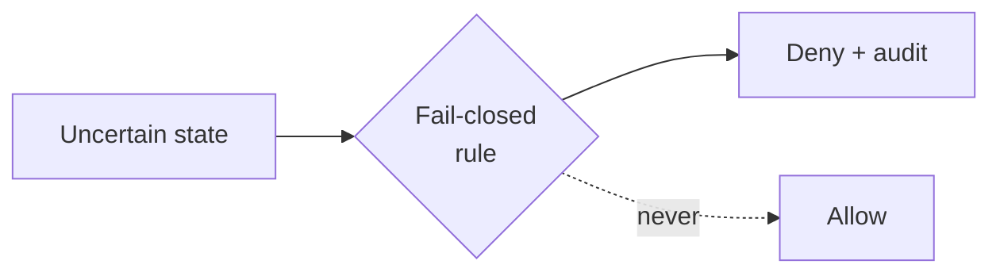

---

## 4. Rules-of-engagement terms

The **rules of engagement (ROE)** encode the bounds of permitted action as policy. The ROE engine is the second gate after lane assignment.

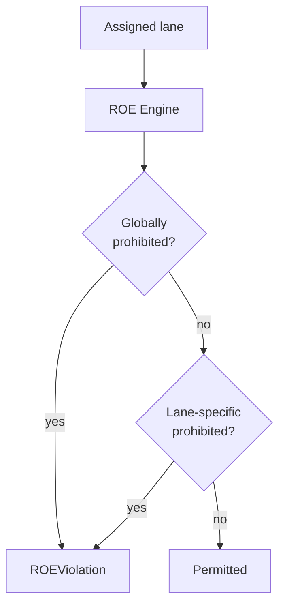

### 4.1 ROE engine — *Implemented (not yet unit-tested)*
`orchestrator/roe/roe_engine.py`. Validates a requested capability against the assigned lane before any execution would occur. Raises `ROEViolation` on any breach and writes a `roe_check` audit event. Exposes `check_roe`, `get_permitted_capabilities`, and `validate_escalation_attempt`.

### 4.2 Globally prohibited capability — *Implemented*
A capability refused in **every** lane, including Lane C. The set `GLOBALLY_PROHIBITED_CAPABILITIES` contains malware creation and deployment, credential theft and harvesting, DDoS generation, unauthorised data exfiltration, persistence installation, evasion technique, destructive payload, autonomous retaliation, hack-back, and unauthorised third-party targeting. These are hard limits; no authorisation lifts them.

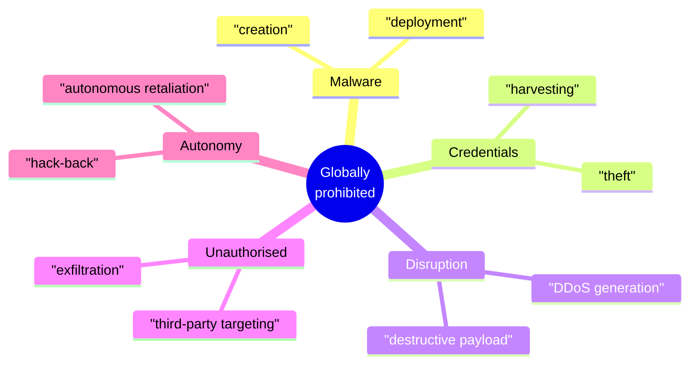

### 4.3 Lane-specific prohibition — *Implemented*
A capability refused only in certain lanes. For Lane A, the set includes `live_exploitation`, `deception_deployment`, `honeypot_deployment`, and `active_engagement` (these require Lane B or C). For Lane B, the set includes `offensive_operation`, `unauthorized_system_access`, and `destructive_action` (these require Lane C — within the global limits).

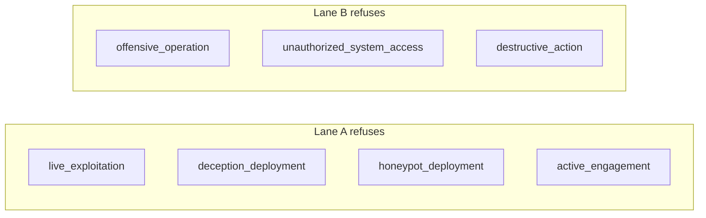

### 4.4 Permitted capability set — *Implemented*
The list of capabilities a lane may request, returned by `get_permitted_capabilities(lane)`. Lane A: vulnerability assessment, defensive analysis, security-config review, compliance checking, threat modelling. Lane B adds deception and honeypot deployment, threat hunting, controlled engagement, attribution support. Lane C: a bounded sovereign-authorised set. `UNKNOWN` returns an empty list.

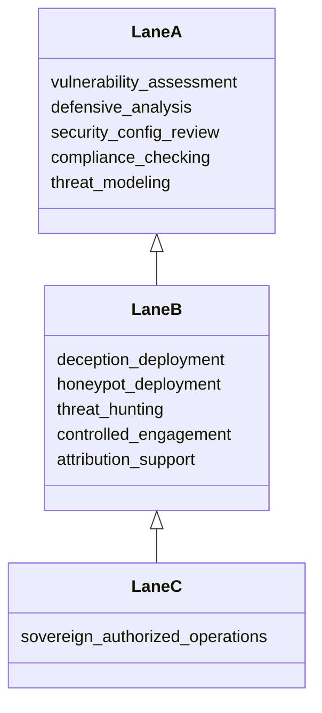

### 4.5 ROEViolation — *Implemented*
The exception raised by the ROE engine when a capability breaches policy. It is the fail-closed signal that halts an operation and triggers an audit record.

### 4.6 Capability — *Implemented*
A named unit of requested action (for example `vulnerability_assessment`). Capabilities are the vocabulary the ROE engine reasons over. See `06-roe-engine.md`.

### 4.7 Active-defence keyword — *Implemented*
A substring used by `LanePolicy._is_active_defense_operation` to route an operation toward Lane B: `deception`, `honeypot`, `honeytoken`, `threat_hunting`, `controlled_engagement`, `attribution`. The Foundation implementation is deliberately simple keyword matching; richer classification is **specified** for production.

### 4.8 Written-authorisation validation — *Implemented*
`LanePolicy._validate_written_authorization` checks that an authorisation reference is at least ten characters and begins with an approved prefix (`AUTH-`, `WRITTEN-AUTH-`, `CONTRACT-`, `SOW-`). It is a format check; verification against an authorisation database is **specified** for production.

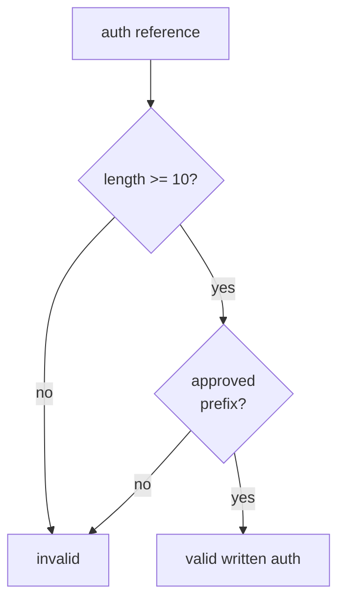

---

## 5. Human-gate terms

The **human gate** interposes required human authorisation at decision points, making the human the decision authority for sensitive operations.

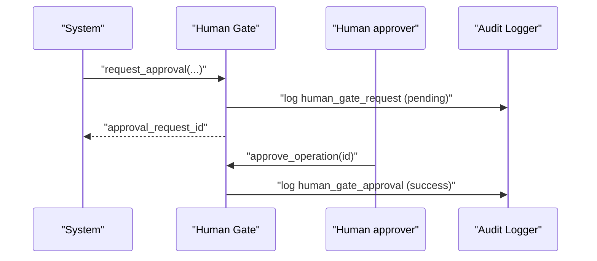

### 5.1 Human gate — *Implemented (not yet unit-tested)*
`orchestrator/human_gate/human_gate.py`. Tracks approval requests and their lifecycle. Foundation-phase approval state is held **in memory** in `_pending_approvals`; persistent storage is **specified** for production.

### 5.2 Human-approval requirement — *Implemented*
The rule, in `requires_human_approval`, determining when a gate is mandatory. Lane A requires approval only for sensitive operations (`live_vulnerability_scan`, `configuration_change`, `access_customer_data`). Lane B requires approval for **all** active-defence deployments. Lane C requires approval for **every** operation. `UNKNOWN` requires approval (fail closed).

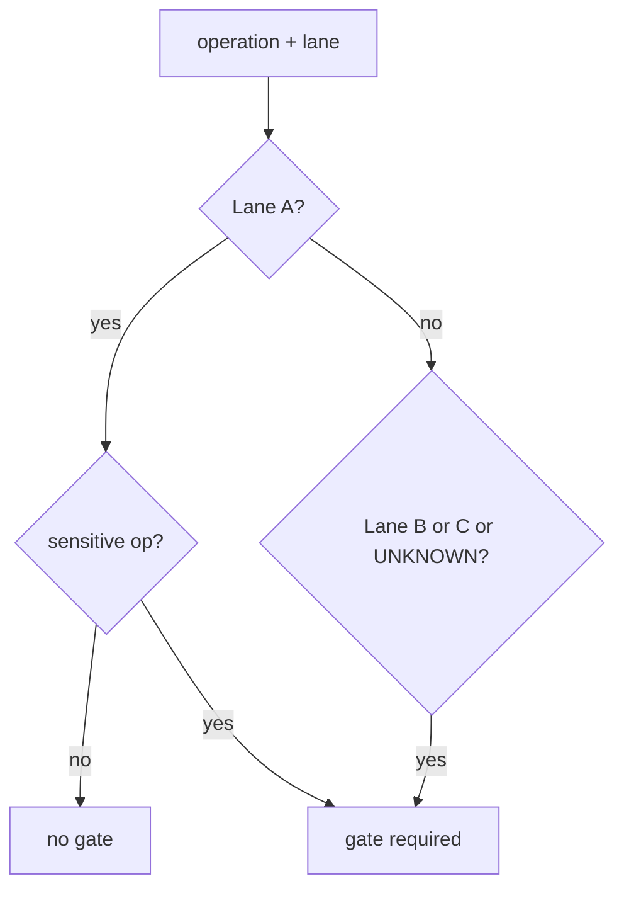

### 5.3 Approval request — *Implemented*
A record created by `request_approval`, identified by a UUID (`approval_request_id`), carrying lane, operation type and description, authorisation reference, requestor, and status. Logged as a `human_gate_request` with result `pending`.

### 5.4 Approval status — *Implemented*
The `ApprovalStatus` enum: `PENDING`, `APPROVED`, `DENIED`, `EXPIRED`. `approve_operation` and `deny_operation` transition a pending request and refuse to re-process a request that is no longer pending.

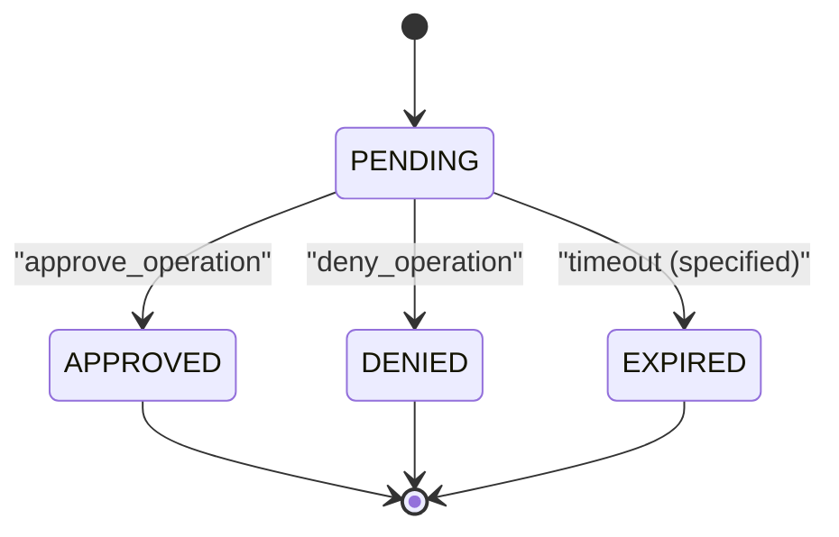

### 5.5 Human-in-the-loop — *Implemented (concept)*
The principle that a human remains the approver for sensitive and sovereign operations, and that autonomous decision-making for destructive action is prohibited. See `07-human-gate.md` and `FOUNDATION.md`.

### 5.6 Approver / requestor — *Implemented*
The two human/system roles in a gate transaction: the **requestor** raises the approval request; the **approver** (actor type `human`) approves or denies it. Both are recorded in the audit trail.

---

## 6. Governance and audit terms

### 6.1 Audit logger — *Implemented*
`governance/audit_logger.py`. Writes an **append-only JSONL** evidence record. Each call to `log_event` validates enums, generates a UUID event id and an ISO-8601 UTC timestamp, and appends one JSON line to a daily file under `governance/logs/`.

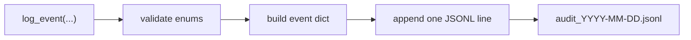

### 6.2 Append-only log — *Implemented*
A log to which events are only ever added, never edited or removed in place. ZP42's log is plain JSONL and append-only; it is **not** cryptographically signed. Any claim of cryptographic tamper-evidence would be false for the current release — signing is **specified**, not implemented (see §9.4).

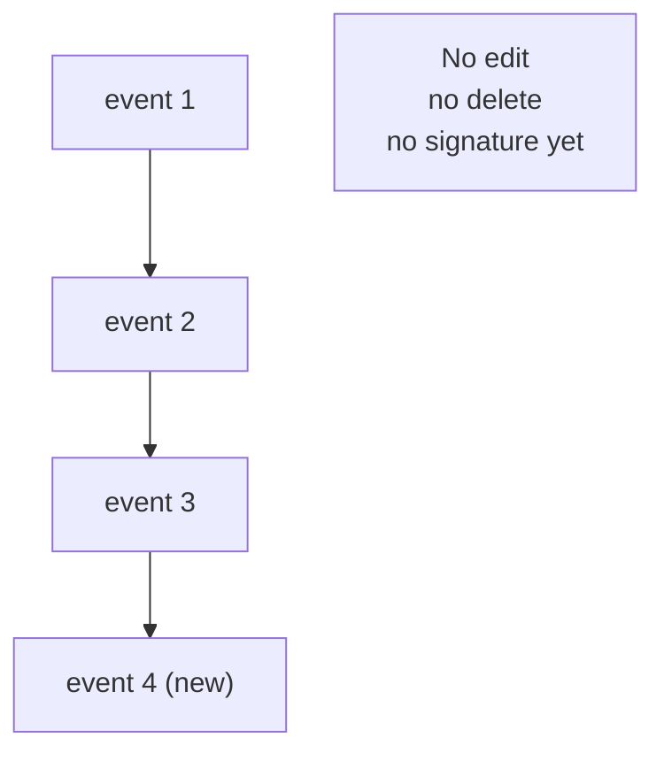

### 6.3 Audit event — *Implemented*
One JSONL record. Required fields: `timestamp`, `event_id`, `operation_type`, `lane`, `actor` (type + identifier), `result`, `escalation_attempt`. Optional: `authorization_reference`, `operation_details`, `failure_reason`, `policy_violations`.

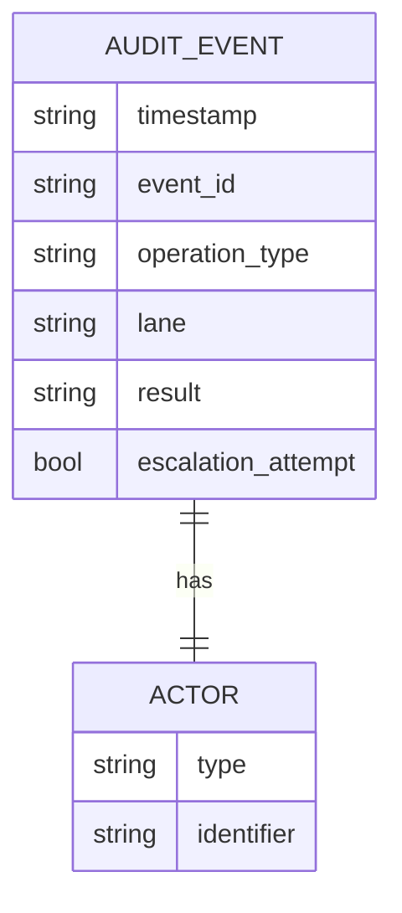

### 6.4 Audit schema — *Implemented (declared)*
`governance/audit_schema.json`. Declares field types, required flags, and enumerations for audit events, plus example events and a **specified** retention policy (minimum 2555 days, encrypted gzip archive, storage location marked `TODO_REQUIRED`). The retention policy is declared, not enforced.

### 6.5 Operation type — *Implemented (enum)*
The validated kind of an event: `lane_assignment`, `authorization_check`, `human_gate_request`, `human_gate_approval`, `human_gate_denial`, `model_reference`, `model_download_attempt`, `inference_request`, `escalation_attempt`, `policy_violation`, `roe_check`, `capability_request`, `operation_start`, `operation_complete`, `operation_failed`. An invalid value raises `ValueError`.

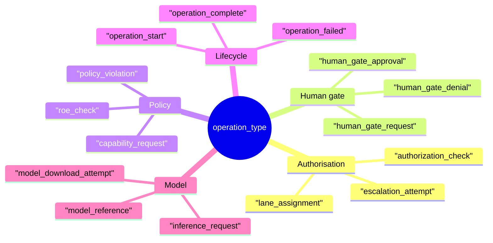

### 6.6 Actor — *Implemented*
The entity that initiated an operation, recorded as `{type, identifier}`. `type` is one of `system`, `human`, `api`. Human-gate approvals/denials carry actor type `human`; policy engines carry `system`.

### 6.7 Result — *Implemented (enum)*
The outcome of an event: `success`, `failure`, `denied`, or `pending`. Denials and failures carry a `failure_reason`.

### 6.8 Escalation-attempt flag — *Implemented*
A boolean on an event marking that an operation tried to widen its lane without authorisation. Set true by `validate_escalation_attempt` on denial.

### 6.9 Policy violation (field) — *Implemented*
An optional list on an event naming the policies breached (for example `prohibited_capability:hack_back`, `unauthorized_lane_escalation`). Distinct from the `policy_violation` *operation type* in §6.5.

### 6.10 Log query — *Implemented*
`AuditLogger.query_logs` reads the JSONL files and filters by time window, lane, operation type, or actor. It is a simple file scan; a database-backed query path is **specified** for production.

```mermaid
flowchart LR
    Q["query_logs(filters)"] --> G["glob audit_*.jsonl"]
    G --> L["read each line"]
    L --> F{"matches<br/>filters?"}
    F -- "yes" --> R["collect"]
    F -- "no" --> S["skip"]
    R --> OUT["results list"]
```

---

## 7. Compliance terms

### 7.1 Compliance layer — *Specified (declared)*
The `compliance/` directory. It declares machine-readable manifests — the model allowlist and the licence manifest — that express policy. These are **declared**, not yet **enforced in code**: no runtime path currently blocks a disallowed model or licence. Enforcement is **specified** for later phases.

```mermaid
flowchart TD
    C["compliance/"] --> MA["model_allowlist.json"]
    C --> LM["license_manifest.json"]
    MA --> D1["declared, not enforced"]
    LM --> D2["declared, not enforced"]
```

### 7.2 Model allowlist — *Specified (declared)*
`compliance/model_allowlist.json`. Names the three approved models, their organisations, origin country, licence, and permitted use cases, plus a fail-closed enforcement declaration and verification requirements. The allowlist is the authoritative record of which models ZP42 *may* reference; it does not yet gate code.

### 7.3 Approved model — *Specified (declared)*
A model on the allowlist. The three are **AI2 OLMo 3 32B Base**, **AI2 OLMo 3 32B Think** (Allen Institute for AI, Apache-2.0), and **IBM Granite 4.1 30B Base** (IBM, Apache-2.0). Each is restricted to `no_training` and `no_fine_tuning_without_approval`.

```mermaid
classDiagram
    class ApprovedModel {
      +name
      +organization
      +origin_country
      +license
      +use_cases
      +restrictions
    }
    class OLMo3Base
    class OLMo3Think
    class Granite41
    ApprovedModel <|-- OLMo3Base
    ApprovedModel <|-- OLMo3Think
    ApprovedModel <|-- Granite41
```

### 7.4 PRC-origin exclusion policy — *Specified (declared)*
The rule that ZP42 shall not use models, outputs, embeddings, labels, checkpoints, synthetic data, or derivatives originating from PRC-based or PRC-funded organisations. Declared in the allowlist (`excluded_countries`, `excluded_organizations`, `prohibited_model_families`) and in `FOUNDATION.md`. The prohibited families include Qwen, DeepSeek, Kimi, GLM, ChatGLM, MiniMax, ERNIE, and Llama (the last excluded by policy decision). This is a provenance/supply-chain rule, not a code-enforced check in the Foundation phase.

```mermaid
flowchart TD
    M["candidate model"] --> O{"PRC origin or<br/>derivative?"}
    O -- "yes" --> X["excluded (declared)"]
    O -- "no" --> A{"on allowlist?"}
    A -- "no" --> F["fail closed (specified)"]
    A -- "yes" --> OK["referenceable"]
```

### 7.5 Licence manifest — *Specified (declared)*
`compliance/license_manifest.json`. Records the project licence (MIT, owner Naquib Hatami), approved dependency licences (MIT, Apache-2.0, BSD-3/2-Clause, ISC), review-required licences (MPL-2.0, EPL-2.0, LGPL-3.0), and prohibited licences (GPL-3.0/2.0, AGPL-3.0, SSPL).

```mermaid
flowchart LR
    subgraph OK["Approved"]
        L1["MIT"]
        L2["Apache-2.0"]
        L3["BSD / ISC"]
    end
    subgraph REV["Review required"]
        R1["MPL-2.0"]
        R2["LGPL-3.0"]
    end
    subgraph NO["Prohibited"]
        N1["GPL"]
        N2["AGPL / SSPL"]
    end
```

### 7.6 Fail-closed enforcement (compliance) — *Specified*
The declared response to compliance uncertainty: `unknown_model → fail_closed`, `prohibited_model → fail_closed_and_alert`, `unverifiable_origin → fail_closed`. Declared in the allowlist; not yet wired into an execution path.

### 7.7 MIT Licence — *Implemented*
The open-source licence under which ZP42 is released by Naquib Hatami. See `../LICENSE`. It permits use, modification, and distribution subject to preserving the copyright and permission notice.

---

## 8. Prohibited-terms scanner terms

### 8.1 Prohibited-terms scanner — *Implemented*
`scripts/scan_prohibited_terms.py`. Guards against disallowed terms at the boundary (for example before commit). It scans text files for four categories of forbidden term and exits non-zero if any are found.

```mermaid
flowchart TD
    S["scan(root)"] --> I["iter scannable files"]
    I --> C["scan each line, lowercased"]
    C --> M{"term in any<br/>category?"}
    M -- "yes" --> V["record violation"]
    M -- "no" --> N["continue"]
    V --> R["report + exit 1"]
    N --> Z["exit 0 if clean"]
```

### 8.2 Prohibited-term category — *Implemented*
One of four sets the scanner checks: **internal names** (redacted placeholders), **third-party AI/tool names**, **PRC-origin model names**, and **reckless public terms** (hack-back, retaliation, punishment, revenge, private offensive action, unauthorised access, and similar). The categories enforce the approved public positioning described in `FOUNDATION.md`.

```mermaid
mindmap
  root(("Prohibited<br/>terms"))
    "Internal names"
      "redacted placeholders"
    "Third-party AI"
      "tool/model names"
    "PRC models"
      "excluded families"
    "Reckless public"
      "hack-back"
      "retaliation"
      "revenge"
```

### 8.3 Scannable extension — *Implemented*
A file type the scanner inspects: `.py`, `.md`, `.txt`, `.json`, `.yaml`, `.yml`, `.toml`, `.sh`, `.rst`. Other types are skipped.

### 8.4 Skip directory — *Implemented*
A directory the scanner ignores, such as `__pycache__`, `.git`, caches, `node_modules`, and virtual-environment folders.

### 8.5 Violation report — *Implemented*
The scanner output, available as human-readable text or JSON (`report_json`), listing each file, line, term, and category, with a pass/fail status and count.

### 8.6 Boundary guard — *Implemented (concept)*
The general role of the scanner: a check at the edge of the repository that keeps disallowed language out of published materials. Conceptually it is the public-positioning complement to the ROE engine's capability guard.

```mermaid
flowchart LR
    DEV["author change"] --> SCAN["prohibited-terms scan"]
    SCAN -- "clean" --> COMMIT["commit allowed"]
    SCAN -- "violation" --> BLOCK["blocked, fix required"]
```

---

## 9. Honest-status terms

These entries exist specifically to prevent overstatement. The Foundation release is a **scaffold**: the governance modules are real as independent components — four of them unit-tested (lane policy, audit logger, prohibited-terms scanner, capture_manifest), the ROE engine and human gate not yet — but the end-to-end pipeline that chains them is not yet built.

```mermaid
flowchart LR
    subgraph Implemented
        LP["lane_policy"]
        RE["roe_engine"]
        HG["human_gate"]
        AL["audit_logger"]
        SC["scan_prohibited_terms"]
    end
    subgraph Specified
        OR["orchestrator wiring"]
        VF["output verifier"]
        SG["log signing"]
        CE["compliance enforcement"]
    end
    Implemented -. "not yet joined" .-> Specified
```

### 9.1 Out of scope (Foundation) — *Out of scope*
Capabilities explicitly excluded from the Foundation phase: model training, weight downloads, **inference execution**, cloud provisioning, telemetry, **offensive/exploit code**, and **live targeting** of third-party systems. `ControlledEval.run_evaluation` enforces this by raising `NotImplementedError` when `dry_run=False`.

```mermaid
flowchart TD
    subgraph OOS["Out of scope"]
        T["training"]
        W["weight downloads"]
        INF["inference"]
        OFF["offensive code"]
        LT["live targeting"]
    end
    N["Foundation phase<br/>excludes all of these"]
```

### 9.2 Scaffold — *Scaffold*
A module that establishes structure without full behaviour. `orchestrator/__init__.py` is an empty scaffold: the orchestrator that would wire **lane → ROE → human gate → verify → audit** into a single flow is **not yet implemented**. The components it would call are real; the wiring is not.

```mermaid
flowchart LR
    L["lane"] -.-> R["ROE"]
    R -.-> H["human gate"]
    H -.-> V["verify"]
    V -.-> A["audit"]
    note["dashed = specified, not wired"]
```

### 9.3 Verifier (verifiers/) — *Scaffold*
A **defined stage** for output validation, represented by `verifiers/__init__.py` (currently empty). It is a named place in the architecture, not a completed output verifier. Any description of ZP42 verification should present it as specified.

### 9.4 Unsigned audit log — *Implemented (honest caveat)*
A statement of fact: the audit log is plain JSONL and is **not cryptographically signed**. It is append-only by convention and code path, not by cryptographic tamper-evidence. Signing is **specified** (see the retention policy in §6.4) but absent from the current release.

### 9.5 Declared-not-enforced — *Specified*
A status describing the compliance manifests: the model allowlist and licence manifest are machine-readable **declarations** of policy that are **not yet enforced** by executable gates. Reading this glossary, treat "the allowlist forbids X" as a declared rule, not a runtime block.

### 9.6 Independent component — *Implemented*
A module that is implemented in isolation, as distinct from an integrated pipeline. Four such modules carry dedicated unit-test suites (lane policy, audit logger, prohibited-terms scanner, capture_manifest); the ROE engine and human gate are implemented but not yet unit-tested. ZP42's honesty rule is to describe the architecture "as specified" while clearly marking which components are independently real and which integration is still pending.

```mermaid
flowchart TD
    subgraph Real["Tested independently"]
        A["lane_policy"]
        D["audit_logger"]
        E["scan_prohibited_terms"]
    end
    subgraph RealNT["Implemented, not yet unit-tested"]
        B["roe_engine"]
        C["human_gate"]
    end
    Real --> T["unit tests under tests/"]
```

---

## 10. Core-module terms

### 10.1 Controlled evaluation — *Scaffold*
`core/eval/run_controlled_eval.py`. A skeleton for running controlled evaluations on cyber-reasoning benchmarks. Foundation phase runs **dry-run only**: it loads a benchmark, validates structure, and checks task safety. It performs **no inference**.

```mermaid
sequenceDiagram
    participant U as "Caller"
    participant CE as "ControlledEval"
    participant AL as "Audit Logger"
    U->>CE: "load_benchmark()"
    CE->>AL: "log operation_start"
    U->>CE: "run_evaluation(dry_run=True)"
    CE->>CE: "validate_task_safety per task"
    CE->>AL: "log operation_complete"
    CE-->>U: "dry-run results"
```

### 10.2 Dry-run mode — *Implemented*
The only permitted evaluation mode in the Foundation phase. `run_evaluation(dry_run=False)` raises `NotImplementedError`. Dry-run validates benchmark structure and per-task safety without executing a model.

### 10.3 Task safety validation — *Implemented*
`validate_task_safety` rejects a benchmark task whose serialised text contains a prohibited keyword (exploit, malware, credential_theft, ddos, exfiltration, persistence, evasion, destructive). Foundation benchmarks must contain only safe placeholder tasks.

```mermaid
flowchart TD
    TK["task JSON"] --> S["lowercase serialise"]
    S --> K{"prohibited<br/>keyword?"}
    K -- "yes" --> E["ValueError: unsafe"]
    K -- "no" --> OK["task safe"]
```

### 10.4 Benchmark — *Specified*
A JSON file with `benchmark_name` and a `tasks` list, loaded by `ControlledEval.load_benchmark`. The `benchmarks/` directory holds safe evaluation benchmarks. Benchmark *execution* against a model is out of scope for the Foundation phase.

### 10.5 Snapshot manifest — *Implemented*
`core/snapshot/capture_manifest.py`. Captures SHA-256 checksums and sizes for local files and directories to support reproducibility and verification. Foundation phase does **local file hashing only**; model-weight manifest capture is a stub (`capture_model_manifest_stub` returns `status: not_implemented`).

```mermaid
flowchart LR
    D["directory"] --> H["hash each file (sha256)"]
    H --> M["manifest {files: {sha256, size}}"]
    M --> V["verify_manifest later"]
    V --> C{"hashes match?"}
    C -- "no" --> FAIL["status failed"]
    C -- "yes" --> PASS["status verified"]
```

### 10.6 Manifest verification — *Implemented*
`verify_manifest` recomputes hashes and reports `mismatches`, `missing_files`, and `extra_files`, setting status to `failed` on any discrepancy. It underpins integrity checking of captured artefacts.

### 10.7 Model-manifest stub — *Scaffold*
`capture_model_manifest_stub` — a metadata-only placeholder that does not download weights. It marks the boundary between the implemented local hashing and the specified future model-provenance capture.

---

## 11. Relationships at a glance

The glossary terms compose into one governance flow. The following diagram shows the **specified** end-to-end path; recall that the orchestrator wiring itself is a scaffold (§9.2), while each box names a real, independently tested component.

```mermaid
flowchart TD
    REQ["Operation request"] --> LP["Lane Policy<br/>assign_lane"]
    LP -->|"UNKNOWN"| DENY1["Deny + audit"]
    LP -->|"A / B / C"| RE["ROE Engine<br/>check_roe"]
    RE -->|"ROEViolation"| DENY2["Deny + audit"]
    RE -->|"permitted"| HG["Human Gate<br/>requires_human_approval"]
    HG -->|"gate + denied"| DENY3["Deny + audit"]
    HG -->|"approved or no gate"| VF["Verifier stage<br/>(specified)"]
    VF --> AUD["Audit Logger<br/>append-only JSONL"]
    AUD --> DONE["Evidence recorded"]
```

A second view groups the terms by the directory that owns them.

```mermaid
flowchart LR
    subgraph core["core/"]
        CE["controlled eval"]
        SM["snapshot manifest"]
    end
    subgraph orch["orchestrator/"]
        LP["lane policy"]
        RE["roe engine"]
        HG["human gate"]
    end
    subgraph gov["governance/"]
        AL["audit logger"]
        AS["audit schema"]
    end
    subgraph comp["compliance/"]
        MA["model allowlist"]
        LM["licence manifest"]
    end
    subgraph scripts["scripts/"]
        SC["prohibited-terms scanner"]
    end
    orch --> gov
    core --> gov
```

Finally, the authorisation strength of the three active lanes and the fail-closed floor:

```mermaid
flowchart TD
    UNK["UNKNOWN<br/>deny everything"] --> A["Lane A<br/>owner-authorised defensive"]
    A --> B["Lane B<br/>written-authorised active-defence"]
    B --> C["Lane C<br/>sovereign auth + human signoff"]
    C --> GL["Global prohibitions still apply"]
```

---

## 12. Cross-reference index

Each term above belongs to a home document that treats it in depth:

| Term group | Home document |
|------------|---------------|
| Identity, status, licence | `FOUNDATION.md`, `00-vision.md` |
| Lane model | `05-lane-model.md` |
| ROE | `06-roe-engine.md` |
| Human gate | `07-human-gate.md` |
| Audit / governance | `08-governance-audit.md` |
| Compliance / allowlists | `09-compliance-allowlists.md` |
| Safety boundaries | `11-safety-boundaries.md` |
| Architecture & design | `03-architecture.md`, `04-detailed-design.md` |

---

## Related documents

- `../README.md` — project overview and quick-start.
- `FOUNDATION.md` — authoritative charter, model policy, and safety boundaries.
- `05-lane-model.md` — full treatment of Lanes A, B, C, and UNKNOWN.
- `06-roe-engine.md` — rules-of-engagement design and capability sets.
- `08-governance-audit.md` — audit logger, schema, and retention.
- `09-compliance-allowlists.md` — model allowlist and licence manifest.

*ZP42 (Zeroth Protocol 42) — invented and authored by Naquib Hatami. Open source under the MIT Licence. Defensive, active-defence, and sovereign-authorised cyber reasoning, gated by authorisation.*
