# ZP42 Frequently Asked Questions

> Part of the ZP42 documentation set.

**Abstract.** This document answers the questions most often raised about ZP42 (Zeroth Protocol 42), the open, MIT-licensed, governance-first cyber-reasoning system created by Naquib Hatami and published by SADI AI Inc. / iQs Group Inc. It is written to be *honest first*: it states plainly what is implemented today, what is only specified, and where the hard boundaries lie. ZP42 is built for defensive, active-defence, and sovereign-authorised workflows, and its central design claim is modest and verifiable — capability is gated by authorisation, and governance is wired in from the first commit rather than bolted on later. Wherever an answer could be read as over-claiming, this FAQ marks the status explicitly. The present release is a **Foundation-phase scaffold**: the governance primitives exist and are tested as independent components, but the end-to-end orchestration pipeline is not yet fully wired. Nothing here should be read as a claim of cryptographic signing, enforced compliance, or offensive capability — none of those exist in this release, and two of them are deliberately out of scope.

---

## 1. What is ZP42, in one honest paragraph?

ZP42 is a scaffold for a **governed cyber-reasoning system**. It is not a scanner, an exploit framework, or an autonomous agent. It is a set of policy primitives — lane assignment, a rules-of-engagement (ROE) engine, a human authorisation gate, an append-only audit logger, and a prohibited-terms boundary scanner — together with a declared architecture that describes how those primitives are intended to compose into a controlled evaluation and reasoning pipeline. The primitives are real, implemented Python with tests. The composition is specified but not yet fully built. The guiding idea is that reasoning capability in a security context is dangerous precisely when it is ungoverned, so ZP42 puts the governance layer first and treats reasoning as something that must pass through authorisation checks before it ever runs.

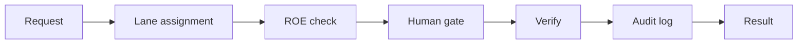

The diagram above shows the *specified* flow. Read section 4 for exactly which boxes are implemented today and which are not.

The reason the architecture is ordered this way matters. In most security tooling, capability is written first and controls are retrofitted; the result is that the "off switch" is a layer wrapped around a system that already knows how to act. ZP42 inverts that: authorisation is the gate every request must pass, and reasoning capability is deliberately the last thing to be added, so there is never a privileged path that bypasses the lane, ROE, gate, and audit checks. That ordering is the whole design intent. It is also why a Foundation-phase scaffold with no inference is a coherent artifact rather than an unfinished one — the governance skeleton is the part that has to be correct first, and it is the part that exists today.

---

## 2. Who made ZP42, and under what licence?

ZP42 was invented and authored by **Naquib Hatami**. It is released as open-source software under the **MIT License**. The publisher is **SADI AI Inc. / iQs Group Inc.**, the canonical repository is `github.com/iQs-Group/zp-42`, and the project site is `zp42.org`.

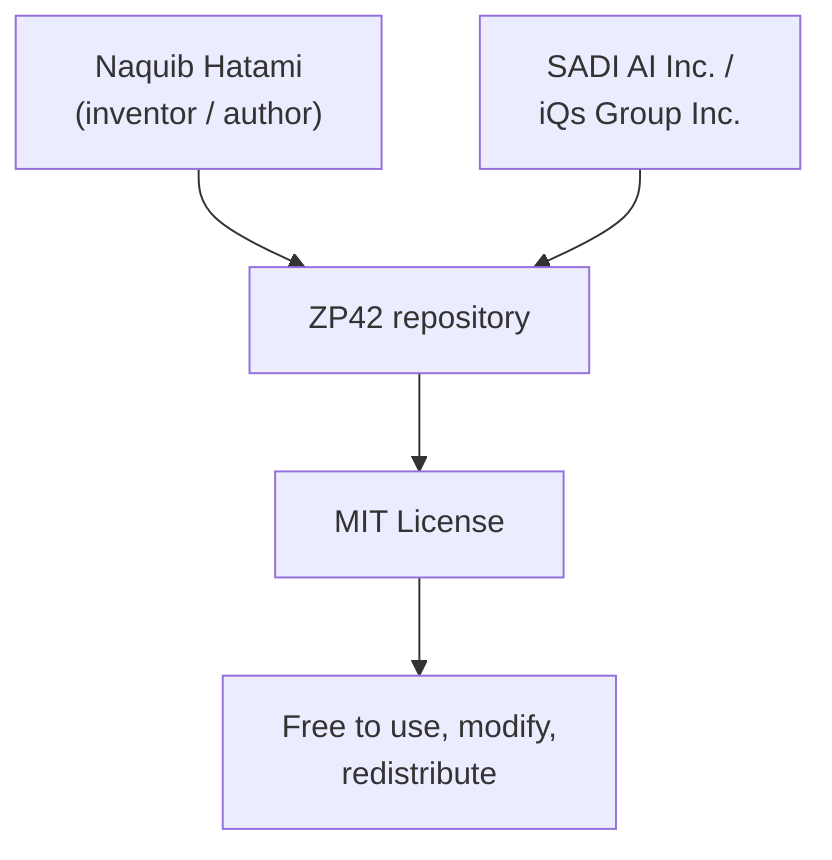

MIT is a permissive licence: you may use, copy, modify, publish, distribute, and sell copies, subject to preserving the copyright and permission notice. Being open does not dilute the governance model — the lane and ROE boundaries are code and policy inside the project, not licence terms. A downstream user is free to fork and remove those boundaries, which the MIT licence permits; what they cannot do is remove them and still call the result ZP42 operated as intended, because the boundaries *are* the system. Openness and governance are not in tension here. The project's position is that a governance-first security scaffold is most trustworthy when it is fully inspectable: anyone can read exactly what the lane policy accepts, what the ROE engine refuses, and what the audit logger records, and can verify those claims against the tests rather than taking them on faith. See `../LICENSE` for the exact text.

---

## 3. Is this an offensive or a "hack-back" tool?

No. ZP42 is a **defensive and active-defence** system, and offensive execution is explicitly out of scope for the Foundation phase. The project vocabulary deliberately excludes "hack-back", "retaliation", "punishment", and "private offensive action" — the prohibited-terms scanner (`scripts/scan_prohibited_terms.py`) fails the build if those phrases appear in repository files.

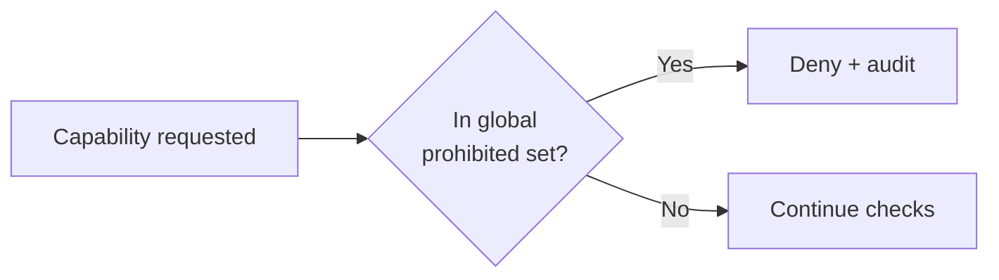

The ROE engine maintains a set of **globally prohibited capabilities** that no lane — not even the most privileged — may perform:

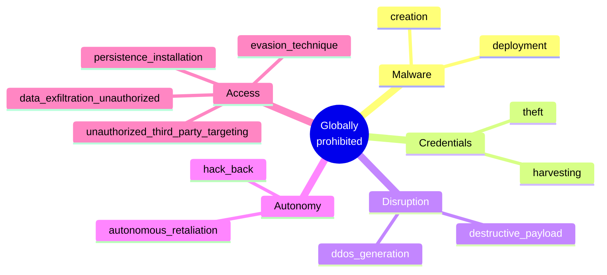

These are enforced in `orchestrator/roe/roe_engine.py` as `GLOBALLY_PROHIBITED_CAPABILITIES`. The point of ZP42 is not that it *can* do these things under the right flag; it is that these capabilities are absent and that the request path refuses them structurally.

---

## 4. What is actually implemented versus merely specified?

This is the most important question in the FAQ, and the answer is deliberately blunt. ZP42 is a **Foundation-phase scaffold**. The table below is authoritative over any aspirational language elsewhere.

| Component | Path | Status |
|-----------|------|--------|
| Lane policy engine | `orchestrator/lanes/lane_policy.py` | Implemented, tested (independent) |
| ROE engine | `orchestrator/roe/roe_engine.py` | Implemented (not yet unit-tested) |
| Human gate | `orchestrator/human_gate/human_gate.py` | Implemented (not yet unit-tested) |
| Audit logger | `governance/audit_logger.py` | Implemented, tested (plain JSONL) |
| Prohibited-terms scanner | `scripts/scan_prohibited_terms.py` | Implemented, tested |
| Controlled eval framework | `core/eval/run_controlled_eval.py` | Skeleton; dry-run only, no inference |
| Orchestrator pipeline | `orchestrator/__init__.py` | Scaffold (empty); not wired end-to-end |
| Verifiers stage | `verifiers/` | Defined stage, not a completed verifier |
| Model allowlist | `compliance/model_allowlist.json` | Declared manifest; not enforced in code |
| Licence manifest | `compliance/license_manifest.json` | Declared manifest; not enforced in code |
| Audit log signing | — | Not implemented (plain JSONL, unsigned) |

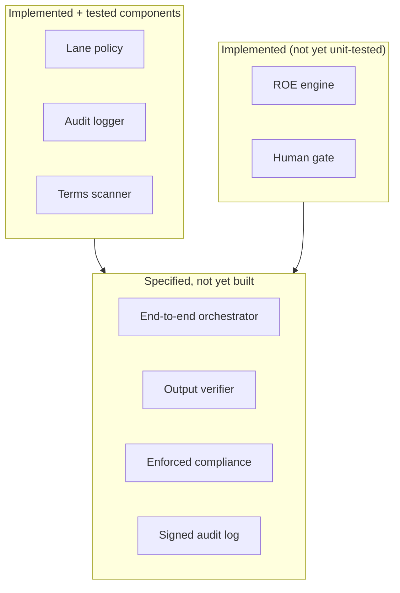

The honest reading: the **parts** work and are tested; the **whole** is not yet assembled. When this document describes the architecture, treat it as "the system as specified" unless the status table marks a component as implemented.

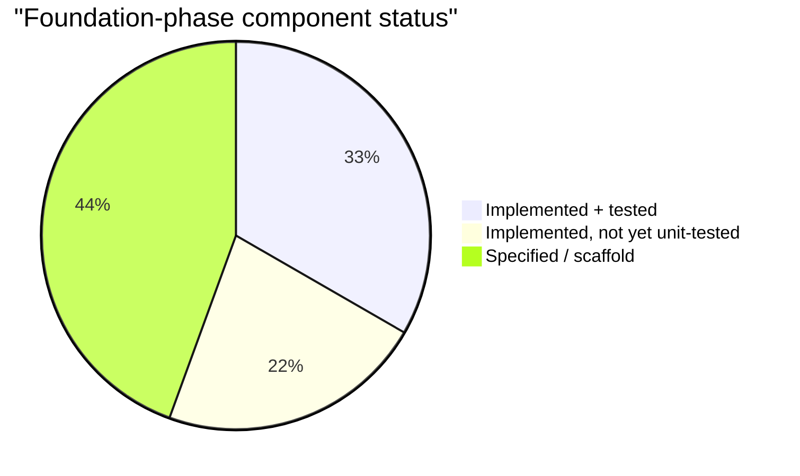

---

## 5. How does the lane model work?

Lanes encode *how much authorisation* an operation requires. A lane is entered deliberately — it is not a default that silently widens. The implemented model in `lane_policy.py` has three active lanes plus a fail-closed UNKNOWN state.

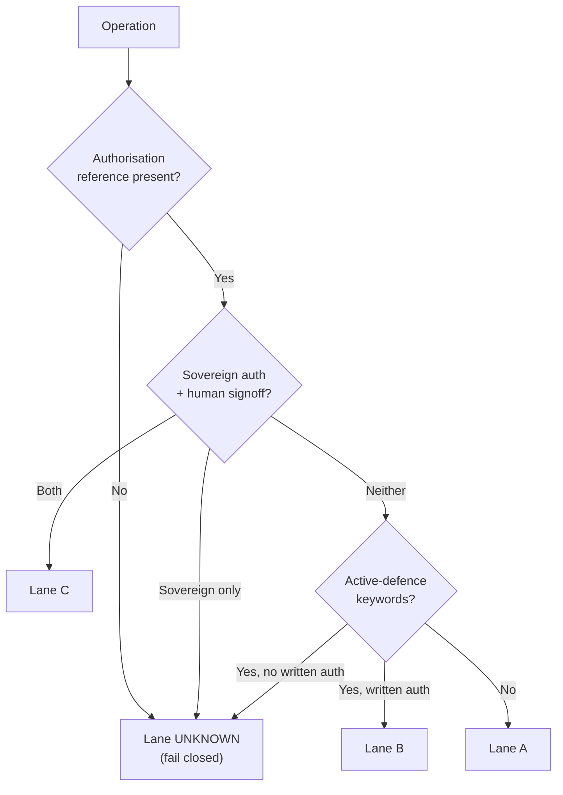

| Lane | Intent | Authorisation required |
|------|--------|------------------------|
| A | Defensive work | Customer / system authorisation reference |
| B | Active-defence work | Explicit **written** authorisation document |
| C | Sovereign-authorised work | Sovereign authorisation **and** human signoff |
| UNKNOWN | Unassigned | None satisfied → fail closed |

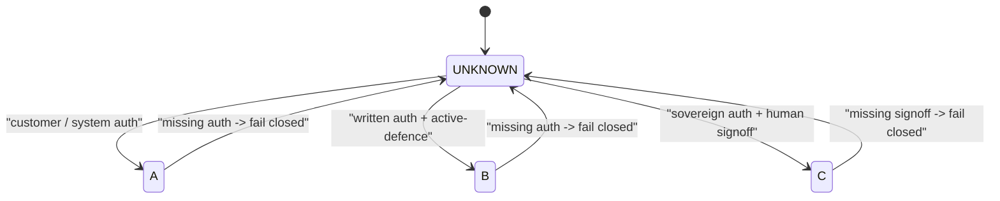

Written authorisation for Lane B is format-checked in the Foundation phase: the reference must be at least ten characters and begin with a recognised prefix such as `AUTH-`, `WRITTEN-AUTH-`, `CONTRACT-`, or `SOW-`.

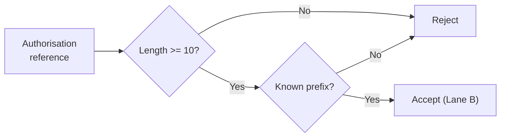

This is intentionally a *format* check, not a database verification. Production is expected to verify the reference against an authorisation store; the Foundation phase does not. The distinction is important for anyone evaluating ZP42: a well-formed reference string is accepted as structurally valid, but that acceptance says nothing about whether a real, countersigned authorisation document exists behind it. Treat the current check as a syntactic guard that keeps obviously malformed requests out, not as proof of legal or contractual authority. The active-defence classifier is likewise deliberately simple — it matches keywords such as `deception`, `honeypot`, `honeytoken`, `threat_hunting`, `controlled_engagement`, and `attribution` in the operation description. Keyword matching is a transparent, auditable starting point; the code comments mark it explicitly as something a production system should replace with a more sophisticated classifier. Calling it out here is part of the honesty contract: the behaviour is correct for what it claims to be and no more. See `05-lane-model.md` for the full specification.

---

## 6. What does "fail closed" mean here?

Fail-closed means that when the system cannot establish that an operation is authorised, it refuses rather than proceeds. Uncertainty resolves to *no*, not to *yes*.

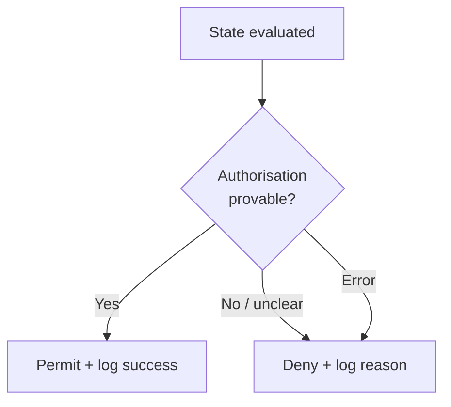

Three concrete fail-closed behaviours are implemented:

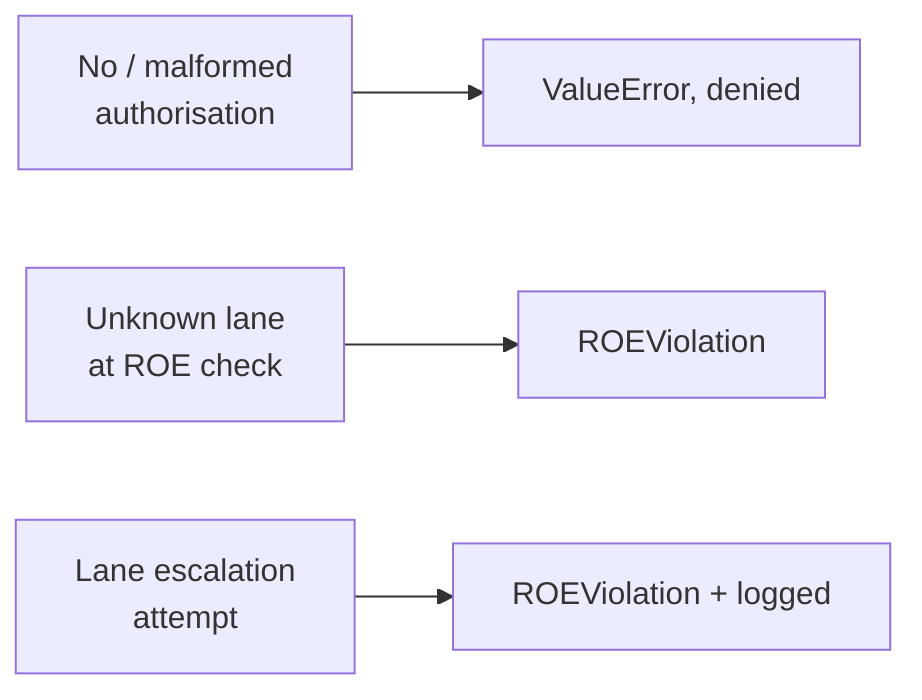

Escalation is especially strict. In the Foundation phase, **every** attempt to move from one lane to a different lane is denied and recorded.

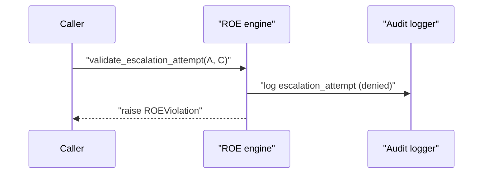

Only a no-op escalation (current lane equals requested lane) returns success. Any genuine widening is refused; authorised escalation paths are a future-phase concern, not a present capability.

---

## 7. How does the ROE engine decide what is allowed?

The ROE engine checks a requested capability against three layers: the global prohibition set, lane-specific prohibitions, and the permitted-capability list for the lane.

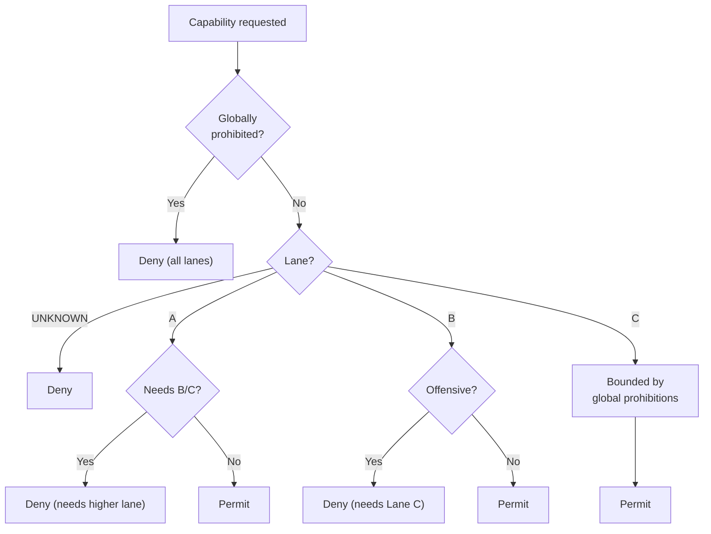

Lane A, for example, refuses capabilities that belong to active defence, such as `live_exploitation`, `deception_deployment`, `honeypot_deployment`, and `active_engagement` — those require Lane B or C.

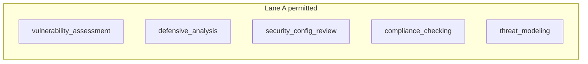

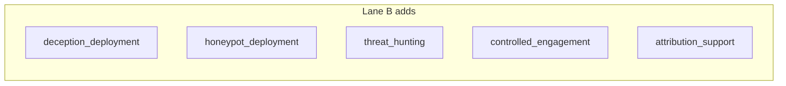

Even Lane C, the most privileged, is still bounded by the global prohibitions — there is no flag anywhere that re-enables malware, credential theft, DDoS, or hack-back.

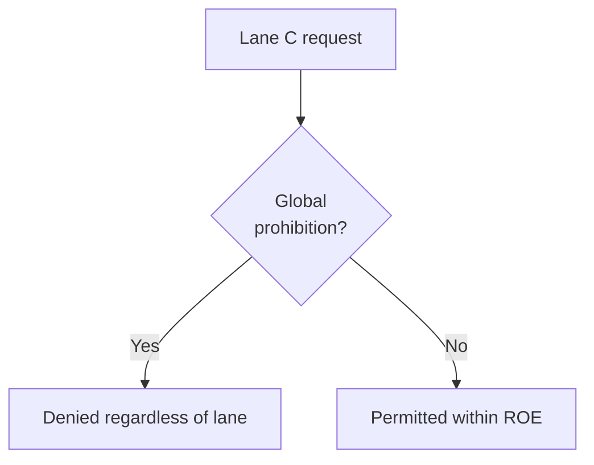

A denied check does not fail silently. It raises `ROEViolation` and writes an audit record first, so the refusal is evidenced.

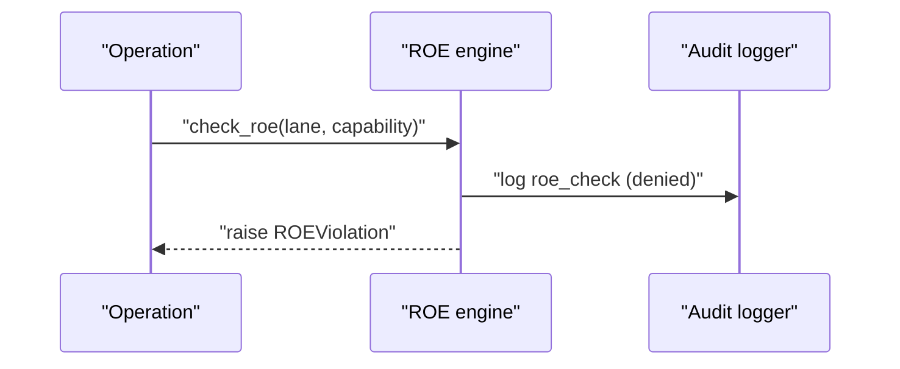

See `06-roe-engine.md` for the complete capability matrix.

---

## 8. Where does the human stay in the loop?

The human gate interposes required human authorisation at decision points. Whether a gate is required depends on the lane and the operation type.

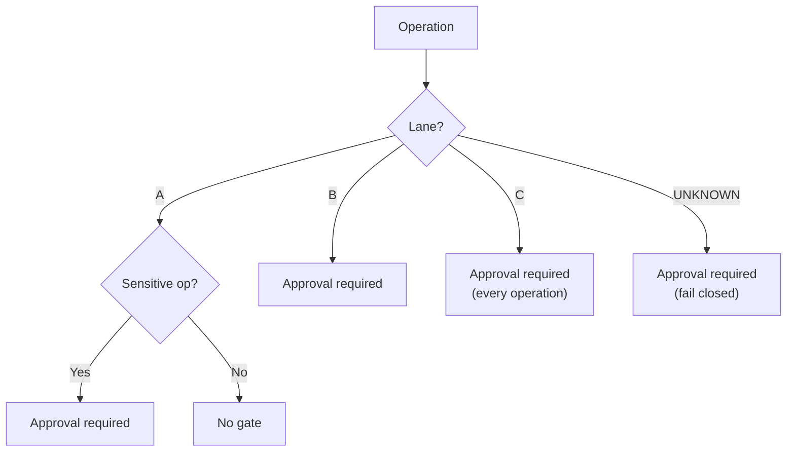

For Lane A, routine defensive work proceeds without a gate, but sensitive operations — `live_vulnerability_scan`, `configuration_change`, `access_customer_data` — still require approval. Lanes B and C always require a human.

The request lifecycle is a simple state machine tracked in memory in the Foundation phase:

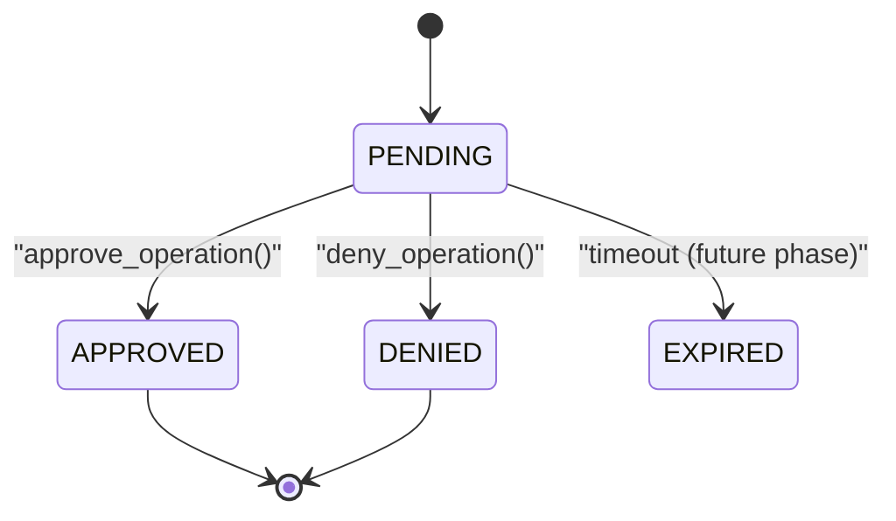

Each request carries a unique identifier and is logged at request, approval, and denial.

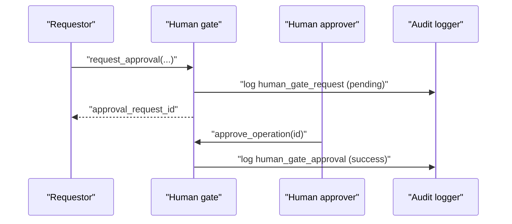

A caveat marked honestly: approval tracking is **in-memory** (`self._pending_approvals`). It does not survive a process restart, and an already-processed request cannot be re-approved or re-denied — a second call raises `ValueError`, which prevents an approval from being quietly overwritten. The design keeps the human decision and the machine action as separate, logged events, so that an operation can never claim human approval it did not receive: the gate issues an identifier, the human acts against that identifier, and both the request and its resolution are written to the audit trail. Persistent approval storage, expiry handling for the `EXPIRED` state shown above, and multi-approver workflows are future-phase items. See `07-human-gate.md`.

---

## 9. How is the audit trail recorded, and is it signed?

Every governance primitive writes to a shared append-only audit logger. Records are JSON objects, one per line, in daily JSONL files.

```mermaid
flowchart LR
    LP["Lane policy"] --> AL["Audit logger"]
    ROE["ROE engine"] --> AL
    HG["Human gate"] --> AL
    EV["Controlled eval"] --> AL
    AL --> F["audit_YYYY-MM-DD.jsonl<br/>(append-only)"]
```

Each event is validated against closed enumerations before it is written — operation type, lane, actor type, and result must all be recognised values, or the write raises `ValueError`.

```mermaid
flowchart TD
    E["Event"] --> OT{"Valid<br/>operation_type?"}
    OT -->|"No"| ERR["ValueError"]
    OT -->|"Yes"| LN{"Valid lane?"}
    LN -->|"No"| ERR
    LN -->|"Yes"| AC{"Valid actor_type?"}
    AC -->|"No"| ERR
    AC -->|"Yes"| RS{"Valid result?"}
    RS -->|"No"| ERR
    RS -->|"Yes"| WRITE["Append line"]
```

A record carries a timestamp (ISO 8601 UTC), a UUID event id, the operation type, lane, actor, result, and optional fields such as authorisation reference, failure reason, and policy violations.

```mermaid
classDiagram
    class AuditEvent {
        +string timestamp
        +string event_id
        +string operation_type
        +string lane
        +object actor
        +string result
        +bool escalation_attempt
        +string authorization_reference
        +object operation_details
        +string failure_reason
        +list policy_violations
    }
```

**Is it signed? No.** The log is plain JSONL. "Append-only" here describes how the code writes (it opens the file in append mode and never rewrites earlier lines); it is *not* a cryptographic integrity guarantee. There is no hash chain, no signature, and no tamper-evidence in this release. Anyone who can write the file can alter it. Cryptographic signing is a specified future concern, not a present property — do not represent ZP42 as producing a signed or tamper-proof audit log.

```mermaid
flowchart LR
    W["Writer appends line"] --> FILE["JSONL file"]
    FILE --> Q["query_logs() reads + filters"]
    Q --> R["Matching events"]
```

See `08-governance-audit.md` for the full schema and `governance/audit_schema.json` for the machine-readable version.

---

## 10. Which models does ZP42 use, and is the allowlist enforced?

ZP42 declares an allowlist of approved models in `compliance/model_allowlist.json`. All three are US-origin and Apache-2.0 licensed.

| Model | Organisation | Licence |
|-------|-------------|---------|
| OLMo 3 32B Base | Allen Institute for AI | Apache-2.0 |
| OLMo 3 32B Think | Allen Institute for AI | Apache-2.0 |
| Granite 4.1 30B Base | IBM | Apache-2.0 |

```mermaid
flowchart TD
    ML["model_allowlist.json"] --> OK["Approved:<br/>OLMo 3 Base / Think,<br/>Granite 4.1"]
    ML --> EX["Excluded origins<br/>(PRC-origin policy)"]
```

The allowlist also declares a PRC-origin exclusion policy, and the prohibited-terms scanner enforces the *naming* side of that policy at the repository boundary.

```mermaid
flowchart LR
    FILE["Repo file"] --> SCAN["scan_prohibited_terms.py"]
    SCAN --> T1["Third-party AI names"]
    SCAN --> T2["PRC model names"]
    SCAN --> T3["Reckless public terms"]
    SCAN --> T4["Internal codenames"]
    T1 & T2 & T3 & T4 --> V{"Any match?"}
    V -->|"Yes"| FAILX["Exit 1 (block commit)"]
    V -->|"No"| PASS["Exit 0"]
```

**Is the allowlist enforced in code? Not yet.** The manifest is machine-readable and declares `fail_closed` enforcement intent, but there is no runtime loader in the Foundation phase that checks a requested model against the allowlist before use — because there is no inference in the Foundation phase to check. The scanner enforces that prohibited *names* do not enter the repository; it does not enforce model loading. Enforced compliance is specified, not built.

```mermaid
flowchart TD
    DECL["Declared:<br/>allowlist + licence manifest"] -.->|"future phase"| ENF["Enforced:<br/>runtime loader + gate"]
    style ENF stroke-dasharray: 5 5
```

See `09-compliance-allowlists.md`.

---

## 11. Can ZP42 run inference or exploit anything today?

No. Inference execution, exploit/offensive execution, and live targeting are all explicitly out of scope for the Foundation phase.

```mermaid
flowchart LR
    subgraph OOS["Out of scope (Foundation)"]
        INF["Model inference"]
        EXP["Exploit execution"]
        TGT["Live targeting"]
        TRN["Model training"]
        DL["Weight downloads"]
    end
```

The controlled-evaluation framework (`core/eval/run_controlled_eval.py`) makes this concrete: it refuses to run anything but a dry run.

```mermaid
flowchart TD
    RUN["run_evaluation(dry_run)"] --> D{"dry_run == True?"}
    D -->|"No"| NI["raise NotImplementedError"]
    D -->|"Yes"| VAL["Validate benchmark structure"]
    VAL --> SAFE["Check task safety keywords"]
    SAFE --> RES["Return validation results"]
```

Even the benchmark tasks are safety-checked: a task whose serialised text contains keywords like `exploit`, `malware`, `ddos`, or `exfiltration` is rejected, because Foundation-phase benchmarks must contain only safe placeholder tasks.

```mermaid
sequenceDiagram
    participant E as "ControlledEval"
    participant B as "Benchmark file"
    E->>B: "load_benchmark()"
    B-->>E: "tasks[]"
    E->>E: "validate_task_safety(task)"
    E-->>E: "reject if prohibited keyword"
```

So the honest answer: today ZP42 validates structure and safety; it does not reason with a model, and it cannot act against any system. This is a feature of the phasing, not a gap to apologise for. The controlled-evaluation path is where model reasoning will eventually be introduced, and it is being built so that the governance checks are already present and exercised before any inference is ever wired in. When inference arrives in a later phase, it is intended to arrive *inside* the dry-run-validated, lane-assigned, audited harness — not as a separate capability that the harness is later asked to supervise. Building the empty harness first is the conservative order, and it is the order ZP42 has chosen.

---

## 12. What is the orchestrator supposed to do, and does it exist?

The orchestrator is the intended spine that would compose the primitives into one path: assign a lane, check ROE, gate on a human where required, verify output, and audit throughout.

```mermaid
flowchart LR
    IN["Request"] --> LA["Lane assignment"]
    LA --> RO["ROE check"]
    RO --> HG["Human gate"]
    HG --> VR["Verify"]
    VR --> AU["Audit"]
    AU --> OUT["Result"]
```

As of this release, `orchestrator/__init__.py` is an empty scaffold. The wiring that would call these components in sequence is **not implemented**. The components are reachable and tested individually; a caller must compose them manually today.

```mermaid
flowchart TD
    subgraph Today["Today"]
        T1["Primitives callable<br/>independently + tested"]
    end
    subgraph Future["Specified"]
        F1["Single orchestrated<br/>lane -> ROE -> gate -> verify -> audit"]
    end
    Today -.->|"not yet wired"| Future
```

The verifiers stage is in the same position: `verifiers/` is a **defined stage** in the architecture, not a completed output verifier. It names where output validation belongs; it does not yet validate output.

```mermaid
flowchart LR
    OUTP["Reasoning output"] --> VF["verifiers/ (defined stage)"]
    VF -.->|"not implemented"| CHK["Output checks"]
    style CHK stroke-dasharray: 5 5
```

See `03-architecture.md` and `14-integration.md`.

---

## 13. Is ZP42 production-ready? What would misusing this FAQ look like?

ZP42 is **not** production-ready, and this FAQ should never be quoted to imply otherwise. The most common misreadings to avoid:

```mermaid
flowchart TD
    M1["'It signs its audit log'"] --> C1["False: plain JSONL, unsigned"]
    M2["'Compliance is enforced'"] --> C2["False: declared, not enforced"]
    M3["'The pipeline is wired'"] --> C3["False: orchestrator is a scaffold"]
    M4["'It can run inference'"] --> C4["False: dry-run only"]
    M5["'It can hack back'"] --> C5["False + out of scope by design"]
```

What ZP42 *is* ready for is review, extension, and contribution against a clear, honest baseline. The governance primitives are a sound foundation to build the rest upon.

```mermaid
flowchart LR
    R["Read the status table (sec. 4)"] --> E["Extend a primitive"]
    E --> T["Add tests"]
    T --> S["Run the terms scanner"]
    S --> PR["Open a PR"]
```

---

## 14. How do I validate the repository myself?

The project ships three validation steps. None requires network access or model weights.

```mermaid
flowchart TD
    V0["Clone repo"] --> V1["python -m compileall ."]
    V1 --> V2["python -m pytest -q"]
    V2 --> V3["python scripts/scan_prohibited_terms.py --root ."]
    V3 --> DONE{"All pass?"}
    DONE -->|"Yes"| GREEN["Baseline verified"]
    DONE -->|"No"| FIX["Fix + re-run"]
```

The terms scanner is the fastest honesty check: it reads every scannable file and exits non-zero if any prohibited third-party name, PRC model name, reckless public term, or internal codename appears.

```mermaid
sequenceDiagram
    participant Dev as "Developer"
    participant CI as "Local / CI"
    participant Scan as "Terms scanner"
    Dev->>CI: "commit"
    CI->>Scan: "scan repo"
    Scan-->>CI: "exit 0 (clean) / exit 1 (block)"
```

Because the primitives are tested independently, a green `pytest` run tells you the components behave as specified — it does **not** tell you the end-to-end pipeline works, because that pipeline is not built yet.

```mermaid
flowchart LR
    PT["pytest green"] --> OKC["Components OK"]
    OKC -. "does not imply" .-> PIPE["Wired pipeline OK"]
```

See `12-test-strategy.md` and `13-conformance.md`.

---

## 15. How do I contribute, and what are the hard rules?

Contributions are welcome under the MIT License. The hard rules follow directly from the project's purpose.

```mermaid
flowchart TD
    START["Contribution"] --> D{"Defensive /<br/>governance framed?"}
    D -->|"No"| REJECT["Out of scope"]
    D -->|"Yes"| P{"Adds prohibited<br/>term or capability?"}
    P -->|"Yes"| REJECT
    P -->|"No"| H{"Honest about<br/>status?"}
    H -->|"No (over-claims)"| REVISE["Revise claims"]
    H -->|"Yes"| ACCEPT["Reviewable PR"]
```

Three principles bind every change:

```mermaid
mindmap
  root(("Contribution<br/>principles"))
    Defensive_only
      no offensive how-to
      no exploit code
      capability stays gated
    Honest_status
      distinguish built vs specified
      no claimed signing
      no claimed enforcement
    Governance_first
      log through audit logger
      respect lanes + ROE
      fail closed on doubt
```

A change that would describe how to perform offensive actions, unauthorised access, or retaliation is rejected regardless of quality — the system's entire thesis is that such capability is gated by authorisation and absent from the scaffold.

```mermaid
flowchart LR
    GATE["Capability"] --> AUTHZ{"Authorised?"}
    AUTHZ -->|"No"| BLOCK["Refused"]
    AUTHZ -->|"Yes, within lane + ROE"| PERMIT["Permitted + audited"]
```

---

## 16. Where should I read next?

```mermaid
flowchart TD
    FAQ["23-faq.md (this doc)"] --> VIS["00-vision.md"]
    FAQ --> LM["05-lane-model.md"]
    FAQ --> ROE["06-roe-engine.md"]
    FAQ --> GA["08-governance-audit.md"]
    FAQ --> SB["11-safety-boundaries.md"]
```

ZP42 is a scaffold built honestly: the governance primitives are real and tested, the composition is specified and pending, and the dangerous capabilities are absent by design. Credit for the design and the governance-first thesis belongs to **Naquib Hatami**. Read the vision and safety documents next to see how the boundaries described here extend across the rest of the system.

---

## Related documents

- `00-vision.md` — project vision and the governance-first thesis
- `05-lane-model.md` — full lane assignment specification
- `06-roe-engine.md` — complete rules-of-engagement capability matrix
- `08-governance-audit.md` — audit schema and logging detail
- `11-safety-boundaries.md` — operational boundaries across all lanes

Root references: `../README.md`, `../LICENSE`, `FOUNDATION.md`
