Part of the ZP42 documentation set

# ZP42 Roadmap & Architecture Decision Records

> **Abstract.** This document sets out the forward roadmap for ZP42 (Zeroth Protocol 42) — an open, MIT-licensed, governance-first cyber-reasoning system invented and authored by **Naquib Hatami** and published by SADI AI Inc. / iQs Group Inc. (repository `github.com/iQs-Group/zp-42`, site `zp42.org`). It describes the phased delivery plan that follows the current Foundation phase, and it records the durable architecture decisions — the lane model, the rules-of-engagement (ROE) engine, the audit trail, and the choice to open-source — as numbered Architecture Decision Records (ADRs). Throughout, the document is deliberate about honesty: the present release is a **Foundation-phase scaffold**. The governance modules exist and are tested as independent components; the end-to-end orchestrator that wires them together, cryptographic signing of the audit log, and enforced compliance are **specified, not yet implemented**. Where this document describes behaviour that does not yet exist in code, it says so plainly, and it describes only defensive, active-defence, and sovereign-authorised workflows. Capability in ZP42 is gated by authorisation by design; this document does not describe how to perform offensive, exploitation, unauthorised-access, hack-back, or retaliation actions.

---

## 1. Purpose and scope

ZP42 is a cyber-reasoning system for **defensive**, **active-defence**, and **sovereign-authorised** workflows. Its organising principle is that reasoning capability is useful only when it is bounded: every action passes through a lane assignment, a rules-of-engagement check, a human gate where required, an output verifier, and an append-only audit record. The Foundation phase builds those boundary components first and leaves capability deliberately out of scope.

This document answers two questions. First, *what comes after Foundation?* — a phased roadmap with explicit entry and exit criteria for each phase. Second, *why is the architecture shaped the way it is?* — recorded as ADRs so that future contributors inherit the reasoning, not merely the result.

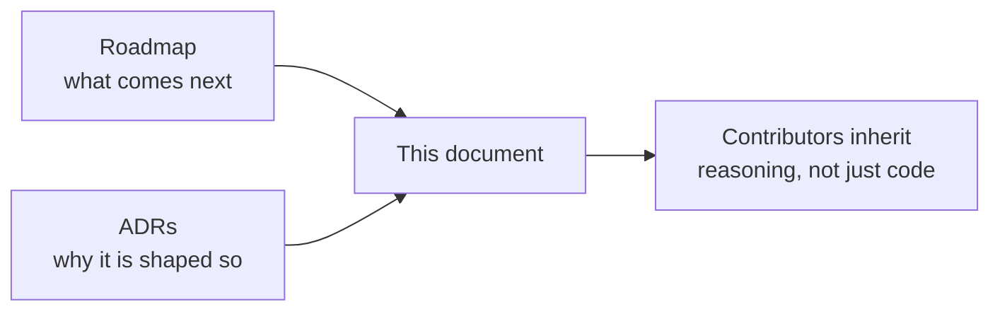

### 1.1 Status legend used throughout

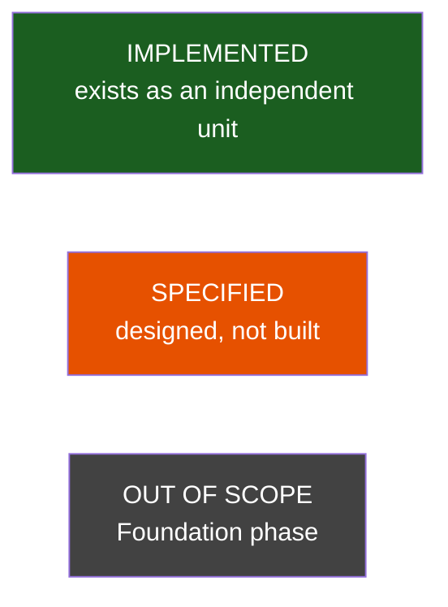

- **IMPLEMENTED:** `lane_policy`, `roe_engine`, `human_gate`, `audit_logger`, `scan_prohibited_terms` — each present in the repository as independent components. `lane_policy`, `audit_logger`, and `scan_prohibited_terms` (together with `capture_manifest`) are exercised by dedicated unit-test suites; `roe_engine` and `human_gate` are implemented but not yet unit-tested.
- **SPECIFIED:** the end-to-end orchestrator pipeline (`orchestrator/__init__.py` is a scaffold), the `verifiers/` output stage (a defined stage, not a completed verifier), cryptographic signing of the audit log, and enforced compliance from `compliance/` manifests.
- **OUT OF SCOPE (Foundation):** inference execution, exploit/offensive execution, model weight downloads, cloud provisioning, and live targeting.

---

## 2. Where Foundation leaves us

The Foundation phase delivered a safe repository scaffold and the governance spine as independent modules (four with dedicated unit-test suites; the ROE engine and human gate implemented but not yet unit-tested). The following diagram shows the module map as it exists today, marking what is wired versus what is standalone.

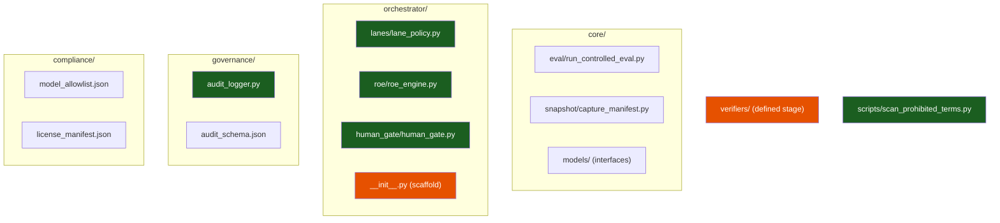

The honest reading of this map: the boxes shaded as implemented each work on their own and call the audit logger. The scaffolded orchestrator does **not** yet compose them into a single enforced pipeline, and the verifier stage and compliance enforcement are declared rather than enforced in code.

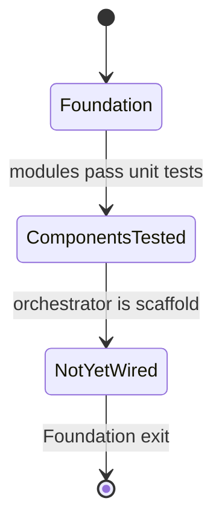

### 2.1 What "wired" will mean

A wired pipeline composes the independent components in a fixed order so that no stage can be skipped. The target composition is lane assignment, then ROE check, then human gate, then verify, then audit. The Foundation release does not yet enforce this ordering end to end.


---

## 3. Roadmap overview

The roadmap advances in phases. Each phase has a theme, entry criteria, exit criteria, and a non-negotiable rule: **governance must never regress**. A later phase may add capability only behind the boundary the earlier phase proved.

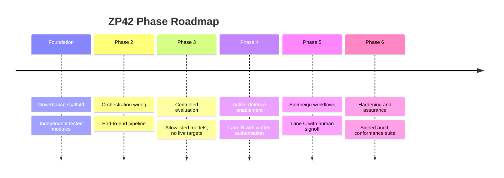

The phases are sequential in dependency, not necessarily in calendar. A phase ships only when its exit criteria are met and the prohibited-terms scan and test suite are green.

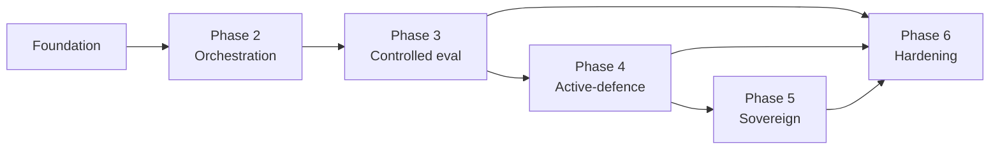

### 3.1 Phase gate principle

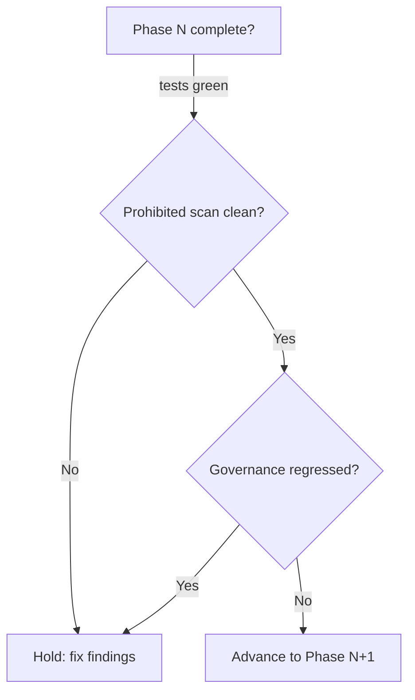

---

## 4. Phase 2 — Orchestration wiring

Phase 2 turns the scaffolded orchestrator into a composed pipeline. No new capability is introduced; the goal is that a request cannot reach an action without traversing every boundary stage in order, fail-closed at each.

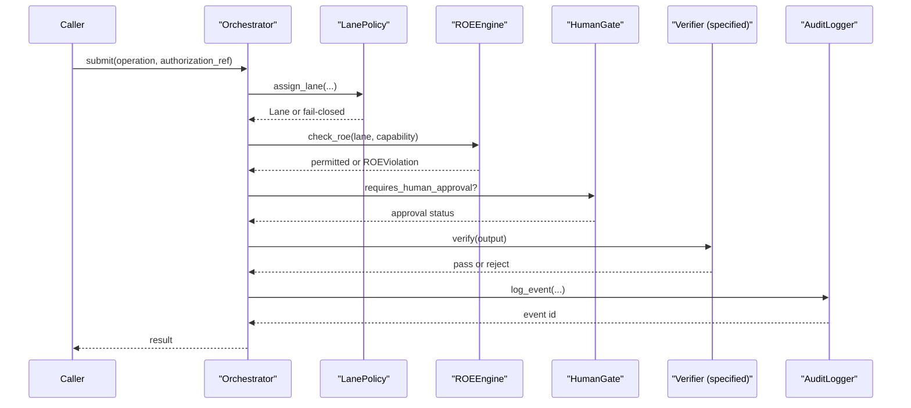

### 4.1 Phase 2 criteria

| Criterion | Entry | Exit |
|-----------|-------|------|
| Pipeline ordering | Components standalone | Fixed order enforced; no stage skippable |
| Fail-closed | Per-component | Whole pipeline fails closed on any ambiguity |
| Audit coverage | Per-component events | Every stage transition logged |
| Tests | Unit per module | Integration tests across full chain |
| Verifier | Not present | Stage interface defined and invoked (reject-capable) |

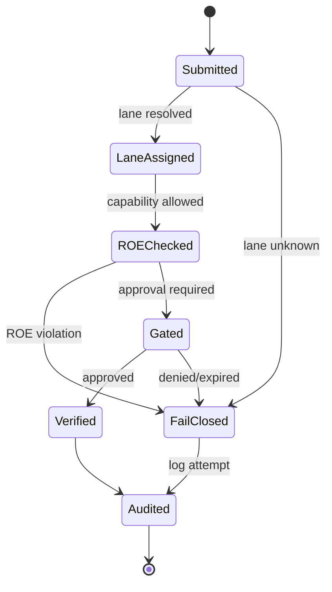

The orchestrator must treat *any* indeterminate result as a stop. This is the single most important behaviour Phase 2 adds, and it is why the phase ships no capability of its own.

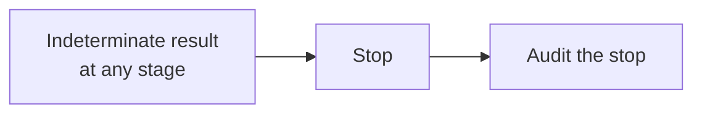

---

## 5. Phase 3 — Controlled evaluation

Phase 3 enables controlled evaluation using only allowlisted models, against safe benchmarks, with **no live targets**. The `core/eval/run_controlled_eval.py` harness and `core/snapshot/capture_manifest.py` provide the evaluation and provenance surfaces; `compliance/model_allowlist.json` names the approved models (AI2 OLMo 3 32B Base, AI2 OLMo 3 32B Think, IBM Granite 4.1 30B Base).

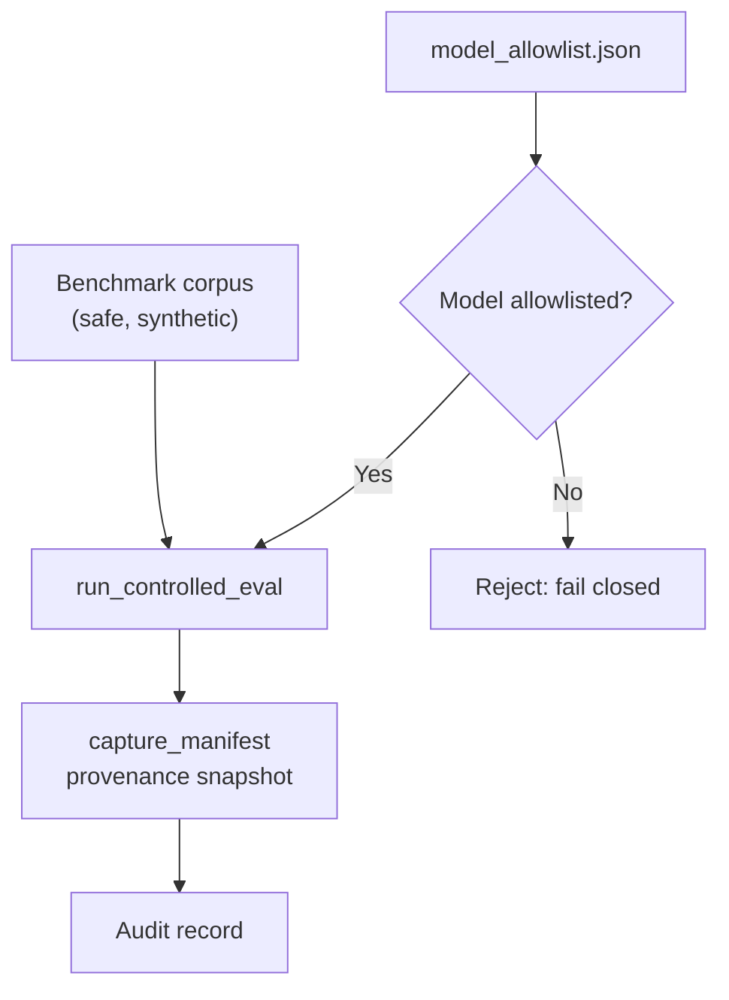

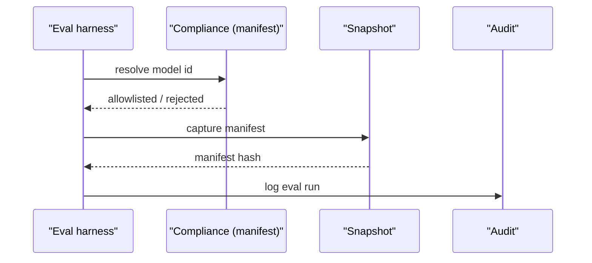

### 5.1 Compliance moves from declared to enforced

In Foundation the allowlist is a machine-readable manifest that is *declared* but not enforced in code. Phase 3 introduces the enforcement check that reads the manifest and refuses any model not named in it.

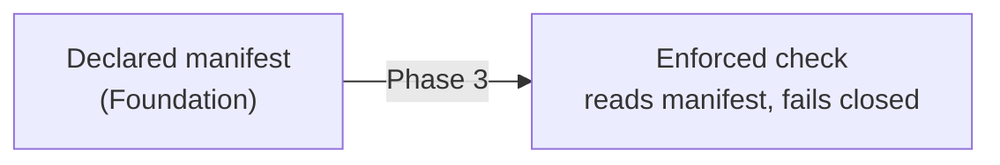

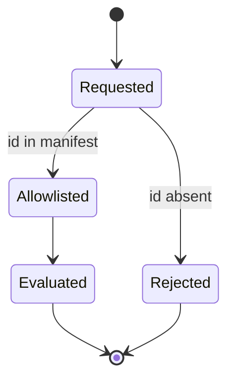

The PRC-origin exclusion policy carried from Foundation remains in force: no models, outputs, embeddings, labels, checkpoints, synthetic data, or derivatives of excluded origin are permitted. Phase 3 enforces the *allowlist* positively — only named models pass — which is the structurally stronger form of the same policy.

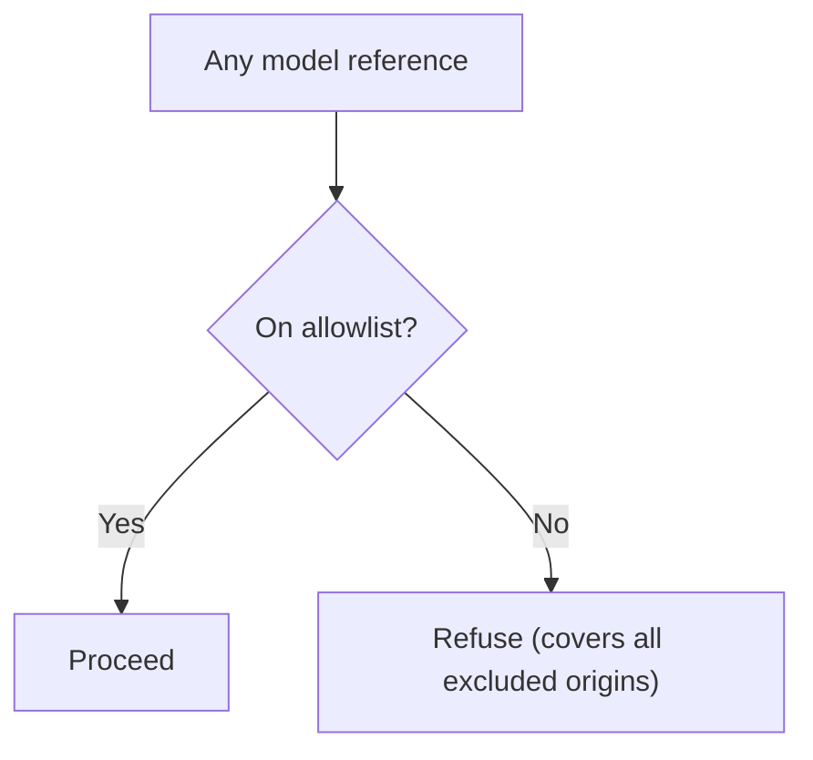

### 5.2 Phase 3 criteria

| Criterion | Exit |
|-----------|------|
| Allowlist enforcement | Non-allowlisted model is refused in code |
| Provenance | Every eval run produces a captured manifest |
| Targets | Benchmarks only; no network target; no inference against third parties |
| Audit | Eval runs and refusals both logged |

---

## 6. Phase 4 — Active-defence enablement (Lane B)

Phase 4 enables Lane B workflows — active-defence work that requires **explicit written authorisation**. A lane is entered deliberately; it is never a default that widens. Lane B remains strictly within defensive and active-defence bounds: deception technology on owned systems, honeypot and honeytoken management, authorised-scope threat hunting, controlled engagement of adversary behaviour, and evidence-only attribution support. Hack-back, offensive retaliation, and unauthorised third-party access are prohibited in every lane.

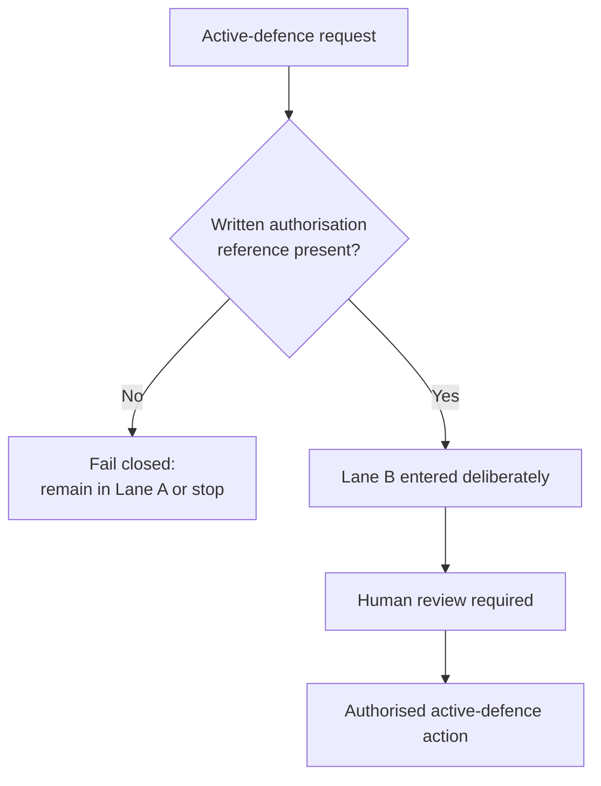

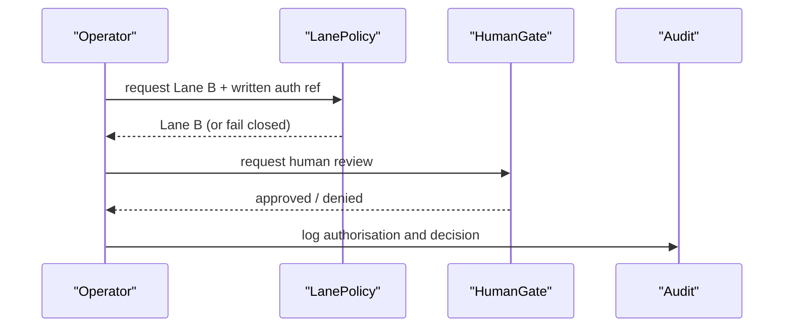

### 6.1 Lane B is not an escalation shortcut

Entry to Lane B does not relax the globally prohibited capabilities enforced by the ROE engine. The same prohibitions that apply in Lane A apply in Lane B.

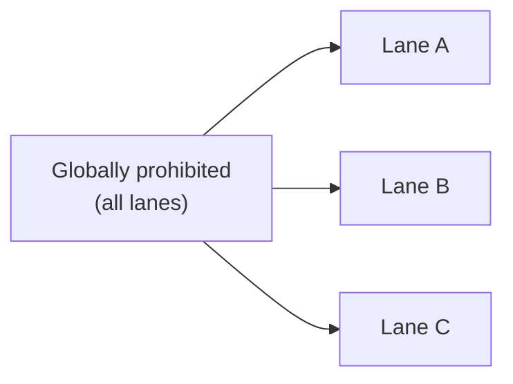

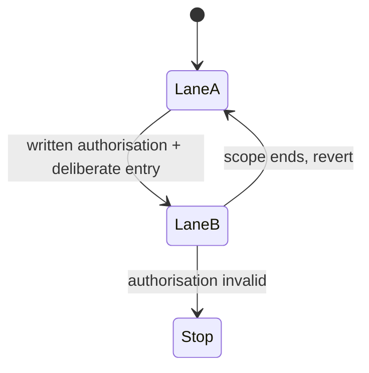

---

## 7. Phase 5 — Sovereign-authorised workflows (Lane C)

Phase 5 enables Lane C workflows, which require a **sovereign authorisation reference AND human signoff for every operation**. This is the most tightly gated lane. Autonomous decision-making for destructive actions is prohibited; human-in-the-loop approval is mandatory and non-skippable.

```mermaid
flowchart TD
    REQ["Lane C request"] --> SA{"Sovereign auth<br/>reference?"}
    SA -->|No| FC["Fail closed"]
    SA -->|Yes| HS{"Human signoff<br/>for THIS operation?"}
    HS -->|No| FC
    HS -->|Yes| ACT["Operation within written ROE"]
    ACT --> AUD["Audit with both references"]
```

```mermaid
sequenceDiagram
    participant Auth as "Sovereign authority"
    participant Human as "Command human"
    participant Sys as "ZP42"
    participant Aud as "Audit"
    Auth->>Sys: sovereign authorisation reference
    Sys->>Human: request per-operation signoff
    Human-->>Sys: signoff (or deny)
    Sys->>Aud: log sovereign ref + signoff + result
```

### 7.1 Every operation, not every session

The critical property of Lane C is that approval is per-operation. A single signoff never authorises a batch.

```mermaid
flowchart LR
    O1["Op 1"] --> S1["Signoff 1"]
    O2["Op 2"] --> S2["Signoff 2"]
    O3["Op 3"] --> S3["Signoff 3"]
```

```mermaid
stateDiagram-v2
    [*] --> Pending
    Pending --> Approved: human signoff
    Pending --> Denied: human denies
    Pending --> Expired: timeout
    Approved --> [*]
    Denied --> [*]
    Expired --> [*]
```

---

## 8. Phase 6 — Hardening and assurance

Phase 6 raises assurance. It introduces cryptographic signing of the audit log (today the log is plain JSONL and **not** signed), a conformance suite that tests the whole boundary against its specification, and operational runbooks. None of these exists yet; all are specified here as targets.

```mermaid
flowchart TD
    J["Plain JSONL log<br/>(today)"] -->|"Phase 6"| SG["Signed, verifiable<br/>audit chain"]
    SG --> CF["Conformance suite"]
    CF --> RB["Operations runbook"]
```

```mermaid
flowchart LR
    E1["Event"] --> H1["hash(event)"]
    H1 --> C1["chain: h(prev || event)"]
    C1 --> V["Tamper-evident verification"]
```

### 8.1 Why signing is a later phase, not Foundation

Signing adds key management, rotation, and verification tooling. Building it before the pipeline is wired would harden a chain whose links are not yet in place. Phase 6 therefore follows orchestration and the lane phases.

```mermaid
flowchart LR
    W["Wire pipeline"] --> L["Prove lanes"] --> S["Then sign the record"]
```

---

## 9. Cross-cutting roadmap concerns

### 9.1 Governance never regresses

Every phase is forbidden from weakening a boundary an earlier phase established. This is tracked as an invariant in the test strategy.

```mermaid
flowchart TD
    N["New feature in Phase N"] --> T{"Weakens an existing<br/>boundary?"}
    T -->|Yes| BLOCK["Blocked"]
    T -->|No| MERGE["Eligible to merge"]
```

### 9.2 Prohibited-terms scanning stays at the boundary

`scripts/scan_prohibited_terms.py` guards the repository against disallowed terms. It runs in Foundation and continues through every phase as a pre-commit and CI gate.

```mermaid
flowchart LR
    COMMIT["Commit / PR"] --> SCAN["scan_prohibited_terms"]
    SCAN -->|"clean"| PASS["Proceed"]
    SCAN -->|"hit"| FAILc["Block"]
```

### 9.3 Capability is always downstream of authorisation

The roadmap adds capability only behind the gate. No phase introduces a capability that can act without a lane, an ROE pass, and (where required) a human gate.

```mermaid
flowchart LR
    AUTH["Authorisation"] --> CAP["Capability"]
    CAP -.->|"never the reverse"| AUTH
```

---

## 10. Architecture Decision Records

ADRs capture a decision, its context, the options weighed, the choice, and its consequences. The records below are the durable decisions behind ZP42.

```mermaid
flowchart LR
    CTX["Context"] --> DEC["Decision"]
    DEC --> CON["Consequences"]
    CON --> REV["Revisit trigger"]
```

### ADR-001 — Lane-based authorisation model

**Status:** Accepted (IMPLEMENTED as `orchestrator/lanes/lane_policy.py`).

**Context.** A cyber-reasoning system spans work of very different sensitivity, from routine defensive analysis to sovereign-authorised operations. Treating all work uniformly would either over-restrict the benign or under-gate the sensitive.

**Decision.** Partition work into explicit lanes — Lane A (defensive, system-owner authorised), Lane B (active-defence, written authorisation), Lane C (sovereign-authorised, sovereign reference plus human signoff) — with a fail-closed UNKNOWN lane. A lane is entered deliberately and never widens by default.

```mermaid
flowchart TD
    REQ["Operation"] --> AR{"Authorisation<br/>reference?"}
    AR -->|None| UNK["UNKNOWN: fail closed"]
    AR -->|"System/customer"| A["Lane A"]
    AR -->|Written| B["Lane B"]
    AR -->|"Sovereign + signoff"| C["Lane C"]
```

**Options considered.**

| Option | Verdict |
|--------|---------|
| Single permission flag | Rejected: cannot express graded sensitivity |
| Role-based only | Rejected: ties authority to identity, not to the authorisation artefact |
| Lane model with fail-closed default | **Chosen** |

**Consequences.** Clear, auditable authority boundaries; a default that denies rather than permits. The cost is that every operation must carry an authorisation reference, which the orchestrator must enforce (Phase 2).

```mermaid
stateDiagram-v2
    [*] --> Unknown
    Unknown --> A: system/customer auth
    Unknown --> B: written auth
    Unknown --> C: sovereign + signoff
    A --> [*]
    B --> [*]
    C --> [*]
```

### ADR-002 — Fail-closed as the universal default

**Status:** Accepted (IMPLEMENTED across modules).

**Context.** Ambiguity is common: a missing reference, a malformed authorisation, an unrecognised capability. The system must have one unambiguous behaviour for all of them.

**Decision.** Every indeterminate state fails closed — the operation stops and the attempt is logged.

```mermaid
flowchart TD
    ANY["Any ambiguity"] --> STOP["Stop"]
    STOP --> LOG["Log the attempt"]
```

**Consequences.** Safety is the default; a bug tends toward denial, not toward unauthorised action. The trade-off is that legitimate work can be blocked by incomplete authorisation data, which operators resolve by supplying a valid reference.

```mermaid
flowchart LR
    SAFE["Bias to deny"] --> OK["Safe failure mode"]
    SAFE --> COST["Cost: false denials"]
```

### ADR-003 — Rules-of-engagement engine as policy

**Status:** Accepted (IMPLEMENTED as `orchestrator/roe/roe_engine.py`).

**Context.** Some capabilities must never be available in any lane — for example malware creation, credential theft, DDoS generation, data exfiltration from unauthorised systems, persistence, evasion, destructive payloads, autonomous retaliation, hack-back, and unauthorised third-party targeting. These prohibitions must be encoded, not left to convention.

**Decision.** Encode the bounds of permitted action as policy in an ROE engine that is consulted before any action, with a globally prohibited set enforced across all lanes and a `ROEViolation` raised on breach.

```mermaid
flowchart TD
    CAP["Requested capability"] --> GP{"In globally<br/>prohibited set?"}
    GP -->|Yes| VIO["ROEViolation"]
    GP -->|No| LANECHK{"Permitted in<br/>this lane?"}
    LANECHK -->|No| VIO
    LANECHK -->|Yes| ALLOW["Permit"]
```

**Consequences.** Prohibitions are machine-checked and uniform; adding a capability requires an explicit policy change, which is reviewable. The ROE engine becomes a central dependency that every action path must call.

```mermaid
flowchart LR
    A2["Lane A"] --> ROE["ROE engine"]
    B2["Lane B"] --> ROE
    C2["Lane C"] --> ROE
    ROE --> DEC2["Permit / violate"]
```

### ADR-004 — Human gate at decision points

**Status:** Accepted (IMPLEMENTED as `orchestrator/human_gate/human_gate.py`).

**Context.** Sensitive operations must not proceed on the system's own authority. Lane B requires human review; Lane C requires per-operation human approval.

**Decision.** Interpose a human gate that produces an explicit approval status — pending, approved, denied, or expired — and that cannot be bypassed for operations that require it.

```mermaid
stateDiagram-v2
    [*] --> Pending
    Pending --> Approved
    Pending --> Denied
    Pending --> Expired
    Approved --> Proceed
    Denied --> Stop
    Expired --> Stop
```

**Consequences.** A human is accountable for sensitive actions, and the approval is recorded. The cost is latency and the need for reachable approvers; where none is reachable, the operation holds rather than self-approving.

```mermaid
flowchart TD
    REQ3["Sensitive op"] --> NEED{"Human approval<br/>required?"}
    NEED -->|No, Lane A routine| GO["Proceed"]
    NEED -->|"Yes"| WAIT["Request approval"]
    WAIT --> RES{"Approved?"}
    RES -->|Yes| GO
    RES -->|No/expired| HOLD["Stop"]
```

### ADR-005 — Append-only audit log

**Status:** Accepted (IMPLEMENTED as `governance/audit_logger.py`, plain JSONL; signing SPECIFIED for Phase 6).

**Context.** Governance requires an evidence record that cannot be quietly rewritten. The record must capture timestamp, operation type, lane, authorisation reference, actor, result, and any escalation attempt, per `governance/audit_schema.json`.

**Decision.** Write an append-only JSONL audit log synchronously, one event per line, conforming to a published schema. Cryptographic signing is deferred to Phase 6 and is **not** present today.

```mermaid
flowchart LR
    EV["Event"] --> SCHEMA{"Matches<br/>audit_schema.json?"}
    SCHEMA -->|No| REJ3["Reject event"]
    SCHEMA -->|Yes| APP["Append line to JSONL"]
```

**Consequences.** A durable, human-readable trail from day one, at the cost of being only *append-only by convention* until signing lands. This limitation is stated openly so that no reader assumes tamper-evidence that does not yet exist.

```mermaid
timeline
    title Audit assurance trajectory
    Foundation : Append-only JSONL : conformant to schema
    Phase 6 : Hash-chained : signed and verifiable
```

### ADR-006 — Prohibited-terms scanner at the boundary

**Status:** Accepted (IMPLEMENTED as `scripts/scan_prohibited_terms.py`).

**Context.** The repository must not drift into disallowed terminology or leak forbidden concepts into public-facing material.

**Decision.** Run a prohibited-terms scanner as a boundary gate on commits and in CI; a hit blocks.

```mermaid
flowchart LR
    SRC["Source change"] --> G3["scan_prohibited_terms"]
    G3 -->|clean| MERGE3["Allow"]
    G3 -->|hit| BLK3["Block"]
```

**Consequences.** Consistent, enforceable terminology hygiene; a small ongoing maintenance cost to keep the term list current.

### ADR-007 — Open-source under MIT

**Status:** Accepted (IMPLEMENTED: `LICENSE` is MIT).

**Context.** A governance-first system earns trust by being inspectable. Operators and reviewers should be able to read exactly how the boundaries work.

**Decision.** Release ZP42 as open-source under the MIT License, authored by Naquib Hatami and published by SADI AI Inc. / iQs Group Inc. Capability remains gated by authorisation; openness applies to the governance code, not to any unauthorised capability — of which there is none.

```mermaid
flowchart TD
    OPEN["MIT open source"] --> INSPECT["Boundaries inspectable"]
    INSPECT --> TRUST["Trust through verifiability"]
    OPEN --> GATE["Capability still gated by authorisation"]
```

**Options considered.**

| Option | Verdict |
|--------|---------|
| Closed source | Rejected: undermines the trust argument |
| Copyleft (GPL) | Considered; MIT chosen for maximal adoption and clarity |
| MIT | **Chosen** |

**Consequences.** Broad reuse and independent review; the licence manifest (`compliance/license_manifest.json`) records obligations. Openness places the burden of lawful, authorised operation squarely on the operator — which the lane model and ROE engine are designed to support.

```mermaid
flowchart LR
    MIT["MIT License"] --> REUSE["Reuse / modify / distribute"]
    MIT --> NOTICE["Preserve copyright notice"]
    REUSE --> OPREST["Operator keeps authorisation duty"]
```

### ADR-008 — Compliance manifests as machine-readable policy

**Status:** Accepted for the manifest; enforcement SPECIFIED for Phase 3.

**Context.** Model and licence policy should be data, not scattered code, so it can be reviewed and versioned on its own.

**Decision.** Express the model allowlist and licence obligations as machine-readable manifests (`compliance/model_allowlist.json`, `compliance/license_manifest.json`). Foundation *declares* them; Phase 3 adds the code that *enforces* them fail-closed.

```mermaid
flowchart LR
    MAN["Manifest (data)"] --> REVIEW["Reviewable / versioned"]
    MAN -->|"Phase 3"| ENF["Enforced in code"]
```

**Consequences.** Policy changes are diff-able and auditable; until Phase 3, the manifest is advisory, which this document flags rather than overstates.

### ADR-009 — Verifier as a defined stage

**Status:** Accepted as a stage; verifier logic SPECIFIED, not completed.

**Context.** Outputs of reasoning must be validated before they are treated as results. The pipeline reserves a verification stage between the human gate and the audit record.

**Decision.** Define `verifiers/` as a mandatory pipeline stage capable of rejecting output, implemented fully in a later phase. Today it is a defined slot, not a completed verifier.

```mermaid
flowchart LR
    GATE4["Human gate"] --> VER4["Verifier stage<br/>(defined, reject-capable)"]
    VER4 -->|pass| AUD4["Audit"]
    VER4 -->|reject| STOP4["Stop + log"]
```

**Consequences.** The ordering guarantees that nothing unverified is recorded as a result once the stage is built; until then, the slot exists but does not validate.

### 10.1 ADR relationships

```mermaid
flowchart TD
    A1["ADR-001 Lanes"] --> A2b["ADR-002 Fail-closed"]
    A1 --> A3["ADR-003 ROE"]
    A1 --> A4["ADR-004 Human gate"]
    A3 --> A5["ADR-005 Audit"]
    A4 --> A5
    A5 --> A6["ADR-008 Compliance"]
    A7["ADR-007 Open source"] --> A1
    A9["ADR-009 Verifier"] --> A5
    A10["ADR-006 Prohibited scan"] --> A7
```

### 10.2 ADR lifecycle

```mermaid
stateDiagram-v2
    [*] --> Proposed
    Proposed --> Accepted
    Proposed --> Rejected
    Accepted --> Superseded: new ADR replaces
    Accepted --> Deprecated: no longer applies
    Superseded --> [*]
    Deprecated --> [*]
    Rejected --> [*]
```

---

## 11. Decision drivers summary

The recurring drivers behind these ADRs are safety-by-default, auditability, human accountability, and verifiability through openness.

```mermaid
mindmap
  root(("ZP42 decisions"))
    Safety
      Fail-closed
      Lanes
      ROE
    Accountability
      Human gate
      Audit trail
    Verifiability
      Open source
      Machine-readable policy
    Honesty
      Specified vs implemented
      No overstated assurance
```

```mermaid
pie showData
    title "Foundation module status (illustrative)"
    "Implemented components" : 5
    "Specified, not built" : 4
```

> The chart above is an illustrative count of named surfaces (five implemented governance modules; four specified surfaces: orchestrator wiring, verifier logic, audit signing, compliance enforcement). It is not a metric, benchmark, or measured figure.

---

## 12. Risks the roadmap manages

```mermaid
quadrantChart
    title Roadmap risk posture
    x-axis "Low effort" --> "High effort"
    y-axis "Low impact" --> "High impact"
    quadrant-1 "Prioritise"
    quadrant-2 "Plan"
    quadrant-3 "Monitor"
    quadrant-4 "Quick win"
    "Pipeline not wired": [0.7, 0.9]
    "Audit unsigned": [0.6, 0.7]
    "Compliance advisory": [0.4, 0.6]
    "Verifier incomplete": [0.5, 0.8]
    "Terminology drift": [0.2, 0.3]
```

| Risk | Current mitigation | Roadmap resolution |
|------|--------------------|--------------------|
| Pipeline components not composed | Each fails closed independently | Phase 2 wiring |
| Audit not tamper-evident | Append-only by convention, schema-checked | Phase 6 signing |
| Compliance only declared | Manifest reviewed | Phase 3 enforcement |
| Verifier not built | Slot defined, nothing recorded unverified once built | Phase 3+ verifier |
| Capability outrunning gates | Out of scope in Foundation | Lanes B/C gated entry |

```mermaid
flowchart LR
    R1["Risk identified"] --> R2["Mapped to phase"]
    R2 --> R3["Exit criterion added"]
    R3 --> R4["Test enforces non-regression"]
```

---

## 13. Delivery cadence and non-regression

Phases ship when green, not on a clock. The non-regression gate is the backbone.

```mermaid
gantt
    title Indicative phase sequence (dependency order, not dates)
    dateFormat X
    axisFormat %s
    section Governance spine
    Foundation            :done, f, 0, 1
    section Wiring
    Phase 2 orchestration  :p2, after f, 1
    section Capability
    Phase 3 controlled eval :p3, after p2, 1
    Phase 4 active-defence  :p4, after p3, 1
    Phase 5 sovereign       :p5, after p4, 1
    section Assurance
    Phase 6 hardening       :p6, after p3, 2
```

```mermaid
flowchart TD
    MERGE5{"Merge candidate"} --> T5["Unit + integration tests"]
    T5 --> S5["Prohibited-terms scan"]
    S5 --> R5["Non-regression check"]
    R5 -->|all pass| SHIP["Ship phase"]
    R5 -->|any fail| HOLD5["Hold"]
```

---

## 14. Contributor guidance for new ADRs

New decisions are recorded, not merely made. A contributor proposing an architectural change writes an ADR using the context/decision/consequences form, links it to the ADRs it affects, and ensures no governance boundary regresses.

```mermaid
sequenceDiagram
    participant C as "Contributor"
    participant Rev as "Reviewer"
    participant Repo as "Repository"
    C->>Repo: open PR with ADR draft
    Rev->>C: assess non-regression + clarity
    C->>Repo: revise
    Rev->>Repo: accept ADR
    Repo-->>C: merged, ADR status Accepted
```

```mermaid
flowchart LR
    NEW["New ADR"] --> LINK["Link to affected ADRs"]
    LINK --> CHECK["Confirm no boundary weakened"]
    CHECK --> ACC["Accept / Reject / Supersede"]
```

---

## 15. Summary

ZP42's roadmap grows capability only behind a boundary that earlier phases prove: Foundation builds the governance spine as independent tested modules; Phase 2 wires them fail-closed; Phase 3 enforces compliance and runs controlled evaluation against allowlisted models with no live targets; Phases 4 and 5 open Lane B and Lane C behind written and sovereign authorisation with human gates; Phase 6 hardens the record with signing and a conformance suite. The ADRs record why: lanes, fail-closed default, ROE as policy, human gates, append-only audit, prohibited-terms scanning, open-source under MIT, machine-readable compliance, and a defined verifier stage. Throughout, the document distinguishes what is **implemented** from what is **specified**, credits **Naquib Hatami** as inventor and author, and keeps a defensive, governance-first framing in which capability is always downstream of authorisation.

```mermaid
flowchart LR
    GOV["Governance first"] --> GATE6["Capability gated"]
    GATE6 --> OPEN6["Open and inspectable"]
    OPEN6 --> HON["Honest about status"]
    HON --> GOV
```

---

## Related documents

- [`03-architecture.md`](03-architecture.md) — system architecture and module composition
- [`05-lane-model.md`](05-lane-model.md) — the lane authorisation model in detail
- [`06-roe-engine.md`](06-roe-engine.md) — rules-of-engagement engine design
- [`08-governance-audit.md`](08-governance-audit.md) — audit logging and schema
- [`09-compliance-allowlists.md`](09-compliance-allowlists.md) — model allowlist and licence manifest
- [`../README.md`](../README.md), [`../LICENSE`](../LICENSE), and [`FOUNDATION.md`](FOUNDATION.md) — project root, licence, and Foundation charter
