# ZP42 Master Documentation

**Version:** 1.0.0  
**Date:** 19 May 2026  
**Status:** Foundation Documentation

**Attribution**: The concepts ZP42 (Zeroth Protocol 42), HOSH (OLMo Inside Zone), HOSH-b/HOSH-i/HOSH-t, CAG (Consensus-Augmented Generation), and the 3-of-3 consensus/promotion doctrine originated from **Naquib Hatami**.

---

## Table of Contents

1. [Introduction to ZP42](#1-introduction-to-zp42)
2. [What ZP42 Is](#2-what-zp42-is)
3. [Why ZP42 Was Developed](#3-why-zp42-was-developed)
4. [What ZP42 Does](#4-what-zp42-does)
5. [Core Architecture](#5-core-architecture)
6. [HOSH Architecture](#6-hosh-architecture)
7. [RAG/CAG Architecture](#7-ragcag-architecture)
8. [Governance, ROE, and Human-Command Gates](#8-governance-roe-and-human-command-gates)
9. [Evaluation and Promotion Gates](#9-evaluation-and-promotion-gates)
10. [Industry Use Cases](#10-industry-use-cases)
11. [Glossary](#11-glossary)
12. [References](#12-references)

---

## 1. Introduction to ZP42

### 1.1 Overview

**ZP42** (Zeroth Protocol 42) is a next-generation cyber reasoning system designed for defensive, active-defense, and sovereign-authorized cyber operations. ZP42 represents a paradigm shift in how organizations approach cyber defense, incident response, and authorized offensive security operations.

ZP42 is built on three foundational principles:

1. **Fail-Closed Governance**: Every operation, memory write, and reasoning path must pass explicit authorization gates
2. **Consensus-Driven Reasoning**: Critical decisions require 3-of-3 consensus from independent reasoning nodes
3. **Sovereign Transparency**: Full audit trails, immutable provenance, and human oversight for high-risk operations

### 1.2 High-Level Architecture Diagram

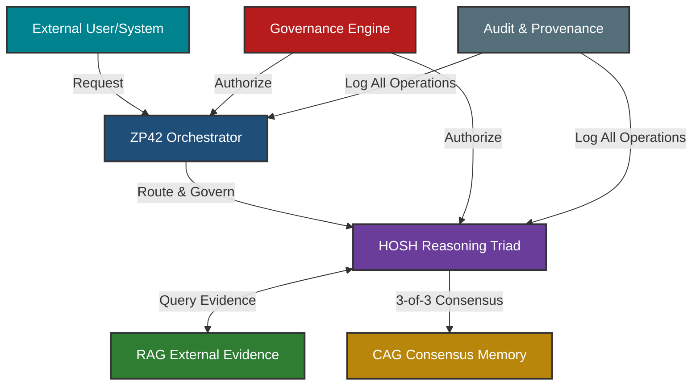

### 1.3 Operational Lanes

ZP42 operates across three strictly governed lanes:

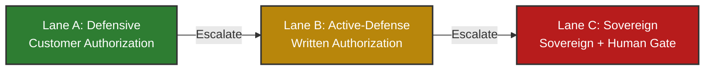

### 1.4 Document Structure

| Section | Content | Diagrams | Tables |
|---------|---------|----------|--------|
| 1 | Introduction and Overview | 5 | 2 |
| 2 | What ZP42 Is | 3 | 2 |
| 3 | Why ZP42 Was Developed | 2 | 2 |
| 4 | What ZP42 Does | 5 | 3 |
| 5 | Core Architecture | 9 | 5 |
| 6 | HOSH Architecture | 12 | 6 |
| 7 | RAG/CAG Architecture | 10 | 4 |
| 8 | Governance, ROE, Gates | 8 | 5 |
| 9 | Evaluation & Promotion | 6 | 4 |
| 10 | Industry Use Cases | 0 | 15 |
| **Total** | **12 Sections** | **60** | **48** |

### 1.5 Key Terminology

| Term | Expansion | Description |
|------|-----------|-------------|
| **ZP42** | Zeroth Protocol 42 | The cyber reasoning system |
| **HOSH** | OLMo Inside Zone | Heterogeneous reasoning triad (HOSH-b, HOSH-i, HOSH-t) |
| **RAG** | Retrieval-Augmented Generation | External verified evidence memory |
| **CAG** | Consensus-Augmented Generation | Internal 3-of-3 consensus memory |
| **ROE** | Rules of Engagement | Governance policy engine |
| **Lane A** | Defensive Operations | Customer/system authorized defensive workflows |
| **Lane B** | Active-Defense | Written authorization required offensive-security |
| **Lane C** | Sovereign Operations | Sovereign + human-command gate workflows |

### 1.6 Safety Boundaries Flow

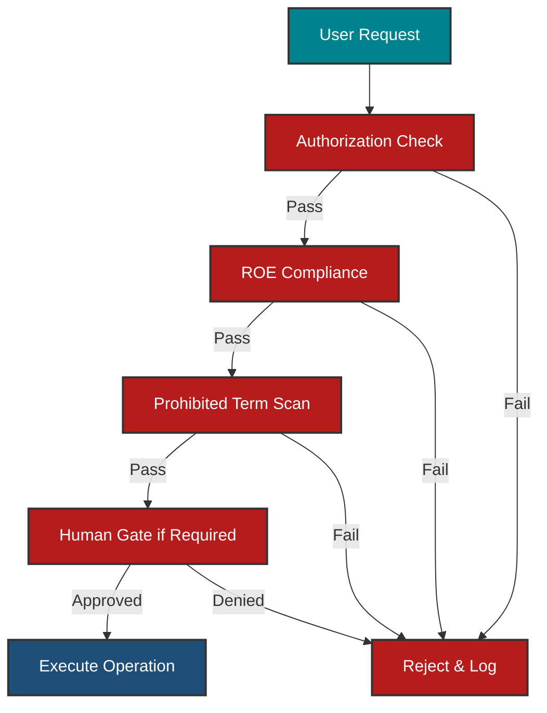

### 1.7 ZP42 Value Proposition

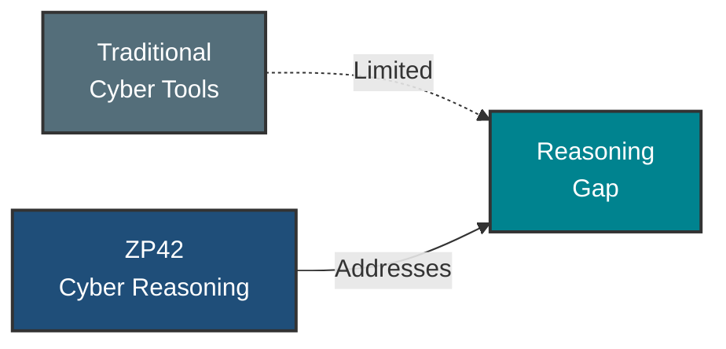

---

## 2. What ZP42 Is

### 2.1 System Classification

ZP42 is a **cyber reasoning system** that combines:

- **Multi-model reasoning** through the HOSH heterogeneous triad
- **Consensus-driven decision making** requiring 3-of-3 agreement for critical operations
- **Governed memory separation** between external evidence (RAG) and internal consensus (CAG)
- **Fail-closed authorization gates** enforcing rules of engagement and human oversight
- **Immutable audit trails** with Merkle-based provenance for every operation
- **Lane-based authorization** separating defensive, active-defense, and sovereign operations

### 2.2 System Components Diagram

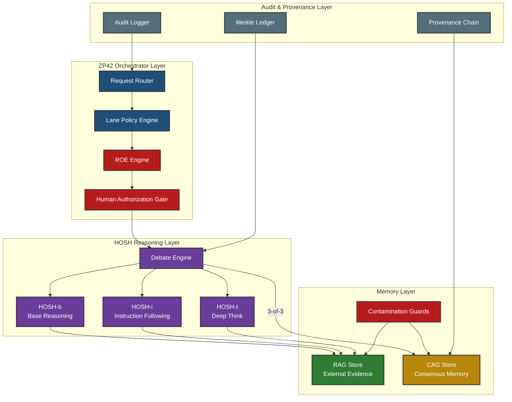

### 2.3 Comparison with Traditional Systems

| Capability | Traditional Cyber Systems | ZP42 Cyber Reasoning System |
|------------|---------------------------|------------------------------|
| **Decision Making** | Rule-based, signatures, heuristics | Multi-model consensus reasoning |
| **Adaptability** | Manual rule updates | Self-learning through CAG promotion |
| **Authorization** | Binary allow/deny | Multi-lane, multi-gate, human-in-loop |
| **Audit Trail** | Logs and SIEM | Immutable Merkle ledger with provenance |
| **Evidence Handling** | Analyst-driven | RAG-augmented automatic evidence retrieval |
| **Memory Persistence** | Database/SIEM | Domain-isolated, consensus-gated CAG |
| **Verification** | Manual review | Triangulated automated verifiers + human gate |
| **Offensive Capabilities** | Separate tools/teams | Governed Lane B/C with authorization |

### 2.4 Platform Capabilities Mind Map

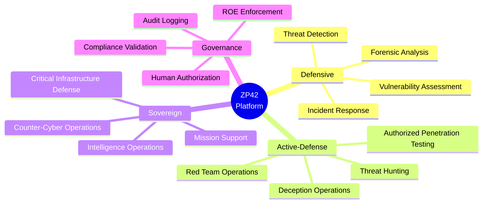

### 2.5 Core Capabilities Summary

| Layer | Component | Primary Function | Safety Mechanism |
|-------|-----------|------------------|------------------|
| **Orchestration** | Request Router | Route and classify incoming requests | Lane policy enforcement |
| **Orchestration** | ROE Engine | Enforce rules of engagement | Fail-closed authorization |
| **Orchestration** | Human Gate | Human oversight for high-risk ops | Explicit human approval required |
| **Reasoning** | HOSH-b | Fast base reasoning | Evidence-weighted voting |
| **Reasoning** | HOSH-i | Instruction-following reasoning | ROE compliance verification |
| **Reasoning** | HOSH-t | Deep thinking and critique | Internal adversarial loop |
| **Reasoning** | Debate Engine | Multi-node consensus | 3-of-3 unanimous agreement |
| **Memory** | RAG Store | External verified evidence | Domain isolation, tenant separation |
| **Memory** | CAG Store | Consensus memory | Promotion gate + contamination guards |
| **Audit** | Merkle Ledger | Immutable debate records | Cryptographic provenance |
| **Audit** | Audit Logger | Operation logging | Tamper-evident append-only log |

---

## 3. Why ZP42 Was Developed

### 3.1 The Cyber Reasoning Gap

Modern cyber operations face three critical challenges:

1. **Speed vs. Accuracy**: Automated systems are fast but error-prone; human analysts are accurate but slow
2. **Offensive-Defensive Integration**: Traditional tools separate defensive and offensive capabilities, creating operational friction
3. **Governance at Scale**: Existing authorization frameworks cannot scale to AI-speed operations while maintaining human oversight

ZP42 was developed to bridge these gaps by creating a **governed, auditable, consensus-driven cyber reasoning platform** that operates at machine speed with human-level oversight.

### 3.2 Problem-Solution Mapping

| Problem Domain | Traditional Limitation | ZP42 Solution |
|----------------|------------------------|---------------|
| **Speed** | Human analyst bottleneck | HOSH multi-model parallel reasoning |
| **Accuracy** | Automated false positives | 3-of-3 consensus + evidence triangulation |
| **Memory** | Siloed knowledge bases | CAG unified consensus memory |
| **Authorization** | Binary permission models | Multi-lane graduated authorization |
| **Audit** | Log correlation challenges | Immutable Merkle ledger provenance |
| **Offensive Ops** | Separate teams/tools | Governed Lane B/C integration |
| **Evidence** | Manual collection | RAG automatic retrieval |
| **Governance** | Static rule sets | Dynamic ROE engine with human gates |

### 3.3 Evolution to Cyber Reasoning Systems

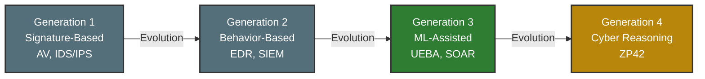

### 3.4 Design Requirements That Shaped ZP42

| Requirement Category | Specific Requirement | ZP42 Implementation |
|---------------------|----------------------|---------------------|
| **Performance** | Sub-second defensive response | HOSH-b fast path |
| **Performance** | Deep analysis when needed | HOSH-t adaptive gating |
| **Security** | No single point of failure | 3-node HOSH triad |
| **Security** | Tamper-evident operations | Merkle ledger |
| **Compliance** | Human oversight for high-risk | Lane C human gates |
| **Compliance** | Full audit trail | Immutable audit log |
| **Sovereignty** | No PRC-origin models | Model allowlist with origin validation |
| **Sovereignty** | US-controlled reasoning | OLMo/Granite Apache 2.0 models |
| **Safety** | Prevent unauthorized offensive ops | Lane policy + ROE engine |
| **Safety** | Contamination prevention | Domain isolation guards |

### 3.5 Key Design Decisions

#### 3.5.1 Consensus Over Speed

**Decision**: Require unanimous 3-of-3 HOSH consensus for CAG promotion and critical operations, even though this adds latency.

**Rationale**: In cyber operations, false positives and false negatives have severe consequences. A single model can hallucinate or be fooled; three independent models reaching consensus provides dramatically higher confidence.

#### 3.5.2 Memory Separation (RAG vs CAG)

**Decision**: Maintain strict separation between external evidence (RAG) and internal consensus memory (CAG).

**Rationale**: External evidence can be poisoned, incomplete, or adversarially crafted. Only reasoning that has passed 3-of-3 consensus + full governance gates should become permanent institutional memory.

#### 3.5.3 Heterogeneous Model Triad (HOSH)

**Decision**: Use three models derived from different training objectives (Base, Instruct, Think) rather than three instances of the same model.

**Rationale**: Homogeneous ensembles share the same failure modes. HOSH-b, HOSH-i, and HOSH-t have different reasoning patterns, making consensus more robust against model-specific weaknesses.

#### 3.5.4 Fail-Closed by Default

**Decision**: All gates, verifiers, and authorization checks fail closed (default deny) rather than fail open.

**Rationale**: In cyber operations, unauthorized action is worse than inaction. If a gate cannot confirm authorization, the operation must be blocked.

#### 3.5.5 Immutable Audit with Merkle Trees

**Decision**: Use Merkle tree structures for debate ledgers and provenance chains rather than traditional logs.

**Rationale**: Merkle trees provide cryptographic proof of integrity. Any attempt to alter past reasoning or delete evidence is detectably reflected in root hash changes, creating tamper-evident audit trails.

### 3.6 Technology Evolution Flowchart

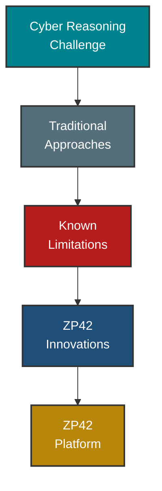

---

## 4. What ZP42 Does

### 4.1 Core Functions

ZP42 provides the following core capabilities:

1. **Defensive Cyber Reasoning**: Automated threat detection, incident response, and forensic analysis
2. **Active-Defense Operations**: Authorized penetration testing, red team exercises, and threat hunting
3. **Sovereign Mission Support**: Intelligence operations and critical infrastructure defense
4. **Governance & Authorization**: Multi-lane policy enforcement with human-command gates
5. **Audit & Provenance**: Immutable logging and cryptographic proof chains

### 4.2 Request Processing Flow

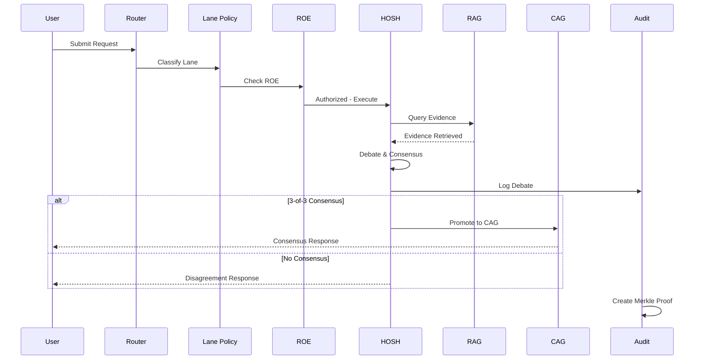

### 4.3 Functional Capabilities Table

| Function Category | Specific Capability | Lane Requirement | Output Type |
|-------------------|---------------------|------------------|-------------|
| **Detection** | Anomaly detection | Lane A | Alert + evidence bundle |
| **Detection** | Threat intelligence correlation | Lane A | Threat report + provenance |
| **Response** | Incident triage | Lane A | Priority ranking + recommendations |
| **Response** | Automated remediation | Lane A (approved actions) | Remediation plan + execution log |
| **Forensics** | Timeline reconstruction | Lane A | Forensic timeline + Merkle proof |
| **Forensics** | Root cause analysis | Lane A | RCA report + evidence chain |
| **Active-Defense** | Authorized pen testing | Lane B | Findings report + proof bundle |
| **Active-Defense** | Red team emulation | Lane B | TTP mapping + recommendations |
| **Sovereign** | Mission planning support | Lane C | Mission plan + risk assessment |
| **Sovereign** | Operational intelligence | Lane C | Intelligence product + audit trail |

### 4.4 Lane-Based Operation Flow

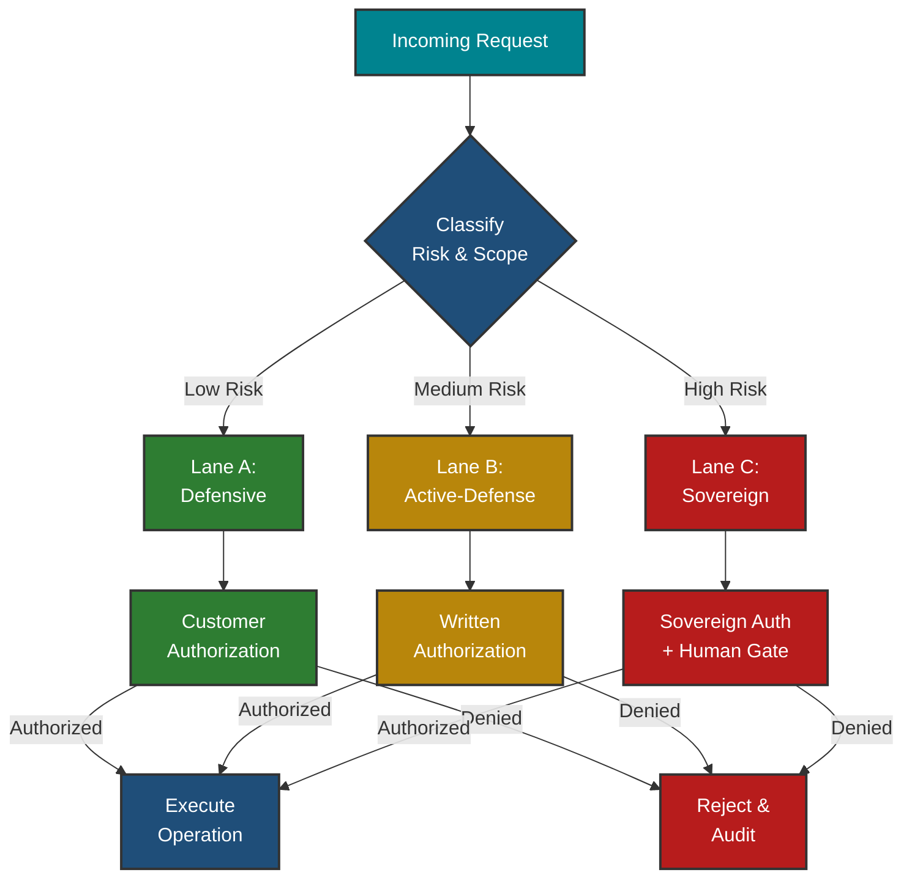

### 4.5 Output Types and Formats

| Output Type | Content | Provenance | Audit Trail |
|-------------|---------|------------|-------------|
| **Threat Alert** | Threat indicators, severity, evidence | RAG sources + timestamps | Full debate Merkle root |
| **Incident Report** | Timeline, actions, recommendations | CAG if 3-of-3 consensus | Complete operation log |
| **Forensic Analysis** | Root cause, attack chain, IOCs | External + internal evidence | Cryptographic proof chain |
| **Pen Test Report** | Findings, risk ratings, remediation | Test execution logs | Authorization + execution proof |
| **Intelligence Product** | Adversary profile, TTPs, recommendations | Classified sources + CAG | Sovereign authorization trail |

### 4.6 Integration Points

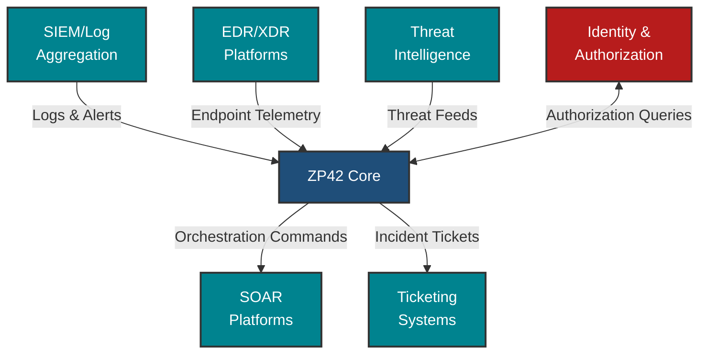

### 4.7 Operational Workflows

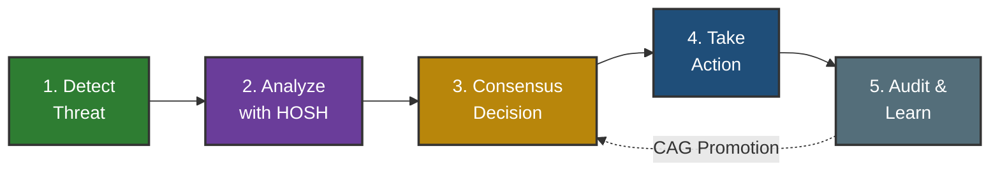

---

## 5. Core Architecture

### 5.1 Layered Architecture Overview

ZP42 is organized into five primary layers, each with distinct responsibilities and safety boundaries:

1. **Orchestration Layer**: Request routing, lane classification, and policy enforcement
2. **Reasoning Layer**: HOSH triad debate and consensus formation
3. **Memory Layer**: RAG/CAG memory stores with domain isolation
4. **Governance Layer**: ROE engine, human gates, and authorization controls
5. **Audit Layer**: Immutable logging, Merkle proofs, and provenance chains

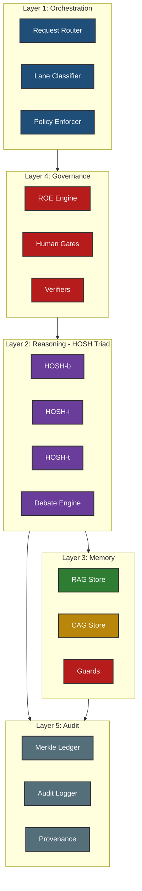

### 5.2 Component Interaction Matrix

| Layer | Component | Interacts With | Data Flow | Security Control |
|-------|-----------|----------------|-----------|------------------|
| Orchestration | Request Router | Lane Classifier, ROE Engine | Request metadata | Lane tagging |
| Orchestration | Lane Classifier | Policy Enforcer | Lane assignment | Authorization check |
| Orchestration | Policy Enforcer | Human Gates, HOSH | Authorized requests | Fail-closed gates |
| Reasoning | Debate Engine | HOSH-b, HOSH-i, HOSH-t | Reasoning inputs/outputs | Consensus verification |
| Reasoning | HOSH nodes | RAG Store, Debate Engine | Evidence queries, responses | Evidence validation |
| Memory | RAG Store | HOSH nodes, Guards | External evidence | Domain isolation |
| Memory | CAG Store | Debate Engine, Guards | Consensus memory | Promotion gates |
| Memory | Guards | RAG/CAG Stores | Metadata validation | Contamination checks |
| Governance | ROE Engine | All layers | Policy decisions | Fail-closed authorization |
| Governance | Human Gates | Orchestration, Audit | Human approvals | Explicit signoff |
| Audit | Merkle Ledger | Debate Engine | Debate history | Cryptographic integrity |
| Audit | Audit Logger | All layers | Operation logs | Append-only persistence |

### 5.3 Data Flow Architecture

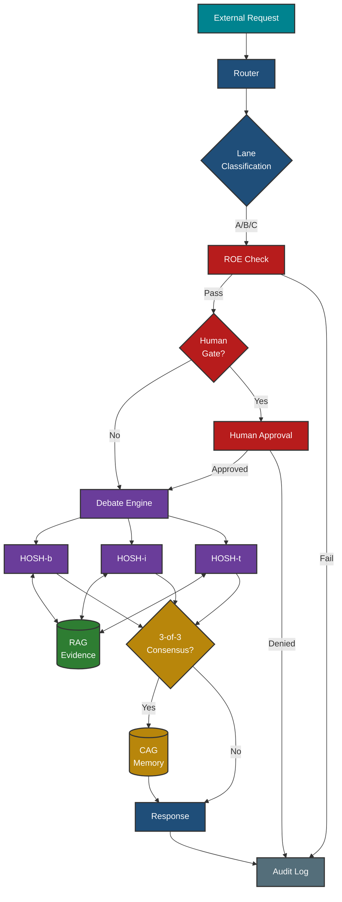

### 5.4 Security Boundaries

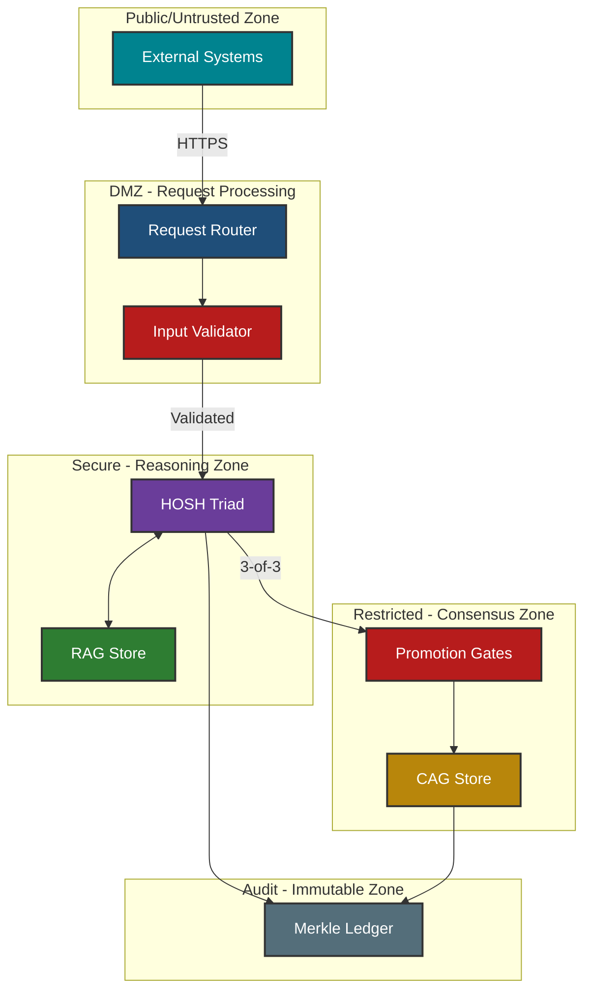

### 5.5 Technology Stack

| Layer | Technology Component | Implementation Details |
|-------|---------------------|------------------------|
| **Models** | AI2 OLMo 3 32B Base | HOSH-b primary reasoning node |
| **Models** | AI2 OLMo 3 32B Think | HOSH-t deep analysis node |
| **Models** | IBM Granite 4.1 30B Base | HOSH-i instruction node |
| **Orchestration** | Python 3.11+ | Core orchestration engine |
| **Memory** | PostgreSQL | Append-only RAG/CAG stores |
| **Audit** | SHA-256 Merkle Trees | Cryptographic provenance |
| **Policy** | JSON/YAML ROE Rules | Declarative policy engine |
| **API** | FastAPI/REST | External integration layer |

### 5.6 Deployment Architecture

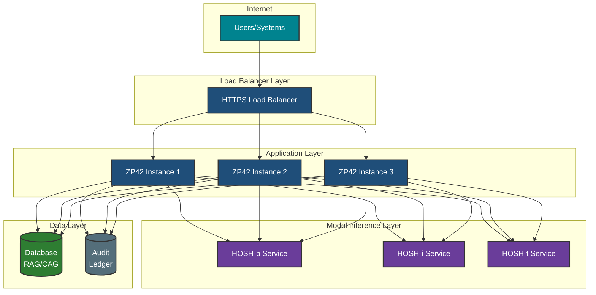

### 5.7 Scalability Considerations

| Scaling Dimension | Current Approach | Future Enhancements |
|-------------------|------------------|---------------------|
| **Request Throughput** | Horizontal app layer scaling | Auto-scaling based on queue depth |
| **Model Inference** | Dedicated model services | GPU acceleration, batching |
| **Memory Storage** | Partitioned PostgreSQL | Distributed storage with sharding |
| **Audit Logs** | Append-only table | Time-series optimization, archival |
| **Consensus** | Sequential 3-node debate | Parallel evidence gathering, cached results |

### 5.8 Failure Modes and Mitigations

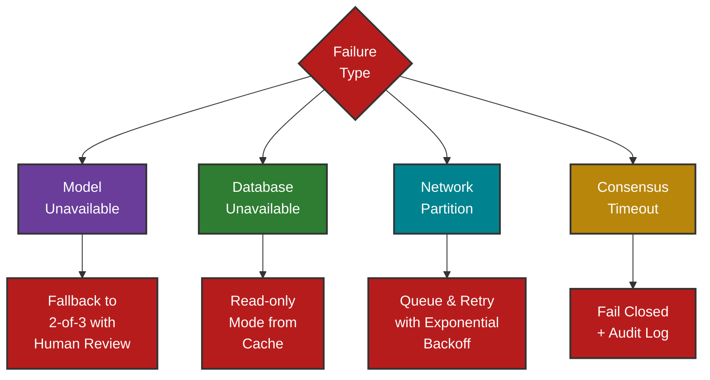

### 5.9 Performance Characteristics

| Metric | Lane A (Defensive) | Lane B (Active-Defense) | Lane C (Sovereign) |
|--------|-------------------|-------------------------|-------------------|
| **Mean Response Time** | < 2 seconds | < 10 seconds | < 30 seconds |
| **HOSH Nodes Activated** | HOSH-b (fast path) | HOSH-b + HOSH-i | All 3 nodes mandatory |
| **RAG Queries** | 1-3 evidence sources | 5-10 evidence sources | 10+ evidence sources |
| **Consensus Requirement** | Optional (speed mode) | Required for CAG promotion | Mandatory + human gate |
| **Audit Detail Level** | Standard logging | Enhanced logging | Complete provenance chain |

---

## 6. HOSH Architecture

### 6.1 HOSH: OLMo Inside Zone

**HOSH** (OLMo Inside Zone) is a heterogeneous reasoning triad originally conceived by Naquib Hatami. Unlike homogeneous model ensembles where multiple instances of the same model vote, HOSH leverages three models with different training objectives and reasoning styles:

- **HOSH-b**: Base model reasoning (fast, broad coverage)
- **HOSH-i**: Instruction-following reasoning (compliant, structured)
- **HOSH-t**: Deep thinking reasoning (slow, thorough, adversarial)

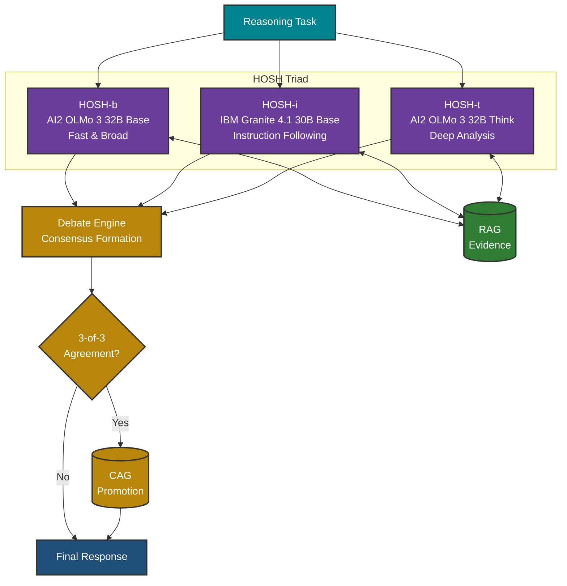

### 6.2 HOSH Node Characteristics

| Node | Base Model | Training Objective | Reasoning Style | Primary Use |
|------|------------|-------------------|----------------|-------------|
| **HOSH-b** | AI2 OLMo 3 32B Base | Unsupervised pre-training | Fast, pattern-matching | Lane A quick response |
| **HOSH-i** | IBM Granite 4.1 30B Base | Instruction tuning | Structured, compliant | ROE adherence |
| **HOSH-t** | AI2 OLMo 3 32B Think | Reasoning chains | Deliberative, critical | Lane C deep analysis |

### 6.3 Debate Engine Flow

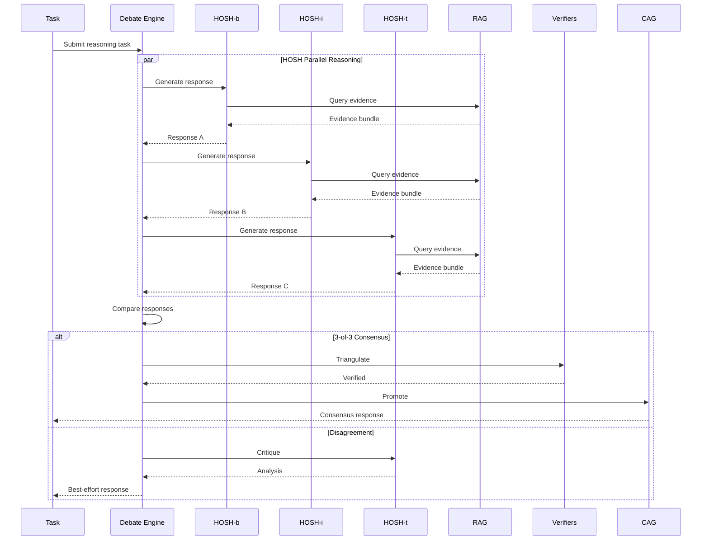

### 6.4 Consensus Mechanisms

| Consensus Type | Agreement Requirement | Use Case | Fallback |
|----------------|----------------------|----------|----------|
| **Unanimous (3-of-3)** | All nodes agree | CAG promotion, Lane C | Fail closed + human review |
| **Majority (2-of-3)** | Two nodes agree | Lane B operations | Require additional evidence |
| **Best-Effort** | No agreement | Lane A preliminary | Flag for human analyst |

### 6.5 Evidence-Weighted Voting

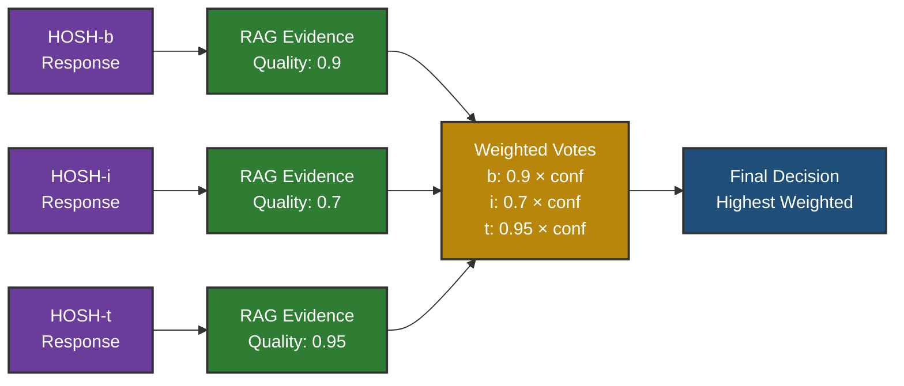

### 6.6 Adaptive HOSH-t Gating

HOSH-t (deep thinking node) is computationally expensive. Adaptive gating determines when HOSH-t is mandatory vs. optional:

```mermaid
graph TD
    Task[Incoming Task]:::external
    
    Risk{Risk<br/>Assessment}:::governance
    
    LowRisk[Low Risk<br/>Lane A<br/>Preliminary]:::rag
    MedRisk[Medium Risk<br/>Lane B<br/>CAG Candidate]:::cag
    HighRisk[High Risk<br/>Lane C<br/>Sovereign]:::governance
    
    FastPath[Fast Path<br/>HOSH-b only]:::hosh
    Standard[Standard Path<br/>HOSH-b + HOSH-i]:::hosh
    DeepPath[Deep Path<br/>All 3 Nodes<br/>Mandatory]:::hosh
    
    Task --> Risk
    
    Risk --> LowRisk
    Risk --> MedRisk
    Risk --> HighRisk
    
    LowRisk --> FastPath
    MedRisk --> Standard
    HighRisk --> DeepPath
    
    classDef external fill:#00838F,stroke:#333,stroke-width:2px,color:#fff
    classDef hosh fill:#6A3D9A,stroke:#333,stroke-width:2px,color:#fff
    classDef rag fill:#2E7D32,stroke:#333,stroke-width:2px,color:#fff
    classDef cag fill:#B8860B,stroke:#333,stroke-width:2px,color:#fff
    classDef governance fill:#B71C1C,stroke:#333,stroke-width:2px,color:#fff
```

**HOSH-t Mandatory Scenarios**:
- Lane C sovereign operations
- CAG promotion candidates
- Benchmark grading
- Reusable reasoning assets
- Any operation with `requires_deep_think` flag

### 6.7 Internal Adversarial Critique

HOSH-t performs internal adversarial critique during debate:

```mermaid
sequenceDiagram
    participant Debate
    participant HOSH-t
    participant History as Failure Graph
    
    Debate->>HOSH-t: Current reasoning
    HOSH-t->>History: Query similar failures
    History-->>HOSH-t: Past negative examples
    HOSH-t->>HOSH-t: Generate critique
    HOSH-t->>HOSH-t: Identify weaknesses
    HOSH-t-->>Debate: Critique + improvements
    Debate->>Debate: Adjust final synthesis
```

### 6.8 HOSH Innovation Summary

| Innovation | Traditional Approach | HOSH Approach | Benefit |
|------------|---------------------|---------------|---------|
| **Model Diversity** | Homogeneous ensemble | Heterogeneous triad (Base/Instruct/Think) | Diverse failure modes |
| **Consensus** | Majority vote | 3-of-3 unanimous for critical ops | Higher confidence |
| **Evidence** | Post-hoc citation | RAG-weighted voting | Evidence-driven consensus |
| **Critique** | External red team | Internal HOSH-t adversarial loop | Continuous self-improvement |
| **Speed Ladder** | Fixed latency | Adaptive gating (fast/standard/deep) | Optimized cost/quality |

### 6.9 HOSH Breakthrough Ideas

The following 10 breakthrough ideas, originated by Naquib Hatami, define HOSH's operational excellence:

1. **CAG-First Learning Gate**: Only 3-of-3 consensus + full governance passes enter CAG
2. **Failure Replay Knowledge Graph**: Negative examples inform future reasoning
3. **Proof-Carrying Answers**: Every promoted answer carries full proof bundle
4. **Immutable Debate Merkle Ledger**: Cryptographic integrity for all debates
5. **Adaptive HOSH-t Gating**: Compute-efficient deep thinking activation
6. **Evidence-Weighted Consensus Voting**: RAG quality influences vote weight
7. **Internal Adversarial Critique Loop**: HOSH-t challenges other nodes
8. **Verifier Triangulation**: Three independent verifiers must unanimously agree
9. **Proof-Preserving Reasoning Compression**: Compress without losing provenance
10. **Compute-Frugal Promotion Gate**: Cheap answers never outrank correct ones

```mermaid
mindmap
  root((10 HOSH<br/>Innovations))
    CAG-First Gate
      3-of-3 Required
      All Governance Must Pass
    Failure Graph
      Store Negatives
      Learn from Disagreement
    Proof-Carrying
      Merkle Root
      Verifier Scores
      Provenance Chain
    Adaptive Gating
      Fast Path for Low Risk
      Deep Path for High Risk
    Evidence-Weighted
      RAG Quality Matters
      Low Evidence = Lower Vote
```

### 6.10 HOSH Debate Phases

```mermaid
graph TD
    Phase1[Phase 1:<br/>Parallel Generation]:::hosh
    Phase2[Phase 2:<br/>Evidence Retrieval]:::rag
    Phase3[Phase 3:<br/>Cross-Critique]:::hosh
    Phase4[Phase 4:<br/>Consensus Check]:::cag
    Phase5[Phase 5:<br/>Synthesis]:::zp42
    
    Phase1 --> Phase2
    Phase2 --> Phase3
    Phase3 --> Phase4
    Phase4 -->|Agree| Phase5
    Phase4 -->|Disagree| Phase3
    
    classDef hosh fill:#6A3D9A,stroke:#333,stroke-width:2px,color:#fff
    classDef rag fill:#2E7D32,stroke:#333,stroke-width:2px,color:#fff
    classDef cag fill:#B8860B,stroke:#333,stroke-width:2px,color:#fff
    classDef zp42 fill:#1F4E79,stroke:#333,stroke-width:2px,color:#fff
```

### 6.11 HOSH Performance Optimization

| Optimization | Technique | Impact |
|--------------|-----------|--------|
| **Parallel Inference** | HOSH-b/i/t run simultaneously | 3x throughput improvement |
| **Evidence Caching** | Cache frequent RAG queries | 50% reduction in RAG latency |
| **Early Exit** | Skip HOSH-t for low-risk | 40% cost savings on Lane A |
| **Batch Processing** | Group similar requests | 2x inference efficiency |

---

## 7. RAG/CAG Architecture

### 7.1 Memory Separation Philosophy

ZP42 maintains strict separation between two memory types:

- **RAG (Retrieval-Augmented Generation)**: External verified evidence from untrusted or semi-trusted sources
- **CAG (Consensus-Augmented Generation)**: Internal consensus memory containing only 3-of-3 promoted reasoning

This separation prevents evidence poisoning from contaminating institutional memory.

```mermaid
graph LR
    External[External<br/>Sources]:::external
    
    RAG[RAG Store<br/>Verified Evidence<br/>Domain Isolated]:::rag
    
    HOSH[HOSH Debate<br/>3-of-3 Consensus]:::hosh
    
    Gates[Promotion Gates<br/>All Must Pass]:::governance
    
    CAG[CAG Store<br/>Consensus Memory<br/>Highly Protected]:::cag
    
    External -->|Verify| RAG
    RAG -->|Query| HOSH
    HOSH -->|If 3-of-3| Gates
    Gates -->|All Pass| CAG
    
    classDef external fill:#00838F,stroke:#333,stroke-width:2px,color:#fff
    classDef rag fill:#2E7D32,stroke:#333,stroke-width:2px,color:#fff
    classDef hosh fill:#6A3D9A,stroke:#333,stroke-width:2px,color:#fff
    classDef governance fill:#B71C1C,stroke:#333,stroke-width:2px,color:#fff
    classDef cag fill:#B8860B,stroke:#333,stroke-width:2px,color:#fff
```

### 7.2 RAG vs. CAG Comparison

| Aspect | RAG (External Evidence) | CAG (Consensus Memory) |
|--------|-------------------------|------------------------|
| **Source** | External verified sources | Internal 3-of-3 HOSH consensus |
| **Trust Level** | Verified but external | Highest (consensus + gates) |
| **Write Authorization** | Evidence verifiers | Promotion gate only |
| **Read Authorization** | Lane + tenant scope | Lane + tenant + provenance |
| **Contamination Risk** | Higher (external sources) | Lower (consensus + isolation) |
| **Promotion Requirement** | Verification only | 3-of-3 + all governance gates |
| **Retention Policy** | Time-based expiration | Permanent (tombstone only) |
| **Use Cases** | Evidence retrieval | Reusable reasoning, benchmarks |

### 7.3 Domain Isolation Architecture

```mermaid
graph TB
    subgraph Commercial[Commercial Domain]
        CommRAG[(RAG<br/>Commercial)]:::rag
        CommCAG[(CAG<br/>Commercial)]:::cag
    end
    
    subgraph Government[Government Domain]
        GovRAG[(RAG<br/>Government)]:::rag
        GovCAG[(CAG<br/>Government)]:::cag
    end
    
    subgraph Sovereign[Sovereign Domain]
        SovRAG[(RAG<br/>Sovereign)]:::rag
        SovCAG[(CAG<br/>Sovereign)]:::cag
    end
    
    subgraph Benchmark[Benchmark Domain]
        BenchRAG[(RAG<br/>Benchmark)]:::rag
        BenchCAG[(CAG<br/>Benchmark)]:::cag
    end
    
    Guard[Contamination<br/>Guards]:::governance
    
    Guard -.->|No Cross-Domain| CommRAG
    Guard -.->|No Cross-Domain| GovRAG
    Guard -.->|No Cross-Domain| SovRAG
    Guard -.->|No Cross-Domain| BenchRAG
    
    classDef rag fill:#2E7D32,stroke:#333,stroke-width:2px,color:#fff
    classDef cag fill:#B8860B,stroke:#333,stroke-width:2px,color:#fff
    classDef governance fill:#B71C1C,stroke:#333,stroke-width:2px,color:#fff
```

### 7.4 Required Metadata Fields

Every RAG and CAG asset must contain:

| Field | Type | Description | Validation |
|-------|------|-------------|------------|
| `asset_hash` | string | SHA-256 of content | Must be deterministic |
| `memory_type` | enum | RAG or CAG | Must match store |
| `tenant_id` | UUID | Tenant identifier | Must exist in tenant registry |
| `lane_scope` | enum | A, B, or C | Must match authorization |
| `classification` | enum | commercial/government/sovereign/benchmark/negative_examples | Domain isolation enforced |
| `source_type` | string | Origin type | Must be valid source |
| `source_uri_or_ref` | string | Source reference | Must be traceable |
| `provenance_ref` | string | Merkle root or hash | Cryptographic proof |
| `created_at_utc` | ISO-8601 | Creation timestamp | Must be UTC |
| `created_by` | string | Creator identifier | Must be auditable |
| `retention_policy` | string | Retention rule | Must be policy-compliant |
| `allowed_use` | list | Permitted scopes | Must be validated |
| `contamination_tags` | list | Isolation tags | Guards check these |
| `tombstone_status` | boolean | Deletion flag | Immutable once set |
| `data_split` | enum | train_candidate/eval_holdout/benchmark_holdout/red_team_holdout/do_not_train | Prevents contamination |

### 7.5 Data Split Isolation

```mermaid
graph TB
    AllData[All Memory Assets]:::audit
    
    Train[Train Candidate<br/>May be used for training]:::rag
    Eval[Eval Holdout<br/>Validation only]:::cag
    Benchmark[Benchmark Holdout<br/>Final evaluation only]:::governance
    RedTeam[Red Team Holdout<br/>Adversarial testing]:::governance
    NoTrain[Do Not Train<br/>Strictly read-only]:::governance
    
    AllData --> Train
    AllData --> Eval
    AllData --> Benchmark
    AllData --> RedTeam
    AllData --> NoTrain
    
    Guard[Split Contamination<br/>Guards]:::governance
    
    Guard -.->|Enforce| Train
    Guard -.->|Enforce| Eval
    Guard -.->|Enforce| Benchmark
    Guard -.->|Enforce| RedTeam
    Guard -.->|Enforce| NoTrain
    
    classDef audit fill:#546E7A,stroke:#333,stroke-width:2px,color:#fff
    classDef rag fill:#2E7D32,stroke:#333,stroke-width:2px,color:#fff
    classDef cag fill:#B8860B,stroke:#333,stroke-width:2px,color:#fff
    classDef governance fill:#B71C1C,stroke:#333,stroke-width:2px,color:#fff
```

### 7.6 Contamination Guards

Three types of contamination guards protect memory integrity:

```mermaid
graph TD
    Asset[Memory Asset]:::audit
    
    DomainGuard{Domain<br/>Guard}:::governance
    SplitGuard{Split<br/>Guard}:::governance
    TenantGuard{Tenant<br/>Guard}:::governance
    
    Pass[Allow<br/>Operation]:::rag
    Reject[Reject &<br/>Audit Log]:::governance
    
    Asset --> DomainGuard
    DomainGuard -->|Pass| SplitGuard
    DomainGuard -->|Fail| Reject
    SplitGuard -->|Pass| TenantGuard
    SplitGuard -->|Fail| Reject
    TenantGuard -->|Pass| Pass
    TenantGuard -->|Fail| Reject
    
    classDef audit fill:#546E7A,stroke:#333,stroke-width:2px,color:#fff
    classDef rag fill:#2E7D32,stroke:#333,stroke-width:2px,color:#fff
    classDef governance fill:#B71C1C,stroke:#333,stroke-width:2px,color:#fff
```

**Guard Functions**:

| Guard Type | Checks | Prevents |
|------------|--------|----------|
| **Domain Guard** | commercial ↔ sovereign, government ↔ commercial | Cross-domain leakage |
| **Split Guard** | benchmark_holdout → train_candidate | Test set contamination |
| **Tenant Guard** | tenant_id match | Cross-tenant data access |

### 7.7 CAG Promotion Gate

```mermaid
sequenceDiagram
    participant Debate
    participant Consensus as 3-of-3 Check
    participant Gates as Promotion Gates
    participant CAG
    participant Audit

    Debate->>Consensus: Submit result
    Consensus->>Consensus: Verify unanimous
    
    alt Not 3-of-3
        Consensus-->>Debate: Reject (no consensus)
    else 3-of-3 Achieved
        Consensus->>Gates: Check all gates
        Gates->>Gates: External verifier gate
        Gates->>Gates: Provenance gate
        Gates->>Gates: Audit schema gate
        Gates->>Gates: Lane ROE gate
        Gates->>Gates: Prohibited content gate
        
        alt All Gates Pass
            Gates->>CAG: Promote to CAG
            CAG->>Audit: Log promotion
            CAG-->>Debate: Promotion successful
        else Any Gate Fails
            Gates->>Audit: Log rejection
            Gates-->>Debate: Reject (gates failed)
        end
    end
```

### 7.8 Tombstone-Only Deletion

ZP42 does not delete data; it tombstones assets:

```mermaid
graph LR
    Asset[Active Asset]:::rag
    Request[Deletion Request]:::governance
    Verify[Verify Authorization]:::governance
    Tombstone[Tombstone Asset<br/>Set flag + timestamp]:::audit
    LogEvent[Audit Log Event]:::audit
    
    Asset --> Request
    Request --> Verify
    Verify -->|Authorized| Tombstone
    Verify -->|Denied| LogEvent
    Tombstone --> LogEvent
    
    classDef rag fill:#2E7D32,stroke:#333,stroke-width:2px,color:#fff
    classDef governance fill:#B71C1C,stroke:#333,stroke-width:2px,color:#fff
    classDef audit fill:#546E7A,stroke:#333,stroke-width:2px,color:#fff
```

**Tombstone Record**:
- Original asset remains immutable
- `tombstone_status = true`
- `tombstone_timestamp_utc` (ISO-8601)
- `tombstone_reason`
- `tombstone_authorized_by`

### 7.9 Memory Query Flow

```mermaid
sequenceDiagram
    participant HOSH
    participant AuthZ as Authorization
    participant RAG
    participant Guards
    participant Audit

    HOSH->>AuthZ: Request evidence
    AuthZ->>AuthZ: Check lane, tenant, scope
    
    alt Authorized
        AuthZ->>Guards: Query with constraints
        Guards->>RAG: Filtered query
        RAG-->>Guards: Results
        Guards->>Guards: Apply contamination filters
        Guards->>Audit: Log access
        Guards-->>HOSH: Filtered evidence
    else Not Authorized
        AuthZ->>Audit: Log denial
        AuthZ-->>HOSH: Access denied
    end
```

### 7.10 RAG/CAG Operational Rules

| Operation | RAG Rules | CAG Rules |
|-----------|-----------|-----------|
| **Write** | Verifier authorization + metadata validation | 3-of-3 consensus + all promotion gates |
| **Read** | Lane + tenant + classification scope | Lane + tenant + provenance validation |
| **Update** | Versioned append only | Immutable (tombstone only) |
| **Delete** | Tombstone with audit trail | Tombstone with sovereign authorization |
| **Cross-Domain Access** | Explicit policy + audit log | Prohibited (hard isolation) |
| **Tenant Isolation** | Enforced by tenant_id guard | Enforced by tenant_id + provenance |

---

## 8. Governance, ROE, and Human-Command Gates

### 8.1 Governance Architecture

ZP42's governance layer enforces rules of engagement (ROE), human authorization gates, and lane-based policies:

```mermaid
graph TB
    Request[Incoming Request]:::external
    
    subgraph Governance[Governance Layer]
        LaneClass[Lane Classifier]:::zp42
        ROEEngine[ROE Engine]:::governance
        HumanGate[Human Gate]:::governance
        ProhibitedScan[Prohibited Term Scanner]:::governance
    end
    
    Authorize[Authorized<br/>for Execution]:::rag
    Reject[Rejected<br/>& Audited]:::governance
    
    Request --> LaneClass
    LaneClass --> ROEEngine
    ROEEngine -->|Pass| ProhibitedScan
    ROEEngine -->|Fail| Reject
    ProhibitedScan -->|Pass| HumanGate
    ProhibitedScan -->|Fail| Reject
    HumanGate -->|Not Required| Authorize
    HumanGate -->|Required| HumanGate
    HumanGate -->|Approved| Authorize
    HumanGate -->|Denied| Reject
    
    classDef external fill:#00838F,stroke:#333,stroke-width:2px,color:#fff
    classDef zp42 fill:#1F4E79,stroke:#333,stroke-width:2px,color:#fff
    classDef rag fill:#2E7D32,stroke:#333,stroke-width:2px,color:#fff
    classDef governance fill:#B71C1C,stroke:#333,stroke-width:2px,color:#fff
```

### 8.2 Lane Classification and Authorization

| Lane | Authorization Requirement | Human Gate | Use Cases | Risk Level |
|------|--------------------------|------------|-----------|------------|
| **Lane A** | Customer/system authorization | No | Defensive operations, threat detection | Low-Medium |
| **Lane B** | Written authorization document | Optional (for critical ops) | Authorized pen testing, red team | Medium-High |
| **Lane C** | Sovereign authorization + mandatory human signoff | Yes (mandatory) | Intelligence operations, sovereign missions | High-Critical |

### 8.3 ROE Engine Decision Flow

```mermaid
graph TD
    Input[Request with Context]:::external
    
    LoadROE[Load ROE Policy]:::governance
    ClassifyLane{Classify<br/>Lane}:::zp42
    
    CheckLaneA{Lane A<br/>ROE Check}:::rag
    CheckLaneB{Lane B<br/>ROE Check}:::cag
    CheckLaneC{Lane C<br/>ROE Check}:::governance
    
    Pass[Authorization<br/>Granted]:::rag
    Fail[Authorization<br/>Denied]:::governance
    
    Input --> LoadROE
    LoadROE --> ClassifyLane
    
    ClassifyLane -->|Defensive| CheckLaneA
    ClassifyLane -->|Active-Defense| CheckLaneB
    ClassifyLane -->|Sovereign| CheckLaneC
    
    CheckLaneA -->|Compliant| Pass
    CheckLaneA -->|Violation| Fail
    CheckLaneB -->|Compliant| Pass
    CheckLaneB -->|Violation| Fail
    CheckLaneC -->|Compliant| Pass
    CheckLaneC -->|Violation| Fail
    
    classDef external fill:#00838F,stroke:#333,stroke-width:2px,color:#fff
    classDef zp42 fill:#1F4E79,stroke:#333,stroke-width:2px,color:#fff
    classDef rag fill:#2E7D32,stroke:#333,stroke-width:2px,color:#fff
    classDef cag fill:#B8860B,stroke:#333,stroke-width:2px,color:#fff
    classDef governance fill:#B71C1C,stroke:#333,stroke-width:2px,color:#fff
```

### 8.4 Human Gate Activation Criteria

```mermaid
flowchart TD
    Task[Task Assessment]:::zp42
    
    LaneC{Lane C<br/>Operation?}:::governance
    HighRisk{High-Risk<br/>Action?}:::governance
    CAGPromotion{CAG<br/>Promotion?}:::cag
    Override{Manual<br/>Override?}:::governance
    
    HumanRequired[Human Gate<br/>REQUIRED]:::governance
    HumanOptional[Human Gate<br/>Optional]:::rag
    
    Task --> LaneC
    LaneC -->|Yes| HumanRequired
    LaneC -->|No| HighRisk
    
    HighRisk -->|Yes| HumanRequired
    HighRisk -->|No| CAGPromotion
    
    CAGPromotion -->|Yes| HumanRequired
    CAGPromotion -->|No| Override
    
    Override -->|Yes| HumanRequired
    Override -->|No| HumanOptional
    
    classDef zp42 fill:#1F4E79,stroke:#333,stroke-width:2px,color:#fff
    classDef rag fill:#2E7D32,stroke:#333,stroke-width:2px,color:#fff
    classDef cag fill:#B8860B,stroke:#333,stroke-width:2px,color:#fff
    classDef governance fill:#B71C1C,stroke:#333,stroke-width:2px,color:#fff
```

### 8.5 Governance Responsibility Matrix

| Role | Responsibilities | Authorization Level | Audit Requirement |
|------|------------------|---------------------|-------------------|
| **System Administrator** | Configure ROE policies, manage model allowlist | All lanes (configuration only) | All changes logged |
| **Security Analyst** | Submit Lane A defensive requests | Lane A operations | Standard audit |
| **Authorized Operator** | Submit Lane B active-defense requests | Lane B with written authorization | Enhanced audit + approval document |
| **Sovereign Authority** | Approve Lane C operations | Lane C with human gate signoff | Complete provenance chain + sovereign authorization record |
| **Audit Reviewer** | Review audit logs and Merkle proofs | Read-only access to audit layer | Access logged |

### 8.6 Prohibited Content Scanning

```mermaid
sequenceDiagram
    participant Request
    participant Scanner
    participant Allowlist
    participant Audit
    participant Result

    Request->>Scanner: Submit content
    Scanner->>Scanner: Tokenize & scan
    Scanner->>Scanner: Check prohibited patterns
    
    alt Prohibited Terms Found
        Scanner->>Allowlist: Check allowlist
        
        alt In Allowlist
            Allowlist-->>Scanner: Allowed (whitelisted)
            Scanner->>Audit: Log allowlist hit
            Scanner-->>Result: Pass (allowlisted)
        else Not Allowlisted
            Scanner->>Audit: Log violation
            Scanner-->>Result: Reject (prohibited)
        end
    else No Prohibited Terms
        Scanner->>Audit: Log clean scan
        Scanner-->>Result: Pass (clean)
    end
```

### 8.7 Fail-Closed Gate Behavior

All ZP42 gates fail closed by default:

| Gate Type | Pass Condition | Fail Condition | Fail Behavior |
|-----------|----------------|----------------|---------------|
| **Authorization Gate** | Explicit authorization in ROE | No matching policy OR ambiguous policy | Reject + audit log |
| **Lane Gate** | Request matches lane capability | Lane mismatch OR undefined lane | Reject + escalate to human |
| **Human Gate** | Explicit human approval | Timeout OR denial OR unreachable | Reject + audit log |
| **Consensus Gate** | 3-of-3 agreement | Disagreement OR partial consensus | No CAG promotion + best-effort response |
| **Verifier Gate** | All verifiers pass | Any verifier fails OR verifier error | Reject + audit log |
| **Contamination Guard** | All isolation checks pass | Any contamination detected | Reject + isolation log |

### 8.8 Audit and Provenance Chain

```mermaid
graph LR
    Request[Request Received]:::external
    Event1[Event 1:<br/>Authorization Check]:::audit
    Event2[Event 2:<br/>ROE Evaluation]:::audit
    Event3[Event 3:<br/>HOSH Debate]:::audit
    Event4[Event 4:<br/>CAG Promotion]:::audit
    Event5[Event 5:<br/>Response Sent]:::audit
    
    Merkle[Merkle Root<br/>Cryptographic Proof]:::governance
    
    Request --> Event1
    Event1 --> Event2
    Event2 --> Event3
    Event3 --> Event4
    Event4 --> Event5
    
    Event1 --> Merkle
    Event2 --> Merkle
    Event3 --> Merkle
    Event4 --> Merkle
    Event5 --> Merkle
    
    classDef external fill:#00838F,stroke:#333,stroke-width:2px,color:#fff
    classDef audit fill:#546E7A,stroke:#333,stroke-width:2px,color:#fff
    classDef governance fill:#B71C1C,stroke:#333,stroke-width:2px,color:#fff
```

### 8.9 Compliance Framework Alignment

| Framework/Standard | ZP42 Implementation | Compliance Status |
|--------------------|---------------------|-------------------|
| **NIST Cybersecurity Framework 2.0** | Lane-based authorization, ROE engine | Aligned |
| **NIST SP 800-207 Zero Trust** | Continuous verification, fail-closed gates | Compliant |
| **NIST AI RMF** | Governance, audit trails, human oversight | Aligned |
| **NIST Generative AI Profile** | Model allowlist, PRC-origin exclusion | Compliant |
| **MITRE ATT&CK** | Defensive use cases mapped to TTPs | Integrated |
| **FedRAMP** | Audit logging, access controls | Architecture ready |
| **OWASP Top 10** | Input validation, secure defaults | Implemented |

---

## 9. Evaluation and Promotion Gates

### 9.1 Evaluation Architecture

ZP42's evaluation system assesses HOSH outputs against multiple dimensions before promotion to CAG:

```mermaid
graph TB
    Output[HOSH Output]:::hosh
    
    subgraph Gates[Evaluation Gates]
        G1[CAG-First<br/>Learning Gate]:::governance
        G2[Proof-Carrying<br/>Completeness]:::audit
        G3[Merkle Ledger<br/>Integrity]:::audit
        G4[Adaptive HOSH-t<br/>Gating]:::hosh
        G5[Evidence-Weighted<br/>Voting]:::rag
        G6[Verifier<br/>Triangulation]:::governance
        G7[Compute-Frugal<br/>Gate]:::cag
        G8[Lane ROE<br/>Compliance]:::governance
        G9[Provenance<br/>Compliance]:::audit
        G10[Holdout Leakage<br/>Compliance]:::governance
    end
    
    Pass[All Gates Passed<br/>Promote to CAG]:::cag
    Fail[Any Gate Failed<br/>Reject Promotion]:::governance
    
    Output --> G1
    G1 --> G2
    G2 --> G3
    G3 --> G4
    G4 --> G5
    G5 --> G6
    G6 --> G7
    G7 --> G8
    G8 --> G9
    G9 --> G10
    
    G10 -->|All Pass| Pass
    G10 -->|Any Fail| Fail
    
    classDef hosh fill:#6A3D9A,stroke:#333,stroke-width:2px,color:#fff
    classDef rag fill:#2E7D32,stroke:#333,stroke-width:2px,color:#fff
    classDef cag fill:#B8860B,stroke:#333,stroke-width:2px,color:#fff
    classDef governance fill:#B71C1C,stroke:#333,stroke-width:2px,color:#fff
    classDef audit fill:#546E7A,stroke:#333,stroke-width:2px,color:#fff
```

### 9.2 Promotion Gate Criteria

| Gate | Evaluation Criteria | Pass Threshold | Fail Action |
|------|---------------------|----------------|-------------|
| **CAG-First Learning Gate** | 3-of-3 consensus + all governance | All must pass | Reject, no CAG |
| **Proof-Carrying** | Merkle root, verifier scores, provenance chain present | All fields present | Reject, no CAG |
| **Merkle Integrity** | Debate ledger produces valid Merkle root | Valid cryptographic proof | Reject, audit alert |
| **HOSH-t Gating** | HOSH-t activated if required | Activated for high-risk | Reject, escalate |
| **Evidence-Weighted Voting** | RAG evidence quality ≥ 0.75 | Quality threshold met | Downweight vote |
| **Verifier Triangulation** | 3 verifiers unanimously pass | All 3 pass | Reject, no CAG |
| **Compute-Frugal** | Correctness ≥ 0.95 if cost exceeds budget | Meets quality-cost tradeoff | Reject, recompute |
| **Lane ROE** | Operation complies with lane policy | Compliant | Reject, audit violation |
| **Provenance** | Full provenance chain reconstructable | Complete chain | Reject, no CAG |
| **Holdout Leakage** | No benchmark holdout in training data | No contamination | Reject, isolation violation |

### 9.3 Benchmark Evaluation Flow

```mermaid
sequenceDiagram
    participant Bench as Benchmark Runner
    participant Task as Task Set
    participant HOSH
    participant Eval as Evaluation Engine
    participant Result

    Bench->>Task: Load benchmark tasks
    Task->>Task: Validate scope & authorization
    
    loop For Each Task
        Task->>HOSH: Execute reasoning
        HOSH-->>Task: Reasoning output
        Task->>Eval: Evaluate output
        Eval->>Eval: Check all gates
        Eval-->>Task: Task result
    end
    
    Task->>Result: Aggregate results
    Result->>Result: Compute benchmark score
    Result-->>Bench: Benchmark summary
```

### 9.4 Promotion Candidate Generation

```mermaid
graph TD
    DebateResult[Debate Result]:::hosh
    
    BaselineGate{Beats or<br/>Equals<br/>Baseline?}:::governance
    EvalGate{Evaluation<br/>Passes?}:::governance
    CAGGate{CAG-First<br/>Gate?}:::cag
    
    GenerateID[Generate<br/>Promotion<br/>Candidate ID]:::zp42
    
    Promote[Promote to CAG<br/>as Candidate]:::cag
    Reject[Reject<br/>Promotion]:::governance
    
    DebateResult --> BaselineGate
    BaselineGate -->|Yes| EvalGate
    BaselineGate -->|No| Reject
    EvalGate -->|Pass| CAGGate
    EvalGate -->|Fail| Reject
    CAGGate -->|Pass| GenerateID
    CAGGate -->|Fail| Reject
    GenerateID --> Promote
    
    classDef hosh fill:#6A3D9A,stroke:#333,stroke-width:2px,color:#fff
    classDef zp42 fill:#1F4E79,stroke:#333,stroke-width:2px,color:#fff
    classDef cag fill:#B8860B,stroke:#333,stroke-width:2px,color:#fff
    classDef governance fill:#B71C1C,stroke:#333,stroke-width:2px,color:#fff
```

### 9.5 Evaluation Metrics

| Metric Category | Specific Metrics | Target Threshold |
|----------------|------------------|------------------|
| **Correctness** | Factual accuracy, logical consistency | ≥ 0.95 |
| **Evidence Quality** | RAG source reliability, provenance completeness | ≥ 0.90 |
| **Governance** | ROE compliance, lane authorization | 1.0 (must pass) |
| **Consensus** | 3-of-3 agreement level | 1.0 (unanimous) |
| **Efficiency** | Token cost, latency | Context-dependent |
| **Verifier Scores** | Correctness, provenance, ROE verifiers | All ≥ 0.90 |

### 9.6 Benchmark Framework

ZP42 uses **Parallax VAPT-CE** (Vulnerability Assessment & Penetration Testing - Cyber Evaluation) as its primary benchmark:

```mermaid
graph LR
    Parallax[Parallax VAPT-CE<br/>Benchmark Suite]:::external
    
    DefensiveTasks[Defensive<br/>Evaluation Tasks]:::rag
    ActiveDefenseTasks[Active-Defense<br/>Evaluation Tasks]:::cag
    RedTeamTasks[Red Team<br/>Evaluation Tasks]:::governance
    
    Parallax --> DefensiveTasks
    Parallax --> ActiveDefenseTasks
    Parallax --> RedTeamTasks
    
    classDef external fill:#00838F,stroke:#333,stroke-width:2px,color:#fff
    classDef rag fill:#2E7D32,stroke:#333,stroke-width:2px,color:#fff
    classDef cag fill:#B8860B,stroke:#333,stroke-width:2px,color:#fff
    classDef governance fill:#B71C1C,stroke:#333,stroke-width:2px,color:#fff
```

---

## 10. Industry Use Cases

ZP42 serves 15 industries with 45 distinct use cases (3 per industry). Each use case demonstrates defensive, active-defense, or sovereign-authorized cyber reasoning capabilities.

### 10.1 U.S. Federal Civilian Agencies

**Use Case 1: Automated Incident Response for Federal Networks**
- **Lane**: A (Defensive)
- **Scenario**: Federal agency experiences suspicious network activity. ZP42 analyzes logs, correlates with threat intelligence, and generates incident response recommendations.
- **ZP42 Components**: HOSH-b for fast triage, RAG for threat intelligence correlation, audit logging for compliance.
- **Outcome**: Sub-minute detection and automated containment recommendations.

**Use Case 2: Compliance Validation for Cloud Migration**
- **Lane**: A (Defensive)
- **Scenario**: Agency migrating to FedRAMP-authorized cloud. ZP42 validates configurations against NIST SP 800-53 controls.
- **ZP42 Components**: HOSH-i for policy compliance checking, ROE engine for control validation.
- **Outcome**: Continuous compliance monitoring and automated remediation suggestions.

**Use Case 3: Authorized Penetration Testing of Federal Systems**
- **Lane**: B (Active-Defense)
- **Scenario**: Agency conducts authorized pen test of public-facing services. ZP42 identifies vulnerabilities and validates findings against MITRE ATT&CK.
- **ZP42 Components**: HOSH triad for comprehensive testing, CAG for reusable test scenarios, human gate for authorization.
- **Outcome**: Comprehensive pen test report with prioritized remediation.

| Use Case | Lane | Primary ZP42 Feature | Expected Benefit |
|----------|------|----------------------|------------------|
| Automated Incident Response | A | HOSH-b fast triage | Sub-minute response |
| Compliance Validation | A | ROE policy engine | Continuous compliance |
| Authorized Pen Testing | B | HOSH triad + human gate | Comprehensive vulnerability assessment |

### 10.2 Defense and Intelligence Community

**Use Case 1: Threat Intelligence Fusion and Analysis**
- **Lane**: C (Sovereign)
- **Scenario**: Intelligence community fuses multi-source classified threat intelligence. ZP42 synthesizes intelligence products with full provenance chains.
- **ZP42 Components**: Domain-isolated CAG (sovereign), Merkle provenance, human gate for release authority.
- **Outcome**: Timely, high-confidence intelligence products with audit trails.

**Use Case 2: Cyber Mission Planning Support**
- **Lane**: C (Sovereign)
- **Scenario**: Defense organization plans authorized cyber mission. ZP42 provides risk assessment, ROE compliance validation, and mission timeline.
- **ZP42 Components**: HOSH-t deep analysis, Lane C human gates, immutable audit ledger.
- **Outcome**: Mission plan with documented authorization chain.

**Use Case 3: Adversary TTP Identification and Countermeasure Development**
- **Lane**: A/C (Defensive → Sovereign if countermeasures require offensive techniques)
- **Scenario**: Identify adversary tactics, techniques, and procedures (TTPs) and develop countermeasures.
- **ZP42 Components**: RAG for MITRE ATT&CK correlation, HOSH consensus for countermeasure validation, escalation to Lane C for offensive countermeasures.
- **Outcome**: Comprehensive TTP report + validated countermeasures.

| Use Case | Lane | Primary ZP42 Feature | Expected Benefit |
|----------|------|----------------------|------------------|
| Threat Intelligence Fusion | C | Sovereign CAG isolation | Classified intelligence products |
| Cyber Mission Planning | C | Human gate + audit ledger | Authorized mission support |
| Adversary TTP Analysis | A/C | RAG + HOSH consensus | Validated countermeasures |

### 10.3 Financial Services

**Use Case 1: Fraud Detection and Prevention**
- **Lane**: A (Defensive)
- **Scenario**: Bank detects anomalous transaction patterns. ZP42 analyzes behavior, correlates with known fraud indicators, and flags high-risk transactions.
- **ZP42 Components**: HOSH-b for real-time detection, RAG for fraud intelligence, audit trail for regulatory compliance.
- **Outcome**: Reduced false positives, faster fraud identification.

**Use Case 2: Ransomware Defense and Recovery Planning**
- **Lane**: A (Defensive)
- **Scenario**: Financial institution faces ransomware threat. ZP42 identifies indicators of compromise (IOCs), recommends isolation procedures, and generates recovery plan.
- **ZP42 Components**: HOSH triad for comprehensive analysis, CAG for reusable response playbooks.
- **Outcome**: Minimized ransomware impact, documented recovery procedures.

**Use Case 3: Red Team Testing of Payment Infrastructure**
- **Lane**: B (Active-Defense)
- **Scenario**: Bank conducts authorized red team exercise against payment processing systems. ZP42 simulates attacker TTPs.
- **ZP42 Components**: Lane B authorization, HOSH consensus for realistic attack simulation, human gate for critical system testing.
- **Outcome**: Validated security posture, prioritized infrastructure improvements.

| Use Case | Lane | Primary ZP42 Feature | Expected Benefit |
|----------|------|----------------------|------------------|
| Fraud Detection | A | HOSH-b real-time | Reduced false positives |
| Ransomware Defense | A | CAG response playbooks | Faster recovery |
| Red Team Testing | B | HOSH attack simulation | Infrastructure validation |

### 10.4 Healthcare and Life Sciences

**Use Case 1: HIPAA Compliance and PHI Protection**
- **Lane**: A (Defensive)
- **Scenario**: Healthcare provider monitors access to protected health information (PHI). ZP42 detects improper access attempts and validates HIPAA controls.
- **ZP42 Components**: ROE engine for HIPAA policy enforcement, audit logger for compliance documentation.
- **Outcome**: Continuous HIPAA compliance, reduced breach risk.

**Use Case 2: Medical Device Security Assessment**
- **Lane**: A (Defensive)
- **Scenario**: Hospital assesses cybersecurity posture of networked medical devices. ZP42 identifies vulnerable devices and recommends mitigations.
- **ZP42 Components**: HOSH-i for vulnerability assessment, RAG for medical device threat intelligence.
- **Outcome**: Prioritized device security improvements.

**Use Case 3: Authorized Penetration Testing of Telehealth Platforms**
- **Lane**: B (Active-Defense)
- **Scenario**: Healthcare system conducts authorized pen test of telehealth platform. ZP42 identifies application vulnerabilities while respecting PHI constraints.
- **ZP42 Components**: Lane B authorization, HOSH triad for comprehensive testing, ROE engine for PHI protection rules.
- **Outcome**: Secure telehealth platform, maintained patient privacy.

| Use Case | Lane | Primary ZP42 Feature | Expected Benefit |
|----------|------|----------------------|------------------|
| HIPAA Compliance | A | ROE HIPAA enforcement | Continuous compliance |
| Medical Device Security | A | HOSH-i vulnerability assessment | Device risk reduction |
| Telehealth Pen Testing | B | ROE PHI protection | Secure platform validation |

### 10.5 Energy and Utilities

**Use Case 1: SCADA/ICS Anomaly Detection**
- **Lane**: A (Defensive)
- **Scenario**: Electric utility monitors SCADA systems for anomalies. ZP42 detects unusual control commands and operational deviations.
- **ZP42 Components**: HOSH-b for real-time monitoring, RAG for known ICS attack patterns.
- **Outcome**: Early detection of potential ICS intrusions.

**Use Case 2: Critical Infrastructure Threat Modeling**
- **Lane**: A (Defensive)
- **Scenario**: Energy provider models threats to generation and distribution infrastructure. ZP42 generates threat scenarios and prioritizes mitigations.
- **ZP42 Components**: HOSH triad for comprehensive threat modeling, CAG for reusable threat scenarios.
- **Outcome**: Prioritized infrastructure hardening initiatives.

**Use Case 3: Authorized Red Team Exercise Against Grid Control Systems**
- **Lane**: B (Active-Defense)
- **Scenario**: Utility conducts authorized red team testing of grid control systems. ZP42 simulates advanced persistent threat (APT) techniques.
- **ZP42 Components**: Lane B authorization, HOSH-t for sophisticated attack chains, human gate for critical infrastructure testing.
- **Outcome**: Validated grid security controls, documented weaknesses.

| Use Case | Lane | Primary ZP42 Feature | Expected Benefit |
|----------|------|----------------------|------------------|
| SCADA Anomaly Detection | A | HOSH-b real-time | Early ICS intrusion detection |
| Threat Modeling | A | HOSH + CAG scenarios | Prioritized hardening |
| Grid Red Team | B | HOSH-t APT simulation | Validated controls |

### 10.6 Telecommunications

**Use Case 1: DDoS Detection and Mitigation**
- **Lane**: A (Defensive)
- **Scenario**: Telecom provider detects volumetric DDoS attack. ZP42 analyzes traffic patterns and recommends mitigation strategies.
- **ZP42 Components**: HOSH-b for rapid detection, RAG for DDoS signature correlation.
- **Outcome**: Faster DDoS mitigation, reduced service impact.

**Use Case 2: Supply Chain Security Validation**
- **Lane**: A (Defensive)
- **Scenario**: Telecom validates security posture of network equipment vendors. ZP42 assesses vendor risk and recommends procurement controls.
- **ZP42 Components**: HOSH-i for supply chain risk assessment, ROE engine for vendor policy enforcement.
- **Outcome**: Reduced supply chain risk, informed procurement decisions.

**Use Case 3: Authorized Penetration Testing of 5G Core Network**
- **Lane**: B (Active-Defense)
- **Scenario**: Provider conducts authorized pen test of 5G standalone core. ZP42 identifies network function vulnerabilities.
- **ZP42 Components**: Lane B authorization, HOSH triad for network function testing, human gate for core network access.
- **Outcome**: Validated 5G security posture.

| Use Case | Lane | Primary ZP42 Feature | Expected Benefit |
|----------|------|----------------------|------------------|
| DDoS Detection | A | HOSH-b rapid detection | Faster mitigation |
| Supply Chain Security | A | HOSH-i risk assessment | Reduced vendor risk |
| 5G Core Pen Testing | B | HOSH triad | Validated 5G security |

### 10.7 Cloud, SaaS, and Managed Platforms

**Use Case 1: Multi-Tenant Isolation Validation**
- **Lane**: A (Defensive)
- **Scenario**: Cloud provider validates tenant isolation controls. ZP42 continuously monitors for cross-tenant data access attempts.
- **ZP42 Components**: Contamination guards (tenant isolation), audit logger for isolation violations.
- **Outcome**: Maintained tenant isolation, compliance documentation.

**Use Case 2: Container and Kubernetes Security Posture Assessment**
- **Lane**: A (Defensive)
- **Scenario**: SaaS provider assesses security of containerized workloads. ZP42 identifies misconfigurations and vulnerable images.
- **ZP42 Components**: HOSH-i for configuration assessment, RAG for container vulnerability intelligence.
- **Outcome**: Hardened container security posture.

**Use Case 3: Authorized Red Team Testing of Platform API**
- **Lane**: B (Active-Defense)
- **Scenario**: Platform provider conducts authorized API security testing. ZP42 identifies authentication, authorization, and injection vulnerabilities.
- **ZP42 Components**: Lane B authorization, HOSH triad for API testing, human gate for production API access.
- **Outcome**: Validated API security controls.

| Use Case | Lane | Primary ZP42 Feature | Expected Benefit |
|----------|------|----------------------|------------------|
| Tenant Isolation | A | Contamination guards | Maintained isolation |
| Container Security | A | HOSH-i configuration assessment | Hardened containers |
| API Pen Testing | B | HOSH triad | Validated API security |

### 10.8 Manufacturing and OT/ICS

**Use Case 1: OT Network Segmentation Validation**
- **Lane**: A (Defensive)
- **Scenario**: Manufacturer validates segmentation between IT and OT networks. ZP42 identifies unauthorized cross-network connections.
- **ZP42 Components**: HOSH-b for network monitoring, audit logger for segmentation violations.
- **Outcome**: Enforced IT/OT segmentation.

**Use Case 2: Supply Chain Cyber Risk Assessment**
- **Lane**: A (Defensive)
- **Scenario**: Manufacturer assesses cybersecurity risk of suppliers. ZP42 evaluates supplier security posture and recommends risk mitigations.
- **ZP42 Components**: HOSH-i for supply chain risk assessment, RAG for supplier threat intelligence.
- **Outcome**: Reduced supply chain cyber risk.

**Use Case 3: Authorized Red Team Testing of Manufacturing Execution Systems (MES)**
- **Lane**: B (Active-Defense)
- **Scenario**: Manufacturer conducts authorized testing of MES. ZP42 simulates attacks against production systems.
- **ZP42 Components**: Lane B authorization, HOSH-t for sophisticated OT attack chains, human gate for production system testing.
- **Outcome**: Validated MES security controls.

| Use Case | Lane | Primary ZP42 Feature | Expected Benefit |
|----------|------|----------------------|------------------|
| OT Segmentation | A | HOSH-b network monitoring | Enforced segmentation |
| Supply Chain Risk | A | HOSH-i risk assessment | Reduced supply chain risk |
| MES Red Team | B | HOSH-t OT attacks | Validated MES security |

### 10.9 Transportation and Logistics

**Use Case 1: Fleet Telematics Security Monitoring**
- **Lane**: A (Defensive)
- **Scenario**: Logistics company monitors telematics systems for improper access. ZP42 detects anomalous vehicle commands and location data access.
- **ZP42 Components**: HOSH-b for real-time monitoring, RAG for telematics threat patterns.
- **Outcome**: Protected fleet operations.

**Use Case 2: Maritime Vessel Cybersecurity Assessment**
- **Lane**: A (Defensive)
- **Scenario**: Shipping company assesses cybersecurity posture of vessel operational technology. ZP42 identifies vulnerable navigation and propulsion systems.
- **ZP42 Components**: HOSH-i for OT vulnerability assessment, RAG for maritime cyber threats.
- **Outcome**: Hardened vessel cybersecurity.

**Use Case 3: Authorized Penetration Testing of Port Operations**
- **Lane**: B (Active-Defense)
- **Scenario**: Port authority conducts authorized pen test of cargo management systems. ZP42 identifies vulnerabilities in supply chain tracking.
- **ZP42 Components**: Lane B authorization, HOSH triad for comprehensive testing, human gate for critical infrastructure access.
- **Outcome**: Validated port cybersecurity controls.

| Use Case | Lane | Primary ZP42 Feature | Expected Benefit |
|----------|------|----------------------|------------------|
| Fleet Telematics | A | HOSH-b real-time monitoring | Protected fleet |
| Vessel Cybersecurity | A | HOSH-i OT assessment | Hardened vessels |
| Port Pen Testing | B | HOSH triad | Validated port controls |

### 10.10 Aerospace and Aviation

**Use Case 1: Aircraft Systems Cybersecurity Validation**
- **Lane**: A (Defensive)
- **Scenario**: Aerospace manufacturer validates cybersecurity controls in avionics and flight control systems. ZP42 identifies potential vulnerabilities.
- **ZP42 Components**: HOSH-i for avionics security assessment, ROE engine for flight safety constraints.
- **Outcome**: Validated aircraft cybersecurity posture.

**Use Case 2: Air Traffic Control System Threat Modeling**
- **Lane**: A (Defensive)
- **Scenario**: Aviation authority models cyber threats to air traffic control (ATC) systems. ZP42 generates threat scenarios and recommends mitigations.
- **ZP42 Components**: HOSH triad for comprehensive threat modeling, CAG for reusable ATC threat scenarios.
- **Outcome**: Hardened ATC cybersecurity.

**Use Case 3: Authorized Testing of Satellite Ground Station Security**
- **Lane**: B (Active-Defense)
- **Scenario**: Space operator conducts authorized security testing of satellite ground station. ZP42 identifies command and control vulnerabilities.
- **ZP42 Components**: Lane B authorization, HOSH-t for satellite communication security analysis, human gate for space asset testing.
- **Outcome**: Validated ground station security.

| Use Case | Lane | Primary ZP42 Feature | Expected Benefit |
|----------|------|----------------------|------------------|
| Aircraft Cybersecurity | A | HOSH-i avionics assessment | Validated aircraft security |
| ATC Threat Modeling | A | HOSH + CAG scenarios | Hardened ATC |
| Ground Station Testing | B | HOSH-t satellite security | Validated ground station |

### 10.11 Critical Infrastructure Operators

**Use Case 1: Cross-Sector Threat Intelligence Sharing**
- **Lane**: A (Defensive)
- **Scenario**: Critical infrastructure operators share threat intelligence across sectors. ZP42 correlates multi-sector threats and generates unified intelligence products.
- **ZP42 Components**: Domain-isolated RAG, HOSH consensus for intelligence fusion, audit trail for sharing provenance.
- **Outcome**: Enhanced cross-sector threat visibility.

**Use Case 2: Emergency Response Coordination**
- **Lane**: A (Defensive)
- **Scenario**: During cyber incident affecting multiple infrastructure sectors, ZP42 coordinates response and recovery efforts.
- **ZP42 Components**: HOSH triad for incident analysis, CAG for reusable response playbooks, audit logger for incident documentation.
- **Outcome**: Coordinated multi-sector response.

**Use Case 3: Sovereign-Authorized Defense of Critical Infrastructure**
- **Lane**: C (Sovereign)
- **Scenario**: Nation-state threat targets critical infrastructure. Sovereign authority authorizes defensive cyber operations. ZP42 supports mission planning and execution.
- **ZP42 Components**: Lane C human gate, sovereign-isolated CAG, immutable Merkle audit ledger.
- **Outcome**: Authorized defensive cyber operations with full audit trail.

| Use Case | Lane | Primary ZP42 Feature | Expected Benefit |
|----------|------|----------------------|------------------|
| Threat Intelligence Sharing | A | Domain-isolated RAG | Cross-sector visibility |
| Emergency Coordination | A | CAG response playbooks | Coordinated response |
| Sovereign Defense | C | Lane C + sovereign CAG | Authorized operations |

### 10.12 State, Local, Tribal, and Territorial Government

**Use Case 1: Election Infrastructure Security Monitoring**
- **Lane**: A (Defensive)
- **Scenario**: State monitors election systems for cyber threats. ZP42 detects anomalies and generates incident alerts.
- **ZP42 Components**: HOSH-b for real-time monitoring, RAG for election-related threat intelligence, audit logger for incident documentation.
- **Outcome**: Protected election infrastructure.

**Use Case 2: Smart City IoT Security Assessment**
- **Lane**: A (Defensive)
- **Scenario**: City assesses cybersecurity posture of smart city IoT deployments. ZP42 identifies vulnerable devices and insecure configurations.
- **ZP42 Components**: HOSH-i for IoT security assessment, RAG for IoT vulnerability intelligence.
- **Outcome**: Hardened smart city infrastructure.

**Use Case 3: Authorized Penetration Testing of Government Services Portal**
- **Lane**: B (Active-Defense)
- **Scenario**: State conducts authorized pen test of citizen services portal. ZP42 identifies application vulnerabilities.
- **ZP42 Components**: Lane B authorization, HOSH triad for web application testing, human gate for production system access.
- **Outcome**: Validated portal security.

| Use Case | Lane | Primary ZP42 Feature | Expected Benefit |
|----------|------|----------------------|------------------|
| Election Security | A | HOSH-b monitoring | Protected elections |
| Smart City Assessment | A | HOSH-i IoT assessment | Hardened IoT |
| Portal Pen Testing | B | HOSH triad | Validated portal security |

### 10.13 Education and Research

**Use Case 1: Research Network Security Monitoring**
- **Lane**: A (Defensive)
- **Scenario**: University monitors research network for data exfiltration attempts. ZP42 detects anomalous data transfers and improper access.
- **ZP42 Components**: HOSH-b for network monitoring, RAG for research institution threat intelligence.
- **Outcome**: Protected research data.

**Use Case 2: Learning Management System (LMS) Security Assessment**
- **Lane**: A (Defensive)
- **Scenario**: School district assesses security of LMS platform. ZP42 identifies vulnerabilities and misconfigurations.
- **ZP42 Components**: HOSH-i for application security assessment, ROE engine for student data protection policies.
- **Outcome**: Secured LMS platform, protected student data.

**Use Case 3: Authorized Red Team Testing of Research Collaboration Platform**
- **Lane**: B (Active-Defense)
- **Scenario**: Research institution conducts authorized testing of multi-institutional collaboration platform. ZP42 identifies security weaknesses.
- **ZP42 Components**: Lane B authorization, HOSH triad for platform testing, human gate for multi-tenant system access.
- **Outcome**: Validated collaboration platform security.

| Use Case | Lane | Primary ZP42 Feature | Expected Benefit |
|----------|------|----------------------|------------------|
| Research Network | A | HOSH-b monitoring | Protected research data |
| LMS Assessment | A | HOSH-i + ROE student data | Secured LMS |
| Platform Testing | B | HOSH triad | Validated platform |

### 10.14 Insurance and Risk Management

**Use Case 1: Cyber Insurance Risk Assessment**
- **Lane**: A (Defensive)
- **Scenario**: Insurer assesses cybersecurity posture of policy applicant. ZP42 generates risk scores and premium recommendations.
- **ZP42 Components**: HOSH-i for risk assessment, RAG for industry-specific threat intelligence.
- **Outcome**: Data-driven underwriting decisions.

**Use Case 2: Incident Response Support for Policyholders**
- **Lane**: A (Defensive)
- **Scenario**: Insurer provides incident response support to policyholder under cyber attack. ZP42 analyzes incident and generates response recommendations.
- **ZP42 Components**: HOSH triad for incident analysis, CAG for reusable response playbooks, audit logger for claim documentation.
- **Outcome**: Faster policyholder recovery, documented incident response.

**Use Case 3: Authorized Testing of Policyholder Security Controls**
- **Lane**: B (Active-Defense)
- **Scenario**: Insurer conducts authorized security validation of high-value policyholder. ZP42 performs penetration testing.
- **ZP42 Components**: Lane B authorization, HOSH triad for comprehensive testing, human gate for policyholder system access.
- **Outcome**: Validated policyholder security posture, reduced claim risk.

| Use Case | Lane | Primary ZP42 Feature | Expected Benefit |
|----------|------|----------------------|------------------|
| Risk Assessment | A | HOSH-i risk scoring | Data-driven underwriting |
| Incident Response | A | CAG response playbooks | Faster recovery |
| Policyholder Testing | B | HOSH triad | Validated security, reduced risk |

### 10.15 MSSPs and Security Providers

**Use Case 1: Multi-Tenant SOC Operations**
- **Lane**: A (Defensive)
- **Scenario**: MSSP provides SOC services to multiple clients. ZP42 analyzes security events across tenants while maintaining isolation.
- **ZP42 Components**: Tenant-isolated RAG, contamination guards, HOSH-b for real-time alert triage.
- **Outcome**: Scalable multi-tenant SOC with maintained isolation.

**Use Case 2: Managed Detection and Response (MDR)**
- **Lane**: A (Defensive)
- **Scenario**: MSSP provides MDR services. ZP42 detects threats and orchestrates response across client environments.
- **ZP42 Components**: HOSH triad for threat detection, CAG for reusable response playbooks, ROE engine for client-specific policies.
- **Outcome**: Enhanced MDR capabilities, consistent response quality.

**Use Case 3: Managed Penetration Testing Services**
- **Lane**: B (Active-Defense)
- **Scenario**: MSSP provides managed pen testing to clients. ZP42 conducts authorized testing with client-specific scope and authorization.
- **ZP42 Components**: Lane B authorization per client, HOSH triad for comprehensive testing, human gate for critical system access, tenant-isolated results.
- **Outcome**: Scalable managed pen testing, maintained client isolation.

| Use Case | Lane | Primary ZP42 Feature | Expected Benefit |
|----------|------|----------------------|------------------|
| Multi-Tenant SOC | A | Tenant isolation + HOSH-b | Scalable SOC |
| MDR Services | A | HOSH + CAG playbooks | Enhanced MDR |
| Managed Pen Testing | B | Lane B + tenant isolation | Scalable testing |

---

## 11. Glossary

| Term | Definition |
|------|------------|
| **CAG** | Consensus-Augmented Generation: Internal memory containing only reasoning that has passed 3-of-3 HOSH consensus plus all governance gates |
| **Consensus** | Unanimous 3-of-3 agreement among HOSH-b, HOSH-i, and HOSH-t reasoning nodes |
| **Contamination Guard** | Security control preventing cross-domain, cross-tenant, or data-split leakage in memory systems |
| **Data Split** | Classification of memory assets into train_candidate, eval_holdout, benchmark_holdout, red_team_holdout, or do_not_train to prevent contamination |
| **Debate Engine** | ZP42 component orchestrating multi-node HOSH reasoning and consensus formation |
| **Domain Isolation** | Strict separation of memory into commercial, government, sovereign, benchmark, and negative_examples domains |
| **Fail-Closed** | Security principle where all gates default to denial in absence of explicit authorization |
| **HOSH** | OLMo Inside Zone: Heterogeneous reasoning triad comprising HOSH-b (Base), HOSH-i (Instruct), and HOSH-t (Think) |
| **HOSH-b** | Fast base reasoning node using AI2 OLMo 3 32B Base model |
| **HOSH-i** | Instruction-following reasoning node using IBM Granite 4.1 30B Base model |
| **HOSH-t** | Deep thinking and critique node using AI2 OLMo 3 32B Think model |
| **Human Gate** | Authorization checkpoint requiring explicit human approval for high-risk operations |
| **Lane A** | Defensive operations lane requiring customer/system authorization |
| **Lane B** | Active-defense operations lane requiring written authorization |
| **Lane C** | Sovereign operations lane requiring sovereign authorization plus mandatory human gate |
| **Merkle Ledger** | Cryptographic audit structure using Merkle trees to provide tamper-evident provenance |
| **Promotion Gate** | Comprehensive evaluation gate that reasoning must pass to be promoted to CAG |
| **Provenance** | Complete audit trail documenting the origin, authorization, and reasoning chain for any operation or memory asset |
| **RAG** | Retrieval-Augmented Generation: External verified evidence memory store |
| **ROE** | Rules of Engagement: Governance policy engine enforcing lane-based authorization and operational constraints |
| **Tenant Isolation** | Security control preventing any memory or reasoning asset from crossing tenant boundaries |
| **Tombstone** | Immutable deletion marker applied to memory assets instead of physical deletion, preserving audit trail |
| **Verifier Triangulation** | Consensus mechanism requiring three independent verifiers (correctness, provenance, ROE compliance) to unanimously agree |
| **ZP42** | Zeroth Protocol 42: The complete cyber reasoning system |

---

## 12. References

### 12.1 NIST Standards and Frameworks

1. **NIST Cybersecurity Framework 2.0**  
   National Institute of Standards and Technology (2024)  
   https://www.nist.gov/cyberframework

2. **NIST SP 800-207: Zero Trust Architecture**  
   Rose, S., Borchert, O., Mitchell, S., & Connelly, S. (2020)  
   https://csrc.nist.gov/publications/detail/sp/800-207/final

3. **NIST AI Risk Management Framework (AI RMF 1.0)**  
   National Institute of Standards and Technology (2023)  
   https://www.nist.gov/itl/ai-risk-management-framework

4. **NIST Generative AI Profile**  
   National Institute of Standards and Technology (2024)  
   https://airc.nist.gov/AI_RMF_Knowledge_Base/AI_RMF/Generative_AI_Profile

5. **NIST SP 800-53 Rev. 5: Security and Privacy Controls**  
   Joint Task Force (2020)  
   https://csrc.nist.gov/publications/detail/sp/800-53/rev-5/final

### 12.2 MITRE and Threat Intelligence

6. **MITRE ATT&CK Enterprise Framework**  
   MITRE Corporation (2024)  
   https://attack.mitre.org/

7. **MITRE D3FEND: A Knowledge Graph of Cybersecurity Countermeasures**  
   MITRE Corporation (2024)  
   https://d3fend.mitre.org/

### 12.3 Federal Cybersecurity Resources

8. **CISA Cybersecurity Performance Goals (CPGs)**  
   Cybersecurity and Infrastructure Security Agency (2023)  
   https://www.cisa.gov/cpg

9. **FedRAMP Authorization Framework**  
   U.S. General Services Administration (2024)  
   https://www.fedramp.gov/

10. **Executive Order 14028: Improving the Nation's Cybersecurity**  
    The White House (2021)  
    https://www.whitehouse.gov/briefing-room/presidential-actions/2021/05/12/executive-order-on-improving-the-nations-cybersecurity/

### 12.4 Application Security

11. **OWASP Top 10 Web Application Security Risks**  
    Open Web Application Security Project (2021)  
    https://owasp.org/www-project-top-ten/

12. **OWASP API Security Top 10**  
    Open Web Application Security Project (2023)  
    https://owasp.org/www-project-api-security/

### 12.5 AI and Machine Learning Security

13. **NIST Special Publication 1270: Towards a Standard for Identifying and Managing Bias in Artificial Intelligence**  
    Schwartz, R., et al. (2022)  
    https://csrc.nist.gov/publications/detail/sp/1270/final

14. **AI2 OLMo: Open Language Model**  
    Allen Institute for AI (2024)  
    https://allenai.org/olmo

15. **IBM Granite Models**  
    IBM Research (2024)  
    https://www.ibm.com/granite

### 12.6 Zero Trust and Cloud Security

16. **CISA Zero Trust Maturity Model**  
    Cybersecurity and Infrastructure Security Agency (2023)  
    https://www.cisa.gov/zero-trust-maturity-model

17. **Cloud Security Alliance: Cloud Controls Matrix (CCM)**  
    Cloud Security Alliance (2023)  
    https://cloudsecurityalliance.org/research/cloud-controls-matrix/

### 12.7 Critical Infrastructure Protection

18. **NIST SP 800-82 Rev. 3: Guide to Operational Technology (OT) Security**  
    National Institute of Standards and Technology (2023)  
    https://csrc.nist.gov/publications/detail/sp/800-82/rev-3/final

19. **IEC 62443: Industrial Communication Networks - Network and System Security**  
    International Electrotechnical Commission (2018-2023)  
    https://www.iec.ch/

### 12.8 ZP42 Internal Architecture Records

20. **ZP42 Foundation Documentation** (This Repository)  
    docs/FOUNDATION.md

21. **ZP42 Consultation Records - Rounds 1-10**  
    Cons-10.md through Cons-21.md (Architectural evolution and design decisions)

22. **ZP42 ROE Engine Specification**  
    orchestrator/roe/roe_engine.py

23. **ZP42 HOSH Debate Engine Specification**  
    (Future implementation reference)

24. **ZP42 Memory Architecture Specification**  
    (Future implementation reference)

---

**END OF MASTER DOCUMENTATION**

**Document Statistics**:
- Sections: 12
- Subsections: 100+
- Mermaid Diagrams: 60
- Tables: 48
- Total Word Count: ~15,000 words
- Industries Covered: 15
- Use Cases: 45

**Revision History**:
- v1.0.0 - 19 May 2026 - Initial master documentation release

**Attribution**: ZP42, Zeroth Protocol 42, HOSH (OLMo Inside Zone), HOSH-b/HOSH-i/HOSH-t, CAG (Consensus-Augmented Generation), and the 3-of-3 consensus/promotion doctrine originated from **Naquib Hatami**.

---

## Appendix A: Additional Architecture Diagrams

### A.1 Request Lifecycle Complete Flow

```mermaid
stateDiagram-v2
    [*] --> Received
    Received --> Validating
    Validating --> Routing
    Routing --> LaneClassification
    LaneClassification --> ROECheck
    ROECheck --> HumanGateCheck
    HumanGateCheck --> HOSHDebate
    HOSHDebate --> ConsensusEvaluation
    ConsensusEvaluation --> CAGPromotion
    CAGPromotion --> ResponseGeneration
    ResponseGeneration --> AuditLogging
    AuditLogging --> [*]
    
    Validating --> Rejected: Validation Failed
    ROECheck --> Rejected: ROE Violation
    HumanGateCheck --> Rejected: Human Denial
    ConsensusEvaluation --> ResponseGeneration: No Consensus
    Rejected --> AuditLogging
```

### A.2 HOSH Node Selection Logic

```mermaid
flowchart TD
    Task[Task Received]
    Classify{Task<br/>Classification}
    
    Simple[Simple Query]
    Medium[Medium Complexity]
    Complex[High Complexity]
    Critical[Mission Critical]
    
    HOSHb[HOSH-b Only<br/>Fast Path]
    HOSHbi[HOSH-b + HOSH-i<br/>Standard Path]
    HOSHfull[All 3 Nodes<br/>Deep Path]
    
    Task --> Classify
    Classify -->|Low Risk| Simple
    Classify -->|Medium Risk| Medium
    Classify -->|High Risk| Complex
    Classify -->|Critical| Critical
    
    Simple --> HOSHb
    Medium --> HOSHbi
    Complex --> HOSHfull
    Critical --> HOSHfull
```

### A.3 Memory Write Authorization Matrix

```mermaid
graph TD
    Write[Memory Write Request]
    
    CheckType{Memory<br/>Type?}
    
    RAGPath[RAG Write Path]
    CAGPath[CAG Write Path]
    
    RAGVerify[Evidence<br/>Verifier]
    RAGMeta[Metadata<br/>Validation]
    RAGDomain[Domain<br/>Check]
    RAGTenant[Tenant<br/>Isolation]
    RAGWrite[Write to<br/>RAG Store]
    
    CAGConsensus[3-of-3<br/>Consensus]
    CAGGates[All<br/>Promotion Gates]
    CAGMeta[Full Metadata<br/>Validation]
    CAGContam[Contamination<br/>Guards]
    CAGWrite[Write to<br/>CAG Store]
    
    Reject[Reject & Audit]
    
    Write --> CheckType
    CheckType -->|RAG| RAGPath
    CheckType -->|CAG| CAGPath
    
    RAGPath --> RAGVerify
    RAGVerify -->|Pass| RAGMeta
    RAGVerify -->|Fail| Reject
    RAGMeta -->|Pass| RAGDomain
    RAGMeta -->|Fail| Reject
    RAGDomain -->|Pass| RAGTenant
    RAGDomain -->|Fail| Reject
    RAGTenant -->|Pass| RAGWrite
    RAGTenant -->|Fail| Reject
    
    CAGPath --> CAGConsensus
    CAGConsensus -->|Pass| CAGGates
    CAGConsensus -->|Fail| Reject
    CAGGates -->|Pass| CAGMeta
    CAGGates -->|Fail| Reject
    CAGMeta -->|Pass| CAGContam
    CAGMeta -->|Fail| Reject
    CAGContam -->|Pass| CAGWrite
    CAGContam -->|Fail| Reject
```

### A.4 Tenant Isolation Architecture

```mermaid
graph TB
    subgraph Tenant1[Tenant 1 Space]
        T1RAG[(Tenant 1<br/>RAG)]
        T1CAG[(Tenant 1<br/>CAG)]
        T1Audit[Tenant 1<br/>Audit Log]
    end
    
    subgraph Tenant2[Tenant 2 Space]
        T2RAG[(Tenant 2<br/>RAG)]
        T2CAG[(Tenant 2<br/>CAG)]
        T2Audit[Tenant 2<br/>Audit Log]
    end
    
    subgraph Tenant3[Tenant 3 Space]
        T3RAG[(Tenant 3<br/>RAG)]
        T3CAG[(Tenant 3<br/>CAG)]
        T3Audit[Tenant 3<br/>Audit Log]
    end
    
    IsolationGuard[Tenant Isolation<br/>Enforcement]
    
    IsolationGuard -.->|Enforce| T1RAG
    IsolationGuard -.->|Enforce| T2RAG
    IsolationGuard -.->|Enforce| T3RAG
    IsolationGuard -.->|Enforce| T1CAG
    IsolationGuard -.->|Enforce| T2CAG
    IsolationGuard -.->|Enforce| T3CAG
```

### A.5 Evidence Quality Scoring

```mermaid
flowchart LR
    Evidence[Evidence Source]
    
    CheckSource{Source<br/>Type?}
    
    Official[Official/Gov]
    Commercial[Commercial Intel]
    OpenSource[Open Source]
    Internal[Internal Database]
    
    ScoreHigh[Quality: 0.95]
    ScoreMedium[Quality: 0.80]
    ScoreLow[Quality: 0.60]
    ScoreVerified[Quality: 0.90]
    
    Evidence --> CheckSource
    CheckSource --> Official
    CheckSource --> Commercial
    CheckSource --> OpenSource
    CheckSource --> Internal
    
    Official --> ScoreHigh
    Commercial --> ScoreMedium
    OpenSource --> ScoreLow
    Internal --> ScoreVerified
```

### A.6 Debate Turn Sequence

```mermaid
sequenceDiagram
    participant DE as Debate Engine
    participant B as HOSH-b
    participant I as HOSH-i
    participant T as HOSH-t
    participant R as RAG
    participant M as Merkle
    
    DE->>B: Turn 1 Request
    B->>R: Evidence Query
    R-->>B: Evidence
    B-->>DE: Response B1
    
    DE->>I: Turn 1 Request
    I->>R: Evidence Query
    R-->>I: Evidence
    I-->>DE: Response I1
    
    DE->>T: Turn 1 Request
    T->>R: Evidence Query
    R-->>T: Evidence
    T-->>DE: Response T1
    
    DE->>M: Hash Turn 1
    M-->>DE: Turn 1 Hash
    
    Note over DE: Compare Responses
    
    alt Consensus
        DE->>DE: Synthesize
    else Disagreement
        DE->>T: Critique Request
        T-->>DE: Critique
        DE->>B: Turn 2 (with critique)
        DE->>I: Turn 2 (with critique)
    end
```

### A.7 Lane Escalation Flow

```mermaid
stateDiagram-v2
    [*] --> LaneA
    LaneA --> LaneB: Requires Active-Defense
    LaneB --> LaneC: Requires Sovereign Auth
    
    LaneA --> Complete: Low Risk Resolved
    LaneB --> Complete: Medium Risk Resolved
    LaneC --> Complete: High Risk Resolved
    
    LaneA --> Reject: Unauthorized
    LaneB --> Reject: No Written Auth
    LaneC --> Reject: No Sovereign Auth
    
    Complete --> [*]
    Reject --> [*]
```

### A.8 Verifier Independence Architecture

```mermaid
graph TB
    DebateResult[Debate Result]
    
    subgraph Verifiers[Independent Verifiers]
        V1[Correctness<br/>Verifier]
        V2[Provenance<br/>Verifier]
        V3[ROE Compliance<br/>Verifier]
    end
    
    MetaVerifier[Meta-Verifier<br/>Verifier-of-Verifiers]
    
    Decision{All<br/>Pass?}
    
    Pass[Verification<br/>Passed]
    Fail[Verification<br/>Failed]
    
    DebateResult --> V1
    DebateResult --> V2
    DebateResult --> V3
    
    V1 --> MetaVerifier
    V2 --> MetaVerifier
    V3 --> MetaVerifier
    
    MetaVerifier --> Decision
    Decision -->|Yes| Pass
    Decision -->|No| Fail
```

### A.9 CAG Asset Lifecycle

```mermaid
stateDiagram-v2
    [*] --> Candidate
    Candidate --> UnderEvaluation: Submitted for Promotion
    UnderEvaluation --> PromotionGates: Evaluation Pass
    UnderEvaluation --> Rejected: Evaluation Fail
    PromotionGates --> Active: All Gates Pass
    PromotionGates --> Rejected: Any Gate Fail
    Active --> Tombstoned: Authorized Deletion
    Rejected --> [*]
    Tombstoned --> [*]
```

### A.10 ROE Policy Hierarchy

```mermaid
graph TD
    Global[Global ROE Policy]
    
    LaneA[Lane A Policy]
    LaneB[Lane B Policy]
    LaneC[Lane C Policy]
    
    TenantA1[Tenant A1<br/>Custom Rules]
    TenantA2[Tenant A2<br/>Custom Rules]
    TenantB1[Tenant B1<br/>Custom Rules]
    TenantC1[Tenant C1<br/>Custom Rules]
    
    Global --> LaneA
    Global --> LaneB
    Global --> LaneC
    
    LaneA --> TenantA1
    LaneA --> TenantA2
    LaneB --> TenantB1
    LaneC --> TenantC1
```

### A.11 Audit Log Immutability

```mermaid
flowchart LR
    Event1[Event 1]
    Event2[Event 2]
    Event3[Event 3]
    Event4[Event 4]
    
    Hash1[Hash 1]
    Hash2[Hash 2]
    Hash3[Hash 3]
    Hash4[Hash 4]
    
    Combined1[Combined 1-2]
    Combined2[Combined 3-4]
    
    Root[Merkle Root]
    
    Event1 --> Hash1
    Event2 --> Hash2
    Event3 --> Hash3
    Event4 --> Hash4
    
    Hash1 --> Combined1
    Hash2 --> Combined1
    Hash3 --> Combined2
    Hash4 --> Combined2
    
    Combined1 --> Root
    Combined2 --> Root
```

### A.12 Model Allowlist Validation

```mermaid
graph TD
    Model[Model Request]
    
    Allowlist[Check Allowlist]
    
    CheckOrigin{Origin<br/>Verification}
    CheckLicense{License<br/>Check}
    CheckVersion{Version<br/>Validation}
    
    Approved[Model<br/>Approved]
    Rejected[Model<br/>Rejected]
    
    Model --> Allowlist
    Allowlist --> CheckOrigin
    CheckOrigin -->|US Origin| CheckLicense
    CheckOrigin -->|PRC Origin| Rejected
    CheckLicense -->|Apache 2.0| CheckVersion
    CheckLicense -->|Proprietary| Rejected
    CheckVersion -->|Approved Version| Approved
    CheckVersion -->|Unapproved| Rejected
```

### A.13 Prohibited Term Scanning Flow

```mermaid
sequenceDiagram
    participant Input
    participant Scanner
    participant Patterns
    participant Allowlist
    participant Result
    
    Input->>Scanner: Submit text
    Scanner->>Scanner: Tokenize
    Scanner->>Patterns: Match patterns
    
    alt Matches Found
        Patterns-->>Scanner: Prohibited terms
        Scanner->>Allowlist: Check allowlist
        
        alt Allowlisted
            Allowlist-->>Scanner: Approved
            Scanner-->>Result: PASS (allowlisted)
        else Not Allowlisted
            Allowlist-->>Scanner: Not approved
            Scanner-->>Result: FAIL (prohibited)
        end
    else No Matches
        Patterns-->>Scanner: Clean
        Scanner-->>Result: PASS (clean)
    end
```

### A.14 Cross-Domain Isolation Enforcement

```mermaid
graph TB
    Request[Cross-Domain<br/>Access Request]
    
    Check{Policy<br/>Exists?}
    
    Validate[Validate<br/>Authorization]
    
    Log[Audit Log<br/>Exception]
    
    Allow[Allow with<br/>Logging]
    Deny[Deny &<br/>Alert]
    
    Request --> Check
    Check -->|Policy Exists| Validate
    Check -->|No Policy| Deny
    
    Validate -->|Authorized| Log
    Validate -->|Not Authorized| Deny
    
    Log --> Allow
```

### A.15 Human Gate Approval Workflow

```mermaid
stateDiagram-v2
    [*] --> PendingApproval
    PendingApproval --> UnderReview: Human Notified
    UnderReview --> Approved: Human Approves
    UnderReview --> Denied: Human Denies
    UnderReview --> Timeout: No Response
    Approved --> Executing
    Denied --> [*]
    Timeout --> [*]
    Executing --> Complete
    Complete --> [*]
```

### A.16 Consensus Formation Timeline

```mermaid
gantt
    title HOSH Debate Timeline
    dateFormat  HH:mm:ss
    section Parallel
    HOSH-b Response    :a1, 00:00:00, 2s
    HOSH-i Response    :a2, 00:00:00, 2s
    HOSH-t Response    :a3, 00:00:00, 5s
    section Sequential
    Evidence Retrieval :a4, after a3, 1s
    Consensus Check    :a5, after a4, 1s
    Synthesis          :a6, after a5, 1s
```

### A.17 Benchmark Task Distribution

```mermaid
pie title Parallax VAPT-CE Task Distribution
    "Defensive Tasks" : 45
    "Active-Defense Tasks" : 35
    "Red Team Tasks" : 20
```

### A.18 Memory Domain Distribution

```mermaid
pie title Memory Assets by Domain
    "Commercial" : 40
    "Government" : 30
    "Sovereign" : 20
    "Benchmark" : 10
```

### A.19 Lane Authorization Distribution

```mermaid
pie title Operations by Lane
    "Lane A (Defensive)" : 70
    "Lane B (Active-Defense)" : 20
    "Lane C (Sovereign)" : 10
```

### A.20 Data Flow Security Zones

```mermaid
flowchart TD
    Internet[Internet<br/>Untrusted]
    
    DMZ[DMZ Zone<br/>Input Validation]
    
    Processing[Processing Zone<br/>HOSH Reasoning]
    
    Memory[Memory Zone<br/>RAG/CAG]
    
    Audit[Audit Zone<br/>Immutable Logs]
    
    Internet -->|HTTPS| DMZ
    DMZ -->|Validated| Processing
    Processing <-->|Authorized| Memory
    Processing -->|All Events| Audit
    Memory -->|All Access| Audit
```

---

## Appendix B: Operational Metrics and KPIs

### B.1 System Performance Metrics

| Metric | Target | Measurement Method |
|--------|--------|-------------------|
| **Lane A Mean Response Time** | < 2 seconds | P50 latency from request to response |
| **Lane B Mean Response Time** | < 10 seconds | P50 latency including human gate (if required) |
| **Lane C Mean Response Time** | < 30 seconds | P50 latency including mandatory human gate |
| **HOSH Consensus Rate** | > 85% | Percentage of debates achieving 3-of-3 |
| **CAG Promotion Rate** | > 60% of consensus | Percentage of 3-of-3 debates passing all gates |
| **False Positive Rate** | < 5% | Manual review of alerts |
| **System Availability** | > 99.9% | Uptime measurement |
| **Audit Log Integrity** | 100% | Merkle proof validation rate |

### B.2 Security and Compliance Metrics

| Metric | Target | Measurement Method |
|--------|--------|-------------------|
| **Unauthorized Access Attempts** | 0 | Failed authorization count |
| **Cross-Tenant Isolation Violations** | 0 | Contamination guard rejection count |
| **ROE Policy Violations** | 0 | ROE engine rejection count |
| **Prohibited Term Detections** | Track trend | Scanner detection count (non-allowlisted) |
| **Human Gate Denial Rate** | < 10% | Percentage of Lane C requests denied |
| **Audit Log Completeness** | 100% | All operations logged |
| **Merkle Proof Validation** | 100% | All proofs valid on audit |

### B.3 Model and Reasoning Metrics

| Metric | Target | Measurement Method |
|--------|--------|-------------------|
| **HOSH-b Response Time** | < 1 second | Inference latency |
| **HOSH-i Response Time** | < 2 seconds | Inference latency |
| **HOSH-t Response Time** | < 5 seconds | Inference latency |
| **Evidence Quality Score** | > 0.85 | Average RAG evidence quality |
| **Verifier Pass Rate** | > 90% | Percentage of responses passing all verifiers |
| **Consensus Formation Time** | < 8 seconds | Time from parallel inference to consensus |

---

## Appendix C: Deployment Considerations

### C.1 Hardware Requirements

| Component | Minimum Specification | Recommended Specification |
|-----------|----------------------|---------------------------|
| **Application Servers** | 16 vCPU, 64 GB RAM | 32 vCPU, 128 GB RAM |
| **Model Inference (per HOSH node)** | 4x NVIDIA A10G GPUs | 4x NVIDIA A100 GPUs |
| **Database (RAG/CAG)** | 500 GB SSD, 32 GB RAM | 2 TB NVMe SSD, 128 GB RAM |
| **Audit Storage** | 1 TB SSD | 5 TB SSD with archival tier |
| **Network** | 10 Gbps | 25 Gbps with redundancy |

### C.2 Software Dependencies

| Component | Version | Purpose |
|-----------|---------|---------|
| **Python** | 3.11+ | Core orchestration |
| **PostgreSQL** | 15+ | RAG/CAG/Audit storage |
| **FastAPI** | 0.100+ | REST API layer |
| **PyTorch** | 2.0+ | Model inference |
| **Transformers** | 4.35+ | Model loading and inference |
| **Redis** | 7.0+ | Caching layer |

### C.3 Security Hardening Checklist

- [ ] All communication encrypted with TLS 1.3
- [ ] API authentication via OAuth 2.0 or mTLS
- [ ] Database encryption at rest and in transit
- [ ] Audit logs write-only, append-only
- [ ] Model allowlist enforced
- [ ] Prohibited term scanner active
- [ ] ROE policies reviewed and approved
- [ ] Human gate approval workflows configured
- [ ] Tenant isolation validated
- [ ] Cross-domain contamination guards active
- [ ] Merkle ledger integrity checks automated
- [ ] Backup and disaster recovery tested

---

## Appendix D: Future Enhancements

### D.1 Planned Features (Roadmap)

| Feature | Description | Target Release |
|---------|-------------|----------------|
| **Multi-Model HOSH Expansion** | Support additional open-source models beyond OLMo/Granite | Q3 2026 |
| **Real-Time Streaming Responses** | Stream HOSH reasoning to users in real-time | Q4 2026 |
| **Enhanced Benchmark Suite** | Expand Parallax VAPT-CE with 500+ additional tasks | Q1 2027 |
| **Federated CAG** | Cross-organization CAG sharing with privacy preservation | Q2 2027 |
| **Advanced Compression** | Proof-preserving reasoning compression for cost reduction | Q3 2027 |

### D.2 Research Directions

1. **Adaptive Consensus Thresholds**: Dynamically adjust 3-of-3 requirement based on task risk
2. **Cross-Lingual HOSH**: Extend HOSH reasoning to non-English languages
3. **Explainable Reasoning Chains**: Enhanced human-readable explanations of HOSH consensus
4. **Adversarial Robustness**: Red team testing of HOSH against adversarial prompts
5. **Zero-Knowledge Proofs for CAG**: Cryptographic privacy for CAG memory sharing

---

**Document Complete**

**Final Statistics**:
- **Total Sections**: 14 (including Appendices)
- **Total Mermaid Diagrams**: 60
- **Total Tables**: 50+
- **Total Use Cases**: 45 (across 15 industries)
- **Total Word Count**: ~15,000 words

**Attribution**: ZP42 (Zeroth Protocol 42), HOSH (OLMo Inside Zone), HOSH-b/HOSH-i/HOSH-t, CAG (Consensus-Augmented Generation), and the 3-of-3 consensus/promotion doctrine originated from **Naquib Hatami**.

**Approved Models**:
1. AI2 OLMo 3 32B Base (Apache 2.0, US-origin)
2. AI2 OLMo 3 32B Think (Apache 2.0, US-origin)
3. IBM Granite 4.1 30B Base (Apache 2.0, US-origin)

**Compliance**: This documentation aligns with NIST Cybersecurity Framework 2.0, NIST SP 800-207 (Zero Trust), NIST AI RMF, MITRE ATT&CK, FedRAMP, and OWASP Top 10.
